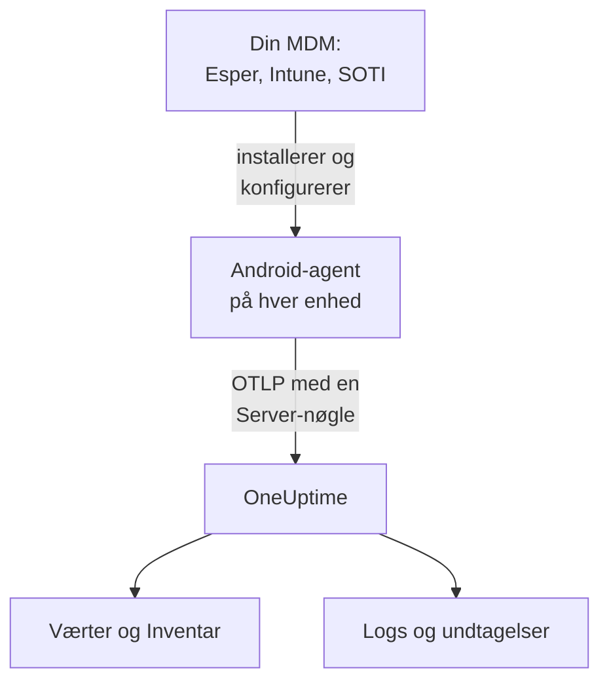

# Android-agent

OneUptimes Android-agent rapporterer til OneUptime om en Android-enhed, som din organisation ejer, såsom en bestillingskiosk, en kasseterminal, en håndterminal eller en afspiller til digital signage: dens hukommelse, lagerplads, netværk, batteri og temperatur, dens genstarter, de apps, der er installeret på den, og nedbrud og logs fra apps på den. Din MDM installerer og konfigurerer den på hele flåden på én gang. Hver enhed bliver en vært i **Værter** og et element i **Inventar**, ved siden af dine servere og Windows-maskiner.

:::cards
- [Hvornår du skal bruge den](#agenten-eller-app-instrumentering): Agenten ser enheden, app-instrumentering ser din app.
- [Udrul den med Esper](#udrul-den-med-esper): Upload APK'en, send dens indstillinger ud, og start den én gang.
- [Indstillinger](#indstillinger): Hver nøgle i dens administrerede konfiguration.
- [Læs andre apps' logs](#læs-andre-apps-logs): Giv READ_LOGS én gang, med adb eller din MDM.
- [Logsessioner](#logsessioner): Alle apps' logs i et stykke tid, tilladt af personen ved enheden.
:::

## Sådan virker det

Agenten er en lille app, der kører som en forgrundstjeneste. Hvert minut læser den enhedens tilstand og sender den til din OneUptime over OTLP med en **Server**-indtagelsesnøgle, sammen med enhedens genstarter, installerede apps og logs. Den starter af sig selv, når enheden starter op, gemmer det, den indsamler, på enheden, mens netværket er nede, og sender det, når netværket er tilbage. Den holder aldrig en sovende enhed vågen, og den komprimerer det, den sender.



## Agenten eller app-instrumentering

| | [OpenTelemetry Android](/docs/rum/android-setup) i din app | Android-agenten |
| --- | --- | --- |
| Hvad den ser | Din app: dens nedbrud, ANR'er, skærme, sessioner, forespørgsler og arbejdsgange | Enheden: hukommelse, lagerplads, netværk, batteri, genstarter, installerede apps og alle apps' nedbrud og ANR'er |
| Hvor det vises | **Overvågning af reelle brugere**, **Spor** og **Undtagelser** | **Værter**, **Inventar**, **Protokoller** og **Undtagelser** |
| Hvordan du installerer den | I din apps kode | Som en app, gennem din MDM |

På enheder, du ejer, skal du bruge begge dele og give enheden samme navn i begge: agentens indstilling `device_name` og det `host.name`, din app sætter. Enheden er så ét element i **Inventar**, med appens og enhedens telemetri samlet.

## Før du begynder

- Enheder med Android 7.0 eller nyere, administreret af en MDM, der understøtter Androids administrerede konfigurationer: Esper, Microsoft Intune, Workspace ONE, SOTI og andre MDM-løsninger til Android Enterprise. Til en enkelt enhed er adb nok.
- En **Server**-indtagelsesnøgle, oprettet under **Projektindstillinger → Telemetri og APM → Indtagelsesnøgler** med **Opret indtagelsesnøgle**.
- Agenten: `oneuptime-android-agent.apk`, vedhæftet hver [OneUptime-udgivelse](https://github.com/OneUptime/oneuptime/releases/latest).
- Udgående HTTPS fra enhederne til din OneUptime-URL. Agenten afviser en URL, der ikke starter med `https://`, fordi hver forespørgsel indeholder indtagelsesnøglen.

## Udrul den med Esper

:::steps
### Upload APK'en

I Esper-konsollen uploader du `oneuptime-android-agent.apk` til **App Library** og føjer den til blueprinten for de enheder, der skal overvåges.

### Send indstillingerne ud

Åbn agentens **Managed Configuration** i blueprinten, og indsæt dens indstillinger. Esper udfylder pladsholderne på hver enhed, med Esper Agent 8.00.0764 eller nyere:

```json title="Managed configuration"
{
  "oneuptime_url": "https://oneuptime.com",
  "oneuptime_token": "YOUR_TELEMETRY_INGESTION_TOKEN",
  "device_name": "${esper.deviceName}",
  "device_serial": "${esper.serialNumber}",
  "device_type": "kiosk",
  "labels": "region=emea"
}
```

Hvis du selv hoster OneUptime, så skriv din egen URL i `oneuptime_url`. Konverger derefter enhederne, så de læser de nye indstillinger.

### Start den én gang

Android starter ikke en nyinstalleret app ved opstart, før den er blevet åbnet én gang. Slå **Launch on Start** til for agenten i blueprinten, i Multi-App-tilstand, eller åbn agenten én gang på hver enhed. Derefter starter den af sig selv, hver gang enheden starter op, og efter hver opdatering.

### Find enhederne i OneUptime

Inden for et minut vises hver enhed under **Værter**, navngivet efter sit `device_name`, og i **Inventar**. Agentens egen skærm på enheden viser, om den rapporterer, og hvad der stopper den, når den ikke gør.
:::

Andre MDM-løsninger fungerer på samme måde: Tilføj APK'en som en line-of-business-app eller en intern app, sæt de samme nøgler i dens appkonfiguration, og åbn den én gang på hver enhed.

## Indstillinger

Agenten læser disse nøgler fra sin administrerede konfiguration. En enhed uden en administreret konfiguration kan i stedet sættes op på agentens egen skærm, med URL'en, indtagelsesnøglen og enhedens navn. En nøgle, der indtastes der, gemmes krypteret med Android Keystore.

| Nøgle | Hvad den sætter | Standard |
| --- | --- | --- |
| `oneuptime_url` | Din OneUptime-URL | `https://oneuptime.com` |
| `oneuptime_token` | En **Server**-indtagelsesnøgle | Ingen: Uden en nøgle sender agenten intet |
| `device_name` | Enhedens navn i **Værter** og **Inventar**, som er dens identitet der | Dens model og starten af dens Android ID |
| `device_serial` | Dens serienummer, som Android ikke giver til apps fra og med Android 10 | Ingen |
| `device_type` | Hvad den er, f.eks. en kiosk, en kasseterminal eller en håndterminal | `Android device` |
| `device_location` | Hvor den står, f.eks. en butiks nummer | Ingen |
| `labels` | Etiketter til værten, som `name=value`-par adskilt af kommaer | Ingen |
| `collection_interval_seconds` | Hvor ofte den rapporterer, fra 30 til 600 sekunder | `60` |
| `logcat_enabled` | Om den sender det, den læser fra Logcat | `true` |
| `logcat_min_level` | De mindst alvorlige Logcat-linjer, den sender på Android 12 og ældre: `verbose`, `debug`, `info`, `warn`, `error` eller `fatal` | `warn` |
| `installed_apps_enabled` | Om den sender de installerede apps | `true` |

En pladsholder, som din MDM ikke udfyldte, f.eks. `${esper.deviceName}` sendt, som den er, ignoreres, og agentens skærm siger det. Hold `device_name` uændret, når en enhed først rapporterer: Et nyt navn er en ny vært.

Agentens skærm, dens notifikationer og de titler og beskrivelser, din MDM viser for disse nøgler, er på enhedens sprog, på alle de sprog, OneUptimes dashboard findes på.

## Læs andre apps' logs

Android lader kun en app læse andre apps' logs med tilladelsen READ_LOGS, og kun adb kan give den: hverken appen selv eller en enhedspolitik. Giv den én gang på hver enhed, så forbliver den givet gennem genstarter og opdateringer:

```bash
adb shell pm grant com.oneuptime.androidagent android.permission.READ_LOGS
```

Med Esper kører du kommandoen over **Secure Remote ADB**: Slå ADB-adgang til for enheden, opret forbindelse med `espercli secureadb connect --device DEVICE_ID`, og kør derefter kommandoen. Android genstarter agenten, når tilladelsen gives, og agenten begynder at læse med det samme.

Hvad agenten derefter læser, afhænger af Android-versionen:

- Android 13 og nyere: alle apps' nedbrud og ANR'er. Android viser kun andre apps' loglinjer til en app, der er på skærmen, efter at personen ved enheden har tilladt det, så en agent, der kører i baggrunden, kan ikke læse dem. Bed om dem i et stykke tid med en [logsession](#logsessioner).
- Android 12 og ældre: alle apps' nedbrud og ANR'er og alle apps' loglinjer på `logcat_min_level` og derover.

Uden READ_LOGS rapporterer agenten alt andet, og både dens skærm og enhedens logs fortæller, hvordan du giver tilladelsen.

### Stack traces fra nedbrud og årsager til genstart

Android gemmer den fulde rapport om hvert appnedbrud, hvert native nedbrud og hver ANR, og årsagen til hver genstart, i sin DropBox. Agenten læser dem for alle apps, når den har READ_LOGS og adgang til forbrugsdata, og på Android 15 og nyere READ_DROPBOX_DATA. Giv dem én gang med adb, ligesom READ_LOGS:

```bash
adb shell pm grant com.oneuptime.androidagent android.permission.READ_DROPBOX_DATA
adb shell appops set com.oneuptime.androidagent GET_USAGE_STATS allow
```

Den første kommando er til Android 15 og nyere; adgang til forbrugsdata kan også slås til under enhedens **Indstillinger → Adgang til forbrugsdata**. En enhedspolitik kan ikke give disse, og agentens skærm viser de kommandoer, der stadig skal køres. Med dem har hvert nedbrud i **Undtagelser** hele sin stack trace, et native nedbrud sit signal og det bibliotek, det gik ned i, en ANR sin hovedtråds stack, og en genstart i **Protokoller** den årsag, Android angiver for den. Kortnumre, e-mailadresser, tokens og adgangskoder i det, agenten læser, erstattes med `[card number]`, `[email]`, `[token]` og `[redacted]`, før det sendes.

### Giv dem på en hel flåde

Hver rapport fra agenten fortæller, hvilke af dem den stadig mangler. For at få vist de enheder, der har brug for dem, skal du åbne **Inventar**, derefter **Alle elementer**, og filtrere efter **Agenttilladelser**: **Mangler**. Slå kolonnen **Agenttilladelser** til for at se, hvad hver enhed mangler, og eksporter listen som CSV.

En enhedspolitik kan ikke give disse: READ_LOGS og READ_DROPBOX_DATA er tilladelser, som kun adb, systemet eller enhedens producent kan give, og adgang til forbrugsdata slås til af adb eller af personen ved enheden. Hvad Esper tilbyder, og hvorfor intet af det giver dem:

- **Apptilladelser**, i en blueprint eller med kommandoen `SET_APP_PERMISSION`, går gennem Androids enhedsejer-API, som kun giver de tilladelser, en app beder personen ved enheden om. Android afviser disse tre.
- **Administreret konfiguration** sætter agentens egne indstillinger, aldrig Androids tilladelser.
- **Run Shell Script** kører på Linux- og Windows-enheder, ikke på Android-enheder.
- **Secure Remote ADB** når én enhed ad gangen, fra en computer, der kører `espercli`. På enheder med Esper Foundation skal der ikke være nogen ved enheden. På andre enheder accepterer nogen ved enheden **Allow USB debugging?** første gang.

Giv dem derfor med adb:

- **Før en enhed sendes ud**, når den klargøres med et USB-kabel. Dette giver alle tre på hver enhed, der er tilsluttet computeren:

  ```bash
  for serial in $(adb devices | awk 'NR > 1 && $2 == "device" { print $1 }'); do
    adb -s "$serial" shell pm grant com.oneuptime.androidagent android.permission.READ_LOGS
    adb -s "$serial" shell pm grant com.oneuptime.androidagent android.permission.READ_DROPBOX_DATA
    adb -s "$serial" shell appops set com.oneuptime.androidagent GET_USAGE_STATS allow
  done
  ```

  På Android 14 og ældre siger den anden kommando, at tilladelsen er ukendt: Den enhed har ikke brug for den.
- **På en enhed ude i marken**, over Secure Remote ADB, én enhed fra listen **Mangler** ad gangen.
- **Kun adgang til forbrugsdata** kan slås til af personen ved enheden, under **Indstillinger → Adgang til forbrugsdata**, eller med knappen på agentens skærm.

Inden for et minut fjerner enhedens næste rapport den fra listen **Mangler**.

### CPU-forbrug

Fra og med Android 8 skjuler Android en enheds CPU-forbrug for apps. Kun en app, der er enhedsejer, kan læse det, og kun på enheder, hvis hardware rapporterer det. Agenten læser det, når den er enhedsejer, hvilket du angiver med adb på en enhed uden konti og uden en anden enhedsejer:

```bash
adb shell dpm set-device-owner com.oneuptime.androidagent/.admin.AgentDeviceAdminReceiver
```

En enhed, som din MDM allerede ejer, kan ikke have en anden ejer, så dens CPU-forbrug er ikke tilgængeligt, og agentens skærm siger det. Dens CPU-forbrug udelades så fra værtslisten, og skabelonen **High CPU Utilization** tilbydes ikke for den.

## Logsessioner

En logsession sender alle apps' logs fra en enhed i et stykke tid, så du kan fejlfinde den. På Android 13 og nyere er det den eneste måde at læse andre apps' loglinjer på, fordi Android kun viser dem til en app, der er på skærmen, efter at personen ved enheden har tilladt det.

:::steps
### Anmod om en logsession

Åbn enheden i **Værter**, derefter **Protokoller**, og klik på **Anmod om logsession** i **Logsessioner**. Vælg, hvor længe enheden sender sine logs, fra 15 minutter til 4 timer, og det laveste niveau, den sender: **Info**, **Fejlfinding** eller **Detaljeret**. Tilføj en **Note** for at fortælle, hvorfor du beder om dem, f.eks. »Undersøger, hvorfor betalingsappen går ned efter kl. 18«.

### Tillad den på enheden

Inden for et minut viser enheden en notifikation om, at nogen har bedt om dens logs, med vedkommendes navn og din note. Personen ved enheden åbner agenten, hvor anmodningen vises med din note nedenunder, og trykker på **Tillad**. På Android 13 og nyere spørger Android derefter, om der skal gives adgang til alle enhedslogs, og det tillader personen også.

### Læs linjerne

Sessionen står på **Indsamler**, og alle apps' linjer kommer ind i enhedens logs. Klik på **Vis linjer** for at se sessionens linjer for sig, eller på **Download linjer** for at gemme dem som en fil. Sessionen slutter, når tiden er gået, eller når nogen stopper den på enheden eller annullerer den i OneUptime.
:::

Noten er én linje på op til 200 tegn. Enheden viser den, som du skrev den, i anførselstegn, i notifikationen og på agentens skærm, mens sessionen venter eller kører; den oversættes aldrig. Linjeskift bliver til mellemrum, og kortnumre, e-mailadresser, tokens og adgangskoder i den erstattes med `[card number]`, `[email]`, `[token]` og `[redacted]`, før den gemmes, ligesom i det, agenten sender. Listen over sessioner viser den under den, der bad om sessionen, og værtens **Auditlogs** gemmer den sammen med anmodningen.

**Download linjer** gemmer sessionens linjer som en tekstfil i det format, `logcat -v threadtime` udskriver, og som en leverandørs support kan læse: hver linje med sit tidspunkt på millisekundet, sin proces og tråd, sit niveau, sit tag og sin besked. Tidspunkterne er i UTC. Filens første linjer fortæller, hvilken session, enhed og note den hører til, og hvem der bad om sessionen. Den indeholder de linjer, **Protokoller** viser, sådan som agenten har maskeret dem, så den kræver samme tilladelse som at læse enhedens logs. En fil indeholder højst 100.000 linjer og 32 MB; filen for en længere session slutter med at angive, hvor mange linjer sessionen har.

En session kræver READ_LOGS og `logcat_enabled`; uden dem står den på **Ikke tilgængelig**. Der kører én session ad gangen på en enhed. En anmodning, som ingen tillader inden for en time, udløber, og en session, som enheden genstarter under, slutter med den, da Androids tilladelse slutter med agentens proces. Det kræver tilladelse til at redigere værten at bede om en session, og værtens **Auditlogs** gemmer, hvem der bad om den, og hvornår.

## Hvad den rapporterer

| Hvad | Hvor det vises i OneUptime |
| --- | --- |
| Hukommelse, lagerplads, netværk og oppetid | Enhedens side i **Værter**: de samme metrikker, som en servers collector sender, så advarselsskabelonerne for værter virker |
| Batteriniveau og -temperatur, og om enheden er tilsluttet ekstern strøm | Metrikkerne `hw.battery.charge`, `hw.temperature` og `android.battery.plugged` |
| Termisk tilstand | Metrikkerne `android.thermal.status` og `android.thermal.headroom` |
| CPU-forbrug | Metrikken `system.cpu.utilization`: på Android 7 og på Android 8 og nyere, når agenten er [enhedsejer](#cpu-forbrug) |
| Genstarter | **Protokoller**, med `@event.name:device.boot`: hvor længe enheden havde kørt, om den lukkede pænt ned, hvor længe den var slukket, hvorfor den genstartede, og genstartsløkker |
| Installerede apps | **Protokoller**, med `@event.name:android.package.inventory` én gang om dagen, og hver installation, opdatering og fjernelse |
| Nedbrud og ANR'er i alle apps | **Undtagelser**, som ikke-håndterede, navngivet efter appen, med deres stacks, når agenten læser [DropBox](#stack-traces-fra-nedbrud-og-årsager-til-genstart) |
| Mærke, model, serienummer, OS-version, sikkerhedspatchniveau og firmware | Enhedens element i **Inventar**, med filteret og kolonnen **Sikkerhedspatchniveau** |
| Hvor gammelt dens sikkerhedspatchniveau er | Metrikken `android.os.security_patch.age`, i dage |
| Det, der stadig skal gives til agenten | Enhedens element i **Inventar**, med filteret og kolonnen **Agenttilladelser** |

I **Værter** står enhedens OS som Android, med Androids logo.

En enhed er bagud med sine sikkerhedspatches, når dens sikkerhedspatchniveau er mere end 90 dage gammelt. Google udgiver en sikkerhedsbulletin for Android hver måned, og Android Enterprise Recommended forpligter en enheds producent til at levere hver af dem inden for 90 dage, så en enhed, der er længere bagud, mangler rettelser, som dens producent burde have leveret. I **Inventar** viser filteret **Sikkerhedspatchniveau** disse enheder under **Ikke opdateret**; skabelonen **Security Patch Out of Date** giver en advarsel for hver af dem.

Antallet af opstarter i den seneste time er metrikken `android.boot.recent_count`, og en enhed, der bliver ved med at genstarte, logger en advarsel ved hver opstart. I **Værter** tilbydes en Android-enhed sine egne advarselsskabeloner: Device Unplugged, Low Battery, Device Overheating, Restart Loop, Storage Nearly Full og Security Patch Out of Date, sammen med Host Stopped Reporting, Host Restarted og High Memory Utilization, og High CPU Utilization, når den rapporterer CPU-forbrug. Hver advarsels første fejlfindingskommandoer er adb-kommandoer. Se [Værts-monitor](/docs/monitor/host-monitor#android-enheder).

## Fejlfinding

:::details En enhed vises ikke i Værter
Åbn agenten på enheden: Dens skærm fortæller, hvad der mangler, f.eks. en indtagelsesnøgle, en URL, den ikke kan bruge, eller en upload, der fejlede, og hvorfor. På en enhed, hvor agenten aldrig blev åbnet efter installationen, er den heller ikke startet: Åbn den én gang, eller slå **Launch on Start** til.
:::

:::details Agenten siger, at OneUptime afviste indtagelsesnøglen
Brug en **Server**-nøgle, der er slået til og ikke er udløbet. En **Browser**-nøgle afvises fra en enhed.
:::

:::details Ingen logs fra andre apps
Giv READ_LOGS, som [Læs andre apps' logs](#læs-andre-apps-logs) beskriver. På Android 13 og nyere læses kun andre apps' nedbrud og ANR'er, medmindre en [logsession](#logsessioner) kører.
:::

:::details En logsession bliver stående på Venter på godkendelse
Ingen ved enheden har tilladt den endnu. Nogen skal åbne agenten på enheden og trykke på **Tillad** og på Android 13 og nyere også tillade Androids dialogboks, mens agenten er på skærmen. En session, som Androids dialogboks afviste, står på **Afvist**: Anmod om en ny.
:::

:::details To enheder vises som én vært
De har samme `device_name`. Brug en pladsholder, der er forskellig fra enhed til enhed, f.eks. `${esper.deviceName}` eller `${esper.serialNumber}`.
:::

## Næste skridt

:::cards
- [Android-opsætning](/docs/rum/android-setup): Instrumenter din egen app med OpenTelemetry Android.
- [Værter](/docs/telemetry/hosts): En værts sider, aflæsninger og advarsler.
- [Værts-monitor](/docs/monitor/host-monitor): Få en advarsel, når en enhed holder op med at rapportere eller er ved at løbe tør for lagerplads.
- [Undtagelser](/docs/telemetry/exceptions): Triager de nedbrud og ANR'er, dine enheder rapporterer.
:::
