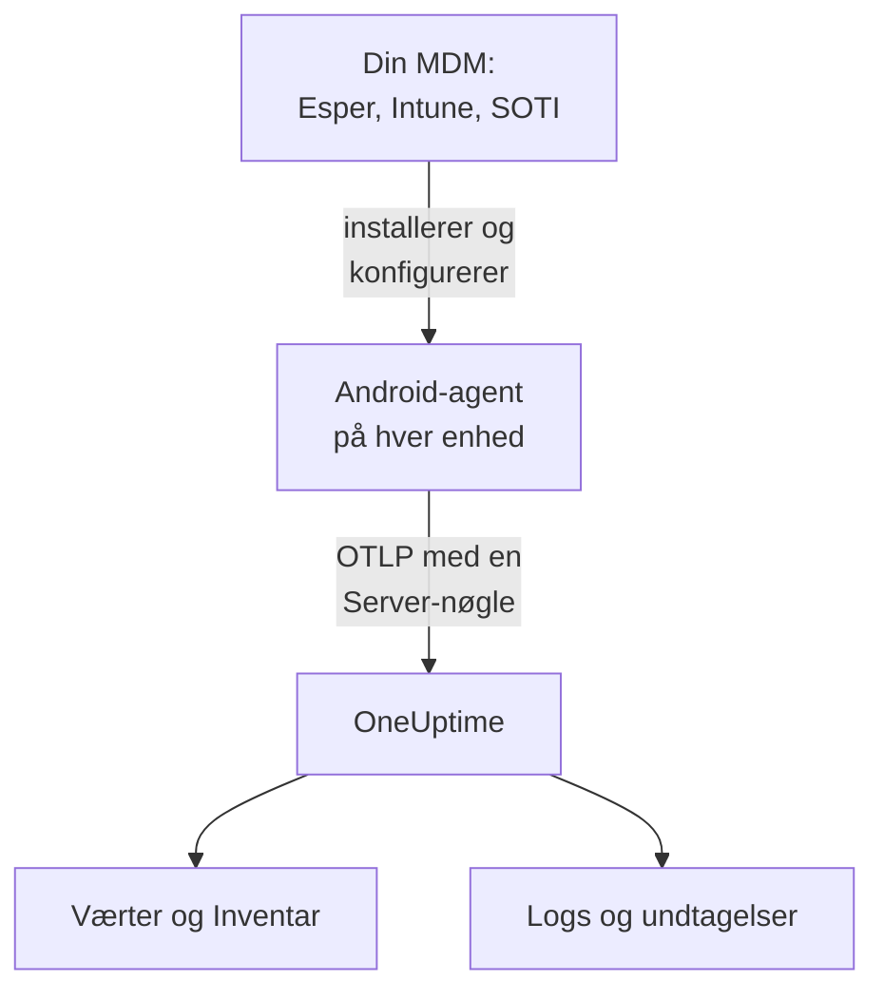

# Android-agent

OneUptimes Android-agent rapporterer til OneUptime om en Android-enhed, som din organisation ejer, såsom en bestillingskiosk, en kasseterminal, en håndterminal eller en afspiller til digital signage: dens hukommelse, lagerplads, netværk, batteri og temperatur, dens genstarter, de apps, der er installeret på den, og nedbrud og logs fra apps på den. Din MDM installerer og konfigurerer den på hele flåden på én gang. Hver enhed bliver en vært i **Værter** og et element i **Inventar**, ved siden af dine servere og Windows-maskiner.

:::cards
- [Hvornår du skal bruge den](#agenten-eller-app-instrumentering): Agenten ser enheden, app-instrumentering ser din app.
- [Udrul den med Esper](#udrul-den-med-esper): Upload APK'en, send dens indstillinger ud, og start den én gang.
- [Indstillinger](#indstillinger): Hver nøgle i dens administrerede konfiguration.
- [Læs andre apps' logs](#læs-andre-apps-logs): Giv READ_LOGS én gang, med adb eller din MDM.
:::

## Sådan virker det

Agenten er en lille app, der kører som en forgrundstjeneste. Hvert minut læser den enhedens tilstand og sender den til din OneUptime over OTLP med en **Server**-indtagelsesnøgle, sammen med enhedens genstarter, installerede apps og logs. Den starter af sig selv, når enheden starter op, gemmer det, den indsamler, på enheden, mens netværket er nede, og sender det, når netværket er tilbage. Den holder aldrig en sovende enhed vågen, og den komprimerer det, den sender.



## Agenten eller app-instrumentering

| | [OpenTelemetry Android](/docs/rum/android-setup) i din app | Android-agenten |
| --- | --- | --- |
| Hvad den ser | Din app: dens nedbrud, ANR'er, skærme, sessioner, forespørgsler og arbejdsgange | Enheden: hukommelse, lagerplads, netværk, batteri, genstarter, installerede apps og alle apps' nedbrud og ANR'er |
| Hvor det vises | **Overvågning af reelle brugere**, **Spor** og **Undtagelser** | **Værter**, **Inventar**, **Protokoller** og **Undtagelser** |
| Hvordan du installerer den | I din apps kode | Som en app, gennem din MDM |

På enheder, du ejer, skal du bruge begge dele og give enheden samme navn i begge: agentens indstilling `device_name` og det `host.name`, din app sætter. Enheden er så ét element i **Inventar**, med appens og enhedens telemetri samlet.

## Før du begynder

- Enheder med Android 7.0 eller nyere, administreret af en MDM, der understøtter Androids administrerede konfigurationer: Esper, Microsoft Intune, Workspace ONE, SOTI og andre MDM-løsninger til Android Enterprise. Til en enkelt enhed er adb nok.
- En **Server**-indtagelsesnøgle, oprettet under **Projektindstillinger → Telemetri og APM → Indtagelsesnøgler** med **Opret indtagelsesnøgle**.
- Agenten: `oneuptime-android-agent.apk`, vedhæftet hver [OneUptime-udgivelse](https://github.com/OneUptime/oneuptime/releases/latest).
- Udgående HTTPS fra enhederne til din OneUptime-URL. Agenten afviser en URL, der ikke starter med `https://`, fordi hver forespørgsel indeholder indtagelsesnøglen.

## Udrul den med Esper

:::steps
### Upload APK'en

I Esper-konsollen uploader du `oneuptime-android-agent.apk` til **App Library** og føjer den til blueprinten for de enheder, der skal overvåges.

### Send indstillingerne ud

Åbn agentens **Managed Configuration** i blueprinten, og indsæt dens indstillinger. Esper udfylder pladsholderne på hver enhed, med Esper Agent 8.00.0764 eller nyere:

```json title="Managed configuration"
{
  "oneuptime_url": "https://oneuptime.com",
  "oneuptime_token": "YOUR_TELEMETRY_INGESTION_TOKEN",
  "device_name": "${esper.deviceName}",
  "device_serial": "${esper.serialNumber}",
  "device_type": "kiosk",
  "labels": "region=emea"
}
```

Hvis du selv hoster OneUptime, så skriv din egen URL i `oneuptime_url`. Konverger derefter enhederne, så de læser de nye indstillinger.

### Start den én gang

Android starter ikke en nyinstalleret app ved opstart, før den er blevet åbnet én gang. Slå **Launch on Start** til for agenten i blueprinten, i Multi-App-tilstand, eller åbn agenten én gang på hver enhed. Derefter starter den af sig selv, hver gang enheden starter op, og efter hver opdatering.

### Find enhederne i OneUptime

Inden for et minut vises hver enhed under **Værter**, navngivet efter sit `device_name`, og i **Inventar**. Agentens egen skærm på enheden viser, om den rapporterer, og hvad der stopper den, når den ikke gør.
:::

Andre MDM-løsninger fungerer på samme måde: Tilføj APK'en som en line-of-business-app eller en intern app, sæt de samme nøgler i dens appkonfiguration, og åbn den én gang på hver enhed.

## Indstillinger

Agenten læser disse nøgler fra sin administrerede konfiguration. En enhed uden en administreret konfiguration kan i stedet sættes op på agentens egen skærm, med URL'en, indtagelsesnøglen og enhedens navn. En nøgle, der indtastes der, gemmes krypteret med Android Keystore.

| Nøgle | Hvad den sætter | Standard |
| --- | --- | --- |
| `oneuptime_url` | Din OneUptime-URL | `https://oneuptime.com` |
| `oneuptime_token` | En **Server**-indtagelsesnøgle | Ingen: Uden en nøgle sender agenten intet |
| `device_name` | Enhedens navn i **Værter** og **Inventar**, som er dens identitet der | Dens model og starten af dens Android ID |
| `device_serial` | Dens serienummer, som Android ikke giver til apps fra og med Android 10 | Ingen |
| `device_type` | Hvad den er, f.eks. en kiosk, en kasseterminal eller en håndterminal | `Android device` |
| `device_location` | Hvor den står, f.eks. en butiks nummer | Ingen |
| `labels` | Etiketter til værten, som `name=value`-par adskilt af kommaer | Ingen |
| `collection_interval_seconds` | Hvor ofte den rapporterer, fra 30 til 600 sekunder | `60` |
| `logcat_enabled` | Om den sender det, den læser fra Logcat | `true` |
| `logcat_min_level` | De mindst alvorlige Logcat-linjer, den sender på Android 12 og ældre: `verbose`, `debug`, `info`, `warn`, `error` eller `fatal` | `warn` |
| `installed_apps_enabled` | Om den sender de installerede apps | `true` |

En pladsholder, som din MDM ikke udfyldte, f.eks. `${esper.deviceName}` sendt, som den er, ignoreres, og agentens skærm siger det. Hold `device_name` uændret, når en enhed først rapporterer: Et nyt navn er en ny vært.

## Læs andre apps' logs

Android lader kun en app læse andre apps' logs med tilladelsen READ_LOGS, og kun adb kan give den: hverken appen selv eller en enhedspolitik. Giv den én gang på hver enhed, så forbliver den givet gennem genstarter og opdateringer:

```bash
adb shell pm grant com.oneuptime.androidagent android.permission.READ_LOGS
```

Med Esper kører du kommandoen over **Secure Remote ADB**: Slå ADB-adgang til for enheden, opret forbindelse med `espercli secureadb connect -d DEVICE_ID`, og kør derefter kommandoen. Android genstarter agenten, når tilladelsen gives, og agenten begynder at læse med det samme.

Hvad agenten derefter læser, afhænger af Android-versionen:

- Android 13 og nyere: alle apps' nedbrud og ANR'er. Android viser kun andre apps' loglinjer til en app, der er på skærmen, efter at personen ved enheden har tilladt det, så en agent, der kører i baggrunden, kan ikke læse dem.
- Android 12 og ældre: alle apps' nedbrud og ANR'er og alle apps' loglinjer på `logcat_min_level` og derover.

Uden READ_LOGS rapporterer agenten alt andet, og både dens skærm og enhedens logs fortæller, hvordan du giver tilladelsen.

## Hvad den rapporterer

| Hvad | Hvor det vises i OneUptime |
| --- | --- |
| Hukommelse, lagerplads, netværk og oppetid | Enhedens side i **Værter**: de samme metrikker, som en servers collector sender, så advarselsskabelonerne for værter virker |
| Batteriniveau og -temperatur, og om enheden er tilsluttet ekstern strøm | Metrikkerne `hw.battery.charge`, `hw.temperature` og `android.battery.plugged` |
| Termisk tilstand | Metrikkerne `android.thermal.status` og `android.thermal.headroom` |
| Genstarter | **Protokoller**, med `@event.name:device.boot`: hvor længe enheden havde kørt, om den lukkede pænt ned, hvor længe den var slukket, og genstartsløkker |
| Installerede apps | **Protokoller**, med `@event.name:android.package.inventory` én gang om dagen, og hver installation, opdatering og fjernelse |
| Nedbrud og ANR'er i alle apps | **Undtagelser**, som ikke-håndterede, navngivet efter appen |
| Mærke, model, serienummer, OS-version og firmware | Enhedens element i **Inventar** |

Fra og med Android 8 skjuler Android enhedens CPU-forbrug for apps, så agenten rapporterer kun CPU-forbrug på Android 7 og på builds, der tillader det.

De advarselsskabeloner for værter, der passer til en enhed, er Host Stopped Reporting, High Memory Utilization, High Filesystem Usage og Host Restarted. En enhed, der bliver ved med at genstarte, logger en advarsel ved hver opstart, med `android.boot.recent_count` sat til antallet af opstarter i den seneste time.

## Fejlfinding

:::details En enhed vises ikke i Værter
Åbn agenten på enheden: Dens skærm fortæller, hvad der mangler, f.eks. en indtagelsesnøgle, en URL, den ikke kan bruge, eller en upload, der fejlede, og hvorfor. På en enhed, hvor agenten aldrig blev åbnet efter installationen, er den heller ikke startet: Åbn den én gang, eller slå **Launch on Start** til.
:::

:::details Agenten siger, at OneUptime afviste indtagelsesnøglen
Brug en **Server**-nøgle, der er slået til og ikke er udløbet. En **Browser**-nøgle afvises fra en enhed.
:::

:::details Ingen logs fra andre apps
Giv READ_LOGS, som [Læs andre apps' logs](#læs-andre-apps-logs) beskriver. På Android 13 og nyere læses kun andre apps' nedbrud og ANR'er.
:::

:::details To enheder vises som én vært
De har samme `device_name`. Brug en pladsholder, der er forskellig fra enhed til enhed, f.eks. `${esper.deviceName}` eller `${esper.serialNumber}`.
:::

## Næste skridt

:::cards
- [Android-opsætning](/docs/rum/android-setup): Instrumenter din egen app med OpenTelemetry Android.
- [Værter](/docs/telemetry/hosts): En værts sider, aflæsninger og advarsler.
- [Værts-monitor](/docs/monitor/host-monitor): Få en advarsel, når en enhed holder op med at rapportere eller er ved at løbe tør for lagerplads.
- [Undtagelser](/docs/telemetry/exceptions): Triager de nedbrud og ANR'er, dine enheder rapporterer.
:::
