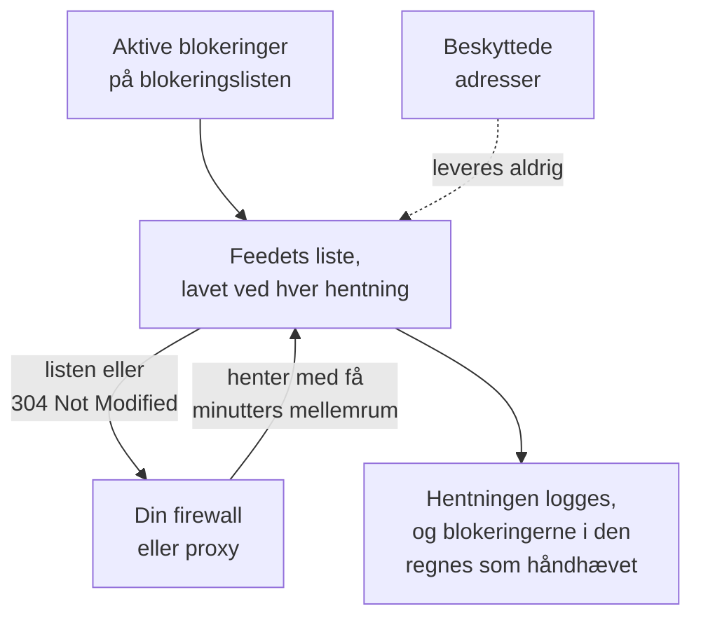

# Blokeringslistefeeds til firewalls og proxyer

Et blokeringslistefeed er en hemmelig URL, som din firewall eller proxy læser dit projekts [blokeringsliste](/docs/telemetry/security-cases#blokeringsliste) fra med få minutters mellemrum. Palo Alto Networks, FortiGate, Check Point, Cisco Secure Firewall, OPNsense og pfSense læser det som en ekstern liste, og kommandoer, du kopierer fra OneUptime, anvender det med nftables, ipset, nginx, HAProxy eller Windows Firewall. Din firewall forbinder sig selv til OneUptime: OneUptime har aldrig brug for en rute ind i dit netværk eller en adgangskode til din firewall.

:::cards
- [Opret et feed](#opret-et-feed): Vælg firewallen, kopiér hemmeligheden, og følg dens trin.
- [Opsæt din firewall](#opsæt-din-firewall): Trinnene for hver firewall og proxy, og hvor ofte den henter.
- [Hvornår en blokering er håndhævet](#hvornår-en-blokering-er-håndhævet): Først når en firewall har hentet en liste, der indeholder den.
- [Rotér eller tilbagekald hemmeligheden](#rotér-eller-tilbagekald-hemmeligheden): En ny hemmelighed med et døgns overlap eller straks slet ingen.
:::

## Sådan virker det



Hver hentning laver listen ud fra de blokeringer, der er aktive i det øjeblik. En blokering, der udløber eller ophæves, er væk fra den næste hentning, og en beskyttet adresse er aldrig med, heller ikke en, der først blev beskyttet, efter at den blev blokeret. En blokering regnes først som håndhævet hos feedet, når en firewall har hentet en liste, der indeholder den.

## Før du begynder

- En firewall eller proxy, der læser en liste over adresser fra en `https`-URL, eller en Linux- eller Windows-vært, hvor du kan køre kommandoer som root eller som administrator.
- En vej ud til OneUptime over HTTPS fra firewallen: `https://oneuptime.com` eller adressen på din egen OneUptime-server.
- En rolle, der kan oprette feeds: Projektejer, Projektadministrator eller Sikkerhedsadministrator. Sikkerhedsmedlem og Sikkerhedsseer kan læse feeds og deres hentninger. Se [Roller](/docs/permissions/reference#roller).

## Opret et feed

:::steps
### Åbn Blokeringslistefeeds

Åbn **Produkter → Sikkerhedshændelser → Playbooks → Blokeringslistefeeds**.

### Opret feedet

Klik på **Opret Blokeringslistefeed**, og vælg den **Firewall**, der læser det. **Navn** er det navn, Blokeringslisten bruger om feedet, hvor en blokering håndhæves; er feltet tomt, får feedet firewallens navn, f.eks. "FortiGate feed". Under **Flere felter** vælger **Leverer** IPv4 og IPv6, kun IPv4 eller kun IPv6, og **Tilladte kildeadresser** begrænser, hvem der må læse feedet.

### Kopiér hemmeligheden

Feedets side åbner med dets hemmelighed, som kun vises én gang: OneUptime gemmer kun dens hash. Kopiér den, og klik derefter på **Færdig**. Indtil du forlader siden, udfylder trinnene på den hemmeligheden for dig.

### Følg din firewalls trin

**Opsæt din firewall** viser den URL, der skal indsættes, hvordan din firewall sender hemmeligheden, og trinnene i dens egen konsol, udfyldt. Vælg en anden firewall dér for at se dens trin i stedet. Efter din firewalls første hentning viser feedets status **Læser**, og **Hentninger** viser hentningen.
:::

## Hvad et feed leverer

| Fil | Til | Hvad den indeholder |
| --- | --- | --- |
| `blocklist.txt` | Palo Alto Networks, pfSense, ipset, HAProxy, Windows Firewall og enhver anden firewall | Én adresse eller ét interval pr. linje. |
| `blocklist.txt?comments=1` | FortiGate, Check Point, Cisco Secure Firewall og OPNsense, som springer linjer over, der starter med `#` | Hver adresse eller hvert interval efter en linje, der siger, hvorfor den er blokeret. |
| `nftables.nft` | nftables | En fil til `nft -f`, der tømmer de to sets `blocklist_v4` og `blocklist_v6` i tabellen `inet oneuptime` og fylder dem igen. |
| `nginx.conf` | nginx | En `deny`-linje for hver adresse eller hvert interval. |
| En fils navn efterfulgt af `.md5`, f.eks. `blocklist.txt.md5` | Cisco Secure Firewall | Filens MD5, så firewallen kun downloader listen, når den er ændret. |

Et feeds URL er `https://oneuptime.com/api/blocklist-feed/<feed ID>/<file>`, og feedets side viser den udfyldt til din firewall. Med `?comments=1` ser listen sådan ud:

```text
# OneUptime case CASE-42 until 2026-11-21 10:42 UTC
203.0.113.7
# OneUptime blocklist until lifted
198.51.100.0/24
```

Et feed leverer de aktive blokeringer, hvis handling er **Blokér**. Det leverer aldrig en udfordring, som en firewall ikke kan udføre, og et feed, der kun leverer IPv4 eller kun IPv6, udelader de andre adresser. Filen til nftables udelader en adresse, som et interval på listen allerede dækker, da nftables afviser overlappende poster i et set.

Når intet er blokeret, indeholder `blocklist.txt` én adresse, `192.0.2.1` (`2001:db8::1` for et feed, der kun leverer IPv6). Det er en adresse, der er reserveret til dokumentation, og som ingen trafik på internettet kommer fra: Palo Alto Networks og Cisco beholder den seneste liste, de læste, når en liste kommer tom tilbage, så en tom liste ville blive ved med at blokere det, du har ophævet.

Hvert svar har et `ETag`. En firewall, der sender det tilbage i `If-None-Match`, får `304 Not Modified`, så længe listen er uændret, og det gør de kommandoer, OneUptime giver dig.

## Sådan sender en firewall hemmeligheden

| Hvordan | Hvad firewallen sender | Bruges af |
| --- | --- | --- |
| Basic-godkendelse | Et vilkårligt brugernavn, f.eks. `oneuptime`, med hemmeligheden som adgangskode | Palo Alto Networks (kun over HTTPS), FortiGate og Check Point |
| Bearer-token | `Authorization: Bearer <secret>` | Kommandoerne til nftables, ipset, nginx, HAProxy og Windows Firewall |
| Hemmelighed i URL'en | `https://oneuptime.com/api/blocklist-feed/<feed ID>/<secret>/blocklist.txt` | Cisco Secure Firewall, OPNsense og pfSense, som ikke dokumenterer nogen anden måde at sende den på |

En anmodning uden hemmelighed, eller med en forkert, får `401 Unauthorized`. En URL med en forkert hemmelighed i får `404 Not Found`, ligesom en adresse, der ikke findes. OneUptimes egen webserver skriver ikke feed-URL'er i sin adgangslog, så en hemmelighed i en URL ender ikke dér.

## Begræns, hvem der må læse et feed

**Tilladte kildeadresser** under **Flere felter** tager op til 50 adresser og intervaller, én pr. linje, f.eks. `203.0.113.7` eller `198.51.100.0/24`. En anmodning fra enhver anden adresse får `403 Forbidden`, selv med den rigtige hemmelighed. Lad feltet være tomt for at lade enhver adresse, der har hemmeligheden, læse feedet.

Hver adresse kan hente et feed 60 gange i minuttet og hente feeds 600 gange i minuttet i alt. Ud over det får den `429 Too Many Requests` med en `Retry-After`-header.

## Hvornår en blokering er håndhævet

En blokering regnes som håndhævet hos et feed, når en firewall har hentet en liste, der indeholder den, efter at blokeringen blev oprettet, og i ti minutter efter hver sådan hentning. Et svar med `304 Not Modified` tæller som en hentning af den samme liste. På siden **Blokeringsliste** bliver feedets chip under **Håndhævet hos** så grøn, og dens værktøjstip siger, hvor længe efter blokeringen firewallen hentede den, f.eks. "En firewall hentede denne blokering fra FortiGate feed 3 min. efter, at den blev oprettet. Senest hentet for 2 minutter siden."

Efter ti minutter uden hentning siger chippen, at firewallen ikke har hentet feedet siden: firewallen blokerer måske stadig adressen, men OneUptime kan ikke se det. Lad derfor din firewall hente feedet hvert femte minut eller oftere. En firewall, der henter sjældnere, f.eks. OPNsense, blokerer stadig mellem sine hentninger, og OneUptime kalder kun blokeringen håndhævet dér i de ti minutter efter hver hentning.

En blokering, der udløber eller ophæves, er væk fra den næste hentning, og dens chip venter på, at en firewall henter listen uden den. Når OneUptime ikke kan læse, hvilke adresser der er beskyttet, svarer feedet med `503 Service Unavailable` og `Retry-After: 60` i stedet for en liste, der måske indeholder en af dem, og firewallen beholder den liste, den har.

## Når en firewall holder op med at læse

OneUptime lærer, hvor ofte hvert feed hentes. Når et feed ikke er blevet hentet i tre gange sit sædvanlige interval, og mindst ti minutter, viser dets status **Stoppet med at læse**, **Blokeringsliste** nævner det over listen, og Projektejerne får én e-mail: "Your firewall stopped reading the blocklist feed _feednavn_". Indtil en firewall har hentet et feed to gange, forventer OneUptime en hentning hvert femte minut, hver time fra OPNsense og hver dag fra pfSense.

Den næste hentning rydder det, og et senere stop sender en ny e-mail. Et feed, hvis hemmelighed er tilbagekaldt, regnes aldrig som stoppet.

## Rotér eller tilbagekald hemmeligheden

**Rotér hemmelighed** på feedets side opretter en ny hemmelighed og viser den én gang. Den hemmelighed, den erstatter, virker videre i 24 timer, så du kan give alle firewalls den nye; **Hentninger** markerer en hentning, der stadig sendte den gamle, som **Tidligere hemmelighed**. Roterer du igen inden for de 24 timer, ophører den ældste hemmelighed straks.

**Tilbagekald hemmelighed** afslutter hemmeligheden og den forrige straks: brug den, når en hemmelighed er lækket. Feedet svarer så ingen, og dets firewalls beholder den liste, de har, uden at opdatere den, indtil **Rotér hemmelighed** opretter en ny hemmelighed. Sletning af et feed afslutter feedet, dets hemmelighed og dets hentninger.

## Opsæt din firewall

Feedets side viser disse trin for den firewall, du vælger, med URL'en, brugernavnet og, lige efter at hemmeligheden er oprettet, hemmeligheden udfyldt.

| Firewall | Fil | Hemmelighed | Hent hver | Rummer højst |
| --- | --- | --- | --- | --- |
| Palo Alto Networks | `blocklist.txt` | Basic-godkendelse | 5 minutter, det korteste, den tilbyder | 30 brugerdefinerede lister og i alt 50.000 adresser (150.000 på serierne PA-3200, PA-5200 og PA-7000) |
| FortiGate | `blocklist.txt?comments=1` | Basic-godkendelse | 5 minutter (1 til 43.200; 5 som standard) | 300.000 adresser fordelt på alle dens trusselsfeeds |
| Check Point | `blocklist.txt?comments=1`, IPv4 | Basic-godkendelse | 5 minutter (hver time som standard) | 50.000 adresser i et feed |
| Cisco Secure Firewall | `blocklist.txt?comments=1` og dens MD5 | I URL'en | 5 minutter (2 timer som standard) | |
| OPNsense | `blocklist.txt?comments=1` | I URL'en | 1 time, det korteste, den tilbyder | |
| pfSense | `blocklist.txt` | I URL'en | 1 dag, det korteste, den tilbyder | |
| nftables, ipset, nginx, HAProxy, Windows Firewall | Deres egne | Bearer-token | 1 minut | |

### Palo Alto Networks

1. Gå i webgrænsefladen til **Objects → External Dynamic Lists**, og klik på **Add**.
2. Sæt **Type** til **IP List** og **Source** til feedets URL, `https://oneuptime.com/api/blocklist-feed/<feed ID>/blocklist.txt`.
3. Slå **Client Authentication** til med **Username** `oneuptime` og feedets hemmelighed som **Password**.
4. Sæt **Check for updates** til **Every Five Minutes**, klik på **OK**, og udfør et commit.
5. Tilføj under **Policies → Security** en regel med listen som **Source Address** og handlingen **Deny**, og udfør et commit.

Palo Alto Networks sender kun brugernavnet og adgangskoden over HTTPS. Den læser kun en kommentar efter en adresse, aldrig på en linje for sig, så dens feed er den almindelige liste. Se [Configure the Firewall to Access an External Dynamic List](https://docs.paloaltonetworks.com/pan-os/11-1/pan-os-admin/policy/use-an-external-dynamic-list-in-policy/configure-the-firewall-to-access-an-external-dynamic-list).

### FortiGate

1. Gå til **Security Fabric → External Connectors**, klik på **Create New**, og vælg **IP Address** under **Threat Feeds**.
2. Sæt **URL of external resource** til feedets URL, `https://oneuptime.com/api/blocklist-feed/<feed ID>/blocklist.txt?comments=1`.
3. Slå **HTTP basic authentication** til med **Username** `oneuptime` og feedets hemmelighed som **Password**.
4. Sæt **Refresh Rate** til 5 minutter, og klik på **OK**.
5. Brug under **Policy & Objects → Firewall Policy** feedet som **Source** i en politik, og sæt **Action** til **DENY**.

Se [Configuring a threat feed](https://docs.fortinet.com/document/fortigate/7.6.0/administration-guide/379433/configuring-a-threat-feed).

### Check Point

1. Åbn **Object Explorer** i SmartConsole, og vælg **New → More → Network Object → Network Feed**.
2. Sæt **Feed URL** til feedets URL, `https://oneuptime.com/api/blocklist-feed/<feed ID>/blocklist.txt?comments=1`, **Format** til **Flat list** og **Data type** til **IP Address**.
3. Under **Advanced Settings** angiver du **Username** `oneuptime` og feedets hemmelighed som adgangskode til **Authentication**.
4. Sæt **Check feed interval** til 5 minutter, klik på **Test Feed** og derefter på **OK**.
5. Brug feedet som **Source** i en Access Control-regel med handlingen **Drop**, og installér politikken.

Check Point dokumenterer IPv4-adresser til et netværksfeed, så et feed, der er oprettet til den, kun leverer IPv4. Se [Network Feed](https://sc1.checkpoint.com/documents/R82/WebAdminGuides/EN/CP_R82_SecurityManagement_AdminGuide/Content/Topics-SECMG/Network_Feed.htm).

### Cisco Secure Firewall

1. Vælg **Objects → Security Intelligence** i management center, og klik på **Add Network Lists and Feeds**.
2. Sæt **Type** til **Feed**, **Feed URL** til feedets URL, `https://oneuptime.com/api/blocklist-feed/<feed ID>/<secret>/blocklist.txt?comments=1`, og **MD5 URL** til den samme URL med `.md5` efter `blocklist.txt`.
3. Sæt **Update Frequency** til 5 minutter, og gem.
4. Åbn **Security Intelligence → Networks** i din adgangskontrolpolitik, føj feedet til **Block List**, og gem og udrul derefter.

Cisco kræver en MD5-URL for en opdateringsfrekvens på 30 minutter eller mindre, og dens administrerede enheder henter opdateringer fra management center hvert 30. minut, så en blokering når dem op til 30 minutter efter, at feedet er hentet. Se [Creating Security Intelligence feeds](https://docs.manage.security.cisco.com/cdfmc/t_creating_security_intelligence_feeds.html).

### OPNsense

1. Gå til **Firewall → Aliases**, og tilføj et alias af typen **URL Table (IPs)**.
2. Sæt **Content** til feedets URL, `https://oneuptime.com/api/blocklist-feed/<feed ID>/<secret>/blocklist.txt?comments=1`, og **Refresh Frequency** til 0 dage og 1 time.
3. Gem, klik på **Apply**, og tilføj derefter under **Firewall → Rules** en regel, der blokerer trafik, hvis **Source** er aliasset.

OPNsense henter en URL-tabel højst én gang i timen, så OneUptime bekræfter kun dens blokeringer i de ti minutter efter hver hentning. Den blokerer dem stadig ind imellem. Se [Aliases](https://docs.opnsense.org/manual/aliases.html).

### pfSense

1. Gå til **Firewall → Aliases**, klik på **Add**, og vælg **URL Table (IPs)**.
2. Angiv feedets URL, `https://oneuptime.com/api/blocklist-feed/<feed ID>/<secret>/blocklist.txt`, og sæt opdateringsintervallet til 1 dag.
3. Klik på **Save** og **Apply Changes**, og tilføj derefter under **Firewall → Rules** en regel med aliasset som **Source** og handlingen **Block**.

> [!WARNING]
> pfSense henter en URL-tabel højst én gang om dagen: for langsomt til at blokere et angreb, mens det står på. Brug den til lange blokeringer ved siden af en firewall, der henter med få minutters mellemrum.

Se [Alias Types](https://docs.netgate.com/pfsense/en/latest/firewall/aliases-types.html).

### nftables

Kør de kommandoer, feedets side viser, én gang som root. De opretter tabellen `inet oneuptime` med to sets, `blocklist_v4` og `blocklist_v6`, regler i dens kæder `input` og `forward`, der kasserer trafik fra adresserne i dem, og scriptet `/usr/local/sbin/oneuptime-blocklist`, som gemmer hemmeligheden i `/etc/oneuptime-blocklist`, der kun kan læses af root.

```bash
# Run once, as root.
install -d -m 700 /etc/oneuptime-blocklist /var/lib/oneuptime-blocklist
printf 'Authorization: Bearer %s\n' 'YOUR_FEED_SECRET' > /etc/oneuptime-blocklist/auth
chmod 600 /etc/oneuptime-blocklist/auth
cat > /usr/local/sbin/oneuptime-blocklist <<'SCRIPT'
#!/bin/sh
# Loads the OneUptime blocklist into nftables when it changed.
set -eu
URL='https://oneuptime.com/api/blocklist-feed/<feed ID>/nftables.nft'
STATE=/var/lib/oneuptime-blocklist
if ! nft list table inet oneuptime >/dev/null 2>&1; then
  rm -f "$STATE/etag"
  nft -f - <<'NFT'
table inet oneuptime {
  set blocklist_v4 { type ipv4_addr; flags interval; auto-merge; }
  set blocklist_v6 { type ipv6_addr; flags interval; auto-merge; }
  chain input {
    type filter hook input priority filter; policy accept;
    ip saddr @blocklist_v4 drop
    ip6 saddr @blocklist_v6 drop
  }
  chain forward {
    type filter hook forward priority filter; policy accept;
    ip saddr @blocklist_v4 drop
    ip6 saddr @blocklist_v6 drop
  }
}
NFT
fi
TMP=$(mktemp)
trap 'rm -f "$TMP" "$TMP.h"' EXIT
ETAG=$(cat "$STATE/etag" 2>/dev/null || true)
CODE=$(curl --silent --show-error --max-time 60 --header @/etc/oneuptime-blocklist/auth \
  ${ETAG:+--header "If-None-Match: $ETAG"} \
  --dump-header "$TMP.h" --output "$TMP" --write-out '%{http_code}' "$URL")
[ "$CODE" = 304 ] && exit 0
[ "$CODE" = 200 ] || { echo "oneuptime-blocklist: the feed answered $CODE" >&2; exit 1; }
nft -f "$TMP"
sed -n 's/^[Ee][Tt][Aa][Gg]:[[:space:]]*//p' "$TMP.h" | tr -d '\r' > "$STATE/etag"
SCRIPT
chmod 700 /usr/local/sbin/oneuptime-blocklist
echo '* * * * * root flock -n /run/oneuptime-blocklist.lock /usr/local/sbin/oneuptime-blocklist' > /etc/cron.d/oneuptime-blocklist
/usr/local/sbin/oneuptime-blocklist
```

Scriptet kører hvert minut fra `/etc/cron.d/oneuptime-blocklist`. Det indlæser kun `nftables.nft`, når listen er ændret, i én transaktion, så et set aldrig er halvt fyldt. Se [Sets](https://wiki.nftables.org/wiki-nftables/index.php/Sets).

### ipset og iptables

Kør de kommandoer, feedets side viser, én gang som root. De opretter to sets, `oneuptime_v4` og `oneuptime_v6`, og regler i kæden `PREROUTING` i tabellen `raw` til iptables og ip6tables, der kasserer trafik fra adresserne i dem.

Scriptet kører hvert minut fra cron. Når listen er ændret, fylder det to nye sets og bytter dem ud med de gamle, så reglerne aldrig ser et halvfyldt set. Se [ipset](https://ipset.netfilter.org/ipset.man.html).

### nginx

Tilføj include-linjen til `server`-blokken for hvert websted, der skal beskyttes, og kør derefter de kommandoer, feedets side viser, én gang som root:

```nginx
server {
    include /etc/nginx/oneuptime-blocklist.conf;
}
```

```bash
# Run once, as root.
install -d -m 700 /etc/oneuptime-blocklist /var/lib/oneuptime-blocklist
printf 'Authorization: Bearer %s\n' 'YOUR_FEED_SECRET' > /etc/oneuptime-blocklist/auth
chmod 600 /etc/oneuptime-blocklist/auth
touch /etc/nginx/oneuptime-blocklist.conf
cat > /usr/local/sbin/oneuptime-blocklist <<'SCRIPT'
#!/bin/sh
# Writes the OneUptime blocklist for nginx when it changed, and reloads nginx.
set -eu
URL='https://oneuptime.com/api/blocklist-feed/<feed ID>/nginx.conf'
STATE=/var/lib/oneuptime-blocklist
TMP=$(mktemp)
trap 'rm -f "$TMP" "$TMP.h"' EXIT
ETAG=$(cat "$STATE/etag" 2>/dev/null || true)
CODE=$(curl --silent --show-error --max-time 60 --header @/etc/oneuptime-blocklist/auth \
  ${ETAG:+--header "If-None-Match: $ETAG"} \
  --dump-header "$TMP.h" --output "$TMP" --write-out '%{http_code}' "$URL")
[ "$CODE" = 304 ] && exit 0
[ "$CODE" = 200 ] || { echo "oneuptime-blocklist: the feed answered $CODE" >&2; exit 1; }
cp /etc/nginx/oneuptime-blocklist.conf "$STATE/last.conf"
cp "$TMP" /etc/nginx/oneuptime-blocklist.conf
if nginx -t -q; then nginx -s reload; else cp "$STATE/last.conf" /etc/nginx/oneuptime-blocklist.conf; exit 1; fi
sed -n 's/^[Ee][Tt][Aa][Gg]:[[:space:]]*//p' "$TMP.h" | tr -d '\r' > "$STATE/etag"
SCRIPT
chmod 700 /usr/local/sbin/oneuptime-blocklist
echo '* * * * * root flock -n /run/oneuptime-blocklist.lock /usr/local/sbin/oneuptime-blocklist' > /etc/cron.d/oneuptime-blocklist
/usr/local/sbin/oneuptime-blocklist

# Then add this line to the server block of the site to protect, and reload nginx:
#   include /etc/nginx/oneuptime-blocklist.conf;
```

Scriptet kører hvert minut fra cron. Når listen er ændret, skriver det `/etc/nginx/oneuptime-blocklist.conf`, kontrollerer konfigurationen med `nginx -t` og genindlæser nginx, og det lægger den forrige fil tilbage, hvis kontrollen mislykkes.

Bag en load balancer eller et CDN ser nginx balancerens adresse, ikke den besøgendes, medmindre realip-modulet er sat op: sæt `set_real_ip_from` til balancerens adresser og `real_ip_header` til den header, den sender, eller blokér ved balanceren i stedet. Se [ngx_http_access_module](https://nginx.org/en/docs/http/ngx_http_access_module.html).

### HAProxy

Opret listefilen som root, tilføj to linjer til `haproxy.cfg`, og genindlæs derefter HAProxy én gang: dens Runtime API opdaterer kun en liste, som HAProxy allerede læser.

```text
global
    stats socket /run/haproxy/admin.sock mode 660 level admin

frontend www
    http-request deny if { src -n -f /etc/haproxy/oneuptime-blocklist.lst }
```

Kør derefter resten af de kommandoer, feedets side viser. Scriptet kører hvert minut fra cron og skriver, når listen er ændret, `/etc/haproxy/oneuptime-blocklist.lst` og opdaterer HAProxy via dens Runtime API uden genindlæsning. Se [The Runtime API](https://docs.haproxy.org/3.4/management.html#9.3).

### Windows Firewall

Kør de kommandoer, feedets side viser, én gang i PowerShell som administrator. De gemmer et script og hemmeligheden i `C:\ProgramData\OneUptime\Blocklist`, som kun SYSTEM og Administratorer kan læse, og registrerer den planlagte opgave "OneUptime Blocklist", som kører scriptet hvert minut som SYSTEM.

Scriptet vedligeholder indgående regler, der blokerer alle adresser på listen, 1.000 pr. regel: "OneUptime blocklist 0", "OneUptime blocklist 1" og så videre. Se [Set-NetFirewallRule](https://learn.microsoft.com/en-us/powershell/module/netsecurity/set-netfirewallrule).

### Andre firewalls

1. Peg din firewall eller proxy på feedets URL, `https://oneuptime.com/api/blocklist-feed/<feed ID>/blocklist.txt`: én adresse eller ét interval pr. linje.
2. Send feedets hemmelighed som adgangskode til Basic-godkendelse med et vilkårligt brugernavn eller som bearer-token.
3. Lad den hente listen hvert 5. minut eller oftere: en blokering regnes som håndhævet der i ti minutter efter hver hentning.

### Kubernetes

Blokér ved edge-netværket eller den cloud-WAF, der står foran klyngen, forbundet som destination for blokeringslisten under **Sikkerhedsforbindelser** eller **Cloudforbindelser**, eller på en proxy, du kører foran den, med kommandoerne til nginx eller HAProxy. Community-controlleren Ingress NGINX er udfaset, og dens repository blev arkiveret i marts 2026, så OneUptime dokumenterer ikke dens annotationer. Se [Ingress NGINX Retirement](https://kubernetes.io/blog/2025/11/11/ingress-nginx-retirement/).

## Grænser

| Hvad | Grænse |
| --- | --- |
| Poster i et feed | 20.000 |
| Tilladte kildeadresser | 50 adresser og intervaller |
| Hentninger af ét feed fra én adresse | 60 i minuttet |
| Hentninger af alle feeds fra én adresse | 600 i minuttet |
| En erstattet hemmelighed virker videre | 24 timer |
| En blokering regnes som håndhævet efter en hentning | 10 minutter |
| Gemte hentninger | 30 dage |

## Fejlfinding

:::details Firewallen får 401 Unauthorized
Den hemmelighed, den sender, er ikke feedets. Tjek, at adgangskoden eller bearer-tokenet er hele hemmeligheden, uden noget før eller efter. En hemmelighed, der blev erstattet for mere end 24 timer siden, virker ikke længere: **Rotér hemmelighed** opretter en ny.
:::

:::details Firewallen får 404 Not Found
URL'en angiver et feed, der ikke findes, en fil, som et feed ikke leverer, eller en forkert hemmelighed. Kopiér URL'en igen fra feedets side.
:::

:::details Firewallen får 403 Forbidden
Feedets **Tilladte kildeadresser** indeholder ikke den adresse, firewallen henter fra. **Hentninger** viser den adresse, hver hentning kom fra.
:::

:::details En blokerings chip siger, at den venter på, at en firewall henter feedet
Ingen firewall har hentet feedet, siden blokeringen blev oprettet. Tjek **Hentninger** på feedets side: en firewall, der henter hvert femte minut, har blokeringen inden for fem minutter.
:::

## Næste trin

:::cards
- [Sikkerhedssager og playbooks](/docs/telemetry/security-cases): Blokér en adresse fra en sag, manuelt eller fra en playbook.
- [Trusselsintelligens](/docs/telemetry/threat-intelligence): Bring kendte ondsindede adresser ind i OneUptime.
- [Sikkerhedsbegivenheder](/docs/telemetry/security-events): Find de adresser, der er værd at blokere.
:::
