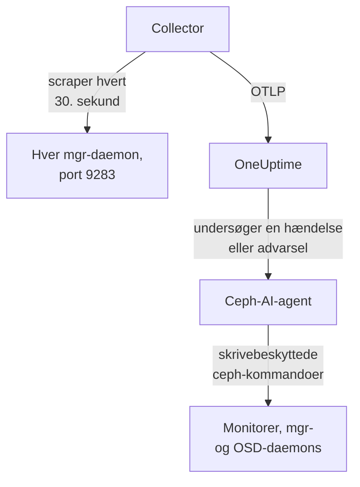

# Ceph-agent

OneUptimes Ceph-agent overvåger en Ceph-klynge: dens tilstand, monitor-quorum, OSD'er, pools og placement groups. Den scraper Ceph mgr-modulet `prometheus` på hver mgr-daemon, stempler hver metrik med din klynges navn og sender den til OneUptime, hvor klyngen vises med sine OSD'er, pools og daemons. [Ceph-monitorer](/docs/monitor/ceph-monitor) advarer ud fra det, der ankommer.

:::cards
- [Installér agenten](#installer-agenten): Aktivér mgr-modulet, derefter installationsscriptet eller Docker Compose.
- [Hvad agenten indsamler](#hvad-agenten-indsamler): Serierne bag Ceph-siderne, metrikkerne og advarselsskabelonerne.
- [AI-agent](#ai-agent): Lad OneUptime AI læse klyngen, mens den undersøger.
- [Fejlfinding](#fejlfinding): Et diagnosescript og de sædvanlige problemer.
:::

## Sådan virker det

Agenten består af to containere, som du kører med Docker Compose på én maskine. En OpenTelemetry Collector scraper mgr-modulet `prometheus` på hver mgr-daemon hvert 30. sekund. Kun den aktive mgr svarer med metrikker, så når den skifter over til en standby, fortsætter metrikkerne uden nogen ændring. Ceph-AI-agenten ved siden af lader OneUptime AI køre skrivebeskyttede `ceph`-kommandoer, mens den undersøger en hændelse eller advarsel.



Klyngen registrerer sig med sine første data under det navn, agenten stempler på hver metrik som `ceph.cluster.name`.

## Før du begynder

- Docker Engine 20.10 eller nyere med Docker Compose v2-pluginet, på en maskine, der kan nå dine Ceph mgr-daemons på port 9283.
- En shell på en Ceph-adminnode, hvor `ceph`-CLI'en virker med administratorrettigheder.
- En indtagelsesnøgle. Opret en under **Projektindstillinger → Telemetri og APM → Indtagelsesnøgler**, og kopiér dens værdi.
- Udgående HTTPS fra den maskine til din OneUptime-URL.

## Installer agenten

:::steps
### Aktivér mgr-modulet prometheus

På en Ceph-adminnode:

```bash
ceph mgr module enable prometheus
```

Hver mgr-daemon leverer så Prometheus-metrikker på port `9283` under `/metrics`. Kun den aktive mgr returnerer metrikker: standby-mgr'er svarer med et tomt svar eller med en HTTP-fejl, hvis `mgr/prometheus/standby_behaviour` er sat til `error`. Derfor scraper agenten hver mgr. Vis dem:

```bash
ceph mgr stat                    # active mgr
ceph orch ps --daemon-type mgr   # all mgrs (cephadm clusters)
```

### Installer og start agenten

:::tabs
@tab install.sh
Hent installationsscriptet, og kør det på den maskine, der skal være vært for agenten:

```bash
curl -sSL https://raw.githubusercontent.com/OneUptime/oneuptime/master/agents/CephAgent/install.sh -o install.sh
bash install.sh
```

Scriptet spørger efter din OneUptime-URL, indtagelsesnøglen, et navn til klyngen og mgr-endpointene, og om [AI-agenten](#ai-agent) må anvende rettelser. Hvor `ceph` virker med administratorrettigheder, tilbyder det også at oprette AI-agentens egen Ceph-klient. Det installerer i `/opt/oneuptime-ceph-agent`, skriver en `.env`-fil med `0600` og starter agenten med Docker Compose. Kører du scriptet igen, genbruger det alt i den `.env` i stedet for at spørge igen, og det er sådan, du [opgraderer agenten](#opgradering-af-agenten).
@tab Docker Compose
Hent `docker-compose.yml` og `otel-collector-config.yaml` fra [CephAgent-mappen](https://github.com/OneUptime/oneuptime/tree/master/agents/CephAgent) ind i en ny mappe:

```bash
mkdir oneuptime-ceph-agent && cd oneuptime-ceph-agent
curl -fsSLO https://raw.githubusercontent.com/OneUptime/oneuptime/master/agents/CephAgent/docker-compose.yml
curl -fsSLO https://raw.githubusercontent.com/OneUptime/oneuptime/master/agents/CephAgent/otel-collector-config.yaml
```

Opret en `.env`-fil ved siden af dem:

```bash title=".env"
ONEUPTIME_URL=YOUR_ONEUPTIME_URL
ONEUPTIME_TELEMETRY_INGESTION_KEY=YOUR_TELEMETRY_INGESTION_TOKEN
CEPH_CLUSTER_NAME=my-ceph-cluster
CEPH_MGR_ENDPOINTS=[ceph-mon-1:9283,ceph-mon-2:9283,ceph-mon-3:9283]
```

Angiv hver mgr-daemon, den aktive og standby'erne, kommaseparerede og i firkantede parenteser: Parenteserne får collectoren til at læse værdien som en liste af scrape-mål. Start agenten:

```bash
docker compose up -d
```

AI-agentens container starter også og venter på en Ceph-klient for sig selv: se [AI-agent](#ai-agent).
:::

### Kontrollér, at agenten kører

```bash
docker compose ps
docker logs -f oneuptime-ceph-agent
```

`docker compose ps` viser collectoren (`oneuptime-ceph-agent`) og AI-agenten (`oneuptime-ceph-ai-agent`). Collectorens logs bør vise denne linje, når den er startet:

```text
Everything is ready. Begin running and processing data.
```

### Find klyngen i OneUptime

Åbn **Produkter → Infrastruktur → Ceph → Alle klynger**. Klyngen vises under sit `CEPH_CLUSTER_NAME` inden for et minuts tid, med sine OSD'er, pools og daemons.
:::

## Miljøvariabler

Installationsscriptet skriver disse til `/opt/oneuptime-ceph-agent/.env`; en Docker Compose-installation læser dem fra `.env` ved siden af `docker-compose.yml`. Efter at have ændret en skal du køre `docker compose up -d` i den mappe.

| Variabel | Påkrævet | Beskrivelse |
| --- | --- | --- |
| `ONEUPTIME_URL` | Ja | Din OneUptime-URL, såsom `https://oneuptime.com` eller din selvhostede instans. Brug `http://` og dens port, hvis instansen kun bruger HTTP. |
| `ONEUPTIME_TELEMETRY_INGESTION_KEY` | Ja | Indtagelsesnøglen fra **Projektindstillinger → Telemetri og APM → Indtagelsesnøgler**. |
| `CEPH_CLUSTER_NAME` | Ja | Klyngens navn i OneUptime, stemplet på hver metrik som ressourceattributten `ceph.cluster.name`. Hold det stabilt: at ændre det senere registrerer en anden klynge. Standard er `ceph`. |
| `CEPH_MGR_ENDPOINTS` | Ja | Hver mgr-daemon som en kommasepareret `host:port`-liste i firkantede parenteser, fx `[ceph-mon-1:9283,ceph-mon-2:9283,ceph-mon-3:9283]`. Installationsscriptet tilføjer parenteserne for dig. |

AI-agentens egne indstillinger findes under [AI-agent](#ai-agent).

## Sådan scraper agenten

- **Hver mgr, hvert 30. sekund.** mgr-modulet `prometheus` cacher hvert scrape i `mgr/prometheus/scrape_interval` (som standard 15 sekunder). Scrape aldrig oftere end det: Du ville bare læse cachen igen.
- **`honor_labels: true`.** De labels, Ceph eksporterer (`ceph_daemon`, `pool_id`, instanslabels pr. daemon), bevares, som de er. Uden det ville labelet `instance` blive omskrevet for hvert scrape-mål og ændre sig, hver gang den aktive mgr skifter, hvilket ødelægger hver serie.

## Hvad agenten indsamler

Agenten sender alt, hvad mgr-modulet `prometheus` eksporterer. OneUptimes Ceph-sider, metrikkatalog og advarselsskabeloner bygger på disse serier:

| Kategori | Metrikker |
| --- | --- |
| Klyngetilstand | `ceph_health_status` (0 = OK, 1 = WARN, 2 = ERR), `ceph_health_detail` (én serie pr. aktivt sundhedstjek, med labels `name` og `severity`, fra Quincy og frem; bag advarselsskabelonerne for sundhedstjek og oversigtens **Active Health Checks**), `ceph_healthcheck_slow_ops`, `ceph_daemon_health_metrics` (pr. daemon, efter `type`), `ceph_mon_quorum_status`, `ceph_mon_metadata`, `ceph_cluster_total_bytes`, `ceph_cluster_total_used_bytes` |
| OSD | `ceph_osd_up`, `ceph_osd_in`, `ceph_osd_apply_latency_ms`, `ceph_osd_commit_latency_ms`, `ceph_osd_stat_bytes`, `ceph_osd_stat_bytes_used`, `ceph_osd_numpg`, `ceph_osd_metadata`, pr. OSD via labelet `ceph_daemon` (fx `osd.3`) |
| Pool | `ceph_pool_stored`, `ceph_pool_max_avail`, `ceph_pool_objects`, `ceph_pool_rd`, `ceph_pool_wr`, `ceph_pool_rd_bytes`, `ceph_pool_wr_bytes`, `ceph_pool_metadata`. Dataserierne bærer kun et label `pool_id`; poolens navn står på `ceph_pool_metadata`. |
| Placement groups | `ceph_pg_total`, `ceph_pg_active`, `ceph_pg_clean`, `ceph_pg_degraded`, `ceph_pg_undersized` (alle pr. pool, efter `pool_id`), `ceph_num_objects_degraded`, `ceph_num_objects_misplaced` |
| Daemons | `ceph_mgr_metadata`, `ceph_mds_metadata` og `ceph_rgw_metadata`, ud over monitor- og OSD-metadataene ovenfor. Hver navngiver en daemon og bærer dens version i labelet `ceph_version`: Siden **Daemons** viser dem. |

### Flere scrape-mål

mgr-modulet dækker klyngens tilstand og kapacitet. For et nærmere kig kan du tilføje flere jobs under `scrape_configs` i `otel-collector-config.yaml`:

- **`ceph-exporter` (Reef 18.2 og senere).** cephadm kører en `ceph-exporter`-daemon på hver klyngevært, der leverer ydelsestællere pr. daemon på port `9926`. Tilføj ét mål pr. vært.
- **`node_exporter`.** Den sædvanlige ledsager til hver Ceph-værts CPU-, hukommelses-, disk- og netværksmetrikker, som standard på port `9100`.

Begge får ressourceattributten `ceph.cluster.name` fra den medfølgende processor `resource`, så de lander på den samme klynge i OneUptime.

## Valgfrit — Send Ceph-klyngeloggen

Agenten kan følge `/var/log/ceph/ceph.log` og sende den til OneUptime, hvilket fylder klyngens side **Cluster Log**. Det er slået fra som standard, fordi agenten så skal køre på en vært, der har klyngeloggen: som standard en monitorvært.

:::steps
### Slå receiveren til

Fjern i `otel-collector-config.yaml` udkommenteringen af receiveren `filelog` og pipelinen `logs`.

### Montér logmappen

Fjern i `docker-compose.yml` udkommenteringen af det volume, der monterer mappen i collectoren:

```yaml
- /var/log/ceph:/var/log/ceph:ro
```

### Genstart agenten

```bash
docker compose up -d
```
:::

Linjerne sendes, efterhånden som de skrives. OneUptime læser `ceph.log`-formatet (tid, daemon, niveau `INF`/`WRN`/`ERR`, besked), når den viser dem, og processoren `resource` stempler `ceph.cluster.name`, så loggen lander på denne klynge.

## Mærk klyngen med projektetiketter

En ressourceattribut, der starter med `oneuptime.label.`, bliver en projektetiket på klyngen: `oneuptime.label.<dimension>=<value>` er etiketten `<dimension>:<value>`. Tilføj attributterne til processoren `resource` i `otel-collector-config.yaml`, ved siden af `ceph.cluster.name`:

```yaml
processors:
  resource:
    attributes:
      # ...existing attributes...
      - key: oneuptime.label.team
        value: storage
        action: upsert
      - key: oneuptime.label.env
        value: production
        action: upsert
```

Collectoren læser kun sin konfiguration, når den starter: Kør `docker compose restart oneuptime-ceph-agent`. Klyngen viser derefter etiketterne `team:storage` og `env:production`. Etiketter sammenlignes uden hensyn til store og små bogstaver, så en eksisterende etiket `Production` genbruges i stedet for at blive dubleret, og agenten fjerner aldrig en etiket, som nogen har tilføjet i OneUptime.

## Kør som en systemd-tjeneste

For at starte agenten sammen med maskinen og genstarte den, når den fejler, skal du installere dens systemd-enhed. Den antager, at agenten bor i `/opt/oneuptime-ceph-agent`, hvor installationsscriptet lægger den:

```bash
sudo curl -fsSL https://raw.githubusercontent.com/OneUptime/oneuptime/master/agents/CephAgent/systemd/oneuptime-ceph-agent.service -o /etc/systemd/system/oneuptime-ceph-agent.service
sudo systemctl daemon-reload
sudo systemctl enable --now oneuptime-ceph-agent
```

## Opgradering af agenten

Agenten rapporterer den collector-version, dens filer fastlåser, som sin **Agentversion**. Når den er ældre end den version, denne OneUptime-udgivelse fastlåser, vises et advarselstegn ved siden af den på klyngens **Oversigt**. Vælg det for at se disse kommandoer. En agent, der blev installeret, før dens filer rapporterede en version, viser ingen, indtil den opgraderes på denne måde.

Collector-imaget er fastlåst i `docker-compose.yml`, og dens konfiguration er en fil ved siden af, så et pull alene flytter ikke agenten frem. Kør `install.sh` igen: det genbruger hver værdi i din eksisterende `.env` (der spørges ikke om noget igen), fornyer `docker-compose.yml` og `otel-collector-config.yaml` (en fil, du har redigeret, beholdes som `<file>.bak.<timestamp>`), henter imagene og genopretter agenten, så collectoren læser sin nye konfiguration. AI-agentens mappe `ceph/` forbliver, som den er.

```bash
curl -sSL https://raw.githubusercontent.com/OneUptime/oneuptime/master/agents/CephAgent/install.sh -o install.sh
bash install.sh
```

Installerede du den i stedet med Docker Compose? Hent begge filer igen i agentens mappe (og foretag igen eventuelle ændringer, du lavede i dem), hent derefter imagene, og genopret agenten:

```bash
curl -fsSLO https://raw.githubusercontent.com/OneUptime/oneuptime/master/agents/CephAgent/docker-compose.yml
curl -fsSLO https://raw.githubusercontent.com/OneUptime/oneuptime/master/agents/CephAgent/otel-collector-config.yaml
docker compose pull
docker compose up -d --force-recreate
```

## Afinstallation af agenten

```bash
cd /opt/oneuptime-ceph-agent
docker compose down
```

Hvis du oprettede AI-agentens Ceph-klient, så fjern den på en adminnode med `ceph auth del client.oneuptime-ai`.

## AI-agent

Agentens `docker-compose.yml` kører også **Ceph-AI-agenten**, `oneuptime-ceph-ai-agent` (image `oneuptime/resource-ai-agent:release`). Mens OneUptime AI undersøger en hændelse eller advarsel på denne klynge, kører den skrivebeskyttede `ceph`-kommandoer gennem den — `ceph health detail`, `ceph osd tree`, `ceph pg dump_stuck`, `ceph crash ls` — og anvender, kun hvis du tillader det, rettelser som at markere en OSD som in igen eller fjerne `noout`. Den registrerer sig som klyngen med navnet `CEPH_CLUSTER_NAME`, ligesom collectoren, og vises på klyngens side **AI → AI-agent** i OneUptime.

- **AI-undersøgelser er slået til som standard.** Så snart agenten forbinder, undersøger OneUptime AI hændelser og advarsler på denne klynge med den, og klyngens **Oversigt** viser agentens status. For at stoppe skal du sætte `ONEUPTIME_AI_INVESTIGATION=false`, hvor agenten kører (**Skift** under **Hvad AI må gøre** på AI-agentens side viser hvordan), eller udelade agenten.
- **Dens egen Ceph-klient er den hårde grænse.** Den forbinder som `client.oneuptime-ai`, med klyngens minimale `ceph.conf` og den klients keyring i en mappe `ceph/` ved siden af `docker-compose.yml` (monteret skrivebeskyttet på `/etc/ceph`). Med læse-caps kan intet af det, den kører, ændre klyngen. Ved en ny installation tilbyder `install.sh` at oprette klienten; at køre det igen gør det aldrig. Læg aldrig admin-keyringen i den mappe.
- Den er **skrivebeskyttet**, medmindre du sætter `ONEUPTIME_AI_ALLOW_WRITES=true` og giver klienten caps til rettelserne (agentens README viser dem); `ONEUPTIME_AI_WRITE_TARGETS` (for eksempel `osd.*,cluster`) begrænser, hvad en rettelse må røre. `ONEUPTIME_AI_FIXES` i samme `.env` angiver, hvordan rettelser kører — `ask-for-approval` (en person godkender hver enkelt), `automatic` eller `bypass-approval` — og AI-agentens side viser det skrivebeskyttet ([Hvad AI må gøre, fastsat af agenten](/docs/ai/infrastructure-ai-agents#what-ai-may-do-set-by-the-agent)).
- Den forbinder udad til monitorerne (TCP 3300 og 6789) og mgr- og OSD-daemons (TCP 6800–7300), kører som UID 1000 uden capabilities og kører aldrig `auth`, `config-key`, `tell` eller noget, der sletter data. Slet tjenesten `oneuptime-ceph-ai-agent` fra `docker-compose.yml`, hvis du ikke bruger OneUptime AI.

For at oprette klienten manuelt skal du køre dette på en Ceph-adminnode i agentens mappe (kopiér de to filer til mappen `ceph/` på agentens maskine, hvis det er en anden):

```bash
mkdir -p ceph
ceph config generate-minimal-conf > ceph/ceph.conf
ceph auth get-or-create client.oneuptime-ai mon 'allow r' mgr 'allow r' osd 'allow r' -o ceph/ceph.client.oneuptime-ai.keyring
sudo chown 1000:1000 ceph/ceph.client.oneuptime-ai.keyring
sudo chmod 600 ceph/ceph.client.oneuptime-ai.keyring
docker compose up -d
```

Hvad den må køre, hvordan rettelser virker, og hvordan du fejlsøger den: [Infrastructure AI Agents](/docs/ai/infrastructure-ai-agents#ceph-clusters).

## Fejlfinding

:::details Kør diagnosescriptet først
Agenten leveres med et script, [`troubleshoot.sh`](https://github.com/OneUptime/oneuptime/blob/master/agents/CephAgent/troubleshoot.sh), der kontrollerer hele kæden: container-runtimen, hvert konfigureret mgr-endpoint, klyngenavnet stemplet på hver metrik, tokenets form, collectorens egne metrikker, og om OneUptime accepterer indtagelsesnøglen. Det advarer, når intet endpoint returnerer `ceph_health_status`, eller når kun ét er konfigureret, da kun den aktive mgr leverer metrikker. Nøglekontrollen betyder mest. OneUptime afviser en forkert nøgle med `401` (`422` for en deaktiveret nøgle eller en browsernøgle), og collectoren behandler begge som permanente: den dropper batchen og logger én `Exporting failed`-fejl, som er let at overse, mens containeren forbliver sund. Scriptet spørger `GET <url>/otlp/v1/validate` inde fra agentens netværk efter et direkte `200` (gyldig) eller `401` (ugyldig) og falder tilbage til `POST /fluentd/v1/logs` på ældre servere.

```bash
curl -sSL https://raw.githubusercontent.com/OneUptime/oneuptime/master/agents/CephAgent/troubleshoot.sh -o troubleshoot.sh
bash troubleshoot.sh    # add -d <dir> if you installed outside /opt/oneuptime-ceph-agent
```

Det slutter med en konklusion, der navngiver den mest sandsynlige årsag.
:::

:::details Der vises ingen klynge i OneUptime
1. Læs collectorens logs: `docker logs oneuptime-ceph-agent`. En `401` ved eksport betyder en forkert indtagelsesnøgle; afvist forbindelse betyder en forkert `ONEUPTIME_URL`.
2. Kontrollér, at en mgr leverer metrikker: `curl http://ACTIVE_MGR_HOST:9283/metrics | head` bør udskrive `ceph_*`-linjer. Gør den ikke det, så aktivér modulet med `ceph mgr module enable prometheus`.
3. Kontrollér, at `CEPH_MGR_ENDPOINTS` står i firkantede parenteser. Uden dem læser collectoren hele den kommaseparerede liste som ét mål, der ikke findes.
:::

:::details Klyngen vises som afbrudt
En klynge bliver afbrudt, når OneUptime ikke har modtaget noget fra den i 15 minutter; OneUptime tjekker hvert 5. minut, og tid, hvor OneUptime selv ikke modtog data, tæller ikke med. Kontrollér, at collectoren kører (`docker compose ps`), at dens logs ikke viser eksportfejl, og at maskinen stadig når din OneUptime-URL. Klyngen bliver forbundet igen med sine næste data.
:::

:::details Metrikkerne stopper efter en mgr-failover
Du scraper sandsynligvis kun den mgr, der tidligere var aktiv. Angiv hver mgr-daemon i `CEPH_MGR_ENDPOINTS`: At scrape standby'erne koster næsten ingenting, og de svarer med tomme svar.
:::

:::details Scrape-fejl for standby-mgr'er i collectorens logs
Forventet, når `mgr/prometheus/standby_behaviour` er sat til `error` på din klynge: Standby'erne svarer så med HTTP 500. Den aktive mgr's scrape lykkes stadig, så fejlene er støj; sæt adfærden tilbage til `default` for at få dem til at tie.
:::

:::details Metrikker lander under den forkerte klynge
OneUptime registrerer en Ceph-klynge ud fra dens `ceph.cluster.name`, som agenten tager fra `CEPH_CLUSTER_NAME`. At ændre det efter de første data opretter en anden klynge i stedet for at omdøbe den første.
:::

## Næste trin

:::cards
- [Ceph-monitor](/docs/monitor/ceph-monitor): Advar om tilstand, OSD'er, placement groups, kapacitet, nedbrud og langsomme operationer.
- [Proxmox-agent](/docs/telemetry/proxmox): Kører du Ceph under Proxmox VE? Overvåg også klyngen.
- [Infrastructure AI Agents](/docs/ai/infrastructure-ai-agents): Hvad Ceph-AI-agenten må køre, og hvordan rettelser virker.
- [OpenTelemetry-collector på værten](/docs/telemetry/host-otel-collector): Operativsystemets visning af hver Ceph-vært.
:::
