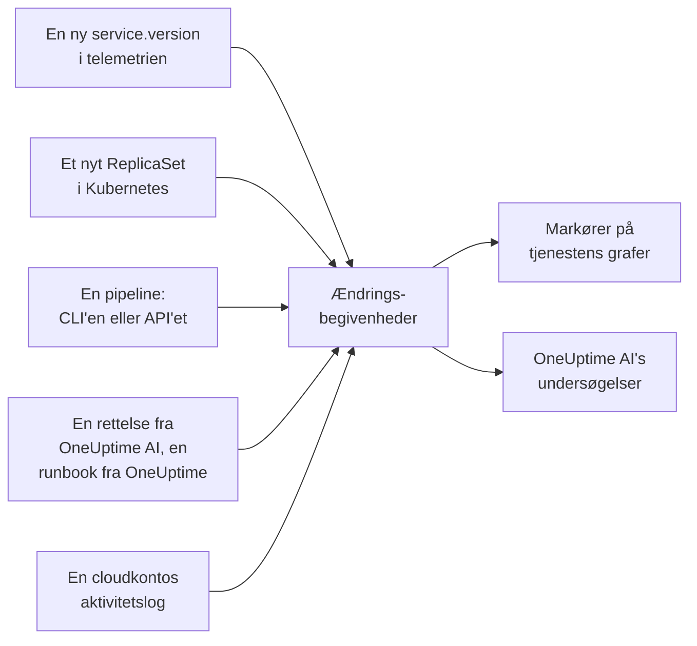

# Udrulninger og ændringer

OneUptime fører et register over, hvad der har ændret sig i dit projekt: udrulninger, Kubernetes-rollouts, konfigurationsændringer, ændringerne i dine forbundne cloudkonti og de rettelser, den selv har kørt. Hver ændring tegnes som en markør på graferne for dens tjeneste eller cloudressource, og OneUptime AI læser dem, når den undersøger en hændelse, så "det begyndte lige efter udrulningen kl. 10:02" er det første, du får at vide, ikke det sidste.

:::cards
- [Hvad OneUptime registrerer af sig selv](#hvad-oneuptime-registrerer-af-sig-selv): Udrulninger og rollouts fra telemetri, dine cloudkontis ændringer og dens egne rettelser.
- [Registrér en udrulning fra en pipeline](#registrér-en-udrulning-fra-en-pipeline): CLI'en, GitHub Actions og API'et.
- [Sådan bruger OneUptime AI ændringer](#sådan-bruger-oneuptime-ai-ændringer): De mistænkte ændringer i hver undersøgelse.
- [Reference](#reference): Felter, attributter og grænser.
:::

## Sådan virker det



## Hvad OneUptime registrerer af sig selv

Disse kræver ikke, at du sender noget. OneUptime registrerer dem ud fra den telemetri, den allerede modtager, og ud fra det, den selv gør.

| Ændring | Registreres, når | Kilde |
| --- | --- | --- |
| En udrulning | En tjeneste begynder at rapportere en `service.version`, som den ikke har rapporteret før i sit miljø | `service-version` |
| En rollout | Pods i et Kubernetes-Deployment begynder at køre et ReplicaSet, de ikke har kørt før: et nyt image, en ændret miljøvariabel eller konfigurationsreference eller en genstart | `kubernetes` |
| En rettelse, som OneUptime AI kørte | En AI-agent rapporterer resultatet af en kommando, der ændrer noget, for eksempel `kubectl rollout restart` | `oneuptime-ai` |
| En runbook | En runbook, som OneUptime kørte, fuldføres, mislykkes eller annulleres, efter at den er startet | `runbook` |
| En cloudændring | En forbundet cloudkontos aktivitetslog registrerer en ændring: AWS CloudTrail, Azures aktivitetslog eller Google Clouds auditlog Admin Activity | `cloud` |
| En begivenhed fra udbyderen | Cloududbyderen offentliggør en sundhedshændelse om kontoen: AWS Health, Azure Service Health eller Resource Health eller Google Cloud Service Health | `cloud-health` |

- **Den første version, en tjeneste rapporterer, er dens udgangspunkt, ikke en udrulning.** En tjeneste, der har kørt i måneder, bliver ikke udrullet i det øjeblik, OneUptime begynder at modtage dens telemetri.
- **En rollback til en version, der er set inden for de seneste 30 dage, registreres ikke,** fordi den version ikke er ny. En rollback, som OneUptime AI kører, registreres som en rettelse.
- **Ud over 6 nye versioner eller ReplicaSets inden for en time registreres der ikke flere, før timen er gået.** En "version", der ændrer sig med hver pod, for eksempel et build-tidsstempel, ville ellers registrere en udrulning for hver pod.

En udrulning registreres kun for en tjeneste, der rapporterer `service.version`. Sæt den sammen med miljøet og committen i ressourceattributterne i din OpenTelemetry-SDK eller -collector:

```bash
OTEL_RESOURCE_ATTRIBUTES="service.version=2.3.1,deployment.environment.name=production,vcs.ref.head.revision=$GIT_SHA"
```

En rollout kræver [Kubernetes-agenten](/docs/telemetry/kubernetes-agent), som stempler hver pods telemetri med dens Deployment og ReplicaSet.

En cloudændring eller en begivenhed fra udbyderen kræver en [forbundet cloudkonto](/docs/telemetry/cloud-accounts). Hver af dem knyttes til den cloudressource, den nævner, når OneUptime viser den ressource, og tegnes på ressourcens grafer. Dens type kommer fra handlingen: `deployment`, `scaling` eller `rollback`, når handlingens navn siger det, ellers `config-change`, og `provider-event` for en sundhedshændelse. Grafer, der ikke er filtreret til nogen ressource, udelader en cloudkontos aktivitetslog, så en travl konto ikke fortrænger dine udrulninger; udbyderens sundhedshændelser bliver på dem.

## Registrér en udrulning fra en pipeline

En pipeline kan registrere en udrulning eller enhver anden ændring, mens den sker: en konfigurationsændring, en migrering, et feature flag. Den skriver med en telemetri-indtagelsesnøgle til dit projekt, den slags, dine applikationer sender telemetri med. Opret en under **Projektindstillinger → Telemetri og APM → Indtagelsesnøgler**.

En nøgle, der er låst til én tjeneste, registrerer hver ændring under den tjeneste.

:::tabs
@tab CLI
```bash
oneuptime deploy \
  --service checkout \
  --service-version 2.3.1 \
  --commit "$GIT_SHA" \
  --environment production \
  --url https://oneuptime.com \
  --ingestion-key "$ONEUPTIME_TELEMETRY_INGESTION_KEY"
```
@tab GitHub Actions
```yaml title=".github/workflows/deploy.yml"
- name: Record the deploy in OneUptime
  env:
    ONEUPTIME_URL: https://oneuptime.com
    ONEUPTIME_TELEMETRY_INGESTION_KEY: ${{ secrets.ONEUPTIME_TELEMETRY_INGESTION_KEY }}
  run: |
    npx -y @oneuptime/cli deploy \
      --service checkout \
      --service-version "${{ github.ref_name }}" \
      --commit "${{ github.sha }}" \
      --repository "${{ github.server_url }}/${{ github.repository }}" \
      --environment production
```
@tab API
```bash
curl -X POST https://oneuptime.com/telemetry/change-events/v1/ingest \
  -H "Content-Type: application/json" \
  -H "x-oneuptime-token: $ONEUPTIME_TELEMETRY_INGESTION_KEY" \
  -d '{"events": [{"serviceName": "checkout", "version": "2.3.1", "commit": "1a2b3c4", "environment": "production"}]}'
```
:::

På en selvhostet OneUptime skal du bruge din egen adresse i stedet for `https://oneuptime.com`. API'et svarer med, hvor mange begivenheder det gemte, og hvor mange det sprang over:

```json
{ "ingested": 1, "skipped": 0 }
```

Se [`oneuptime deploy`](/docs/cli/command-reference#oneuptime-deploy) for alle CLI'ens indstillinger.

## Sådan bruger OneUptime AI ændringer

Hver [AI-undersøgelse](/docs/ai/ai-sre) af en hændelse eller en advarsel starter fra de ændringer, der er registreret i de 2 timer før den og i de 10 minutter efter, for en pipeline, der først registrerer sin udrulning, når rollouten er færdig. Ændringerne på de tjenester, clustre, værter og cloudressourcer, som hændelsen er knyttet til, kommer først.

For op til 4 af dem, der nævner en tjeneste, læser OneUptime tjenestens telemetri i de 30 minutter før og efter ændringen og markerer ændringen som **mistænkt**, når tjenesten blev målbart dårligere lige efter den:

| Signal | Mistænkt, når |
| --- | --- |
| Fejlede spans | Fejlraten blev mindst fordoblet og steg med mindst ét procentpoint, over mindst 10 fejlede spans |
| Latens | p99 steg med mindst det halve og med mindst 100 ms |
| Undtagelser | Mindst tre gange så mange pr. minut og mindst 10 af dem |
| Nye undtagelser | En undtagelsestype, der først blev set i den version, ændringen udrullede, mellem 10 minutter før og 30 minutter efter ændringen, forekom mindst 3 gange |

OneUptime afgør ud fra disse tal, hvilken ændring der er mistænkt, ikke ud fra, hvad en ændrings titel siger. Undersøgelsen tjekker en mistænkt ændring først, siger, om den forårsagede hændelsen, og siger, om det at rulle den tilbage er den hurtigste sikre rettelse.

Når den mistænkte ændring er en Kubernetes-rollout på et cluster, hvor [AI-rettelser](/docs/ai/ai-sre#sådan-fungerer-rettelser) er slået til, ruller OneUptime AI den tilbage først med en `kubectl rollout undo`, som OneUptime bygger ud fra den registrerede ændring. En udrulning, der leverer kode, rulles tilbage gennem sine commits: undersøgelsen nævner den commit eller pull request, der forårsagede problemet, så en [pull request med en rettelse](/docs/ai/ai-sre#automatiske-koderettelser) kan rulle præcis den tilbage.

OneUptime tjekker også hver udrulning af sig selv, uanset om nogen bliver tilkaldt. Når de 30 minutter efter en udrulning er gået, sammenligner den dem med de 30 minutter før efter de samme tærskler, og når tjenesten blev dårligere, nævner en [AI-indsigt](/docs/ai/ai-sre#indsigter-proaktiv-detektion) udrulningen på den tjeneste.

En pull request med en rettelse, som OneUptime AI åbnede, kontrolleres på samme måde: når en registreret udrulning indeholder dens commit, holder OneUptime der øje med det, rettelsen var til - undtagelsen, operationen, den gjorde hurtigere, monitoren bag hændelsen eller advarslen, telemetrien, den tilføjer - og siger, om rettelsen virkede (se [Automatiske koderettelser](/docs/ai/ai-sre#automatiske-koderettelser)). Den udrullede rettelse læses kun i udrulningens version, når tjenestens egen telemetri melder den version, og ellers fra 10 minutter efter udrulningen, når gamle instanser er stoppet.

I en undersøgelse og i [Ask AI](/docs/ai/ask-ai) viser `recent_changes` ændringerne i et hvilket som helst tidsvindue, og `get_change_details` viser, hvad en udrulning leverede: commits siden tjenestens forrige udrulning, deres forfattere, pull requests og de filer, de ændrede. Det kræver committen på ændringen og et repository, der er forbundet via [GitHub App](/docs/ai/github-app).

## Reference

### Felter

| Felt | Hvad det er |
| --- | --- |
| `title` | Hvad der ændrede sig, for eksempel `Deploy 2.3.1`. En udrulning, der sender `version`, kan udelade det |
| `eventType` | Typen af ændring: `deployment` (standard), `config-change`, `scaling`, `rollback`, `feature-flag` eller din egen |
| `serviceName` | Den tjeneste, ændringen hører til. Uden en tjeneste gælder ændringen hele projektet |
| `time` | Hvornår det skete, som ISO 8601 eller epoch i sekunder eller millisekunder. Standard er tidspunktet, hvor den ankom |
| `description` | Detaljer om ændringen |
| `version` | Den udrullede version |
| `previousVersion` | Den version, den erstattede |
| `commit` | Den udrullede commit (også `commitSha` eller `sha`) |
| `repository` | Committens repository (også `repositoryUrl`) |
| `branch` | Den udrullede branch |
| `pullRequest` | Den udrullede pull request |
| `environment` | Det miljø, der blev udrullet til |
| `attributes` | Op til 50 attributter mere, som tekst, tal eller booleske værdier |

Felterne på øverste niveau gemmes som attributter under OpenTelemetry-navnene: `version` som `service.version`, `commit` som `vcs.ref.head.revision`, `repository` som `vcs.repository.url.full`, `branch` som `vcs.ref.head.name`, `pullRequest` som `vcs.change.id` og `environment` som `deployment.environment.name`. En attribut, der sendes under et af de navne, går forud for sit felt.

Attributter, hvis navne begynder med `oneuptime.`, er OneUptimes egne og fjernes fra det, en pipeline sender. Hver ændring, som en pipeline registrerer, angiver det i `oneuptime.change.source`, som er `api`.

En ændring, der er læst fra en cloudkonto, navngiver kontoen og ressourcen under OpenTelemetrys navne, `cloud.provider`, `cloud.account.id`, `cloud.region` og `cloud.resource_id`, og gemmer handlingen i `oneuptime.cloud.operation`, hvem der kørte den i `oneuptime.cloud.actor`, om den mislykkedes i `oneuptime.change.status` og dens cloudkonto i `oneuptime.cloud_account.id`.

### Grænser

| Grænse | Værdi |
| --- | --- |
| Begivenheder i én anmodning | 100 |
| Titel | 500 tegn |
| Beskrivelse | 5.000 tegn |
| Attributter | 50 |
| Tid | Et tidspunkt mere end 366 dage tilbage eller mere end 60 minutter frem erstattes med det tidspunkt, hvor begivenheden ankom |

## Næste skridt

:::cards
- [AI SRE](/docs/ai/ai-sre): Hvad en undersøgelse læser, og hvordan den retter det, den finder.
- [Kommandoreference](/docs/cli/command-reference): Hver kommando i CLI'en.
- [OpenTelemetry](/docs/telemetry/open-telemetry): Send dine tjenesters telemetri med deres versioner.
- [Forbind en cloudkonto](/docs/telemetry/cloud-accounts): Ændringerne og sundhedshændelserne for dine AWS-, Azure- og Google Cloud-konti.
:::
