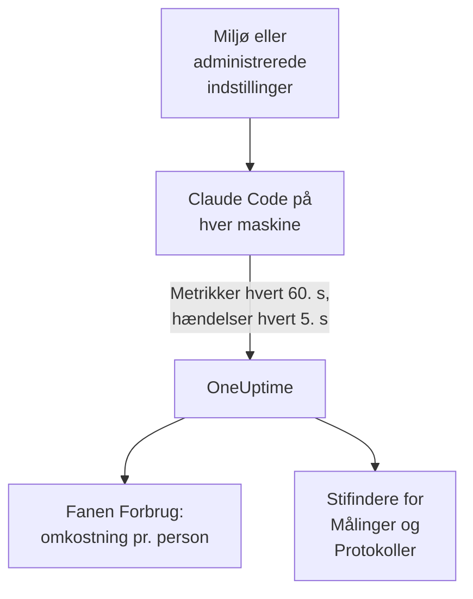

# Claude Code

Claude Code eksporterer selv OpenTelemetry-metrikker og -hændelser direkte til OneUptime: ingen collector og ingen gateway imellem. Slå det til med nogle få miljøvariabler, eller for en hel flåde med én fil med administrerede indstillinger, og se omkostninger, tokens, sessioner, commits og accepterede redigeringer pr. udvikler.

:::cards
- [Sæt én maskine op](#sæt-én-maskine-op): Seks miljøvariabler og en genstart.
- [Rul ud til flåden](#rul-ud-til-flåden): Én fil med administrerede indstillinger på hver maskine.
- [Tildel forbruget til personer](#tildel-forbruget-til-personer-og-teams): Hvem der er logget ind, og hvornår du selv skal sætte identiteten.
- [Fejlfinding](#fejlfinding): Hvad du skal tjekke, når intet ankommer.
:::

## Sådan virker det



Claude Code sender:

- **Omkostninger og tokens**: `claude_code.cost.usage` (USD) og `claude_code.token.usage`, pr. model, pr. hovedagent eller subagent, og pr. agent, skill, plugin eller MCP-server, der foretog kaldet.
- **Aktivitet**: sessioner, commits, pull requests, tilføjede og fjernede kodelinjer samt aktiv tid.
- **Redigeringsbeslutninger**: `claude_code.code_edit_tool.decision` tæller accepterede og afviste redigeringer, så acceptraten er `accept / (accept + reject)`, pr. sprog og pr. værktøj.
- **Hændelser**: prompts, værktøjsresultater, API-anmodninger og -fejl, ændringer af tilladelsestilstand og forbindelser til MCP-servere, som OTLP-logposter.

Hvert datapunkt for en metrik og hver hændelse bærer `user.email`, når udvikleren er logget ind med en Claude-konto, og OneUptime læser den som medarbejderen på metrikkerne, hvor omkostningerne og tokens er.

## Før du begynder

1. Opret en telemetri-indtagelsesnøgle under **Projektindstillinger → Telemetri og APM → Indtagelsesnøgler**.
2. Dit OTLP-endpoint er `https://oneuptime.com/otlp`, eller `https://YOUR-ONEUPTIME-HOST/otlp`, hvis du selv hoster OneUptime.
3. Brug én nøgle til hele flåden. Den ender på hver udviklermaskine, så behandl den som en delt legitimation, der kun kan sende data, og rotér den som enhver anden.

## Sæt én maskine op

:::steps
### Eksportér variablerne

Tilføj dem til din shellprofil (`.zshrc` eller `.bashrc`), eller eksportér dem i den terminal, du starter Claude Code fra:

```bash
export CLAUDE_CODE_ENABLE_TELEMETRY=1
export OTEL_METRICS_EXPORTER=otlp
export OTEL_LOGS_EXPORTER=otlp
export OTEL_EXPORTER_OTLP_PROTOCOL=http/protobuf
export OTEL_EXPORTER_OTLP_ENDPOINT="https://oneuptime.com/otlp"
export OTEL_EXPORTER_OTLP_HEADERS="x-oneuptime-token=YOUR_INGESTION_TOKEN"
```

| Variabel | Hvad den gør |
| --- | --- |
| `CLAUDE_CODE_ENABLE_TELEMETRY` | Hovedkontakten: uden den eksporteres intet. |
| `OTEL_METRICS_EXPORTER`, `OTEL_LOGS_EXPORTER` | `otlp` sender til OneUptime. `otlp,console` udskriver også det, der sendes, praktisk under opsætningen. |
| `OTEL_EXPORTER_OTLP_PROTOCOL` | `http/protobuf`; `http/json` og `grpc` virker også. |
| `OTEL_EXPORTER_OTLP_ENDPOINT` | Basis-URL'en. Claude Code tilføjer selv `/v1/metrics` og `/v1/logs`. |
| `OTEL_EXPORTER_OTLP_HEADERS` | Kommaseparerede `key=value`-par; her din indtagelsesnøgle. |

### Genstart Claude Code

Variablerne læses, når Claude Code starter. Metrikker sendes hvert 60. sekund og hændelser hvert 5. sekund, så brug Claude Code et minut, før du kigger.

### Tjek, at data ankommer

Åbn **Målinger**, og søg efter `claude_code.token.usage`, åbn derefter **Produkter → AI / LLM**, og gå til **Forbrug**: dine omkostninger vises under din e-mail, markeret med **fra GenAI-metrikker**.
:::

For at sende metrikker og hændelser til forskellige steder sætter du i stedet `OTEL_EXPORTER_OTLP_METRICS_ENDPOINT` og `OTEL_EXPORTER_OTLP_LOGS_ENDPOINT` med den fulde sti (`https://oneuptime.com/otlp/v1/metrics`, `https://oneuptime.com/otlp/v1/logs`).

## Rul ud til flåden

I en organisation leverer du de samme variabler i en fil med administrerede indstillinger. Den har samme form som `settings.json`, med variablerne i en `env`-blok:

```json title="managed-settings.json"
{
  "env": {
    "CLAUDE_CODE_ENABLE_TELEMETRY": "1",
    "OTEL_METRICS_EXPORTER": "otlp",
    "OTEL_LOGS_EXPORTER": "otlp",
    "OTEL_EXPORTER_OTLP_PROTOCOL": "http/protobuf",
    "OTEL_EXPORTER_OTLP_ENDPOINT": "https://oneuptime.com/otlp",
    "OTEL_EXPORTER_OTLP_HEADERS": "x-oneuptime-token=YOUR_INGESTION_TOKEN",
    "OTEL_RESOURCE_ATTRIBUTES": "team.id=platform,cost_center=eng-123"
  }
}
```

:::steps
### Læg filen, hvor Claude Code læser den

| Platform | Sti |
| --- | --- |
| macOS | `/Library/Application Support/ClaudeCode/managed-settings.json` |
| Linux og WSL | `/etc/claude-code/managed-settings.json` |
| Windows | `C:\Program Files\ClaudeCode\managed-settings.json` |

Claude Code læser ikke længere den gamle Windows-sti `C:\ProgramData\ClaudeCode\managed-settings.json`. Hvis du allerede leverer en fil med administrerede indstillinger, så tilføj i stedet en supplerende fil, som `managed-settings.d/10-telemetry.json` ved siden af den: Claude Code fletter først `managed-settings.json` og derefter hver `*.json`-fil i `managed-settings.d/` i alfabetisk rækkefølge.

### Tjek én maskine

Kør `/status` i Claude Code. Linjen `Setting sources` skal sige `Enterprise managed settings (file)`, eller `(drop-ins)` eller `(file + drop-ins)` for en supplerende fil. En anden kilde i parentes betyder, at en højere rangeret kilde vandt, og at din ikke blev brugt.

### Se flåden ankomme

På fanen **Forbrug** vises hver udvikler som en række, så snart vedkommende har brugt Claude Code med de nye indstillinger.
:::

Den samme JSON kan også komme fra servertilknyttede indstillinger i claude.ai's administrationskonsol (hentet ved opstart og hver time), fra en macOS-konfigurationsprofil i domænet `com.anthropic.claudecode` eller fra en `Settings`-værdi under `HKLM\SOFTWARE\Policies\ClaudeCode` på Windows.

:::details Hvilken administreret kilde vinder, og hvordan telemetrivariablerne kombineres
Som standard bruger Claude Code den højest rangerede kilde, der sætter en politiknøgle, og ignorerer de andre: servertilknyttede indstillinger, så en MDM- eller styresystempolitik, så filerne med administrerede indstillinger og så registreringsværdien `HKCU` pr. bruger. `env`-blokken er undtagelsen: siden version 2.1.223 flettes den variabel for variabel på tværs af administrationskilderne.

Det gør telemetrivariablerne ikke: variablerne `OTEL_EXPORTER_OTLP_*`, indholdskontakterne `OTEL_LOG_*`, `OTEL_LOGS_EXPORTER` og variablerne for tracing-betaen kommer samlet fra den højest rangerede kilde, der sætter en af dem, så et endpoint fra én kilde aldrig parres med legitimationsoplysninger fra en anden. Hvis en højere rangeret kilde sætter en af dem, bidrager en supplerende telemetrifil ikke med noget.

Servertilknyttede indstillinger kræver ét trin mere: et ikke-tomt `OTEL_EXPORTER_OTLP_ENDPOINT` anvendes først, når hver udvikler har accepteret en sikkerhedsdialog i en interaktiv session, og ændringer i eksportørindstillingerne træder i kraft ved næste start. Filer og MDM-politikker har ingen dialog.
:::

:::details Rotér indtagelsesnøglen uden at redigere hver maskine
I stedet for en fast header sætter du `"otelHeadersHelper": "/path/to/generate-otel-headers.sh"` i indstillingerne. Scriptet udskriver et fladt JSON-objekt med headers, som `{"x-oneuptime-token":"..."}`. Claude Code kører det ved opstart og igen hvert `CLAUDE_CODE_OTEL_HEADERS_HELPER_DEBOUNCE_MS` millisekund (`1740000` som standard, 29 minutter). Fejl vises i `/status`.
:::

## Tildel forbruget til personer og teams

**Medarbejderen er `user.email`.** Claude Code sender den, når udvikleren er logget ind med en Claude-konto, og der er ingen variabel til at slå den fra. OneUptime læser den fra hvert datapunkt for omkostninger og tokens uden opsætning.

**Andre logins sender ingen e-mail.** Med en API-nøgle, eller med Claude på Amazon Bedrock, Google Cloud eller Microsoft Foundry, er der ingen Claude-konto i sessionen, og Claude Code sender kun `user.id` og `session.id`. Sæt selv identiteten, pr. maskine, i de administrerede indstillinger eller et startscript:

```bash
export OTEL_RESOURCE_ATTRIBUTES="user.email=jdoe@example.com,team.id=platform"
```

**`user.id` er ikke en person.** Det er et tilfældigt id, som Claude Code skriver til `~/.claude.json` ved første kørsel: ét pr. installation, og et nyt, hvis filen slettes. Uden en e-mail vises hver installation som sin egen række. Én undtagelse: en session, der er logget ind på en gateway til Claude-apps, sender den indloggede identitet (`user.id` er identitetsudbyderens subject, `user.email` e-mailen) og ignorerer `user.*`-nøgler, du selv sætter.

**Teams og omkostningssteder** kommer fra `OTEL_RESOURCE_ATTRIBUTES`: OneUptime læser `team.id`, `team`, `cost_center` og `department`. Værdier må ikke indeholde mellemrum, og anførselstegn beskytter dem ikke: skriv `team=Platform_Engineering`, eller brug procentkodning som i `team=Platform%20Engineering`. Claude Code kopierer disse nøgler over på hvert datapunkt (`OTEL_METRICS_INCLUDE_RESOURCE_ATTRIBUTES`, slået til som standard), og OneUptime læser dem begge steder. En nøgle, du selv sætter, tilsidesætter aldrig en, som Claude Code selv sætter.

## Hvad OneUptime viser

På **Produkter → AI / LLM → Forbrug** fodrer `claude_code.cost.usage` tabellerne **Medarbejder**, **Team** og **Model**, og `claude_code.token.usage` tokentotalerne. To regler afgør, hvad du ser:

- **Metrikkerne udfylder hullerne i spans; de lægges aldrig oven i dem.** Hvis det samme projekt modtager GenAI-spans med omkostninger fra dine egne apps, vises Claude Codes forbrug ikke. Send Claude Code til et projekt for sig selv. Se [Spans kommer først, metrikker udfylder hullerne](/docs/telemetry/ai-llm-observability#spans-kommer-først-metrikker-udfylder-hullerne).
- **En række fra metrikker bærer kun omkostninger.** Dens celler for kald og tokens viser `—`, og tabellerne **Udbyder** og **Applikation / Tjeneste** forbliver tomme: metrikkerne nævner ingen udbyder og tilhører ingen OneUptime-tjeneste.

Alt andet, som acceptrate, kodelinjer, commits og pull requests pr. udvikler eller forbrug pr. `query_source`, viser du i et [dashboard](/docs/dashboards/index) ud fra metrikkerne nedenfor og advarer på med en [metrik-monitor](/docs/monitor/metrics-monitor).

## Metrikker

Hver metrik er en tæller og bærer standardattributterne ud over sine egne.

| Metrik | Enhed | Egne attributter |
| --- | --- | --- |
| `claude_code.session.count` | ingen | `start_type`: `fresh`, `resume`, `continue`, `agents_view` |
| `claude_code.lines_of_code.count` | ingen | `type`: `added`, `removed`; `model` |
| `claude_code.commit.count` | ingen | ingen |
| `claude_code.pull_request.count` | ingen | ingen |
| `claude_code.cost.usage` | USD | `model`; `query_source`: `main`, `subagent`, `auxiliary`; `speed`: `fast`, `normal`; `effort`; `agent.name`, `skill.name`, `plugin.name`, `marketplace.name`, `mcp_server.name`, `mcp_tool.name` |
| `claude_code.token.usage` | tokens | `type`: `input`, `output`, `cacheRead`, `cacheCreation`; og de samme attributter som `claude_code.cost.usage` |
| `claude_code.code_edit_tool.decision` | ingen | `tool_name`: `Edit`, `Write`, `NotebookEdit`; `decision`: `accept`, `reject`; `source`; `language` |
| `claude_code.active_time.total` | s | `type`: `user` (ved tastaturet), `cli` (værktøjer og modelsvar) |

Standardattributterne er `session.id`, `app.version`, `app.entrypoint`, `organization.id`, `user.account_uuid`, `user.account_id`, `user.id`, `user.email` og `terminal.type` plus dine `OTEL_RESOURCE_ATTRIBUTES`. Nogle af dem kan slås fra: se [Hold metrikmængden nede](#hold-metrikmængden-nede).

- Cachetokentyperne er i camelCase: `cacheRead` og `cacheCreation`. OneUptimes tokentotaler tæller kun `input` og `output`.
- På omkostnings- og tokenmetrikkerne står navnene på dine egne agenter og MCP-servere, og på tredjeparts plugins og skills, som `custom` eller `third-party`, medmindre `OTEL_LOG_TOOL_DETAILS=1` er sat (Claude Code 2.1.273 eller nyere).

## Hændelser

Hændelser ankommer som OTLP-logposter, hver med `event.name`, `event.timestamp` og `event.sequence`. Dem, du oftest vil bruge:

| Hændelse | Hvad den registrerer |
| --- | --- |
| `claude_code.user_prompt` | En prompt: dens længde og dens kommando; teksten kun, hvis du slår det til |
| `claude_code.api_request` | En modelanmodning: `model`, `cost_usd`, `cost_usd_micros`, `duration_ms`, `input_tokens`, `output_tokens`, cachetokens |
| `claude_code.api_error` | En anmodning, der fejlede efter sine genforsøg: `model`, `error`, `status_code`, `attempt` |
| `claude_code.tool_result` | En værktøjskørsel: `tool_name`, `success`, `duration_ms` og den beslutning, der tillod den |
| `claude_code.tool_decision` | Om et værktøj blev tilladt, og af hvad |
| `claude_code.mcp_server_connection` | En MCP-server, der forbinder eller fejler |

Claude Code sender mange flere, som afvisninger, ændringer af tilladelsestilstand og hændelser fra plugins, hooks og skills: Anthropics [overvågningsreference](https://code.claude.com/docs/en/monitoring-usage) viser dem alle. I `cost_usd_micros` er omkostningen et helt antal milliontedele af en USD, som lægges sammen uden afrundingsfejl.

## Hold metrikmængden nede

Claude Code sætter som standard `session.id` på hvert datapunkt, og hver session er en ny serie. På tværs af en flåde driver den ene attribut metrikmængden op, og omkostningsrapportering har ikke brug for den:

```bash
export OTEL_METRICS_INCLUDE_SESSION_ID=false
```

| Variabel | Standard | Tilføjer |
| --- | --- | --- |
| `OTEL_METRICS_INCLUDE_SESSION_ID` | `true` | `session.id`, en ny værdi hver session |
| `OTEL_METRICS_INCLUDE_VERSION` | `false` | `app.version` |
| `OTEL_METRICS_INCLUDE_ACCOUNT_UUID` | `true` | `user.account_uuid` og `user.account_id` |
| `OTEL_METRICS_INCLUDE_ENTRYPOINT` | `false` | `app.entrypoint` |
| `OTEL_METRICS_INCLUDE_RESOURCE_ATTRIBUTES` | `true` | Dine nøgler fra `OTEL_RESOURCE_ATTRIBUTES` |
| `OTEL_METRICS_INCLUDE_REPOSITORY` | `false` | Repositoriets `vcs.*`-attributter |

`user.email`, `user.id`, `organization.id` og `terminal.type` har ingen kontakt. Hændelser er det travleste signal: hver aktiv udvikler sender hvert 5. sekund (`OTEL_LOGS_EXPORT_INTERVAL`, i millisekunder). Hæv den for at sende færre og større batches, eller sæt `OTEL_LOGS_EXPORTER=none`, hvis du kun har brug for omkostninger og forbrug, som alle ligger i metrikkerne.

## Prompt- og værktøjsindhold er slået fra som standard

Claude Code eksporterer ikke prompts, svar, værktøjsargumenter eller værktøjsoutput, medmindre du slår hver enkelt til:

| Variabel | Standard | Hvad `1` slår til |
| --- | --- | --- |
| `OTEL_LOG_USER_PROMPTS` | fra | Prompttekst |
| `OTEL_LOG_ASSISTANT_RESPONSES` | fra | Svartekst; når den ikke er sat, følger den `OTEL_LOG_USER_PROMPTS` |
| `OTEL_LOG_TOOL_DETAILS` | fra | Værktøjsparametre, Bash-kommandoer og de rigtige navne på agenter, plugins, skills og MCP-servere |
| `OTEL_LOG_TOOL_CONTENT` | fra | Værktøjsinput og -output, kun på trace-spans |
| `OTEL_LOG_RAW_API_BODIES` | fra | Fulde bodies for API-anmodninger og -svar (`file:<dir>` skriver dem til disk i stedet) |

Vi anbefaler at lade dem være slået fra: metrikkerne og de maskerede hændelser svarer allerede på, hvem der brugte hvad, på hvilken model og med hvilken acceptrate. Opsamling af indhold flytter prompts, kildekode og værktøjsoutput over i et telemetrilager med andre adgangskontroller end dine repositorier. Hvis du slår det til for en undersøgelse, begrænser `CLAUDE_CODE_OTEL_CONTENT_MAX_LENGTH` (`61440` som standard), hvor meget der sendes pr. post, og traces' **Scrub-regler** og **Drop-filtre** under **Spor → Indstillinger** maskerer eller dropper det, før det gemmes.

## Metrikker ankommer som deltaer

Claude Code sender deltametrikker som standard: hvert datapunkt er stigningen siden sidste eksport, ikke en løbende total. Når du viser dem i grafer eller advarer på dem, lægger du datapunkterne sammen over vinduet, og du anvender ikke en rate- eller tællernulstillingsfunktion, som du ville med en kumulativ tæller: tallene bliver forkerte uden at se forkerte ud.

```bash
export OTEL_EXPORTER_OTLP_METRICS_TEMPORALITY_PREFERENCE=cumulative
```

Lås kun `cumulative` fast, hvis hver eksportør i din organisation bruger det, og bland ikke de to i en flåde.

## Traces (beta)

Claude Code har også en beta-eksportør for traces, der tegner hver interaktion som et træ af spans: `claude_code.interaction` med `claude_code.llm_request` og `claude_code.tool` under sig.

```bash
export CLAUDE_CODE_ENHANCED_TELEMETRY_BETA=1
export OTEL_TRACES_EXPORTER=otlp
```

> [!WARNING]
> Hold traces-betaen ude af det projekt, du bruger til forbrug. Dens modelspans bærer `gen_ai.system` og `gen_ai.request.model`, så OneUptime viser dem under **Kald**, men deres tokens ligger i `input_tokens` og `output_tokens`, ikke i `gen_ai.usage.*`-nøglerne, så de ankommer uden tokens og uden omkostninger. Så snart de findes, er det dem, tabellerne **Medarbejder**, **Team** og **Model** viser som rækker, til $0, i stedet for metrikkernes forbrug.

I Agent SDK-sessioner og ikke-interaktive `-p`-sessioner opfanger Claude Code en indgående `TRACEPARENT`, så dens spans slutter sig til kalderens trace; interaktive sessioner ignorerer den. Den sender kun headeren `traceparent` til modellen, når `ANTHROPIC_BASE_URL` ikke er sat eller er Anthropics API; bag din egen proxy sætter du `CLAUDE_CODE_PROPAGATE_TRACEPARENT=1`.

## Fejlfinding

:::details Intet ankommer overhovedet
Tjek først `CLAUDE_CODE_ENABLE_TELEMETRY=1`: uden den gør ingen anden variabel noget. Tilføj derefter `console` til eksportørerne (`OTEL_METRICS_EXPORTER=otlp,console`), og hold øje med terminalen: hvis der udskrives datapunkter, fungerer Claude Code, og problemet er endpointet, nøglen eller netværket.
:::

:::details Filen med administrerede indstillinger ser ud til at blive ignoreret
Kør `/status`, og læs linjen `Setting sources`. Står der ingen administreret kilde, ligger filen på den forkerte sti, er ikke gyldig JSON eller kan ikke læses af udviklerens konto. Står der en anden kilde, vandt den, og din blev ikke brugt. Servertilknyttede indstillinger venter desuden på, at udvikleren accepterer godkendelsesdialogen i en interaktiv session.
:::

:::details Forbruget vises som Ikke tildelt, eller som én række pr. installation
De udviklere er ikke logget ind med en Claude-konto: de bruger en API-nøgle, Amazon Bedrock, Google Cloud eller Microsoft Foundry. Sæt `user.email` i `OTEL_RESOURCE_ATTRIBUTES` for dem, som [Tildel forbruget til personer og teams](#tildel-forbruget-til-personer-og-teams) viser.
:::

:::details Teamet eller omkostningsstedet mangler
Tjek, at `OTEL_RESOURCE_ATTRIBUTES` er sat på maskinen, ikke indeholder mellemrum og ikke genbruger en nøgle, som Claude Code selv sætter: Claude Codes værdi vinder.
:::

:::details Tallene ser for små eller for store ud
Claude Code sender deltaer: læg datapunkterne sammen over vinduet, som [Metrikker ankommer som deltaer](#metrikker-ankommer-som-deltaer) forklarer. Og vent et helt minut: metrikker sendes hvert 60. sekund.
:::

:::details Nøglen afvises
OneUptime afviser en forkert `x-oneuptime-token`. Kopiér nøglen igen fra **Projektindstillinger → Telemetri og APM → Indtagelsesnøgler**, og tjek, at headeren lyder `x-oneuptime-token=YOUR_INGESTION_TOKEN` uden mellemrum omkring `=`.
:::

## Næste trin

:::cards
- [AI-kodeassistenter](/docs/telemetry/ai-coding-assistants): Sådan tildeles forbruget på tværs af alle kodeassistenter.
- [AI- / LLM-observability](/docs/telemetry/ai-llm-observability): Samtaler, advarsler, omkostninger og budgetter for dine egne AI-kald.
- [Metrik-monitor](/docs/monitor/metrics-monitor): Advar på forbrug eller tokens pr. udvikler.
:::
