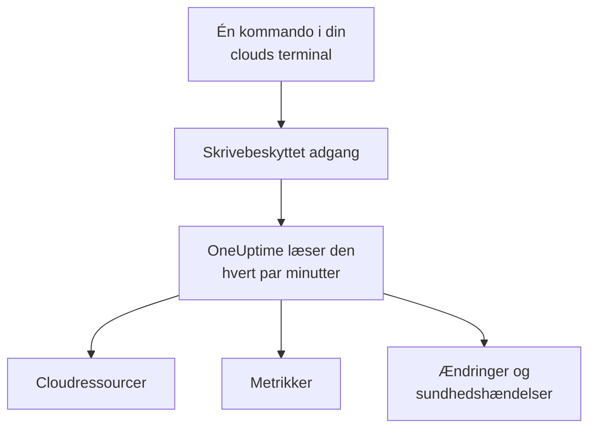

# Forbind en cloudkonto

Forbind en AWS-konto, et Azure-abonnement eller et Google Cloud-projekt fra dashboardet, og OneUptime viser hver ressource i det, læser deres vigtigste metrikker og registrerer, hvad der er ændret i dem, og hvad din cloududbyder siger om deres tilstand. Du kører én kommando i din clouds egen browserterminal og indsætter det, den udskriver: Der er ingen collector at køre og intet at installere.

:::cards
- [Amazon Web Services](#amazon-web-services): En IAM-rolle, som OneUptime logger ind med, eller en adgangsnøgle.
- [Microsoft Azure](#microsoft-azure): En app med rollen Monitoring Reader.
- [Google Cloud](#google-cloud): En tjenestekonto med fire roller, der kun kan læse.
- [Hvad OneUptime læser](#hvad-oneuptime-læser): Ressourcer, metrikker, ændringer og sundhedshændelser, hvor ofte, og hvad det koster.
- [Datasikkerhed](#datasikkerhed): Hvad forbindelsen lader Datasikkerhed læse, og hvad hvert niveau tilføjer til kommandoen.
:::

## Sådan virker det



- **Adgangen kan kun læse.** Kommandoen opretter en adgang, der læser dine ressourcer og deres opsætning, deres metrikker, hvad der er ændret og din udbyders sundhedshændelser, og intet andet: handlingerne nedenfor på AWS, rollen **Monitoring Reader** på Azure og fire læseroller på Google Cloud. Den læser aldrig data eller hemmeligheder, medmindre du slår indholdsprøver til for [Datasikkerhed](#datasikkerhed). Slet den for at lukke OneUptime ude.
- **OneUptime læser efter en tidsplan.** Hvert 5. minut for Azure og Google Cloud og hvert 10. minut for AWS, medmindre du vælger et andet interval, når du forbinder. Hver læsning registrerer også, hvad der er ændret siden den forrige, og hvert 30. minut viser en læsning alle ressourcer igen.
- **Hver ressource får sin egen side.** Ressourcer vises under **Cloud → Alle ressourcer** med deres vigtigste metrikker, ejere og etiketter. Siden for en listet ressource viser også dens **Forbundne ressourcer** (hvad den kører i, hvad der sender trafik til den), dens endepunkter, tags og indstillinger og dens **Hændelser**, **Advarsler** og **Ændringer**.
- **Hver konto får sin egen side.** Konti vises under **Cloud → Konti** med deres ressourcer efter type og region, deres **Ændringer** og en **Topologi** over, hvordan deres ressourcer hænger sammen.
- **OneUptime AI læser, hvad der er ændret.** En undersøgelse af en hændelse eller en advarsel, der er tilknyttet en cloud-ressource, læser først den ressources ændringer og læser kontoens aktivitetslog igen, når den starter.

## Før du begynder

- **En projektejer eller -administrator.** Kun de kan forbinde, teste og redigere cloudkonti.
- **Din clouds terminal** (AWS CloudShell, Azure Cloud Shell eller Google Cloud Shell), logget ind som en, der må oprette en IAM-rolle eller -bruger, en appregistrering eller en tjenestekonto.

## Amazon Web Services

:::steps
### Åbn AWS-formularen

Gå til **Cloud → Forbind**, og vælg **Amazon Web Services**.

### Kør kommandoen i AWS CloudShell

Vælg, hvordan OneUptime logger ind. En **IAM-rolle** er den anbefalede måde: Intet hemmeligt gemmes, og du kan slette rollen når som helst. Formularen viser kommandoen skrevet til dit projekt: Den opretter en rolle, der stoler på OneUptimes AWS-konto med dit projekts eksterne id, og udskriver rollens ARN.

Under **Hvad der skal læses** vælger du denne konto eller hver konto i din AWS Organization. Kør organisationens kommando i dens administrationskonto: Den tilføjer et StackSet, der lægger den samme rolle i hver konto, nu og efterhånden som konti kommer til, og lader administrationskontoens rolle vise kontiene. Én forbindelse læser op til 50 konti.

Brug en **Adgangsnøgle**, når en rolle ikke er mulig: Den læser kun sin egen konto. Denne kommando opretter en bruger med de samme tilladelser og udskriver brugerens nøgle:

```bash
aws iam create-user --user-name OneUptimeReadOnly > /dev/null 2>&1 || true
aws iam put-user-policy --user-name OneUptimeReadOnly --policy-name OneUptimeReadOnly --policy-document '{"Version":"2012-10-17","Statement":[{"Effect":"Allow","Action":["cloudwatch:GetMetricData","cloudwatch:ListMetrics","tag:GetResources","iam:ListAccountAliases","cloudformation:ListResources","ec2:DescribeInstances","ec2:DescribeVolumes","ec2:DescribeVpcs","ec2:DescribeNatGateways","autoscaling:DescribeAutoScalingGroups","elasticloadbalancing:DescribeLoadBalancers","elasticloadbalancing:DescribeLoadBalancerAttributes","elasticloadbalancing:DescribeTargetGroups","elasticloadbalancing:DescribeTargetGroupAttributes","elasticloadbalancing:DescribeTargetHealth","elasticloadbalancing:DescribeTags","ecs:ListClusters","ecs:DescribeClusters","ecs:ListServices","ecs:DescribeServices","lambda:ListFunctions","rds:DescribeDBInstances","rds:DescribeDBClusters","elasticache:DescribeReplicationGroups","sqs:ListQueues","sqs:GetQueueAttributes","sns:ListTopics","sns:GetTopicAttributes","sns:ListSubscriptionsByTopic","dynamodb:ListTables","dynamodb:DescribeTable","kinesis:ListStreams","kinesis:DescribeStreamSummary","states:ListStateMachines","states:DescribeStateMachine","cloudfront:ListDistributions","elasticfilesystem:DescribeFileSystems","es:ListDomainNames","es:DescribeDomains","apprunner:ListServices","apprunner:DescribeService","cloudtrail:LookupEvents","health:DescribeEvents","health:DescribeEventDetails"],"Resource":"*"},{"Effect":"Allow","Action":["apigateway:GET"],"Resource":["arn:aws:apigateway:*::/restapis","arn:aws:apigateway:*::/restapis/*","arn:aws:apigateway:*::/apis","arn:aws:apigateway:*::/apis/*"]}]}'
aws iam create-access-key --user-name OneUptimeReadOnly
```

### Indsæt det, AWS-kommandoen udskrev

Indsæt alt, hvad kommandoen udskrev, i **Det, kommandoen udskrev**. OneUptime finder rollens ARN eller adgangsnøglens id og dens hemmelighed.

### Test og forbind AWS

OneUptime tester forbindelsen, så snart dette trin åbner: Det logger ind, tæller de ressourcer, det finder, og siger, hvad det koster at læse dem. Vælg **Forbind** for at gemme.
:::

Rollen og brugeren kan gøre dette og intet andet:

| Hvad OneUptime bruger dem til | Handlinger |
| --- | --- |
| Finde de ressourcer, der rapporterer metrikker, og læse deres metrikker | `cloudwatch:GetMetricData`, `cloudwatch:ListMetrics` |
| Navngive hver ressource og læse dens tags | `tag:GetResources`, `iam:ListAccountAliases` |
| Vise hver ressource og dens konfiguration gennem Cloud Control | `cloudformation:ListResources`, `ec2:DescribeInstances`, `ec2:DescribeVolumes`, `ec2:DescribeVpcs`, `ec2:DescribeNatGateways`, `autoscaling:DescribeAutoScalingGroups`, `elasticloadbalancing:DescribeLoadBalancers`, `elasticloadbalancing:DescribeLoadBalancerAttributes`, `elasticloadbalancing:DescribeTargetGroups`, `elasticloadbalancing:DescribeTargetGroupAttributes`, `elasticloadbalancing:DescribeTargetHealth`, `elasticloadbalancing:DescribeTags`, `ecs:ListClusters`, `ecs:DescribeClusters`, `ecs:ListServices`, `ecs:DescribeServices`, `lambda:ListFunctions`, `rds:DescribeDBInstances`, `rds:DescribeDBClusters`, `elasticache:DescribeReplicationGroups`, `sqs:ListQueues`, `sqs:GetQueueAttributes`, `sns:ListTopics`, `sns:GetTopicAttributes`, `sns:ListSubscriptionsByTopic`, `dynamodb:ListTables`, `dynamodb:DescribeTable`, `kinesis:ListStreams`, `kinesis:DescribeStreamSummary`, `states:ListStateMachines`, `states:DescribeStateMachine`, `cloudfront:ListDistributions`, `elasticfilesystem:DescribeFileSystems`, `es:ListDomainNames`, `es:DescribeDomains`, `apprunner:ListServices`, `apprunner:DescribeService`, `apigateway:GET` |
| Læse, hvad der er ændret: kontoens administrationshændelser | `cloudtrail:LookupEvents` |
| Læse AWS' egne sundhedshændelser for kontoen | `health:DescribeEvents`, `health:DescribeEventDetails` |
| Vise organisationens konti fra dens administrationskonto | `organizations:ListAccounts` |

`apigateway:GET` er kun tilladt på API'ernes egne definitioner, aldrig på deres nøgler, og kun administrationskontoens rolle må vise organisationens konti. AWS Health svarer kun konti med en Business-, Enterprise On-Ramp- eller Enterprise-supportplan: Uden en spørger OneUptime igen en dag senere.

> [!NOTE]
> På en selvhostet OneUptime kræver vejen med en **IAM-rolle** en AWS-identitet, der tilhører OneUptime selv: Sæt `CLOUD_CONNECT_AWS_ACCESS_KEY_ID` og `CLOUD_CONNECT_AWS_SECRET_ACCESS_KEY` til nøglen for en IAM-bruger, der må kalde `sts:AssumeRole`. Uden dem tilbyder formularen en **Adgangsnøgle**.

## Microsoft Azure

:::steps
### Åbn Azure-formularen

Gå til **Cloud → Forbind**, og vælg **Microsoft Azure**.

### Kør kommandoen i Azure Cloud Shell

Kommandoen opretter en app med rollen **Monitoring Reader** på dit nuværende abonnement og udskriver dens detaljer med den dato, hvor dens hemmelighed udløber:

```bash
SCOPE="/subscriptions/$(az account show --query id --output tsv)"
OUT=$(az ad sp create-for-rbac --name OneUptimeReadOnly --role "Monitoring Reader" --scopes "$SCOPE")
APP=$(echo "$OUT" | jq -r .appId)
END=$(az ad app credential list --id "$APP" --query "max([].endDateTime)" --output tsv)
echo "$OUT" | jq --arg end "$END" '. + {endDateTime: $end}'
```

Under **Hvad der skal læses** vælger du i stedet hvert abonnement i lejeren, og rollen tildeles lejerens rodadministrationsgruppe:

```bash
SCOPE="/providers/Microsoft.Management/managementGroups/$(az account show --query tenantId --output tsv)"
OUT=$(az ad sp create-for-rbac --name OneUptimeReadOnly --role "Monitoring Reader" --scopes "$SCOPE")
APP=$(echo "$OUT" | jq -r .appId)
END=$(az ad app credential list --id "$APP" --query "max([].endDateTime)" --output tsv)
echo "$OUT" | jq --arg end "$END" '. + {endDateTime: $end}'
```

### Indsæt det, Azure-kommandoen udskrev

Indsæt alt, hvad kommandoen udskrev, i **Det, kommandoen udskrev**. OneUptime finder `tenant`, `appId`, `password` og den dato, hvor den udløber.

### Test og forbind Azure

OneUptime tester forbindelsen, så snart dette trin åbner. Vælg **Forbind** for at gemme.
:::

For at læse flere abonnementer med den samme app skal du give den rollen på hvert af dem:

```bash
az role assignment create --assignee <APP_ID> --role "Monitoring Reader" --scope /subscriptions/<SUBSCRIPTION_ID>
```

OneUptime læser hvert abonnement, appen kan læse, op til 50, medmindre du angiver nogle under **Abonnementer**. Appens hemmelighed holder op med at virke på sin udløbsdato: Fra 30 dage før advarer hver læsning om det. Kør kommandoen igen, og indsæt det, den udskriver, for at give den en ny.

## Google Cloud

:::steps
### Åbn Google Cloud-formularen

Gå til **Cloud → Forbind**, og vælg **Google Cloud**.

### Kør kommandoen i Google Cloud Shell

Kør den i det projekt, der skal overvåges. Den slår de API'er til, som OneUptime læser, opretter en tjenestekonto med rollerne **Monitoring Viewer**, **Cloud Asset Viewer**, **Logs Viewer** og **Service Health Viewer** og udskriver dens nøgle:

```bash
PROJECT_ID=$(gcloud config get-value project)
gcloud services enable monitoring.googleapis.com cloudasset.googleapis.com logging.googleapis.com cloudresourcemanager.googleapis.com servicehealth.googleapis.com
gcloud iam service-accounts create oneuptime-read-only --display-name "OneUptime (read only)" > /dev/null 2>&1 || true
gcloud projects add-iam-policy-binding "$PROJECT_ID" --member "serviceAccount:oneuptime-read-only@$PROJECT_ID.iam.gserviceaccount.com" --role roles/monitoring.viewer --condition=None > /dev/null
gcloud projects add-iam-policy-binding "$PROJECT_ID" --member "serviceAccount:oneuptime-read-only@$PROJECT_ID.iam.gserviceaccount.com" --role roles/cloudasset.viewer --condition=None > /dev/null
gcloud projects add-iam-policy-binding "$PROJECT_ID" --member "serviceAccount:oneuptime-read-only@$PROJECT_ID.iam.gserviceaccount.com" --role roles/logging.viewer --condition=None > /dev/null
gcloud projects add-iam-policy-binding "$PROJECT_ID" --member "serviceAccount:oneuptime-read-only@$PROJECT_ID.iam.gserviceaccount.com" --role roles/servicehealth.viewer --condition=None > /dev/null
gcloud iam service-accounts keys create oneuptime-key.json --iam-account "oneuptime-read-only@$PROJECT_ID.iam.gserviceaccount.com"
cat oneuptime-key.json && rm oneuptime-key.json
```

Under **Hvad der skal læses** vælger du i stedet hvert projekt i organisationen, og rollerne tildeles projektets organisation:

```bash
PROJECT_ID=$(gcloud config get-value project)
ORG_ID=$(gcloud projects get-ancestors "$PROJECT_ID" --format="value(id)" | tail -1)
gcloud services enable monitoring.googleapis.com cloudasset.googleapis.com logging.googleapis.com cloudresourcemanager.googleapis.com servicehealth.googleapis.com
gcloud iam service-accounts create oneuptime-read-only --display-name "OneUptime (read only)" > /dev/null 2>&1 || true
gcloud organizations add-iam-policy-binding "$ORG_ID" --member "serviceAccount:oneuptime-read-only@$PROJECT_ID.iam.gserviceaccount.com" --role roles/monitoring.viewer --condition=None > /dev/null
gcloud organizations add-iam-policy-binding "$ORG_ID" --member "serviceAccount:oneuptime-read-only@$PROJECT_ID.iam.gserviceaccount.com" --role roles/cloudasset.viewer --condition=None > /dev/null
gcloud organizations add-iam-policy-binding "$ORG_ID" --member "serviceAccount:oneuptime-read-only@$PROJECT_ID.iam.gserviceaccount.com" --role roles/logging.viewer --condition=None > /dev/null
gcloud organizations add-iam-policy-binding "$ORG_ID" --member "serviceAccount:oneuptime-read-only@$PROJECT_ID.iam.gserviceaccount.com" --role roles/servicehealth.viewer --condition=None > /dev/null
gcloud iam service-accounts keys create oneuptime-key.json --iam-account "oneuptime-read-only@$PROJECT_ID.iam.gserviceaccount.com"
cat oneuptime-key.json && rm oneuptime-key.json
```

### Indsæt nøglen

Indsæt alt, hvad kommandoen udskrev. OneUptime læser nøglens eget projekt og gemmer nøglen krypteret.

### Test og forbind Google Cloud

OneUptime tester forbindelsen, så snart dette trin åbner. Vælg **Forbind** for at gemme.
:::

For at læse flere projekter med den samme tjenestekonto skal du give den de fire roller i hvert af dem og angive dem under **Projekter**:

```bash
for ROLE in roles/monitoring.viewer roles/cloudasset.viewer roles/logging.viewer roles/servicehealth.viewer; do gcloud projects add-iam-policy-binding <PROJECT_ID> --member "serviceAccount:oneuptime-read-only@<KEY_PROJECT_ID>.iam.gserviceaccount.com" --role "$ROLE"; done
```

En organisations forbindelse læser op til 50 af dens projekter, medmindre du angiver nogle under **Projekter**.

## Datasikkerhed

Den samme forbindelse kan lade [Datasikkerhed](/docs/data-security/index) læse kontoens datalagre: dens buckets, databaser og datavarehuse. Under **Flere felter** står **Datasikkerhed** på **Fra**, indtil du vælger andet, og den kommando, formularen viser, ændrer sig med dit valg:

| Datasikkerhed | Hvad Datasikkerhed må læse | Hvad kommandoen tilføjer |
| --- | --- | --- |
| **Fra** | Ingen af kontoens datalagre | Intet |
| **Kun konfiguration** | Hvem der kan nå hvert datalager, og hvordan det er krypteret, sikkerhedskopieret og logget. Aldrig data. | På AWS en ekstra inline-politik, `OneUptimeDataSecurity`, med læsehandlinger. På Azure og Google Cloud intet: **Monitoring Reader** og **Cloud Asset Viewer** læser det allerede. |
| **Konfiguration og indholdsprøver** | Det samme og prøver af objekter og rækker for at finde følsomme data i dem | På AWS den samme politik med `s3:ListBucket`, `s3:GetObject` og `kms:Decrypt` kun via S3. På Azure **Storage Blob Data Reader**. På Google Cloud `roles/storage.objectViewer`, `roles/bigquery.dataViewer` og BigQuery-API'et. |

På AWS tilføjer rollens kommando politikken med én linje mere. På indholdsniveauet er det:

```bash
aws iam put-role-policy --role-name "$ROLE" --policy-name OneUptimeDataSecurity --policy-document '{"Version":"2012-10-17","Statement":[{"Effect":"Allow","Action":["s3:ListAllMyBuckets","s3:GetBucketLocation","s3:GetBucketPolicyStatus","s3:GetBucketPublicAccessBlock","s3:GetAccountPublicAccessBlock","s3:GetBucketAcl","s3:GetBucketPolicy","s3:GetEncryptionConfiguration","s3:GetBucketVersioning","s3:GetBucketLogging","s3:GetBucketOwnershipControls","s3:GetReplicationConfiguration","s3:GetBucketTagging","rds:DescribeDBInstances","rds:DescribeDBClusters","rds:DescribeDBSnapshots","rds:DescribeDBSnapshotAttributes","rds:DescribeDBClusterSnapshots","rds:DescribeDBClusterSnapshotAttributes","dynamodb:ListTables","dynamodb:DescribeTable","dynamodb:DescribeContinuousBackups","redshift:DescribeClusters","redshift:DescribeLoggingStatus","es:ListDomainNames","es:DescribeDomains","elasticache:DescribeReplicationGroups","elasticfilesystem:DescribeFileSystems","kms:ListAliases"],"Resource":"*"},{"Effect":"Allow","Action":["s3:ListBucket"],"Resource":"arn:aws:s3:::*"},{"Effect":"Allow","Action":["s3:GetObject"],"Resource":"arn:aws:s3:::*/*"},{"Effect":"Allow","Action":["kms:Decrypt"],"Resource":"*","Condition":{"StringLike":{"kms:ViaService":"s3.*.amazonaws.com"}}}]}'
```

IAM begrænser en brugers egne inline-politikker til 2.048 tegn i alt, så med en **Adgangsnøgle** lægges politikken på en gruppe, `OneUptimeDataSecurity`, som brugeren bliver medlem af:

```bash
aws iam create-user --user-name OneUptimeReadOnly > /dev/null 2>&1 || true
aws iam put-user-policy --user-name OneUptimeReadOnly --policy-name OneUptimeReadOnly --policy-document '{"Version":"2012-10-17","Statement":[{"Effect":"Allow","Action":["cloudwatch:GetMetricData","cloudwatch:ListMetrics","tag:GetResources","iam:ListAccountAliases","cloudformation:ListResources","ec2:DescribeInstances","ec2:DescribeVolumes","ec2:DescribeVpcs","ec2:DescribeNatGateways","autoscaling:DescribeAutoScalingGroups","elasticloadbalancing:DescribeLoadBalancers","elasticloadbalancing:DescribeLoadBalancerAttributes","elasticloadbalancing:DescribeTargetGroups","elasticloadbalancing:DescribeTargetGroupAttributes","elasticloadbalancing:DescribeTargetHealth","elasticloadbalancing:DescribeTags","ecs:ListClusters","ecs:DescribeClusters","ecs:ListServices","ecs:DescribeServices","lambda:ListFunctions","rds:DescribeDBInstances","rds:DescribeDBClusters","elasticache:DescribeReplicationGroups","sqs:ListQueues","sqs:GetQueueAttributes","sns:ListTopics","sns:GetTopicAttributes","sns:ListSubscriptionsByTopic","dynamodb:ListTables","dynamodb:DescribeTable","kinesis:ListStreams","kinesis:DescribeStreamSummary","states:ListStateMachines","states:DescribeStateMachine","cloudfront:ListDistributions","elasticfilesystem:DescribeFileSystems","es:ListDomainNames","es:DescribeDomains","apprunner:ListServices","apprunner:DescribeService","cloudtrail:LookupEvents","health:DescribeEvents","health:DescribeEventDetails"],"Resource":"*"},{"Effect":"Allow","Action":["apigateway:GET"],"Resource":["arn:aws:apigateway:*::/restapis","arn:aws:apigateway:*::/restapis/*","arn:aws:apigateway:*::/apis","arn:aws:apigateway:*::/apis/*"]}]}'
aws iam create-group --group-name OneUptimeDataSecurity > /dev/null 2>&1 || true
aws iam put-group-policy --group-name OneUptimeDataSecurity --policy-name OneUptimeDataSecurity --policy-document '{"Version":"2012-10-17","Statement":[{"Effect":"Allow","Action":["s3:ListAllMyBuckets","s3:GetBucketLocation","s3:GetBucketPolicyStatus","s3:GetBucketPublicAccessBlock","s3:GetAccountPublicAccessBlock","s3:GetBucketAcl","s3:GetBucketPolicy","s3:GetEncryptionConfiguration","s3:GetBucketVersioning","s3:GetBucketLogging","s3:GetBucketOwnershipControls","s3:GetReplicationConfiguration","s3:GetBucketTagging","rds:DescribeDBInstances","rds:DescribeDBClusters","rds:DescribeDBSnapshots","rds:DescribeDBSnapshotAttributes","rds:DescribeDBClusterSnapshots","rds:DescribeDBClusterSnapshotAttributes","dynamodb:ListTables","dynamodb:DescribeTable","dynamodb:DescribeContinuousBackups","redshift:DescribeClusters","redshift:DescribeLoggingStatus","es:ListDomainNames","es:DescribeDomains","elasticache:DescribeReplicationGroups","elasticfilesystem:DescribeFileSystems","kms:ListAliases"],"Resource":"*"},{"Effect":"Allow","Action":["s3:ListBucket"],"Resource":"arn:aws:s3:::*"},{"Effect":"Allow","Action":["s3:GetObject"],"Resource":"arn:aws:s3:::*/*"},{"Effect":"Allow","Action":["kms:Decrypt"],"Resource":"*","Condition":{"StringLike":{"kms:ViaService":"s3.*.amazonaws.com"}}}]}'
aws iam add-user-to-group --user-name OneUptimeReadOnly --group-name OneUptimeDataSecurity
aws iam create-access-key --user-name OneUptimeReadOnly
```

På Azure tilføjer indholdsniveauet **Storage Blob Data Reader** på det samme scope som **Monitoring Reader**:

```bash
SCOPE="/subscriptions/$(az account show --query id --output tsv)"
OUT=$(az ad sp create-for-rbac --name OneUptimeReadOnly --role "Monitoring Reader" --scopes "$SCOPE")
APP=$(echo "$OUT" | jq -r .appId)
az role assignment create --assignee "$APP" --role "Storage Blob Data Reader" --scope "$SCOPE" > /dev/null
END=$(az ad app credential list --id "$APP" --query "max([].endDateTime)" --output tsv)
echo "$OUT" | jq --arg end "$END" '. + {endDateTime: $end}'
```

På Google Cloud tilføjer det de to roller og slår `bigquery.googleapis.com` til:

```bash
PROJECT_ID=$(gcloud config get-value project)
gcloud services enable monitoring.googleapis.com cloudasset.googleapis.com logging.googleapis.com cloudresourcemanager.googleapis.com servicehealth.googleapis.com bigquery.googleapis.com
gcloud iam service-accounts create oneuptime-read-only --display-name "OneUptime (read only)" > /dev/null 2>&1 || true
gcloud projects add-iam-policy-binding "$PROJECT_ID" --member "serviceAccount:oneuptime-read-only@$PROJECT_ID.iam.gserviceaccount.com" --role roles/monitoring.viewer --condition=None > /dev/null
gcloud projects add-iam-policy-binding "$PROJECT_ID" --member "serviceAccount:oneuptime-read-only@$PROJECT_ID.iam.gserviceaccount.com" --role roles/cloudasset.viewer --condition=None > /dev/null
gcloud projects add-iam-policy-binding "$PROJECT_ID" --member "serviceAccount:oneuptime-read-only@$PROJECT_ID.iam.gserviceaccount.com" --role roles/logging.viewer --condition=None > /dev/null
gcloud projects add-iam-policy-binding "$PROJECT_ID" --member "serviceAccount:oneuptime-read-only@$PROJECT_ID.iam.gserviceaccount.com" --role roles/servicehealth.viewer --condition=None > /dev/null
gcloud projects add-iam-policy-binding "$PROJECT_ID" --member "serviceAccount:oneuptime-read-only@$PROJECT_ID.iam.gserviceaccount.com" --role roles/storage.objectViewer --condition=None > /dev/null
gcloud projects add-iam-policy-binding "$PROJECT_ID" --member "serviceAccount:oneuptime-read-only@$PROJECT_ID.iam.gserviceaccount.com" --role roles/bigquery.dataViewer --condition=None > /dev/null
gcloud iam service-accounts keys create oneuptime-key.json --iam-account "oneuptime-read-only@$PROJECT_ID.iam.gserviceaccount.com"
cat oneuptime-key.json && rm oneuptime-key.json
```

Et lavere niveaus kommando erstatter AWS-politikken med den lavere. **Fra** tilføjer intet, så det lader det, en tidligere kommando gav adgang til, blive på plads, indtil du sletter det: politikken `OneUptimeDataSecurity` på AWS med `aws iam delete-role-policy --role-name <your role> --policy-name OneUptimeDataSecurity` og indholdsniveauets roller på Azure og Google Cloud. Datasikkerhed holder under alle omstændigheder straks op med at læse: den læser kun det, forbindelsens niveau angiver. [Konfigurer Datasikkerhed](/docs/data-security/setup) viser hver handling i politikken, og hvad Datasikkerhed gemmer af det, den læser.

## Hvad OneUptime læser

| | AWS | Azure | Google Cloud |
| --- | --- | --- | --- |
| Ressourcer | Hver ressource af de typer, OneUptime kender, i hver region, du bruger, fra Cloud Control | Hver ressource i abonnementerne, fra Resource Graph | Hver ressource i projekterne, fra Cloud Asset Inventory |
| Metrikker | De vigtigste metrikker for hver tjeneste, såsom en instans' CPU, netværk og statustjek | Op til 8 vigtige metrikker pr. ressource | De vigtigste metrikker for hver ressourcetype |
| Ændringer | CloudTrails administrationshændelser | Aktivitetsloggens administrative hændelser | Auditloggen Admin Activity |
| Sundhedshændelser | AWS Health | Service Health og Resource Health | Service Health |
| Læses hvert | 10. minut | 5. minut | 5. minut |
| En slettet ressource | Arkiveres, når en fuld liste ikke længere har den | Arkiveres, når en fuld liste ikke længere har den | Arkiveres, når en fuld liste ikke længere har den |

Hver læsning fortsætter, hvor den forrige stoppede, så hvert datapunkt og hver ændring skrives én gang. En ny forbindelses første læsning starter inden for et minut og går en time tilbage for metrikker og 2 timer tilbage for ændringer; efter en pause går en læsning højst 6 timer tilbage. En ressource, der kun rapporterer metrikker, og som ingen liste har, arkiveres efter 7 dage uden metrikker.

De kald, OneUptime foretager, faktureres til din cloudkonto til din clouds priser. At vise ressourcer og læse ændringer og sundhedshændelser koster intet på alle tre clouds; at læse metrikker gør. Testen anslår prisen for det, den finder, og at læse sjældnere koster mindre: Skift **Interval for læsning af metrikker** under **Flere felter**.

| Cloud | Pris |
| --- | --- |
| AWS | CloudWatch `GetMetricData`: $0.01 pr. 1.000 metrikker, og hver vigtig metrik for en ressource er én metrik pr. læsning |
| Azure | De første 1.000.000 metriklæsninger om måneden for hvert abonnement er gratis, derefter $0.01 pr. 1.000 |
| Google Cloud | De første 1.000.000 læste tidsserier om måneden er gratis, derefter $0.50 pr. million |

## Det, du ser i OneUptime

- **En kontos side.** Under **Cloud → Konti** tæller en kontos oversigt dens ressourcer efter type og region og siger, hvornår en forbindelse sidst læste den. Dens **Ressourcer** viser dem, dens **Ændringer** viser, hvad der er ændret i den, nyeste først, og dens **Topologi** tegner dens regioner, netværkene i dem og hvad der kører i hvert, med de åbne hændelser og advarsler på de ressourcer, de er tilknyttet.
- **En ressources ændringer.** En ændring gemmes som en ændringshændelse, der er knyttet til den ressource, den ændrede, og til dens konto, og tegnes som en markør i ressourcens metrikdiagrammer sammen med dens hændelser og advarsler. Diagrammer, der ikke er filtreret til nogen ressource, udelader en cloudkontos aktivitetslog, så en travl konto ikke fortrænger dine udrulninger; udbyderens sundhedshændelser bliver på dem.
- **Hændelser og advarsler.** Tilknyt en cloud-ressource til en overvågning, en hændelse eller en advarsel under dens tilknyttede ressourcer, og dens hændelser og advarsler vises på ressourcens side. En overvågning af et websted, en API, SSL, ping eller en port, hvis vært fører til et endepunkt for en ressource, direkte eller gennem dens DNS, viser ressourcen under **Foreslåede cloud-ressourcer** på sit kort **Tilknyttede ressourcer**: Vælg **Tilknyt ressource** for at tilknytte den.

## Fejlfinding

:::details Testen siger, at nøglen eller hemmeligheden ikke blev accepteret
Kopiér alt, hvad kommandoen udskrev, og indsæt det igen. En nøgle, der blev oprettet for et minut siden, kan være et minut om at virke. En udløbet Azure-hemmelighed afvises også: Kør kommandoen igen.
:::

:::details Testen logger ind, men kan ikke læse
Kør kommandoen igen: Den tildeler de roller, OneUptime har brug for. På AWS skal du køre den kommando, formularen viser for dette projekt: En rolle, der er lavet til et andet projekt, stoler på det projekts eksterne id, ikke på dette projekts.
:::

:::details Google Cloud lader ikke kommandoen oprette en nøgle
En organisationspolitik, `iam.disableServiceAccountKeyCreation`, kan forbyde nøgler til tjenestekonti. Bed din organisations administrator om en undtagelse for projektet, eller [send metrikkerne med din egen collector](/docs/telemetry/cloud-resources).
:::

:::details Der vises ingen ressourcer
Den første læsning viser hver ressource i kontoen, uanset om den rapporterer metrikker. Hvis en forbindelse ikke virker, siger **View error** under **Cloud → Forbind**, hvorfor dens seneste læsning mislykkedes.
:::

:::details Nogle af organisationens konti mangler
Én forbindelse læser op til 50 konti, abonnementer eller projekter, og hver læsning siger det, når der er flere. Forbind de andre med en forbindelse for sig.
:::

## Næste trin

:::cards
- [Cloudressourcer](/docs/telemetry/cloud-resources): Kør i stedet din egen OpenTelemetry Collector, eller stream CloudWatch-metrikker.
- [Udrulninger og ændringer](/docs/telemetry/change-events): Hver ændring, OneUptime registrerer, og hvordan OneUptime AI læser dem.
- [Metrikmonitor](/docs/monitor/metrics-monitor): Få besked ud fra en ressources metrikker.
:::
