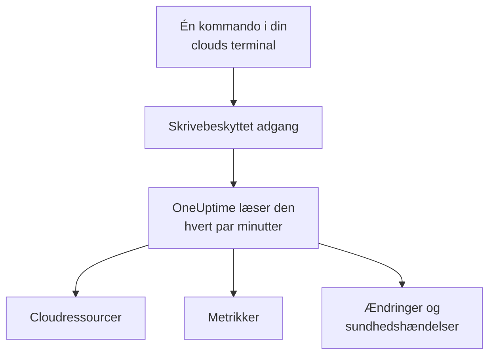

# Forbind en cloudkonto

Forbind en AWS-konto, et Azure-abonnement eller et Google Cloud-projekt fra dashboardet, og OneUptime viser hver ressource i det, læser deres vigtigste metrikker og siger, hvordan hver enkelt har det, registrerer, hvad der er ændret i dem, og hvad din cloududbyder siger om deres tilstand, og læser, hvad kontoen koster, og hvordan den kunne koste mindre. Du kører én kommando i din clouds egen browserterminal og indsætter det, den udskriver: Der er ingen collector at køre og intet at installere.

:::cards
- [Amazon Web Services](#amazon-web-services): En IAM-rolle, som OneUptime logger ind med, eller en adgangsnøgle.
- [Microsoft Azure](#microsoft-azure): En app med rollerne Monitoring Reader og Cost Management Reader.
- [Google Cloud](#google-cloud): En tjenestekonto med seks roller, der kun kan læse.
- [Hvad OneUptime læser](#hvad-oneuptime-læser): Ressourcer, metrikker, ændringer, sundhedshændelser og omkostninger, hvor ofte, og hvad det koster at læse dem.
- [Cloudomkostninger og besparelser](/docs/telemetry/cloud-costs): Hvad hver konto koster, måderne at bruge mindre på og budgetter, der advarer.
- [Stream CloudWatch-metrikker og -logge](/docs/telemetry/cloud-streaming): Hver metrik inden for minutter, og CloudWatch Logs, via Amazon Data Firehose.
- [Stream Azure Monitor-metrikker og -logge](/docs/telemetry/cloud-streaming-azure): Nøglemetrikker inden for minutter og ressourcelogge, læst fra hændelseshubs i dit abonnement.
- [Stream Google Cloud-logge](/docs/telemetry/cloud-streaming-google-cloud): Hver log, så snart den skrives, pushet via Pub/Sub.
- [Datasikkerhed](#datasikkerhed): Hvad forbindelsen lader Datasikkerhed læse, og hvad hvert niveau tilføjer til kommandoen.
- [Lad AI rette problemer](#lad-ai-rette-problemer): Én kommando mere, så kan OneUptime AI rette det, den finder.
:::

## Sådan virker det



- **Adgangen kan kun læse.** Kommandoen opretter en adgang, der læser dine ressourcer og deres opsætning, deres metrikker, hvad der er ændret, din udbyders sundhedshændelser og hvad kontoen koster, og intet andet: handlingerne nedenfor på AWS, rollerne **Monitoring Reader** og **Cost Management Reader** på Azure og seks læseroller på Google Cloud. OneUptime læser aldrig data eller hemmeligheder med den, undtagen loglinjer, når du lader AI læse en kontos logs, og indholdsprøver, når du slår dem til for [Datasikkerhed](#datasikkerhed). Slet den for at lukke OneUptime ude.
- **OneUptime læser efter en tidsplan.** Hvert 5. minut for Azure og Google Cloud og hvert 10. minut for AWS, medmindre du vælger et andet interval, når du forbinder. Hver læsning registrerer også, hvad der er ændret siden den forrige, og hvert 30. minut viser en læsning alle ressourcer igen.
- **Hver ressource får sin egen side.** Ressourcer vises under **Cloud → Alle ressourcer** med deres tilstand, vigtigste metrikker, ejere og etiketter. Siden for en listet ressource viser også dens **Forbundne ressourcer** (hvad den kører i, hvad der sender trafik til den), dens endepunkter, tags og indstillinger og dens **Hændelser**, **Advarsler** og **Ændringer**.
- **Hver konto får sin egen side.** Konti vises under **Cloud → Konti** med deres ressourcer efter type og region, deres **Omkostninger**, deres **Ændringer** og en **Topologi** over, hvordan deres ressourcer hænger sammen.
- **Cloud åbner på sin oversigt.** **Cloud → Oversigt** viser de ressourcer, der kræver opmærksomhed, og hvorfor, hvad kontiene koster i denne måned, og hvad dine clouds siger kunne spares. [Cloudomkostninger og besparelser](/docs/telemetry/cloud-costs) forklarer, hvordan omkostninger, besparelser og budgetter læses. Når dine konti kører apps på administrerede app-platforme, tæller kortet **App-platforme** deres miljøer og apps, og hvert tal åbner den liste i App-platforme, allerede filtreret til de konti.
- **OneUptime AI læser, hvad der er ændret.** En undersøgelse af en hændelse eller en advarsel, der er tilknyttet en cloud-ressource, læser først den ressources ændringer og læser kontoens aktivitetslog igen, når den starter.

## Før du begynder

- **En projektejer eller -administrator.** Kun de kan forbinde, teste og redigere cloudkonti.
- **Din clouds terminal** (AWS CloudShell, Azure Cloud Shell eller Google Cloud Shell), logget ind som en, der må oprette en IAM-rolle eller -bruger, en appregistrering eller en tjenestekonto.

## Amazon Web Services

:::steps
### Åbn AWS-formularen

Gå til **Cloud → Forbind**, og vælg **Amazon Web Services**.

### Kør kommandoen i AWS CloudShell

Vælg, hvordan OneUptime logger ind. En **IAM-rolle** er den anbefalede måde: Intet hemmeligt gemmes, og du kan slette rollen når som helst. Formularen viser kommandoen skrevet til dit projekt: Den opretter en rolle, der stoler på OneUptimes AWS-konto med dit projekts eksterne id, og udskriver rollens ARN.

Under **Hvad der skal læses** vælger du denne konto eller hver konto i din AWS Organization. Kør organisationens kommando i dens administrationskonto: Den tilføjer et StackSet, der lægger den samme rolle i hver konto, nu og efterhånden som konti kommer til, og lader administrationskontoens rolle vise kontiene. Én forbindelse læser op til 50 konti.

Brug en **Adgangsnøgle**, når en rolle ikke er mulig: Den læser kun sin egen konto. Denne kommando opretter en bruger med de samme tilladelser og udskriver brugerens nøgle:

```bash
aws iam create-user --user-name OneUptimeReadOnly > /dev/null 2>&1 || true
aws iam put-user-policy --user-name OneUptimeReadOnly --policy-name OneUptimeReadOnly --policy-document '{"Version":"2012-10-17","Statement":[{"Effect":"Allow","Action":["cloudwatch:GetMetricData","cloudwatch:ListMetrics","tag:GetResources","iam:ListAccountAliases","cloudformation:ListResources","ec2:DescribeInstances","ec2:DescribeVolumes","ec2:DescribeVpcs","ec2:DescribeNatGateways","autoscaling:DescribeAutoScalingGroups","elasticloadbalancing:DescribeLoadBalancers","elasticloadbalancing:DescribeLoadBalancerAttributes","elasticloadbalancing:DescribeTargetGroups","elasticloadbalancing:DescribeTargetGroupAttributes","elasticloadbalancing:DescribeTargetHealth","elasticloadbalancing:DescribeTags","ecs:ListClusters","ecs:DescribeClusters","ecs:ListServices","ecs:DescribeServices","lambda:ListFunctions","rds:DescribeDBInstances","rds:DescribeDBClusters","elasticache:DescribeReplicationGroups","sqs:ListQueues","sqs:GetQueueAttributes","sns:ListTopics","sns:GetTopicAttributes","sns:ListSubscriptionsByTopic","dynamodb:ListTables","dynamodb:DescribeTable","kinesis:ListStreams","kinesis:DescribeStreamSummary","states:ListStateMachines","states:DescribeStateMachine","cloudfront:ListDistributions","elasticfilesystem:DescribeFileSystems","es:ListDomainNames","es:DescribeDomains","apprunner:ListServices","apprunner:DescribeService","elasticbeanstalk:DescribeEnvironments","cloudtrail:LookupEvents","health:DescribeEvents","health:DescribeEventDetails","ce:GetCostAndUsage","ce:GetCostAndUsageWithResources","ce:GetSavingsPlansCoverage","ce:GetSavingsPlansUtilization","ce:GetReservationCoverage","ce:GetReservationUtilization","cost-optimization-hub:ListRecommendations","rds:DescribeEvents","autoscaling:DescribeScalingActivities","ec2:DescribeInstanceStatus","ecs:DescribeTaskDefinition","lambda:GetFunctionConfiguration","lambda:GetFunctionConcurrency","lambda:GetAlias","servicequotas:ListServiceQuotas","logs:DescribeLogGroups","logs:FilterLogEvents"],"Resource":"*"},{"Effect":"Allow","Action":["apigateway:GET"],"Resource":["arn:aws:apigateway:*::/restapis*","arn:aws:apigateway:*::/apis*"]}]}'
aws iam create-access-key --user-name OneUptimeReadOnly
```

### Indsæt det, AWS-kommandoen udskrev

Indsæt alt, hvad kommandoen udskrev, i **Det, kommandoen udskrev**. OneUptime finder rollens ARN eller adgangsnøglens id og dens hemmelighed.

### Test og forbind AWS

OneUptime tester forbindelsen, så snart dette trin åbner: Det logger ind, tæller de ressourcer, det finder, og siger, hvad det koster at læse dem. Vælg **Forbind** for at gemme.
:::

Rollen og brugeren kan gøre dette og intet andet:

| Hvad OneUptime bruger dem til | Handlinger |
| --- | --- |
| Finde de ressourcer, der rapporterer metrikker, og læse deres metrikker | `cloudwatch:GetMetricData`, `cloudwatch:ListMetrics` |
| Navngive hver ressource og læse dens tags | `tag:GetResources`, `iam:ListAccountAliases` |
| Vise hver ressource og dens konfiguration gennem Cloud Control | `cloudformation:ListResources`, `ec2:DescribeInstances`, `ec2:DescribeVolumes`, `ec2:DescribeVpcs`, `ec2:DescribeNatGateways`, `autoscaling:DescribeAutoScalingGroups`, `elasticloadbalancing:DescribeLoadBalancers`, `elasticloadbalancing:DescribeLoadBalancerAttributes`, `elasticloadbalancing:DescribeTargetGroups`, `elasticloadbalancing:DescribeTargetGroupAttributes`, `elasticloadbalancing:DescribeTargetHealth`, `elasticloadbalancing:DescribeTags`, `ecs:ListClusters`, `ecs:DescribeClusters`, `ecs:ListServices`, `ecs:DescribeServices`, `lambda:ListFunctions`, `rds:DescribeDBInstances`, `rds:DescribeDBClusters`, `elasticache:DescribeReplicationGroups`, `sqs:ListQueues`, `sqs:GetQueueAttributes`, `sns:ListTopics`, `sns:GetTopicAttributes`, `sns:ListSubscriptionsByTopic`, `dynamodb:ListTables`, `dynamodb:DescribeTable`, `kinesis:ListStreams`, `kinesis:DescribeStreamSummary`, `states:ListStateMachines`, `states:DescribeStateMachine`, `cloudfront:ListDistributions`, `elasticfilesystem:DescribeFileSystems`, `es:ListDomainNames`, `es:DescribeDomains`, `apprunner:ListServices`, `apprunner:DescribeService`, `elasticbeanstalk:DescribeEnvironments`, `apigateway:GET` |
| Læse, hvad der er ændret: kontoens administrationshændelser | `cloudtrail:LookupEvents` |
| Læse AWS' egne sundhedshændelser for kontoen | `health:DescribeEvents`, `health:DescribeEventDetails` |
| Læse, hvad kontoen koster, fra Cost Explorer | `ce:GetCostAndUsage`, `ce:GetCostAndUsageWithResources`, `ce:GetSavingsPlansCoverage`, `ce:GetSavingsPlansUtilization`, `ce:GetReservationCoverage`, `ce:GetReservationUtilization` |
| Læse måderne at bruge mindre på, fra Cost Optimization Hub | `cost-optimization-hub:ListRecommendations` |
| Læse en ressources aktuelle status og seneste hændelser under en undersøgelse | `rds:DescribeEvents`, `autoscaling:DescribeScalingActivities`, `ec2:DescribeInstanceStatus`, `ecs:DescribeTaskDefinition`, `lambda:GetFunctionConfiguration`, `lambda:GetFunctionConcurrency`, `lambda:GetAlias` |
| Læse kontoens kvoter under en undersøgelse | `servicequotas:ListServiceQuotas` |
| Læse loglinjer, kun når du lader AI læse en kontos logs | `logs:DescribeLogGroups`, `logs:FilterLogEvents` |
| Vise organisationens konti fra dens administrationskonto | `organizations:ListAccounts` |

`apigateway:GET` er kun tilladt på API'ernes egne definitioner, aldrig på deres nøgler, og kun administrationskontoens rolle må vise organisationens konti. AWS Health svarer kun konti med en Business-, Enterprise On-Ramp- eller Enterprise-supportplan: Uden en spørger OneUptime igen en dag senere.

> [!NOTE]
> På en selvhostet OneUptime kræver vejen med en **IAM-rolle** en AWS-identitet, der tilhører OneUptime selv: Sæt `CLOUD_CONNECT_AWS_ACCESS_KEY_ID` og `CLOUD_CONNECT_AWS_SECRET_ACCESS_KEY` til nøglen for en IAM-bruger, der må kalde `sts:AssumeRole`. Uden dem tilbyder formularen en **Adgangsnøgle**.

## Microsoft Azure

:::steps
### Åbn Azure-formularen

Gå til **Cloud → Forbind**, og vælg **Microsoft Azure**.

### Kør kommandoen i Azure Cloud Shell

Kommandoen opretter en app med rollerne **Monitoring Reader** og **Cost Management Reader** på dit nuværende abonnement og udskriver dens detaljer med den dato, hvor dens hemmelighed udløber:

```bash
SCOPE="/subscriptions/$(az account show --query id --output tsv)"
OUT=$(az ad sp create-for-rbac --name OneUptimeReadOnly --role "Monitoring Reader" --scopes "$SCOPE")
APP=$(echo "$OUT" | jq -r .appId)
az role assignment create --assignee "$APP" --role "Cost Management Reader" --scope "$SCOPE" > /dev/null
END=$(az ad app credential list --id "$APP" --query "max([].endDateTime)" --output tsv)
echo "$OUT" | jq --arg end "$END" '. + {endDateTime: $end}'
```

Under **Hvad der skal læses** vælger du i stedet hvert abonnement i lejeren, og rollen tildeles lejerens rodadministrationsgruppe:

```bash
SCOPE="/providers/Microsoft.Management/managementGroups/$(az account show --query tenantId --output tsv)"
OUT=$(az ad sp create-for-rbac --name OneUptimeReadOnly --role "Monitoring Reader" --scopes "$SCOPE")
APP=$(echo "$OUT" | jq -r .appId)
az role assignment create --assignee "$APP" --role "Cost Management Reader" --scope "$SCOPE" > /dev/null
END=$(az ad app credential list --id "$APP" --query "max([].endDateTime)" --output tsv)
echo "$OUT" | jq --arg end "$END" '. + {endDateTime: $end}'
```

### Indsæt det, Azure-kommandoen udskrev

Indsæt alt, hvad kommandoen udskrev, i **Det, kommandoen udskrev**. OneUptime finder `tenant`, `appId`, `password` og den dato, hvor den udløber.

### Test og forbind Azure

OneUptime tester forbindelsen, så snart dette trin åbner. Vælg **Forbind** for at gemme.
:::

For at læse flere abonnementer med den samme app skal du give den begge roller på hvert af dem:

```bash
az role assignment create --assignee <APP_ID> --role "Monitoring Reader" --scope /subscriptions/<SUBSCRIPTION_ID>
az role assignment create --assignee <APP_ID> --role "Cost Management Reader" --scope /subscriptions/<SUBSCRIPTION_ID>
```

OneUptime læser hvert abonnement, appen kan læse, op til 50, medmindre du angiver nogle under **Abonnementer**. Appens hemmelighed holder op med at virke på sin udløbsdato: Fra 30 dage før advarer hver læsning om det. Kør kommandoen igen, og indsæt det, den udskriver, for at give den en ny.

## Google Cloud

:::steps
### Åbn Google Cloud-formularen

Gå til **Cloud → Forbind**, og vælg **Google Cloud**.

### Kør kommandoen i Google Cloud Shell

Kør den i det projekt, der skal overvåges. Den slår de API'er til, som OneUptime læser, opretter en tjenestekonto med rollerne **Monitoring Viewer**, **Cloud Asset Viewer**, **Logs Viewer**, **Service Health Viewer**, **BigQuery Job User** og **Compute Recommender Viewer** og udskriver dens nøgle:

```bash
PROJECT_ID=$(gcloud config get-value project)
gcloud services enable monitoring.googleapis.com cloudasset.googleapis.com logging.googleapis.com cloudresourcemanager.googleapis.com servicehealth.googleapis.com bigquery.googleapis.com recommender.googleapis.com
gcloud iam service-accounts create oneuptime-read-only --display-name "OneUptime (read only)" > /dev/null 2>&1 || true
gcloud projects add-iam-policy-binding "$PROJECT_ID" --member "serviceAccount:oneuptime-read-only@$PROJECT_ID.iam.gserviceaccount.com" --role roles/monitoring.viewer --condition=None > /dev/null
gcloud projects add-iam-policy-binding "$PROJECT_ID" --member "serviceAccount:oneuptime-read-only@$PROJECT_ID.iam.gserviceaccount.com" --role roles/cloudasset.viewer --condition=None > /dev/null
gcloud projects add-iam-policy-binding "$PROJECT_ID" --member "serviceAccount:oneuptime-read-only@$PROJECT_ID.iam.gserviceaccount.com" --role roles/logging.viewer --condition=None > /dev/null
gcloud projects add-iam-policy-binding "$PROJECT_ID" --member "serviceAccount:oneuptime-read-only@$PROJECT_ID.iam.gserviceaccount.com" --role roles/servicehealth.viewer --condition=None > /dev/null
gcloud projects add-iam-policy-binding "$PROJECT_ID" --member "serviceAccount:oneuptime-read-only@$PROJECT_ID.iam.gserviceaccount.com" --role roles/bigquery.jobUser --condition=None > /dev/null
gcloud projects add-iam-policy-binding "$PROJECT_ID" --member "serviceAccount:oneuptime-read-only@$PROJECT_ID.iam.gserviceaccount.com" --role roles/recommender.computeViewer --condition=None > /dev/null
gcloud iam service-accounts keys create oneuptime-key.json --iam-account "oneuptime-read-only@$PROJECT_ID.iam.gserviceaccount.com"
cat oneuptime-key.json && rm oneuptime-key.json
```

Under **Hvad der skal læses** vælger du i stedet hvert projekt i organisationen, og rollerne tildeles projektets organisation:

```bash
PROJECT_ID=$(gcloud config get-value project)
ORG_ID=$(gcloud projects get-ancestors "$PROJECT_ID" --format="value(id)" | tail -1)
gcloud services enable monitoring.googleapis.com cloudasset.googleapis.com logging.googleapis.com cloudresourcemanager.googleapis.com servicehealth.googleapis.com bigquery.googleapis.com recommender.googleapis.com
gcloud iam service-accounts create oneuptime-read-only --display-name "OneUptime (read only)" > /dev/null 2>&1 || true
gcloud organizations add-iam-policy-binding "$ORG_ID" --member "serviceAccount:oneuptime-read-only@$PROJECT_ID.iam.gserviceaccount.com" --role roles/monitoring.viewer --condition=None > /dev/null
gcloud organizations add-iam-policy-binding "$ORG_ID" --member "serviceAccount:oneuptime-read-only@$PROJECT_ID.iam.gserviceaccount.com" --role roles/cloudasset.viewer --condition=None > /dev/null
gcloud organizations add-iam-policy-binding "$ORG_ID" --member "serviceAccount:oneuptime-read-only@$PROJECT_ID.iam.gserviceaccount.com" --role roles/logging.viewer --condition=None > /dev/null
gcloud organizations add-iam-policy-binding "$ORG_ID" --member "serviceAccount:oneuptime-read-only@$PROJECT_ID.iam.gserviceaccount.com" --role roles/servicehealth.viewer --condition=None > /dev/null
gcloud organizations add-iam-policy-binding "$ORG_ID" --member "serviceAccount:oneuptime-read-only@$PROJECT_ID.iam.gserviceaccount.com" --role roles/bigquery.jobUser --condition=None > /dev/null
gcloud organizations add-iam-policy-binding "$ORG_ID" --member "serviceAccount:oneuptime-read-only@$PROJECT_ID.iam.gserviceaccount.com" --role roles/recommender.computeViewer --condition=None > /dev/null
gcloud iam service-accounts keys create oneuptime-key.json --iam-account "oneuptime-read-only@$PROJECT_ID.iam.gserviceaccount.com"
cat oneuptime-key.json && rm oneuptime-key.json
```

### Indsæt nøglen

Indsæt alt, hvad kommandoen udskrev. OneUptime læser nøglens eget projekt og gemmer nøglen krypteret.

### Test og forbind Google Cloud

OneUptime tester forbindelsen, så snart dette trin åbner. Vælg **Forbind** for at gemme.
:::

For at læse flere projekter med den samme tjenestekonto skal du give den disse roller i hvert af dem og angive dem under **Projekter**:

```bash
for ROLE in roles/monitoring.viewer roles/cloudasset.viewer roles/logging.viewer roles/servicehealth.viewer roles/recommender.computeViewer; do gcloud projects add-iam-policy-binding <PROJECT_ID> --member "serviceAccount:oneuptime-read-only@<KEY_PROJECT_ID>.iam.gserviceaccount.com" --role "$ROLE"; done
```

En organisations forbindelse læser op til 50 af dens projekter, medmindre du angiver nogle under **Projekter**.

Google Cloud har intet API til et projekts omkostninger: OneUptime læser dem fra din faktureringskontos eksport til BigQuery, så snart du angiver dens tabel under **Tabel for faktureringseksport**. [Cloudomkostninger og besparelser](/docs/telemetry/cloud-costs#google-cloud) viser hvordan.

## Datasikkerhed

Den samme forbindelse kan lade [Datasikkerhed](/docs/data-security/index) læse kontoens datalagre: dens buckets, databaser og datavarehuse. Under **Flere felter** står **Datasikkerhed** på **Fra**, indtil du vælger andet, og den kommando, formularen viser, ændrer sig med dit valg:

| Datasikkerhed | Hvad Datasikkerhed må læse | Hvad kommandoen tilføjer |
| --- | --- | --- |
| **Fra** | Ingen af kontoens datalagre | Intet |
| **Kun konfiguration** | Hvem der kan nå hvert datalager, og hvordan det er krypteret, sikkerhedskopieret og logget. Aldrig data. | På AWS en ekstra inline-politik, `OneUptimeDataSecurity`, med læsehandlinger. På Azure og Google Cloud intet: **Monitoring Reader** og **Cloud Asset Viewer** læser det allerede. |
| **Konfiguration og indholdsprøver** | Det samme og prøver af objekter og rækker for at finde følsomme data i dem | På AWS den samme politik med `s3:ListBucket`, `s3:GetObject` og `kms:Decrypt` kun via S3. På Azure **Storage Blob Data Reader**. På Google Cloud `roles/storage.objectViewer` og `roles/bigquery.dataViewer`. |

På AWS tilføjer rollens kommando politikken med én linje mere. På indholdsniveauet er det:

```bash
aws iam put-role-policy --role-name "$ROLE" --policy-name OneUptimeDataSecurity --policy-document '{"Version":"2012-10-17","Statement":[{"Effect":"Allow","Action":["s3:ListAllMyBuckets","s3:GetBucketLocation","s3:GetBucketPolicyStatus","s3:GetBucketPublicAccessBlock","s3:GetAccountPublicAccessBlock","s3:GetBucketAcl","s3:GetBucketPolicy","s3:GetEncryptionConfiguration","s3:GetBucketVersioning","s3:GetBucketLogging","s3:GetBucketOwnershipControls","s3:GetReplicationConfiguration","s3:GetBucketTagging","rds:DescribeDBInstances","rds:DescribeDBClusters","rds:DescribeDBSnapshots","rds:DescribeDBSnapshotAttributes","rds:DescribeDBClusterSnapshots","rds:DescribeDBClusterSnapshotAttributes","dynamodb:ListTables","dynamodb:DescribeTable","dynamodb:DescribeContinuousBackups","redshift:DescribeClusters","redshift:DescribeLoggingStatus","es:ListDomainNames","es:DescribeDomains","elasticache:DescribeReplicationGroups","elasticfilesystem:DescribeFileSystems","kms:ListAliases","iam:GetAccountAuthorizationDetails","iam:GenerateCredentialReport","iam:GetCredentialReport"],"Resource":"*"},{"Effect":"Allow","Action":["s3:ListBucket"],"Resource":"arn:aws:s3:::*"},{"Effect":"Allow","Action":["s3:GetObject"],"Resource":"arn:aws:s3:::*/*"},{"Effect":"Allow","Action":["kms:Decrypt"],"Resource":"*","Condition":{"StringLike":{"kms:ViaService":"s3.*.amazonaws.com"}}}]}'
```

IAM begrænser en brugers egne inline-politikker til 2.048 tegn i alt, så med en **Adgangsnøgle** lægges politikken på en gruppe, `OneUptimeDataSecurity`, som brugeren bliver medlem af:

```bash
aws iam create-user --user-name OneUptimeReadOnly > /dev/null 2>&1 || true
aws iam put-user-policy --user-name OneUptimeReadOnly --policy-name OneUptimeReadOnly --policy-document '{"Version":"2012-10-17","Statement":[{"Effect":"Allow","Action":["cloudwatch:GetMetricData","cloudwatch:ListMetrics","tag:GetResources","iam:ListAccountAliases","cloudformation:ListResources","ec2:DescribeInstances","ec2:DescribeVolumes","ec2:DescribeVpcs","ec2:DescribeNatGateways","autoscaling:DescribeAutoScalingGroups","elasticloadbalancing:DescribeLoadBalancers","elasticloadbalancing:DescribeLoadBalancerAttributes","elasticloadbalancing:DescribeTargetGroups","elasticloadbalancing:DescribeTargetGroupAttributes","elasticloadbalancing:DescribeTargetHealth","elasticloadbalancing:DescribeTags","ecs:ListClusters","ecs:DescribeClusters","ecs:ListServices","ecs:DescribeServices","lambda:ListFunctions","rds:DescribeDBInstances","rds:DescribeDBClusters","elasticache:DescribeReplicationGroups","sqs:ListQueues","sqs:GetQueueAttributes","sns:ListTopics","sns:GetTopicAttributes","sns:ListSubscriptionsByTopic","dynamodb:ListTables","dynamodb:DescribeTable","kinesis:ListStreams","kinesis:DescribeStreamSummary","states:ListStateMachines","states:DescribeStateMachine","cloudfront:ListDistributions","elasticfilesystem:DescribeFileSystems","es:ListDomainNames","es:DescribeDomains","apprunner:ListServices","apprunner:DescribeService","elasticbeanstalk:DescribeEnvironments","cloudtrail:LookupEvents","health:DescribeEvents","health:DescribeEventDetails","ce:GetCostAndUsage","ce:GetCostAndUsageWithResources","ce:GetSavingsPlansCoverage","ce:GetSavingsPlansUtilization","ce:GetReservationCoverage","ce:GetReservationUtilization","cost-optimization-hub:ListRecommendations","rds:DescribeEvents","autoscaling:DescribeScalingActivities","ec2:DescribeInstanceStatus","ecs:DescribeTaskDefinition","lambda:GetFunctionConfiguration","lambda:GetFunctionConcurrency","lambda:GetAlias","servicequotas:ListServiceQuotas","logs:DescribeLogGroups","logs:FilterLogEvents"],"Resource":"*"},{"Effect":"Allow","Action":["apigateway:GET"],"Resource":["arn:aws:apigateway:*::/restapis*","arn:aws:apigateway:*::/apis*"]}]}'
aws iam create-group --group-name OneUptimeDataSecurity > /dev/null 2>&1 || true
aws iam put-group-policy --group-name OneUptimeDataSecurity --policy-name OneUptimeDataSecurity --policy-document '{"Version":"2012-10-17","Statement":[{"Effect":"Allow","Action":["s3:ListAllMyBuckets","s3:GetBucketLocation","s3:GetBucketPolicyStatus","s3:GetBucketPublicAccessBlock","s3:GetAccountPublicAccessBlock","s3:GetBucketAcl","s3:GetBucketPolicy","s3:GetEncryptionConfiguration","s3:GetBucketVersioning","s3:GetBucketLogging","s3:GetBucketOwnershipControls","s3:GetReplicationConfiguration","s3:GetBucketTagging","rds:DescribeDBInstances","rds:DescribeDBClusters","rds:DescribeDBSnapshots","rds:DescribeDBSnapshotAttributes","rds:DescribeDBClusterSnapshots","rds:DescribeDBClusterSnapshotAttributes","dynamodb:ListTables","dynamodb:DescribeTable","dynamodb:DescribeContinuousBackups","redshift:DescribeClusters","redshift:DescribeLoggingStatus","es:ListDomainNames","es:DescribeDomains","elasticache:DescribeReplicationGroups","elasticfilesystem:DescribeFileSystems","kms:ListAliases","iam:GetAccountAuthorizationDetails","iam:GenerateCredentialReport","iam:GetCredentialReport"],"Resource":"*"},{"Effect":"Allow","Action":["s3:ListBucket"],"Resource":"arn:aws:s3:::*"},{"Effect":"Allow","Action":["s3:GetObject"],"Resource":"arn:aws:s3:::*/*"},{"Effect":"Allow","Action":["kms:Decrypt"],"Resource":"*","Condition":{"StringLike":{"kms:ViaService":"s3.*.amazonaws.com"}}}]}'
aws iam add-user-to-group --user-name OneUptimeReadOnly --group-name OneUptimeDataSecurity
aws iam create-access-key --user-name OneUptimeReadOnly
```

På Azure tilføjer indholdsniveauet **Storage Blob Data Reader** på det samme scope som **Monitoring Reader**:

```bash
SCOPE="/subscriptions/$(az account show --query id --output tsv)"
OUT=$(az ad sp create-for-rbac --name OneUptimeReadOnly --role "Monitoring Reader" --scopes "$SCOPE")
APP=$(echo "$OUT" | jq -r .appId)
az role assignment create --assignee "$APP" --role "Cost Management Reader" --scope "$SCOPE" > /dev/null
az role assignment create --assignee "$APP" --role "Storage Blob Data Reader" --scope "$SCOPE" > /dev/null
END=$(az ad app credential list --id "$APP" --query "max([].endDateTime)" --output tsv)
echo "$OUT" | jq --arg end "$END" '. + {endDateTime: $end}'
```

På Google Cloud tilføjer det de to roller:

```bash
PROJECT_ID=$(gcloud config get-value project)
gcloud services enable monitoring.googleapis.com cloudasset.googleapis.com logging.googleapis.com cloudresourcemanager.googleapis.com servicehealth.googleapis.com bigquery.googleapis.com recommender.googleapis.com
gcloud iam service-accounts create oneuptime-read-only --display-name "OneUptime (read only)" > /dev/null 2>&1 || true
gcloud projects add-iam-policy-binding "$PROJECT_ID" --member "serviceAccount:oneuptime-read-only@$PROJECT_ID.iam.gserviceaccount.com" --role roles/monitoring.viewer --condition=None > /dev/null
gcloud projects add-iam-policy-binding "$PROJECT_ID" --member "serviceAccount:oneuptime-read-only@$PROJECT_ID.iam.gserviceaccount.com" --role roles/cloudasset.viewer --condition=None > /dev/null
gcloud projects add-iam-policy-binding "$PROJECT_ID" --member "serviceAccount:oneuptime-read-only@$PROJECT_ID.iam.gserviceaccount.com" --role roles/logging.viewer --condition=None > /dev/null
gcloud projects add-iam-policy-binding "$PROJECT_ID" --member "serviceAccount:oneuptime-read-only@$PROJECT_ID.iam.gserviceaccount.com" --role roles/servicehealth.viewer --condition=None > /dev/null
gcloud projects add-iam-policy-binding "$PROJECT_ID" --member "serviceAccount:oneuptime-read-only@$PROJECT_ID.iam.gserviceaccount.com" --role roles/bigquery.jobUser --condition=None > /dev/null
gcloud projects add-iam-policy-binding "$PROJECT_ID" --member "serviceAccount:oneuptime-read-only@$PROJECT_ID.iam.gserviceaccount.com" --role roles/recommender.computeViewer --condition=None > /dev/null
gcloud projects add-iam-policy-binding "$PROJECT_ID" --member "serviceAccount:oneuptime-read-only@$PROJECT_ID.iam.gserviceaccount.com" --role roles/storage.objectViewer --condition=None > /dev/null
gcloud projects add-iam-policy-binding "$PROJECT_ID" --member "serviceAccount:oneuptime-read-only@$PROJECT_ID.iam.gserviceaccount.com" --role roles/bigquery.dataViewer --condition=None > /dev/null
gcloud iam service-accounts keys create oneuptime-key.json --iam-account "oneuptime-read-only@$PROJECT_ID.iam.gserviceaccount.com"
cat oneuptime-key.json && rm oneuptime-key.json
```

Et lavere niveaus kommando erstatter AWS-politikken med den lavere. **Fra** tilføjer intet, så det lader det, en tidligere kommando gav adgang til, blive på plads, indtil du sletter det: politikken `OneUptimeDataSecurity` på AWS med `aws iam delete-role-policy --role-name <your role> --policy-name OneUptimeDataSecurity` og indholdsniveauets roller på Azure og Google Cloud. Datasikkerhed holder under alle omstændigheder straks op med at læse: den læser kun det, forbindelsens niveau angiver. [Konfigurer Datasikkerhed](/docs/data-security/setup) viser hver handling i politikken, og hvad Datasikkerhed gemmer af det, den læser.

## Hvad OneUptime læser

| | AWS | Azure | Google Cloud |
| --- | --- | --- | --- |
| Ressourcer | Hver ressource af de typer, OneUptime kender, i hver region, du bruger, fra Cloud Control | Hver ressource i abonnementerne, fra Resource Graph | Hver ressource i projekterne, fra Cloud Asset Inventory |
| Metrikker | De vigtigste metrikker for hver tjeneste, såsom en instans' CPU, netværk og statustjek | Op til 8 vigtige metrikker pr. ressource | De vigtigste metrikker for hver ressourcetype |
| Ændringer | CloudTrails administrationshændelser | Aktivitetsloggens administrative hændelser | Auditloggen Admin Activity |
| Sundhedshændelser | AWS Health | Service Health og Resource Health | Service Health |
| Omkostninger | Hver dags, efter tjeneste og region, og efter ressource med Omkostninger pr. ressource slået til, fra Cost Explorer | Hver dags, efter ressource og tjeneste, fra Cost Management | Hver dags, efter tjeneste, region og ressource, fra din faktureringseksport til BigQuery |
| Måder at bruge mindre på | Cost Optimization Hub | Azure Advisor | Recommender |
| Forpligtelser | Savings Plans og Reserved Instances: hvad de dækker, og hvor meget af dem der bruges, fra Cost Explorer | Besparelsesplaner og reservationer, fra Cost Management | Rabatter for forpligtet brug, fra din faktureringseksport til BigQuery |
| Læses hvert | 10. minut | 5. minut | 5. minut |
| En slettet ressource | Arkiveres, når en fuld liste ikke længere har den | Arkiveres, når en fuld liste ikke længere har den | Arkiveres, når en fuld liste ikke længere har den |

Hver læsning fortsætter, hvor den forrige stoppede, så hvert datapunkt og hver ændring skrives én gang. Med **Cloud-auditlogs** slået til i Sikkerhedshændelser gemmer de samme læsninger også kontienes auditlogs som [sikkerhedshændelser](/docs/telemetry/security-events#læs-auditlogs-fra-dine-cloudkonti). En ny forbindelses første læsning starter inden for et minut og går en time tilbage for metrikker og 2 timer tilbage for ændringer; efter en pause går en læsning højst 6 timer tilbage. En ressource, der kun rapporterer metrikker, og som ingen liste har, arkiveres efter 7 dage uden metrikker. Omkostninger læses to gange om dagen, og måderne at bruge mindre på og forpligtelserne én gang om dagen.

De kald, OneUptime foretager, faktureres til din cloudkonto til din clouds priser. At vise ressourcer, læse ændringer og sundhedshændelser, læse måderne at bruge mindre på og læse Azures omkostninger koster intet; at læse metrikker gør, og det samme gør det at læse AWS' og Google Clouds omkostninger. Testen anslår prisen for det, den finder, og at læse sjældnere koster mindre: Skift **Interval for læsning af metrikker** under **Flere felter**.

| Cloud | Pris |
| --- | --- |
| AWS | CloudWatch `GetMetricData`: $0.01 pr. 1.000 metrikker, og hver vigtig metrik for en ressource er én metrik pr. læsning |
| AWS-omkostninger | Cost Explorer: $0.01 pr. forespørgsel. En læsning af omkostningerne laver nogle få, forpligtelserne fire om dagen og Omkostninger pr. ressource nogle få mere om dagen |
| Azure | De første 1.000.000 metriklæsninger om måneden for hvert abonnement er gratis, derefter $0.01 pr. 1.000 |
| Google Cloud | De første 1.000.000 læste tidsserier om måneden er gratis, derefter $0.50 pr. million |
| Google Cloud-omkostninger | BigQuery fakturerer forespørgslen på din faktureringseksport: den første 1 TiB om måneden er gratis, derefter $6.25 pr. TiB |

Et Service Bus- eller Event Hubs-navneområdes vigtigste metrikker læses for hver af dets køer, emner og event hubs, opdelt efter dimensionen `EntityName`, i det samme ene kald pr. navneområde og læsning: med en læsning hvert 5. minut koster et navneområde med 50 køer 12 kald i timen, lige så meget som et navneområde med én kø. En læsning tager op til 1.000 af dem pr. navneområde og siger det, når der er flere. Metrikkerne for hver af dem vises på dens side under [Køer](/docs/telemetry/queues#azure-service-bus), tildelt sådan som collectorens `azure_monitor`-receiver tildeler dem, og hvor den receiver også læser en metrik for en kø, beholdes dens værdier, og forbindelsens udelades, så intet tælles to gange.

## Det, du ser i OneUptime

- **En kontos side.** Under **Cloud → Konti** tæller en kontos oversigt dens ressourcer efter type og region og siger, hvornår en forbindelse sidst læste den. Dens **Ressourcer** viser dem, dens **Ændringer** viser, hvad der er ændret i den, nyeste først, og dens **Topologi** tegner dens regioner, netværkene i dem og hvad der kører i hvert, med de åbne hændelser og advarsler på de ressourcer, de er tilknyttet. På **Ændringer** står der **OneUptime AI** ved en ændring, som OneUptime AI har foretaget, med den hændelse eller advarsel, den rettede, hvem der godkendte den, eller at den kørte af sig selv, og et link til dens post på kontoens side **AI-logs**. Dens **Feed** registrerer, hvordan kontoen kom til OneUptime, hvornår dens Cloud-AI-agent oprettede forbindelse eller blev nulstillet, og hvem der ændrede, hvad OneUptime AI må gøre i den.
- **En ressources ændringer.** En ændring gemmes som en ændringshændelse, der er knyttet til den ressource, den ændrede, og til dens konto, og tegnes som en markør i ressourcens metrikdiagrammer sammen med dens hændelser og advarsler. Diagrammer, der ikke er filtreret til nogen ressource, udelader en cloudkontos aktivitetslog, så en travl konto ikke fortrænger dine udrulninger; udbyderens sundhedshændelser bliver på dem.
- **Hændelser og advarsler.** Tilknyt en cloud-ressource til en overvågning, en hændelse eller en advarsel under dens tilknyttede ressourcer, og dens hændelser og advarsler vises på ressourcens side. En overvågning af et websted, en API, SSL, ping eller en port, hvis vært fører til et endepunkt for en ressource, direkte eller gennem dens DNS, viser ressourcen under **Foreslåede cloud-ressourcer** på sit kort **Tilknyttede ressourcer**: Vælg **Tilknyt ressource** for at tilknytte den.
- **En ressources tilstand.** Hver læsning gemmer den nyeste værdi af en ressources vigtigste metrikker og vurderer dem: En ressource viser **Sund**, **Forringet** eller **Usund**, med årsagen, f.eks. statustjek, der fejler, eller lager, der næsten er fuldt, og **Rapporterer ikke**, når dens metrikker stopper. **Cloud → Oversigt** og en kontos oversigt viser, hvad der kræver opmærksomhed, det mest presserende først.
- **Anbefalede monitorer.** En kontos **Anbefalinger** viser de monitorer, OneUptime anbefaler til dens ressourcer, efter ressourcetype, med de ressourcer, hver er til, og hvor mange der allerede har den: Tilføj en til en ressource, eller til alle ressourcer af dens type på én gang, og sidemenuen tæller dem, der stadig skal sættes op. En ressources fane **Anbefalinger** tilbyder dens egne. Hver monitor læser de vigtigste metrikker, forbindelsen læser, hvert 5. minut, over de seneste 30 minutter på AWS og de seneste 15 på Azure og Google Cloud, og er knyttet til sin ressource. Et antal, såsom fejl eller begrænsede anmodninger, lægges sammen over det vindue, så en konto, der [streamer sine metrikker](/docs/telemetry/cloud-streaming), og en, der læses, advarer ens, den streamede tidligere. De dage, et certifikat har tilbage, som ACM udgiver to gange om dagen, læses én gang i timen: dets monitor læser de seneste 2 dage og advarer, så snart certifikatet har 30 dage eller færre tilbage, eller når ACM holder op med at udgive dem, fordi det er udløbet. En RDS-instans' forbindelser måles mod 90 % af forbindelsesgrænsen for dens klasse og motor. Mens en [vedligeholdelseshændelse](/docs/scheduled-maintenance/creating-events) indeholder en ressource, åbner dens monitorer ingen hændelse eller advarsel.
- **Hvad kontiene koster.** **Cloud → Forbrug → Omkostninger** tegner hver dags forbrug, og hvor det går hen, **Cloud → Forbrug → Besparelser** viser måderne at bruge mindre på, og **Cloud → Forbrug → Budgetter** advarer, før en måned koster mere, end den bør: [Cloudomkostninger og besparelser](/docs/telemetry/cloud-costs).

## Lad AI rette problemer

OneUptime AI læser alle forbundne konti, mens den undersøger, med den skrivebeskyttede adgang ovenfor. Hvis den også skal rette problemer, for eksempel genstarte en tjeneste, skalere den ud eller rulle den tilbage, så åbn kontoen under **Cloud → Konti**, og vælg **Lad AI rette problemer** på kortet **AI-agent** i dens **Oversigt**.

Dialogen stiller ét spørgsmål, **Hvor langt må AI gå?**: **Spørg mig først**, standarden, hvor OneUptime AI foreslår hver rettelse, og en person godkender den med ét klik, eller **Ret sikre problemer på egen hånd**, hvor sikre ændringer kører automatisk, og mere risikable stadig venter på godkendelse. Alt andet har en sikker standard under **Flere felter**. Derefter viser den én kommando, skrevet til denne konto: kør den i AWS CloudShell, Azure Cloud Shell eller Google Cloud Shell, logget ind som en, der må oprette roller i kontoen. Kommandoen opretter en rolle, der kun må foretage de ændringer, der er slået til, og starter Cloud-AI-agenten med den i din konto. Agenten opretter selv forbindelse inden for få minutter, og dialogen siger det: der er intet at indsætte tilbage.

Kommandoen indeholder en nøgle, der kun er lavet til denne kontos agent, og som virker i en dag, indtil agenten forbinder med den: Åbn dialogen igen for at få en ny. Kun den, der må nulstille agenten og redigere kontoen, får en.

På en AWS-konto, som en forbindelse, der læser en AWS Organization, har fundet, spørger dialogen også **Hvilke konti?**: valget **Alle konti i organisationen** sætter en agent op i hver af dens konti med én kommando i administrationskontoens AWS CloudShell, hver agent med sin egen nøgle og den samme rolle med mindst mulige rettigheder, og viser, hvilke agenter der har forbundet.

Agenten kører hele måneden i din konto, faktureret af din cloud til dens listepriser. I Google Cloud kører den på sin egen lille VM i et netværk, der ikke lukker noget ind; til et projekt, hvis organisation ikke giver nogen VM en ekstern IP-adresse, skal du vælge **Cloud Run** under **Hvor agenten kører** i **Flere felter**:

| Cloud | Hvad der kører | Cirka |
| --- | --- | --- |
| AWS | Én ECS Fargate-opgave på 0.25 vCPU og 0.5 GB og dens offentlige IPv4-adresse til priserne i `us-east-1` | $13 om måneden |
| Azure | Én Container Apps-replika på 0.25 vCPU og 0.5 GiB efter abonnementets månedlige gratis tildeling på 180.000 vCPU-sekunder og 360.000 GiB-sekunder | $14 om måneden |
| Google Cloud | Én `e2-micro`-VM i Compute Engine med dens standardstartdisk på 10 GB og dens eksterne IPv4-adresse til priserne i `us-central1`. Google Clouds gratis niveau dækker én `e2-micro`-VM om måneden i `us-central1`, `us-west1` og `us-east1` | $10 om måneden |
| Google Cloud, på Cloud Run | Én Cloud Run-instans på 1 vCPU og 0.5 GiB med CPU altid allokeret, som optager en hel vCPU, efter det månedlige gratis niveau på 240.000 vCPU-sekunder og 450.000 GiB-sekunder | $45 om måneden |

Hvad agenten må ændre, hvordan hver ændring placeres i et niveau og fortrydes, og hvordan du læser dens logs: [AI-agenter til infrastruktur](/docs/ai/infrastructure-ai-agents#i-en-cloudkonto).

## Fejlfinding

:::details Testen siger, at nøglen eller hemmeligheden ikke blev accepteret
Kopiér alt, hvad kommandoen udskrev, og indsæt det igen. En nøgle, der blev oprettet for et minut siden, kan være et minut om at virke. En udløbet Azure-hemmelighed afvises også: Kør kommandoen igen.
:::

:::details Testen logger ind, men kan ikke læse
Kør kommandoen igen: Den tildeler de roller, OneUptime har brug for. På AWS skal du køre den kommando, formularen viser for dette projekt: En rolle, der er lavet til et andet projekt, stoler på det projekts eksterne id, ikke på dette projekts.
:::

:::details Google Cloud lader ikke kommandoen oprette en nøgle
En organisationspolitik, `iam.disableServiceAccountKeyCreation`, kan forbyde nøgler til tjenestekonti. Bed din organisations administrator om en undtagelse for projektet, eller [send metrikkerne med din egen collector](/docs/telemetry/cloud-resources).
:::

:::details Der vises ingen ressourcer
Den første læsning viser hver ressource i kontoen, uanset om den rapporterer metrikker. Hvis en forbindelse ikke virker, siger **Vis fejl** under **Cloud → Forbind**, hvorfor dens seneste læsning mislykkedes.
:::

:::details Nogle af organisationens konti mangler
Én forbindelse læser op til 50 konti, abonnementer eller projekter, og hver læsning siger det, når der er flere. Forbind de andre med en forbindelse for sig.
:::

:::details En læsning har advarsler
En læsning, der virker, kan stadig udelade noget, fx en metrik, som din cloud ikke returnerede for nogle ressourcer, eller køerne i et navneområde ud over de første 1.000. Under **Cloud → Forbind** siger forbindelsens status så, hvor mange advarsler dens seneste læsning havde: vælg dem for at læse hver enkelt.
:::

## Næste trin

:::cards
- [Cloudressourcer](/docs/telemetry/cloud-resources): Kør i stedet din egen OpenTelemetry Collector, eller stream CloudWatch-metrikker.
- [Udrulninger og ændringer](/docs/telemetry/change-events): Hver ændring, OneUptime registrerer, og hvordan OneUptime AI læser dem.
- [Metrikmonitor](/docs/monitor/metrics-monitor): Få besked ud fra en ressources metrikker.
:::
