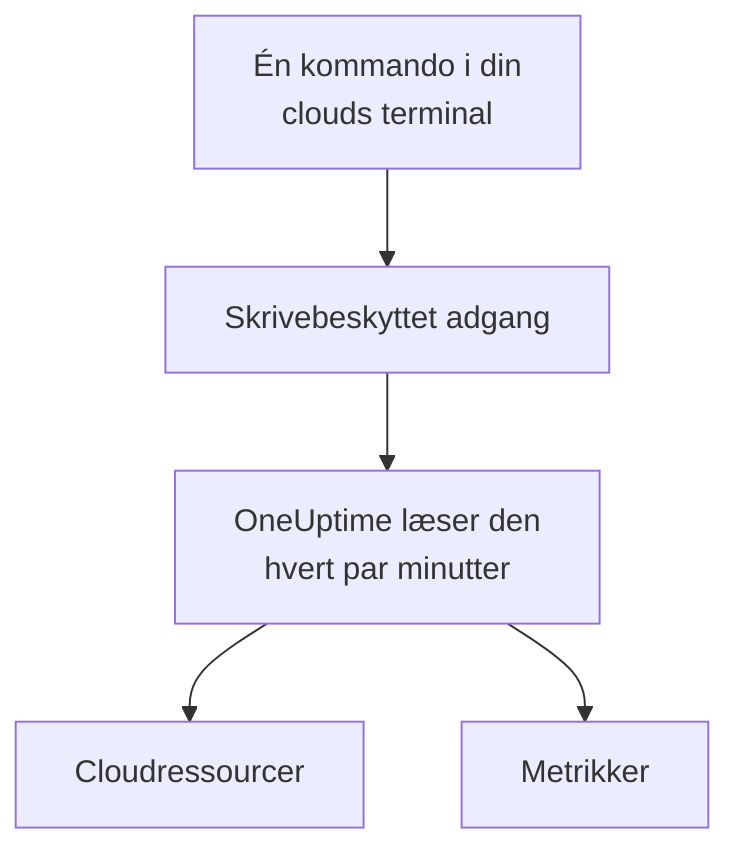

# Forbind en cloudkonto

Forbind en AWS-konto, et Azure-abonnement eller et Google Cloud-projekt fra dashboardet, og OneUptime viser dets ressourcer og læser deres vigtigste metrikker efter en tidsplan. Du kører én kommando i din clouds egen browserterminal og indsætter det, den udskriver: der er ingen collector at køre og intet at installere.

:::cards
- [Amazon Web Services](#amazon-web-services): En IAM-rolle, som OneUptime logger ind med, eller en adgangsnøgle.
- [Microsoft Azure](#microsoft-azure): En app med rollen Monitoring Reader.
- [Google Cloud](#google-cloud): En tjenestekonto med rollen Monitoring Viewer.
- [Hvad OneUptime læser](#hvad-oneuptime-læser): Hvilke ressourcer og metrikker, hvor ofte, og hvad det koster.
:::

## Sådan virker det



- **Adgangen kan kun læse.** Kommandoen opretter en adgang, der læser metrikker og intet andet: tre læsehandlinger på AWS, rollen **Monitoring Reader** på Azure og rollen **Monitoring Viewer** på Google Cloud. Slet den for at lukke OneUptime ude.
- **OneUptime læser efter en tidsplan.** Hvert 5. minut for Azure og Google Cloud og hvert 10. minut for AWS, medmindre du vælger et andet interval, når du forbinder.
- **Hver ressource får sin egen side.** Ressourcer vises under **Cloud → Alle ressourcer** med deres vigtigste metrikker, ejere og etiketter, ligesom de ressourcer, en collector rapporterer.

## Før du begynder

- **En projektejer eller -administrator.** Kun de kan forbinde, teste og redigere cloudkonti.
- **Din clouds terminal** (AWS CloudShell, Azure Cloud Shell eller Google Cloud Shell), logget ind som en, der må oprette en IAM-rolle eller -bruger, en appregistrering eller en tjenestekonto.

## Amazon Web Services

:::steps
### Åbn AWS-formularen

Gå til **Cloud → Forbind**, og vælg **Amazon Web Services**.

### Kør kommandoen i AWS CloudShell

Vælg, hvordan OneUptime logger ind. En **IAM-rolle** er den anbefalede måde: intet hemmeligt gemmes, og du kan slette rollen når som helst. Formularen viser kommandoen, skrevet til dit projekt: den opretter en rolle, der stoler på OneUptimes AWS-konto med dit projekts eksterne id, og udskriver rollens ARN. Brug en **Adgangsnøgle**, når en rolle ikke er mulig. Denne kommando opretter en bruger med de samme tilladelser og udskriver dens nøgle:

```bash
aws iam create-user --user-name OneUptimeReadOnly > /dev/null 2>&1 || true
aws iam put-user-policy --user-name OneUptimeReadOnly --policy-name OneUptimeReadOnly --policy-document '{"Version":"2012-10-17","Statement":[{"Effect":"Allow","Action":["cloudwatch:GetMetricData","cloudwatch:ListMetrics","tag:GetResources"],"Resource":"*"}]}'
aws iam create-access-key --user-name OneUptimeReadOnly
```

### Indsæt det, AWS-kommandoen udskrev

Indsæt alt, hvad kommandoen udskrev, i **Det, kommandoen udskrev**. OneUptime finder rollens ARN eller adgangsnøgle-id'et og dets hemmelighed.

### Test og forbind AWS

OneUptime tester forbindelsen, når trinnet åbner: den logger ind, tæller de ressourcer, den finder, og siger, hvad det koster at læse dem. Vælg **Forbind** for at gemme.
:::

Rollen og brugeren kan gøre tre ting og intet andet:

| Handling | Hvad OneUptime bruger den til |
| --- | --- |
| `cloudwatch:ListMetrics` | Finde de ressourcer, der rapporterer metrikker, i hver region |
| `cloudwatch:GetMetricData` | Læse deres vigtigste metrikker |
| `tag:GetResources` | Navngive hver ressource efter dens `Name`-tag |

> [!NOTE]
> På en selvhostet OneUptime kræver måden **IAM-rolle** en AWS-identitet, der er OneUptimes egen: sæt `CLOUD_CONNECT_AWS_ACCESS_KEY_ID` og `CLOUD_CONNECT_AWS_SECRET_ACCESS_KEY` til nøglen for en IAM-bruger, der må kalde `sts:AssumeRole`. Uden dem tilbyder formularen en **Adgangsnøgle**.

## Microsoft Azure

:::steps
### Åbn Azure-formularen

Gå til **Cloud → Forbind**, og vælg **Microsoft Azure**.

### Kør kommandoen i Azure Cloud Shell

Kommandoen opretter en app med rollen **Monitoring Reader** på dit nuværende abonnement og udskriver dens oplysninger:

```bash
az ad sp create-for-rbac --name OneUptimeReadOnly --role "Monitoring Reader" --scopes "/subscriptions/$(az account show --query id --output tsv)"
```

### Indsæt det, Azure-kommandoen udskrev

Indsæt alt, hvad kommandoen udskrev, i **Det, kommandoen udskrev**. OneUptime finder `tenant`, `appId` og `password`.

### Test og forbind Azure

OneUptime tester forbindelsen, når trinnet åbner. Vælg **Forbind** for at gemme.
:::

For at læse flere abonnementer med den samme app skal du give den rollen på hvert af dem:

```bash
az role assignment create --assignee <APP_ID> --role "Monitoring Reader" --scope /subscriptions/<SUBSCRIPTION_ID>
```

OneUptime læser alle de abonnementer, appen kan læse, medmindre du angiver nogle under **Abonnementer**.

## Google Cloud

:::steps
### Åbn Google Cloud-formularen

Gå til **Cloud → Forbind**, og vælg **Google Cloud**.

### Kør kommandoen i Google Cloud Shell

Kør den i det projekt, der skal overvåges. Den slår Cloud Monitoring API til, opretter en tjenestekonto med rollen **Monitoring Viewer** og udskriver dens nøgle:

```bash
PROJECT_ID=$(gcloud config get-value project)
gcloud services enable monitoring.googleapis.com
gcloud iam service-accounts create oneuptime-read-only --display-name "OneUptime (read only)"
gcloud projects add-iam-policy-binding "$PROJECT_ID" --member "serviceAccount:oneuptime-read-only@$PROJECT_ID.iam.gserviceaccount.com" --role roles/monitoring.viewer --condition=None > /dev/null
gcloud iam service-accounts keys create oneuptime-key.json --iam-account "oneuptime-read-only@$PROJECT_ID.iam.gserviceaccount.com"
cat oneuptime-key.json && rm oneuptime-key.json
```

### Indsæt nøglen

Indsæt alt, hvad kommandoen udskrev. OneUptime læser nøglens eget projekt og gemmer nøglen krypteret.

### Test og forbind Google Cloud

OneUptime tester forbindelsen, når trinnet åbner. Vælg **Forbind** for at gemme.
:::

For at læse flere projekter med den samme tjenestekonto skal du give den rollen i hvert af dem og angive dem under **Projekter**:

```bash
gcloud projects add-iam-policy-binding <PROJECT_ID> --member "serviceAccount:oneuptime-read-only@<KEY_PROJECT_ID>.iam.gserviceaccount.com" --role roles/monitoring.viewer
```

## Hvad OneUptime læser

| | AWS | Azure | Google Cloud |
| --- | --- | --- | --- |
| Ressourcer | Dem, der rapporterer metrikker til CloudWatch, i alle de regioner, du bruger | Alle ressourcer i abonnementerne | Dem, der rapporterer metrikker til Cloud Monitoring |
| Metrikker | De vigtigste metrikker for hver tjeneste, fx en instans' CPU, netværk og statuskontroller | Op til 8 vigtige metrikker pr. ressource | De vigtigste metrikker for hver ressourcetype |
| Læses hvert | 10. minut | 5. minut | 5. minut |
| En slettet ressource | Arkiveres efter 7 dage uden metrikker | Arkiveres ved næste læsning | Arkiveres efter 7 dage uden metrikker |

Hver læsning fortsætter, hvor den forrige stoppede, så hvert datapunkt skrives én gang. En ny forbindelses første læsning starter inden for et minut og går en time tilbage; efter en pause går en læsning højst 6 timer tilbage.

OneUptimes kald faktureres til din cloudkonto til din clouds priser. Testen anslår, hvad det, den finder, koster, og sjældnere læsning koster mindre: skift **Interval for læsning af metrikker** under **Flere felter**.

| Cloud | Pris |
| --- | --- |
| AWS | CloudWatch `GetMetricData`: $0.01 pr. 1.000 metrikker, og hver vigtig metrik for en ressource er én metrik pr. læsning |
| Azure | De første 1.000.000 metriklæsninger om måneden for hvert abonnement er gratis, derefter $0.01 pr. 1.000 |
| Google Cloud | De første 1.000.000 læste tidsserier om måneden er gratis, derefter $0.50 pr. million |

## Fejlfinding

:::details Testen siger, at nøglen eller hemmeligheden ikke blev accepteret
Kopiér alt, hvad kommandoen udskrev, og indsæt det igen. En nøgle, der blev oprettet for et minut siden, kan tage et minut om at virke.
:::

:::details Testen logger ind, men kan ikke læse
Kør kommandoen igen: den tildeler den rolle, OneUptime har brug for. På AWS skal du køre den kommando, formularen viser for dette projekt: en rolle, der er lavet til et andet projekt, stoler på det projekts eksterne id, ikke på dette projekts.
:::

:::details Google Cloud lader ikke kommandoen oprette en nøgle
En organisationspolitik, `iam.disableServiceAccountKeyCreation`, kan forbyde nøgler til tjenestekonti. Bed din organisations administrator om en undtagelse for projektet, eller [send metrikkerne med din egen collector](/docs/telemetry/cloud-resources).
:::

:::details Der vises ingen ressourcer
På AWS og Google Cloud vises en ressource, når den rapporterer metrikker. Hvis en forbindelse ikke virker, siger **View error** under **Cloud → Forbind**, hvorfor dens seneste læsning mislykkedes.
:::

## Næste trin

:::cards
- [Cloudressourcer](/docs/telemetry/cloud-resources): Kør i stedet din egen OpenTelemetry Collector, eller stream CloudWatch-metrikker.
- [Metrikmonitor](/docs/monitor/metrics-monitor): Få besked ud fra en ressources metrikker.
:::
