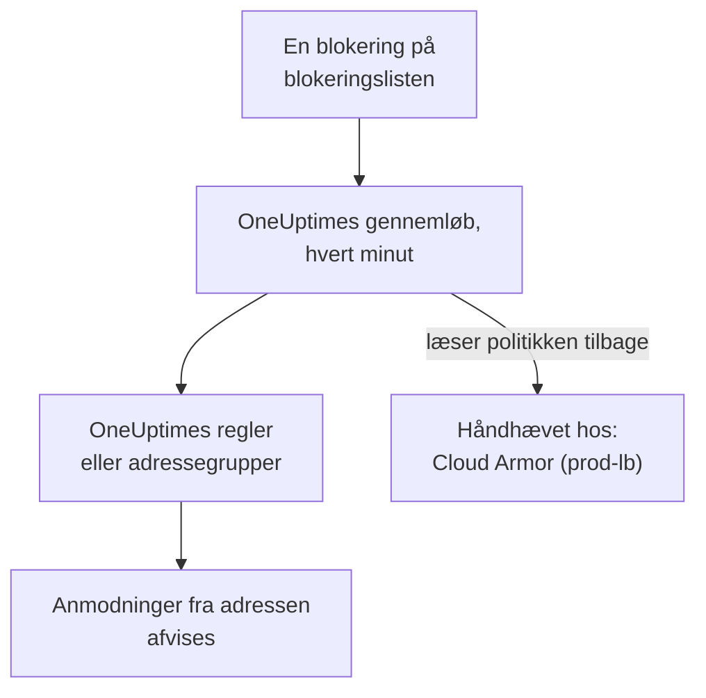

# Bloker adresser i Cloud Armor

Dit projekts blokeringsliste kan håndhæves i Google Cloud Armor-sikkerhedspolitikkerne for dine load balancere. Slå det til for en Google Cloud-forbindelse, du allerede har, vælg sikkerhedspolitikkerne, og hver adresse, blokeringslisten blokerer, blokeres der, uanset om en person, en playbook eller OneUptime AI blokerede den.

:::cards
- [Slå det til](#slå-det-til): Én indstilling på Google Cloud-forbindelsen og den rolle, den kræver.
- [Hvad OneUptime opretter](#hvad-oneuptime-opretter): Egne regler i hver politik eller adressegrupper med Cloud Armor Enterprise.
- [Hvilken adresse der matches](#hvilken-adresse-der-matches): Den adresse, der oprettede forbindelse, eller bruger-IP'en bag en proxy.
:::

## Sådan virker det

OneUptime vedligeholder sine egne regler i hver sikkerhedspolitik, du vælger, og lægger de adresser, blokeringslisten blokerer, i dem. Hvert minut ændrer den det, der er ændret, én regel ad gangen, og læser derefter politikken tilbage. På siden **Blokeringsliste** nævner en blokerings **Håndhævet hos** først Cloud Armor (prod-lb), når politikken indeholder blokeringen; indtil da er den ikke håndhævet.

## Før du begynder

- Et Google Cloud-projekt, der er forbundet til OneUptime (se [Forbind en cloudkonto](/docs/telemetry/cloud-accounts#google-cloud)).
- En rolle, der må ændre, hvor blokeringslisten håndhæves: **Projektejer**, **Projektadministrator** eller **Sikkerhedsadministrator**.
- En, der må oprette roller og tildele dem i Google Cloud-projektet, til at køre én kommando i Cloud Shell.

## Slå det til

:::steps
### Åbn forbindelsen
Åbn **Cloud → Forbind**, og rediger Google Cloud-forbindelsen.

### Slå indstillingen til
Under **Flere felter** skal du sætte **Bloker adresser i Cloud Armor** til **Til** og gemme. Den opsætningskommando, formularen viser, tildeler nu rollen nedenfor der, hvor den tildeler de andre. En forbindelse, du allerede har, behøver ikke at køre den igen: Dialogen **Tilføj WAF** giver de linjer, der tildeler rollen i politikkens projekt.

### Tilføj sikkerhedspolitikkerne
Åbn **Sikkerhedshændelser → Playbooks → Blokeringsliste**. Under **Cloud-WAF'er** skal du klikke på **Tilføj WAF** og vælge en sikkerhedspolitik. OneUptime spørger Google Cloud, om forbindelsen må skrive den, uden at skrive noget.

### Tildel rollen, hvis den mangler
Når en tilladelse mangler, viser dialogen de linjer, der tildeler den i politikkens projekt. Kør dem i Cloud Shell, klik på **Kontrollér igen**, og tilføj derefter politikken. Dens **Status** viser **Håndhæver**, når OneUptime har sat den op.
:::

Sikkerhedspolitikkerne kommer fra forbindelsens inventar: En politik, som OneUptime ikke har læst endnu, vises efter næste læsning. Så længe en politik håndhæver blokeringslisten, kan forbindelsens indstilling ikke slås fra, og forbindelsen kan ikke slettes: Fjern først politikken, så OneUptime tager sine regler ud.

## Hvad OneUptime opretter

OneUptime vælger, hvordan en politik rummer blokeringslisten, når du tilføjer den.

| Hvad | Navn | Hvor |
| --- | --- | --- |
| Regler, der afviser med 403, hver med op til 10 adresser eller intervaller | Deres beskrivelse starter med `OneUptime blocklist <project> #1`, `#2`, ... | I hver politik, du vælger, højst 20 af dem. |
| To adressegrupper, IPv4 og IPv6 | `oneuptime-<project>-block-ipv4`, `oneuptime-<project>-block-ipv6` | Globale, i politikkens projekt. Kun med Cloud Armor Enterprise. |
| Én regel, der afviser med 403, hvad end en af grupperne indeholder | Dens beskrivelse starter med `OneUptime blocklist <project>, address groups` | I hver global backend-politik, du vælger, med Cloud Armor Enterprise. |

`<project>` er de første otte tegn i dit projekts eksterne ID, så to OneUptime-projekter, der vælger én politik, aldrig skriver hinandens regler. Cloud Armor navngiver kun en regel ud fra dens prioritet, så OneUptime kender sine egne regler på deres beskrivelse.

- **Regler.** Cloud Armor rummer 10 adresser eller intervaller i en regel, så en politik rummer op til 200 blokeringer i OneUptimes 20 regler; en blokering, der ikke er plads til, siger det på sin række.
- **Adressegrupper.** En global backend-politik i et projekt med Cloud Armor Enterprise rummer i stedet blokeringslisten i to adressegrupper: 10.000 IPv4- og 2.000 IPv6-intervaller. Alle sådanne politikker i projektet deler dem, og én regel i hver politik afviser det, de indeholder. Grupperne bruger 16.000 enheder af projektets kvote for adressegrupper.

OneUptime tilføjer, ændrer og fjerner hver af sine regler for sig med Cloud Armors regelmetoder: Den skriver aldrig politikken som en helhed og skriver aldrig en af dine regler. En enkelt adresse skrives som `/32` eller `/128`.

## Reglernes plads i politikken

OneUptime placerer sine regler på ledige prioriteter før din første regel, der lukker en anmodning igennem, laveste først, så ingen af dine regler lukker en blokeret adresse igennem: en regel, der tillader, begrænser, udelukker efter hastighed eller fordeler ligeligt. En af dine regler, der afviser, må gerne komme først. OneUptime omnummererer, ændrer eller fjerner aldrig en af dine regler: Når ingen prioritet er ledig før din første regel af den slags, viser politikken **Ingen ledig prioritet**, og OneUptime tilføjer sin regel, så snart du frigør én.

## Hvilken adresse der matches

| Sikkerhedspolitik | Klientadresse | Hvornår du skal vælge den |
| --- | --- | --- |
| Backend | **Adressen, der oprettede forbindelse til load balanceren (origin.ip)** | Standardvalget. |
| Backend | Bruger-IP'en fra politikkens anmodningsheadere (origin.user_ip) | Til en load balancer bag en anden proxy eller et andet CDN. |
| Edge | Adressen, der oprettede forbindelse til load balanceren (origin.ip) | Det eneste valg: En edge-politik læser ingen anden adresse. |

`origin.user_ip` er adressen i politikkens headere til bruger-IP'en (`userIpRequestHeaders`), som en proxy eller et CDN foran load balanceren skriver. Er ingen angivet, eller er der ingen gyldig adresse i dem, er den `origin.ip`. Vælg den kun, når sådan en proxy skriver dem, da en klient, der når load balanceren direkte, selv kan skrive dem. Valget findes under **Flere felter** i dialogen **Tilføj WAF**, og du kan ændre det senere med **Klientadresse** i politikkens række.

En network edge-sikkerhedspolitik til passthrough Network Load Balancers kan ikke vælges, og dialogen **Tilføj WAF** siger hvorfor: Dens regler matcher pakker, ikke anmodninger.

OneUptimes regler i Cloud Armor afviser kun. En blokering, der beder om at udfordre en adresse, anvendes ikke i Cloud Armor og siger det. En udfordring fra en politik for automatisk respons håndhæves der som en blokering i samme tidsrum.

## Når en regel ændres manuelt

Når nogen sætter en af OneUptimes regler til forhåndsvisning, ændrer den eller sletter den, eller sletter en af OneUptimes adressegrupper, lader OneUptime den være, som den blev efterladt. Politikken viser **Ændret manuelt**, og de blokeringer, den indeholdt, håndhæves ikke, med årsag, indtil nogen klikker på **Gendan** i politikkens række. Gendan skriver reglen igen, som OneUptime skriver den, på dens egen prioritet, så længe den er ledig, og opretter en slettet adressegruppe igen.

OneUptime kontrollerer ikke, at en politik er knyttet til en backend-tjeneste. En politik, der ikke er knyttet til nogen, blokerer intet.

## Behold en politik i Terraform

En `google_compute_security_policy` med `rule`-blokke ejer alle politikkens regler, så dens næste plan fjerner OneUptimes regler. Hold dine regler som `google_compute_security_policy_rule`-ressourcer, der lader andre regler være, eller tilføj `ignore_changes = [rule]` til politikkens `lifecycle`-blok.

## Tilladelser

Opsætningskommandoen tilføjer en brugerdefineret rolle, `oneuptimeCloudArmorBlocklist`, der, hvor den tildeler forbindelsens andre roller, og tildeler den til forbindelsens tjenestekonto. De linjer, dialogen **Tilføj WAF** viser, tilføjer den samme rolle i politikkens projekt. En politik, der rummer blokeringslisten i regler og ikke i adressegrupper, behøver kun sine egne tilladelser.

| Tilladelse | Hvorfor |
| --- | --- |
| `compute.securityPolicies.get`, `compute.securityPolicies.update` | Læse en global politik og ændre OneUptimes regler i den. |
| `compute.regionSecurityPolicies.get`, `compute.regionSecurityPolicies.update` | Læse en regional politik og ændre OneUptimes regler i den. |
| `compute.globalOperations.get`, `compute.regionOperations.get` | Vente, indtil en ændring er færdig. |
| `compute.projects.get` | Læse, om projektet har Cloud Armor Enterprise. |
| `networksecurity.addressGroups.get`, `networksecurity.addressGroups.list`, `networksecurity.addressGroups.create`, `networksecurity.addressGroups.update`, `networksecurity.addressGroups.delete`, `networksecurity.addressGroups.use` | Vedligeholde OneUptimes adressegrupper og henvise til dem fra dens regel. Kun med Cloud Armor Enterprise. |
| `networksecurity.operations.get` | Vente, indtil en adressegruppes ændring er færdig. |

Rollen kan ikke slette en politik, og OneUptime skriver aldrig andet. Opsætningskommandoen slår også Compute Engine- og Network Security-API'erne til.

## Fjern det

:::steps
### Fjern sikkerhedspolitikken
På **Sikkerhedshændelser → Playbooks → Blokeringsliste** skal du klikke på **Fjern** i politikkens række. OneUptime tager sine regler ud af politikken og sletter sine adressegrupper, når ingen anden politik i projektet bruger dem.

### Slå indstillingen fra
Rediger forbindelsen, sæt **Bloker adresser i Cloud Armor** til **Fra**, og gem. Indstillingen kan slås fra, når ingen politik i forbindelsen længere håndhæver blokeringslisten.
:::

Når OneUptime ikke længere må skrive politikken, skal du markere **Fjern kun fra OneUptime** i dialogen **Fjern WAF**. OneUptime fjerner politikken fra blokeringslisten og nævner de regler og adressegrupper, den efterlod: De bliver ved med at blokere det, de indeholder, indtil du sletter dem i Google Cloud.

## Fejlfinding

:::details Håndhæver ikke
Politikkens status siger, hvad Google Cloud svarede, og hvad du skal gøre. Et afslag nævner den tilladelse, der mangler: Kør de linjer, **Tilføj WAF** viser for politikken, og klik derefter på **Kontrollér igen**. Et afslag på grund af en kvote nævner kvoten: Bed Google Cloud om mere, eller slet regler, du ikke længere bruger.
:::

:::details Ingen ledig prioritet
Hver prioritet før din første regel, der lukker en anmodning igennem, er optaget. Giv den regel et højere nummer, og klik derefter på **Kontrollér igen**.
:::

:::details En politik er ikke på listen
OneUptime viser sikkerhedspolitikkerne for forbindelser med indstillingen slået til, når den har læst dem. En politik, der er tilføjet siden, vises efter forbindelsens næste læsning.
:::

## Næste trin

:::cards
- [Sikkerhedssager og playbooks](/docs/telemetry/security-cases): Blokér en adresse fra en sag, og se dens trin blive kontrolleret.
- [Forbind en cloudkonto](/docs/telemetry/cloud-accounts): Den forbindelse, denne indstilling er en del af.
:::
