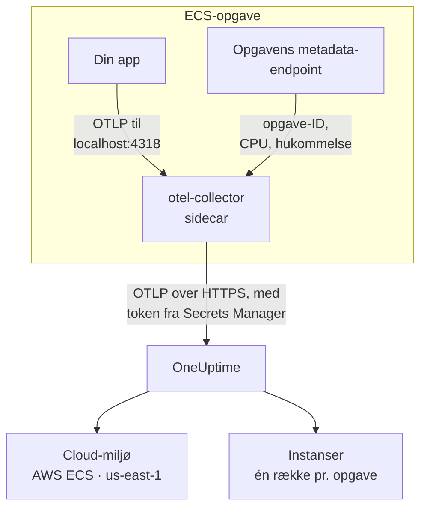

# AWS ECS / Fargate

Send spor, logs og metrikker fra dine Amazon ECS-opgaver til OneUptime, både med Fargate- og EC2-starttypen. Hver opgave, der rapporterer `cloud.platform=aws_ecs`, havner i ét **Cloud Environment** pr. AWS-konto og region, f.eks. _AWS ECS · us-east-1 · 123456789012_, uanset om den kører én tjeneste eller halvtreds.

:::cards
- [Sådan virker det](#sådan-virker-det): Hvad ECS-detektoren og sidecar-collectoren gør.
- [Opsætning](#opsætning): Gem tokenet, føj indstillingerne til opgavedefinitionen, udrul og tjek.
- [Den fulde opgavedefinition](#den-fulde-opgavedefinition): En komplet Fargate-opgavedefinition, du kan registrere.
- [Fejlfinding](#fejlfinding): Opgaver, der hænger i PENDING, afviste eksporter, tomme instanser eller felter.
:::

## Sådan virker det



- **ECS-detektoren navngiver miljøet.** OpenTelemetrys ECS-ressourcedetektor, i SDK'et eller i en collector, læser det metadata-endpoint, som ECS giver hver container, og stempler kontoen, regionen og opgaven på alt, hvad opgaven sender. Intet er hardkodet.
- **Opgaven navngiver hver instans.** Miljøets fane **Instanser** viser de kørende opgaver efter opgave-ID med deres CPU og hukommelse.
- **En sidecar-collector tilføjer CPU og hukommelse.** Dens receiver `awsecscontainermetrics` læser hver opgaves CPU og hukommelse fra det samme endpoint, og den har tokenet, så applikationen aldrig ser det.

ECS-detektoren sætter disse ressourceattributter:

| Attribut | Sat af ECS-detektoren | Bruges til |
| ------------------------------------------------------------------ | ----------------------- | --------------------------------------------------------------------------------------------------------- |
| `cloud.platform` | `aws_ecs` | Arkiverer telemetrien under **Cloud-miljøer**. Værdien skal være præcis |
| `cloud.account.id` | `123456789012` | En del af miljønøglen |
| `cloud.region` | `us-east-1` | En del af miljønøglen |
| `aws.ecs.task.arn` | opgavens ARN | Navngiver én kørende opgave under **Instanser** efter opgave-ID'et i slutningen |
| `aws.ecs.task.id` | opgave-ID'et | Det samme; nyere detektorversioner sætter begge |
| `aws.ecs.cluster.arn`, `aws.ecs.task.family`, `aws.ecs.launchtype` | clusteret og opgaven | Bevares på hvert span, hver log og metrik, så du kan søge på dem; ikke en del af miljøet |

Miljønøglen er `aws_ecs|123456789012|us-east-1`. Opgave-ID'et navngiver en instans, også når SDK'et desuden sætter `service.instance.id`: sidecarens containermetrikker bærer kun opgave-ID'et, så når det er nøglen, holdes en opgaves spans og dens CPU og hukommelse på én række. Se [Cloud-miljøer](/docs/telemetry/cloud-environments) for den fulde regel.

## Før du begynder

- **En indtagelsesnøgle.** Opret en nøgle af typen **Server** under **Projektindstillinger → Telemetri og APM → Indtagelsesnøgler**, og kopiér dens token.
- **Et ECS-cluster og en opgavedefinition, du kan revidere**, og AWS CLI konfigureret til den konto.
- **Din applikation instrumenteret med et OpenTelemetry-SDK**, der eksporterer OTLP, i et hvilket som helst sprog.

## Vælg, hvordan telemetrien forlader opgaven

| | Sidecar collector | SDK direct |
| ----------------------- | ---------------------------------------------- | ----------------------------------------------- |
| Ekstra container | `otel-collector` i hver opgave | Ingen |
| CPU og hukommelse pr. opgave | Ja, fra receiveren `awsecscontainermetrics` | Nej |
| Har tokenet | Collectoren | Applikationen |
| Hemmeligheden indeholder | Kun tokenet | Hele headeren `x-oneuptime-token=...` |

De fleste teams bruger sidecar-collectoren: den stempler attributterne `cloud.*` selv på telemetri fra biblioteker, der intet ved om ECS. SDK direct er det enkleste valg til en enkelt tjeneste. Hvert trin nedenfor har en fane til begge; vælg én, så følger hvert trin den.

## Opsætning

:::steps
### Gem tokenet i Secrets Manager

> [!IMPORTANT]
> Tokenet er en hemmelighed. Gem det i AWS Secrets Manager, og referér til det fra opgavedefinitionen med `secrets` og `valueFrom`. Et token i en almindelig post under `environment` er synligt for alle, der kan læse opgavedefinitionen, og dukker op i hvert output fra `describe-task-definition` og hver CloudFormation-diff.

:::tabs
@tab Sidecar collector
```bash
aws secretsmanager create-secret \
  --name oneuptime/ingestion-token \
  --region us-east-1 \
  --secret-string "YOUR_TELEMETRY_INGESTION_TOKEN"
```

Collectorens konfiguration tilføjer headernavnet, så denne hemmelighed indeholder kun tokenet.
@tab SDK direct
```bash
aws secretsmanager create-secret \
  --name oneuptime/ingestion-token \
  --region us-east-1 \
  --secret-string "x-oneuptime-token=YOUR_TELEMETRY_INGESTION_TOKEN"
```

ECS lægger en hemmeligheds værdi uændret i variablen, og `OTEL_EXPORTER_OTLP_HEADERS` skal bruge hele parret `name=value`, så denne hemmelighed indeholder hele headeren.
:::

Notér den ARN, kommandoen udskriver. Den ender på et tilfældigt suffiks, f.eks. `oneuptime/ingestion-token-AbCdEf`, og du indsætter den i opgavedefinitionen.

### Lad opgaven læse hemmeligheden

Opgavens udførelsesrolle (den rolle, ECS starter opgaven med, ikke den rolle, din kode kører som) skal kunne læse hemmeligheden. Knyt denne politik til `ecsTaskExecutionRole`:

```json title="secret-access-policy.json"
{
  "Version": "2012-10-17",
  "Statement": [
    {
      "Effect": "Allow",
      "Action": ["secretsmanager:GetSecretValue"],
      "Resource": "arn:aws:secretsmanager:us-east-1:123456789012:secret:oneuptime/ingestion-token-*"
    }
  ]
}
```

Hvis en kundeadministreret KMS-nøgle krypterer hemmeligheden, skal rollen også have `kms:Decrypt` på den nøgle. Uden en af dem starter opgaven ikke: den stopper med `ResourceInitializationError: unable to pull secrets`.

### Føj indstillingerne til opgavedefinitionen

:::tabs
@tab Sidecar collector
1. **AWS Console → Amazon Elastic Container Service → Task definitions** → vælg familien → **Create new revision**.
2. Under **Container - 1** (din applikation) skal du udfolde **Environment variables** og tilføje applikationsvariablerne nedenfor.
3. **+ Add container**: navn `otel-collector`, image `otel/opentelemetry-collector-contrib:latest` (fastlås en version, når det virker), **Essential container: No**. Under **Docker configuration → Command** skal du angive `--config=env:OTEL_COLLECTOR_CONFIG`.
4. Tilføj på collector-containeren miljøvariablen `ONEUPTIME_TOKEN` med **Value type: ValueFrom** og hemmelighedens ARN, og `OTEL_COLLECTOR_CONFIG` med **Value type: Value** og collector-konfigurationen nedenfor.
5. Under **Startup dependency ordering** på applikationscontaineren skal du tilføje `otel-collector` med betingelsen **Start**, så applikationen aldrig starter, før noget lytter på port 4318.
6. Under **Task execution role** skal du tjekke, at det er den rolle, du knyttede politikken til.

Applikationsvariabler. I netværkstilstanden `awsvpc` (altid på Fargate) deler containerne i en opgave ét netværk, så `localhost` er sidecaren:

```bash
OTEL_SERVICE_NAME=checkout-api
OTEL_EXPORTER_OTLP_ENDPOINT=http://localhost:4318
OTEL_EXPORTER_OTLP_PROTOCOL=http/protobuf
```

Collector-konfiguration. Collectoren læser det hele fra variablen `OTEL_COLLECTOR_CONFIG`, så der er ingen fil at bygge ind i et image, og den udfylder `${env:ONEUPTIME_TOKEN}` fra den hemmelighed, ECS lægger i dens miljø:

```yaml title="OTEL_COLLECTOR_CONFIG"
receivers:
  otlp:
    protocols:
      http:
        endpoint: 0.0.0.0:4318
      grpc:
        endpoint: 0.0.0.0:4317
  # Per-task and per-container CPU / memory from the ECS task metadata
  # endpoint. This is what fills the CPU and memory tiles in OneUptime.
  awsecscontainermetrics:
    collection_interval: 20s
processors:
  # Stamps cloud.provider, cloud.platform=aws_ecs, cloud.account.id,
  # cloud.region and aws.ecs.task.arn on every span, log and metric.
  resourcedetection:
    detectors: [env, ecs]
    timeout: 5s
  batch: {}
exporters:
  otlphttp/oneuptime:
    endpoint: https://oneuptime.com/otlp
    headers:
      x-oneuptime-token: ${env:ONEUPTIME_TOKEN}
service:
  pipelines:
    traces:
      receivers: [otlp]
      processors: [resourcedetection, batch]
      exporters: [otlphttp/oneuptime]
    metrics:
      receivers: [otlp, awsecscontainermetrics]
      processors: [resourcedetection, batch]
      exporters: [otlphttp/oneuptime]
    logs:
      receivers: [otlp]
      processors: [resourcedetection, batch]
      exporters: [otlphttp/oneuptime]
```

Hverken detektoren `ecs` eller receiveren `awsecscontainermetrics` behøver en IAM-tilladelse: begge læser det metadata-endpoint, som ECS giver hver container i `ECS_CONTAINER_METADATA_URI_V4`.
@tab SDK direct
1. **AWS Console → Amazon Elastic Container Service → Task definitions** → vælg familien → **Create new revision**.
2. Under **Container - 1** (din applikation) skal du udfolde **Environment variables** og tilføje variablerne nedenfor. Tilføj `OTEL_EXPORTER_OTLP_HEADERS` med **Value type: ValueFrom** og hemmelighedens ARN som værdi.
3. Tilføj den kontakt, der slår dit sprogs ECS-ressourcedetektor til, fra tabellen nedenfor.
4. Under **Task execution role** skal du tjekke, at det er den rolle, du knyttede politikken til.

```bash
OTEL_SERVICE_NAME=checkout-api
OTEL_EXPORTER_OTLP_ENDPOINT=https://oneuptime.com/otlp
OTEL_EXPORTER_OTLP_PROTOCOL=http/protobuf
# Injected from Secrets Manager (secrets / valueFrom), not typed here.
OTEL_EXPORTER_OTLP_HEADERS=x-oneuptime-token=YOUR_TELEMETRY_INGESTION_TOKEN
```

| Sprog | Slå ECS-detektoren til |
| -------- | --------------------------------------------------------------------------------------------------------------- |
| Node.js | `OTEL_NODE_RESOURCE_DETECTORS=env,host,os,aws` (auto-instrumentations-node) |
| Python | `pip install opentelemetry-sdk-extension-aws`, derefter `OTEL_EXPERIMENTAL_RESOURCE_DETECTORS=aws_ecs` |
| Java | `-Dotel.resource.providers.aws.enabled=true` (agenten leveres med provideren slået fra) |
| Go | `import "go.opentelemetry.io/contrib/detectors/aws/ecs"`, og send `ecs.NewResourceDetector()` til `resource.New` |
| .NET | Pakken `OpenTelemetry.Resources.AWS`: `.ConfigureResource(r => r.AddAWSECSDetector())` |

I en opgavedefinitionsfil er hemmeligheden `"secrets": [{ "name": "OTEL_EXPORTER_OTLP_HEADERS", "valueFrom": "<secret ARN>" }]`.
:::

Hvis du selv hoster OneUptime, så brug `https://YOUR-ONEUPTIME-HOST/otlp` som endpoint.

### Udrul den nye revision

Klik på **Create**, derefter **Clusters → your cluster → Services → select the service → Update → Task definition revision: latest → Deploy**. Eller fra CLI'en:

```bash
aws ecs update-service \
  --cluster production \
  --service checkout-api \
  --task-definition checkout-api
```

### Tjek forbindelsen

Tjek tokenet først: det er det billigste tjek, og intet efter det virker uden.

```bash
curl -i https://oneuptime.com/otlp/v1/validate \
  -H "x-oneuptime-token: YOUR_TELEMETRY_INGESTION_TOKEN"
```

`200` med `"valid": true` betyder, at tokenet er accepteret. `401` betyder, at det er ukendt, tilbagekaldt, deaktiveret eller udløbet. Kør den samme kommando inde fra opgaven med ECS Exec for at bevise, at opgaven selv kan nå OneUptime:

```bash
aws ecs execute-command --cluster production --task <task id> \
  --container app --interactive --command "sh"
```

Collectorens CloudWatch-logstream (`otel/otel-collector/...`) skal vise `Everything is ready` uden linjer med `401` eller `connection refused`. Inden for et minut efter det første span, den første log eller metrik vises miljøet under **Cloud → All Environments** som _AWS ECS · us-east-1 · 123456789012_.
:::

## Den fulde opgavedefinition

Sidecar-opsætningen som en fil, du registrerer med `aws ecs register-task-definition --cli-input-json file://task-definition.json`. Udskift konto-ID'et, regionen, imaget og hemmelighedens ARN:

```json title="task-definition.json"
{
  "family": "checkout-api",
  "requiresCompatibilities": ["FARGATE"],
  "networkMode": "awsvpc",
  "cpu": "512",
  "memory": "1024",
  "executionRoleArn": "arn:aws:iam::123456789012:role/ecsTaskExecutionRole",
  "taskRoleArn": "arn:aws:iam::123456789012:role/checkout-api-task-role",
  "containerDefinitions": [
    {
      "name": "app",
      "image": "123456789012.dkr.ecr.us-east-1.amazonaws.com/checkout-api:1.4.2",
      "essential": true,
      "portMappings": [{ "containerPort": 8080, "protocol": "tcp" }],
      "environment": [
        { "name": "OTEL_SERVICE_NAME", "value": "checkout-api" },
        {
          "name": "OTEL_EXPORTER_OTLP_ENDPOINT",
          "value": "http://localhost:4318"
        },
        { "name": "OTEL_EXPORTER_OTLP_PROTOCOL", "value": "http/protobuf" }
      ],
      "dependsOn": [
        { "containerName": "otel-collector", "condition": "START" }
      ],
      "logConfiguration": {
        "logDriver": "awslogs",
        "options": {
          "awslogs-group": "/ecs/checkout-api",
          "awslogs-region": "us-east-1",
          "awslogs-stream-prefix": "app"
        }
      }
    },
    {
      "name": "otel-collector",
      "image": "otel/opentelemetry-collector-contrib:latest",
      "essential": false,
      "command": ["--config=env:OTEL_COLLECTOR_CONFIG"],
      "secrets": [
        {
          "name": "ONEUPTIME_TOKEN",
          "valueFrom": "arn:aws:secretsmanager:us-east-1:123456789012:secret:oneuptime/ingestion-token-AbCdEf"
        }
      ],
      "environment": [
        {
          "name": "OTEL_COLLECTOR_CONFIG",
          "value": "receivers:\n  otlp:\n    protocols:\n      http:\n        endpoint: 0.0.0.0:4318\n      grpc:\n        endpoint: 0.0.0.0:4317\n  awsecscontainermetrics:\n    collection_interval: 20s\nprocessors:\n  resourcedetection:\n    detectors: [env, ecs]\n    timeout: 5s\n  batch: {}\nexporters:\n  otlphttp/oneuptime:\n    endpoint: https://oneuptime.com/otlp\n    headers:\n      x-oneuptime-token: ${env:ONEUPTIME_TOKEN}\nservice:\n  pipelines:\n    traces:\n      receivers: [otlp]\n      processors: [resourcedetection, batch]\n      exporters: [otlphttp/oneuptime]\n    metrics:\n      receivers: [otlp, awsecscontainermetrics]\n      processors: [resourcedetection, batch]\n      exporters: [otlphttp/oneuptime]\n    logs:\n      receivers: [otlp]\n      processors: [resourcedetection, batch]\n      exporters: [otlphttp/oneuptime]\n"
        }
      ],
      "logConfiguration": {
        "logDriver": "awslogs",
        "options": {
          "awslogs-group": "/ecs/checkout-api",
          "awslogs-region": "us-east-1",
          "awslogs-stream-prefix": "otel"
        }
      }
    }
  ]
}
```

Værdien af `OTEL_COLLECTOR_CONFIG` er collector-konfigurationen som én JSON-streng. I stedet for at escape den i hånden kan du gemme YAML'en i `collector.yaml` og lade `jq` gøre det:

```bash
jq --rawfile cfg collector.yaml \
  '.containerDefinitions[1].environment[0].value = $cfg' \
  task-definition.json > task-definition.rendered.json
aws ecs register-task-definition --cli-input-json file://task-definition.rendered.json
```

## Netværk

Opgaven skal nå to ting uden for din VPC: Secrets Manager for at starte og OneUptime for at eksportere.

- **Fargate-opgaver i private subnet** skal have en rute til internettet: en NAT-gateway i subnettets rutetabel eller et offentligt subnet med `assignPublicIp=ENABLED`. En opgave uden nogen af delene hænger i `PENDING` på hemmeligheden, før collectoren sender noget.
- **Udgående trafik i sikkerhedsgruppen** skal tillade TCP 443 til OneUptime-værten: `oneuptime.com` eller din egen vært på den port, den lytter på. Standardsikkerhedsgruppen tillader al udgående trafik; en låst gruppe gør det ofte ikke. Telemetri behøver ingen indgående regel.
- **VPC-interface-endpoints** til `com.amazonaws.us-east-1.secretsmanager` (og `ecr.api`, `ecr.dkr` og S3 til hentning af images) holder AWS-kaldene uden for NAT-stien. OneUptime selv skal stadig have ruten til internettet.

```bash
aws ecs update-service \
  --cluster production \
  --service checkout-api \
  --task-definition checkout-api \
  --network-configuration "awsvpcConfiguration={subnets=[subnet-0abc1234],securityGroups=[sg-0def5678],assignPublicIp=ENABLED}"
```

## Hvad du får

- **Oversigt**: anmodninger, fejlrate og p95-latens fra dine spor, felterne **CPU** og **Hukommelse** og **Øverste instanser efter CPU**. Felterne fyldes fra `ecs.task.cpu.utilized` og `ecs.task.memory.utilized` fra receiveren `awsecscontainermetrics`, eller fra enhver metrik `container.cpu.utilization` og `container.memory.usage`, der bærer opgavens identitet. SDK direct sender ingen af dem.
- **Instanser**: én række pr. kørende opgave, navngivet efter opgave-ID'et (slutningen af `aws.ecs.task.arn`), med seneste CPU, hukommelse og tidspunkt for sidst set. En opgave, der holder op med at rapportere, bliver **Stale**.
- **Protokoller**, **Spor** og **Metrikker**: alt, der bar `cloud.platform=aws_ecs` for denne konto og region.
- **Tjenester**: de samme opgaver, opdelt efter `service.name`.

## Fejlfinding

ECS-fejlene i den rækkefølge, de opstår:

:::details En opgave hænger i PENDING med "unable to pull secrets"
Den fulde fejl er `ResourceInitializationError: unable to pull secrets`. Enten mangler opgavens udførelsesrolle `secretsmanager:GetSecretValue` på hemmeligheden (eller `kms:Decrypt` på dens nøgle), eller også har opgaven ingen rute til Secrets Manager: ingen NAT-gateway og intet VPC-endpoint. Se [Netværk](#netværk).
:::

:::details Collectoren logger 401
Hemmeligheden indeholder den forkerte værdi. Til sidecar-collectoren skal den kun være tokenet; til SDK direct hele headeren `x-oneuptime-token=...`. Tjek selve tokenet med kommandoen i [Tjek forbindelsen](#tjek-forbindelsen).
:::

:::details Miljøet vises, men Instanser er tom
Telemetrien bærer ingen opgaveidentitet. Sørg for, at detektoren `ecs` kører: ressourcen skal bære `aws.ecs.task.arn`, `aws.ecs.task.id` eller `service.instance.id`.
:::

:::details Instanser fyldes, men felterne CPU og Hukommelse forbliver tomme
Receiveren `awsecscontainermetrics` mangler i pipelinen `metrics`, eller den pipeline springer processoren `resourcedetection` over, så containermetrikkerne ankommer uden `cloud.platform`. SDK direct fylder aldrig disse felter.
:::

Et miljø, der aldrig vises, havner under **Værter** eller **Serverløse funktioner**, viser **Afbrudt** eller deler sig i to, er dækket på [Cloud-fejlfinding](/docs/telemetry/cloud-troubleshooting).

## Næste trin

:::cards
- [Cloud-miljøer](/docs/telemetry/cloud-environments): Sådan identificeres miljøer og instanser.
- [Cloud-fejlfinding](/docs/telemetry/cloud-troubleshooting): De fejl, som alle platforme har til fælles.
- [Cloud-ressourcer (IaaS og PaaS)](/docs/telemetry/cloud-resources): Dine load balancere, RDS-databaser og buckets fra CloudWatch.
- [OpenTelemetry](/docs/telemetry/open-telemetry): Instrumentér din applikation, og se endpoints og grænser.
:::
