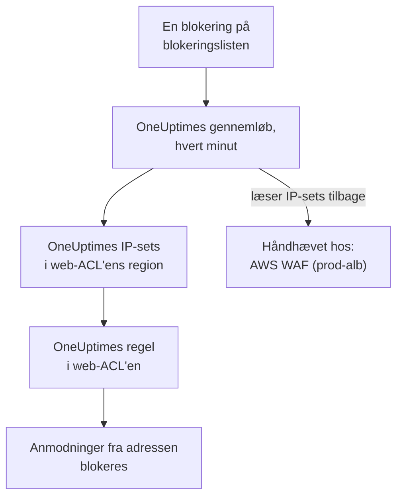

# Bloker adresser i AWS WAF

Dit projekts blokeringsliste kan håndhæves i de web-ACL'er i AWS WAF, der står foran dine CloudFront-distributioner, load balancere og API Gateway-API'er. Slå det til for en AWS-cloudforbindelse, du allerede har, vælg web-ACL'erne, og hver adresse, blokeringslisten blokerer, blokeres der, uanset om en person, en playbook eller OneUptime AI blokerede den.

:::cards
- [Slå det til](#slå-det-til): Én indstilling på AWS-forbindelsen og dens opsætningskommando igen.
- [Hvad OneUptime opretter](#hvad-oneuptime-opretter): Fire IP-sets pr. region og to regler pr. web-ACL.
- [Administrer web-ACL'en i kode](#administrer-web-aclen-i-kode): Tilføj selv reglerne i Terraform eller CloudFormation.
:::

## Sådan virker det

OneUptime vedligeholder sine egne IP-sets i hver region, som en valgt web-ACL ligger i, og en regel i hver web-ACL, der blokerer adresserne i dem. Hvert minut skriver den hvert set én gang med det, blokeringslisten indeholder, og læser dem derefter tilbage. På siden **Blokeringsliste** nævner en blokerings **Håndhævet hos** først AWS WAF (prod-alb), når AWS WAF indeholder blokeringen, og web-ACL'ens regel blokerer det set, blokeringen ligger i; indtil da er den ikke håndhævet.

## Før du begynder

- En AWS-konto, der er forbundet til OneUptime (se [Forbind en cloudkonto](/docs/telemetry/cloud-accounts#amazon-web-services)).
- En rolle, der må ændre, hvor blokeringslisten håndhæves: **Projektejer**, **Projektadministrator** eller **Sikkerhedsadministrator**.
- En, der kan køre forbindelsens opsætningskommando i AWS-kontoen igen.

## Slå det til

:::steps
### Åbn forbindelsen
Åbn **Cloud → Forbind**, og rediger AWS-forbindelsen.

### Vælg, hvem der tilføjer reglen
Under **Flere felter** skal du sætte **Bloker adresser i AWS WAF** til **Til, og OneUptime tilføjer sin regel** eller til **Til, og jeg tilføjer reglen i kode**, hvis dine web-ACL'er administreres i Terraform eller CloudFormation.

### Kør opsætningskommandoen igen
Den kommando, formularen nu viser, giver adgang til IP-sets og til reglen, når OneUptime tilføjer den. Kør den i AWS CloudShell, og gem derefter forbindelsen.

### Tilføj web-ACL'erne
Åbn **Sikkerhedshændelser → Playbooks → Blokeringsliste**. Under **Cloud-WAF'er** skal du klikke på **Tilføj WAF**, vælge en web-ACL og under **Flere felter** hvor den læser klientens adresse og tilføje den. OneUptime sætter den op med det samme, og dens **Status** viser **Håndhæver**, når dens regel blokerer OneUptimes IP-sets.
:::

Web-ACL'erne kommer fra forbindelsens inventar: En web-ACL, som OneUptime ikke har læst endnu, vises efter næste læsning. Så længe en web-ACL håndhæver blokeringslisten, kan forbindelsens indstilling hverken slås fra eller skiftes fra reglen, som OneUptime tilføjer, til reglen i kode, og forbindelsen kan ikke slettes: Fjern først web-ACL'en, så OneUptime tager sin regel ud.

## Hvad OneUptime opretter

| Hvad | Navn | Hvor |
| --- | --- | --- |
| Fire IP-sets: blokering og udfordring, IPv4 og IPv6 | `oneuptime-<project>-block-ipv4`, `oneuptime-<project>-block-ipv6`, `oneuptime-<project>-challenge-ipv4`, `oneuptime-<project>-challenge-ipv6` | I hver region, som en valgt web-ACL ligger i. CloudFronts web-ACL'er er globale, og deres sets ligger i `us-east-1`. |
| To regler: én blokerer, én udfordrer | `OneUptime-Blocklist-<project>`, `OneUptime-Challenge-<project>` | I hver valgt web-ACL, når OneUptime tilføjer sin regel. |

`<project>` er de første otte tegn i dit projekts eksterne ID, så to OneUptime-projekter i én konto aldrig skriver hinandens sets. Web-ACL'er i én region deler sets. En enkelt adresse skrives som `/32` eller `/128`. AWS WAF rummer 10.000 adresser i et set og 100 IP-sets i en region, medmindre AWS har hævet grænsen for dig; en blokering, der ikke er plads til, siger det på sin række.

## Reglens plads i web-ACL'en

OneUptime placerer sine to regler på ledige prioriteter under din første regels, så de kører før de regler, du har skrevet. Uden regler i web-ACL'en får de prioriteterne 0 og 1. OneUptime omnummererer, ændrer eller fjerner aldrig en af dine regler: Når der ikke er to ledige prioriteter under din første regel, viser web-ACL'en **Ingen ledig prioritet**, og OneUptime tilføjer sine regler, så snart du frigør to.

Hver regel matcher, når et af dens sets, IPv4 eller IPv6, indeholder klientens adresse. AWS WAF opdaterer en web-ACL som en helhed, så OneUptime læser den, tilføjer sine regler og skriver den tilbage med web-ACL'ens låsetoken og læser den igen, hvis en anden har skrevet den i mellemtiden.

## Videresendte adresser

En web-ACL bag en anden proxy eller et andet CDN ser proxyens adresse, ikke klientens. Vælg under **Klientadresse**, hvor den læser klientens adresse:

| Klientadresse | Hvad reglen læser |
| --- | --- |
| **Anmodningens kildeadresse** | Den adresse, anmodningen kom fra. Standardvalget. |
| Den sidste adresse i `X-Forwarded-For`-headeren | Den adresse, den sidste proxy tilføjede. En adresse før den er en, anmodningen blot påstod. |
| `CF-Connecting-IP`-headeren | Den ene adresse, Cloudflare skriver. |
| `True-Client-IP`-headeren | Den ene adresse, Akamai eller Cloudflare Enterprise skriver. |

En anmodning uden headeren matcher ikke: AWS WAF lukker den igennem i stedet for at blokere en proxys adresse.

## Administrer web-ACL'en i kode

Med **Til, og jeg tilføjer reglen i kode** opretter OneUptime kun IP-sets og skriver aldrig til din web-ACL. Klik på **Vis regel** i web-ACL'ens række: Den viser begge regler som Terraform (`rule`-blokke i `aws_wafv2_web_acl`) og som CloudFormation med hvert sets ARN og den header, web-ACL'en læser. Tilføj dem til din kode før dine andre regler, og anvend den.

Indtil reglerne er der, viser web-ACL'en **Venter på din regel**, og dens blokeringer håndhæves ikke. OneUptime læser web-ACL'en ved hvert gennemløb, og blokeringerne håndhæves fra det første gennemløb, der for hvert set finder en regel, som blokerer det, uanset hvad du har kaldt reglen.

## Tilladelser

Opsætningskommandoen tilføjer en inline-politik, `OneUptimeWafBlocklist`, til rollen. Med en adgangsnøgle kommer den på grund af IAM's grænse for en brugers egne politikker på en gruppe, `OneUptimeWafBlocklist-<project>`, som brugeren bliver medlem af.

| Handling | Ressource | Hvorfor |
| --- | --- | --- |
| `wafv2:ListIPSets` | Alle | Finde OneUptimes IP-sets i en region. |
| `wafv2:GetIPSet`, `wafv2:CreateIPSet`, `wafv2:UpdateIPSet`, `wafv2:DeleteIPSet` | Kun OneUptimes IP-sets (`oneuptime-<project>-*`) | Vedligeholde sets og slette dem, når du fjerner den sidste web-ACL i en region. |
| `wafv2:GetSampledRequests` | Web-ACL'er | Læse de anmodninger, en regel afviste: det bevis, som en sags blokeringstrin kontrolleres ud fra. |
| `wafv2:UpdateWebACL` | Web-ACL'er og de IP-sets, regex-sets og regelgrupper, de henviser til | Tilføje OneUptimes regler. Kun med **Til, og OneUptime tilføjer sin regel**. |

Læsning af en web-ACL, `wafv2:GetWebACL`, er allerede med i forbindelsens skrivebeskyttede politik.

## Fjern det

:::steps
### Fjern web-ACL'en
På **Sikkerhedshændelser → Playbooks → Blokeringsliste** skal du klikke på **Fjern** i web-ACL'ens række. OneUptime tager sine regler ud af web-ACL'en og tømmer og sletter sine IP-sets, når ingen anden web-ACL i regionen bruger dem.

### Slå indstillingen fra
Rediger forbindelsen, sæt **Bloker adresser i AWS WAF** til **Fra**, og gem. Indstillingen kan slås fra, når ingen web-ACL i forbindelsen længere håndhæver blokeringslisten.
:::

Når OneUptime ikke længere må skrive web-ACL'en, skal du markere **Fjern kun fra OneUptime** i dialogen **Fjern WAF**. OneUptime fjerner web-ACL'en fra blokeringslisten og nævner de regler og IP-sets, den efterlod i AWS WAF: De bliver ved med at blokere det, de indeholder, indtil du sletter dem der. En af dine regler, der stadig henviser til et set, beholder det også: OneUptime tømmer det og nævner det.

## Fejlfinding

:::details Håndhæver ikke
Web-ACL'ens status siger, hvad AWS svarede, og hvad du skal gøre. Et afslag nævner handlingen og den indstilling, der giver adgang til den: Slå indstillingen til, eller vælg **Til, og OneUptime tilføjer sin regel**, kør derefter forbindelsens opsætningskommando igen, og klik på **Kontrollér igen**.
:::

:::details Ingen ledig prioritet
Din første regel har prioritet 0 eller 1, så der er ikke to ledige prioriteter under den. Hæv dine reglers prioritetsnumre med to, og klik derefter på **Kontrollér igen**.
:::

:::details En web-ACL er ikke på listen
OneUptime viser web-ACL'erne for forbindelser med indstillingen slået til, når den har læst dem. Web-ACL'er, der kun er set via deres metrikker, kræver forbindelsens opsætningskommando igen, så OneUptime kan læse dem.
:::

## Næste trin

:::cards
- [Sikkerhedssager og playbooks](/docs/telemetry/security-cases): Blokér en adresse fra en sag, og se dens trin blive kontrolleret.
- [Forbind en cloudkonto](/docs/telemetry/cloud-accounts): Den forbindelse, denne indstilling er en del af.
:::
