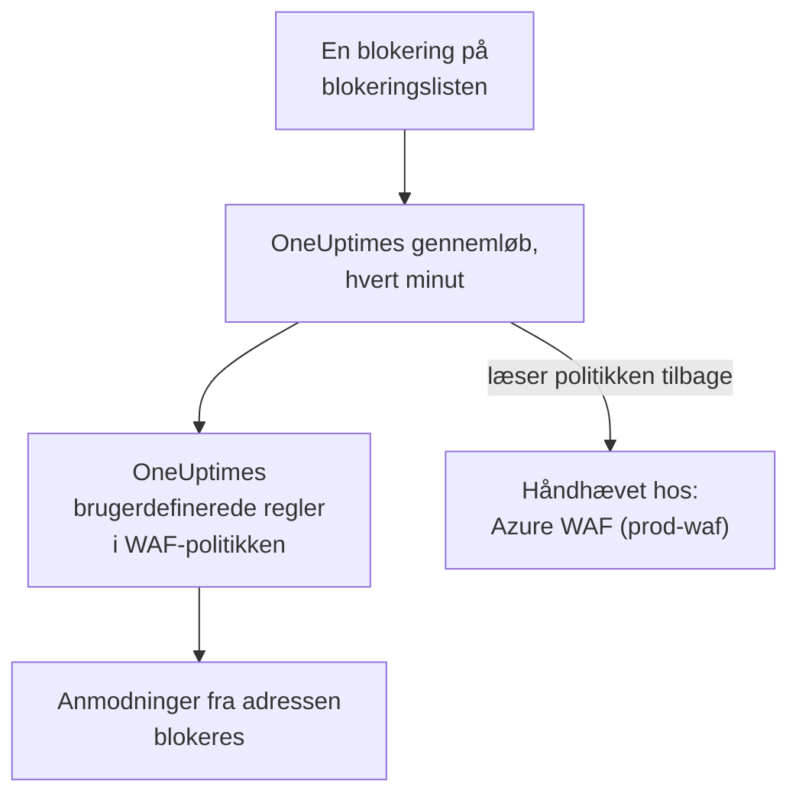

# Bloker adresser i Azure WAF

Dit projekts blokeringsliste kan håndhæves i Azure WAF-politikkerne for dine Application Gateways og Front Doors. Slå det til for en Azure-cloudforbindelse, du allerede har, vælg WAF-politikkerne, og hver adresse, blokeringslisten blokerer, blokeres der, uanset om en person, en playbook eller OneUptime AI blokerede den.

:::cards
- [Slå det til](#slå-det-til): Én indstilling på Azure-forbindelsen og den rolle, den kræver.
- [Hvad OneUptime opretter](#hvad-oneuptime-opretter): Egne brugerdefinerede regler i hver politik, du vælger.
- [Hvilken adresse der matches](#hvilken-adresse-der-matches): Den adresse, der oprettede forbindelse, eller den oprindelige klient bag en proxy.
:::

## Sådan virker det

OneUptime vedligeholder sine egne brugerdefinerede regler i hver WAF-politik, du vælger, og lægger de adresser, blokeringslisten blokerer, i dem. Hvert minut skriver den politikken én gang med det, blokeringslisten indeholder, og læser den derefter tilbage. På siden **Blokeringsliste** nævner en blokerings **Håndhævet hos** først Azure WAF (prod-waf), når politikken indeholder blokeringen, og Azure har anvendt ændringen; indtil da er den ikke håndhævet.

## Før du begynder

- Et Azure-abonnement, der er forbundet til OneUptime (se [Forbind en cloudkonto](/docs/telemetry/cloud-accounts#microsoft-azure)).
- En rolle, der må ændre, hvor blokeringslisten håndhæves: **Projektejer**, **Projektadministrator** eller **Sikkerhedsadministrator**.
- En, der må tildele roller i Azure-abonnementet, til at køre én kommando i Azure Cloud Shell.

## Slå det til

:::steps
### Åbn forbindelsen
Åbn **Cloud → Forbind**, og rediger Azure-forbindelsen.

### Slå indstillingen til
Under **Flere felter** skal du sætte **Bloker adresser i Azure WAF** til **Til** og gemme. Den opsætningskommando, formularen viser, tildeler nu rollen nedenfor på hele abonnementet. En forbindelse, du allerede har, behøver ikke at køre den igen: Dialogen **Tilføj WAF** giver de linjer, der tildeler rollen på én politik alene.

### Tilføj WAF-politikkerne
Åbn **Sikkerhedshændelser → Playbooks → Blokeringsliste**. Under **Cloud-WAF'er** skal du klikke på **Tilføj WAF** og vælge en WAF-politik. OneUptime spørger Azure, om forbindelsen må skrive den, uden at skrive noget.

### Tildel rollen, hvis den mangler
Når en tilladelse mangler, viser dialogen de linjer, der tildeler den på den politik alene. Kør dem i Azure Cloud Shell, klik på **Kontrollér igen**, og tilføj derefter politikken. Dens **Status** viser **Håndhæver**, når OneUptime har læst den.
:::

WAF-politikkerne kommer fra forbindelsens inventar: En politik, som OneUptime ikke har læst endnu, vises efter næste læsning. Så længe en politik håndhæver blokeringslisten, kan forbindelsens indstilling ikke slås fra, og forbindelsen kan ikke slettes: Fjern først politikken, så OneUptime tager sine regler ud.

## Hvad OneUptime opretter

| Hvad | Navn | Hvor |
| --- | --- | --- |
| Brugerdefinerede regler, hver med én IP-matchbetingelse og handlingen Block | `OneUptime<project>Block1`, `OneUptime<project>Block2`, ... | I hver WAF-politik, du vælger, højst 10 af dem. |

`<project>` er de første otte tegn i dit projekts eksterne ID, så to OneUptime-projekter, der vælger én politik, aldrig skriver hinandens regler. En regel rummer 540 adresser eller intervaller på Application Gateway, 600 med CRS 3.2 eller et Default Rule Set og 600 på Front Door. Med ti regler rummer en politik 5.400 eller 6.000 blokeringer; en blokering, der ikke er plads til, siger det på sin række.

OneUptime ændrer intet i en politik ud over sine egne regler. Azure skriver kun en WAF-politik som en helhed, så OneUptime læser politikken med dens ETag, ændrer sine egne regler og skriver den tilbage med ETag'en i `If-Match`: Alle andre regler, indstillinger og administrerede regelsæt skrives, som de blev læst. Når en anden har skrevet politikken i mellemtiden, afviser Azure skrivningen, og OneUptime læser den igen og laver sin ændring oven på det, der blev skrevet.

## Reglernes plads i politikken

OneUptime placerer sine regler på ledige prioriteter før din første regel, der tillader trafik, laveste først, så ingen af dine regler lukker en blokeret adresse igennem. En af dine regler, der blokerer eller logger, må gerne komme først. OneUptime omnummererer, ændrer eller fjerner aldrig en af dine regler: Når ingen prioritet er ledig før din første Allow-regel, viser politikken **Ingen ledig prioritet**, og OneUptime tilføjer sin regel, så snart du frigør én.

## Hvilken adresse der matches

| WAF-politik | Klientadresse | Hvornår du skal vælge den |
| --- | --- | --- |
| Front Door | **Adressen, der oprettede forbindelse til Front Door (SocketAddr)** | Standardvalget. |
| Front Door | Den oprindelige klient, fra X-Forwarded-For (RemoteAddr) | Til en Front Door bag en anden proxy eller et andet CDN. |
| Application Gateway | Adressen, der oprettede forbindelse til gatewayen (RemoteAddr) | Det eneste valg: Dens IP-match læser ingen anden adresse. |

Front Door tager `RemoteAddr` fra `X-Forwarded-For`-headeren, som en klient, der forbinder sig direkte til Front Door, kan skrive selv. Vælg den kun, når en anden proxy eller et andet CDN foran Front Door skriver den header. Valget findes under **Flere felter** i dialogen **Tilføj WAF**, og du kan ændre det senere med **Klientadresse** i politikkens række.

Application Gateways IP-match læser kun IPv4-adresser, så en IPv6-blokering anvendes ikke der, og dens række siger hvorfor.

OneUptimes regler i Azure WAF blokerer kun. En blokering, der beder om at udfordre en adresse, anvendes ikke i Azure WAF og siger det. En udfordring fra en politik for automatisk respons håndhæves der som en blokering i samme tidsrum.

## Hvor lang tid en ændring tager

Application Gateway anvender en ændring, idet Azure skriver den. Front Door accepterer ændringen og spreder den til sine edge-lokationer i løbet af de næste par minutter: Politikken viser **Anvender ændringen**, og en ny blokerings **Håndhævet hos** venter på politikken, indtil Azure melder den klargjort. Blokeringen håndhæves fra da af.

## Når en regel ændres manuelt

Når nogen slår en af OneUptimes regler fra, ændrer den eller sletter den i Azure, lader OneUptime den være, som den blev efterladt. Politikken viser **Ændret manuelt**, og de blokeringer, reglen indeholdt, håndhæves ikke, med årsag, indtil nogen klikker på **Gendan** i politikkens række. Gendan skriver reglen igen, som OneUptime skriver den, på dens egen prioritet, så længe den er ledig.

En politik, der intet blokerer, siger det også, og dens blokeringer håndhæves ikke:

- En politik, der er slået fra.
- En politik i tilstanden **Detection**, som kun logger det, OneUptimes regler matcher.
- En politik, der ikke er tilknyttet en Application Gateway, en lytter, en stiregel eller et Front Door-domæne.

## Behold en politik i Terraform

Terraform skriver også en WAF-politik som en helhed, så dens næste plan fjerner OneUptimes regler. For at lade OneUptime beholde dem skal du tilføje `ignore_changes = [custom_rules]` til `lifecycle`-blokken i en `azurerm_web_application_firewall_policy` eller `ignore_changes = [custom_rule]` til den i en `azurerm_cdn_frontdoor_firewall_policy` og holde dine egne brugerdefinerede regler ude af den politiks kode.

## Tilladelser

Opsætningskommandoen tilføjer en brugerdefineret rolle, `OneUptime WAF Blocklist`, og tildeler den til forbindelsens app på abonnementet. De linjer, dialogen **Tilføj WAF** viser, tildeler den samme rolle på én politik alene.

| Handling | Hvorfor |
| --- | --- |
| `Microsoft.Network/ApplicationGatewayWebApplicationFirewallPolicies/read`, `Microsoft.Network/ApplicationGatewayWebApplicationFirewallPolicies/write` | Læse en Application Gateway-WAF-politik og skrive OneUptimes regler i den. |
| `Microsoft.Network/FrontDoorWebApplicationFirewallPolicies/read`, `Microsoft.Network/FrontDoorWebApplicationFirewallPolicies/write` | Læse en Front Door-WAF-politik og skrive OneUptimes regler i den. |

Rollen kan ikke slette en politik, og OneUptime skriver aldrig andet.

## Fjern det

:::steps
### Fjern WAF-politikken
På **Sikkerhedshændelser → Playbooks → Blokeringsliste** skal du klikke på **Fjern** i politikkens række. OneUptime tager sine regler ud af politikken og ændrer intet andet i den.

### Slå indstillingen fra
Rediger forbindelsen, sæt **Bloker adresser i Azure WAF** til **Fra**, og gem. Indstillingen kan slås fra, når ingen politik i forbindelsen længere håndhæver blokeringslisten.
:::

Når OneUptime ikke længere må skrive politikken, skal du markere **Fjern kun fra OneUptime** i dialogen **Fjern WAF**. OneUptime fjerner politikken fra blokeringslisten og nævner de regler, den efterlod i den: De bliver ved med at blokere det, de indeholder, indtil du sletter dem i Azure.

## Fejlfinding

:::details Håndhæver ikke
Politikkens status siger, hvad Azure svarede, og hvad du skal gøre. Et afslag nævner den tilladelse, der mangler: Kør de linjer, **Tilføj WAF** viser for politikken, og klik derefter på **Kontrollér igen**.
:::

:::details Ingen ledig prioritet
Din første regel, der tillader trafik, har prioritet 1, eller hver prioritet før den er optaget. Giv den et højere prioritetsnummer, og klik derefter på **Kontrollér igen**.
:::

:::details En politik er ikke på listen
OneUptime viser WAF-politikkerne for forbindelser med indstillingen slået til, når den har læst dem. En politik, der er tilføjet siden, vises efter forbindelsens næste læsning.
:::

## Næste trin

:::cards
- [Sikkerhedssager og playbooks](/docs/telemetry/security-cases): Blokér en adresse fra en sag, og se dens trin blive kontrolleret.
- [Forbind en cloudkonto](/docs/telemetry/cloud-accounts): Den forbindelse, denne indstilling er en del af.
:::
