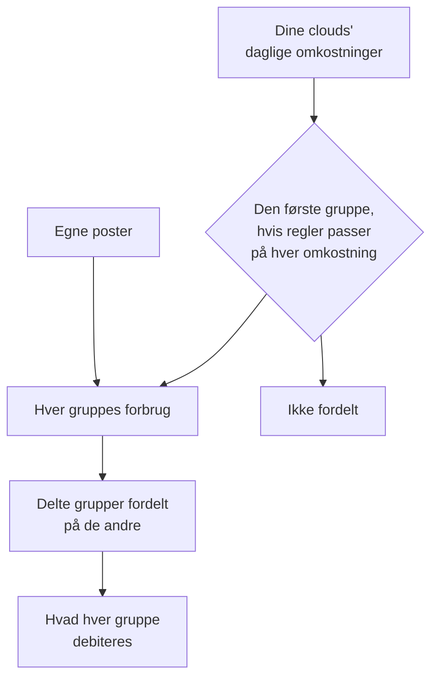

# Fordeling af cloudomkostninger

Omkostningsgrupper besvarer det første spørgsmål på hver månedlig cloudregning: hvem brugte pengene? En **omkostningsvisning** som "Efter team" eller "Efter omkostningssted" fordeler forbruget fra dine forbundne konti i **omkostningsgrupper** efter regler, uden at noget tælles to gange. Det, som ingen regel tager, forbliver synligt som ikke-fordelt forbrug, og delte omkostninger fordeles på grupperne. Du finder dem under **Cloud → Forbrug → Omkostningsgrupper**.

:::cards
- [Opret en visning](#opret-en-visning): Efter team ud fra de ejere, du allerede har angivet, efter et tag eller med dine egne grupper.
- [Skriv en gruppes regler](#skriv-en-gruppes-regler): Konti, tjenester, tags, ejer-teams, etiketter og mere.
- [Ikke-fordelt forbrug](#ikke-fordelt-forbrug): Det, som ingen regel tager, og ét klik for at fordele det.
- [Delte omkostninger](#delte-omkostninger): En supportplan eller en delt klynge, fordelt på grupperne.
:::

## Sådan virker det



- **Den første gruppe, der passer, tager omkostningen.** En visnings grupper har en rækkefølge, og hver omkostning havner i den første gruppe, hvis regler passer på den, så intet tælles to gange. Grupperne og det ikke-fordelte forbrug giver altid periodens total tilsammen.
- **Regler læser alt, hvad en omkostning har.** Kontoen, cloudens udbyder, tjenesten, regionen, ressourcen og dens tags, og det, OneUptime ved om ressourcen: dens ejer-teams, dens etiketter, dens App Platforms-miljø og app.
- **Alt beregnes, når du kigger.** Intet skrives pr. omkostning. En regel, du ændrer, fordeler hver måned, OneUptime gemmer, igen, op til 400 dage tilbage, uden ventetid.
- **Flere visninger kan fordele det samme forbrug.** "Efter team" og "Efter omkostningssted" fordeler hver især det hele på deres egen måde.

## Før du begynder

- **Omkostninger, der læses.** [Forbind en cloudkonto](/docs/telemetry/cloud-accounts), og lad den [læse sine omkostninger](/docs/telemetry/cloud-costs).
- **Tags eller ejere, hvis du vil have dem.** Regler på tags kræver omkostninger, der har dem; på AWS skal du slå [Omkostninger pr. ressource](/docs/telemetry/cloud-costs#omkostninger-pr-ressource) til. Ejer-teams kommer fra hver ressources ejere, angivet manuelt eller via [ejerregler](/docs/configuration/label-and-owner-rules).

## Opret en visning

Åbn **Cloud → Forbrug → Omkostningsgrupper**. Et projekt uden en visning får tilbudt tre måder at starte på:

| Start | Hvad den opretter |
| --- | --- |
| **Efter team, ud fra ejere** | En gruppe for hvert team, der ejer cloudressourcer, knyttet til teamet. |
| **Efter et tag** | En gruppe for hver værdi af et tag, som dine omkostninger har, fx `team` eller `cost-center`. |
| **Dine egne grupper** | En tom visning. Du skriver selv hver gruppes regler. |

OneUptime opretter grupperne i en visning efter tag eller efter ejer-team, når du gemmer den, og derefter hver time, efterhånden som nye tag-værdier og ejere dukker op. Du kan omdøbe disse grupper, knytte dem til et team eller dele dem. Deres regler forbliver OneUptimes. For at oprette de manglende grupper nu skal du åbne visningen og klikke på **Opret grupper nu**.

## Skriv en gruppes regler

Åbn en visning og derefter **Opret Omkostningsgruppe** under **Grupper**. En omkostning hører til gruppen, når **en** af dens regler passer på den, og en regel passer, når **alle** dens betingelser gør. En betingelse sammenligner noget, en omkostning har, med de værdier, du vælger eller skriver:

| Felt | Hvad det læser |
| --- | --- |
| **Mærke** | Værdien af et tag, via taggets nøgle. **er angivet** og **er ikke angivet** spørger, om omkostningen har det. |
| **Konto** | Den forbundne konto, som omkostningen faktureres til. |
| **Ejer-team** | De teams, der ejer ressourcen i OneUptime. |
| **Tjeneste** | Tjenesten, som din clouds fakturering kalder den. |
| **Mærkat** | Etiketterne på ressourcen eller dens konto i OneUptime. |
| **Region** | Regionen. Lad værdien være tom for en global tjeneste. |
| **Cloud** | AWS, Azure eller Google Cloud. |
| **Ressource** | Ressourcen, som din cloud kalder den. |
| **App Platforms-miljø** og **App** | Det, et miljø eller en app faktureres, som **Cloud → Forbrug → Omkostninger** tæller det. |
| **Kubernetes-navnerum** og **Kubernetes-klynge** | En klynges navnerum, når en delt gruppe fordeles efter dem. Se [Kubernetes-klynger](#kubernetes-klynger). |

Tekst sammenlignes uden hensyn til store og små bogstaver: `Payments` og `payments` er ét team. Et taggs nøgle sammenlignes, som den er skrevet, sådan som dine clouds gemmer den.

For eksempel tager en gruppe **Betalinger** med tre regler en omkostning, der er tagget `team: payments`, **eller** faktureret til kontoen payments, **eller** ejet af teamet Betalinger.

### Gruppernes rækkefølge

Træk grupperne under **Grupper** for at ændre deres rækkefølge. En gruppe, hvis regler en tidligere gruppe allerede dækker, kan aldrig tage en omkostning, og dens række siger, hvilken gruppe der tager det hele. En gruppe, hvis regler også passer på omkostninger, som en tidligere gruppe tager, siger, hvor meget af dem den får.

### Ressourcer med flere ejer-teams

En ressource, som to teams ejer, deles ligeligt mellem dem: hvert teams halvdel går gennem reglerne for sig. En regel, der ikke spørger om ejere, fx et tag eller en konto, tager stadig hele omkostningen. En halvdel, hvis team ikke har en gruppe, forbliver ikke fordelt.

## Ikke-fordelt forbrug

En visnings side viser det, som ingen regel tager endnu: de tjenester, konti, tag-værdier og ejer-teams, det består af, de dyreste først. Klik på **Føj til gruppe** ud for en af dem for at føje en regel for den til en gruppe eller til en ny gruppe. Omkostningerne flytter straks ind i gruppen, også for tidligere måneder.

## Delte omkostninger

En supportplan, en delt klynge eller en netværkshub tilhører alle. Gør den til en gruppe for sig, slå derefter **Delt** til under **Flere felter**, og vælg, hvordan dens omkostninger fordeles på visningens andre grupper:

| Fordeling | Hvordan |
| --- | --- |
| **Fordel efter andel af forbruget** | Hver gruppe tager sin andel af de andre gruppers cloudforbrug den måned. En måned, hvor de intet brugte, fordeles ligeligt. |
| **Fordel ligeligt** | Det samme beløb til hver gruppe. |
| **Fordel efter faste procenter** | De procenter, du angiver for hver gruppe, i alt 100. |
| **Fordel efter Kubernetes-navnerum** | Hvad hvert navnerum i en klynge kostede den måned. Se nedenfor. |

En delt gruppes omkostninger fordeles dag for dag med hver måneds andele, så en måned giver de samme tal, uanset om den læses pr. dag eller pr. måned. Ikke-fordelt forbrug får aldrig en andel.

### Kubernetes-klynger

En klynges noder faktureres af din cloud, mens klyngens egen omkostningsmotor siger, hvad hvert navnerum brugte. Sådan debiterer du hvert team for dets workloads i en delt klynge:

1. Opret en gruppe, hvis regler passer på klyngens noder, fx **Mærke** `eks:cluster-name` **er en af** `prod`.
2. Slå **Delt** til, vælg **Fordel efter Kubernetes-navnerum**, og vælg **Kubernetes-klynge**.
3. Giv teamenes grupper regler, der læser navnerummenes labels, som tæller som tags. For eksempel **Mærke** `team` **er en af** `payments` eller **Kubernetes-navnerum** **starter med** `payments-`.

Hver måned fordeles nodernes omkostninger efter, hvad hvert navnerum kostede i klyngens [omkostningsmotor](/docs/telemetry/kubernetes-cost), og hvert navnerums del går til den første gruppe, hvis regler passer på det. Ledig kapacitet og et navnerum, som ingen gruppe tager, bliver hos klyngens gruppe. Klyngens egne prissatte omkostninger lægges aldrig til din regning, så intet tælles to gange.

## Egne poster

Tilføj under **Cloud → Forbrug → Omkostningsgrupper → Egne poster** en debitering eller kreditering, som dine clouds' regninger ikke har med: en andel af en supportaftale, en virksomhedsrabat, et internt tillæg eller et platformgebyr.

- **Én gang eller hver måned.** En månedlig post fordeles over hver måneds dage, så en del af en måned får sin del.
- **På en konto eller en gruppe.** En post, der er tilføjet en konto, går gennem hver visnings regler som kontoens omkostninger. En post, der er tilføjet en gruppe, går direkte til den.
- **Altid adskilt.** Hvert tal holder poster adskilt fra det, cloudene har faktureret, så cloudenes egne tal stadig passer med deres konsoller.

## Se hver gruppes forbrug

- **Cloud → Forbrug → Omkostninger**: Vælg **Omkostningsgrupper** og en visning under **Hvor pengene går hen**. Hver gruppes forbrug sammenlignet med perioden før.
- **En visnings side**: hvad hver gruppe blev debiteret, med dens delte omkostninger, hvad ingen regel tager, og **Download CSV** til månedens viderefakturering.
- **En gruppes side**: dens forbrug dag for dag, de tjenester, ressourcer og konti, den debiteres mest for, og dens regler. Den viser kun den gruppes forbrug, så knyt gruppen til dens **Team**, og send teamet dens side: alle, der må læse cloudforbruget, kan åbne den.

## API, CLI og MCP

Visninger, grupper og poster er API-ressourcer (`cloud-cost-view`, `cloud-cost-group`, `cloud-cost-line-item`) med CLI-kommandoer og MCP-værktøjer som enhver ressource. En gruppes regler er JSON:

```json
[
  { "conditions": [{ "field": "tag", "key": "team", "operator": "is", "values": ["payments"] }] },
  { "conditions": [{ "field": "ownerTeam", "operator": "is", "values": ["<team ID>"] }] }
]
```

For at læse, hvad en visning fordeler, for hele UTC-dage fra `startDate` til `endDate`:

```bash
curl -X POST "https://oneuptime.com/api/cloud-cost-view/<view ID>/allocation" \
  -H "apikey: <API key>" -H "tenantid: <project ID>" -H "Content-Type: application/json" \
  -d '{"startDate": "2026-11-01", "endDate": "2026-11-30", "currency": "USD"}'
```

Svaret har hver gruppes `total` og det, den består af (`cloud`, `lineItems`, `sharedIn`, `sharedOut`), dens tal pr. dag eller pr. måned, perioden før, og hvad det ikke-fordelte forbrug består af. `POST /cloud-cost-group/<group ID>/spend` svarer for én gruppe.

## Grænser

- En visning rummer højst 500 grupper. En visning efter tag opretter grupper for de 500 dyreste værdier.
- En gruppe har højst 25 regler, en regel 20 betingelser og en betingelse 200 værdier.
- Omkostninger gemmes i 400 dage, så en visning læser højst 400 dage.

## Fejlfinding

:::details En gruppe får intet
Dens regler passer måske endnu ikke på nogen omkostning, eller en tidligere gruppe tager alle de omkostninger, de passer på. Dens række under **Grupper** nævner så den gruppe: træk denne over den, eller indsnævr den tidligere gruppes regler.
:::

:::details En omkostning er i den forkerte gruppe
En omkostning havner i den første gruppe, hvis regler passer på den. Træk den gruppe, den hører til, over den gruppe, der tager den, eller indsnævr den gruppes regler.
:::

:::details En regel på et tag passer på intet
En omkostning beholder de tags, den havde, da den blev læst: etiketterne fra en Google Cloud-faktureringseksport, ellers taggene på den ressource, den faktureres til, hvilket på AWS kræver [Omkostninger pr. ressource](/docs/telemetry/cloud-costs#omkostninger-pr-ressource). Et taggs nøgle sammenlignes, som den er skrevet.
:::

:::details En visning efter tag eller efter ejer-team mangler en gruppe
OneUptime opretter de manglende grupper hver time: én for hver tag-værdi i de sidste 400 dages omkostninger eller for hvert team, der ejer cloudressourcer, op til 500 grupper. Klik på **Opret grupper nu** på visningens side for at oprette dem med det samme.
:::

:::details Tallene udelader en konto
En visnings tal er i den valuta, de fleste af dine konti faktureres i. En konto, der faktureres i en anden, er udeladt af dem, og det samme er en post i en anden valuta.
:::

## Næste trin

:::cards
- [Cloudomkostninger og besparelser](/docs/telemetry/cloud-costs): Hvad dine forbundne konti koster, og hvordan du bruger mindre.
- [Etiket- og ejerregler](/docs/configuration/label-and-owner-rules): Giv ressourcer ejer-teams og etiketter, som reglerne kan læse.
- [Observability for Kubernetes-omkostninger](/docs/telemetry/kubernetes-cost): Hvad hver Kubernetes-workload koster.
:::
