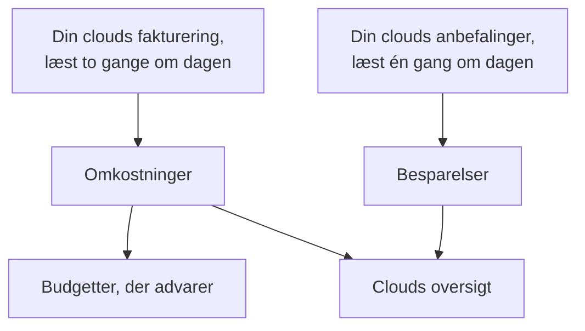

# Cloudomkostninger og besparelser

En forbundet cloudkonto siger også, hvad den koster, og hvordan den kunne koste mindre. OneUptime læser hver dags omkostninger fra din clouds egen fakturering og anbefalingerne fra din clouds egen anbefalingstjeneste, viser dem under **Cloud → Forbrug → Omkostninger** og **Cloud → Forbrug → Besparelser** og advarer, før en måned koster mere end sit budget under **Cloud → Forbrug → Budgetter**.

:::cards
- [Amazon Web Services](#amazon-web-services): Cost Explorer og Cost Optimization Hub, hver slået til én gang.
- [Microsoft Azure](#microsoft-azure): Cost Management og Azure Advisor, med én rolle mere.
- [Google Cloud](#google-cloud): Din faktureringseksport til BigQuery og Recommender.
- [Budgetter](#budgetter): En advarsel, når en måneds forbrug passerer en andel af dens budget.
:::

## Sådan virker det



- **Omkostningerne kommer fra din clouds egen fakturering.** AWS Cost Explorer, Azure Cost Management og Google Clouds faktureringseksport til BigQuery, før kreditter og refusioner, i den valuta, kontoen faktureres i. Hvert beløb er en dags, i UTC-dage, som din cloud fakturerer dem.
- **En cloud rapporterer den sidste dag eller to for sent.** Hver læsning tager den sidste uge igen og hele sidste måned i en måneds første dage, så en dags omkostning falder på plads, efterhånden som din cloud afslutter den. En forbindelses første læsning går tilbage til starten af måneden før sidste måned.
- **Månedens fremskrivning følger tempoet i den sidste uge.** Den er, hvad måneden har kostet indtil nu, med hver dag, der er tilbage, til gennemsnittet af de sidste syv hele dage.
- **Besparelserne kommer fra din clouds egen anbefalingstjeneste.** AWS Cost Optimization Hub, Azure Advisor og Google Clouds Recommender: en mindre størrelse, en ressource, der står ubrugt, en forpligtelse, der kan betale sig, hver med det, den ville spare om måneden. En anbefaling, du udfører eller afviser i din clouds konsol, forsvinder ved den næste læsning.

## Før du begynder

- **En forbundet konto.** [Forbind en cloudkonto](/docs/telemetry/cloud-accounts) med den nuværende opsætningskommando: Den lader forbindelsen læse omkostninger og anbefalinger. En forbindelse oprettet før læser ingen af delene, før du kører dens kommando igen.

## Amazon Web Services

Forbindelsen læser omkostninger med `ce:GetCostAndUsage` og anbefalinger med `cost-optimization-hub:ListRecommendations`. Hver af dem kræver, at noget først slås til i kontoen:

:::steps
### Slå Cost Explorer til

Åbn Cost Explorer én gang i AWS-konsollen Billing and Cost Management: AWS forbereder kontoens omkostninger inden for en dag. Forbind organisationens administrationskonto for at læse omkostningerne for hver medlemskonto.

### Tilmeld Cost Optimization Hub

Åbn Cost Optimization Hub i den samme konsol og tilmeld dig, for organisationen fra dens administrationskonto eller kun for kontoen. Dens anbefalinger kommer inden for en dag.
:::

Cost Explorer tager $0.01 for hver forespørgsel, og en læsning af omkostningerne laver nogle få. Cost Optimization Hub er gratis.

## Microsoft Azure

Appen læser omkostninger med rollen **Cost Management Reader** på samme område som **Monitoring Reader**: Opsætningskommandoen tildeler begge. Azure Advisors anbefalinger læses med **Monitoring Reader**, så der er intet at slå til. For at give en app oprettet før rollen skal du køre:

```bash
az role assignment create --assignee <APP_ID> --role "Cost Management Reader" --scope /subscriptions/<SUBSCRIPTION_ID>
```

Cost Management svarer for hvert abonnement, med den ressource, hver omkostning gælder, og det koster intet at læse. Når den ikke kan svare for et abonnement, siger kontoens **Omkostninger** hvorfor.

## Google Cloud

Google Cloud har intet API til et projekts omkostninger: OneUptime læser dem fra din faktureringskontos eksport til BigQuery.

:::steps
### Eksportér din fakturering til BigQuery

Åbn Billing og derefter Billing export i Google Cloud-konsollen, og slå eksporten af detaljerede forbrugsomkostninger til et BigQuery-datasæt til. Google skriver den nogle timer bagud, fra den dag, du slår den til.

### Lad tjenestekontoen læse den

Giv forbindelsens tjenestekonto **BigQuery Data Viewer** på eksportens datasæt. Opsætningskommandoen har allerede givet den **BigQuery Job User**, så den kan køre forespørgslen i sit eget projekt.

### Angiv eksportens tabel

Redigér forbindelsen under **Cloud → Forbind**, og sæt under **Flere felter** **Tabel for faktureringseksport** til tabellens fulde navn: `<PROJECT_ID>.<DATASET>.gcp_billing_export_resource_v1_<BILLING_ACCOUNT_ID>`.
:::

Den detaljerede eksport nævner den ressource, hver omkostning gælder; standardeksporten siger kun tjenesten og regionen. BigQuery fakturerer forespørgslen: den første 1 TiB om måneden er gratis, derefter $6.25 pr. TiB, og en måned af en eksport fylder fra nogle få megabyte til nogle få gigabyte. Recommenders anbefalinger om maskintyper og ubrugte ressourcer læses med **Compute Recommender Viewer**, som opsætningskommandoen tildeler, og koster intet.

## Måder at bruge mindre på

**Cloud → Forbrug → Besparelser** viser hver anbefaling, den største besparelse først: hvad der skal gøres, ved hvilken ressource, hvad der ville ændre sig, og hvad den sparer om måneden. Båndet over den lægger dem sammen, i alt og efter type: en mindre størrelse, en ressource, der står ubrugt, en forpligtelse. En anbefaling linker til siden for dens ressource, når OneUptime har ressourcen.

### Størrelsestilpasning ud fra OneUptimes egne målinger

En ressource, som ingen anbefalingstjeneste udtaler sig om, fordi den ikke er slået til, ikke dækker dens type eller finder den for ny, får sin størrelse vurderet af OneUptime ud fra de CPU- og hukommelsesmålinger, som dens forbindelse har taget de sidste 14 dage. OneUptime vurderer EC2-instanser, RDS-databaser og ElastiCache-klynger på AWS, virtuelle maskiner, fleksible PostgreSQL- og MySQL-servere og App Service-planer på Azure samt Compute Engine-VM'er og Cloud SQL-instanser på Google Cloud:

- **Overprovisioneret**, når den halvt så store størrelse, eller en fjerdedel, stadig ville have plads: på den mindre størrelse ville CPU'ens 95. percentil højst være 60 %, dens højeste CPU-måling højst 100 % og hukommelsens top højst 70 %, når hukommelsen læses.
- **Underprovisioneret**, når CPU'ens 95. percentil er 85 % eller mere, eller hukommelsens top 90 % eller mere: den dobbelt så store størrelse.

En ressource vurderes, så snart den har 6 dages målinger. Dens side viser dens **Størrelsestilpasning** ved siden af, hvad den koster, og en overprovisioneret står under **Cloud → Forbrug → Besparelser** med OneUptime som kilde. Det, en ændring sparer, er dens andel af det, ressourcen kostede de sidste 30 dage, så det kendes, så snart din cloud fakturerer ressourcen ved navn: Azures og Google Clouds detaljerede eksport gør det, AWS Cost Explorer gør ikke. En EC2-instans rapporterer kun sin hukommelse med CloudWatch-agenten og en Compute Engine-VM kun med Ops Agent: uden den vurderes den alene ud fra sin CPU. Burstable størrelser som t3, B-serien og e2-micro vurderes aldrig.

## Budgetter

:::steps
### Opret et budget

Under **Cloud → Forbrug → Budgetter** opretter du et budget: dets **Månedligt beløb** og den **Konto**, det gælder, eller ingen for alle konti.

### Vælg, hvornår det advarer

**Advar ved** tager de andele af budgettet, der skal advares ved, i procent: 80 og 100 til at begynde med. **Advar, når det er på vej til at blive overskredet** advarer også, én gang om måneden, når tempoet i den sidste uge ville bringe måneden over budgettet. **Advar ved usædvanlige dage** advarer også dagen efter en dag, der kostede langt mere end normalt: se [Usædvanlige dage](#usædvanlige-dage). **Advarselsalvor** og **Vagtpolitikker** angiver, hvor alvorlige advarslerne er, og hvem der tilkaldes.
:::

Et budget kontrolleres efter hver læsning af omkostningerne og hver time. Når månedens forbrug passerer en tærskel, oprettes der én advarsel for den, den højeste, når en læsning passerer flere på én gang, og en ny måned løser den forrige måneds advarsler. Et budget tæller kun de konti, der faktureres i dets valuta.

AI-agenter kan oprette og ændre budgetter via [MCP-serveren](/docs/ai/mcp-server), og scripts med CLI'ens kommando `oneuptime cloud-budget`: se [Ressourceoperationer](/docs/cli/resource-operations).

### Usædvanlige dage

Efter hver læsning holdes hver af en kontos sidste 14 hele dage op mod de 14 dage før den. En dag er usædvanlig, når en tjeneste kostede det dobbelte af sin normale dag eller mere, eller hele kontoen halvanden gang sin normale dag eller mere. I begge tilfælde skal det være mindst 10 mere end normalt i kontoens valuta og mindst 5 % af kontoens normale dag, så nogle få øre aldrig tæller som en top. En dags normale værdi er medianen af de 14 dage før den, så en enkelt top flytter den lidt, og en konto vurderes først, når den har en uges omkostninger.

**Cloud → Forbrug → Omkostninger** viser de usædvanlige dage under det daglige forbrug. Et budget, der medregner kontoen, opretter én advarsel for hver konto og dag, dagen efter, og nævner hver tjeneste, der lå højt. En top, der varer i dagevis, meldes den dag, den begyndte, og en dag, der er mere end en uge gammel, meldes ikke. Et budget, der blev oprettet, før disse advarsler fandtes, opretter dem ikke, før du redigerer det og slår dem til.

## Det, du ser i OneUptime

- **Clouds oversigt.** **Cloud → Oversigt** viser månedens forbrug over for sidste måneds på samme dag, de dyreste tjenester og de største måder at bruge mindre på, ved siden af det, der kræver opmærksomhed.
- **Hver dags forbrug.** **Cloud → Forbrug → Omkostninger** tegner hver af de sidste 30 dage, viser de dage, der kostede langt mere end normalt, og opdeler en periode efter tjeneste, region, konto eller ressource. De konti, hvis omkostninger ikke læses, vises nedenunder, hver med årsagen.
- **En kontos omkostninger.** En kontos **Omkostninger** viser det samme for kontoen alene, med dens måder at bruge mindre på.
- **En ressources omkostning.** En ressources side viser, hvad den har kostet i denne måned og de sidste 30 dage, når dens cloud fakturerer den ved navn, med dens måder at bruge mindre på og dens størrelsestilpasning.

## Fejlfinding

:::details En konto siger Kræver tilladelse
Forbindelsen må endnu ikke læse kontoens omkostninger. Kør dens opsætningskommando igen fra **Cloud → Forbind**: Den tilføjer det, læsningen af omkostninger kræver. På Google Cloud skal du også give tjenestekontoen **BigQuery Data Viewer** på eksportens datasæt.
:::

:::details En konto siger Ikke sat op
Dens cloud har endnu ingen omkostninger at give. På AWS skal du slå Cost Explorer til; på Google Cloud skal du angive eksportens tabel under **Tabel for faktureringseksport**. De første beløb kommer med den næste læsning, inden for 12 timer.
:::

:::details Beløbene udelader en konto
Beløbene er i den valuta, de fleste af dine konti faktureres i. En konto, der faktureres i en anden, vises nedenunder med sin valuta, og et budget tæller kun de konti, der faktureres i dets egen.
:::

:::details Denne måned er lavere end i din clouds konsol
Din cloud rapporterer den sidste dag eller to for sent, og beløbene er før kreditter og refusioner. De næste læsninger indhenter det.
:::

## Næste trin

:::cards
- [Forbind en cloudkonto](/docs/telemetry/cloud-accounts): Forbind en anden konto, eller kør dens kommando igen.
- [Cloud-ressourcer](/docs/telemetry/cloud-resources): Hver ressources metrikker, fra din egen collector.
- [Kubernetes-omkostningsobservability](/docs/telemetry/kubernetes-cost): Hvad hver Kubernetes-workload koster.
:::
