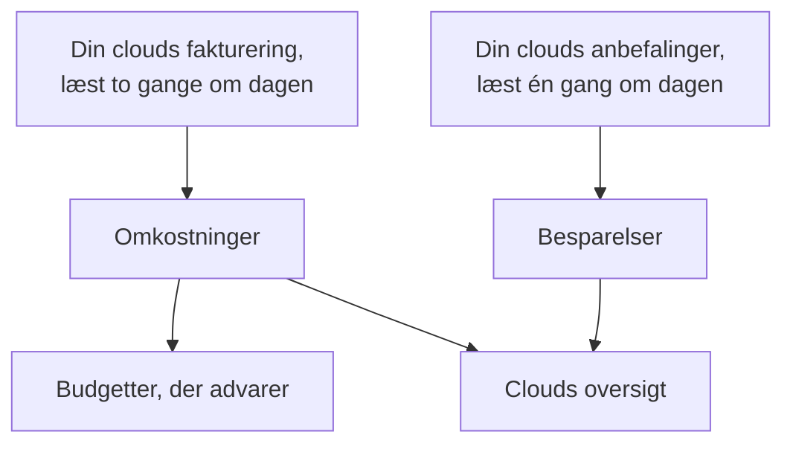

# Cloudomkostninger og besparelser

En forbundet cloudkonto siger også, hvad den koster, og hvordan den kunne koste mindre. OneUptime læser hver dags omkostninger fra din clouds egen fakturering og anbefalingerne fra din clouds egen anbefalingstjeneste, viser dem under **Cloud → Forbrug → Omkostninger** og **Cloud → Forbrug → Besparelser**, viser dine Savings Plans, reservationer og rabatter for forpligtet brug under **Cloud → Forbrug → Forpligtelser** og advarer, før en måned koster mere end sit budget under **Cloud → Forbrug → Budgetter**.

:::cards
- [Amazon Web Services](#amazon-web-services): Cost Explorer og Cost Optimization Hub, hver slået til én gang.
- [Microsoft Azure](#microsoft-azure): Cost Management og Azure Advisor, med én rolle mere.
- [Google Cloud](#google-cloud): Din faktureringseksport til BigQuery og Recommender.
- [Faktureret, amortiseret og netto](#faktureret-amortiseret-og-netto): Hver omkostning på tre måder, så forpligtelser og kreditter lander, hvor pengene gik hen.
- [Forpligtelser og fornyelser](#forpligtelser-og-fornyelser): Hver forpligtelse, advarsler før en udløber, eller mens den er underudnyttet, og hvad der skal fornyes eller købes.
- [Budgetter](#budgetter): En advarsel, når en måneds forbrug passerer en andel af dens budget.
:::

## Sådan virker det



- **Omkostningerne kommer fra din clouds egen fakturering.** AWS Cost Explorer, Azure Cost Management og Google Clouds faktureringseksport til BigQuery, i den valuta, kontoen faktureres i, hver gemt faktureret, amortiseret og netto: se [Faktureret, amortiseret og netto](#faktureret-amortiseret-og-netto). Hvert beløb er en dags, i UTC-dage, som din cloud fakturerer dem.
- **En cloud rapporterer den sidste dag eller to for sent.** Hver læsning tager den sidste uge igen og hele sidste måned i en måneds første dage, så en dags omkostning falder på plads, efterhånden som din cloud afslutter den. En forbindelses første læsning går tilbage til starten af måneden før sidste måned.
- **Månedens fremskrivning følger tempoet i den sidste uge.** Den er, hvad måneden har kostet indtil nu, med hver dag, der er tilbage, til gennemsnittet af de sidste syv hele dage.
- **Besparelserne kommer fra din clouds egen anbefalingstjeneste.** AWS Cost Optimization Hub, Azure Advisor og Google Clouds Recommender: en mindre størrelse, en ressource, der står ubrugt, en forpligtelse, der kan betale sig, hver med det, den ville spare om måneden. En anbefaling, du udfører eller afviser i din clouds konsol, forsvinder ved den næste læsning.

## Før du begynder

- **En forbundet konto.** [Forbind en cloudkonto](/docs/telemetry/cloud-accounts) med den nuværende opsætningskommando: Den lader forbindelsen læse omkostninger og anbefalinger. En forbindelse oprettet før læser ingen af delene, før du kører dens kommando igen.

## Amazon Web Services

Forbindelsen læser omkostninger med `ce:GetCostAndUsage`, sine forpligtelser med `ce:GetSavingsPlansCoverage`, `ce:GetSavingsPlansUtilization`, `ce:GetSavingsPlansUtilizationDetails`, `ce:GetReservationCoverage` og `ce:GetReservationUtilization`, de købte Savings Plans med `savingsplans:DescribeSavingsPlans` og anbefalinger med `cost-optimization-hub:ListRecommendations` og `cost-optimization-hub:GetRecommendation`. Opsætningskommandoen tildeler Cost Explorers læsninger som tre familier, `ce:GetCostAndUsage*`, `ce:GetSavingsPlans*` og `ce:GetReservation*`, alle sammen læsninger, så en adgangsnøgles bruger stadig holder sig inden for de 2.048 tegn, IAM tillader dens politik. Cost Explorer og Cost Optimization Hub skal først slås til i kontoen:

:::steps
### Slå Cost Explorer til

Åbn Cost Explorer én gang i AWS-konsollen Billing and Cost Management: AWS forbereder kontoens omkostninger inden for en dag. Forbind organisationens administrationskonto for at læse omkostningerne for hver medlemskonto.

### Tilmeld Cost Optimization Hub

Åbn Cost Optimization Hub i den samme konsol og tilmeld dig, for organisationen fra dens administrationskonto eller kun for kontoen. Dens anbefalinger kommer inden for en dag.
:::

Cost Explorer tager $0.01 for hver forespørgsel: en læsning af omkostningerne laver to eller nogle få flere, en for faktureret og amortiseret og en for netto, og forpligtelserne læses med fire om dagen for deres dækning og brug og seks til tolv flere om dagen for hver enkelts egen. Savings Plans API og Cost Optimization Hub er gratis.

### Omkostninger pr. ressource

Cost Explorer oplyser også, hvad hver ressource koster, for de sidste 14 dage, når data på ressourceniveau er slået til. Åbn Cost Management-præferencerne i AWS-konsollen Billing and Cost Management, og slå data på ressourceniveau til med daglig granularitet, for organisationen fra dens administrationskonto. AWS forbereder dem inden for 48 timer.

Rediger derefter forbindelsen under **Cloud → Forbind**, og slå **Omkostninger pr. ressource** til under **Flere felter**. Forbindelsen læser dem med `ce:GetCostAndUsageWithResources` én gang om dagen: de 14 dage første gang, derefter de sidste tre igen, med nogle få forespørgsler hver gang. Det, den læser, bliver ved kontoens omkostninger, efter at Cost Explorer har glemt det. En forbindelse, der er oprettet før, skal have sin opsætningskommando kørt igen, som tilføjer handlingen.

## Microsoft Azure

Appen læser omkostninger med rollen **Cost Management Reader** på samme område som **Monitoring Reader**: Opsætningskommandoen tildeler begge. Azure Advisors anbefalinger læses med **Monitoring Reader**, så der er intet at slå til. For at give en app oprettet før rollen skal du køre:

```bash
az role assignment create --assignee <APP_ID> --role "Cost Management Reader" --scope /subscriptions/<SUBSCRIPTION_ID>
```

Cost Management svarer for hvert abonnement, med den ressource, hver omkostning gælder, og det koster intet at læse. Når den ikke kan svare for et abonnement, siger kontoens **Omkostninger** hvorfor.

Cost Management begrænser, hvor hurtigt en tenants omkostninger læses, ens for alle, der læser dem: hver forespørgsel koster en forespørgselsbehandlingsenhed (QPU) for hver måned data, den læser, og en tenant har 12 QPU hvert 10. sekund, 60 i minuttet og 600 i timen. OneUptime læser en tenants abonnementer et ad gangen inden for to tredjedele af hver kvote, venter så længe, Cost Management beder om, når den afviser en forespørgsel, og fortsætter ved næste læsning, hvor den slap. Et abonnement, der ikke er læst endnu, siger **I kø** og hvornår det læses; et, der har beløb, beholder dem imens. Dets amortiserede omkostninger læses ved hver læsning og dets faktiske omkostninger én gang om dagen, så et abonnements første læsning spørger Cost Management to gange og bruger dobbelt så mange forespørgselsenheder: en stor tenants første beløb tager nogle få læsninger mere.

Tenantens reservationer og besparelsesplaner læses med **Reservations Reader** og **Savings plan Reader**, som Azure giver på tenantens eget niveau, hvor kun en global administrator med forhøjet adgang må tildele dem. Opsætningskommandoen forsøger og siger det, når den ikke må. For at tildele dem senere, som global administrator med forhøjet adgang:

```bash
az role assignment create --assignee <APP_ID> --role "Reservations Reader" --scope /providers/Microsoft.Capacity
az role assignment create --assignee <APP_ID> --role "Savings plan Reader" --scope /providers/Microsoft.BillingBenefits
```

Uden dem læses omkostninger og anbefalinger som før, og **Cloud → Forbrug → Forpligtelser** siger, hvilken rolle der skal tildeles.

## Google Cloud

Google Cloud har intet API til et projekts omkostninger: OneUptime læser dem fra din faktureringskontos eksport til BigQuery.

:::steps
### Eksportér din fakturering til BigQuery

Åbn Billing og derefter Billing export i Google Cloud-konsollen, og slå eksporten af detaljerede forbrugsomkostninger til et BigQuery-datasæt til. Google skriver den nogle timer bagud, fra den dag, du slår den til.

### Lad tjenestekontoen læse den

Giv forbindelsens tjenestekonto **BigQuery Data Viewer** på eksportens datasæt. Opsætningskommandoen har allerede givet den **BigQuery Job User**, så den kan køre forespørgslen i sit eget projekt.

### Angiv eksportens tabel

Redigér forbindelsen under **Cloud → Forbind**, og sæt under **Flere felter** **Tabel for faktureringseksport** til tabellens fulde navn: `<PROJECT_ID>.<DATASET>.gcp_billing_export_resource_v1_<BILLING_ACCOUNT_ID>`.
:::

Den detaljerede eksport nævner den ressource, hver omkostning gælder; standardeksporten siger kun tjenesten og regionen. BigQuery fakturerer forespørgslen: den første 1 TiB om måneden er gratis, derefter $6.25 pr. TiB, og en måned af en eksport fylder fra nogle få megabyte til nogle få gigabyte. Recommenders anbefalinger om maskintyper og ubrugte ressourcer læses med **Compute Recommender Viewer**, som opsætningskommandoen tildeler, og koster intet. Compute Engines forpligtelser vises fra Cloud Asset Inventory med **Cloud Asset Viewer**, som opsætningskommandoen allerede tildeler: der skal ikke gives mere.

## Faktureret, amortiseret og netto

Hver omkostning gemmes på tre måder, og **Cloud → Forbrug → Omkostninger**, en kontos **Omkostninger**, Clouds oversigt og budgetter viser den, du vælger:

- **Faktureret** er hver opkrævning den dag, din cloud fakturerede den, før kreditter og refusioner. En forudbetalt Savings Plan eller reservation er én stor opkrævning den dag, den blev købt, og det brug, den dækker, ser gratis ud resten af løbetiden.
- **Amortiseret** fordeler hver forpligtelses gebyrer over de dage og ressourcer, den dækker, så pengene lander, hvor de blev brugt. Stadig før kreditter og refusioner. Det er det, siderne viser, medmindre du vælger andet.
- **Netto** er amortiseret, minus kreditter, refusioner og rabatter: det, fakturaen lyder på.

| | Faktureret | Amortiseret | Netto |
|---|---|---|---|
| AWS | Cost Explorers ublandede omkostninger (unblended) | Cost Explorers amortiserede omkostninger | Cost Explorers netto amortiserede omkostninger, med kreditter og refusioner |
| Azure | Cost Managements faktiske omkostninger | Cost Managements amortiserede omkostninger | De amortiserede omkostninger: Azure trækker kreditter fra på faktureringskontoen, som et abonnements forbindelse ikke læser |
| Google Cloud | Eksportens omkostninger | Omkostningerne minus kreditterne fra rabatterne for forpligtet brug og fra abonnementer | Omkostningerne minus alle kreditter |

Kontakten over beløbene skifter grundlaget på siden, og OneUptime husker dit valg for dette projekt i din browser. Projektets eget grundlag, det siderne åbner med, og som budgetter overvåger, findes under **Cloud → Indstillinger → Omkostningsindstillinger**. Et budget kan overvåge sit eget grundlag: rediger det, og angiv **Omkostningsgrundlag**.

Omkostninger, der blev læst, før de tre blev gemt, viser deres fakturerede beløb på hvert grundlag. Hver forbindelse læser sine omkostninger igen én gang, så langt tilbage som en første læsning, så hvert grundlag bliver udfyldt.

## Måder at bruge mindre på

**Cloud → Forbrug → Besparelser** viser hver anbefaling, den største besparelse først: hvad der skal gøres, ved hvilken ressource, hvad der ville ændre sig, og hvad den sparer om måneden. Båndet over den lægger dem sammen, i alt og efter type: en mindre størrelse, en ressource, der står ubrugt, en forpligtelse. En anbefaling linker til siden for dens ressource, når OneUptime har ressourcen.

### Størrelsestilpasning ud fra OneUptimes egne målinger

En ressource, som ingen anbefalingstjeneste udtaler sig om, fordi den ikke er slået til, ikke dækker dens type eller finder den for ny, får sin størrelse vurderet af OneUptime ud fra de CPU- og hukommelsesmålinger, som dens forbindelse har taget de sidste 14 dage. OneUptime vurderer EC2-instanser, RDS-databaser og ElastiCache-klynger på AWS, virtuelle maskiner, fleksible PostgreSQL- og MySQL-servere og App Service-planer på Azure samt Compute Engine-VM'er og Cloud SQL-instanser på Google Cloud:

- **Overprovisioneret**, når den halvt så store størrelse, eller en fjerdedel, stadig ville have plads: på den mindre størrelse ville CPU'ens 95. percentil højst være 60 %, dens højeste CPU-måling højst 100 % og hukommelsens top højst 70 %, når hukommelsen læses.
- **Underprovisioneret**, når CPU'ens 95. percentil er 85 % eller mere, eller hukommelsens top 90 % eller mere: den dobbelt så store størrelse.

En ressource vurderes, så snart den har 6 dages målinger. Dens side viser dens **Størrelsestilpasning** ved siden af, hvad den koster, og en overprovisioneret står under **Cloud → Forbrug → Besparelser** med OneUptime som kilde. Det, en ændring sparer, er dens andel af det, ressourcen kostede de sidste 30 dage, så det kendes, så snart din cloud fakturerer ressourcen ved navn: Azures og Google Clouds detaljerede eksport gør det, og AWS gør det, når Omkostninger pr. ressource er slået til. En EC2-instans rapporterer kun sin hukommelse med CloudWatch-agenten og en Compute Engine-VM kun med Ops Agent: uden den vurderes den alene ud fra sin CPU. Burstable størrelser som t3, B-serien og e2-micro vurderes aldrig.

### Forpligtelser

**Cloud → Forbrug → Besparelser** og en kontos **Omkostninger** viser, hvor meget af de seneste 30 dages forbrug hver kontos forpligtelser betalte, og hvor meget af dem der blev brugt, en linje for hver slags:

- AWS: Savings Plans og Reserved Instances, fra Cost Explorer. En organisations administrationskonto læser dem for hver konto i organisationen.
- Azure: besparelsesplaner og reservationer, fra Cost Management, i amortiseret omkostning.
- Google Cloud: rabatter for forpligtet brug, fra din faktureringseksport. Eksporten oplyser ikke, hvor meget af en forpligtelse der forblev ubrugt, så hvor meget der bruges, vises ikke.

En konto uden forpligtelser viser, hvad der kørte til on demand-priser, som en forpligtelse ville betale billigere. Hver slags tal er dens clouds egne, og slags lægges aldrig sammen: en reservation og en Savings Plan kan begge tælle den samme maskines forbrug som deres at dække. Hver enkelt forpligtelse vises under **Cloud → Forbrug → Forpligtelser**: se [Forpligtelser og fornyelser](#forpligtelser-og-fornyelser).

## Forpligtelser og fornyelser

**Cloud → Forbrug → Forpligtelser** viser hver Savings Plan, reservation og rabat for forpligtet brug, som dine forbindelser kan læse, så ingen udløber ubemærket:

- **Aktive forpligtelser** øverst tæller de aktive og dem, der udløber inden for 90 dage, **Udnyttelse** hvor meget af dem der blev brugt de seneste 30 dage, og hvad der blev efterladt ubrugt, og **Dækning** hvor meget af forbruget de dækker.
- **Udløber snart** viser dem, der udløber inden for 90 dage og ikke fornyer sig selv, hver med sin fornyelsesplan: hvad der skal købes for at beholde rabatten (dens forpligtelse pr. time eller dens instanser, i den andel, der blev brugt), hvad det koster og sparer om måneden, hvornår det er tjent hjem, og hvor meget af forbruget der er dækket nu, og når den udløber. **Forny i konsollen** åbner siden, hvor din cloud fornyer den.
- **Alle forpligtelser** er hele listen: hvad hver er og dækker, dens konto, hvornår den udløber, dens løbetid og betalingsmulighed, hvor meget af den der blev brugt de seneste 30 dage, og det brug, den betalte, og hvad det sparede.
- **Købsplaner** er det, din clouds anbefalingstjeneste foreslår at købe, hver med hvad den ville koste og spare om måneden, hvornår den ville være tjent hjem, og hvordan dækningen ville ændre sig. **Køb i konsollen** åbner siden, hvor den købes.
- Under dem hver kontos forpligtelser efter slags, som dens **Omkostninger** viser dem, og hvornår forpligtelserne advarer, med **Rediger advarsler**.

OneUptime planlægger kun: den køber, fornyer eller returnerer aldrig en forpligtelse. Du køber i din clouds konsol.

| | Hvor forpligtelserne kommer fra | Hvad der vides om hver |
|---|---|---|
| AWS | Cost Explorers Savings Plans og Reserved Instances, hver med sit eget brug, og Savings Plans API for de købte planer, også dem i kø til at starte | Dens udløb, løbetid, betalingsmulighed, forpligtelse pr. time eller instanser, gebyrer og brug de seneste 30 og 7 dage |
| Azure | Tenantens reservationer og besparelsesplaner | Dens udløb, løbetid, faktureringsplan, om den fornyer sig selv, og brug de seneste 30 og 7 dage |
| Google Cloud | Compute Engines forpligtelser, fra Cloud Asset Inventory | Dens udløb, plan, ressourcer og om den fornyer sig selv. Google Cloud siger ikke, hvor meget af en forpligtelse der bruges |

En organisations administrationskonto viser hver kontos på AWS. Forbrugsbaserede rabatter for forpligtet brug, som Google Cloud holder på faktureringskontoen i stedet for i et projekt, vises endnu ikke.

### Forpligtelsesadvarsler

Forpligtelser opretter advarsler, der tilkalder via vagtpolitikker som enhver advarsel. Under **Cloud → Indstillinger → Omkostningsindstillinger** siger **Forpligtelsesadvarsler** hvornår:

- **Advar før en forpligtelse udløber**: til at starte med 90, 30 og 7 dage før udløbet. Én advarsel ved den nærmeste af de dage, forpligtelsen har nået, hvor hver nærmere overtager fra den forrige. En forpligtelse, der fornyer sig selv, eller hvis fornyelse står i kø til at starte, når den udløber, opretter ingen.
- **Advar ved udnyttelse under**: til at starte med 80 %, af en forpligtelses seneste 7 dage, når den har kørt en uge. Advarslen løses, når brugen er tilbage.
- **Advar ved dækning under**: til at starte med 60 %, af det forbrug, en kontos forpligtelser af én slags kunne dække, efter at de har dækket mere. Den løses, når dækningen er tilbage. Tom opretter dækning ingen advarsel.

**Advar om forpligtelser** slår dem alle fra, og **Advarselsalvor**, **Vagtpolitikker** og **Ejere** siger, hvor alvorlige de er, hvem der tilkaldes, og hvem der ejer dem. Hver advarsel siger, hvad forpligtelsen dækker, og hvad den betalte, og peger på dens fornyelsesplan. En advarsel løses af sig selv, når dens forpligtelse udløber, fornyes eller ikke længere vises.

## Budgetter

:::steps
### Opret et budget

Under **Cloud → Forbrug → Budgetter** opretter du et budget: dets **Månedligt beløb**, den **Konto**, det gælder, eller ingen for alle konti, og det **Omkostningsgrundlag**, det tæller, eller intet for projektets.

### Vælg, hvornår det advarer

**Advar ved** tager de andele af budgettet, der skal advares ved, i procent: 80 og 100 til at begynde med. **Advar, når det er på vej til at blive overskredet** advarer også, én gang om måneden, når tempoet i den sidste uge ville bringe måneden over budgettet. **Advar ved usædvanlige dage** advarer også dagen efter en dag, der kostede langt mere end normalt: se [Usædvanlige dage](#usædvanlige-dage). **Advarselsalvor** og **Vagtpolitikker** angiver, hvor alvorlige advarslerne er, og hvem der tilkaldes.
:::

Et budget kontrolleres efter hver læsning af omkostningerne og hver time. Når månedens forbrug passerer en tærskel, oprettes der én advarsel for den, den højeste, når en læsning passerer flere på én gang, og en ny måned løser den forrige måneds advarsler. Et budget tæller kun de konti, der faktureres i dets valuta, på dets grundlag: et amortiseret budget udløses ikke af en forpligtelse, der er købt forudbetalt, som et faktureret budget tæller den dag, den blev købt.

AI-agenter kan oprette og ændre budgetter via [MCP-serveren](/docs/ai/mcp-server), og scripts med CLI'ens kommando `oneuptime cloud-budget`: se [Ressourceoperationer](/docs/cli/resource-operations).

### Usædvanlige dage

Efter hver læsning holdes hver af en kontos sidste 14 hele dage op mod de 14 dage før den. En dag er usædvanlig, når en tjeneste kostede det dobbelte af sin normale dag eller mere, eller hele kontoen halvanden gang sin normale dag eller mere. I begge tilfælde skal det være mindst 10 mere end normalt i kontoens valuta og mindst 5 % af kontoens normale dag, så nogle få øre aldrig tæller som en top. En dags normale værdi er medianen af de 14 dage før den, så en enkelt top flytter den lidt, og en konto vurderes først, når den har en uges omkostninger.

**Cloud → Forbrug → Omkostninger** markerer de usædvanlige dage på det daglige forbrug, over deres søjler, og viser dem nedenunder. På tværs af alle konti åbner hver markering sin kontos **Omkostninger**. Et budget, der medregner kontoen, opretter én advarsel for hver konto og dag, dagen efter, og nævner hver tjeneste, der lå højt. En top, der varer i dagevis, meldes den dag, den begyndte, og en dag, der er mere end en uge gammel, meldes ikke. Et budget, der blev oprettet, før disse advarsler fandtes, opretter dem ikke, før du redigerer det og slår dem til.

## Hvor pengene går hen

**Cloud → Forbrug → Omkostninger** opdeler en periodes forbrug efter tjeneste, region, konto eller ressource og på tre måder mere:

- Efter miljø i app-platforme: hvert miljøs platformtjeneste i dets konto og region, såsom Amazon ECS eller Cloud Run, og et Elastic Beanstalk-miljøs ressourcer efter det tag, AWS giver dem.
- Efter app: det, en platform fakturerer en app ved navn, såsom en Cloud Run-tjeneste eller en Container App. Amazon ECS fakturerer sine opgaver og App Service sine planer, så deres apps' omkostninger forbliver deres miljøs.
- Efter tag: hver værdi af det tag, du vælger. En omkostning beholder de tags, den havde, da den blev læst: etiketterne fra en faktureringseksport fra Google Cloud, ellers tags fra den ressource, den faktureres til, hvilket på AWS kræver Omkostninger pr. ressource.

Under listen fortæller kortet, hvad resten beløb sig til: det, der ikke er i noget miljø, det, der faktureres til et miljø som helhed, eller det, der ikke har tagget. Omkostninger, der blev læst, før tags blev gemt, læses igen én gang, så langt tilbage som en første læsning, så deres tags bliver udfyldt.

## Det, du ser i OneUptime

- **Clouds oversigt.** **Cloud → Oversigt** viser månedens forbrug over for sidste måneds på samme dag, de dyreste tjenester og de største måder at bruge mindre på, ved siden af det, der kræver opmærksomhed.
- **Hver dags forbrug.** **Cloud → Forbrug → Omkostninger** tegner hver af de sidste 30 dage og markerer de dage, der kostede langt mere end normalt, viser de dage og opdeler en periode efter tjeneste, region, konto, ressource, miljø i app-platforme, app eller tag, faktureret, amortiseret eller netto. De konti, hvis omkostninger ikke læses, vises nedenunder, hver med årsagen.
- **Hver forpligtelse.** **Cloud → Forbrug → Forpligtelser** viser hver med, hvornår den udløber, og hvor meget af den der bruges, dem, der snart udløber, med hvad der skal fornyes, og hvad der skal købes.
- **En kontos omkostninger.** En kontos **Omkostninger** viser det samme for kontoen alene, med dens forpligtelser og dens måder at bruge mindre på.
- **En ressources omkostning.** En ressources side viser, hvad den har kostet i denne måned og de sidste 30 dage, når dens cloud fakturerer den ved navn, med dens måder at bruge mindre på og dens størrelsestilpasning.

## Fejlfinding

:::details En konto siger Kræver tilladelse
Forbindelsen må endnu ikke læse kontoens omkostninger. Kør dens opsætningskommando igen fra **Cloud → Forbind**: Den tilføjer det, læsningen af omkostninger kræver. På Google Cloud skal du også give tjenestekontoen **BigQuery Data Viewer** på eksportens datasæt.
:::

:::details En konto siger Ikke sat op
Dens cloud har endnu ingen omkostninger at give. På AWS skal du slå Cost Explorer til; på Google Cloud skal du angive eksportens tabel under **Tabel for faktureringseksport**. De første beløb kommer med den næste læsning, inden for 12 timer.
:::

:::details En konto siger I kø
Dens omkostninger venter på deres tur: Azure Cost Management begrænser, hvor hurtigt en tenants omkostninger læses. Kontoen siger, hvornår de læses, ved forbindelsens første læsning fra da af, og der er intet at gøre. En konto, der allerede har beløb, beholder dem imens.
:::

:::details Omkostninger pr. ressource siger Ikke sat op
Data på ressourceniveau er ikke slået til for kontoen. Slå det til med daglig granularitet i Cost Management-præferencerne i AWS-konsollen Billing and Cost Management, for en organisations medlemmer fra dens administrationskonto. AWS forbereder det inden for 48 timer, og næste dags læsning tager det med.
:::

:::details Forpligtelserne siger Kræver tilladelse
Forbindelsen må endnu ikke læse kontoens Savings Plans og reservationer. Kør dens opsætningskommando igen fra **Cloud → Forbind**: den tilføjer de handlinger, de læses med. På Azure tildeler en global administrator med forhøjet adgang **Reservations Reader** og **Savings plan Reader**: se [Microsoft Azure](#microsoft-azure).
:::

:::details Amortiseret og netto viser det samme som faktureret
Omkostninger, der blev læst, før de tre blev gemt, viser deres fakturerede beløb på hvert grundlag indtil forbindelsens næste læsning af omkostninger, som læser dem igen så langt tilbage som dens første. På Azure er netto altid de amortiserede omkostninger.
:::

:::details En forpligtelse udløber, og der kom ingen advarsel
En forpligtelse, der fornyer sig selv, eller hvis fornyelse står i kø til at starte, når den udløber, opretter ingen, og det gør en forpligtelse i et projekt, hvis forpligtelsesadvarsler er slået fra under **Cloud → Indstillinger → Omkostningsindstillinger**, heller ikke. En advarsel kræver også, at projektet har en advarselsalvor.
:::

:::details Beløbene udelader en konto
Beløbene er i den valuta, de fleste af dine konti faktureres i. En konto, der faktureres i en anden, vises nedenunder med sin valuta, og et budget tæller kun de konti, der faktureres i dets egen.
:::

:::details Denne måned er lavere end i din clouds konsol
Din cloud rapporterer den sidste dag eller to for sent, og fakturerede og amortiserede beløb er før kreditter og refusioner. De næste læsninger indhenter det. Sammenlign med det grundlag, din clouds konsol viser: AWS åbner med ublandede omkostninger, som er faktureret.
:::

## Næste trin

:::cards
- [Fordeling af cloudomkostninger](/docs/telemetry/cloud-cost-allocation): Fordel udgifterne på teams, produkter og omkostningssteder.
- [Forbind en cloudkonto](/docs/telemetry/cloud-accounts): Forbind en anden konto, eller kør dens kommando igen.
- [Cloud-ressourcer](/docs/telemetry/cloud-resources): Hver ressources metrikker, fra din egen collector.
- [Kubernetes-omkostningsobservability](/docs/telemetry/kubernetes-cost): Hvad hver Kubernetes-workload koster.
:::
