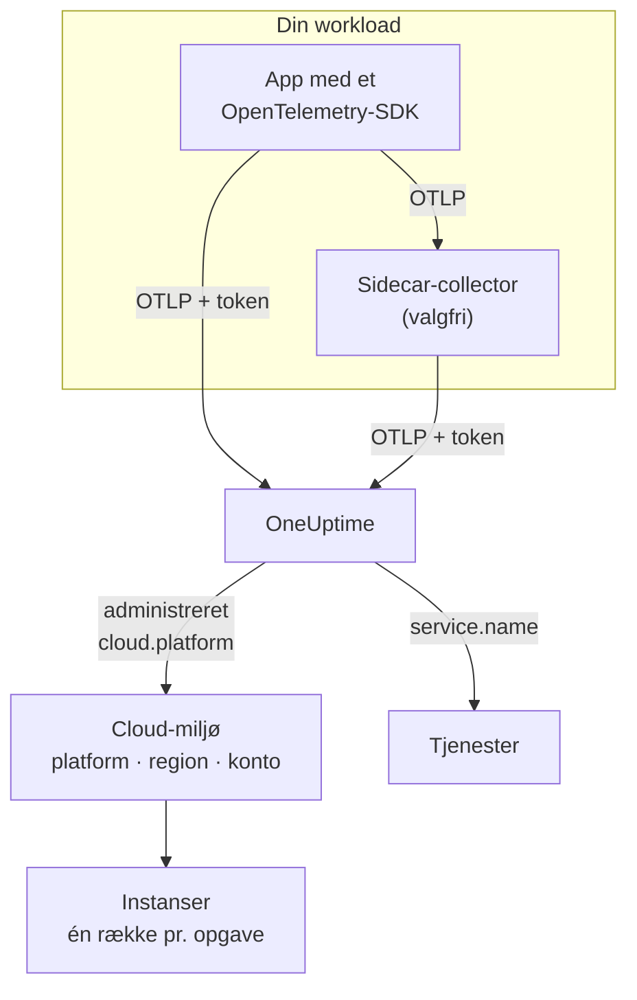

# Cloud-miljøer

Et **Cloud Environment** er stedet, hvor dine containere kører på en administreret cloudplatform: et ECS-clusters konto og region, et Cloud Run-projekt og dets region, et Container Apps-abonnement og dets region. OneUptime opretter et, første gang din telemetri ankommer med de rigtige ressourceattributter, og samler hver workload, der kører der. Der er intet at registrere i hånden.

:::cards
- [AWS ECS / Fargate](/docs/telemetry/cloud-aws-ecs): Opgaver på Fargate eller EC2, med CPU og hukommelse pr. opgave.
- [Google Cloud Run](/docs/telemetry/cloud-gcp-cloud-run): Tjenester og jobs, også vist som serverløse funktioner.
- [Azure Container Apps](/docs/telemetry/cloud-azure-container-apps): Replikaer, med region og abonnement sat i hånden.
- [Andre cloud-platforme](/docs/telemetry/cloud-other-platforms): Elastic Beanstalk, App Runner, App Engine, App Service og Container Instances.
:::

## Sådan virker det



- **En ressourcedetektor fortæller, hvor workloaden kører.** En OpenTelemetry-ressourcedetektor, i SDK'et eller i en collector, læser platformens metadata og sætter `cloud.platform`, `cloud.account.id` og `cloud.region` på alt, hvad workloaden sender. Hvor der ikke findes en detektor, sætter du dem selv.
- **Miljøet samler det hele.** Hver workload med samme platform, konto og region havner i ét miljø. Tjenesterne beholder deres egne rækker under **Tjenester**.
- **Hver kørende opgave er en instans.** Miljøets fane **Instanser** viser de kørende opgaver, instanser eller replikaer, med live CPU og hukommelse, hvor platformen kan levere dem.

## Før du begynder

- **En indtagelsesnøgle.** Opret en nøgle af typen **Server** under **Projektindstillinger → Telemetri og APM → Indtagelsesnøgler**, og kopiér dens token: se [Opret en indtagelsesnøgle](/docs/telemetry/open-telemetry#opret-en-indtagelsesnøgle). Det er en hemmelighed: hver platformside viser, hvor du gemmer det i den clouds hemmelighedslager.
- **OpenTelemetry i din applikation.** Et OpenTelemetry-SDK, der eksporterer OTLP, eller en OpenTelemetry Collector, der kører ved siden af applikationen.

## Understøttede platforme

| Platform | `cloud.platform` | `cloud.*` udfyldes af | Instansidentitet | Vejledning |
| ------------------------- | --------------------------- | ---------------------- | --------------------------------- | ------------------------------------------------------------------ |
| AWS ECS / Fargate | `aws_ecs` | ressourcedetektor | `aws.ecs.task.arn` | [AWS ECS / Fargate](/docs/telemetry/cloud-aws-ecs) |
| AWS Elastic Beanstalk | `aws_elastic_beanstalk` | ressourcedetektor | `host.id` | [Andre cloud-platforme](/docs/telemetry/cloud-other-platforms) |
| AWS App Runner | `aws_app_runner` | sat i hånden | `host.name` | [Andre cloud-platforme](/docs/telemetry/cloud-other-platforms) |
| Google Cloud Run | `gcp_cloud_run` | ressourcedetektor | `faas.instance` | [Google Cloud Run](/docs/telemetry/cloud-gcp-cloud-run) |
| Google App Engine | `gcp_app_engine` | ressourcedetektor | `faas.instance` | [Andre cloud-platforme](/docs/telemetry/cloud-other-platforms) |
| Azure Container Apps | `azure_container_apps` | ressourcedetektor | `azure.container_app.instance.id` | [Azure Container Apps](/docs/telemetry/cloud-azure-container-apps) |
| Azure Container Instances | `azure_container_instances` | sat i hånden | `host.name` | [Andre cloud-platforme](/docs/telemetry/cloud-other-platforms) |
| Azure App Service | `azure_app_service` | ressourcedetektor | `host.id` | [Andre cloud-platforme](/docs/telemetry/cloud-other-platforms) |

- **Ressourcedetektor:** en OpenTelemetry-ressourcedetektor, i SDK'et eller i Collectorens processor `resourcedetection`, sætter attributterne `cloud.*` for dig.
- **Sat i hånden:** der findes ingen detektor, så du sætter attributterne i `OTEL_RESOURCE_ATTRIBUTES`. Platformens side viser den præcise linje.
- **Azure-detektorerne ved mindre.** Container Apps-detektorerne kender hverken regionen eller abonnementet, og App Service-detektorerne kender ikke abonnementet: sæt selv det, der mangler.
- **Azure-stavemåder med punktum virker.** Azure-detektorerne til Node.js og .NET skriver `azure.container_apps` og `azure.app_service`. OneUptime omskriver dem til værdierne med understregning ovenfor, når de modtages.

## Sådan identificerer OneUptime et miljø

Der findes ét miljø for hver kombination af tre ressourceattributter:

| Attribut | Påkrævet | Hvad det er |
| ------------------ | -------- | ------------------------------------------------------------------------------------------- |
| `cloud.platform` | Ja | En af værdierne i [Understøttede platforme](#understøttede-platforme) |
| `cloud.account.id` | Nej | AWS-konto-ID'et, Google Cloud-projekt-ID'et eller Azure-abonnements-ID'et |
| `cloud.region` | Nej | Regionen, f.eks. `us-east-1`, `us-central1` eller `eastus` |

OneUptime sætter de tre sammen med `|` til **miljønøglen** og navngiver miljøet efter de samme værdier, f.eks. _AWS ECS · us-east-1 · 123456789012_:

```text title="Environment keys"
aws_ecs|123456789012|us-east-1
gcp_cloud_run|my-project|us-central1
azure_container_apps|00000000-0000-0000-0000-000000000000|eastus
```

> [!IMPORTANT]
> En manglende del bliver stående i nøglen som et tomt segment: `aws_ecs||us-east-1`. En workload, der udelader `cloud.account.id`, havner derfor i et andet miljø end en, der sætter den. Det er den almindelige grund til, at du ser to miljøer, hvor du ventede ét.

### Instansidentitet

Inden for et miljø får hver kørende opgave, instans eller replika én række under **Instanser**. Navnet kommer fra den første af disse ressourceattributter, som telemetrien bærer:

1. `aws.ecs.task.id`
2. `aws.ecs.task.arn` (forkortet til opgave-ID'et)
3. `faas.instance`
4. `azure.container_app.instance.id`
5. `service.instance.id`
6. `container.id`
7. `host.id`
8. `host.name`

Platformens egen identitet kommer først med vilje. En sidecar-collector og applikationens SDK ser den begge, og den overlever genstarter. Et SDK finder som regel på et nyt `service.instance.id` for hver proces (Node.js-SDK'et gør det som standard), så hvis det var nøglen først, ville én ECS-opgave blive delt i to rækker. `service.instance.id` bruges, når platformen ikke selv sætter en identitet. Kolonnen **Instansidentitet** i [Understøttede platforme](#understøttede-platforme) nævner den attribut, en typisk opsætning bruger på hver platform.

### Miljøer, du opretter i hånden

Det er sjældent nødvendigt: indtagelsen opretter miljøer for dig. For at oprette et før dets telemetri skal du åbne **Cloud → All Environments** og klikke på **Opret Cloud-ressource**. Vælg **Cloud-platform**, og skriv derefter **Cloud-konto-ID** og **Cloud-region** præcis, som din telemetri rapporterer dem. OneUptime bygger nøglen `platform|account|region` ud fra disse tre, og indtagelsen matcher et miljø alene på nøglen. Miljøet får det navn, indtagelsen ville give det; vil du vise et andet navn, så åbn **Flere felter** og skriv et **Visningsnavn**.

## Hvad der ikke er et cloud-miljø

| Du kører på | Hvor det vises | Hvorfor |
| ------------------------------------------------------------------------------------------------- | ------------------------ | ---------------------------------------------------------------------------------------------------- |
| EC2, Compute Engine, Azure VM (`aws_ec2`, `gcp_compute_engine`, `azure_vm`) | **Værter** | En virtuel maskine er en vært. Se [OpenTelemetry-collector på værten](/docs/telemetry/host-otel-collector) |
| EKS, GKE, AKS, selvadministreret Kubernetes | **Kubernetes** | Routes efter attributterne `k8s.*`. Se [Kubernetes-agent](/docs/telemetry/kubernetes-agent) |
| Lambda, Cloud Functions, Azure Functions (`aws_lambda`, `gcp_cloud_functions`, `azure_functions`) | **Serverløse funktioner** | Routes efter `faas.name`, eller efter `service.name` på en `cloud.platform` til FaaS. Se [Serverløse funktioner](/docs/telemetry/serverless-functions) |
| Load balancere, buckets, administrerede databaser og andre IaaS- eller PaaS-ressourcer | **Cloud Resources** | Opdaget ud fra de metrikker, som Azure Monitor, CloudWatch og Cloud Monitoring udgiver. Se [Cloud-ressourcer](/docs/telemetry/cloud-resources) |

> [!NOTE]
> Cloud Run og App Engine vises med vilje to steder. Deres detektor sætter både en administreret `cloud.platform` og `faas.name`, så hver tjeneste er også sin egen **Serverløs funktion**, mens **Cloud Environment** samler alle tjenester i det projekt og den region. Den samme telemetri arkiveres under begge.

## Forbind en workload

Hver platformside har disse trin med den clouds egne kommandoer og konsolskærme. I grove træk:

:::steps
### Sæt cloud-attributterne på din telemetri

:::tabs
@tab Sidecar collector
En ekstra container i opgaven, instansen eller replikaen. Applikationen eksporterer til `localhost:4318`, og collectorens processor `resourcedetection` stempler `cloud.*` på alt, der passerer igennem. Collectoren har tokenet, og på ECS sender den også CPU og hukommelse pr. opgave:

```yaml title="collector.yaml"
processors:
  resourcedetection:
    detectors: [env, ecs] # [env, gcp] on Cloud Run and App Engine; [env, azurecontainerapps] on Container Apps
    timeout: 5s
```
@tab SDK direct
Applikationens SDK eksporterer direkte til OneUptime. Slå platformens ressourcedetektor til i SDK'et, f.eks. `OTEL_NODE_RESOURCE_DETECTORS=env,host,os,aws` i Node.js: hver platformside viser kontakten for hvert sprog. Der er ingen ekstra container og ingen CPU eller hukommelse for containeren.
:::

### Eksportér OTLP til OneUptime

:::tabs
@tab Sidecar collector
```yaml title="collector.yaml"
exporters:
  otlphttp/oneuptime:
    endpoint: https://oneuptime.com/otlp
    headers:
      x-oneuptime-token: ${env:ONEUPTIME_TOKEN}

service:
  pipelines:
    traces:
      receivers: [otlp]
      processors: [resourcedetection, batch]
      exporters: [otlphttp/oneuptime]
    metrics:
      receivers: [otlp]
      processors: [resourcedetection, batch]
      exporters: [otlphttp/oneuptime]
    logs:
      receivers: [otlp]
      processors: [resourcedetection, batch]
      exporters: [otlphttp/oneuptime]
```

Collectoren udfylder `${env:ONEUPTIME_TOKEN}` fra en miljøvariabel, som platformen fylder fra sit hemmelighedslager: Secrets Manager, Secret Manager eller Container Apps-hemmeligheder.
@tab SDK direct
```bash
OTEL_EXPORTER_OTLP_ENDPOINT="https://oneuptime.com/otlp"
OTEL_EXPORTER_OTLP_HEADERS="x-oneuptime-token=YOUR_TELEMETRY_INGESTION_TOKEN"
```
:::

Hvis du selv hoster OneUptime, så brug `https://YOUR-ONEUPTIME-HOST/otlp`.

### Tjek forbindelsen

```bash
curl -i https://oneuptime.com/otlp/v1/validate \
  -H "x-oneuptime-token: YOUR_TELEMETRY_INGESTION_TOKEN"
```

`200` med `"valid": true` betyder, at tokenet er accepteret. `401` betyder, at det er ukendt, tilbagekaldt, deaktiveret eller udløbet, og svarets `message` siger hvilket. Inden for et minut efter det første span, den første log eller metrik vises miljøet under **Cloud → All Environments**.
:::

> [!TIP]
> De samme trin findes i dashboardet med dit token udfyldt: under **Cloud → All Environments**, indtil dit første miljø ankommer, og på hvert miljøs fane **Dokumentation**.

## Hvad du får

Et miljøs **Oversigt** viser:

- **Anmodninger**, **Fejlrate** og **p95 latency** fra dine spor, med grafer over anmodninger, fejl og hukommelse i det tidsrum, du vælger.
- **CPU** og **Hukommelse** på tværs af de levende instanser og en liste **Øverste instanser efter CPU**. De kommer fra metrikkerne `container.cpu.utilization` og `container.memory.usage`, der bærer instansidentiteten; på ECS fra `ecs.task.cpu.utilized` og `ecs.task.memory.utilized` fra receiveren `awsecscontainermetrics`.
- **Instanser**: hvor mange der har rapporteret inden for de seneste 15 minutter. Fanen **Instanser** har én række for hver.
- Fanerne **Protokoller**, **Spor** og **Metrikker**, filtreret til miljøet.

Et miljø, hvis telemetri stopper i 15 minutter, viser **Afbrudt**, og det næste span, den næste log eller metrik bringer det tilbage til **Forbundet**. Tid, hvor OneUptime selv var nede eller var ved at indhente, tæller ikke med i de 15 minutter.

### Etiketter og ejere

- **Fra din telemetri:** en ressourceattribut som `oneuptime.label.team=payments` tilføjer etiketten `team:payments` til miljøet.
- **Fra regler:** **Cloud → Indstillinger → Etiketregler** og **Ejerregler** tilføjer etiketter og ejere til de miljøer, der matcher. Se [Etiket- og ejerregler](/docs/configuration/label-and-owner-rules).

## Fejlfinding

[Cloud-fejlfinding](/docs/telemetry/cloud-troubleshooting) gennemgår hver fejl i den rækkefølge, de opstår: et miljø, der aldrig vises, havner under **Værter** eller kun under **Serverløse funktioner**, ingen instanser eller ingen CPU og hukommelse har, viser **Afbrudt**, deler sig i to eller blev oprettet i hånden og aldrig matcher.

## Næste trin

:::cards
- [AWS ECS / Fargate](/docs/telemetry/cloud-aws-ecs): Den mest almindelige opsætning, med en komplet opgavedefinition.
- [Cloud-fejlfinding](/docs/telemetry/cloud-troubleshooting): Hvad du skal tjekke, når et miljø mangler eller er forkert.
- [Cloud-ressourcer (IaaS og PaaS)](/docs/telemetry/cloud-resources): Load balancere, buckets og administrerede databaser fra din clouds egen overvågning.
- [Serverløse funktioner](/docs/telemetry/serverless-functions): Lambda, Cloud Functions og Azure Functions.
:::
