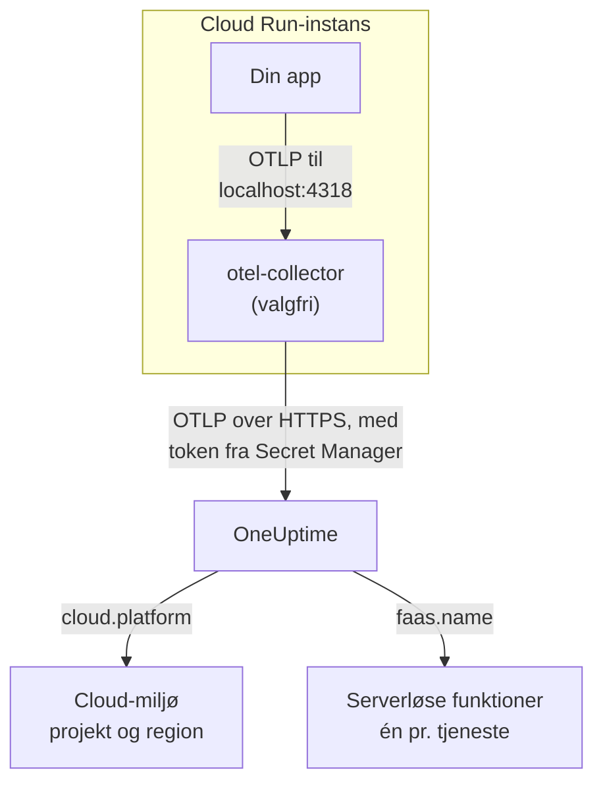

# Google Cloud Run

Send spor, logs og metrikker fra dine Cloud Run-tjenester og -jobs til OneUptime. Alt, der rapporterer `cloud.platform=gcp_cloud_run`, havner i ét **Cloud Environment** pr. Google Cloud-projekt og region, f.eks. _GCP Cloud Run · us-central1 · my-project_, og hver tjeneste vises også under **Serverløse funktioner**.

:::cards
- [Sådan virker det](#sådan-virker-det): Hvad GCP-detektoren sætter, og hvorfor en tjeneste vises to steder.
- [Opsætning](#opsætning): Gem tokenet, konfigurér tjenesten, udrul og tjek.
- [Tjenestens YAML med en sidecar](#tjenestens-yaml-med-en-sidecar): En komplet Cloud Run-tjeneste med en collector.
- [Fejlfinding](#fejlfinding): Fejl med hemmeligheder, sidecarens startrækkefølge og manglende miljøer.
:::

## Sådan virker det



OpenTelemetrys GCP-ressourcedetektor læser metadataserveren og miljøvariablerne `K_SERVICE` og `K_REVISION` og sætter:

| Attribut | Værdi på Cloud Run | Bruges til |
| ------------------ | ------------------------------ | ----------------------------------------------------------------------------------------- |
| `cloud.platform` | `gcp_cloud_run` | Arkiverer telemetrien under **Cloud-miljøer** |
| `cloud.account.id` | projekt-ID'et | En del af miljønøglen |
| `cloud.region` | `us-central1` | En del af miljønøglen |
| `faas.name` | tjenestenavnet (`K_SERVICE`) | Viser også tjenesten under **Serverløse funktioner** |
| `faas.version` | revisionen (`K_REVISION`) | Vises på tjenestens oversigt som serverløs funktion; miljøet bruger den ikke |
| `faas.instance` | instans-ID'et | Navngiver én kørende instans: én række for hver under **Instanser** |

> [!NOTE]
> Cloud Run vises med vilje to steder. Fordi detektoren sætter `faas.name`, er hver tjeneste også en **Serverløs funktion** med egne kald, fejlrate og varighed. **Cloud Environment** samler alle tjenester i det projekt og den region. Intet gemmes to gange: den samme telemetri arkiveres under begge.

Miljønøglen er `gcp_cloud_run|my-project|us-central1`.

## Før du begynder

- **En indtagelsesnøgle.** Opret en nøgle af typen **Server** under **Projektindstillinger → Telemetri og APM → Indtagelsesnøgler**, og kopiér dens token.
- **`gcloud`**, logget ind på projektet, med Secret Manager API'et slået til: `gcloud services enable secretmanager.googleapis.com`.
- **Din applikation instrumenteret med et OpenTelemetry-SDK**, der eksporterer OTLP.

## Vælg, hvordan telemetrien forlader tjenesten

| | SDK direct | Sidecar collector |
| --------------- | ---------------------------------------------------- | ---------------------------------------------------------------------- |
| Ekstra container | Ingen | `otel-collector` i tjenesten |
| Bedst til | Én tjeneste og Cloud Run-jobs | Flere tjenester i ét projekt, eller et SDK, der ikke kan køre en detektor |
| Har tokenet | Applikationen | Collectoren |
| Hemmeligheden | `oneuptime-otlp-headers`, hele headeren | `oneuptime-ingestion-token`, kun tokenet |

Et job kører til det er færdigt, så der er intet at holde en sidecar i live for: brug SDK direct. Hvert trin nedenfor har en fane til begge; vælg én, så følger hvert trin den.

## Opsætning

:::steps
### Gem tokenet i Secret Manager

> [!IMPORTANT]
> Tokenet er en hemmelighed. Læg det i Secret Manager, og referér til det fra tjenesten som en miljøvariabel baseret på en hemmelighed. En almindelig miljøvariabel er synlig for alle, der kan se projektet, i konsollen og i `gcloud run services describe`.

:::tabs
@tab SDK direct
```bash
printf '%s' "x-oneuptime-token=YOUR_TELEMETRY_INGESTION_TOKEN" | gcloud secrets create oneuptime-otlp-headers \
  --data-file=- \
  --replication-policy=automatic

gcloud secrets add-iam-policy-binding oneuptime-otlp-headers \
  --member="serviceAccount:checkout-api@my-project.iam.gserviceaccount.com" \
  --role="roles/secretmanager.secretAccessor"
```

Cloud Run lægger en hemmeligheds værdi uændret i variablen, og `OTEL_EXPORTER_OTLP_HEADERS` skal bruge hele parret `name=value`, så denne hemmelighed indeholder hele headeren.
@tab Sidecar collector
```bash
printf '%s' "YOUR_TELEMETRY_INGESTION_TOKEN" | gcloud secrets create oneuptime-ingestion-token \
  --data-file=- \
  --replication-policy=automatic

gcloud secrets add-iam-policy-binding oneuptime-ingestion-token \
  --member="serviceAccount:checkout-api@my-project.iam.gserviceaccount.com" \
  --role="roles/secretmanager.secretAccessor"
```

Collectorens konfiguration tilføjer headernavnet, så denne hemmelighed indeholder kun tokenet.
:::

Angiv tjenestens runtime-tjenestekonto i `--member`, ikke din egen bruger. Uden `roles/secretmanager.secretAccessor` kan revisionen ikke udrulles og fejler med `Permission denied on secret`. Hvis tjenesten stadig kører som standardtjenestekontoen til Compute, så tildel rollen til den konto, og overvej at give tjenesten sin egen konto: standardkontoen deles af alt i projektet.

### Konfigurér tjenesten

:::tabs
@tab SDK direct
1. **Google Cloud console → Cloud Run → click the service → Edit & deploy new revision**.
2. På fanen **Containers** skal du åbne din container og gå til **Variables & Secrets**. Tilføj variablerne nedenfor.
3. Klik på **Reference a secret**, vælg `oneuptime-otlp-headers`, versionen `latest`, og gør den tilgængelig som miljøvariablen `OTEL_EXPORTER_OTLP_HEADERS`.
4. På fanen **Security** skal du tjekke, at **Service account** er den konto, du gav `roles/secretmanager.secretAccessor`.

```bash
OTEL_SERVICE_NAME=checkout-api
OTEL_EXPORTER_OTLP_ENDPOINT=https://oneuptime.com/otlp
OTEL_EXPORTER_OTLP_PROTOCOL=http/protobuf
# Secret-backed (Variables & Secrets → Reference a secret), not typed here.
OTEL_EXPORTER_OTLP_HEADERS=x-oneuptime-token=YOUR_TELEMETRY_INGESTION_TOKEN
```

Slå derefter dit sprogs GCP-ressourcedetektor til:

| Sprog | Slå GCP-detektoren til |
| -------- | ------------------------------------------------------------------------------------------------------------------- |
| Node.js | `OTEL_NODE_RESOURCE_DETECTORS=env,host,os,gcp` (auto-instrumentations-node) |
| Python | `pip install opentelemetry-resourcedetector-gcp`, derefter `OTEL_EXPERIMENTAL_RESOURCE_DETECTORS=gcp_resource_detector` |
| Java | `-Dotel.resource.providers.gcp.enabled=true` |
| Go | `import "go.opentelemetry.io/contrib/detectors/gcp"`, og send `gcp.NewDetector()` til `resource.New` |
| .NET | Pakken `OpenTelemetry.Resources.Gcp`: `.ConfigureResource(r => r.AddGcpDetector())` |

Eller sæt det hele fra CLI'en:

```bash
gcloud run services update checkout-api --region us-central1 \
  --set-env-vars "^@^OTEL_SERVICE_NAME=checkout-api@OTEL_EXPORTER_OTLP_ENDPOINT=https://oneuptime.com/otlp@OTEL_EXPORTER_OTLP_PROTOCOL=http/protobuf@OTEL_NODE_RESOURCE_DETECTORS=env,host,os,gcp" \
  --set-secrets "OTEL_EXPORTER_OTLP_HEADERS=oneuptime-otlp-headers:latest"
```

Præfikset `^@^` får `gcloud` til at dele flagets liste ved `@` i stedet for `,`. Uden det deler `gcloud` `OTEL_NODE_RESOURCE_DETECTORS=env,host,os,gcp` ved hvert komma og fejler med `Bad syntax for dict arg [host]`.
@tab Sidecar collector
1. **Google Cloud console → Cloud Run → click the service → Edit & deploy new revision**.
2. På fanen **Containers** skal du åbne din container og gå til **Variables & Secrets**. Tilføj applikationsvariablerne nedenfor.
3. Klik på **+ Add container**. Sæt containerimagets URL til `otel/opentelemetry-collector-contrib:latest`, og tilføj under **Container command and arguments** argumentet `--config=env:OTEL_COLLECTOR_CONFIG`.
4. På den nye containers fane **Variables & Secrets**: **Reference a secret**, `oneuptime-ingestion-token`, som miljøvariablen `ONEUPTIME_TOKEN`. Tilføj variablen `OTEL_COLLECTOR_CONFIG` med collector-konfigurationen fra [Tjenestens YAML med en sidecar](#tjenestens-yaml-med-en-sidecar).
5. På collectorens fane **Settings** skal du tilføje en **Startup probe** (HTTP, sti `/`, port `13133`), og under **Container start-up order** gøre din container afhængig af `otel-collector`.
6. På fanen **Security** skal du tjekke, at **Service account** er den konto, du gav `roles/secretmanager.secretAccessor`.

Containerne i én Cloud Run-instans deler `localhost`, så applikationen eksporterer til sidecaren der:

```bash
OTEL_SERVICE_NAME=checkout-api
OTEL_EXPORTER_OTLP_ENDPOINT=http://localhost:4318
OTEL_EXPORTER_OTLP_PROTOCOL=http/protobuf
```

Fra CLI'en er sidecaren tjenestens YAML nedenfor, udrullet med `gcloud run services replace service.yaml --region us-central1`.
:::

Hvis du selv hoster OneUptime, så brug `https://YOUR-ONEUPTIME-HOST/otlp` som endpoint.

### Udrul den nye revision

Klik på **Deploy** i konsollen. Cloud Run starter en ny revision med indstillingerne og sender trafik til den, når den er klar. Kommandoerne med `gcloud` udruller selv en ny revision.

### Tjek forbindelsen

```bash
curl -i https://oneuptime.com/otlp/v1/validate \
  -H "x-oneuptime-token: YOUR_TELEMETRY_INGESTION_TOKEN"
```

`200` med `"valid": true` betyder, at tokenet er accepteret. `401` betyder, at det er ukendt, tilbagekaldt, deaktiveret eller udløbet. Send derefter én anmodning til tjenesten, og søg i collectorens logs i Cloud Logging (filtrér på containeren `otel-collector`) efter `401`, `connection refused` eller `context deadline exceeded`. Inden for et minut vises miljøet under **Cloud → All Environments** som _GCP Cloud Run · us-central1 · my-project_, og tjenesten under **Serverløse funktioner**.
:::

## Tjenestens YAML med en sidecar

Collectoren læser hele sin konfiguration fra `OTEL_COLLECTOR_CONFIG` (`--config=env:OTEL_COLLECTOR_CONFIG`) og tokenet fra hemmeligheden via `${env:ONEUPTIME_TOKEN}`. Annotationen `run.googleapis.com/container-dependencies` får Cloud Run til at starte collectoren først og vente på dens opstartsprobe, før applikationen startes:

```yaml title="service.yaml"
apiVersion: serving.knative.dev/v1
kind: Service
metadata:
  name: checkout-api
spec:
  template:
    metadata:
      annotations:
        # "app" depends on "otel-collector": the collector starts first and
        # must pass its startup probe before the app container is started.
        run.googleapis.com/container-dependencies: '{"app":["otel-collector"]}'
    spec:
      serviceAccountName: checkout-api@my-project.iam.gserviceaccount.com
      containers:
        - name: app
          image: us-central1-docker.pkg.dev/my-project/apps/checkout-api:1.4.2
          ports:
            - containerPort: 8080
          env:
            - name: OTEL_SERVICE_NAME
              value: checkout-api
            - name: OTEL_EXPORTER_OTLP_ENDPOINT
              value: http://localhost:4318
            - name: OTEL_EXPORTER_OTLP_PROTOCOL
              value: http/protobuf
        - name: otel-collector
          image: otel/opentelemetry-collector-contrib:latest
          args:
            - --config=env:OTEL_COLLECTOR_CONFIG
          env:
            - name: ONEUPTIME_TOKEN
              valueFrom:
                secretKeyRef:
                  name: oneuptime-ingestion-token
                  key: latest
            - name: OTEL_COLLECTOR_CONFIG
              value: |
                receivers:
                  otlp:
                    protocols:
                      http:
                        endpoint: 0.0.0.0:4318
                      grpc:
                        endpoint: 0.0.0.0:4317
                processors:
                  # Stamps cloud.provider, cloud.platform=gcp_cloud_run,
                  # cloud.account.id, cloud.region and faas.* on everything.
                  resourcedetection:
                    detectors: [env, gcp]
                    timeout: 5s
                  batch: {}
                exporters:
                  otlphttp/oneuptime:
                    endpoint: https://oneuptime.com/otlp
                    headers:
                      x-oneuptime-token: ${env:ONEUPTIME_TOKEN}
                extensions:
                  health_check:
                    endpoint: 0.0.0.0:13133
                service:
                  extensions: [health_check]
                  pipelines:
                    traces:
                      receivers: [otlp]
                      processors: [resourcedetection, batch]
                      exporters: [otlphttp/oneuptime]
                    metrics:
                      receivers: [otlp]
                      processors: [resourcedetection, batch]
                      exporters: [otlphttp/oneuptime]
                    logs:
                      receivers: [otlp]
                      processors: [resourcedetection, batch]
                      exporters: [otlphttp/oneuptime]
          startupProbe:
            httpGet:
              path: /
              port: 13133
            periodSeconds: 2
            failureThreshold: 15
          resources:
            limits:
              cpu: 500m
              memory: 256Mi
```

Udrul den:

```bash
gcloud run services replace service.yaml --region us-central1
```

Kun den container, der modtager anmodninger (`app`), angiver `ports`; en sidecar må ikke.

## Netværk

- **Som standard** når en Cloud Run-tjeneste internettet direkte, og eksport til `oneuptime.com` kræver ikke mere.
- **Med VPC egress: All traffic** (`--vpc-egress all-traffic`, via Direct VPC egress eller en Serverless VPC Access-connector) forlader udgående trafik tjenesten gennem din VPC, som så skal have Cloud NAT (eller en rute til en proxy) for at nå OneUptime-værten. Med standardværdien `private-ranges-only` bruger kun private adresser VPC'en, og OneUptime nås direkte.
- **Firewallregler for udgående trafik** i VPC'en skal tillade TCP 443 til OneUptime-værten.
- **En selvhostet OneUptime inde i VPC'en** er det omvendte tilfælde: send trafikken gennem VPC'en (`private-ranges-only` eller `all-traffic`), så `https://YOUR-ONEUPTIME-HOST/otlp` slås op der.

## Hvad du får

- **Oversigt**: anmodninger, fejlrate og p95-latens fra dine spor.
- **Instanser**: én række pr. Cloud Run-instans, navngivet efter `faas.instance`. Cloud Run viser ikke en containers ressourceforbrug til en sidecar, så felterne **CPU** og **Hukommelse** forbliver tomme, medmindre du selv sender metrikkerne `container.cpu.utilization` og `container.memory.usage` med den samme `faas.instance`. Læs felterne for anmodninger her, og overlad instansernes CPU og hukommelse til Cloud Monitoring.
- **Protokoller**, **Spor** og **Metrikker**, filtreret til miljøet.
- Den samme tjeneste under **Serverløse funktioner** (efter `faas.name`) og under **Tjenester** (efter `service.name`).

## Fejlfinding

:::details Revisionen fejler med "Permission denied on secret"
Runtime-tjenestekontoen mangler `roles/secretmanager.secretAccessor` på hemmeligheden, eller bindingen ligger på en anden hemmelighed end den, tjenesten refererer til. Kør kommandoen `gcloud secrets add-iam-policy-binding` igen med runtime-tjenestekontoen som `--member`.
:::

:::details Cloud Run afviser container-dependencies
Annotationen nævner en container, der ikke findes, eller collectoren har ingen opstartsprobe, så Cloud Run ikke kan se, hvornår den er klar.
:::

:::details Tjenesten er under Serverløse funktioner, men der findes intet miljø
Telemetrien har ingen `cloud.platform`: GCP-detektoren er ikke slået til i SDK'et, eller `gcp` mangler i collectorens liste `detectors`.
:::

:::details Miljøet findes, men Instanser er tom
Telemetrien har hverken `faas.instance` eller `service.instance.id`. Årsagen er den samme: detektoren kører ikke.
:::

Et miljø, der aldrig vises, viser **Afbrudt** eller deler sig i to, er dækket på [Cloud-fejlfinding](/docs/telemetry/cloud-troubleshooting).

## Næste trin

:::cards
- [Cloud-miljøer](/docs/telemetry/cloud-environments): Sådan identificeres miljøer og instanser.
- [Serverløse funktioner](/docs/telemetry/serverless-functions): Visningen pr. tjeneste af hver Cloud Run-tjeneste.
- [Cloud-fejlfinding](/docs/telemetry/cloud-troubleshooting): De fejl, som alle platforme har til fælles.
- [Cloud-ressourcer (IaaS og PaaS)](/docs/telemetry/cloud-resources): Din Cloud SQL, dine load balancere og buckets fra Cloud Monitoring.
:::
