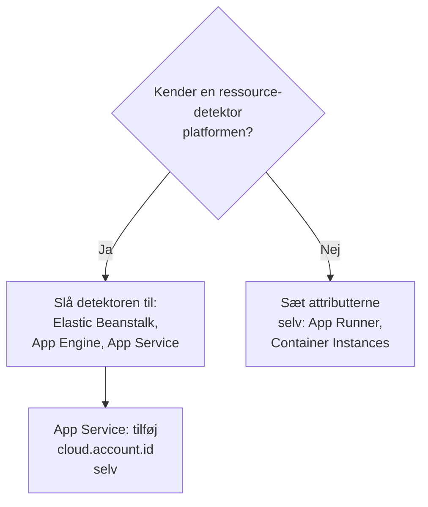

# Andre cloud-platforme

Opsæt de administrerede platforme, der ikke har deres egen side: AWS Elastic Beanstalk, AWS App Runner, Google App Engine, Azure App Service og Azure Container Instances. Reglen er den samme som på alle platforme: telemetri, der bærer en administreret `cloud.platform` med `cloud.account.id` og `cloud.region`, havner i ét **Cloud Environment** pr. platform, konto og region, og en instansidentitet giver hver kørende instans en række under **Instanser**.

:::cards
- [AWS Elastic Beanstalk](#aws-elastic-beanstalk): En collector på hver instans med detektorerne til Beanstalk og EC2.
- [AWS App Runner](#aws-app-runner): Attributterne sat i hånden, tokenet fra Secrets Manager.
- [Google App Engine](#google-app-engine): GCP-detektoren med indstillingerne i `app.yaml`.
- [Azure App Service](#azure-app-service): Azure-detektorerne, en Key Vault-reference og abonnementet i hånden.
- [Azure Container Instances](#azure-container-instances): Attributterne sat i hånden, tokenet som en sikker variabel.
:::

## Hvad hver platform har brug for

Det, der adskiller disse platforme, er, hvem der sætter attributterne `cloud.*`, og hvor indstillingerne findes i cloudens konsol:



| Platform | `cloud.platform` | `cloud.*` udfyldes af | Instansidentitet |
| ------------------------- | --------------------------- | ------------------------------------------------------------------------------------------ | ----------------------------------------------------------- |
| AWS Elastic Beanstalk | `aws_elastic_beanstalk` | Collectorens detektorer `elastic_beanstalk` og `ec2`; `aws` i Node.js | `host.id` (fjern udrulningens `service.instance.id`) |
| AWS App Runner | `aws_app_runner` | Dig (ingen detektor) | `host.name` |
| Google App Engine | `gcp_app_engine` | Detektoren `gcp` (Collectorens og hvert SDK's) | `faas.instance` |
| Azure App Service | `azure_app_service` | Collectorens `azureappservice`, Azure-detektorerne `azure` til Node.js og .NET; `cloud.account.id` af dig | `service.instance.id`, derefter `host.id` |
| Azure Container Instances | `azure_container_instances` | Dig (ingen detektor) | `host.name` |

Hvert afsnit nedenfor kræver en indtagelsesnøgle af typen **Server** fra **Projektindstillinger → Telemetri og APM → Indtagelsesnøgler** og en applikation, der er instrumenteret med et OpenTelemetry-SDK. Hvis du selv hoster OneUptime, så erstat `https://oneuptime.com/otlp` med `https://YOUR-ONEUPTIME-HOST/otlp`.

> [!IMPORTANT]
> Tokenet er en hemmelighed på hver af disse platforme. Hvert afsnit nævner platformens hemmelighedslager. Et token, der er skrevet i en almindelig miljøvariabel, kan læses af alle, der kan læse appens konfiguration.

## AWS Elastic Beanstalk

`cloud.platform`: `aws_elastic_beanstalk`. Beanstalk-detektoren læser `/var/elasticbeanstalk/xray/environment.conf` på instansen og sætter `cloud.platform`, `service.instance.id`, `service.version` og miljønavnet. Den kender hverken kontoen eller regionen, så kombinér den med EC2-detektoren, som gør, og som også sætter `host.id`.

Kør en OpenTelemetry Collector på hver instans med denne konfiguration:

```yaml title="config.yaml"
receivers:
  otlp:
    protocols:
      http:
        endpoint: 0.0.0.0:4318
      grpc:
        endpoint: 0.0.0.0:4317
processors:
  # elastic_beanstalk sets cloud.platform and service.instance.id; ec2 adds
  # cloud.account.id, cloud.region and host.id. The first detector to set an
  # attribute wins, so elastic_beanstalk comes first.
  resourcedetection:
    detectors: [env, elastic_beanstalk, ec2]
    timeout: 5s
  # The Beanstalk detector's service.instance.id is the deployment ID, shared
  # by every instance of a deployment: drop it, so that ec2's host.id names
  # each instance.
  resource:
    attributes:
      - key: service.instance.id
        action: delete
  batch: {}
exporters:
  otlphttp/oneuptime:
    endpoint: https://oneuptime.com/otlp
    headers:
      x-oneuptime-token: ${env:ONEUPTIME_TOKEN}
service:
  pipelines:
    traces:
      receivers: [otlp]
      processors: [resourcedetection, resource, batch]
      exporters: [otlphttp/oneuptime]
    metrics:
      receivers: [otlp]
      processors: [resourcedetection, resource, batch]
      exporters: [otlphttp/oneuptime]
    logs:
      receivers: [otlp]
      processors: [resourcedetection, resource, batch]
      exporters: [otlphttp/oneuptime]
```

:::steps
1. Gem tokenet i Secrets Manager: `aws secretsmanager create-secret --name oneuptime/ingestion-token --secret-string "YOUR_TELEMETRY_INGESTION_TOKEN"`. Beanstalks miljøegenskaber ligger i miljøets konfiguration, ikke i et hemmelighedslager, så læs i stedet hemmeligheden fra en platform-hook med instansprofilen. Instansprofilen skal have `secretsmanager:GetSecretValue` på den.
2. Installér collectoren fra et script i `.platform/hooks/postdeploy/` (eller `.ebextensions`): pakken `otelcol-contrib` med konfigurationen ovenfor og hemmeligheden i dens miljø som `ONEUPTIME_TOKEN`.
3. **AWS Console → Elastic Beanstalk → Environments → your environment → Configuration**.
4. I kategorien **Updates, monitoring, and logging** skal du klikke på **Edit** og rulle ned til **Environment properties**. Tilføj `OTEL_SERVICE_NAME`, `OTEL_EXPORTER_OTLP_ENDPOINT` sat til `http://localhost:4318` og `OTEL_EXPORTER_OTLP_PROTOCOL` sat til `http/protobuf`.
5. Klik på **Apply**. Beanstalk genstarter applikationen med de nye egenskaber.
:::

Node.js-applikationer kan springe collectoren over: SDK'ets detektorer omfatter Beanstalk og EC2. Sæt `OTEL_EXPORTER_OTLP_ENDPOINT` til `https://oneuptime.com/otlp`, `OTEL_EXPORTER_OTLP_HEADERS` til `x-oneuptime-token=YOUR_TELEMETRY_INGESTION_TOKEN` og `OTEL_NODE_RESOURCE_DETECTORS=env,host,os,aws`. Tokenet ligger så i en miljøegenskab. Tjek bagefter ressourceattributterne på et spor: hvis `cloud.platform` er `aws_ec2`, lod din SDK-version EC2-detektoren vinde, og collectoren er den pålidelige vej.

**Netværk:** instanser i et privat subnet skal have en NAT-gateway, og instansens sikkerhedsgruppe skal tillade udgående trafik på TCP 443 til OneUptime-værten.

## AWS App Runner

`cloud.platform`: `aws_app_runner`. Der findes ingen detektor, så du sætter selv attributterne. App Runner kan lægge en hemmelighed fra Secrets Manager (eller SSM Parameter Store) i en miljøvariabel.

```bash
OTEL_SERVICE_NAME=checkout-api
OTEL_EXPORTER_OTLP_ENDPOINT=https://oneuptime.com/otlp
OTEL_EXPORTER_OTLP_PROTOCOL=http/protobuf
# From Secrets Manager: the secret holds the whole header.
OTEL_EXPORTER_OTLP_HEADERS=x-oneuptime-token=YOUR_TELEMETRY_INGESTION_TOKEN
OTEL_RESOURCE_ATTRIBUTES=cloud.provider=aws,cloud.platform=aws_app_runner,cloud.region=us-east-1,cloud.account.id=123456789012
OTEL_NODE_RESOURCE_DETECTORS=env,host,os
```

Udskift regionen og konto-ID'et med dine egne. Detektoren `host` leverer `host.name`, containerens værtsnavn, som er forskelligt for hver App Runner-instans, og OneUptime navngiver instansen efter det.

:::steps
1. Gem hele headeren i Secrets Manager: `aws secretsmanager create-secret --name oneuptime/otlp-headers --secret-string "x-oneuptime-token=YOUR_TELEMETRY_INGESTION_TOKEN"`. App Runner lægger hemmelighedens værdi uændret i variablen.
2. **AWS Console → App Runner → Services → your service → Configuration → Configure service** (klik på **Edit** på fanen **Configuration**).
3. Under **Environment variables** skal du klikke på **Add environment variable** for hver almindelig værdi ovenfor.
4. Tilføj `OTEL_EXPORTER_OTLP_HEADERS` med **Source: Secrets Manager** og hemmelighedens ARN. Under **Security → Instance role** skal du vælge en rolle med `secretsmanager:GetSecretValue` på hemmeligheden: instansrollen, ikke adgangsrollen, der henter imaget.
5. Klik på **Save changes**. App Runner udruller en ny version.
:::

**Netværk:** en tjeneste uden VPC-connector når internettet direkte. Med **Outgoing network traffic: Custom VPC** går udgående trafik gennem din VPC, som skal have en NAT-gateway og en udgående regel i sikkerhedsgruppen for TCP 443 til OneUptime-værten.

## Google App Engine

`cloud.platform`: `gcp_app_engine`. GCP-detektoren genkender App Engine standard og flexible ud fra `GAE_SERVICE`, `GAE_VERSION` og `GAE_INSTANCE` og metadataserveren. Den sætter `cloud.account.id` (projektet), `cloud.region`, `faas.name`, `faas.version` og `faas.instance`. Som på Cloud Run får `faas.name` hver App Engine-tjeneste til også at blive vist under **Serverløse funktioner**, mens miljøet samler projektet og regionen.

| Sprog | Slå GCP-detektoren til |
| -------- | ------------------------------------------------------------------------------------------------------------------- |
| Node.js | `OTEL_NODE_RESOURCE_DETECTORS=env,host,os,gcp` |
| Python | `pip install opentelemetry-resourcedetector-gcp`, derefter `OTEL_EXPERIMENTAL_RESOURCE_DETECTORS=gcp_resource_detector` |
| Java | `-Dotel.resource.providers.gcp.enabled=true` |
| Go | `go.opentelemetry.io/contrib/detectors/gcp` → `gcp.NewDetector()` |
| .NET | `OpenTelemetry.Resources.Gcp` → `.AddGcpDetector()` |

App Engine har ingen editor til miljøvariabler i konsollen: de ligger i `app.yaml`.

```yaml title="app.yaml"
runtime: nodejs22
env_variables:
  OTEL_SERVICE_NAME: checkout-api
  OTEL_EXPORTER_OTLP_ENDPOINT: https://oneuptime.com/otlp
  OTEL_EXPORTER_OTLP_PROTOCOL: http/protobuf
  OTEL_NODE_RESOURCE_DETECTORS: env,host,os,gcp
  # Do not commit the real value. Template it in CI, or read the secret at
  # start-up with the Secret Manager client instead.
  OTEL_EXPORTER_OTLP_HEADERS: x-oneuptime-token=YOUR_TELEMETRY_INGESTION_TOKEN
```

:::steps
1. Gem hele headeren i Secret Manager: `printf '%s' "x-oneuptime-token=YOUR_TELEMETRY_INGESTION_TOKEN" | gcloud secrets create oneuptime-otlp-headers --data-file=-`. Giv App Engine-tjenestekontoen (`my-project@appspot.gserviceaccount.com`) `roles/secretmanager.secretAccessor` på den.
2. Læg hemmeligheden i `app.yaml` i din udrulningspipeline, og behold en pladsholder i den committede fil. Eller læs `projects/PROJECT_ID/secrets/oneuptime-otlp-headers/versions/latest` ved opstart, og send den til eksportørens indstilling `headers` i koden.
3. Udrul med `gcloud app deploy`. I konsollen viser **App Engine → Versions** den nye version, og **App Engine → Services** den tjeneste, der vises under **Serverløse funktioner**.
:::

**Netværk:** App Engine standard når internettet direkte. Instanser i flexible-miljøet ligger i en VPC: hvis subnettet ikke har eksterne IP'er, skal de have Cloud NAT og en udgående firewallregel for TCP 443 til OneUptime-værten.

## Azure App Service

`cloud.platform`: `azure_app_service`. Azure-detektorerne til Node.js og .NET samt Collectorens detektor `azureappservice` læser variablerne `WEBSITE_*`, som App Service sætter. De udfylder `cloud.platform`, `cloud.region`, `service.instance.id` (fra `WEBSITE_INSTANCE_ID`), `deployment.environment` (slottet) og `host.id`. Ingen af dem sætter `cloud.account.id`: tilføj selv abonnements-ID'et, ellers får miljønøglen et tomt kontosegment.

```bash
OTEL_SERVICE_NAME=checkout-api
OTEL_EXPORTER_OTLP_ENDPOINT=https://oneuptime.com/otlp
OTEL_EXPORTER_OTLP_PROTOCOL=http/protobuf
# The Key Vault reference, which resolves to the whole header.
OTEL_EXPORTER_OTLP_HEADERS=@Microsoft.KeyVault(SecretUri=https://my-vault.vault.azure.net/secrets/oneuptime-otlp-headers/)
OTEL_RESOURCE_ATTRIBUTES=cloud.account.id=00000000-0000-0000-0000-000000000000
# Node.js:
OTEL_NODE_RESOURCE_DETECTORS=env,host,os,azure
```

SDK-detektorerne staver platformen `azure.app_service` med et punktum; OneUptime omskriver den til `azure_app_service`, når den modtages. I .NET skal du tilføje `OpenTelemetry.Resources.Azure` og kalde `.ConfigureResource(r => r.AddAzureAppServiceDetector())`. Andre sprog tilføjer `cloud.provider=azure,cloud.platform=azure_app_service,cloud.region=<region>` til `OTEL_RESOURCE_ATTRIBUTES` og tager `service.instance.id` fra `WEBSITE_INSTANCE_ID` i koden.

:::steps
1. Slå appens systemtildelte administrerede identitet til (**Settings → Identity**), og giv den **Key Vault Secrets User** på boksen. Gem hele headeren, `x-oneuptime-token=YOUR_TELEMETRY_INGESTION_TOKEN`, som hemmeligheden `oneuptime-otlp-headers`.
2. **Azure portal → App Services → your app → Settings → Environment variables** (**Configuration → Application settings** i ældre portaler).
3. Tilføj hver variabel ovenfor med **+ Add**. Værdien af `OTEL_EXPORTER_OTLP_HEADERS` er Key Vault-referencen.
4. Klik på **Apply** og derefter **Confirm**: appen genstarter med de nye indstillinger. Udrulningsslots har deres egne indstillinger: markér tokenet som **deployment slot setting**, hvis kun ét slot skal sende telemetri.
:::

**Netværk:** App Service når internettet direkte, medmindre **VNet integration** med **Route All** er slået til. Så skal VNet'et have en NAT-gateway eller en rute til en firewall, der tillader TCP 443 til OneUptime-værten.

## Azure Container Instances

`cloud.platform`: `azure_container_instances`. Der findes ingen detektor, så du sætter selv attributterne. En containergruppes miljøvariabler ligger fast ved oprettelsen: at ændre én betyder at oprette gruppen igen. Send tokenet med `--secure-environment-variables`, så `az container show` ikke returnerer det:

```bash
az container create \
  --resource-group my-rg \
  --name checkout-api \
  --image myregistry.azurecr.io/checkout-api:1.4.2 \
  --location eastus \
  --environment-variables \
    OTEL_SERVICE_NAME=checkout-api \
    OTEL_EXPORTER_OTLP_ENDPOINT=https://oneuptime.com/otlp \
    OTEL_EXPORTER_OTLP_PROTOCOL=http/protobuf \
    "OTEL_RESOURCE_ATTRIBUTES=cloud.provider=azure,cloud.platform=azure_container_instances,cloud.region=eastus,cloud.account.id=00000000-0000-0000-0000-000000000000" \
    OTEL_NODE_RESOURCE_DETECTORS=env,host,os \
  --secure-environment-variables \
    "OTEL_EXPORTER_OTLP_HEADERS=x-oneuptime-token=YOUR_TELEMETRY_INGESTION_TOKEN"
```

`host.name` fra detektoren `host`, containergruppens værtsnavn, navngiver instansen. En sidecar-collector virker også her, da en containergruppe kører flere containere som en ECS-opgave: brug mønstret `detectors: [env]` plus `OTEL_RESOURCE_ATTRIBUTES` fra [Azure Container Apps](/docs/telemetry/cloud-azure-container-apps). Det er også den, der fylder felterne **CPU** og **Hukommelse**, hvis den sender `container.cpu.utilization` og `container.memory.usage` med gruppens identitet.

:::steps
1. **Azure portal → Container Instances → + Create**. Udfyld fanen **Basics**: ressourcegruppe, navn, region og image.
2. På fanen **Advanced** skal du under **Environment variables** tilføje hver variabel. For `OTEL_EXPORTER_OTLP_HEADERS` skal du sætte **Mark as secure** til **Yes**, så portalen og API'et ikke viser dens værdi.
3. Klik på **Review + create** og derefter **Create**. For at ændre en variabel senere skal du slette gruppen og oprette den igen.
:::

**Netværk:** en containergruppe med en offentlig IP når internettet direkte. En gruppe i et VNet-subnet går kun ud via VNet'ets rute: tilføj en NAT-gateway, eller tillad TCP 443 til OneUptime-værten på firewallen eller NSG'en.

## Tjek forbindelsen

Uanset hvilken platform du har sat op, så tjek tokenet først, og kig derefter efter miljøet:

```bash
curl -i https://oneuptime.com/otlp/v1/validate \
  -H "x-oneuptime-token: YOUR_TELEMETRY_INGESTION_TOKEN"
```

`200` med `"valid": true` betyder, at tokenet er accepteret. `401` betyder, at det er ukendt, tilbagekaldt, deaktiveret eller udløbet. Inden for et minut efter det første span, den første log eller metrik vises miljøet under **Cloud → All Environments**, navngivet efter platformen, regionen og kontoen.

## Fejlfinding

:::details Beanstalk-instanser vises under Værter
EC2-detektorens `cloud.platform=aws_ec2` vandt. Den første detektor, der sætter en attribut, vinder, så hold `elastic_beanstalk` foran `ec2` i `detectors`. Uden en collector kan Node.js-SDK'et også foretrække EC2-detektoren: kør collectoren.
:::

:::details Alle Beanstalk-instanser deler én række under Instanser
Beanstalk-detektorens `service.instance.id` er udrulnings-ID'et, som deles af alle instanser i en udrulning, og den læses før `host.id`. Behold processoren `resource`, der sletter den, i hver pipeline.
:::

:::details En App Service-app får 401
Key Vault-referencen blev ikke opløst, så App Service sendte den bogstavelige tekst `@Microsoft.KeyVault(...)` videre som header. Giv appens administrerede identitet **Key Vault Secrets User** på boksen, og tjek, at hemmeligheden indeholder hele headeren `x-oneuptime-token=...`.
:::

:::details Et App Service-miljø har et tomt kontosegment
Ingen af App Service-detektorerne sætter `cloud.account.id`. Føj abonnements-ID'et til `OTEL_RESOURCE_ATTRIBUTES` på hver app: telemetri med og uden det havner i to miljøer.
:::

:::details En ændret Container Instances-variabel har ingen effekt
En containergruppes miljøvariabler ligger fast ved oprettelsen. Slet gruppen, og opret den igen med de nye værdier.
:::

Se [Cloud-fejlfinding](/docs/telemetry/cloud-troubleshooting) for resten, især et miljø, der vises under **Værter**, kun under **Serverløse funktioner** (App Engine uden GCP-detektoren) eller to gange (`cloud.account.id` sat på nogle udrulninger og ikke på andre).

## Næste trin

:::cards
- [Cloud-miljøer](/docs/telemetry/cloud-environments): Sådan identificeres miljøer og instanser.
- [Cloud-fejlfinding](/docs/telemetry/cloud-troubleshooting): De fejl, som alle platforme har til fælles.
- [Serverløse funktioner](/docs/telemetry/serverless-functions): Lambda, Cloud Functions og Azure Functions.
- [Cloud-ressourcer (IaaS og PaaS)](/docs/telemetry/cloud-resources): Ressourcerne omkring dine apps fra din clouds egen overvågning.
:::
