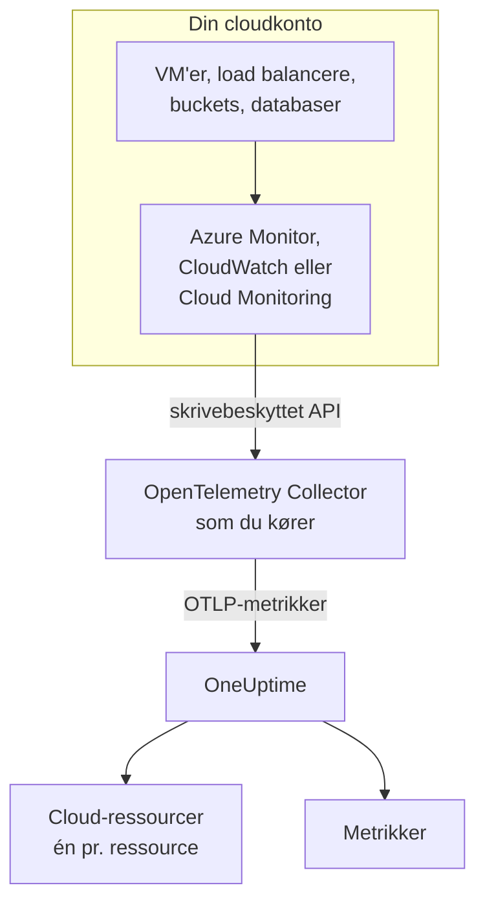
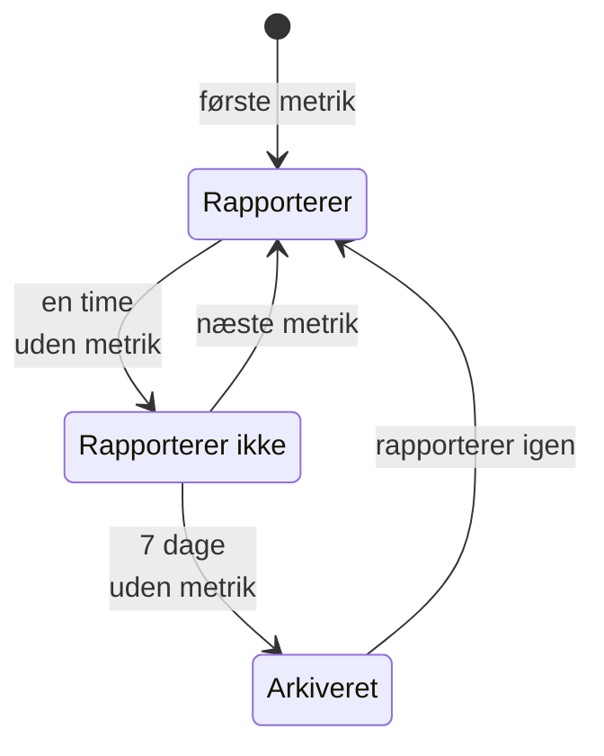

# Cloud-ressourcer (IaaS og PaaS)

**Cloud Resources** viser IaaS- og PaaS-ressourcerne i dine AWS-, Azure- og Google Cloud-konti: virtuelle maskiner, diske, load balancere, buckets, administrerede databaser, caches, køer, API-gateways og resten. Hver ressource får sin egen side med sin type, region og konto, udbyderens eget ID for den, hver metrik, som udbyderen udgiver om den, samt ejere og etiketter som alle andre ressourcer i OneUptime. Du finder dem under **Cloud → Alle ressourcer**.

:::cards
- [Forbind Azure](#forbind-azure): Læs alle ressourcer i et abonnement fra Azure Monitor.
- [Forbind AWS](#forbind-aws): Poll CloudWatch, eller stream det gennem Amazon Data Firehose.
- [Forbind Google Cloud](#forbind-google-cloud): Læs et projekts tjenester fra Cloud Monitoring.
- [Sådan identificeres en ressource](#sådan-identificeres-en-ressource): Hver ressourcetype, som OneUptime genkender, pr. udbyder.
:::

## Sådan virker det



- **Udbyderen måler allerede dine ressourcer.** Azure Monitor, Amazon CloudWatch og Google Cloud Monitoring udgiver metrikker om hver ressource, de kører for dig.
- **En collector, du selv kører, læser dem.** En OpenTelemetry Collector med skrivebeskyttet adgang til den overvågningstjeneste eksporterer metrikkerne til OneUptime. Der installeres intet på ressourcerne, og OneUptime har aldrig dine cloud-legitimationsoplysninger: det har collectoren, i dit miljø.
- **Hver ressource vises med sin første metrik.** OneUptime ser ud fra hvert datapunkt, hvilken ressource det handler om, og opretter cloud-ressourcen, første gang den ser den.

Cloud-ressourcer er ét af flere steder, hvor din cloud dukker op:

| Du kører | Hvor det vises | Hvordan |
| --- | --- | --- |
| Containere på ECS, Cloud Run, Container Apps, App Service, … | **Cloud → All Environments** | Dine workloads' egen telemetri efter deres `cloud.platform`. Se [Cloud-miljøer](/docs/telemetry/cloud-environments) |
| Enhver IaaS- eller PaaS-ressource, som udbyderen overvåger | **Cloud → Alle ressourcer** | Udbyderens overvågnings-API, læst af en collector: denne side |
| Virtuelle maskiner med en OpenTelemetry Collector på | **Værter** | Værtens egne metrikker og logs. Se [OpenTelemetry-collector på værten](/docs/telemetry/host-otel-collector) |
| Køer og topics, som dine applikationer bruger | **Queues** | Spans og de samme cloudmetrikker. Se [Køer](/docs/telemetry/queues) |

En ressource kan vises mere end ét sted. En virtuel maskine med collectoren på er en **Vært**, og dens platformmetrikker (CPU-kreditter, disk og netværk, som hypervisoren ser dem) gør den også til en **Cloud-ressource**. En SQS-kø er en **Queue** og en **Cloud-ressource**. Hver visning viser, hvad dens kilde ved.

## Før du begynder

- **En indtagelsesnøgle.** Opret en nøgle af typen **Server** under **Projektindstillinger → Telemetri og APM → Indtagelsesnøgler**. Collectorerne nedenfor læser den fra miljøvariablen `ONEUPTIME_TOKEN`, aldrig fra deres konfigurationsfil.
- **Et sted at køre OpenTelemetry Collector**: distributionen `otelcol-contrib`, imaget `otel/opentelemetry-collector-contrib`, med udgående adgang til din cloududbyder og til OneUptime. En lille VM, en container eller dit Kubernetes-cluster er nok, og én collector kan læse flere konti og udbydere.
- **Læseadgang til udbyderens overvågnings-API.** Hver udbyders første trin nedenfor opretter den.

> [!TIP]
> De samme trin findes i dashboardet med dit token udfyldt: under **Cloud → Alle ressourcer**, indtil den første ressource ankommer, og på hver ressources fane **Dokumentation**, som åbner på dens egen udbyder.

Hvis du selv hoster OneUptime, så erstat `https://oneuptime.com/otlp` med `https://YOUR-ONEUPTIME-HOST/otlp`.

## Forbind Azure

Receiveren `azure_monitor` viser ressourcerne i et abonnement og læser deres platformmetrikker hvert minut. Uden en liste `services` læser den alle ressourcetyper, så hver ressource i abonnementet bliver en cloud-ressource.

:::steps
### Opret en tjenesteprincipal med Monitoring Reader

**Monitoring Reader** læser metrikker og viser ressourcer og kan ikke ændre noget:

```bash
az ad sp create-for-rbac \
  --name oneuptime-cloud-collector \
  --role "Monitoring Reader" \
  --scopes /subscriptions/<SUBSCRIPTION_ID>
```

Kommandoen udskriver en `appId` (klient-ID'et), en `password` (klienthemmeligheden) og `tenant`. Giv den samme tjenesteprincipal rollen på flere abonnementer for at læse dem med den samme collector.

### Konfigurér Azure Monitor-receiveren

Gem dette som `config.yaml`:

```yaml
extensions:
  azure_auth:
    service_principal:
      tenant_id: ${env:AZURE_TENANT_ID}
      client_id: ${env:AZURE_CLIENT_ID}
      client_secret: ${env:AZURE_CLIENT_SECRET}

receivers:
  azure_monitor:
    subscription_ids: ["${env:AZURE_SUBSCRIPTION_ID}"]
    auth:
      authenticator: azure_auth
    collection_interval: 60s
    # No `services` list: every resource type in the subscription.
    # Series Azure returns per metric and resource (default 10).
    maximum_number_of_records_per_resource: 50

processors:
  batch: {}

exporters:
  otlphttp/oneuptime:
    endpoint: https://oneuptime.com/otlp
    headers:
      x-oneuptime-token: ${env:ONEUPTIME_TOKEN}

service:
  extensions: [azure_auth]
  pipelines:
    metrics:
      receivers: [azure_monitor]
      processors: [batch]
      exporters: [otlphttp/oneuptime]
```

### Kør Azure-collectoren

```bash
docker run -d --name oneuptime-cloud-collector --restart unless-stopped \
  -e ONEUPTIME_TOKEN=YOUR_TELEMETRY_INGESTION_TOKEN \
  -e AZURE_TENANT_ID=<TENANT> \
  -e AZURE_CLIENT_ID=<APP_ID> \
  -e AZURE_CLIENT_SECRET=<PASSWORD> \
  -e AZURE_SUBSCRIPTION_ID=<SUBSCRIPTION_ID> \
  -v "$(pwd)/config.yaml:/etc/otelcol-contrib/config.yaml" \
  otel/opentelemetry-collector-contrib:latest
```

Ressourcer vises under **Cloud → Alle ressourcer** inden for få minutter.
:::

Indstillinger for receiveren `azure_monitor`:

| Indstilling | Hvad den gør |
| --- | --- |
| `resource_groups`, `services`, `resource_tags` | Læs mindre: en liste over ressourcegrupper, over Resource Manager-typer (`Microsoft.Compute/virtualMachines`) eller over tags, en ressource skal have |
| `metrics` | Begrænser hver ressourcetype til de metrikker og aggregeringer, du angiver. Når en type er angivet, læses kun dens angivne metrikker |
| `discover_subscriptions: true` | Læser hvert abonnement, tjenesteprincipalen kan se, i stedet for `subscription_ids` |
| `maximum_number_of_records_per_resource` | Hvor mange serier Azure returnerer pr. metrik og ressource (10 som standard). Hæv den, når en metrik opdeles efter en dimension med mange værdier |
| `use_batch_api: true` | Til store abonnementer. Receiveren laver ét Resource Manager-kald pr. ressource og batch af 20 metrikker, og Resource Manager tillader omkring 12.000 læsninger i timen; batch-API'et læser op til 50 ressourcer pr. kald fra Azure Monitors dataplan, hvis grænse er langt højere |
| `cache_resources` | Hvor ofte, i sekunder, receiveren viser ressourcerne: én gang om dagen som standard. En ressource, der er oprettet efter collectoren startede, kan tage op til en dag om at dukke op; genstart collectoren for at vise dem med det samme |

## Forbind AWS

CloudWatch-metrikker når OneUptime på en af to måder:

| | Polling | Metric Streams |
| --- | --- | --- |
| Hvordan | Collectorens receiver `aws_cloudwatch` spørger CloudWatch | CloudWatch skubber gennem Amazon Data Firehose til collectorens receiver `awsfirehose` |
| Kræver på AWS-siden | Kun legitimationsoplysninger | En Firehose-stream og en metric stream i hver region |
| Collectoren skal kunne nås fra AWS | Nej | Ja, over HTTPS på port 443 |
| Forsinkelse | 10 til 20 minutter | Få minutter |
| Passer til | De fleste konti | Store konti |

### Polling med receiveren aws_cloudwatch

:::steps
#### Lad collectoren læse CloudWatch

Knyt denne politik til den rolle, collectoren kører som (en EC2-instansprofil, en ECS-opgaverolle, en EKS-tjenestekonto), eller til en IAM-bruger, hvis adgangsnøgler du giver den:

```json
{
  "Version": "2012-10-17",
  "Statement": [
    {
      "Effect": "Allow",
      "Action": [
        "cloudwatch:ListMetrics",
        "cloudwatch:GetMetricData",
        "sts:GetCallerIdentity"
      ],
      "Resource": "*"
    }
  ]
}
```

`sts:GetCallerIdentity` lader receiveren rapportere konto-ID'et, som hver ressources ARN har brug for.

#### Konfigurér CloudWatch-receiverne

Én receiver læser ét namespace i én region, så tilføj én for hvert namespace og hver region, du vil have. Dette eksempel læser de almindelige; gem det som `config.yaml`:

```yaml
receivers:
  aws_cloudwatch/ec2:
    region: ${env:AWS_REGION}
    metrics:
      collection_interval: 5m
      period: 5m
      delay: 10m
      discovery:
        filters:
          namespace: AWS/EC2
        # Metrics read per scrape, at most. Each costs 4 GetMetricData queries.
        limit: 1000
  aws_cloudwatch/ebs:
    region: ${env:AWS_REGION}
    metrics:
      collection_interval: 5m
      period: 5m
      delay: 10m
      discovery:
        filters:
          namespace: AWS/EBS
        # Metrics read per scrape, at most. Each costs 4 GetMetricData queries.
        limit: 1000
  aws_cloudwatch/applicationelb:
    region: ${env:AWS_REGION}
    metrics:
      collection_interval: 5m
      period: 5m
      delay: 10m
      discovery:
        filters:
          namespace: AWS/ApplicationELB
        # Metrics read per scrape, at most. Each costs 4 GetMetricData queries.
        limit: 1000
  aws_cloudwatch/rds:
    region: ${env:AWS_REGION}
    metrics:
      collection_interval: 5m
      period: 5m
      delay: 10m
      discovery:
        filters:
          namespace: AWS/RDS
        # Metrics read per scrape, at most. Each costs 4 GetMetricData queries.
        limit: 1000
  aws_cloudwatch/lambda:
    region: ${env:AWS_REGION}
    metrics:
      collection_interval: 5m
      period: 5m
      delay: 10m
      discovery:
        filters:
          namespace: AWS/Lambda
        # Metrics read per scrape, at most. Each costs 4 GetMetricData queries.
        limit: 1000
  aws_cloudwatch/dynamodb:
    region: ${env:AWS_REGION}
    metrics:
      collection_interval: 5m
      period: 5m
      delay: 10m
      discovery:
        filters:
          namespace: AWS/DynamoDB
        # Metrics read per scrape, at most. Each costs 4 GetMetricData queries.
        limit: 1000

processors:
  batch: {}

exporters:
  otlphttp/oneuptime:
    endpoint: https://oneuptime.com/otlp
    headers:
      x-oneuptime-token: ${env:ONEUPTIME_TOKEN}

service:
  pipelines:
    metrics:
      receivers: [aws_cloudwatch/ec2, aws_cloudwatch/ebs, aws_cloudwatch/applicationelb, aws_cloudwatch/rds, aws_cloudwatch/lambda, aws_cloudwatch/dynamodb]
      processors: [batch]
      exporters: [otlphttp/oneuptime]
```

#### Kør CloudWatch-collectoren

```bash
docker run -d --name oneuptime-cloud-collector --restart unless-stopped \
  -e ONEUPTIME_TOKEN=YOUR_TELEMETRY_INGESTION_TOKEN \
  -e AWS_REGION=us-east-1 \
  -e AWS_ACCESS_KEY_ID=<ACCESS_KEY_ID> \
  -e AWS_SECRET_ACCESS_KEY=<SECRET_ACCESS_KEY> \
  -v "$(pwd)/config.yaml:/etc/otelcol-contrib/config.yaml" \
  otel/opentelemetry-collector-contrib:latest
```

På en EC2-instans, ECS-opgave eller EKS-pod, der har rollen, skal du udelade de to nøglevariabler.
:::

- **Lad `stats` være usat.** Hver metrik læses så som én opsummering pr. periode: fire statistikker, fire forespørgsler med `GetMetricData`, og AWS fakturerer `GetMetricData` pr. anmodet metrik. `discovery.limit` begrænser de metrikker, en receiver læser pr. scrape (sæt den: receiverens egen standard er 100), og et længere `collection_interval` læser dem sjældnere.
- **Data ankommer sent.** `delay` venter på, at CloudWatch udgiver en periode, så datapunkter ankommer 10 til 20 minutter efter det tidspunkt, de måler, og ressourcer vises inden for cirka tyve minutter.

### Streaming med CloudWatch Metric Streams

:::steps
#### Konfigurér Firehose-receiveren

Collectoren skal have et certifikat til sin adresse: Firehose leverer kun til `https://` på port 443. Gem dette som `config.yaml`:

```yaml
extensions:
  awscloudwatchmetricstreams_encoding:
    format: opentelemetry1.0

receivers:
  awsfirehose:
    # Firehose delivers to HTTPS on port 443 only: expose this port as
    # 443, for example behind a load balancer.
    endpoint: 0.0.0.0:4433
    encoding: awscloudwatchmetricstreams_encoding
    access_key: ${env:FIREHOSE_ACCESS_KEY}
    tls:
      cert_file: /etc/otelcol-contrib/tls/server.crt
      key_file: /etc/otelcol-contrib/tls/server.key

processors:
  batch: {}

exporters:
  otlphttp/oneuptime:
    endpoint: https://oneuptime.com/otlp
    headers:
      x-oneuptime-token: ${env:ONEUPTIME_TOKEN}

service:
  extensions: [awscloudwatchmetricstreams_encoding]
  pipelines:
    metrics:
      receivers: [awsfirehose]
      processors: [batch]
      exporters: [otlphttp/oneuptime]
```

#### Kør Firehose-collectoren

```bash
docker run -d --name oneuptime-cloud-collector --restart unless-stopped \
  -e ONEUPTIME_TOKEN=YOUR_TELEMETRY_INGESTION_TOKEN \
  -e FIREHOSE_ACCESS_KEY=<A_LONG_RANDOM_SECRET> \
  -p 4433:4433 \
  -v "$(pwd)/tls:/etc/otelcol-contrib/tls:ro" \
  -v "$(pwd)/config.yaml:/etc/otelcol-contrib/config.yaml" \
  otel/opentelemetry-collector-contrib:latest
```

Certifikatet og dets nøgle skal ligge i `tls/` som `server.crt` og `server.key`. Udgiv port 4433 bag noget, der svarer på 443, f.eks. en load balancer.

#### Opret Firehose-streamen og metric streams

1. **Amazon Data Firehose → Create Firehose stream**: kilde **Direct PUT**, destination **HTTP Endpoint**. Endpoint-URL'en er collectorens adresse `https://`; adgangsnøglen er `FIREHOSE_ACCESS_KEY`. Vælg eller opret en S3-bucket til mislykkede leveringer.
2. **CloudWatch → Metrics → Streams → Create metric stream**: de namespaces, der skal med (eller alle), Firehose-streamen og outputformatet **OpenTelemetry 1.0**.
3. Gentag i hver region: en metric stream bærer sin egen regions metrikker.
:::

AWS fakturerer en metric stream pr. metrikopdatering, den leverer, plus Firehoses datagebyrer, så medtag kun de namespaces, du vil have. En stream i formatet **JSON** (`format: json` på kodningsudvidelsen) navngiver de samme ressourcer, men skriver også hvert namespace i `service.name`, så hvert namespace også vises under **Tjenester**: foretræk **OpenTelemetry 1.0**.

## Forbind Google Cloud

Receiveren `googlecloudmonitoring` læser de metriktyper, som dens `metrics_list` nævner, for ét projekt.

:::steps
### Opret en tjenestekonto med Monitoring Viewer

**Monitoring Viewer** læser metrikker og kan ikke ændre noget:

```bash
gcloud iam service-accounts create oneuptime-cloud-collector \
  --project <PROJECT_ID>

gcloud projects add-iam-policy-binding <PROJECT_ID> \
  --member "serviceAccount:oneuptime-cloud-collector@<PROJECT_ID>.iam.gserviceaccount.com" \
  --role roles/monitoring.viewer

gcloud iam service-accounts keys create key.json \
  --iam-account oneuptime-cloud-collector@<PROJECT_ID>.iam.gserviceaccount.com
```

På selve Google Cloud skal du køre collectoren som denne tjenestekonto i stedet for at oprette en nøgle.

### Konfigurér Cloud Monitoring-receiveren

Hvert filter læser hver metriktype fra én tjeneste. Gem dette som `config.yaml`:

```yaml
receivers:
  googlecloudmonitoring:
    project_id: ${env:GCP_PROJECT_ID}
    collection_interval: 2m
    # Only the metric types these filters list are read.
    metrics_list:
      - metric_descriptor_filter: 'metric.type = starts_with("compute.googleapis.com/")'
      - metric_descriptor_filter: 'metric.type = starts_with("cloudsql.googleapis.com/")'
      - metric_descriptor_filter: 'metric.type = starts_with("loadbalancing.googleapis.com/")'
      - metric_descriptor_filter: 'metric.type = starts_with("storage.googleapis.com/")'
      - metric_descriptor_filter: 'metric.type = starts_with("redis.googleapis.com/")'
      - metric_descriptor_filter: 'metric.type = starts_with("run.googleapis.com/")'

processors:
  batch: {}

exporters:
  otlphttp/oneuptime:
    endpoint: https://oneuptime.com/otlp
    headers:
      x-oneuptime-token: ${env:ONEUPTIME_TOKEN}

service:
  pipelines:
    metrics:
      receivers: [googlecloudmonitoring]
      processors: [batch]
      exporters: [otlphttp/oneuptime]
```

### Kør Google Cloud-collectoren

```bash
docker run -d --name oneuptime-cloud-collector --restart unless-stopped \
  -e ONEUPTIME_TOKEN=YOUR_TELEMETRY_INGESTION_TOKEN \
  -e GCP_PROJECT_ID=<PROJECT_ID> \
  -e GOOGLE_APPLICATION_CREDENTIALS=/etc/otelcol-contrib/key.json \
  -v "$(pwd)/key.json:/etc/otelcol-contrib/key.json:ro" \
  -v "$(pwd)/config.yaml:/etc/otelcol-contrib/config.yaml" \
  otel/opentelemetry-collector-contrib:latest
```
:::

- **Listen læses, når collectoren starter:** genstart den efter en ændring. `metric_name: compute.googleapis.com/instance/cpu/utilization` læser én type i stedet for alle en tjenestes typer.
- **Én receiver læser ét projekt:** tilføj én pr. projekt.
- **Læsning har en pris og en kvote.** Hver metriktype er én læsning fra Cloud Monitoring-API'et pr. indsamlingsinterval. Det er gratis at læse Google Clouds egne metrikker inden for API'ets månedlige kvote; et længere `collection_interval` holder et stort projekt inden for den og inden for kvoten pr. minut.

## Hold pipelinen fri for ressourcedetektion

> [!WARNING]
> Tilføj ikke processoren `resourcedetection` til den pipeline, der læser cloudovervågningen. Den stempler collector-maskinens eget `host.name` og `os.type` på hvert datapunkt, og OneUptime arkiverer så også din clouds metrikker under den maskine i **Værter**. En collector, der også overvåger sin egen vært, skal gøre det i sin egen pipeline.

## Sådan identificeres en ressource

Hvert datapunkt fra disse receivere navngiver én ressource, og OneUptime knytter cloud-ressourcen til den ressources identitet, aldrig til dens navn, som du kan ændre. Identiteten sammenlignes uden hensyn til store og små bogstaver, så en ressource, der rapporteres med to stavemåder, er én ressource.

### Azure

Hvert datapunkt bærer sin ressources Azure-ressource-ID (`azuremonitor.resource_id`), så hver ressource, receiveren læser, bliver en cloud-ressource: typerne nedenfor under et læsevenligt navn, alle andre under deres Resource Manager-type. Ressource-ID'et, regionen, abonnementet og ressourcegruppen vises alle på ressourcen.

:::details Azure-ressourcetyperne med et læsevenligt navn
| Ressourcetype | Vises som | Model |
| --- | --- | --- |
| `Microsoft.Compute/virtualMachines` | Virtual Machine | IaaS |
| `Microsoft.Compute/virtualMachineScaleSets` | Virtual Machine Scale Set | IaaS |
| `Microsoft.Compute/disks` | Managed Disk | IaaS |
| `Microsoft.Network/loadBalancers` | Load Balancer | IaaS |
| `Microsoft.Network/applicationGateways` | Application Gateway | IaaS |
| `Microsoft.Network/publicIPAddresses` | Public IP Address | IaaS |
| `Microsoft.Network/natGateways` | NAT Gateway | IaaS |
| `Microsoft.Network/virtualNetworkGateways` | Virtual Network Gateway | IaaS |
| `Microsoft.Network/expressRouteCircuits` | ExpressRoute Circuit | IaaS |
| `Microsoft.Network/azureFirewalls` | Azure Firewall | IaaS |
| `Microsoft.Network/frontdoors` | Front Door (classic) | IaaS |
| `Microsoft.Cdn/profiles` | Front Door and CDN Profile | IaaS |
| `Microsoft.Network/trafficmanagerprofiles` | Traffic Manager Profile | IaaS |
| `Microsoft.Network/networkInterfaces` | Network Interface | IaaS |
| `Microsoft.Network/virtualNetworks` | Virtual Network | IaaS |
| `Microsoft.Network/privateEndpoints` | Private Endpoint | IaaS |
| `Microsoft.Network/dnszones` | DNS Zone | IaaS |
| `Microsoft.Network/bastionHosts` | Bastion | IaaS |
| `Microsoft.Storage/storageAccounts` | Storage Account | IaaS |
| `Microsoft.RecoveryServices/vaults` | Recovery Services Vault | PaaS |
| `Microsoft.Web/sites` | App Service or Function App | PaaS |
| `Microsoft.Web/serverfarms` | App Service Plan | PaaS |
| `Microsoft.Web/staticSites` | Static Web App | PaaS |
| `Microsoft.App/containerApps` | Container App | PaaS |
| `Microsoft.App/managedEnvironments` | Container Apps Environment | PaaS |
| `Microsoft.ContainerInstance/containerGroups` | Container Instance | PaaS |
| `Microsoft.ContainerService/managedClusters` | AKS Cluster | PaaS |
| `Microsoft.ContainerRegistry/registries` | Container Registry | PaaS |
| `Microsoft.SignalRService/SignalR` | SignalR Service | PaaS |
| `Microsoft.Sql/servers/databases` | SQL Database | PaaS |
| `Microsoft.Sql/servers/elasticpools` | SQL Elastic Pool | PaaS |
| `Microsoft.Sql/managedInstances` | SQL Managed Instance | PaaS |
| `Microsoft.DBforPostgreSQL/flexibleServers` | PostgreSQL Flexible Server | PaaS |
| `Microsoft.DBforMySQL/flexibleServers` | MySQL Flexible Server | PaaS |
| `Microsoft.DocumentDB/databaseAccounts` | Cosmos DB Account | PaaS |
| `Microsoft.Cache/redis` | Azure Cache for Redis | PaaS |
| `Microsoft.Cache/redisEnterprise` | Azure Managed Redis | PaaS |
| `Microsoft.ServiceBus/namespaces` | Service Bus Namespace | PaaS |
| `Microsoft.EventHub/namespaces` | Event Hubs Namespace | PaaS |
| `Microsoft.EventGrid/topics` | Event Grid Topic | PaaS |
| `Microsoft.EventGrid/systemTopics` | Event Grid System Topic | PaaS |
| `Microsoft.EventGrid/namespaces` | Event Grid Namespace | PaaS |
| `Microsoft.ApiManagement/service` | API Management | PaaS |
| `Microsoft.Logic/workflows` | Logic App | PaaS |
| `Microsoft.DataFactory/factories` | Data Factory | PaaS |
| `Microsoft.Synapse/workspaces` | Synapse Workspace | PaaS |
| `Microsoft.Kusto/clusters` | Data Explorer Cluster | PaaS |
| `Microsoft.StreamAnalytics/streamingjobs` | Stream Analytics Job | PaaS |
| `Microsoft.CognitiveServices/accounts` | Azure AI Services or OpenAI | PaaS |
| `Microsoft.Search/searchServices` | AI Search Service | PaaS |
| `Microsoft.MachineLearningServices/workspaces` | Machine Learning Workspace | PaaS |
| `Microsoft.KeyVault/vaults` | Key Vault | PaaS |
| `Microsoft.Insights/components` | Application Insights | PaaS |
| `Microsoft.OperationalInsights/workspaces` | Log Analytics Workspace | PaaS |
| `Microsoft.Automation/automationAccounts` | Automation Account | PaaS |
| `Microsoft.Devices/IotHubs` | IoT Hub | PaaS |
:::

### AWS

En CloudWatch-metrik navngiver sin ressource i en dimension, der afhænger af namespacet. Et datapunkt, der bærer dimensionerne under **Identificeret ved**, tilhører den ressource sammen med dens konto og region; ekstra dimensioner indsnævrer serien, ikke ressourcen (en Application Load Balancers serier pr. målgruppe tilhører load balanceren). Et datapunkt, der er aggregeret over noget andet (`InstanceType`, `DatabaseClass`, en total for hele kontoen), navngiver ingen ressource og opdages ikke. Det gør et namespace, der ikke er på listen, heller ikke: dets metrikker når stadig **Metrikker**.

Hver ressource vises med sin ARN, hvor dens metrikker navngiver den fuldt ud; hvor de ikke gør (en Auto Scaling-gruppes ARN indeholder et UUID, som ingen metrik rapporterer), med sit namespace og sine dimensioner.

:::details CloudWatch-namespaces og de dimensioner, der identificerer en ressource
| Namespace | Identificeret ved | Vises som | Ressourcetype | Model |
| --- | --- | --- | --- | --- |
| `AWS/EC2` | `InstanceId` | EC2 Instance | `AWS::EC2::Instance` | IaaS |
| `AWS/EC2` | `AutoScalingGroupName` (without `InstanceId`) | Auto Scaling Group | `AWS::AutoScaling::AutoScalingGroup` | IaaS |
| `AWS/AutoScaling` | `AutoScalingGroupName` | Auto Scaling Group | `AWS::AutoScaling::AutoScalingGroup` | IaaS |
| `AWS/EBS` | `VolumeId` | EBS Volume | `AWS::EC2::Volume` | IaaS |
| `AWS/ELB` | `LoadBalancerName` | Classic Load Balancer | `AWS::ElasticLoadBalancing::LoadBalancer` | IaaS |
| `AWS/ApplicationELB` | `LoadBalancer` | Elastic Load Balancer (ALB, NLB, GWLB) | `AWS::ElasticLoadBalancingV2::LoadBalancer` | IaaS |
| `AWS/NetworkELB` | `LoadBalancer` | Elastic Load Balancer (ALB, NLB, GWLB) | `AWS::ElasticLoadBalancingV2::LoadBalancer` | IaaS |
| `AWS/GatewayELB` | `LoadBalancer` | Elastic Load Balancer (ALB, NLB, GWLB) | `AWS::ElasticLoadBalancingV2::LoadBalancer` | IaaS |
| `AWS/NATGateway` | `NatGatewayId` | NAT Gateway | `AWS::EC2::NatGateway` | IaaS |
| `AWS/TransitGateway` | `TransitGateway` | Transit Gateway | `AWS::EC2::TransitGateway` | IaaS |
| `AWS/VPN` | `VpnId` | Site-to-Site VPN Connection | `AWS::EC2::VPNConnection` | IaaS |
| `AWS/DX` | `ConnectionId` | Direct Connect Connection | `AWS::DirectConnect::Connection` | IaaS |
| `AWS/CloudFront` | `DistributionId` | CloudFront Distribution | `AWS::CloudFront::Distribution` | IaaS |
| `AWS/GlobalAccelerator` | `Accelerator` (without `Listener`, `EndpointGroup`) | Global Accelerator | `AWS::GlobalAccelerator::Accelerator` | IaaS |
| `AWS/Route53` | `HealthCheckId` | Route 53 Health Check | `AWS::Route53::HealthCheck` | IaaS |
| `AWS/NetworkFirewall` | `FirewallName` | Network Firewall | `AWS::NetworkFirewall::Firewall` | IaaS |
| `AWS/WAFV2` | `WebACL` (without `Rule`, `RuleGroup`) | WAF Web ACL | `AWS::WAFv2::WebACL` | PaaS |
| `AWS/S3` | `BucketName` | S3 Bucket | `AWS::S3::Bucket` | IaaS |
| `AWS/EFS` | `FileSystemId` | EFS File System | `AWS::EFS::FileSystem` | IaaS |
| `AWS/FSx` | `FileSystemId` | FSx File System | `AWS::FSx::FileSystem` | IaaS |
| `AWS/ECS` | `ClusterName` + `ServiceName` | ECS Service | `AWS::ECS::Service` | PaaS |
| `AWS/ECS` | `ClusterName` (without `ServiceName`) | ECS Cluster | `AWS::ECS::Cluster` | PaaS |
| `AWS/AppRunner` | `ServiceName` | App Runner Service | `AWS::AppRunner::Service` | PaaS |
| `AWS/ElasticBeanstalk` | `EnvironmentName` | Elastic Beanstalk Environment | `AWS::ElasticBeanstalk::Environment` | PaaS |
| `AWS/Lambda` | `FunctionName` | Lambda Function | `AWS::Lambda::Function` | PaaS |
| `AWS/States` | `StateMachineArn` | Step Functions State Machine | `AWS::StepFunctions::StateMachine` | PaaS |
| `AWS/RDS` | `DBInstanceIdentifier` | RDS DB Instance | `AWS::RDS::DBInstance` | PaaS |
| `AWS/RDS` | `DBClusterIdentifier` (without `DBInstanceIdentifier`) | Aurora / RDS DB Cluster | `AWS::RDS::DBCluster` | PaaS |
| `AWS/DocDB` | `DBInstanceIdentifier` | DocumentDB Instance | `AWS::DocDB::DBInstance` | PaaS |
| `AWS/DocDB` | `DBClusterIdentifier` (without `DBInstanceIdentifier`) | DocumentDB Cluster | `AWS::DocDB::DBCluster` | PaaS |
| `AWS/Neptune` | `DBInstanceIdentifier` | Neptune Instance | `AWS::Neptune::DBInstance` | PaaS |
| `AWS/Neptune` | `DBClusterIdentifier` (without `DBInstanceIdentifier`) | Neptune Cluster | `AWS::Neptune::DBCluster` | PaaS |
| `AWS/DynamoDB` | `TableName` | DynamoDB Table | `AWS::DynamoDB::Table` | PaaS |
| `AWS/ElastiCache` | `CacheClusterId` | ElastiCache Cluster | `AWS::ElastiCache::CacheCluster` | PaaS |
| `AWS/ElastiCache` | `ReplicationGroupId` (without `CacheClusterId`) | ElastiCache Replication Group | `AWS::ElastiCache::ReplicationGroup` | PaaS |
| `AWS/ElastiCache` | `clusterId` (without `CacheClusterId`) | ElastiCache Serverless Cache | `AWS::ElastiCache::ServerlessCache` | PaaS |
| `AWS/MemoryDB` | `ClusterName` | MemoryDB Cluster | `AWS::MemoryDB::Cluster` | PaaS |
| `AWS/Redshift` | `ClusterIdentifier` | Redshift Cluster | `AWS::Redshift::Cluster` | PaaS |
| `AWS/ES` | `DomainName` | OpenSearch Domain | `AWS::OpenSearchService::Domain` | PaaS |
| `AWS/SQS` | `QueueName` | SQS Queue | `AWS::SQS::Queue` | PaaS |
| `AWS/SNS` | `TopicName` | SNS Topic | `AWS::SNS::Topic` | PaaS |
| `AWS/Kinesis` | `StreamName` | Kinesis Data Stream | `AWS::Kinesis::Stream` | PaaS |
| `AWS/Firehose` | `DeliveryStreamName` | Data Firehose Stream | `AWS::KinesisFirehose::DeliveryStream` | PaaS |
| `AWS/AmazonMQ` | `Broker` | Amazon MQ Broker | `AWS::AmazonMQ::Broker` | PaaS |
| `AWS/Kafka` | `Cluster Name` | MSK Cluster | `AWS::MSK::Cluster` | PaaS |
| `AWS/Events` | `RuleName` | EventBridge Rule | `AWS::Events::Rule` | PaaS |
| `AWS/ApiGateway` | `ApiName` | API Gateway REST API | `AWS::ApiGateway::RestApi` | PaaS |
| `AWS/ApiGateway` | `ApiId` (without `ApiName`) | API Gateway HTTP or WebSocket API | `AWS::ApiGatewayV2::Api` | PaaS |
| `AWS/AppSync` | `GraphQLAPIId` | AppSync GraphQL API | `AWS::AppSync::GraphQLApi` | PaaS |
| `AWS/CertificateManager` | `CertificateArn` | ACM Certificate | `AWS::CertificateManager::Certificate` | PaaS |
| `AWS/KMS` | `KeyId` | KMS Key | `AWS::KMS::Key` | PaaS |
| `AWS/Cognito` | `UserPool` | Cognito User Pool | `AWS::Cognito::UserPool` | PaaS |
| `AWS/SageMaker` | `EndpointName` | SageMaker Endpoint | `AWS::SageMaker::Endpoint` | PaaS |
| `AWS/Logs` | `LogGroupName` | CloudWatch Log Group | `AWS::Logs::LogGroup` | PaaS |
:::

### Google Cloud

Cloud Monitoring navngiver hver metriks overvågede ressource med en type og etiketter. Et datapunkt af en type nedenfor tilhører den ressource, identificeret ved de angivne etiketter; ressourcens andre etiketter og dens metadataetiketter deler den aldrig. Kubernetes-typer (`k8s_container`, `k8s_pod`, …) overlades til produktet [Kubernetes](/docs/telemetry/kubernetes-agent).

:::details Cloud Monitoring-ressourcetyperne og de etiketter, der identificerer dem
| Overvåget ressourcetype | Identificeret ved | Vises som | Model |
| --- | --- | --- | --- |
| `gce_instance` | `project_id`, `zone`, `instance_id` | Compute Engine VM Instance | IaaS |
| `instance_group` | `project_id`, `location`, `instance_group_id` | Instance Group | IaaS |
| `gcs_bucket` | `project_id`, `bucket_name` | Cloud Storage Bucket | IaaS |
| `filestore_instance` | `project_id`, `location`, `instance_name` | Filestore Instance | IaaS |
| `https_lb_rule` | `project_id`, `url_map_name` | External Application Load Balancer | IaaS |
| `internal_http_lb_rule` | `project_id`, `region`, `url_map_name` | Internal Application Load Balancer | IaaS |
| `vpn_gateway` | `project_id`, `region`, `gateway_id` | Cloud VPN Gateway | IaaS |
| `nat_gateway` | `project_id`, `region`, `router_id`, `gateway_name` | Cloud NAT Gateway | IaaS |
| `gce_router` | `project_id`, `region`, `router_id` | Cloud Router | IaaS |
| `cloudsql_database` | `project_id`, `database_id` | Cloud SQL Instance | PaaS |
| `alloydb.googleapis.com/Instance` | `resource_container`, `location`, `cluster_id`, `instance_id` | AlloyDB Instance | PaaS |
| `redis_instance` | `project_id`, `region`, `instance_id` | Memorystore for Redis Instance | PaaS |
| `spanner_instance` | `project_id`, `instance_id` | Spanner Instance | PaaS |
| `bigtable_table` | `project_id`, `instance` | Bigtable Instance | PaaS |
| `bigquery_dataset` | `project_id`, `dataset_id` | BigQuery Dataset | PaaS |
| `cloud_function` | `project_id`, `region`, `function_name` | Cloud Run Function | PaaS |
| `cloud_run_revision` | `project_id`, `location`, `service_name` | Cloud Run Service | PaaS |
| `cloud_run_job` | `project_id`, `location`, `job_name` | Cloud Run Job | PaaS |
| `gae_app` | `project_id`, `module_id` | App Engine Service | PaaS |
| `pubsub_topic` | `project_id`, `topic_id` | Pub/Sub Topic | PaaS |
| `pubsub_subscription` | `project_id`, `subscription_id` | Pub/Sub Subscription | PaaS |
| `cloud_tasks_queue` | `project_id`, `location`, `queue_id` | Cloud Tasks Queue | PaaS |
| `cloud_composer_environment` | `project_id`, `location`, `environment_name` | Cloud Composer Environment | PaaS |
| `dataproc_cluster` | `project_id`, `region`, `cluster_name` | Dataproc Cluster | PaaS |
| `aiplatform.googleapis.com/Endpoint` | `resource_container`, `location`, `endpoint_id` | Vertex AI Endpoint | PaaS |
:::

### Navne

En ressource får det navn, udbyderen kalder den (`vm-prod-01`, `checkout`, `orders`). Navne er unikke inden for et projekt, og udbyderens er ikke: to abonnementer har hver en `web-01`, og en App Service-plan og dens app hedder begge `checkout`. Derfor navngives en ressource, hvis navn er optaget, med sin type, derefter sin ressourcegruppe eller region og derefter sin konto: `web-01 (Virtual Machine, rg-prod)`. Omdøb enhver ressource på dens fane **Indstillinger**: metrikker matches på dens identitet, ikke dens navn.

## Status, arkivering og grænser



- **Rapporterer** betyder, at udbyderen har sendt en metrik om ressourcen inden for den seneste time; efter en time uden står der **Rapporterer ikke**. Nogle ressourcer er stille af natur, f.eks. en Key Vault, som ingen kaldte, eller en bucket, hvis lagringsmetrikker CloudWatch udgiver én gang om dagen, og de kommer tilbage med deres næste datapunkt.
- En ressource, der **ingen metrik sender i 7 dage**, arkiveres automatisk: en instans, som en Auto Scaling-gruppe har erstattet, et slettet volume, en bucket, der er væk. Den beholder sine etiketter, ejere og sin historik under **Cloud → Avanceret → Arkiveret** og gendannes af sig selv, så snart den rapporterer igen. En ressource, du selv arkiverer, forbliver arkiveret; en, du gendanner, mens den er stille, bliver på listen, indtil den rapporterer.
- Det holder ikke at slette en ressource, som udbyderen stadig rapporterer: den opdages igen ud fra sine næste metrikker. Arkivér den i stedet.
- Opdagelsen holder op med at oprette ressourcer, når et projekt har **5.000** levende (ikke arkiverede), og logger en advarsel; arkiverede ressourcer tæller ikke med.

Selvhostede installationer kan ændre dette med miljøvariabler på appen:

| Variabel | Standard | Betydning |
| --- | --- | --- |
| `CLOUD_RESOURCE_AUTO_ARCHIVE_DAYS` | `7` | Dage uden metrik, før en ressource arkiveres (mindst 1) |
| `CLOUD_RESOURCE_AUTO_CREATE_BUDGET` | `5000` | Levende ressourcer, et projekt må have, før opdagelsen holder op med at oprette flere (`0` slår opdagelsen fra) |

## Alarmer på en ressource

:::steps
1. Åbn ressourcen og dens fane **Metrikker**, som viser hver metrik, udbyderen rapporterer om den.
2. Åbn en metrik for at vise den som graf i metrikudforskeren, allerede filtreret til ressourcen.
3. Klik på **Opret monitor fra denne visning**: monitoren overvåger den metrik for den ressource.
:::

> [!IMPORTANT]
> Cloudovervågning udgiver hvert tal minutter efter det tidspunkt, det måler: 10 til 20 minutter for CloudWatch, der polles som ovenfor, få minutter for Azure Monitor og Cloud Monitoring. Det gemmes under det tidspunkt, det måler. Giv en monitor over disse metrikker et vindue, der er længere end det (30 minutter for CloudWatch, 15 for de andre), ellers ser den ingen data og udløses aldrig.

## Inventar og regler

- **Inventar:** Cloud-ressourcer vises i [Inventar](/docs/inventory/overview) som elementer af typen **Cloud-ressource** med udbyderens ID som `cloud.resource.id` og typen som `cloud.resource.type`. AI-agentens ressourceværktøjer viser dem også.
- **Regler:** **Cloud → Indstillinger → Etiketregler** og **Ejerregler** gælder for dem, som de gør for cloud-miljøer.

## Fejlfinding

### Ingen ressourcer vises

1. Tjek tokenet: `curl -i https://oneuptime.com/otlp/v1/validate -H "x-oneuptime-token: YOUR_TELEMETRY_INGESTION_TOKEN"` skal svare `200` med `"valid": true`.
2. Læs collectorens log (`docker logs oneuptime-cloud-collector`). En autorisationsfejl nævner den tilladelse, der mangler: `AuthorizationFailed` (Azure: **Monitoring Reader** på abonnementet), `AccessDenied` på `cloudwatch:GetMetricData` (AWS: politikken ovenfor), `PermissionDenied` (Google Cloud: **Monitoring Viewer**).
3. Kig i **Metrikker** efter udbyderens metrikker (`azure_…`, `amazonaws.com/aws/…`, `compute.googleapis.com/…`). Hvis de er der, men ingen ressource er, navngiver datapunkterne ingen ressource, som OneUptime genkender: et AWS-namespace eller en Google Cloud-type, der ikke står ovenfor, eller et datapunkt, der er aggregeret over noget andet end en ressource.
4. Vent på sene data: CloudWatch, der polles som ovenfor, er 10 til 20 minutter bagud.

### En ressource mangler

- **Azure:** receiveren viser ressourcerne én gang om dagen; genstart collectoren for at vise nye nu. En ressourcetype uden platformmetrikker i Azure Monitor har intet at rapportere.
- **AWS:** hver receiver læser ét namespace i én region, og `discovery.limit` begrænser, hvor mange metrikker den læser: hæv den, når en konto har flere.
- **Google Cloud:** `metrics_list` skal nævne ressourcens tjeneste.
- **Alle udbydere:** et projekt, der har nået budgettet, opretter ingen nye ressourcer, før nogle er arkiveret. Se [Status, arkivering og grænser](#status-arkivering-og-grænser).

### Den samme ressource vises to gange

En AWS-ressource, der læses én gang med sit konto-ID og én gang uden, er to ressourcer: polling-receiveren rapporterer kun kontoen, når den må kalde `sts:GetCallerIdentity`. Giv hver collector den tilladelse, og arkivér kopien uden konto.

### Min clouds metrikker vises under en vært

Pipelinen har en processor `resourcedetection`. Se [Hold pipelinen fri for ressourcedetektion](#hold-pipelinen-fri-for-ressourcedetektion).

## Begrænsninger

- **Kun metrikker.** Udbydernes overvågnings-API'er udgiver ingen logs eller spor om en ressource. Send dem fra dine workloads med OpenTelemetry.
- **Opdagelsen følger metrikkerne.** En ressource, som udbyderen ikke udgiver metrikker om, eller som collectoren ikke læser, opdages ikke.
- **Ingen egen opbevaringsindstilling.** En ressources metrikker bevares lige så længe som resten af de metrikker, dens collector sender.
- **Polling koster penge** og tæller med i cloud-API'ernes grænser: se hver udbyders noter ovenfor.

## Næste trin

:::cards
- [Cloud-miljøer](/docs/telemetry/cloud-environments): Dine containere på ECS, Cloud Run og Container Apps ud fra deres egen telemetri.
- [Køer](/docs/telemetry/queues): SQS, Service Bus og Pub/Sub med de samme cloudmetrikker.
- [Etiket- og ejerregler](/docs/configuration/label-and-owner-rules): Sæt etiketter på ressourcer, og tildel ejere, efterhånden som de opdages.
- [Inventar](/docs/inventory/overview): Hver vært, enhed og cloud-ressource på én liste.
:::
