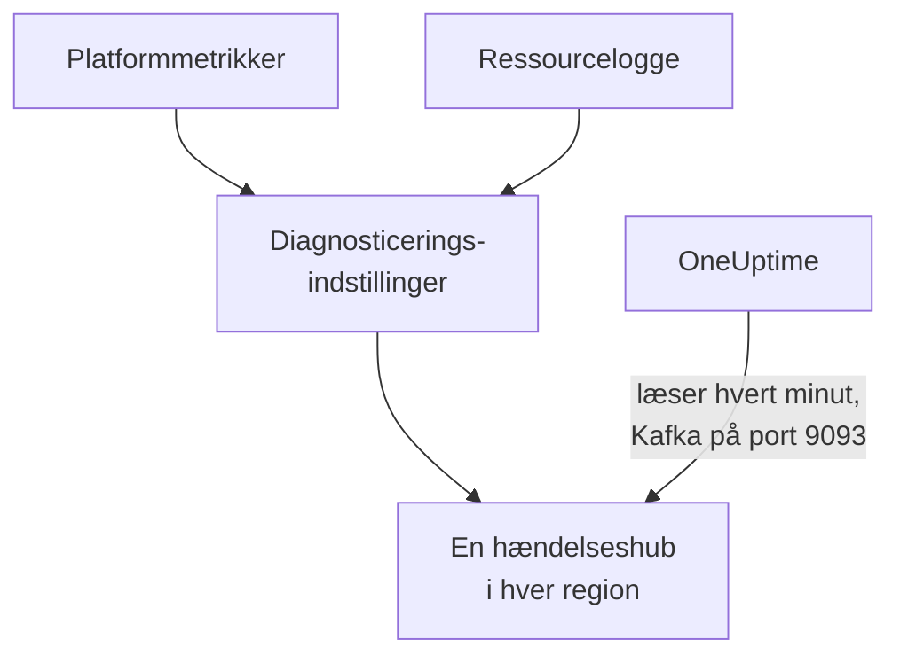

# Stream Azure Monitor-metrikker og -logge

Et forbundet Azure-abonnement kan streame sine Azure Monitor-metrikker og ressourcelogge til OneUptime. Diagnosticeringsindstillinger sender dem til hændelseshubs i dit abonnement, og OneUptime læser hændelseshubbene hvert minut: nøglemetrikker ankommer få minutter efter, at Azure Monitor har dem, i stedet for ved forbindelsens næste læsning, og ressourcelogge ankommer som OneUptime-logge, hver arkiveret under den ressource, den handler om. Én kommando i Azure Cloud Shell sætter det op, og der er intet at køre.

:::cards
- [Sådan virker det](#sådan-virker-det): Diagnosticeringsindstillinger sender til en hændelseshub i hver region, og OneUptime læser dem.
- [Sæt streaming op](#sæt-streaming-op): Vælg, hvad der skal streames, slå læsning til, og kør én kommando.
- [Hvad der ankommer](#hvad-der-ankommer): Metrikker på de ressourcer, de måler, og logge på de ressourcer, de kommer fra.
- [Hvad kommandoen opretter](#hvad-kommandoen-opretter): Hver ressource og hver tilladelse, kommandoen opretter i dit abonnement.
- [Stop streaming](#stop-streaming): Stop læsningen, og slet derefter det, kommandoen oprettede.
:::

## Sådan virker det



- **En hændelseshub i hver region.** En diagnosticeringsindstilling sender kun til en hændelseshub i sin ressources egen region, så kommandoen opretter et Event Hubs-navnerum i hver region, dine ressourcer ligger i, alle i én ressourcegruppe, og retter hver ressources diagnosticeringsindstilling mod hændelseshubben i dens region.
- **OneUptime læser dem.** Azure Monitor sender kun til en hændelseshub, en lagerkonto eller et Log Analytics-arbejdsområde, aldrig til en adresse hos dig: en hændelseshub, som OneUptime læser, er den vej, hvor du ikke skal køre noget. OneUptime logger ind som forbindelsens egen app, der må læse de hændelseshubs og intet andet.
- **Læsningerne overlader streamede metrikker til streamen.** Mens streamen leverer en ressourcetypes nøglemetrikker i en region, holder forbindelsens læsninger op med at skrive dem, så intet datapunkt tælles to gange. Læsningerne bliver ved med at finde ressourcer, deres tilstand og deres ændringer, og tager metrikkerne tilbage efter 15 minutter uden en hændelse.
- **Intet går tabt, mens OneUptime ikke kan læse.** Hændelser venter i hændelseshubbene, indtil OneUptime læser dem, så længe hændelseshubbene gemmer dem, og OneUptime husker, hvor langt det har læst hver partition, så det fortsætter, hvor det slap.

## Før du begynder

- **Et forbundet Azure-abonnement.** Forbind det først under **Cloud → Forbind**: se [Forbind en cloudkonto](/docs/telemetry/cloud-accounts).
- **En projektejer eller administrator.** Kun de kan slå læsning til og stoppe streaming.
- **Azure Cloud Shell**, logget ind som **Owner** af abonnementerne eller som **Contributor**, der også er **User Access Administrator**: kommandoen opretter en ressourcegruppe og en rolletildeling og ændrer diagnosticeringsindstillinger.
- **En vej ud til Azure, på en selvhostet OneUptime.** OneUptime læser hvert navnerum på `<namespace>.servicebus.windows.net` på port 9093, og navnerummene tager imod forbindelser fra internettet.

## Sæt streaming op

:::steps
### Åbn streamingdialogen

Gå til **Cloud → Forbind**, og vælg **Stream metrikker og logge** i Azure-abonnementets række.

### Vælg, hvad der skal streames

**Metrikker** streamer hver nøglemetrik for hver ressource, minut for minut: de metrikker, OneUptime viser og bedømmer hver ressource ud fra. **Metrikker og logge** tilføjer hver ressources egne logge, hver kategori, Azure fører for den, og **Protokoller** streamer kun ressourcelogge.

### Slå læsning til

Vælg **Slå læsning til**. OneUptime leder efter hændelseshubbene hvert minut og venter på dem, indtil kommandoen har oprettet dem.

### Kør kommandoen i Azure Cloud Shell

Kopiér kommandoen, kør den i Azure Cloud Shell, og vent, til den er færdig. Den fortæller hver region, den har oprettet en hændelseshub i, hvor mange ressourcer der sender til dem, og hvilke ressourcer den udelod, med Azures begrundelse.

### Vent på de første hændelser

Dialogen spørger med få sekunders mellemrum, hvad der er ankommet. Azure begynder at sende få minutter efter, at kommandoen er færdig; dialogen fortæller så, hvad der kom hvorfra, og forbindelsens række siger **Streamer**.
:::

**Flere felter** rummer resten:

| Felt | Hvad det gør |
| --- | --- |
| **Abonnementer** | De abonnementer, der skal streames fra: til at begynde med dem, forbindelsen læser. Det første rummer hændelseshubbene, og OneUptime læser dem der. Højst 50 |
| **Sæt det op på en anden måde** | De navne, kommandoen bruger, så du kan sætte det op med Terraform eller portalen |

Når forbindelsen endnu ikke har læst noget abonnement, eller flere end 50, beder dialogen i stedet om **Abonnementer** før sine trin.

Når det første abonnement ikke er det, OneUptime læser hændelseshubbene i, siger dialogen det: vælg **Læs dem der**, før du kører kommandoen.

## Hvad der ankommer

| Hvad | Hvor det lander |
| --- | --- |
| Nøglemetrikker | På de cloudressourcer, de måler, i de samme serier, som forbindelsens læsninger skriver |
| Ressourcelogge | I logudforskeren, under forbindelsens telemetritjeneste, med abonnementet, regionen og kategorien som attributter |
| Logge for en ressource, OneUptime kender | Også på den ressource: dens side i Cloud får en fane **Protokoller** |

Streamen bærer de nøglemetrikker, forbindelsen læser minut for minut. En metrik, den læser med en grovere opløsning, fx en lagerkontos brugte kapacitet, bliver hos læsningerne. En log arkiveres under sin ressource efter ressourcens ARM-id, der bæres som `cloud.resource_id`, og beholder sin kategori, handling, resultat og egenskaber som attributter, fx `azure.category`.

Virtuelle maskiner, skaleringssæt, diske, netværksgrænseflader, virtuelle netværk, private slutpunkter, NAT-gateways, DNS-zoner og App Service-planer sender ingen egne ressourcelogge, så deres sider har ingen fane **Protokoller**. En lagerkontos logge er dens tjenesters, og en container-apps logge er dens miljøs.

## Hvad kommandoen opretter

Ressourcegruppen hedder `oneuptime-stream-` efterfulgt af de første 8 tegn i forbindelsens id. Den giver ikke OneUptime adgang til dine ressourcer: forbindelsens app må læse hændelseshubbene og intet mere.

| Ressource | Hvad den må |
| --- | --- |
| En ressourcegruppe, `oneuptime-stream-<suffix>`, i det første abonnement | Rummer hændelseshubbene, mærket med forbindelsens id som `oneuptime-connection` |
| Et Event Hubs-navnerum i hver region, `oneuptime-<suffix>-<region>`, på Standard-niveauet med 1 gennemløbsenhed | Tager imod det, diagnosticeringsindstillingerne i dets region sender |
| En hændelseshub i hvert, `oneuptime`, med 2 partitioner | Gemmer hændelserne, indtil OneUptime læser dem |
| Rollen **Azure Event Hubs Data Receiver** for forbindelsens app, kun på ressourcegruppen | Lader appen læse hændelseshubbene og intet andet |
| En diagnosticeringsindstilling på hver ressource, `OneUptime-<suffix>` | Sender ressourcens metrikker, logge eller begge dele til hændelseshubben i dens region |

En ressource i en global region, fx Front Door, sender til den første regions hændelseshub. En ressource, som Azure kun fører metrikker eller kun logge for, sættes op med det, den har, og en, der allerede har 5 diagnosticeringsindstillinger, det højeste Azure tillader, udelades. Azure fakturerer hvert navnerums gennemløbsenhed pr. time og de hændelser, diagnosticeringsindstillingerne sender.

## Stop streaming

:::steps
### Stop læsningen

Vælg **Stop streamingen** i abonnementets række under **Cloud → Forbind**. OneUptime holder straks op med at læse hændelseshubbene, og forbindelsen læser igen alle sine metrikker efter sin tidsplan. Det, der er læst, bliver.

### Slet det, kommandoen oprettede

Hændelseshubbene og diagnosticeringsindstillingerne bliver i Azure, og Azure fakturerer dem, indtil de slettes. Dialogen viser kommandoen: den sletter hver ressources diagnosticeringsindstilling og derefter ressourcegruppen, uanset hvilket abonnement der rummer den.

```bash
oneuptime_stream_stop() {
  local SUB ID N=0
  for SUB in '11111111-aaaa-4aaa-8aaa-111111111111' '22222222-bbbb-4bbb-8bbb-222222222222'; do
    while IFS= read -r ID; do
      if [ -z "$ID" ]; then continue; fi
      az monitor diagnostic-settings delete --name OneUptime-6f1c3a2e --resource "$ID" --output none 2> /dev/null &
      N=$((N + 1))
      if [ $((N % 4)) -eq 0 ]; then wait; fi
    done < <(az resource list --subscription "$SUB" --query "[].id" --output tsv)
  done
  wait
  for SUB in '11111111-aaaa-4aaa-8aaa-111111111111' '22222222-bbbb-4bbb-8bbb-222222222222'; do
    if [ "$(az group exists --subscription "$SUB" --name oneuptime-stream-6f1c3a2e 2> /dev/null)" = true ]; then
      az group delete --subscription "$SUB" --name oneuptime-stream-6f1c3a2e --yes --no-wait && echo "Deleting oneuptime-stream-6f1c3a2e in $SUB."
    fi
  done
}
oneuptime_stream_stop
```
:::

For at ændre, hvad der streames, skal du åbne **Stream metrikker og logge** igen, vælge, hvad der skal streames, og køre den nye kommando: den opdaterer det, den første kørsel oprettede, og opretter intet to gange.

## Sæt det op på en anden måde

Opret med Terraform eller portalen det, kommandoen opretter, med disse navne:

| Indstilling | Værdi |
| --- | --- |
| Ressourcegruppe | `oneuptime-stream-<suffix>`, i det abonnement, OneUptime læser hændelseshubbene i |
| Event Hubs-navnerum | `oneuptime-<suffix>-<region>`, ét i hver region med en ressource, der skal streames |
| Hændelseshub | `oneuptime`, i hvert navnerum |
| Diagnosticeringsindstilling | `OneUptime-<suffix>` på hver ressource, til hændelseshubben i dens region, med navnerummets regel `RootManageSharedAccessKey` |
| Rolle | **Azure Event Hubs Data Receiver** for forbindelsens app, på ressourcegruppen |

Slå derefter læsning til, med det abonnement først under **Abonnementer**.

## Fejlfinding

:::details Dialogen bliver ved med at vente på de første hændelser
Tjek, at kommandoen er færdig, og at den har sagt, at en regions hændelseshub er klar: `az eventhubs namespace list --resource-group oneuptime-stream-6f1c3a2e` viser navnerummene. En diagnosticeringsindstilling sender kun det, Azure Monitor har, så en ressource, der intet laver, sender lidt. En ny rolle kan tage et par minutter om at træde i kraft: indtil da ser læsningerne ikke hændelserne.
:::

:::details Forbindelsen siger Stream fejler
Dialogen og rækkens værktøjstip siger hvorfor. Når appen ikke må læse hændelseshubbene, skal du køre kommandoen igen: den giver appen dens rolle igen. Når OneUptime ikke kunne nå dem, skal du tjekke, at navnerummene tager imod forbindelser fra internettet, og at en selvhostet OneUptime må nå port 9093.
:::

:::details Kommandoen udelod ressourcer
Den viser dem, hver med Azures begrundelse. En ressource af en type uden diagnosticeringsindstillinger sender intet, og på en, der allerede har 5 diagnosticeringsindstillinger, skal en af dem slettes først. Kør derefter kommandoen igen.
:::

## Næste trin

:::cards
- [Forbind en cloudkonto](/docs/telemetry/cloud-accounts): Hvad en forbindelse læser, og hvor ofte.
- [Stream Google Cloud-logge](/docs/telemetry/cloud-streaming-google-cloud): Et Google Cloud-projekts logge, pushet via Pub/Sub.
- [Stream CloudWatch-metrikker og -logge](/docs/telemetry/cloud-streaming): En AWS-kontos, leveret af Amazon Data Firehose.
- [Protokoludforsker](/docs/telemetry/logs-explorer): Søg og filtrér i det, streamene har leveret.
:::
