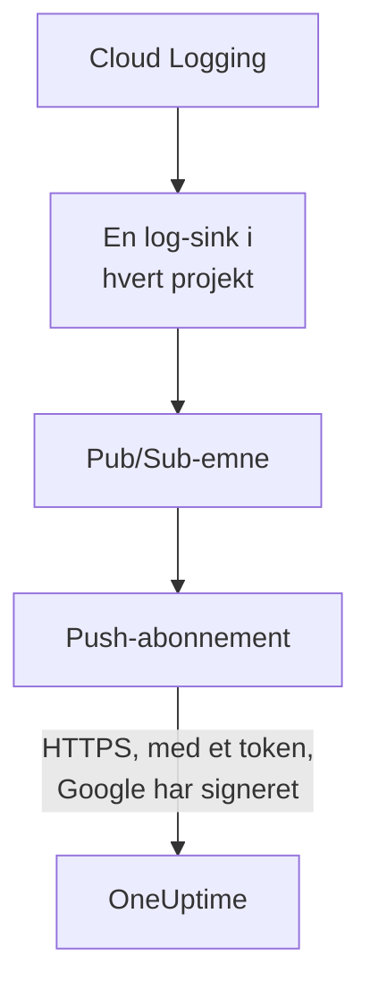

# Stream Google Cloud-logge

Et forbundet Google Cloud-projekt kan streame sine logge til OneUptime, så snart de skrives. Cloud Logging sender dem via en log-sink til et Pub/Sub-emne, og emnets push-abonnement leverer hver post til OneUptime inden for et minut, som en OneUptime-log arkiveret under den ressource, den handler om. Én kommando i Google Cloud Shell sætter det op, og der er intet at køre. Cloud Monitoring har ingen eksport, der pusher metrikker, så forbindelsen bliver ved med at læse metrikker efter sin tidsplan.

:::cards
- [Sådan virker det](#sådan-virker-det): En log-sink i hvert projekt, et emne og dets push-abonnement.
- [Sæt streaming op](#sæt-streaming-op): Vælg, hvilke logge, opret en streamnøgle, og kør én kommando.
- [Hvad der ankommer](#hvad-der-ankommer): Logge på de ressourcer, de kommer fra.
- [Hvad kommandoen opretter](#hvad-kommandoen-opretter): Hver ressource og hver tilladelse, kommandoen opretter i dine projekter.
- [Stop streaming](#stop-streaming): Slå nøglerne fra, og slet derefter det, kommandoen oprettede.
:::

## Sådan virker det



- **En log-sink i hvert projekt.** Hvert projekts sink sender de poster, dens filter matcher, til ét Pub/Sub-emne, i projektet for forbindelsens egen tjenestekonto.
- **To tjek ved hvert push.** Pub/Sub signerer et OpenID Connect-token for en tjenestekonto, der kun er oprettet til pushene, og tokenets audience er forbindelsens streamnøgle. OneUptime tager kun imod et push, når Google har signeret dets token for den tjenestekonto, og nøglen er en af forbindelsens. Nøglen navngiver forbindelsen og dermed projektet: intet i et push afgør, hvor det skrives. OneUptime gemmer kun nøglens SHA-256.
- **Intet går tabt, mens OneUptime ikke kan tage imod det.** Pub/Sub pusher en afvist post igen, med en pause på fra 10 sekunder op til 10 minutter mellem forsøgene, og gemmer den i en dag.

## Før du begynder

- **Et forbundet Google Cloud-projekt.** Forbind det først under **Cloud → Forbind**: se [Forbind en cloudkonto](/docs/telemetry/cloud-accounts).
- **En projektejer eller administrator.** Kun de kan oprette en streamnøgle og stoppe streaming.
- **Google Cloud Shell**, logget ind som **Owner** af projekterne eller som en, der må oprette tjenestekonti, Pub/Sub-emner og log-sinks i dem.
- **En HTTPS-adresse, på en selvhostet OneUptime.** Pub/Sub pusher kun til `https://`-adresser, med et certifikat, som Google stoler på, og adressen skal kunne nås fra Google Cloud.

## Sæt streaming op

:::steps
### Åbn streamingdialogen

Gå til **Cloud → Forbind**, og vælg **Stream logge** i Google Cloud-projektets række.

### Vælg, hvilke logge

**Advarsler og fejl** streamer hver post med alvorsgrad `WARNING` eller højere: det, der gik galt, ikke hver anmodning. **Hver log** streamer hver post undtagen Data Access-revisionsloggene, der registrerer hver læsning og kan overgå alt andet, et projekt skriver. **Dit eget filter** streamer de poster, en Cloud Logging-forespørgsel matcher, skrevet i feltet **Filter**.

### Opret en streamnøgle

Vælg **Opret en streamnøgle**. Nøglen vises kun denne ene gang, i kommandoen: OneUptime gemmer kun dens SHA-256.

### Kør kommandoen i Google Cloud Shell

Kopiér kommandoen, kør den i Google Cloud Shell, og vent, til den er færdig. Den fortæller hvert projekt, den har sat en sink op i, og stopper ved det første trin, Google afviser, med Googles begrundelse.

### Vent på det første push

Dialogen spørger med få sekunders mellemrum, hvad der er ankommet. Pub/Sub pusher en post inden for et minut, efter et projekt har skrevet en, som filteret tager imod; dialogen fortæller så, hvad der kom hvorfra, og forbindelsens række siger **Streamer**.
:::

**Flere felter** rummer resten:

| Felt | Hvad det gør |
| --- | --- |
| **Projekter** | De projekter, hvis logge der skal streames: til at begynde med dem, forbindelsen læser. Emnet oprettes i projektet for forbindelsens tjenestekonto. Højst 100 |
| **Sæt det op på en anden måde** | Push-endepunktet, push-tjenestekontoen og nøglen, så du kan sætte det op med Terraform eller konsollen |

## Hvad der ankommer

| Hvad | Hvor det lander |
| --- | --- |
| Logge | I logudforskeren, under forbindelsens telemetritjeneste, med projektet, regionen og lognavnet som attributter |
| Logge for en ressource, OneUptime kender | Også på den ressource: dens side i Cloud får en fane **Protokoller** |

Hver log beholder sin posts tid på nanosekundet, sin alvorsgrad, sin trace og span og sin HTTP-anmodning under navnene fra OpenTelemetrys semantiske konventioner. Den arkiveres under en ressource, når dens overvågede ressource er en type, hvis metrikker OneUptime læser, fx en VM (`gce_instance`), en Cloud Run-tjeneste (`cloud_run_revision`) eller en Cloud SQL-instans (`cloudsql_database`), og bærer ressourcens id som `cloud.resource_id`. En ekstern load balancers anmodningslogge, skrevet under `http_load_balancer`, arkiveres under dens URL-kort, den `https_lb_rule`, dens metrikker lander på.

En instansgruppes logge er dens VM'ers, så dens side har ingen fane **Protokoller**. En post af en anden type streames alligevel, under sit projekt.

## Hvad kommandoen opretter

Dens ressourcer er opkaldt efter de første 8 tegn i forbindelsens id. Den giver ikke OneUptime adgang til dine projekter: poster flyder kun ud.

| Ressource | Hvad den må |
| --- | --- |
| En tjenestekonto, `oneuptime-push-<suffix>`, i projektet for forbindelsens tjenestekonto | Har ingen rolle: Pub/Sub signerer tokens for dens push for den |
| Rollen **Service Account OpenID Connect Identity Token Creator** for Pub/Sub-tjenesteagenten, kun på den tjenestekonto | Lader Pub/Sub lave de tokens og intet andet |
| Et Pub/Sub-emne, `oneuptime-stream-<suffix>` | Rummer de poster, sinkene sender |
| Dets push-abonnement, `oneuptime-stream-<suffix>-push` | Pusher hver post til OneUptime med en kvitteringsfrist på 60 sekunder og gemmer i en dag det, det ikke kunne pushe |
| En log-sink i hvert projekt, `oneuptime-stream-<suffix>` | Sender de poster, dens filter matcher, til emnet |
| Rollen **Pub/Sub Publisher** for hver sinks skribent, kun på emnet | Lader sinken publicere til emnet og intet andet |

Kommandoen slår API'erne for Pub/Sub og Cloud Logging til i emnets projekt, hvis de er slået fra. Google fakturerer Pub/Sub for de logge, det leverer: stream kun de logge, du har brug for.

## Stop streaming

:::steps
### Slå nøglerne fra

Vælg **Stop streamingen** i projektets række under **Cloud → Forbind**. Alle forbindelsens streamnøgler holder straks op med at virke, og OneUptime afviser det, Pub/Sub pusher. Det, der er leveret, bliver.

### Slet det, kommandoen oprettede

Sinkene, emnet og dets push-abonnement bliver i Google Cloud, og Pub/Sub bliver ved med at pushe, indtil de slettes. Dialogen viser kommandoen for de projekter, forbindelsen læser:

```bash
for SOURCE in 'acme-prod' 'acme-data'; do
  gcloud logging sinks delete oneuptime-stream-6f1c3a2e --project "$SOURCE" --quiet
done
gcloud pubsub subscriptions delete oneuptime-stream-6f1c3a2e-push --project 'acme-prod' --quiet
gcloud pubsub topics delete oneuptime-stream-6f1c3a2e --project 'acme-prod' --quiet
gcloud iam service-accounts delete 'oneuptime-push-6f1c3a2e@acme-prod.iam.gserviceaccount.com' --project 'acme-prod' --quiet
```
:::

For at ændre, hvilke logge der streames, skal du åbne **Stream logge** igen, vælge **Opret en ny nøgle** og køre den nye kommando. Den nøgle, den erstatter, virker i 24 timer endnu, så intet push afvises, mens abonnementet opdateres. Højst 3 erstattede nøgler virker på én gang.

## Sæt det op på en anden måde

Giv et Pub/Sub-emne et push-abonnement med disse værdier, og lad Pub/Sub-tjenesteagenten lave tokens for push-tjenestekontoen:

| Indstilling | Værdi |
| --- | --- |
| Push-endepunkt | `https://oneuptime.com/telemetry/gcp-pubsub/v1/logs` |
| Godkendelse | Et OpenID Connect-token for `oneuptime-push-<suffix>@<project>.iam.gserviceaccount.com` |
| Audience | Streamnøglen |
| Payload | Indpakket, som Pub/Sub sender den, medmindre andet angives |
| Kvitteringsfrist | 60 sekunder |
| Opbevaring af beskeder | 1 dag |

Send derefter hvert projekts logge til emnet med en log-sink, og giv hver sinks skribent **Pub/Sub Publisher** på emnet. På en selvhostet OneUptime skal du erstatte `https://oneuptime.com` med din OneUptimes HTTPS-adresse.

OneUptime svarer på hvert push, som Pub/Sub forventer:

| Svar | Hvornår | Hvad Pub/Sub gør |
| --- | --- | --- |
| `204` | Posten blev taget imod, eller var taget imod før, eller beskeden er ingen logpost | Fortsætter |
| `400` | Det er ikke et Pub/Sub-push, OneUptime kan læse | Pusher det igen, med længere pause hver gang, i en dag |
| `401` | Tokenet er ikke et, Google har signeret for push-tjenestekontoen, eller dets audience er ikke en nøgle for forbindelsen | Pusher det igen, med længere pause hver gang, i en dag |
| `402` | Projektet kan ikke faktureres for telemetri | Pusher det igen, med længere pause hver gang, i en dag |
| `403` | Forbindelsen er slået fra, eller projektet kan ikke tage imod telemetri | Pusher det igen, med længere pause hver gang, i en dag |
| `413` | Anmodningen er større end 1 MiB, eller dens post større end 512 KiB | Pusher det igen, med længere pause hver gang, i en dag |
| `429` | Forbindelsens abonnement pushede mere end 12.000 poster på et minut | Pusher det igen, med længere pause hver gang, i en dag |
| `503` | OneUptime kunne ikke tjekke tokenet eller sætte posten i kø lige da | Pusher det igen, med længere pause hver gang, i en dag |

## Fejlfinding

:::details Dialogen bliver ved med at vente på det første push
Tjek, at kommandoen blev færdig uden at stoppe, og at et projekt har skrevet en post, som filteret tager imod: med **Advarsler og fejl** sender et roligt projekt intet. `gcloud pubsub subscriptions describe oneuptime-stream-6f1c3a2e-push --project acme-prod` viser abonnementets endepunkt. På en selvhostet OneUptime skal du tjekke, at Google Cloud når dens adresse over HTTPS.
:::

:::details Forbindelsen siger Stream afvist
Dialogen og rækkens værktøjstip siger hvorfor. En forkert nøgle betyder, at abonnementet pusher med en nøgle, der ikke længere virker: opret en ny nøgle, og kør kommandoen igen. Et push, der ikke er signeret for push-tjenestekontoen, betyder, at abonnementet signerer som en anden konto, eller at Pub/Sub ikke må signere for den: kør kommandoen igen.
:::

:::details En ressources logge vises ikke på dens side
Siden viser de logge, Cloud Logging arkiverer under ressourcens overvågede ressource, med de labels, dens metrikker har. Logge, som en arbejdsbelastning skriver under en anden ressource, fx en containers, streames kun under deres projekt.
:::

## Næste trin

:::cards
- [Forbind en cloudkonto](/docs/telemetry/cloud-accounts): Hvad en forbindelse læser, og hvor ofte.
- [Stream Azure Monitor-metrikker og -logge](/docs/telemetry/cloud-streaming-azure): Et Azure-abonnements, læst fra hændelseshubs.
- [Stream CloudWatch-metrikker og -logge](/docs/telemetry/cloud-streaming): En AWS-kontos, leveret af Amazon Data Firehose.
- [Protokoludforsker](/docs/telemetry/logs-explorer): Søg og filtrér i det, streamene har leveret.
:::
