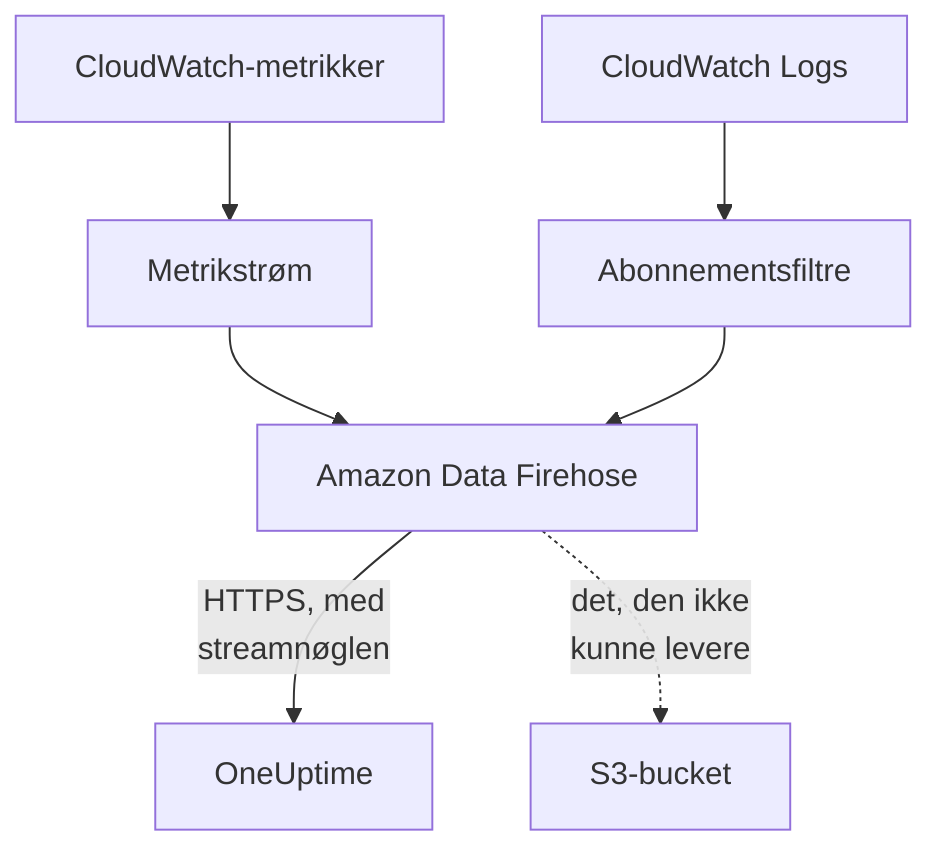

# Stream CloudWatch-metrikker og -logge

En forbundet AWS-konto kan streame sine CloudWatch-metrikker og -logge til OneUptime via Amazon Data Firehose. Metrikker ankommer så få minutter efter, at CloudWatch har dem, i stedet for ved forbindelsens næste læsning, og CloudWatch Logs ankommer som OneUptime-logge, hver arkiveret under den ressource, den handler om. Én kommando i AWS CloudShell sætter det hele op, og der er intet at køre.

:::cards
- [Sådan virker det](#sådan-virker-det): En metrikstrøm og logabonnementer i hver region, leveret af Firehose.
- [Sæt streaming op](#sæt-streaming-op): Vælg, hvad der skal streames, opret en streamnøgle og kør én kommando.
- [Hvad der ankommer](#hvad-der-ankommer): Metrikker på de ressourcer, de måler, og logge på de ressourcer, de kommer fra.
- [Hvad stakken opretter](#hvad-stakken-opretter): Hver ressource og hver tilladelse, kommandoen opretter i din konto.
- [Stop streaming](#stop-streaming): Slå nøglerne fra, og slet derefter stakkene.
:::

## Sådan virker det



- **Én stak i hver region.** Kommandoen udruller en CloudFormation-stak i hver region, du streamer fra. Dens metrikstrøm og abonnementsfiltre for logge giver alt videre til to Firehose-strømme, og Firehose leverer det til OneUptime over HTTPS.
- **Streamnøglen siger, hvis det er.** Firehose sender forbindelsens streamnøgle med hver levering. Nøglen navngiver forbindelsen og dermed projektet: intet i en levering afgør, hvor den skrives. OneUptime gemmer kun nøglens SHA-256.
- **Læsningerne overlader streamede metrikker til streamen.** Så længe en stream leverer et navnerum i en region, holder forbindelsens læsninger op med at skrive det navnerums metrikker, så intet datapunkt tælles to gange. Læsningerne bliver ved med at finde ressourcer, deres tilstand og deres ændringer, og tager et navnerum tilbage efter 15 minutter uden levering.
- **Intet går tabt, mens OneUptime ikke kan tage imod det.** Firehose sender en afvist batch igen i op til en time og gemmer den derefter i 30 dage i stakkens S3-bucket.

## Før du begynder

- **En forbundet AWS-konto.** Forbind den først under **Cloud → Forbind**: se [Forbind en cloudkonto](/docs/telemetry/cloud-accounts).
- **En projektejer eller administrator.** Kun de kan oprette en streamnøgle og stoppe streaming.
- **AWS CloudShell i den konto**, logget ind som en, der må oprette CloudFormation-stakke og IAM-roller.
- **En HTTPS-adresse, på en selvhostet OneUptime.** Firehose leverer kun til `https://`-adresser på port 443, med et certifikat, som AWS stoler på, og adressen skal kunne nås fra AWS.

## Sæt streaming op

:::steps
### Åbn streamingdialogen

Gå til **Cloud → Forbind**, og vælg **Stream metrikker og logge** i AWS-kontoens række.

### Vælg, hvad der skal streames

**Metrikker** streamer hver nøglemetrik for hver ressource, én gang i minuttet: de metrikker, OneUptime viser i diagrammer og bedømmer hver ressource ud fra. **Metrikker og logge** tilføjer CloudWatch Logs, og **Protokoller** streamer kun CloudWatch Logs.

Til logge angiver du **Loggrupper**, én pr. linje, med navn i **Region** ved siden af eller med ARN i deres egen region, eller du vælger **Alle kontoens loggrupper, også nye**. Én kommando abonnerer på højst 50 loggrupper med navn, i højst 10 regioner.

### Opret en streamnøgle

Vælg **Opret en streamnøgle**. Nøglen vises kun denne ene gang, i kommandoen: OneUptime gemmer kun dens SHA-256.

### Kør kommandoen i AWS CloudShell

Kopiér kommandoen, kør den i AWS CloudShell, og vent på, at den bliver færdig. Den skriver skabelonen til `oneuptime-stream.json` og udruller den i hver region, med nøglen som en parameter, der aldrig vises igen.

### Vent på den første levering

Dialogen spørger med få sekunders mellemrum, hvad der er ankommet. Firehose leverer inden for få minutter, efter at kommandoen er færdig; dialogen siger så, hvad der kom hvorfra, og forbindelsens række siger **Streamer**.
:::

**Flere felter** rummer resten:

| Felt | Hvad det gør |
| --- | --- |
| **Alle metrikker, ikke kun nøglemetrikkerne** | Streamer alle metrikker, CloudWatch har for kontoen, også dine egne. AWS fakturerer hver metrikopdatering, en stream sender, så det kan koste mange gange mere |
| **Regioner** | Hvorfra der streames: til at begynde med de regioner, hvor forbindelsen fandt ressourcer. Står feltet tomt, streamer kommandoen fra AWS CloudShells egen region. Højst 30 |
| **Sæt det op på en anden måde** | Endepunkterne for metrikker og logge og nøglen, til at sætte streamsne op med Terraform eller konsollen |

**Download skabelonen** gemmer den skabelon, kommandoen udruller, så du kan udrulle den på din egen måde.

## Hvad der ankommer

| Hvad | Hvor det havner |
| --- | --- |
| Metrikker | På de cloudressourcer, de måler, med de navne og attributter, forbindelsens læsninger giver dem |
| Logge | I protokoludforskeren, under forbindelsens telemetritjeneste, med konto, region og loggruppe som attributter |
| Logge fra en loggruppe, som AWS navngiver efter en ressource | Også på den ressource: dens side i Cloud får en fane **Protokoller** |

En loggruppe arkiveres under en ressource, når AWS har navngivet den efter en:

| Loggruppe | Ressourcetype |
| --- | --- |
| `/aws/lambda/<function>` | `AWS::Lambda::Function` |
| `/aws/rds/instance/<instance>/<log>` | `AWS::RDS::DBInstance` |
| `/aws/rds/cluster/<cluster>/<log>` | `AWS::RDS::DBCluster` |
| `/aws/docdb/<cluster>/<log>` | `AWS::DocDB::DBCluster` |
| `/aws/neptune/<cluster>/<log>` | `AWS::Neptune::DBCluster` |
| `/aws/redshift/cluster/<cluster>/<log>` | `AWS::Redshift::Cluster` |
| `/aws/OpenSearchService/domains/<domain>/<log>` | `AWS::OpenSearchService::Domain` |
| `/aws/aes/domains/<domain>/<log>` | `AWS::OpenSearchService::Domain` |
| `/aws/apprunner/<service>/<service-id>/<log>` | `AWS::AppRunner::Service` |
| `/aws/elasticbeanstalk/<environment>/<log>` | `AWS::ElasticBeanstalk::Environment` |
| `/aws/ecs/containerinsights/<cluster>/performance` | `AWS::ECS::Cluster` |

Hver log bærer ressourcens ID som `cloud.resource_id`, og en Lambda-funktions logge bærer også `faas.name`, så de også vises på funktionen under Serverless. En loggruppe med et andet navn streames alligevel, under sin konto og region. En logs alvorsgrad er den, dens besked angiver, sådan som Lambda skriver den.

## Hvad stakken opretter

Stakken hedder `OneUptimeStream-` efterfulgt af de første 8 tegn i forbindelsens ID. Den giver OneUptime ingen adgang til din konto: data flyder kun ud.

| Ressource | Hvad den må |
| --- | --- |
| En CloudWatch-metrikstrøm i formatet OpenTelemetry 1.0 | Kun lægge poster i Firehose-strømmen for metrikker |
| Abonnementsfiltre for logge, eller én kontodækkende abonnementspolitik for hver loggruppe | Kun lægge poster i Firehose-strømmen for logge |
| To Firehose-strømme, `OneUptime-<suffix>-metrics` og `OneUptime-<suffix>-logs` | Levere til OneUptime med GZIP, en buffer på 1 MiB eller 60 sekunder og en times genforsøg, og skrive det, de ikke kunne levere, i bucketen |
| En S3-bucket til det, der ikke kunne leveres | Offentlig adgang blokeret, krypteret, tømt efter 30 dage og bevaret, når stakken slettes |
| En loggruppe, `/aws/kinesisfirehose/OneUptime-<suffix>` | Rummer Firehoses egne leveringsfejl og streames aldrig |
| Tre IAM-roller | Hver stoler på én AWS-tjeneste i denne konto og tillader kun det, rækkerne ovenfor siger |

AWS fakturerer metrikstrømmen for hver metrikopdatering, den sender, og Firehose for det, den leverer. Stream kun de metrikker og loggrupper, du har brug for.

## Stop streaming

:::steps
### Slå nøglerne fra

Vælg **Stop streamingen** i kontoens række under **Cloud → Forbind**. Alle forbindelsens streamnøgler holder straks op med at virke, OneUptime afviser det, streamsne leverer, og forbindelsen læser igen alle sine metrikker efter sin tidsplan. Det, streamsne har leveret, bliver.

### Slet stakkene

Streamsne bliver i AWS, og AWS fakturerer dem, indtil deres stakke er slettet. Dialogen viser kommandoen, for de regioner, streamsne leverede fra, og dem, hvor forbindelsen fandt ressourcer:

```bash
for REGION in us-east-1 eu-west-1; do
  aws cloudformation delete-stack --region "$REGION" --stack-name OneUptimeStream-6f1c3a2e
done
```
:::

For at ændre, hvad en stak streamer, åbner du **Stream metrikker og logge** igen, vælger **Opret en ny nøgle** og kører den nye kommando. Den nøgle, den erstatter, virker i 24 timer endnu, så ingen levering afvises, mens stakkene opdateres. Højst 3 erstattede nøgler virker på én gang.

## Sæt det op på en anden måde

Giv hver Firehose-strøm en HTTP-endepunktsdestination med disse værdier, og metrikstrømmen outputformatet OpenTelemetry 1.0:

| Indstilling | Værdi |
| --- | --- |
| Endepunkt for metrikker | `https://oneuptime.com/telemetry/aws-firehose/v1/metrics` |
| Endepunkt for logge | `https://oneuptime.com/telemetry/aws-firehose/v1/logs` |
| Adgangsnøgle | Streamnøglen, sendt som `X-Amz-Firehose-Access-Key` |
| Indholdskodning | `GZIP` |
| Buffer | 1 MiB eller 60 sekunder |
| Varighed af genforsøg | 3600 sekunder, med en S3-bucket til det, der ikke kunne leveres |

På en selvhostet OneUptime erstatter du `https://oneuptime.com` med din OneUptimes HTTPS-adresse. Endepunktet for metrikker tager også imod en metrikstrøm i JSON-formatet.

OneUptime besvarer hver levering, som Firehose forventer:

| Svar | Hvornår | Hvad Firehose gør |
| --- | --- | --- |
| `200` | Leveringen blev taget imod, eller den var taget imod før | Fortsætter |
| `400` | Det er ikke en Firehose-levering, OneUptime kan læse, f.eks. en med mere end 10.000 poster | Sender den igen i op til en time |
| `401` | Nøglen er ikke en af forbindelsens nøgler | Sender den igen i op til en time |
| `402` | Projektet kan ikke faktureres for telemetri | Sender den igen i op til en time |
| `403` | Forbindelsen er slået fra, eller projektet kan ikke tage imod telemetri | Sender den igen i op til en time |
| `413` | Anmodningen er større end 4 MiB, eller fylder pakket ud mere end 32 MiB | Gemmer den i bucketen |
| `429` | Forbindelsens streams sendte mere end 600 leveringer på et minut | Sender den igen senere |

## Fejlfinding

:::details Dialogen venter stadig på den første levering
Tjek, at kommandoen blev færdig i hver region uden fejl: `aws cloudformation describe-stacks --stack-name OneUptimeStream-6f1c3a2e` viser stakkens status. En metrikstrøm leverer kun metrikker, CloudWatch har, så en region uden ressourcer sender intet. På en selvhostet OneUptime skal du tjekke, at AWS når dens adresse over HTTPS på port 443.
:::

:::details Forbindelsen siger Stream afvist
Dialogen og rækkens værktøjstip siger hvorfor. En forkert nøgle betyder, at stakkene kører med en nøgle, der ikke virker længere: opret en ny nøgle, og kør kommandoen igen. Firehose bliver ved med at sende det, den holder på, og det tages imod, så snart nøglen er rigtig.
:::

:::details En Lambda-funktions logge vises ikke på dens side
Siden viser loggene fra den loggruppe, der er navngivet efter funktionen, `/aws/lambda/<function>`. En funktion, der skriver til en loggruppe med et andet navn, streamer kun sine logge under sin konto og region.
:::

## Næste trin

:::cards
- [Forbind en cloudkonto](/docs/telemetry/cloud-accounts): Hvad en forbindelse læser, og hvor ofte.
- [Cloud-ressourcer (IaaS og PaaS)](/docs/telemetry/cloud-resources): Hver ressourcetype, OneUptime genkender.
- [Protokoludforsker](/docs/telemetry/logs-explorer): Søg i og filtrér det, streamsne har leveret.
:::
