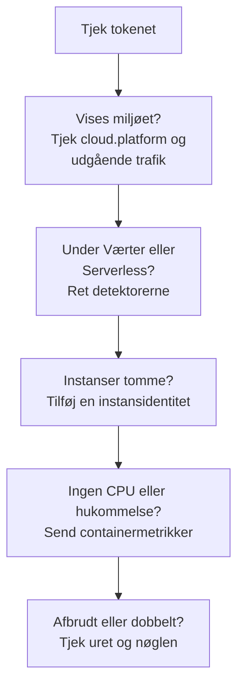

# Cloud-fejlfinding

Find ud af, hvorfor et cloud-miljø mangler, er arkiveret det forkerte sted, er tomt eller findes to gange. Afsnittene står i den rækkefølge, tingene går galt, og hvert afsnit udelukker ét lag, så arbejd dig nedad fra toppen. Fejl, der hører til én platform, står sidst på den platforms side: [AWS ECS / Fargate](/docs/telemetry/cloud-aws-ecs), [Google Cloud Run](/docs/telemetry/cloud-gcp-cloud-run), [Azure Container Apps](/docs/telemetry/cloud-azure-container-apps) og [Andre cloud-platforme](/docs/telemetry/cloud-other-platforms).



## Tjek tokenet først

Det er det billigste tjek, og intet nedenfor virker uden det:

```bash
curl -i https://oneuptime.com/otlp/v1/validate \
  -H "x-oneuptime-token: YOUR_TELEMETRY_INGESTION_TOKEN"
```

| Svar | Hvad det betyder |
| ------------------------- | -------------------------------------------------------------------------------------------------------------------------- |
| `200`, `"valid": true` | Tokenet er accepteret. Dets `keyType` skal være `Server`: en nøgle af typen `Browser` afvises fra en collector eller en backend-tjeneste. |
| `401`, `"valid": false` | Tokenet mangler, er ukendt, tilbagekaldt, deaktiveret eller udløbet, og svarets `message` siger hvilket. Opret en ny nøgle under **Projektindstillinger → Telemetri og APM → Indtagelsesnøgler**, og udrul den igen. |

Hvis du selv hoster OneUptime, så brug `https://YOUR-ONEUPTIME-HOST/otlp/v1/validate`. Kør tjekket inde fra opgaven, instansen eller replikaen, når du kan (ECS Exec, `az containerapp exec`): det beviser, at selve workloaden kan nå OneUptime, ikke kun din bærbare.

## Miljøet vises ikke

Intet under **Cloud → All Environments** et minut efter den første anmodning. Tjek disse tre, i denne rækkefølge.

**`cloud.platform` mangler eller er ikke en administreret værdi.** OneUptime arkiverer kun telemetri under Cloud-miljøer, når ressourcen bærer en af disse værdier: `aws_ecs`, `aws_elastic_beanstalk`, `aws_app_runner`, `gcp_cloud_run`, `gcp_app_engine`, `azure_container_apps`, `azure_container_instances` eller `azure_app_service`. De almindelige årsager:

- Ressourcedetektoren er slået fra i SDK'et (`OTEL_NODE_RESOURCE_DETECTORS`, `OTEL_EXPERIMENTAL_RESOURCE_DETECTORS`, `-Dotel.resource.providers.<cloud>.enabled=true`).
- Collectorens pipeline springer processoren `resourcedetection` over.
- På en platform uden detektor har `OTEL_RESOURCE_ATTRIBUTES` en tastefejl.

Azure-detektorerne til Node.js og .NET skriver `azure.container_apps`, `azure.app_service` og `azure.functions`; OneUptime omskriver dem til værdierne med understregning, så de tæller med. For at se, hvad din telemetri bærer, skal du åbne tjenesten under **Tjenester**, åbne et af dens spor fra fanen **Spor** og læse ressourceattributterne. Hvis `cloud.platform` ikke er der, er det hele problemet.

**Tokenet er forkert.** Tjekket af tokenet svarede `401`. Collectoren logger det som `Permanent error: ... 401`. Et SDK logger det én gang og holder op med at prøve igen, hvilket er korrekt OTLP-adfærd og let at overse.

**Udgående trafik er blokeret.** Collectoren logger `connection refused`, `context deadline exceeded`, `i/o timeout` eller en DNS-fejl:

- **ECS og Fargate:** et privat subnet skal have en NAT-gateway eller `assignPublicIp=ENABLED`, og sikkerhedsgruppen skal tillade udgående trafik på TCP 443.
- **Cloud Run:** **VPC egress: All traffic** kræver Cloud NAT.
- **Container Apps:** en brugerdefineret rute til en firewall skal tillade OneUptime-værten.
- **Overalt:** en selvhostet OneUptime bag et privat DNS-navn skal kunne slås op fra workloadens netværk.

## Det vises under Værter i stedet

Ressourcen bærer en virtuel maskines platform (`aws_ec2`, `gcp_compute_engine` eller `azure_vm`), så OneUptime arkiverer den under **Værter**: rigtigt for en virtuel maskine, forkert for administreret compute. En virtuel maskines detektor vandt over den administrerede: `detectors: [ec2, elastic_beanstalk]` i en collector, hvor den første detektor, der sætter `cloud.platform`, vinder, eller et SDK, hvis rækkefølge foretrækker EC2-detektoren. Sæt `elastic_beanstalk` først, eller sæt selv `cloud.platform` i `OTEL_RESOURCE_ATTRIBUTES`, og behold kun detektoren `env`.

## Det vises kun under Serverløse funktioner

Ressourcen bærer `faas.name`, men ingen administreret `cloud.platform`. Cloud Run og App Engine sætter begge, når GCP-detektoren kører. Hvis du sætter `faas.name` i hånden, eller en collector smider de ressourceattributter væk, som SDK'ets detektor satte, er kun den serverløse side opfyldt. Slå detektoren til, eller sæt selv `cloud.platform=gcp_cloud_run` (eller `gcp_app_engine`), `cloud.account.id` og `cloud.region`.

> [!NOTE]
> På Cloud Run og App Engine skal en tjeneste vises begge steder: miljøet samler projektet og regionen, og **Serverløse funktioner** viser den enkelte tjeneste.

## Instanser er tom

Miljøet er der, men dets fane **Instanser** viser intet: telemetrien bærer ingen instansidentitet. OneUptime navngiver en instans ud fra den første af disse ressourceattributter, den finder:

1. `aws.ecs.task.id`
2. `aws.ecs.task.arn` (forkortet til opgave-ID'et)
3. `faas.instance`
4. `azure.container_app.instance.id`
5. `service.instance.id`
6. `container.id`
7. `host.id`
8. `host.name`

Platformens egen identitet kommer før `service.instance.id`, så et ID, som SDK'et finder på for hver proces (Node.js-SDK'et gør det som standard), ikke kan skille en opgave fra dens sidecars CPU og hukommelse. Hvad der sætter identiteten på hver platform:

| Platform | Hvad der sætter identiteten |
| ----------------------------------------- | ------------------------------------------------------------------------------------------------------------------------------------------------ |
| ECS | Detektoren `ecs` sætter opgavens ARN |
| Cloud Run, App Engine | Detektoren `gcp` sætter `faas.instance` |
| Container Apps | Collectorens detektor `azurecontainerapps` sætter replika-ID'et; eller sæt `service.instance.id` fra `CONTAINER_APP_REPLICA_NAME`, eller kør værtsdetektoren |
| App Runner, Container Instances | Værtsdetektorens `host.name` |
| App Service, Elastic Beanstalk | Platformens detektor sætter `service.instance.id`; på Beanstalk skal du slette den, så `host.id` navngiver hver instans |

En instans vises inden for et minut efter det første signal, der bærer attributten.

## CPU og hukommelse er tomme

Instanserne er listet, men oversigtens felter **CPU** og **Hukommelse** og kolonnerne for CPU og hukommelse i **Instanser** er tomme. De kommer fra metrikker, ikke spor: datapunkter fra `container.cpu.utilization` og `container.memory.usage` (eller `container.memory.usage.total`), hvis ressource bærer samme instansidentitet som sporene, og `cloud.platform`.

- **På ECS** leverer receiveren `awsecscontainermetrics` i en sidecar-collector dem som `ecs.task.cpu.utilized` og `ecs.task.memory.utilized`. Behold den i pipelinen `metrics`, og behold også `resourcedetection` i den pipeline, ellers ankommer metrikkerne uden `cloud.platform` og arkiveres et andet sted.
- **På Cloud Run, Container Apps og de andre platforme** viser platformen ikke containerforbruget til en sidecar. Felterne forbliver tomme, medmindre du selv sender de metrikker: læs i stedet felterne for anmodninger.
- **Med SDK direct** sender intet containermetrikker, så tomme felter er forventet.

## Miljøet viser Afbrudt

Et miljø viser **Afbrudt**, når der ikke er kommet telemetri til det i 15 minutter, og det næste span, den næste log eller metrik bringer det tilbage. Tid, hvor OneUptime selv var nede eller var ved at indhente, tæller ikke med. Mens telemetrien flyder, kan tidspunktet for sidst set halte op til fem minutter bagefter, og derfor er grænsen 15.

- **Et travlt miljø viser Afbrudt:** eksportøren stoppede. Tjek collectorens logs for fejlene `401` og fejlene med udgående trafik ovenfor.
- **Et stagingmiljø, der skalerer til nul om natten,** viser Afbrudt indtil den første anmodning om morgenen, og det er korrekt.

Instanser følger to ure:

- **Stale:** fanen **Instanser** markerer en opgave, instans eller replika som **Stale**, når den ikke har rapporteret inden for de seneste 15 minutter, og oversigten tæller kun de andre som levende.
- **Slettet:** en oprydning sletter instansrækker, der ikke er set i `CLOUD_INSTANCE_STALE_MINUTES` (standard 15, mindst 10), målt fra miljøets egen seneste telemetri, så et nedbrud i collectoren fryser det ur i stedet for at slette den sidst kendte liste over opgaver. Serverløse funktioner bruger `SERVERLESS_INSTANCE_STALE_MINUTES`. En højere grænse beholder rækker længere; den ændrer ikke, hvornår de bliver **Stale**.

## To miljøer, hvor der burde være ét

Miljønøglen er `cloud.platform|cloud.account.id|cloud.region`, sammenlignet tegn for tegn. Hvis nogle workloads sætter `cloud.account.id` og andre ikke gør, én skriver `eastus` og en anden `East US`, eller én collector kører detektoren `ecs` og en anden ikke gør, får du `aws_ecs|123456789012|us-east-1` og `aws_ecs||us-east-1` side om side.

Åbn hvert miljøs **Oversigt**: dets **Miljønøgle** viser, hvilken del der er forskellig. Ret den workload, der mangler værdien. Miljøet med den tomme del holder op med at modtage telemetri, og du kan arkivere det.

## Et håndlavet miljø matcher aldrig

Indtagelsen matcher et miljø alene på dets nøgle, og nøglen skal være præcis `platform|account|region`, f.eks. `aws_ecs|123456789012|us-east-1`: samme platformværdi, konto-ID og region, som telemetrien bærer. Oprettelsesformularen (**Opret Cloud-ressource** under **Cloud → All Environments**) bygger nøglen ud fra felterne **Cloud-platform**, **Cloud-konto-ID** og **Cloud-region**, så de tre skal stemme overens med telemetrien tegn for tegn. Gør de ikke det, opretter indtagelsen et andet miljø med den nøgle, den udledte, og dit forbliver tomt. Arkivér det håndlavede miljø, og lad indtagelsen oprette det rigtige, eller opret det igen med de rettede værdier.

## Stadig problemer

Indsaml disse ting, før du beder om hjælp:

- Ressourceattributterne fra ét rigtigt span eller én logpost fra workloaden. Collectorens eksportør `debug` udskriver dem, eller åbn et spor fra tjenesten under **Tjenester**.
- Svaret fra tjekket `/otlp/v1/validate`, kørt inde fra workloaden.
- De sidste 50 linjer af collectorens log eller SDK'ets diagnoselog med `OTEL_LOG_LEVEL=debug`.
- **Miljønøgle** for hvert miljø, der dukkede op.

Kontakt derefter support@oneuptime.com, eller opret et issue på [GitHub](https://github.com/OneUptime/oneuptime).

## Næste trin

:::cards
- [Cloud-miljøer](/docs/telemetry/cloud-environments): Sådan identificeres miljøer og instanser.
- [AWS ECS / Fargate](/docs/telemetry/cloud-aws-ecs): ECS-opsætningen med en komplet opgavedefinition.
- [OpenTelemetry](/docs/telemetry/open-telemetry): Endpoints, grænser og hvad hvert svar betyder.
:::
