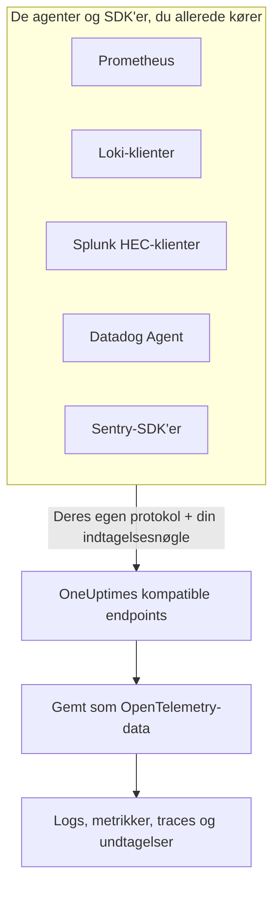

# Prometheus, Loki, Splunk, Datadog & Sentry

Kører du allerede Prometheus, en Loki-klient, en Splunk-forwarder, Datadog Agent eller et Sentry-SDK? Så behold det. OneUptime tager imod det, hvert af disse værktøjer sender, på de stier, værktøjet allerede bruger, og gemmer det som OpenTelemetry-data. At prøve OneUptime kræver en ny URL og nøgle, ikke en ny instrumentering, og dine drop-filtre, scrub-regler, logpipelines, dataopbevaring og indtagelsesbudgetter gælder for disse data som for alle andre.

:::cards
- [Prometheus remote write](#prometheus-remote-write): Metrikker fra Prometheus, Grafana Alloy eller enhver anden afsender af remote write.
- [Loki](#loki): Logs fra Promtail, Grafana Alloy, Fluent Bit eller Vector.
- [Splunk HTTP Event Collector](#splunk-http-event-collector): Logs og metrikhændelser fra enhver HEC-klient.
- [Datadog Agent](#datadog-agent): Metrikker og logs fra Datadog Agent.
- [Sentry-SDK'er](#sentry-sdker): Fejl, transaktioner og logs fra ethvert Sentry-SDK.
:::

## Sådan virker det



Hvert endpoint svarer, som dets værktøj forventer — et `204` til Prometheus og Loki, HEC's `{"text": "Success", "code": 0}`, Datadogs `202`, Sentrys hændelses-ID — så værktøjet melder succes og fejl, som det altid har gjort. Derefter behandles dataene præcis som data fra et OpenTelemetry-SDK.

## Før du begynder

- **Et OneUptime-projekt** – i OneUptime Cloud afregnes telemetri pr. indtaget GB, og et projekt på Free-planen skal have en betalingsmetode, før det kan sende telemetri.
- **Indtagelsesnøgle til telemetri** – opret en **Server**-nøgle under **Produkter → Projektindstillinger → Telemetri og APM → Indtagelsesnøgler**, og kopiér dens **Hemmelig nøgle**. Hvert værktøj sender den der, hvor det sender sine egne legitimationsoplysninger. En browserapps Sentry-DSN tager i stedet en **Browser**-nøgle med dit websteds oprindelser på.
- **Din vært** – eksemplerne bruger `oneuptime.com`. Hvis du selv hoster OneUptime, så brug din egen vært.

> [!TIP]
> Fanen Opsætningsvejledning under Protokoller, Metrikker, Spor og Undtagelser har disse værktøjer med blandt sine måder at sende på, med din vært og en nøgle, du vælger, allerede udfyldt.

## Endpoints

| Værktøj | Peg det mod | Hvor nøglen skal stå |
| --- | --- | --- |
| Prometheus remote write | `https://oneuptime.com/telemetry/prometheus/api/v1/write` | Et bearer-token eller basic auth med nøglen som adgangskode. |
| Loki | `https://oneuptime.com/telemetry/loki/api/v1/push` | Basic auth med nøglen som adgangskode eller et bearer-token. |
| Splunk HTTP Event Collector | `https://oneuptime.com/telemetry/services/collector` | HEC-tokenet: `Authorization: Splunk <key>`. |
| Datadog Agent | `https://oneuptime.com/telemetry/datadog` | API-nøglen: `DD-API-KEY`. |
| Sentry-SDK'er | DSN'en `https://<key>@oneuptime.com/telemetry/sentry/1` | DSN'ens offentlige nøgle. |

Hvert endpoint tager også imod nøglen i headeren `x-oneuptime-token`, og headeren `x-oneuptime-service-name` angiver den tjeneste, som alt, hvad værktøjet sender, hører til. En nøgle kan skrives som sine 32 hexadecimale cifre uden bindestreger; i Sentry-DSN'en og Datadogs API-nøgle skal den skrives sådan.

## Prometheus remote write

Tilføj OneUptime som remote write-mål. Prometheus bliver ved med at scrape, som den gør nu, og sender en kopi af hver sample:

```yaml title="prometheus.yml"
remote_write:
  - url: https://oneuptime.com/telemetry/prometheus/api/v1/write
    authorization:
      credentials: YOUR_TELEMETRY_KEY
```

Med Grafana Alloy tilføjer du en `prometheus.remote_write`-komponent og videresender dine scrapes til den:

```text title="config.alloy"
prometheus.remote_write "oneuptime" {
  endpoint {
    url          = "https://oneuptime.com/telemetry/prometheus/api/v1/write"
    bearer_token = "YOUR_TELEMETRY_KEY"
  }
}
```

Remote write 1.0 og 2.0 accepteres begge, komprimeret med snappy, sådan som alle afsendere sender dem.

### Hvad en serie bliver til

- **Navn og labels bevares.** `http_requests_total{job="checkout", code="500"}` er metrikken `http_requests_total` med attributterne `job` og `code`, så en forespørgsel, der flyttes fra Grafana, finder den.
- **Jobbet er tjenesten.** Hvert `job` bliver en tjeneste og hver `instance` dens tjenesteinstans, sådan som OpenTelemetrys Prometheus-regler kortlægger dem.
- **Typer bevares.** Tællere samt et histograms buckets og antal er kumulative summer, så deres rater vises korrekt i diagrammer. En type kommer fra de metadata, afsenderen sender med; uden dem er et navn, der ender på `_total`, en tæller, og en `_bucket` med en `le`-label en histogram-bucket.
- **Native histogrammer** bliver til eksponentielle histogrammer, og native histogrammer med brugerdefinerede buckets bliver til almindelige histogrammer.
- **Bevares ikke:** staleness-markører og andre samples med NaN eller uendelige værdier, tælleres `_created`-serier og exemplars.

## Loki

OneUptime tager imod Lokis push-API på Lokis egen sti, i JSON eller som den snappy-komprimerede protobuf, Promtail og Grafana Alloy sender. Tilføj OneUptime som klient:

```yaml title="promtail.yaml"
clients:
  - url: https://oneuptime.com/telemetry/loki/api/v1/push
    bearer_token: YOUR_TELEMETRY_KEY
```

Fluent Bits `loki`-output tager værten og stien hver for sig:

```text title="fluent-bit.conf"
[OUTPUT]
    Name         loki
    Match        *
    Host         oneuptime.com
    Port         443
    Tls          On
    Uri          /telemetry/loki/api/v1/push
    Http_User    oneuptime
    Http_Passwd  YOUR_TELEMETRY_KEY
    Labels       job=fluent-bit
```

### Hvad en stream bliver til

- **Hver post er en log** med sit eget tidsstempel ned til nanosekundet og sin linje som indhold.
- **Labels og strukturerede metadata er attributter** under de navne, de har i Loki.
- **Tjenesten** kommer fra den første af `service_name`, `service`, `app`, `application`, `name`, `app_kubernetes_io_name`, `container`, `container_name`, `component`, `workload` og `job`, som en stream har, sådan som Loki finder den. En `host`- eller `hostname`-label angiver værten.
- **Niveauet** kommer fra en `level`-, `detected_level`- eller `severity`-label eller -metadata, ellers fra et logfmt-`level=` eller en JSON-linjes `level`-felt.
- **Sporingskontekst:** et `trace_id` og `span_id` i de strukturerede metadata knytter loggen til dens trace.

## Splunk HTTP Event Collector

Brug OneUptime som HTTP Event Collector med din indtagelsesnøgle som HEC-token. Splunks Docker-logdriver tilføjer selv stien, så den skal kun have værten:

```bash
docker run \
  --log-driver=splunk \
  --log-opt splunk-url=https://oneuptime.com \
  --log-opt splunk-token=YOUR_TELEMETRY_KEY \
  --log-opt splunk-format=json \
  your-image
```

Enhver anden HEC-klient poster til `/services/collector/event` eller `/services/collector/raw`. Sådan sender du én hændelse:

```bash
curl https://oneuptime.com/telemetry/services/collector/event \
  -H "Authorization: Splunk YOUR_TELEMETRY_KEY" \
  -d '{"event": "Payment failed for order 42", "sourcetype": "app", "fields": {"service": "checkout"}}'
```

Et `200` med `{"text": "Success", "code": 0}` betyder, at hændelsen blev accepteret. Endpointet svarer også med HEC's egne koder — `No data` (5), `Invalid data format` (6) med nummeret på den hændelse, der ikke var gyldig, og `Event field is required` (12) — og besvarer `GET /services/collector/health` uden token.

### Hvad en hændelse bliver til

- **En log** med hændelsens `time` som tidsstempel. Er hændelsen en streng, er den indholdet; er den et objekt, er `message`, `msg`, `log`, `line` eller `text` indholdet, og dens øvrige felter er attributter.
- **Metadataene bevares:** `host` er værten, og `source`, `sourcetype` og `index` gemmes som `com.splunk.source`, `com.splunk.sourcetype` og `com.splunk.index`. Forespørgselsstrengens `host`, `source`, `sourcetype` og `index` udfylder det, en hændelse udelader.
- **Felterne er attributter.** Et `service.name`-felt angiver tjenesten, og det gør en logs `service`-felt også.
- **Metrikhændelser** (`"event": "metric"` med `metric_name` og `_value` eller med felter som `metric_name:<name>`) gemmes som metrikker, aldrig som logs.
- **Tilbydes ikke:** indexer acknowledgement. En klient, der beder om det, får intet `ackId`.

## Datadog Agent

Peg Agentens metrikker og logs mod OneUptime med din indtagelsesnøgle som dens API-nøgle:

```yaml title="datadog.yaml"
api_key: YOUR_TELEMETRY_KEY_WITHOUT_HYPHENS
dd_url: https://oneuptime.com/telemetry/datadog
logs_enabled: true
logs_config:
  use_http: true
  logs_dd_url: oneuptime.com:443
apm_config:
  enabled: false
process_config:
  process_collection:
    enabled: false
```

Agenten føjer sine egne stier til `dd_url` og sender logs til `/api/v2/logs` på den vært og port, som `logs_dd_url` angiver. OneUptime besvarer kun de stier i roden for en request med en `DD-API-KEY`-header. Genstart Agenten efter ændringen; `datadog-agent status` viser dens API-nøgle som gyldig, når OneUptime accepterer den.

### Hvad Agentens data bliver til

- **Metrikker** beholder deres navne. Gauges forbliver gauges, counts bliver til summer, og rates bliver til gauges af deres værdi pr. sekund.
- **Distributions** bliver til summaries med deres antal, sum, minimum og maksimum.
- **Service checks** bliver til en metrik opkaldt efter checket, hvis værdi er checkets status: 0 OK, 1 advarsel, 2 kritisk, 3 ukendt.
- **Logs** beholder deres besked, status, vært og tjeneste og resten af deres felter som attributter.
- **Tags er attributter**, og taggene `service`, `env` og `version` angiver tjenesten, dens miljø og dens version.
- **Læses endnu ikke:** APM-traces, processer, containere, netværksdata og profiler. Lad dem være slået fra i `datadog.yaml` som ovenfor.

Datadogs HTTP API-klienter — et logbibliotek, der poster til `/api/v2/logs`, et script, der poster serier — kan sende til det samme endpoint med headeren `DD-API-KEY`.

## Sentry-SDK'er

Erstat DSN'en der, hvor du sætter Sentry op. Resten af din Sentry-kode forbliver, som den er:

```javascript
Sentry.init({
  dsn: "https://YOUR_TELEMETRY_KEY_WITHOUT_HYPHENS@oneuptime.com/telemetry/sentry/1",
  release: "checkout@1.4.2",
  environment: "production",
});
```

```python
sentry_sdk.init(
    dsn="https://YOUR_TELEMETRY_KEY_WITHOUT_HYPHENS@oneuptime.com/telemetry/sentry/1",
    release="checkout@1.4.2",
    environment="production",
)
```

Det afsluttende `1` i DSN'en kræves af Sentrys SDK'er og læses ikke. En browserapps DSN er offentlig, så brug en **Browser**-indtagelsesnøgle der med dit websteds oprindelser på.

### Hvad en kuvert bliver til

- **Fejl** vises i Undtagelser med deres stack traces og de undtagelser, der forårsagede dem, grupperet som enhver anden undtagelse. Hver fejl er et span i sin trace under det span, der var aktivt.
- **Transaktioner** og deres spans vises i Spor.
- **Sentry-logs** og beskeder, der er fanget med `capture_message`, vises i Protokoller.
- **Tjenesten** er et `service`-tag, ellers releasens navn før `@`: `checkout@1.4.2` er `checkout`. Releasen er tjenestens version, og miljøet bevares.
- **Bevares ikke:** sessioner, replays, vedhæftede filer, profiler og check-ins. SDK'et sender dem stadig; OneUptime tager imod dem og smider dem væk.

## Grænser og indtagelsesbudgetter

- **Requeststørrelse** – OneUptimes ingress accepterer requests på op til 4 MB under `/telemetry`, og hver requests indhold må højst fylde 64 MB dekomprimeret.
- **Indtagelsesbudgetter** – Prometheus remote write og Loki tjekkes mod budgettet for metrikker eller logs, før deres indhold læses, og afvises med `403`, når det er brugt op. En HEC-batch, en Datadog-nyttelast eller en Sentry-kuvert kan indeholde flere signaler, så hvert signal tælles mod sit eget budget, når det gemmes, og smides væk, når det budget er brugt op.

## Fejlfinding

### Alle requests afvises med 401

Nøglen kom ikke frem dér, hvor endpointet leder efter den, eller den er ikke en nøgle i dette projekt. Sammenlign værktøjets indstilling for legitimationsoplysninger med tabellen [Endpoints](#endpoints), og tjek, at nøglen ikke er slået fra eller udløbet.

### Et Sentry-SDK siger, at DSN'en er ugyldig

Sentrys SDK'er afviser en DSN, hvis nøgle har bindestreger. Skriv nøglen som sine 32 hexadecimale cifre uden bindestregerne.

### Datadog-metrikker kommer frem, men logs gør ikke

Tjek, at `logs_config.use_http` er `true`, og at `logs_config.logs_dd_url` er en vært og port, ikke en URL. Agenten sender logs over TCP, når `use_http` ikke er sat.

### Prometheus melder 415

Afsenderen bad om en remote write-protokol, som OneUptime ikke læser. Send remote write 1.0 eller 2.0.
