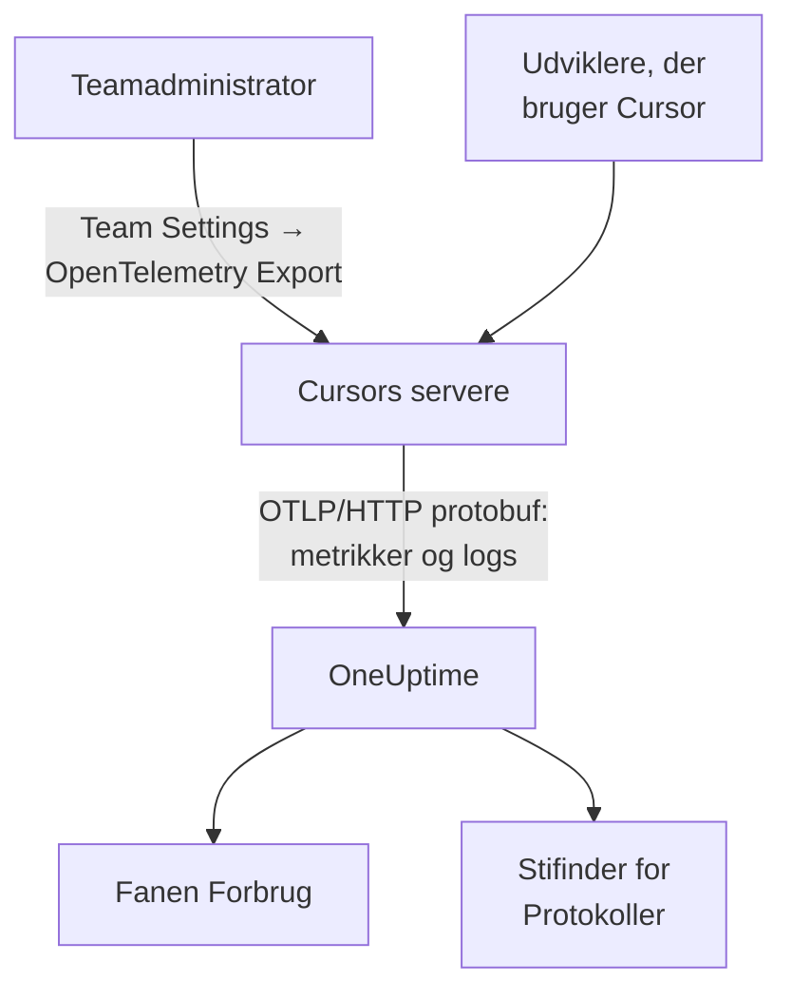

# Cursor

Cursor eksporterer sit teams telemetri fra Cursors egne servere. En teamadministrator tilføjer OneUptime som destination én gang, i Cursors dashboard, og hele teamets tokens, anslåede omkostninger og værktøjskald ankommer: intet at installere eller sætte op på udviklernes maskiner.

:::cards
- [Sæt det op](#sæt-det-op): Opret en nøgle i OneUptime og en destination i Cursor.
- [Hvad du får](#hvad-du-får-og-hvad-du-ikke-får): Metrikker og logs; ingen traces.
- [Hvem brugte hvad](#tildeling-til-medarbejdere): Personer ankommer som Cursor-bruger-id'er.
- [Fejlfinding](#fejlfinding): Hvad du skal tjekke, når intet ankommer.
:::

## Sådan virker det



## Før du begynder

- **Cursors Enterprise-abonnement.** Skærmen OpenTelemetry Export findes ikke i de andre abonnementer.
- **Et endpoint, som Cursor kan nå fra internettet.** Det er Cursor, der forbinder til dig, fra et fast sæt adresser. OneUptime Cloud har ikke brug for mere; en selvhostet OneUptime bag en firewall skal tillade de udgående adresser, som Cursor angiver på sin side [OpenTelemetry Export](https://cursor.com/docs/enterprise/opentelemetry-export).

## Sæt det op

:::steps
### Opret en indtagelsesnøgle

I OneUptime åbner du **Projektindstillinger → Telemetri og APM → Indtagelsesnøgler**, klikker på **Opret ingestion-nøgle** og kopierer nøglen. Din OTLP-basis-URL er `https://oneuptime.com/otlp`, eller `https://YOUR-ONEUPTIME-HOST/otlp`, hvis du selv hoster OneUptime.

### Opret destinationen i Cursor

I Cursors webdashboard åbner du som teamadministrator **Team Settings → OpenTelemetry Export** og opretter en destination:

| Felt | Værdi |
| --- | --- |
| Endpoint (base URL) | `https://oneuptime.com/otlp` |
| Header name | `x-oneuptime-token` |
| Header value | `YOUR_INGESTION_TOKEN` |

Angiv basis-URL'en uden `/v1`: Cursor tilføjer selv `/v1/metrics` og `/v1/logs`, og `https://oneuptime.com/otlp/v1` ville sende til `/otlp/v1/v1/metrics`, hvor intet ankommer.

### Test og slå til

Klik på **Test connection** for at tjekke URL'en og headeren, og derefter på **Enable**. Eksporten starter inden for cirka et minut; senere ændringer af headeren tager cirka 30 sekunder.

### Tjek, at data ankommer

Brug Cursor et minut eller to, åbn derefter **Protokoller** i OneUptime, og filtrér på tjenestenavnet `cursor`: `cursor.api.request`-poster med antal tokens betyder, at nøglen og URL'en er rigtige.
:::

Cursor taler kun OTLP over HTTP med binær protobuf (ingen gRPC, ingen JSON), som OneUptime accepterer, som den er. Den gemmer headeren krypteret og sender til én destination pr. team: for at sende til OneUptime og et andet sted skal du sætte en collector foran.

## Hvad du får, og hvad du ikke får

| Signal | Fra Cursor |
| --- | --- |
| Metrikker: tokens, anslåede omkostninger, værktøjskald | Ja, som deltaer |
| Loghændelser: anmodninger, fejl, rettelser, skills, hooks, plugins, cloud-agenter | Ja |
| Tekst fra prompts og svar | Kun hvis du slår familien `conversation_content` til |
| Traces | Nej |
| Noget fra før du slog destinationen til | Nej |

I OneUptime vises Cursor altså på fanen **Forbrug** under **Produkter → AI / LLM**, ud fra `cursor.token.usage` og `cursor.cost.usage`, men aldrig under **Kald** eller **Samtaler**, som bygges ud fra traces. Detaljen pr. anmodning er hændelsen `cursor.api.request` i stifinderen for **Protokoller**.

### Familier

Hvert signal, og hver familie af telemetri, har sin egen kontakt i Cursors indstillinger:

| Familie | Dækker |
| --- | --- |
| `model_usage` | `cursor.token.usage`, `cursor.cost.usage` og hændelserne `cursor.api.request`, `cursor.api.error` og `cursor.api.correction` |
| `tool_calls` | `cursor.tool.calls` |
| `skills_hooks_plugins` | Hændelser fra skills, hooks og plugins |
| `cloud_agents` | `cursor.cloud_agent.*`-hændelser |
| `grok_bot_agent_actions` | `cursor.grok_bot.*`-hændelser; kræver Action Recording |
| `conversation_content` | Beskedtekst samt input og output fra MCP-værktøjer; slået fra som standard |

Alle familier undtagen `conversation_content` starter slået til. Familier, som Cursor tilføjer senere, starter også slået til, medmindre du slår `auto_enable_new_families` fra.

## Metrikker og hændelser

Alle tre metrikker er deltasummer:

| Metrik | Enhed | Attributter |
| --- | --- | --- |
| `cursor.token.usage` | `{token}` | `cursor.token.type`: `input`, `output`, `cache_read`, `cache_creation`; `cursor.model.name`; `cursor.api.status`: `success`, `errored`, `aborted`; `cursor.api.billable` |
| `cursor.cost.usage` | `USD` | `cursor.model.name` |
| `cursor.tool.calls` | `{call}` | `cursor.tool.kind`: `builtin`, `mcp`; `cursor.tool.name`; `cursor.tool.status`: `success`, `failure`, `aborted`; `cursor.mcp.server.name` |

Datapunkterne bærer intet samtale- eller anmodnings-id, så omkostninger pr. session står ikke i metrikkerne. `cursor.model.name` er den anmodede model, med routede valg slået sammen: en opdeling efter model har en række ved navn `Auto`, som ikke kan fordeles på de modeller, Cursor routede den til.

Den loghændelse, du oftest vil bruge, er `cursor.api.request`: én pr. anmodning, med antal input-, output- og cachetokens, modellen og om den blev faktureret. `cursor.api.error` registrerer en fejlet anmodning (uden fejlmeddelelsen), og `cursor.api.correction` ankommer senere for at sige, at en anmodning alligevel ikke blev faktureret. Cursors [formatreference](https://cursor.com/docs/enterprise/opentelemetry-export/wire) viser alle hændelser og attributter.

Hver post bærer disse ressourceattributter:

| Attribut | Hvad den er |
| --- | --- |
| `service.name` | Altid `cursor`: filtrér stifinderne for **Protokoller** og **Målinger** på den |
| `cursor.team.id` | Dit team, et heltal; altid til stede |
| `cursor.user.id` | Personen, et heltal inden for teamet; valgfri |
| `cursor.surface` | Hvor aktiviteten kom fra, som `desktop`, `cli`, `cloud_agent` eller `bugbot` |
| `cursor.entrypoint` | Hvordan den startede, som `desktop`, `cli`, `web`, `api` eller `github_pr` |

## Tildeling til medarbejdere

**Cursor nævner en person ved `cursor.user.id`, et heltal, som kun Cursor kan gøre til et navn, og udelader det ofte for cloud-agenter.** OneUptime læser det som medarbejderen og `cursor.team.id` som teamet, så fanen **Forbrug** rangerer personer og teams uden opsætning, men personer vises som heltal.

- Begge ankommer som ressourceattributter (`resource.cursor.user.id`, `resource.cursor.team.id`), som OneUptime læser.
- Cursor kan også sende `cursor.user.email`, men OneUptime læser den endnu ikke, så medarbejderens e-mailkolonne forbliver tom for Cursor.
- `gen_ai.user`, `llm.user` og LiteLLMs slutbruger-id'er læses aldrig som medarbejderen: de nævner dine kunder, ikke dine ansatte. Se [Tildeling til medarbejdere og teams](/docs/telemetry/ai-coding-assistants#tildeling-til-medarbejdere-og-teams).

### Hvor Cursor vises på fanen Forbrug

Cursor sender metrikker og ingen GenAI-spans, og metrikkerne udfylder kun hullerne i spans: **hvis det samme projekt modtager GenAI-spans med omkostninger, vises Cursors forbrug ikke.** Send Cursor til et projekt for sig selv. Se [Spans kommer først, metrikker udfylder hullerne](/docs/telemetry/ai-llm-observability#spans-kommer-først-metrikker-udfylder-hullerne).

| Opdeling | For Cursor |
| --- | --- |
| **Medarbejder** | Ja, efter `cursor.user.id` |
| **Team** | Ja, efter `cursor.team.id` |
| **Model** | Ja, efter `cursor.model.name` |
| **Udbyder** | Nej: Cursor siger aldrig, hvilken udbyder der betjente et kald |
| **Applikation / Tjeneste** | Nej: Cursors metrikker tilhører ingen OneUptime-tjeneste |

En Cursor-række bærer kun omkostninger: dens celler for kald og tokens viser `—`, fordi `cursor.cost.usage` ikke har detaljer pr. kald. `cursor.token.usage` fodrer stadig tokentotalerne over tabellen (dens typer `input` og `output`; cachetokens er udeladt), og du kan vise den i et dashboard efter `cursor.token.type`.

:::details Gør et Cursor-bruger-id til en person
Navne og fakturerede beløb ligger i Cursors Admin API, som OneUptime ikke kalder: kald det selv, hvis du har brug for det. Det findes kun for Enterprise, på `https://api.cursor.com`, og tager en administrator-API-nøgle som brugernavn med en tom adgangskode:

```bash
curl -u YOUR_API_KEY: https://api.cursor.com/teams/members
```

`GET /teams/members` viser hvert medlems e-mail og navn. `POST /teams/filtered-usage-events` returnerer faktureret forbrug pr. hændelse; læg dens `chargedCents` sammen for at få forbruget. Dens `conversationId` svarer til `cursor.conversation.id` på Cursors loghændelser, hvilket knytter en person og et faktureret beløb til en session, du allerede ser, når begge sider bærer det. Cursor dokumenterer ikke, at heltallet `cursor.user.id` og Admin API'ets bruger-id'er er de samme, så tjek det på dit eget team, før du fakturerer nogen ud fra det.
:::

## Sådan leverer Cursor

Disse regler ændrer, hvad du ser i grafer, så kend dem, før du rapporterer et hul:

- **Metrikker sendes højst én gang.** En fejlet eksport forsøges ikke igen, så et kort hul efter en fejl er forventet: tilkald ikke nogen for huller i Cursors metrikker.
- **Logs sendes mindst én gang**, dedupliceres på `cursor.event.id` og forsøges automatisk igen i cirka 7 dage.
- **Der er ingen rækkefølge.** En `cursor.api.correction` ankommer efter den anmodning, den retter: sortér efter postens tidsstempel, aldrig efter ankomst.
- **Intet udfyldes bagud.** Intet fra før du slog destinationen til ankommer, og en destination, der efterlades i stykker, mister det, Cursor ikke kunne sende.
- **At slå en destination fra eller slette den taber data undervejs.** For at skifte indtagelsesnøglen redigerer du destinationens header i stedet for at slette og genoprette den.

## Omkostninger er et overslag, ikke en faktura

Cursor dokumenterer `cursor.cost.usage` som et bedste overslag. Det adskiller ikke inkluderet forbrug fra forbrug, der faktureres efter behov; med dine egne modelnøgler afspejler det kun Cursors tokenpris, ikke din udbyders faktura; og en senere `cursor.api.correction` kan trække forbrug tilbage, der allerede er talt med. Læs det som en tendens. For et tal, der passer med fakturaen, lægger du `chargedCents` fra Cursors Admin API sammen.

## Fejlfinding

:::details Intet ankommer
Kør **Test connection** igen i Cursor. Tjek, at basis-URL'en ikke ender på `/v1`, at headerens navn er `x-oneuptime-token` og dens værdi præcis nøglen, og at familien `model_usage` er slået til. Eksporten starter cirka et minut efter, at du slår destinationen til.
:::

:::details Intet ankommer til en selvhostet OneUptime
Cursor forbinder fra sine egne servere: dit OTLP-endpoint skal kunne nås fra internettet under et offentligt DNS-navn og lukke Cursors udgående adresser igennem din firewall.
:::

:::details Logs ankommer, men fanen Forbrug viser intet forbrug fra Cursor
Projektet modtager også GenAI-spans med omkostninger, så Cursors metrikker læses ikke. Send Cursor til et projekt for sig selv, med sin egen indtagelsesnøgle.
:::

:::details Personer vises som tal
Det er `cursor.user.id`: det eneste person-id, OneUptime læser fra Cursor i dag. Knyt det til navne med Cursors Admin API.
:::

## Næste trin

:::cards
- [AI-kodeassistenter](/docs/telemetry/ai-coding-assistants): Sådan tildeles forbruget på tværs af alle kodeassistenter.
- [AI-gateways](/docs/telemetry/ai-gateways): Fulde traces og prompts for de modelkald, dine egne apps foretager.
- [Metrik-monitor](/docs/monitor/metrics-monitor): Advar på `cursor.cost.usage`, `cursor.token.usage` eller `cursor.tool.calls`.
:::
