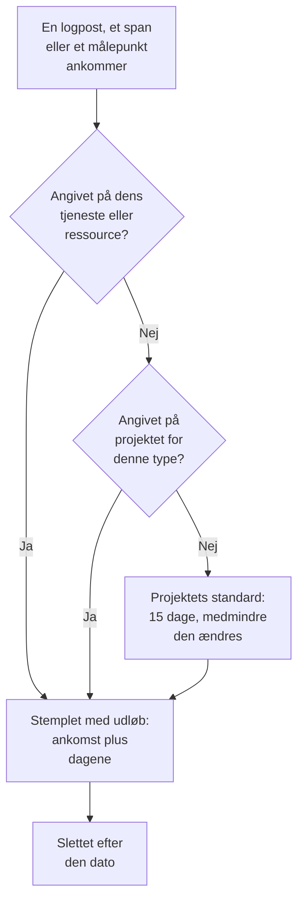

# Dataopbevaring

OneUptime opbevarer dine protokoller, spor, metrikker og profiler i et antal dage og sletter dem derefter: 15 dage, medmindre du ændrer det. Denne side viser, hvordan det tal beregnes, hvordan du ændrer det for hele projektet, og hvordan du opbevarer noget telemetri længere eller kortere end resten.

:::cards
- [Hvor længe telemetri opbevares](#hvor-længe-telemetri-opbevares): Den rækkefølge, OneUptime læser indstillingerne i.
- [Ændr projektets opbevaring](#ændr-projektets-opbevaring): Ét tal for al din telemetri.
- [Opbevar noget telemetri længere eller kortere](#opbevar-noget-telemetri-længere-eller-kortere): Efter type, alvorlighed, status eller tjeneste.
- [Hvad opbevaring koster](#hvad-opbevaring-koster): Fakturering på OneUptime Cloud, disk ved selvhosting.
:::

## Hvor længe telemetri opbevares

Hver logpost, hvert span, hvert målepunkt og hver profilprøve får sin opbevaring, når den ankommer. OneUptime beregner, hvor mange dage den skal opbevares, stempler datoen, hvor den udløber, og sletter den efter den dato. Den mest specifikke indstilling vinder:

Helt præcist læser OneUptime disse indstillinger i denne rækkefølge, og den første, der er angivet, afgør det:

| Rækkefølge | Indstilling | Hvor den angives |
| --- | --- | --- |
| 1 | Dage for én logalvorlighed eller span-status, for én tjeneste eller ressource | **Opbevaring efter telemetritype**, under **Yderligere indstillinger** på dens side **Indstillinger** |
| 2 | Dage for én type telemetri, for én tjeneste eller ressource | Det samme kort |
| 3 | Dage for alt fra én tjeneste eller ressource | **Opbevaring af telemetridata**, under **Yderligere indstillinger** på den samme side |
| 4 | Dage for én logalvorlighed eller span-status, for projektet | **Opbevaring efter telemetritype**, under **Yderligere indstillinger** på **Dataopbevaring** |
| 5 | Dage for én type telemetri, for projektet | Det samme kort |
| 6 | Dage for alt andet | **Standardopbevaring (dage)**, på **Dataopbevaring** |

- **Indstilling 1 til 5 er tilsidesættelser af opbevaringen.** De er en del af [Enterprise Edition](/docs/self-hosted/enterprise), og af Scale-abonnementet på OneUptime Cloud. Uden dem opbevares hver post efter projektets standard.
- **En ændring gælder for ny telemetri.** En post beholder den dato, den blev stemplet med: en kortere opbevaring sletter den ikke tidligere, og en længere opbevarer den ikke længere. Nye poster følger en ændring inden for cirka fem minutter.
- **Undtagelser følger det, de blev fundet i.** En undtagelse opbevares lige så længe som det span eller den logpost, den kom fra. Session Replays har deres egen opbevaring: se [Andre data med deres egen opbevaring](#andre-data-med-deres-egen-opbevaring).

## Før du begynder

- **En rolle, der ændrer projektet.** Project Owner eller Project Admin ændrer projektets opbevaring. En tjenestes eller ressources opbevaring kræver den rolle, der ændrer dens andre indstillinger.
- **Til tilsidesættelser, Enterprise Edition eller Scale-abonnementet.** En selvhostet installation kræver en Enterprise-licens, og et OneUptime Cloud-projekt Scale-abonnementet eller højere. Projektets standardopbevaring findes i alle udgaver og abonnementer.

## Ændr projektets opbevaring

:::steps
### Åbn dataopbevaring

Gå til **Projektindstillinger → Telemetri og APM → Dataopbevaring**. **Telemetri og APM** starter sammenklappet i sidemenuen: klik på den for at åbne den. Kortet **Opbevaring af telemetridata** viser **Standardopbevaring (dage)**.

### Angiv antallet af dage

Klik på **Edit Retention Settings**, indtast antallet af dage, mindst 1, og klik på **Gem ændringer**.
:::

Det nye tal gælder for hver post, der ankommer fra da af og ikke har sin egen tilsidesættelse.

## Opbevar noget telemetri længere eller kortere

Tilsidesættelser opbevarer det, du har brug for, længere og resten kortere: fejlprotokoller i et kvartal, for eksempel, og debugprotokoller i nogle få dage.

### For hele projektet

Under standarden, sammenklappet under **Yderligere indstillinger**, angiver kortet **Opbevaring efter telemetritype** dage for hver type telemetri. Klik på **Edit Overrides**, udfyld de felter, du har brug for, og lad resten stå tomme:

| Type | Felter |
| --- | --- |
| Protokoller | **Logs default (days)**, og ét felt for hver logalvorlighed |
| Spor | **Traces default (days)**, og ét felt for hver span-status: Fejl, Ok og Ikke angivet |
| Metrikker | **Metrics default (days)** |
| Profiler | **Profiles default (days)** |

Et felt, der står tomt, falder tilbage på den næste indstilling i rækkefølgen ovenfor, så en alvorlighed uden egne dage opbevarer sine protokoller efter standarden for protokoller.

### For én tjeneste eller ressource

Åbn tjenestens eller ressourcens side **Indstillinger** og derefter **Yderligere indstillinger**. Dens kort **Opbevaring af telemetridata** indeholder **Bevar telemetridata i (dage)**, ét tal for alt, hvad den sender, og dens kort **Opbevaring efter telemetritype** har de samme felter som projektets. Lad et felt stå tomt for at bruge projektets indstillinger.

Tjenester, værter, Kubernetes-klynger, Docker- og Podman-værter, Docker Swarm-, Proxmox- og Ceph-klynger, lagersystemer, vCentre, databaser, serverless-funktioner, cloudressourcer, RUM-applikationer og IoT-flåder har alle disse kort. Se [Tjenestekataloget](/docs/telemetry/services#skift-en-tjeneste) for en tjenestes side **Indstillinger**.

### Når abonnementet eller licensen ikke længere omfatter tilsidesættelser

- **På en selvhostet installation** holder tilsidesættelser op med at gælde, når Enterprise-prøveperioden eller henstandsperioden slutter uden en licens. Ny telemetri opbevares efter projektets standard, kortene bliver skrivebeskyttede, og intet af det, du har angivet, slettes: aktivér en licens, så gælder de igen. Se [Enterprise Edition](/docs/self-hosted/enterprise#når-en-licens-udløber-eller-mangler).
- **På OneUptime Cloud** bliver en tilsidesættelse, som en prøveperiode efterlod, ved med at gælde under Scale-abonnementet. Dens side viser den under opgraderingskortet med en knap **Fjern tilsidesættelse**, der virker på alle abonnementer. At angive en tilsidesættelse igen kræver Scale-abonnementet.

## Andre data med deres egen opbevaring

| Data | Opbevares i | Hvor det ændres |
| --- | --- | --- |
| Session Replays | 7 dage, medmindre det ændres | RUM-applikationens replaypolitik: se [Administrer applikationer](/docs/rum/applications#opbevaring-af-sessionsafspilninger). |
| Monitorprotokoller, én række pr. tjek | 1 dag, medmindre det ændres | På en selvhostet installation, **Opbevaring af overvågningslogfiler (dage)** i Admin Dashboard |
| Monitormetrikker, og de metrikker, SLO'er registrerer | 30 dage, medmindre det ændres | På en selvhostet installation, **Opbevaring af overvågningsmålinger (dage)** i Admin Dashboard |

## Hvad opbevaring koster

- **På OneUptime Cloud** faktureres telemetri pr. indtaget GB, og prisen pr. GB omfatter 15 dages opbevaring. Længere opbevaring koster forholdsmæssigt mere: 30 dage koster dobbelt så meget pr. GB som 15. Kortere opbevaring koster forholdsmæssigt mindre, men opbevaring under 7 dage faktureres som 7 dage. **Projektindstillinger → Fakturering og fakturaer → Brugshistorik** viser dag for dag, hvor meget hver tjeneste sendte, og hvor længe det opbevares.
- **Ved selvhosting** ligger telemetrien i ClickHouse, og opbevaringen ganger dens diskforbrug. Se [Dimensionering](/docs/installation/sizing#opbevaring-og-hvordan-den-påvirker-lageret).

Telemetri, du ikke har brug for, koster intet, hvis den aldrig gemmes: [Drop-filtre og scrub-regler](/docs/telemetry/drop-filters-and-scrub-rules) kasserer den, når den ankommer.

## Fejlfinding

:::details Jeg har sænket opbevaringen, men gamle data er der stadig
En post beholder den udløbsdato, den blev stemplet med ved ankomsten. Poster, der blev gemt før ændringen, slettes på deres egne datoer, og kun nye poster følger den nye opbevaring.
:::

:::details Tilsidesættelseskortene viser en opfordring til at opgradere
Tilsidesættelser af opbevaringen kræver Enterprise Edition på en selvhostet installation, og Scale-abonnementet på OneUptime Cloud. Indtil da opbevares alt efter projektets standard.
:::

:::details Diskpladsen kommer tilbage en dag efter, at data udløber
Udløbne poster holder op med at vise sig i søgninger, grafer og lister, så snart de udløber. På disken slettes protokoller og metrikker ved den første midnat derefter, så deres plads kommer tilbage op til en dag senere.
:::

## Næste skridt

:::cards
- [Indtagelsesnøgler](/docs/telemetry/ingestion-keys): Send telemetri til dit projekt.
- [Drop-filtre og scrub-regler](/docs/telemetry/drop-filters-and-scrub-rules): Behold kun den telemetri, du har brug for.
- [Tjenestekatalog](/docs/telemetry/services): Angiv en tjenestes egen opbevaring.
- [Enterprise Edition](/docs/self-hosted/enterprise): Hvad tilsidesættelser af opbevaringen følger med.
:::
