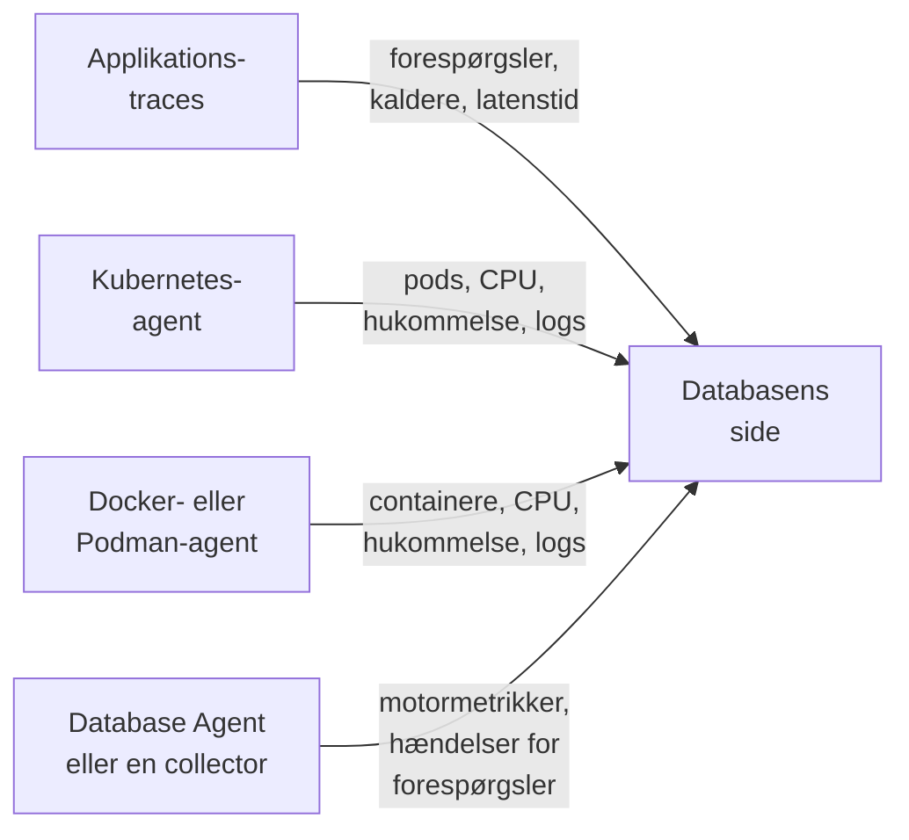

# Databaser

**Databases** giver hver databaseserver, som dit projekt kører eller taler med, sin egen side: hvem der kalder den og hvor hurtigt, hvor den kører, motorens egne sundhedsmetrikker, dens logs og traces, de hændelser, alarmer og planlagte vedligeholdelser, der er knyttet til den, og de alarmmonitorer, der anbefales til dens motor. Databaser har etiketter, ejere, etiket- og ejerregler, opbevaring pr. database og arkivering ligesom alle andre ressourcer. Åbn dem under **Produkter → Ressourcer → Databaser**.

:::cards
- [Database Agent](#database-agent): Motormetrikker for PostgreSQL, MySQL, SQL Server, Oracle, Redis, MongoDB, Elasticsearch og Memcached.
- [Sådan findes databaser](#sådan-findes-databaser): Fra traces, Kubernetes, Docker, Podman og collectorer.
- [Alarmer på en database](#alarmer-på-en-database): Anbefalede monitorer og monitorer, du selv bygger.
- [Fejlfinding](#fejlfinding): Et diagnosescript og de sædvanlige problemer.
:::

## Sådan virker det

De fleste databaser dukker op af sig selv. OneUptime samler hver database fra op til fire kilder, og hver kilde bidrager med noget forskelligt:

| Kilde | Hvad den kræver af dig | Hvad den føjer til databasens side |
| --- | --- | --- |
| **Applikationstraces** | Instrumenterede applikationer (OpenTelemetry) | Forespørgsler fra applikationer: kaldrate, fejl, latenstid og de tjenester, der kalder den |
| **Kubernetes** | [OneUptimes Kubernetes-agent](/docs/telemetry/kubernetes-agent) | Hvor den kører: pods, CPU og hukommelse samt podsenes logs |
| **Docker / Podman** | [Docker-agenten](/docs/telemetry/docker-host) eller [Podman-agenten](/docs/telemetry/podman-host) | Hvor den kører: containerne, deres CPU og hukommelse samt deres logs |
| **Database Agent** (en OpenTelemetry Collector) | [Database Agent](#database-agent) eller din egen collector | **Engine metrics**: forbindelser, gennemløb, cache-hitrate, låse, replikeringsforsinkelse, hukommelse, i det omfang motoren har dem (se [Hvad der indsamles](#hvad-der-indsamles)), plus valgfrie forespørgselsprøver, topforespørgsler og motorens logfil |



Motormetrikker kommer altid kun fra en collector, der taler med selve databasen (eller, for en administreret clouddatabase, med udbyderens overvågnings-API). Traces og containerinventarer fortæller OneUptime, at en database findes, og hvordan den bruges, men ikke hvordan den har det indvendig; statussen **Engine metrics** på hver database viser, om den del er forbundet.

Du kan også tilføje en database manuelt: **Databases → Opret Database** med dens motor, adresse og port. For et sundhedstjek fra en probe, der slet ikke kræver nogen agent, se [Databasetilstands-monitor](/docs/monitor/database-health-monitor).

## Understøttede databaser

OneUptime kender motorerne nedenfor ved navn: den normaliserer det, instrumenteringer lægger i `db.system.name` (eller det ældre `db.system`), til værdien i anden kolonne, viser motorens navn, bruger dens standardport, når et span eller en adresse ikke har en, genkender dens containerimages og Helm-charts og ved, hvor dens motormetrikker kommer fra. En motor, der ikke står på listen, virker stadig alle steder, hvor en database kendes på sin adresse; den vises bare under det rå navn, dine spans rapporterer, og oprettes aldrig alene ud fra traces.

En **familie** er den motor, som en fork eller en protokolkompatibel motor nås igennem: klientbiblioteker kan ikke skelne MariaDB fra MySQL eller Valkey fra Redis, så et span siger `mysql` eller `redis`, mens et containerimage, et Helm-chart eller Database Agent nævner forken. Begge lander på den samme database, og databasen viser den mere specifikke motor, så snart dens containerimage, eller en kilde mindst lige så stærk som den bag dens nuværende motor, nævner den (se [Hvilken motor en database viser](#hvilken-motor-en-database-viser)).

**Oprettet fra traces** angiver, om klientspans alene opretter en database med den motor (se [Fra applikationstraces](#fra-applikationstraces)): en administreret tjeneste, der nås via udbyderens delte API-vært, og en motor, der kører inde i din applikations proces, gør det aldrig. **Engine metrics** angiver, hvor motorens egne sundhedsmetrikker kommer fra: en konfiguration til Database Agent, en collector-contrib-receiver, du føjer til din egen collector, motorens eget Prometheus-endpoint (`:port/path`, scrapet med collectorens `prometheus`-receiver), cloududbyderens overvågnings-API eller intet indbygget. Fanen **Dokumentation** på hver database gør det til en færdig collectorkonfiguration til den database.

| Motor | `db.system.name` | Standardport | Familie | Oprettet fra traces | Engine metrics |
| --- | --- | --- | --- | --- | --- |
| Actian Ingres | `actian.ingres` | — | — | Ja | Intet indbygget |
| Actian Zen (Pervasive PSQL) | `pervasive` | 1583 | — | Ja | Intet indbygget |
| Aerospike | `aerospike` | 3000 | — | Ja | receiver `aerospike` |
| Amazon DocumentDB | `aws.documentdb` | 27017 | MongoDB | Ja | receiver `awsfirehose` (cloudovervågning) |
| Amazon DynamoDB | `aws.dynamodb` | 443 | — | Nej (cloud-API) | receiver `awsfirehose` (cloudovervågning) |
| Amazon Neptune | `aws.neptune` | 8182 | — | Ja | receiver `awsfirehose` (cloudovervågning) |
| Amazon Redshift | `aws.redshift` | 5439 | PostgreSQL | Ja | receiver `awsfirehose` (cloudovervågning) |
| Apache Derby | `derby` | 1527 | — | Nej (in-process) | Ingen (in-process) |
| Apache Doris | `doris` | 9030 | MySQL | Ja | Prometheus, `:8030/metrics` |
| Apache Druid | `druid` | 8888 | — | Ja | Intet indbygget |
| Apache Geode | `geode` | 10334 | — | Ja | Intet indbygget |
| Apache HBase | `hbase` | — | — | Ja | Intet indbygget |
| Apache Hive | `hive` | 10000 | — | Ja | Intet indbygget |
| Apache Ignite | `ignite` | 10800 | — | Ja | Intet indbygget |
| Apache Impala | `impala` | 21050 | — | Ja | Intet indbygget |
| Apache Pinot | `pinot` | 8099 | — | Ja | Intet indbygget |
| Apache Solr | `solr` | 8983 | — | Ja | Intet indbygget |
| ArangoDB | `arangodb` | 8529 | — | Ja | Prometheus, `:8529/_admin/metrics/v2` |
| Azure Cosmos DB | `azure.cosmosdb` | 443 | — | Nej (cloud-API) | receiver `azure_monitor` (cloudovervågning) |
| Cassandra | `cassandra` | 9042 | — | Ja | Intet indbygget |
| Chroma | `chroma` | 8000 | — | Ja | Intet indbygget |
| Claris FileMaker | `filemaker` | 2399 | — | Ja | Intet indbygget |
| ClickHouse | `clickhouse` | 9000 | — | Ja | Prometheus, `:9363/metrics` |
| Cloud Bigtable | `gcp.bigtable` | 443 | — | Nej (cloud-API) | receiver `googlecloudmonitoring` (cloudovervågning) |
| Cloud Firestore | `gcp.firestore` | 443 | — | Nej (cloud-API) | receiver `googlecloudmonitoring` (cloudovervågning) |
| Cloud Spanner | `gcp.spanner` | 443 | — | Nej (cloud-API) | receiver `google_cloud_spanner` |
| CockroachDB | `cockroachdb` | 26257 | PostgreSQL | Ja | Prometheus, `:8080/_status/vars` |
| Couchbase | `couchbase` | 11210 | — | Ja | Prometheus, `:8091/metrics` |
| CouchDB | `couchdb` | 5984 | — | Ja | receiver `couchdb` |
| Databricks | `databricks` | 443 | — | Ja | Intet indbygget |
| Dragonfly | `dragonfly` | 6379 | Redis | Ja | Database Agent (receiver `redis`) |
| DuckDB | `duckdb` | — | — | Nej (in-process) | Ingen (in-process) |
| Elasticsearch | `elasticsearch` | 9200 | — | Ja | Database Agent (receiver `elasticsearch`) |
| etcd | `etcd` | 2379 | — | Ja | Prometheus, `:2379/metrics` |
| FerretDB | `ferretdb` | 27017 | MongoDB | Ja | Prometheus, `:8088/debug/metrics` |
| Firebird | `firebirdsql` | 3050 | — | Ja | Intet indbygget |
| FoundationDB | `foundationdb` | 4500 | — | Ja | Intet indbygget |
| Google BigQuery | `bigquery` | 443 | — | Nej (cloud-API) | receiver `googlecloudmonitoring` (cloudovervågning) |
| Greenplum | `greenplum` | 5432 | PostgreSQL | Ja | Intet indbygget |
| H2 | `h2database` | 9092 | — | Nej (in-process) | Ingen (in-process) |
| Hazelcast | `hazelcast` | 5701 | — | Ja | Intet indbygget |
| HyperSQL | `hsqldb` | 9001 | — | Nej (in-process) | Ingen (in-process) |
| IBM Db2 | `ibm.db2` | 50000 | — | Ja | Intet indbygget |
| IBM Informix | `ibm.informix` | 9088 | — | Ja | Intet indbygget |
| IBM Netezza | `ibm.netezza` | 5480 | — | Ja | Intet indbygget |
| InfluxDB | `influxdb` | 8086 | — | Ja | Prometheus, `:8086/metrics` |
| InstantDB | `instantdb` | — | — | Nej (in-process) | Ingen (in-process) |
| InterBase | `interbase` | 3050 | Firebird | Ja | Intet indbygget |
| InterSystems IRIS / Caché | `intersystems.cache` | 1972 | — | Ja | Prometheus, `:52773/api/monitor/metrics` |
| KeyDB | `keydb` | 6379 | Redis | Ja | Database Agent (receiver `redis`) |
| MariaDB | `mariadb` | 3306 | MySQL | Ja | Database Agent (receiver `mysql`) |
| Meilisearch | `meilisearch` | 7700 | — | Ja | Prometheus, `:7700/metrics` |
| Memcached | `memcached` | 11211 | — | Ja | Database Agent (receiver `memcached`) |
| Milvus | `milvus` | 19530 | — | Ja | Prometheus, `:9091/metrics` |
| MongoDB | `mongodb` | 27017 | — | Ja | Database Agent (receiver `mongodb`) |
| MySQL | `mysql` | 3306 | — | Ja | Database Agent (receiver `mysql`) |
| Neo4j | `neo4j` | 7687 | — | Ja | Prometheus, `:2004/metrics` |
| OceanBase | `oceanbase` | 2881 | MySQL | Ja | Intet indbygget |
| OpenSearch | `opensearch` | 9200 | Elasticsearch | Ja | Database Agent (receiver `elasticsearch`) |
| Oracle | `oracle.db` | 1521 | — | Ja | Database Agent (receiver `oracledb`) |
| Pinecone | `pinecone` | 443 | — | Nej (cloud-API) | Intet indbygget |
| PostgreSQL | `postgresql` | 5432 | — | Ja | Database Agent (receiver `postgresql`) |
| Presto | `presto` | 8080 | — | Ja | Intet indbygget |
| Progress OpenEdge | `progress` | — | — | Ja | Intet indbygget |
| Qdrant | `qdrant` | 6333 | — | Ja | Prometheus, `:6333/metrics` |
| QuestDB | `questdb` | 8812 | PostgreSQL | Ja | Prometheus, `:9003/metrics` |
| RavenDB | `ravendb` | 8080 | — | Ja | Intet indbygget |
| Redis | `redis` | 6379 | — | Ja | Database Agent (receiver `redis`) |
| Riak KV | `riak` | 8087 | — | Ja | receiver `riak` |
| SAP ASE (Sybase) | `sybase` | 5000 | — | Ja | Intet indbygget |
| SAP HANA | `sap.hana` | 30015 | — | Ja | receiver `saphana` |
| SAP MaxDB | `sap.maxdb` | 7210 | — | Ja | Intet indbygget |
| ScyllaDB | `scylladb` | 9042 | Cassandra | Ja | Prometheus, `:9180/metrics` |
| SingleStore | `singlestore` | 3306 | MySQL | Ja | Prometheus, `:9104/metrics` |
| Snowflake | `snowflake` | 443 | — | Ja | receiver `snowflake` |
| Software AG Adabas | `softwareag.adabas` | — | — | Ja | Intet indbygget |
| SQL Server | `microsoft.sql_server` | 1433 | — | Ja | Database Agent (receiver `sqlserver`) |
| SQLite | `sqlite` | — | — | Nej (in-process) | Ingen (in-process) |
| StarRocks | `starrocks` | 9030 | MySQL | Ja | Prometheus, `:8030/metrics` |
| SurrealDB | `surrealdb` | 8000 | — | Ja | Intet indbygget |
| Teradata | `teradata` | 1025 | — | Ja | Intet indbygget |
| TiDB | `tidb` | 4000 | MySQL | Ja | Prometheus, `:10080/metrics` |
| Trino | `trino` | 8080 | — | Ja | Prometheus, `:8080/metrics` |
| Typesense | `typesense` | 8108 | — | Ja | Intet indbygget |
| Valkey | `valkey` | 6379 | Redis | Ja | Database Agent (receiver `redis`) |
| Vertica | `vertica` | 5433 | — | Ja | Intet indbygget |
| Vitess | `vitess` | 3306 | MySQL | Ja | Prometheus, `:15000/metrics` |
| Weaviate | `weaviate` | 8080 | — | Ja | Prometheus, `:2112/metrics` |
| YugabyteDB | `yugabytedb` | 5433 | PostgreSQL | Ja | Prometheus, `:9000/prometheus-metrics` |

De sædvanlige andre stavemåder accepteres også: `postgres` og `pg`, `mssql` og `sqlserver`, `oracle`, `mongo`, `scylla`, `dragonflydb`, `memsql` og alle ældre `db.system`-værdier, OpenTelemetry har brugt (`db2`, `hanadb`, `cosmosdb`, `dynamodb`, `spanner`, `redshift`, `informix`, `maxdb`, `cache`, `h2`, `firebird`, `edb`, `cloudscape`, …). En administreret tjeneste, der taler en motors protokol (Amazon RDS og Aurora, Azure Database, Cloud SQL, AlloyDB, Neon, Supabase, PlanetScale, ElastiCache, Memorystore, MongoDB Atlas), er den motor.

## Sådan findes databaser

Hver database husker den kilde, der oprettede den (kolonnen **Discovered from**), og det første punkt i dens **Feed** siger, hvad der fandt den: Kubernetes-workloaden og dens klynge, Docker- eller Podman-containeren (eller Compose- eller Swarm-tjenesten) og dens vært, det endpoint, applikationerne kaldte, eller den Database Agent (med version) eller collector, der rapporterede den. Senere kilder supplerer den samme database i stedet for at oprette en ny, så længe de beskriver det samme endpoint (se [Endpoints](#endpoints-og-reglen-om-én-ejer)).

### Fra applikationstraces

Hvert 10. minut opsummerer OneUptime de CLIENT-spans, dine applikationer har sendt inden for de seneste 15 minutter, og som bærer `db.system.name` (eller det ældre `db.system`). Serveren kommer fra `server.address` (eller det ældre `net.peer.name`, derefter `network.peer.address` / `net.sock.peer.addr`) og porten fra `server.port` (eller `net.peer.port`, `network.peer.port`, `net.sock.peer.port`); når spannet ikke har nogen port, antages motorens standardport. Motornavne normaliseres (se [Understøttede databaser](#understøttede-databaser)), så `postgres`, `pg` og `postgresql` er én motor, ligesom `mssql` og `microsoft.sql_server`; `mariadb` og `mysql` er to motorer i én familie.

En database **oprettes** kun ud fra traces, når alle disse betingelser er opfyldt; alt andet tæller stadig med for en database, der allerede findes, men opretter aldrig en:

- adressen navngiver én server i hele projektet: et DNS-navn, ikke en IP-literal og ikke et navn, der kun opløses på én maskine eller inden for ét netværk, medmindre kalderens Kubernetes-klynge kvalificerer det (se [Endpoints](#endpoints-og-reglen-om-én-ejer));
- porten er en, som en server lytter på. Operativsystemer giver klientens ende af en forbindelse en port fra 32768 og op (Linux' standardinterval for kortvarige porte starter der; Windows og macOS bruger 49152–65535), så en port fra 32768 og op opretter aldrig en database, medmindre det er motorens egen standardport (IBM Db2's 50000). eBPF-instrumentering, også Kubernetes-agentens, kan koble sig på en langvarig forbindelse midt i det hele og bytte dens to ender om. Spannet angiver så klientens egen port som server, og uden denne regel ville hver forbindelse blive sin egen database;
- motoren er en, OneUptime kender, med sin egen adresse: kolonnen **Oprettet fra traces** i [Understøttede databaser](#understøttede-databaser). Cloud-API'er, hvis vært alle kunder deler (DynamoDB, BigQuery, Spanner, Firestore, Bigtable, Cosmos DB, Pinecone), motorer, der kører inde i din applikation (SQLite, DuckDB, H2, HyperSQL, Derby), og motorer, OneUptime ikke kender, oprettes aldrig ud fra traces; tilføj dem manuelt;
- endpointet modtog mindst 10 forespørgsler i det 15-minutters vindue, en kørsel ser på, så et engangsscript ikke opretter en database. Et klientbiblioteks spans til forbindelseshåndtering (`pg.connect` og `pg-pool.connect` fra node-postgres, `redis-connect`, `connect`, …) er ikke forespørgsler: de tæller hverken her eller i en databases **Forespørgsler**;
- projektet er under sit [budget for automatisk oprettelse](#budgettet-for-automatisk-oprettelse).

Hvert CLIENT-span til en database mærkes også med sit endpoint, når det indtages, så snart en database ejer et endpoint, viser sektionen **Forespørgsler fra applikationer** og fanen **Spor** hvert kald til den, også kald foretaget, før databasen blev oprettet. `db.client.*`-metrikker (for eksempel `db.client.operation.duration`), der bærer en `server.address`, mærkes på samme måde.

**Klynger og værtslister.** En forbindelsesstreng, der angiver flere værter (`m1:27017,m2:27017,m3:27017`), er én database, uanset hvilken rækkefølge en klient angiver dem i. Medlemmer af MongoDB Atlas (`cluster0-shard-00-01.ab1cd.mongodb.net`) bliver til én database opkaldt efter deres klynge (`cluster0.ab1cd.mongodb.net`), og hvert medlem, der ses, bliver et af dens endpoints. Drivere, der rapporterer hvert medlem af en Cassandra-ring, en Redis Cluster, en Elasticsearch-klynge eller ElastiCache-noder for sig, giver stadig én database pr. medlem: intet i de værtsnavne siger, hvilken klynge de hører til. Behold én, og [flet](#endpoints-og-reglen-om-én-ejer) de andre ind i den.

### Fra Kubernetes

Hvert 5. minut ser OneUptime på podsene i hver forbundet Kubernetes-klynge og genkender databaseworkloads:

1. **Først operator- og chartetiketter**: CloudNativePG, Zalando (Spilo), Crunchy PGO, Bitnami-charts, ECK, Altinity ClickHouse, cass-operator, Percona, Oracle MySQL-operatoren og Vitess-operatoren (dens `vtgate`-pods er databasen; `vttablet`, `vtctld`, `vtorc` og `vtbackup` er dele af den, ikke medlemmer). Én operatorklynge bliver til én database. Vitess-klyngens egen vtgate-Service har et hashet navn, så tilføj den på databasens fane **Endepunkter**, hvis applikationer forbinder gennem den.
2. **Ellers containerimages**, efter præcist imagenavn: de officielle images, Bitnamis (inklusive de flyttede repositories `bitnamilegacy` og `bitnamisecure`) og Red Hat / OpenShift-images for hver motor i [Understøttede databaser](#understøttede-databaser), der udgiver et (`postgres`, `bitnami/postgresql`, `rhel9/postgresql-16`, `mysql`, `mariadb`, `mssql/server`, `gvenzl/oracle-free`, `redis`, `valkey/valkey`, `mongo`, `cockroachdb/cockroach`, `pingcap/tidb`, `clickhouse/clickhouse-server`, `qdrant/qdrant`, …). En fork genkendes som sig selv: et `mariadb`-image er MariaDB, et `valkey/valkey`-image er Valkey. Exportere, operatorer, administrationsbrugerflader, connection poolers (pgbouncer, pgpool, ProxySQL, HAProxy, Cloud SQL Proxy) og backupværktøjer er ikke databaser. En pod, der også kører en applikationscontainer, behandles heller ikke som en database (en app med en database-sidecar er stadig appen), dog må et StatefulSet, hvis databasecontainer erklærer motorens standardport, have én ekstra container, som OneUptime ikke genkender (for eksempel en logafsender).

Et databaseimage gør ikke en pod til en databaseserver, men kun positive beviser gør den til noget andet. En container, hvis program er et klient- eller dumpværktøj (`psql`, `redis-cli`, `mongosh`, `pg_dump`, `mysql`), en keep-alive (`sleep infinity`, `tail -f /dev/null`) eller en interaktiv shell (eller hvis `sh -c`-script ikke kører andet end sådanne værktøjer, shell-builtins og simple hjælpeprogrammer som `echo` og `cp`), er en klient- eller fejlfindingskørsel, ikke en database; det samme gælder en Redis- eller Valkey-Sentinel (`redis-sentinel`, `redis-server --sentinel`). Det gælder også bag en starter: `env` (med sine `NAME=value`-indstillinger), `nohup`, `setsid`, `tini`, `dumb-init` og et images `docker-entrypoint.sh` gennemskues til det program, de starter, og det samme gør `exec`, `env` og `nohup` inde i et script, så `env PGPASSWORD=… psql` og `tini -- redis-cli` er klientkørsler, mens `tini -- docker-entrypoint.sh postgres` er serveren, og det er `docker-entrypoint.sh -c max_connections=200` også, imagets egen server startet med et flag. Et script, der derefter starter noget andet (`sleep 5 && exec redis-server`, `bash -ecx 'exec cockroach start …'`), en scriptfil (`sh /start.sh`), en wrapper, der tager sine egne argumenter før programmet (`gosu postgres …`, `timeout 30 …`), eller et script, der er for langt at læse, tæller som en mulig server. Afsluttede pods, batchjobs og engangspods fra `kubectl run`, der ikke erklærer nogen port, er heller ikke databaser.

En database dukker op, når en af dens pods har været Ready i omkring 10 minutter (når kun en sidecar forhindrer poden i at blive Ready, tæller en klar databasecontainer i stedet). En pod i en crashløkke bliver Ready på ny ved hver genstart, så den bliver aldrig en database, og det gør et CI-job eller en pod, der crashede efter et minut, heller ikke. Når en database er oprettet, opdateres den ved hver kørsel.

Pods grupperes efter deres StatefulSet, Deployment eller operatorklynge, så et StatefulSet med tre medlemmer er én database med tre medlemmer. **Instanser** på dens side tæller de pods, hvis databasecontainer kører: ikke en, der venter i `CrashLoopBackOff` eller `ImagePullBackOff`, eller en, der er afsluttet, selvom Kubernetes stadig kan rapportere sådan en pod som Running; en workload skaleret til nul viser 0 og beholder sin side, indtil [automatisk arkivering](#livscyklus-arkivering-og-opbevaring) fjerner den. Vejen tilbage virker også: workloadens StatefulSet- eller Deployment-side og siden for hver af dens pods nævner den database, den kører, med et link **Open database**, også for et StatefulSet eller Deployment med et andet navn end dets database (Bitnamis `shop-redis-master` for `shop-redis`, Perconas `cluster1-pxc` for `cluster1`), mens en pooler- eller backupworkload, som en operator mærker som en del af en klynge, angiver, at den er en del af den databases klynge.

Kubernetes-agenten rapporterer ikke Service-objekter, så en databases Service-navne kommer fra de konventioner, charts og operatorer følger: navnet på det ejende StatefulSet eller Deployment, StatefulSettets headless Service (og hvert medlem bag den, `<pod>.<headless-service>`), og operatorernes proxy- og pooler-Services: HAProxy og ProxySQL fra Percona XtraDB Cluster, routeren og HAProxy fra Percona Server for MySQL, mongos fra Percona Server for MongoDB, pgBouncer fra Crunchy og poolerne fra Zalando og CloudNativePG. Hver bliver et endpoint kvalificeret af klyngen (`postgres.prod.svc.cluster.local:5432@my-cluster`), så det samme navn i to klynger forbliver to databaser. Så længe projektet har præcis én klynge, tilføjes også det ukvalificerede `postgres.prod.svc.cluster.local:5432`, og det frigives igen cirka 2 timer efter, at en anden klynge dukker op. Tilføj en Service med et andet navn på databasens fane **Endepunkter**.

Applikationer, hvis telemetri går gennem Kubernetes-agenten, bærer deres namespace og klynge, så deres kald læses, som deres pods resolver læser dem: `postgres` (fra samme namespace), `postgres.prod` (Servicen `postgres` i namespace `prod`), `postgres.prod.svc` og det fulde navn knyttes alle til databasen, og det samme gør `mongo-0.mongo-headless`, et StatefulSet-medlem i kalderens eget namespace.

OneUptime læser podmetadata, etiketter, images, erklærede porte og hvad en containers kommandolinje kører (programmets navn, en shells flag og hvilke velkendte klient-, keep-alive- og shellkommandoer dens script kører; enhver anden kommando noteres kun som ukendt), aldrig miljøvariabler, argumentværdier, scripttekst eller hemmeligheder.

### Fra Docker og Podman

Hvert 5. minut klassificeres containerne på hver forbundet Docker- eller Podman-vært efter image på samme måde og grupperes og filtreres derefter efter deres navne og deres Compose-, Swarm- og Testcontainers-etiketter, aldrig efter den kommando, de kører (se nedenfor). Containere fra én Compose-tjeneste (efter Compose-etiketterne for projekt og tjeneste) eller én Swarm-tjeneste er én database med flere medlemmer, og dens workload er den tjeneste (`Compose service/<project>-<service>`, `Swarm service/<service>`). Enhver anden container er sin egen database under sit præcise navn (`Container/<name>`), så `redis-6379` og `redis-6380` forbliver to. Testcontainers, engangskørsler med `docker compose run`, containere, som kubelet kører på en Docker-node (Kubernetes-registreringen finder dem som pods), og containere, der kører i under 10 minutter, bliver aldrig databaser. En containers alder er dens oppetid, så en, der allerede har kørt så længe, bliver en database ved den første kørsel efter installationen af agenten. **Instanser** tæller de kørende containere, og hver containers side linker tilbage til dens database (**Open database**). En vært, der er registreret to gange under det samme navn, læses én gang, via den registrering, der senest er set.

Agenten sender de etiketter med hver containers metrikker, når dens `otel-collector-config.yaml` kopierer dem (`container_labels_to_metric_labels`). En ældre Docker- eller Podman-agent gør det ikke: opdatér den, ellers er hver container sin egen database, også Testcontainers-kørsler og engangskørsler.

I modsætning til Kubernetes læses en containers kommandolinje aldrig (agenterne sender den ikke, da den kan indeholde hemmeligheder), så en langvarig klient- eller fejlfindingscontainer fra et databaseimage (`sleep infinity`, en `psql`- eller `redis-cli`-løkke) bliver en database, når den har kørt i 10 minutter. Arkivér den for at afvise den: en database, som en person har arkiveret, forbliver arkiveret. Lader du den være, bliver den [arkiveret automatisk](#livscyklus-arkivering-og-opbevaring) 7 dage efter, at containeren stopper.

Containernavne opløses kun inden for ét Docker-netværk, så disse databaser får **ingen** endpoints automatisk; deres side viser containernes egne metrikker og logs. For at knytte de forespørgsler, dine applikationer sender, til databasen skal du tilføje den adresse, de bruger, på fanen [Endpoints](#endpoints-og-reglen-om-én-ejer).

For motormetrikker skal du installere [Database Agent](#database-agent) fra databasens egen fane **Dokumentation**: dens installationskommando og `.env` indeholder `DATABASE_SERVER_ID`, allerede udfyldt, så agentens data havner i denne database. En agent, der er installeret uden den, matches i stedet via sin `DATABASE_SERVER_ADDRESS`, som en containerdatabase ikke ejer: et DNS-navn registrerer serveren som en anden database (én side med containerne, en anden med motormetrikkerne; se [To databaser for én server](#to-databaser-for-én-server)), og en privat IP eller et containernavn knyttes ikke til noget.

### Fra Database Agent eller din egen collector

Når motormetrikker eller logs kommer fra en databasereceiver i en collector, knytter OneUptime dem til en database i det øjeblik, de indtages: direkte via id, når dataene bærer `oneuptime.database.server.id` (agentens `DATABASE_SERVER_ID`), og ellers via det endpoint, dataene nævner (`server.address` / `server.port`):

- data, der er knyttet via id, havner i den database og vises på dens sider (og kun der), uanset hvilken adresse de rapporterer: en privat IP, et klyngelokalt navn, en adresse, som en anden database ejer, eller ingen. En rapporteret adresse, der navngiver én server i hele projektet og endnu ikke tilhører nogen database, føjes til databasen som et endpoint, så applikationstraces til den adresse også lander der;
- ellers knytter et endpoint, som en database allerede ejer, dataene til den database, uanset hvad der oprettede den;
- ellers **oprettes** en database, men kun ud fra et navn, der betyder én server i hele projektet (et DNS-navn, en offentlig IP eller et klyngelokalt navn, `.internal`- eller `.local`-navn, som dataene kvalificerer med deres Kubernetes-klynge, `k8s.cluster.name`, som Database Agent aldrig sætter), og kun for en motor, der må oprettes af sig selv (kolonnen **Oprettet fra traces** i [Understøttede databaser](#understøttede-databaser): aldrig en delt cloud-API, en in-process-motor eller en ukendt). Private og link-local-IP'er, navne med én etiket (`db`) og ukvalificerede klyngelokale (`postgres.prod.svc.cluster.local`), `.internal`- eller `.local`-navne kan betyde en anden server i hvert netværk; en pods IP skifter ved hver genstart; og et navn med én etiket, som collectorens eget namespace har fuldendt, kan være en Service eller collectorens egen pod. Data, der nævner et af dem, havner kun i en database, der allerede har det som endpoint: den workload, der er fundet i Kubernetes, for dens Service-navne. Opret den database manuelt (**Databases → Opret Database**, samme adresse og port), eller knyt agenten til den med `DATABASE_SERVER_ID`. I et projekt med en Kubernetes-klynge afvises et klyngelokalt Service-navn uden sin klynge: opret databasen som `postgres.prod.svc.cluster.local:5432@my-cluster`, og tilføj derefter det ukvalificerede `postgres.prod.svc.cluster.local:5432` (det, agenten rapporterer) på dens fane **Endepunkter**;
- et receiverbatch, der slet ikke navngiver nogen server, ignoreres (se [Brug din egen OpenTelemetry Collector](#brug-din-egen-opentelemetry-collector)).

Databaser, som en collector opretter, tæller med i [budgettet for automatisk oprettelse](#budgettet-for-automatisk-oprettelse) ligesom alle andre fundne databaser; en database, du har oprettet manuelt og knyttet med `DATABASE_SERVER_ID`, har aldrig brug for en oprettelse. Se [Database Agent](#database-agent).

### Hvilken motor en database viser

Når kilderne er uenige om en databases motor, vinder det stærkeste bevis: en motor, som en person har angivet, derefter en collector eller Database Agent (motoren, der rapporterer om sig selv), derefter et containerimage eller et Helm-chart og derefter klientspans; en PostgreSQL-driver rapporterer `postgresql`, selv når den taler med CockroachDB. En kilde flytter kun en database til en anden motorfamilie, når dens bevis er stærkere end det, der navngav den nuværende motor, og en motor, som en person har angivet, ændres aldrig af registreringen. Inden for en familie præciserer en fork motoren, når den kilde, der nævner den, er mindst lige så stærk som den, der navngav den nuværende motor, eller er et containerimage: et span siger `redis`, imaget siger `valkey`, og databasen viser Valkey, selv hvor en collectors `redis`-receiver sagde `redis`, da den ikke kan skelne de to. Applikationstraces alene præciserer aldrig en motor, som et image eller en collector har bestemt: en klient nævner den protokol, den taler, og MariaDB Connector/J rapporterer `mariadb` over for en MySQL-server. En collector nævner forken, når den sætter den i `db.system.name` (det gør Database Agent, ud fra `DATABASE_SYSTEM`), eller når batchens `db.system.version` nævner den: en versionsstreng, der bærer forkens navn (`8.0.11-TiDB-v7.5.1`), eller en hovedversion, som kun forken har udgivet; MySQL har ingen 10.x eller 11.x, så `mysql` med `11.4.13`, det rene tal, som `mysql`-receiveren rapporterer for MariaDB 11.4, er MariaDB (se [Brug din egen OpenTelemetry Collector](#brug-din-egen-opentelemetry-collector)). En fork fortrydes kun af et containerimage, der nævner dens families motor, og kun når intet andet end applikationstraces har nævnt forken; en collector eller et trace, der nævner familien, fortryder aldrig en. En Kubernetes-workload, hvis image skifter til en fork i samme familie (`redis` til `valkey`), forbliver den samme database.

### Budgettet for automatisk oprettelse

Traces, Kubernetes, Docker, Podman og collectorer opretter kun databaser af sig selv, så længe projektet har færre end 500 aktive, ikke-arkiverede fundne databaser (`DATABASE_SERVER_AUTO_CREATE_BUDGET`, se [Justering til selvhosting](#justering-til-selvhosting)). Databaser, du opretter manuelt, tæller aldrig med og blokeres aldrig; arkiverede databaser tæller ikke med, så [automatisk arkivering](#livscyklus-arkivering-og-opbevaring) frigør budget; og databaser, der allerede findes, bliver ved med at blive matchet og opdateret. Når budgettet er nået, opretter collectordata for et nyt endpoint intet (de havner kun i eksisterende databaser), og OneUptime logger en advarsel højst én gang hvert 10. minut pr. projekt.

## Database Agent

OneUptime Database Agent er en forudkonfigureret OpenTelemetry Collector til **PostgreSQL**, **MySQL / MariaDB**, **SQL Server**, **Oracle**, **Redis / Valkey / KeyDB / Dragonfly**, **MongoDB**, **Elasticsearch / OpenSearch** og **Memcached**. Den består kun af konfiguration: en standard `otel/opentelemetry-collector-contrib`-container, der kører collectorens native receiver til din motor, med en konfiguration, der mærker hvert batch med databasens identitet og sender det til OneUptime via OTLP. Der installeres intet på databaseserveren. Den samme `docker-compose.yml` kører også [database-AI-agenten](#ai-agent) ved siden af collectoren, til OneUptime AI. For de andre motorer i [Understøttede databaser](#understøttede-databaser), se [Brug din egen OpenTelemetry Collector](#brug-din-egen-opentelemetry-collector); fanen **Dokumentation** på hver database indeholder konfigurationen.

**Én agent overvåger én databaseserver.** Identiteten sættes på alt, hvad agenten sender, så kør én agent (én installationsmappe) pr. server og én pr. replika, hvis du vil have replikaer på deres egne sider.

Agenten ligger i [mappen DatabaseAgent](https://github.com/OneUptime/oneuptime/tree/master/agents/DatabaseAgent): `docker-compose.yml`, én collectorkonfiguration pr. receiver (`configs/postgresql.yaml`, `configs/mysql.yaml`, `configs/sqlserver.yaml`, `configs/oracledb.yaml`, `configs/redis.yaml`, `configs/mongodb.yaml`, `configs/elasticsearch.yaml`, `configs/memcached.yaml`), `install.sh`, `troubleshoot.sh` og en systemd-unit. En fork eller en kompatibel erstatning kører sin families konfiguration og rapporterer sit eget navn: `DATABASE_SYSTEM=mariadb` kører `configs/mysql.yaml`, og databasen vises som MariaDB.

### Før du begynder

- Docker Engine 20.10 eller nyere med Docker Compose v2-pluginet, på en maskine, der kan nå databasens port (eller en Kubernetes-klynge: se [Kubernetes](#kubernetes)).
- Et login på databasen, der kan oprette overvågningsbrugeren og give den statistikrettighederne nedenfor.
- En indtagelsesnøgle. Opret en under **Projektindstillinger → Telemetri og APM → Indtagelsesnøgler**, og kopiér dens værdi.

:::steps
### Opret en overvågningsbruger

Giv agenten sit eget login med læseadgang til motorens statistik: aldrig en administrator og aldrig en applikations login. Hvis du allerede har oprettet en overvågningsbruger til [Databasetilstands-monitor](/docs/monitor/database-health-monitor#opret-en-overvågningsbruger), dækker dens rettigheder til PostgreSQL, MySQL og SQL Server også agenten.

:::tabs
@tab PostgreSQL
```sql
CREATE USER oneuptime_monitor WITH PASSWORD 'a-strong-password';
GRANT pg_monitor TO oneuptime_monitor;
```

`pg_monitor` er en indbygget rolle (PostgreSQL 10 og nyere), der giver læseadgang til statistik- og overvågningsvisningerne og ingen adgang til dine tabeller. Den er ikke valgfri: uden den fejler `pg_stat_activity` ikke, men returnerer kun agentens egen session, så antallet af forbindelser viser `1` på en server, der i virkeligheden er fuld. Receiveren forbinder til hver database for at læse statistik pr. database, så brugeren har også brug for `CONNECT` på hver af dem (`PUBLIC` har det som standard). PostgreSQL-receiveren starter ikke uden adgangskode.

Topforespørgsler (`DATABASE_QUERY_EVENTS=true`) læser også `pg_stat_statements`: indlæs den med `shared_preload_libraries = 'pg_stat_statements'` (en genstart), og opret den i hver overvåget database:

```sql
CREATE EXTENSION IF NOT EXISTS pg_stat_statements;
```

Udførelsesplaner for topforespørgsler kræver `SELECT` på de tabeller, forespørgslerne rører ved, hvilket `pg_monitor` ikke giver; giv det pr. skema (`GRANT SELECT ON ALL TABLES IN SCHEMA app TO oneuptime_monitor`), hvis du vil have planer. Uden det kommer topforespørgsler stadig ind, med tomme planer, og collectoren logger `failed to explain` for hver af dem; diagnosescriptet rapporterer det som en advarsel, ikke som en manglende rettighed.

På en administreret tjeneste, hvor `pg_monitor` ikke er tilgængelig, dækker `pg_read_all_stats` de samme visninger. Agenten springer allerede de interne databaser i Amazon RDS, Azure, Cloud SQL og AlloyDB over, som intet kundelogin kan åbne.
@tab MySQL / MariaDB
```sql
CREATE USER 'oneuptime_monitor'@'%' IDENTIFIED BY 'a-strong-password';
GRANT PROCESS, REPLICATION CLIENT ON *.* TO 'oneuptime_monitor'@'%';
GRANT SELECT ON performance_schema.* TO 'oneuptime_monitor'@'%';
```

`PROCESS` og `REPLICATION CLIENT` dækker de globale statustællere, InnoDB-status og replikastatus; `performance_schema` (slået til som standard siden MySQL 5.6) læses for forespørgselsprøver og topforespørgsler. MariaDB 10.5.9 og nyere har flyttet replikastatus til sit eget privilegium, så kør også `GRANT SLAVE MONITOR ON *.* TO 'oneuptime_monitor'@'%';` der. Sæt `DATABASE_SYSTEM=mariadb` for en MariaDB-server: den samme konfiguration overvåger den, og databasen vises som MariaDB. Det er den pålidelige måde. En agent, der er installeret som `mysql` mod MariaDB 10 eller nyere, ender der også, via versionsnummeret (`11.4.13`; MySQL har aldrig udgivet en 10.x eller 11.x), men en MariaDB 5.5 forbliver MySQL.
@tab SQL Server
```sql
CREATE LOGIN oneuptime_monitor WITH PASSWORD = 'a-strong-password';
GRANT VIEW SERVER STATE TO oneuptime_monitor;
GRANT VIEW ANY DEFINITION TO oneuptime_monitor;
```

`VIEW SERVER STATE` (på SQL Server 2022 og nyere er `VIEW SERVER PERFORMANCE STATE` nok) læser de dynamiske administrationsvisninger, som hver metrik kommer fra, og giver ingen adgang til dine data. Receiveren sætter loginnet ind i en forbindelsesstreng uden anførselstegn, så brugernavnet og adgangskoden må hverken indeholde semikolon (`;`) eller dobbelt anførselstegn (`"`) eller begynde eller slutte med et mellemrum; `install.sh` afviser dem. Driveren forhandler selv krypteringen med serveren, så TLS-variablerne gælder ikke.

For en navngiven instans (`sql1.corp\INST01`) skal `DATABASE_ENDPOINT` pege på instansens egen TCP-port, aldrig på standardinstansens 1433, der i stedet når standardinstansen. SQL Server Configuration Manager viser den (instansens TCP/IP-protokol, IPAll), eller kør `SELECT local_tcp_port FROM sys.dm_exec_connections WHERE session_id = @@SPID;` på instansen. `install.sh` afviser `host\instance` og beder om `host:port`.
@tab Oracle
```sql
-- In the pluggable database the agent connects to, e.g. ALTER SESSION SET CONTAINER = FREEPDB1;
CREATE USER oneuptime_monitor IDENTIFIED BY "a-strong-password";
GRANT CREATE SESSION TO oneuptime_monitor;
GRANT SELECT_CATALOG_ROLE TO oneuptime_monitor;
```

`SELECT_CATALOG_ROLE` læser de `V$`- og `DBA_`-visninger, som metrikkerne, forespørgselsprøverne og topforespørgslerne kommer fra, og giver ingen adgang til dine tabeller. `DATABASE_ORACLE_SERVICE` navngiver den tjeneste, agenten forbinder til (`FREEPDB1`, `ORCLPDB1`, …).
@tab Redis / Valkey / KeyDB / Dragonfly
```text
ACL SETUSER oneuptime_monitor on >a-strong-password -@all +info +ping
```

Receiveren kører kun `INFO`. Gør brugeren permanent med `ACL SAVE` (eller en `user`-linje i `redis.conf` / din ACL-fil). På en server, der kun er beskyttet af `requirepass`, lader du `DATABASE_USERNAME` være tom og sætter `DATABASE_PASSWORD`; på en server uden godkendelse lader du begge være tomme. Sæt `DATABASE_SYSTEM` til `valkey`, `keydb` eller `dragonfly` for de servere. Receiveren læser versionen fra `INFO`s `redis_version`, som Valkey holder på `7.2.4` (den Redis-version, den er forket fra), og som Dragonfly sætter til den Redis-version, den emulerer. OneUptime ignorerer den for dem, så en Valkey- eller Dragonfly-database viser versionen af sit containerimage, når Kubernetes, Docker eller Podman kører den, og ingen med agenten alene.
@tab MongoDB
```js
db.getSiblingDB("admin").createUser({
  user: "oneuptime_monitor",
  pwd: "a-strong-password",
  roles: [{ role: "clusterMonitor", db: "admin" }],
});
```

`clusterMonitor` dækker alle metrikker. Udførelsesplaner for topforespørgsler kræver desuden `{ role: "read", db: "<database>" }` for hver overvåget database; uden det kommer topforespørgsler stadig ind, med tomme planer. Agenten forbinder til præcis ét medlem (`direct_connection`), så kør én agent pr. medlem af replica settet.
@tab Elasticsearch / OpenSearch
```text
POST /_security/role/oneuptime_monitor
{ "cluster": ["monitor"], "indices": [{ "names": ["*"], "privileges": ["monitor"] }] }

POST /_security/user/oneuptime_monitor
{ "password": "a-strong-password", "roles": ["oneuptime_monitor"] }
```

`monitor`-rettighederne læser node-, klynge- og indeksstatistik og ingen dokumenter. På OpenSearch med sikkerhedspluginet giver du i stedet klyngetilladelsen `cluster_monitor` og indekstilladelsen `indices_monitor` på `*`; på en klynge uden sikkerhed lader du `DATABASE_USERNAME` og `DATABASE_PASSWORD` være tomme. Én agent overvåger hele klyngen gennem ét endpoint, en URL (`http://search.internal:9200`, eller `https://` til TLS). Sæt `DATABASE_SYSTEM=opensearch` for en OpenSearch-klynge.
@tab Memcached
Memcached har ingen brugere: receiveren kører `stats` over tekstprotokollen, så lad `DATABASE_USERNAME` og `DATABASE_PASSWORD` være tomme. En server, der er startet med SASL-godkendelse (`-S`), kan ikke overvåges på denne måde.
:::

### Installer og start agenten

:::tabs
@tab install.sh
Hent installationsscriptet, og kør det på den maskine, der skal være vært for agenten:

```bash
curl -sSL https://raw.githubusercontent.com/OneUptime/oneuptime/master/agents/DatabaseAgent/install.sh -o install.sh
bash install.sh
```

Scriptet spørger om din OneUptime-URL og indtagelsesnøgle, motoren, det endpoint, der skal forbindes til, og overvågningsoplysningerne (adgangskoden læses uden ekko) og, for en motor, som [AI-agenten](#ai-agent) understøtter, om den må anvende rettelser og i så fald om et login til den. Det henter `docker-compose.yml` og den tilsvarende `configs/<receiver>.yaml` (gemt som `otel-collector-config.yaml`) til `/opt/oneuptime-database-agent`, skriver en `.env`-fil med rettighederne `0600` og starter agenten. Når endpointet kun betyder noget på denne maskine (`localhost`, `host.docker.internal`), spørger det også om det værtsnavn, dine applikationer bruger, fordi det navn er databasens identitet; når det navn kun opløses inden for ét netværk (en privat eller link-local-IP, et navn med én etiket, et klyngelokalt navn, `.internal`- eller `.local`-navn), beder det om databasens id i OneUptime (`DATABASE_SERVER_ID`), fordi et sådant navn aldrig selv opretter en.

Hvert spørgsmål kan besvares med en eksporteret variabel med samme navn, og `INSTALL_DIR` vælger mappen, for eksempel `INSTALL_DIR=/opt/oneuptime-database-agent-orders bash install.sh` til en anden database. Når du kører scriptet igen, genbruges alle værdier i din eksisterende `.env` (se [Opgradering og afinstallation](#opgradering-og-afinstallation)).

Alle tegn er tilladt i adgangskoden, bortset fra de få, som SQL Servers forbindelsesstreng ikke kan bære (se fanen SQL Server under [Opret en overvågningsbruger](#opret-en-overvågningsbruger)). Collectoren udvider `$` i de værdier, den læser, endnu en gang (`$$` bliver til `$`, og `${NAME}` bliver til en anden variabel), så scriptet skriver hvert `$` i `DATABASE_USERNAME` og `DATABASE_PASSWORD` fordoblet, ud over at sætte værdierne i anførselstegn til Docker Compose.
@tab Docker Compose
Hent `docker-compose.yml` og konfigurationen til din motor fra [mappen DatabaseAgent](https://github.com/OneUptime/oneuptime/tree/master/agents/DatabaseAgent) til én mappe, og gem konfigurationen som `otel-collector-config.yaml`:

```bash
curl -fsSL https://raw.githubusercontent.com/OneUptime/oneuptime/master/agents/DatabaseAgent/docker-compose.yml -o docker-compose.yml
curl -fsSL https://raw.githubusercontent.com/OneUptime/oneuptime/master/agents/DatabaseAgent/configs/postgresql.yaml -o otel-collector-config.yaml
```

Opret en `.env`-fil ved siden af dem (`chmod 600 .env`; den indeholder en adgangskode):

```bash
# DATABASE_USERNAME and DATABASE_PASSWORD are escaped for the collector: every $ is written as $$.
ONEUPTIME_URL=YOUR_ONEUPTIME_URL
ONEUPTIME_TELEMETRY_INGESTION_KEY=YOUR_TELEMETRY_INGESTION_KEY
DATABASE_SYSTEM=postgresql
DATABASE_ENDPOINT=db.example.com:5432
DATABASE_ENDPOINT_HOST=db.example.com
DATABASE_ENDPOINT_PORT=5432
DATABASE_ORACLE_SERVICE=
DATABASE_SERVER_ADDRESS=db.example.com
DATABASE_SERVER_PORT=5432
DATABASE_USERNAME=oneuptime_monitor
DATABASE_PASSWORD='a-strong-password'
DATABASE_TLS_INSECURE=true
DATABASE_TLS_INSECURE_SKIP_VERIFY=false
DATABASE_COLLECTION_INTERVAL=30s
DATABASE_QUERY_EVENTS=false
DATABASE_SERVER_ID=
```

Sæt adgangskoden i enkelte anførselstegn, og skriv hvert `$` i den som `$$`. Den første linje siger det med ordene fra den `.env`, som `install.sh` skriver, og `install.sh` læser filen på samme måde, når det køres igen på denne mappe (`INSTALL_DIR`). Start den:

```bash
docker compose up -d
```
:::

### Find databasen i OneUptime

Efter den første indsamling vises databasen under **Databases**, eller, hvis OneUptime allerede havde fundet den fra traces eller containere på samme adresse, skifter dens status **Engine metrics** til Forbundet. For en privat IP eller et navn, der kun opløses inden for dit netværk (`db.prod.internal`, et klyngelokalt navn), skal du først oprette databasen eller sætte `DATABASE_SERVER_ID` (se [Fra Database Agent eller din egen collector](#fra-database-agent-eller-din-egen-collector)).
:::

### Miljøvariabler

| Variabel | Påkrævet | Beskrivelse |
| --- | --- | --- |
| `ONEUPTIME_URL` | Ja | URL'en til din OneUptime-instans (for eksempel `https://oneuptime.com` eller din selvhostede vært) |
| `ONEUPTIME_TELEMETRY_INGESTION_KEY` | Ja | Indtagelsesnøglen fra **Projektindstillinger → Telemetri og APM → Indtagelsesnøgler** |
| `DATABASE_SYSTEM` | Ja | Motoren, sat som `db.system.name`: `postgresql`, `mysql`, `mariadb`, `redis`, `valkey`, `keydb`, `dragonfly`, `mongodb`, `microsoft.sql_server`, `oracle.db`, `elasticsearch`, `opensearch` eller `memcached`. `install.sh` accepterer de sædvanlige stavemåder og henter den tilsvarende konfiguration |
| `DATABASE_ENDPOINT` | Ja | `host:port`, som agenten forbinder til. Brug `host.docker.internal:<port>`, når agenten kører på databasemaskinen (se [Fejlfinding](#fejlfinding), hvis det afvises). For Elasticsearch / OpenSearch en URL: `http://host:9200`, eller `https://` til TLS |
| `DATABASE_ENDPOINT_HOST` | SQL Server | Værten fra `DATABASE_ENDPOINT` for sig selv; SQL Server-receiveren tager vært og port hver for sig. `install.sh` skriver den |
| `DATABASE_ENDPOINT_PORT` | SQL Server | Porten fra `DATABASE_ENDPOINT` for sig selv. `install.sh` skriver den |
| `DATABASE_ORACLE_SERVICE` | Oracle | Den Oracle-tjeneste, der skal forbindes til, for eksempel `FREEPDB1` eller `ORCLPDB1` |
| `DATABASE_SERVER_ADDRESS` | Ja | Databasens identitet, sat som `server.address`: det værtsnavn, dine **applikationer** bruger til at nå den. Aldrig `localhost`; OneUptime ignorerer adresser, der kun betyder noget på én maskine. Et navn, der kun opløses inden for ét netværk (en privat IP, et navn med én etiket, et klyngelokalt navn, `.internal`- eller `.local`-navn), havner kun i en database, der allerede har det som endpoint. Hold den stabil; en ændring registrerer en anden database |
| `DATABASE_SERVER_PORT` | Ja | Den port, dine applikationer bruger, sat som `server.port` |
| `DATABASE_USERNAME` | PostgreSQL, MySQL, SQL Server, Oracle | Overvågningsbrugeren. Valgfri for Redis-, MongoDB- og Elasticsearch-servere uden godkendelse; bruges ikke til Memcached |
| `DATABASE_PASSWORD` | PostgreSQL, SQL Server, Oracle | Dens adgangskode. Sæt den i `.env` i enkelte anførselstegn, og skriv hvert `$` som `$$` (`install.sh` gør begge dele for dig) |
| `DATABASE_TLS_INSECURE` | Nej | `true` (standard) forbinder uden TLS; `false` slår TLS til |
| `DATABASE_TLS_INSECURE_SKIP_VERIFY` | Nej | `true` accepterer et certifikat, som collectorimaget ikke stoler på (selvsigneret, privat CA). Standard er `false` |
| `DATABASE_COLLECTION_INTERVAL` | Nej | Hvor ofte motorens statistik læses. Standard er `30s` |
| `DATABASE_QUERY_EVENTS` | Nej | `true` sender forespørgselsprøver og topforespørgsler som logs (PostgreSQL, MySQL, MongoDB, SQL Server og Oracle). De indeholder forespørgselstekst. Standard er `false` |
| `DATABASE_SERVER_ID` | Nej | Id'et på en database, som OneUptime allerede viser (dens fane **Dokumentation** har det, allerede udfyldt). Dataene havner så direkte i den database og vises på dens sider, uanset hvilken adresse de rapporterer (eller ingen); det er vejen frem i Kubernetes og for private IP'er. Det skal være en database i det projekt, indtagelsesnøglen tilhører |

### Hvad der indsamles

| Motor | Receiver | Også slået til af agenten (slået fra upstream) | Forespørgselshændelser |
| --- | --- | --- | --- |
| PostgreSQL | `postgresql`: forbindelser i forhold til `max_connections`, commits og rollbacks, bloklæsninger, database- og tabelstørrelser, rækkeoperationer, replikeringsforsinkelse i bytes, WAL-alder, checkpoints, vacuums | `postgresql.blks_hit` / `postgresql.blks_read` (cache-hitrate), `postgresql.deadlocks`, `postgresql.temp_files`, `postgresql.tup_*` (rækkegennemløb), `postgresql.database.locks`, `postgresql.wal.delay` (replikeringsforsinkelse i tid) | forespørgselsprøver (`pg_stat_activity`), topforespørgsler (`pg_stat_statements`) |
| MySQL / MariaDB | `mysql`: tråde og forbindelser, brug og læsninger af buffer pool, række- og tabellåse, handlers, rækkeoperationer (kun MySQL), oppetid | `mysql.query.count`, `mysql.query.slow.count`, `mysql.commands`, `mysql.connection.count`, `mysql.connection.errors`, `mysql.max_used_connections`, `mysql.replica.time_behind_source`, `mysql.client.network.io` | forespørgselsprøver, topforespørgsler (`performance_schema`) |
| SQL Server | `sqlserver`: brugerforbindelser, batchanmodninger, kompileringer, buffercache-hitrate, page life expectancy, låseventetider | `sqlserver.deadlock.rate`, `sqlserver.processes.blocked`, `sqlserver.memory.grants.pending.count`, `sqlserver.cpu.utilization`, `sqlserver.database.io`, `sqlserver.database.latency`, `sqlserver.availability_group.database_replica.secondary_lag` | forespørgselsprøver, topforespørgsler (dynamiske administrationsvisninger) |
| Oracle | `oracledb`: sessioner, udførelser, commits og rollbacks, parses, logiske og fysiske læsninger, CPU-tid, PGA, tablespace-størrelser (en forbindelse til en pluggable database rapporterer hverken antal processer eller grænser for sessioner eller processer) | `oracledb.db.time`, `oracledb.tablespace.utilization`, `oracledb.sga.usage`, `oracledb.sga.limit` | forespørgselsprøver, topforespørgsler (`V$SESSION`, `V$SQL`) |
| Redis / Valkey / KeyDB / Dragonfly | `redis`: klienter, kommandoer pr. sekund, keyspace-hits og -misses, hukommelse, evictions, udløb, replikeringsoffset, oppetid | `redis.maxmemory`, `redis.role`, `redis.replication.replica_offset`, `redis.cmd.latency` | — |
| MongoDB | `mongodb`: forbindelser, operationer og deres tid, cacheoperationer, hukommelse, data-, lager- og indeksstørrelser, cursorer, sessioner | `mongodb.uptime`, `mongodb.operation.latency.time`, `mongodb.page_faults`, `mongodb.lock.deadlock.count`, `mongodb.active.reads`, `mongodb.active.writes` | forespørgselsprøver (`$currentOp`), topforespørgsler (profiler eller `getLog`) |
| Elasticsearch / OpenSearch | `elasticsearch`: klyngens sundhed, shards og ventende opgaver, dokumenter pr. node, operationer og deres tid, trådpuljer, caches, disk, JVM-heap og GC, størrelser og operationer pr. indeks | `jvm.memory.heap.utilization`, `elasticsearch.process.cpu.usage`, `elasticsearch.node.operations.current` | — |
| Memcached | `memcached`: forbindelser, kommandoer, hits og misses, evictions, elementer, bytes, netværk, tråde, CPU (alle slået til som standard) | — | — |

PostgreSQL-receiverens feature gate `postgresqlreceiver.preciselagmetrics`, der er slået til som standard, registrerer replikeringsforsinkelsen i tid som `postgresql.wal.delay` i stedet for `postgresql.wal.lag`, og den metrik er slået fra upstream; derfor slår agenten den til. Hver konfiguration angiver yderligere valgfrie metrikker i en kommentar; slå dem til på samme måde. Sektionen **Engine metrics** på en databases oversigt viser et udvalgt sæt for hver motor i denne tabel (for Elasticsearch / OpenSearch klyngens sundhed, noder, ikke-tildelte shards, ventende opgaver, JVM-heap, ledig disk, søgninger og indeksering; for Memcached forbindelser, hukommelse, elementer, get-hits og -misses, kommandoer og evictions), og fanen **Metrikker** har det hele. Dér viser en metrik, som oversigten viser, oversigtens værdi (dens serier kombineret på samme måde, en tæller som rate pr. sekund) med en billedtekst, der siger hvordan (_total of series_, _per second, all series_); hver anden række viser gennemsnittet af sine serier, og det gør hver række også, mens du filtrerer listen efter en attribut. MariaDB rapporterer `mysql.buffer_pool.limit` som buffer poolens antal sider i stedet for de bytes, receiveren angiver, så på en MariaDB-database læses den række og dens graf i sider. MariaDB har ingen `Innodb_rows_*`-statustællere, så receiveren sender ingen `mysql.row_operations` for den, og en MariaDB-oversigt har ingen graf **Row operations**; **Handler operations** viser dens rækkelæsninger og -skrivninger.

Databasens **Version** kommer fra receiveren, hvor den rapporterer en: `db.system.version` (MySQL / MariaDB, MongoDB), `redis.version` (Redis, KeyDB), `oracle.db.version` (Oracle) og `elasticsearch.node.version` (Elasticsearch / OpenSearch). Receiverne til PostgreSQL, SQL Server og Memcached rapporterer ingen, så med agenten alene viser de databaser ingen version; en, der også kører i Kubernetes, Docker eller Podman, viser sit containerimages version.

Forespørgselsprøver og topforespørgsler ankommer på databasens fane **Protokoller** med forespørgselsteksten som besked. Receiverne sender dem med en tom body og forespørgslen i `db.query.text`; konfigurationens processor `transform/query_event_body` kopierer den til body, beholder attributten og giver en hændelse uden forespørgselstekst sit hændelsesnavn (`db.server.query_sample`, `db.server.top_query`).

Hvert batch bærer `db.system.name` (fra `DATABASE_SYSTEM`), `server.address`, `server.port`, `oneuptime.database.agent` og `oneuptime.agent.version` plus `oneuptime.database.server.id`, når `DATABASE_SERVER_ID` er sat. Konfigurationen sletter `service.name`, så dataene aldrig kan registrere en fantom-Service, konfigurationerne til SQL Server og Oracle slår deres receiveres `host.name` fra (navnet på databasemaskinen), og ingen konfiguration har en `resourcedetection`-processor, så ingen maskine nogensinde træder i stedet for databasens identitet.

### Valgfrit: send databasens logfil

Konfigurationerne til PostgreSQL, MySQL, Redis og MongoDB har en udkommenteret `filelog`-receiver. Fjern kommentaren, føj den til `logs`-pipelinen, og montér motorens logmappe på `/var/log/database` i `docker-compose.yml` (for eksempel `- /var/log/postgresql:/var/log/database:ro`). Collectoren kører som en ikke-root-bruger, så filerne skal kunne læses af den. Processoren `resource` sætter den samme identitet, så linjerne lander på databasens fane **Protokoller**.

### Kør som en systemd-tjeneste

```bash
sudo cp /opt/oneuptime-database-agent/systemd/oneuptime-database-agent.service /etc/systemd/system/
sudo systemctl daemon-reload
sudo systemctl enable --now oneuptime-database-agent
```

Unitten forudsætter `/opt/oneuptime-database-agent` (installationsscriptets standard). Til en anden database kopierer du den under et nyt navn og ændrer `WorkingDirectory`.

### Opgradering og afinstallation

Kør `install.sh` igen: det genbruger alle værdier i din eksisterende `.env`, erstatter `docker-compose.yml`, `otel-collector-config.yaml` og systemd-unitten med de nuværende versioner og genopretter agentens container, så den nye konfiguration træder i kraft. En fil, du havde redigeret (`network_mode: host`, en `filelog`-receiver og dens montering, ekstra metrikker), gemmes ved siden af den nye som `<file>.bak.<timestamp>`, og scriptet viser den til sidst, så du kan genanvende ændringen. Anvend enhver ændring af `.env` eller `otel-collector-config.yaml` med `docker compose up -d --force-recreate`: collectoren læser kun sin konfiguration ved start, og et almindeligt `docker compose up -d` lader den kørende container være, når kun konfigurationsfilen er ændret. Scriptet registrerer i `.agent-files.sha256`, hvad det har installeret, så en fil, ingen har redigeret, erstattes uden kopi, uanset hvor meget den nye version har ændret sig; i en mappe uden den registrering (en, du har sat op manuelt) beholdes hver fil, der afviger fra den nye version, da den kan indeholde ændringer. For at fjerne agenten: `cd /opt/oneuptime-database-agent && docker compose down`, og slet derefter overvågningsbrugeren (og AI-agentens eget login, hvis du har oprettet et).

Agenten rapporterer den collectorversion, dens filer fastlåser, som sin **Agent version**. Når den er ældre end den version, denne OneUptime-udgivelse fastlåser, vises et advarselstegn ved siden af den på databasens **Oversigt**. Vælg det for at se, hvordan du opgraderer: med installationsscriptet, med Docker Compose eller, for en database i Kubernetes, med Deploymentet fra opsætningsvejledningen.

## AI-agent

Database Agents `docker-compose.yml` kører også **Database-AI-agenten**, tjenesten `oneuptime-database-ai-agent` (image `oneuptime/resource-ai-agent:release`). Mens OneUptime AI undersøger en hændelse eller alarm på denne database, beder den agenten om diagnoser (`db sessions --limit 20`, `db long-queries --min-seconds 30`, `db locks`, `db replication`, `db settings work_mem`) og anvender, kun hvis du tillader det, en rettelse: annullering af én kørende forespørgsel eller afslutning af én session. `db` er ikke SQL: hver kommando er én operation fra et fast katalog, som agenten kører gennem motorens egen driver, i en skrivebeskyttet session med en tidsgrænse på hver sætning. OneUptime AI skriver aldrig SQL, en Redis-kommando eller MongoDB-shellkode, og forespørgselstekst kommer tilbage med hver literal erstattet af `?`.

- **AI-undersøgelser er slået til som standard.** Så snart agenten forbinder, undersøger OneUptime AI hændelser og alarmer på denne database med den, og databasens **Oversigt** viser agentens status. For at stoppe sætter du `ONEUPTIME_AI_INVESTIGATION=false`, hvor agenten kører (**Skift** under **Hvad AI må gøre** på AI-agentens side viser hvordan), eller udelader agenten.
- Den understøtter PostgreSQL, MySQL (og MariaDB og Percona Server), Redis (og Valkey, KeyDB og Dragonfly) og MongoDB. For SQL Server, Oracle, Elasticsearch / OpenSearch og Memcached kører den intet og siger det på databasens side **AI → AI-agent**.
- Den registrerer sig som den database, collectoren rapporterer (`DATABASE_SERVER_ID` eller `DATABASE_SYSTEM`, `DATABASE_SERVER_ADDRESS` og `DATABASE_SERVER_PORT`), og forbinder til `DATABASE_ENDPOINT` med collectorens overvågningslogin fra samme `.env`. **Loginnet er den faste grænse**: overvågningsloginnet kan læse og intet andet.
- Den er **skrivebeskyttet**, medmindre du sætter `ONEUPTIME_AI_ALLOW_WRITES=true`. Rettelser kræver AI-agentens eget login, der må sende signaler til andre sessioner (`pg_signal_backend` på PostgreSQL, privilegiet `CONNECTION_ADMIN` på MySQL 8, `+client|kill` for en Redis-ACL-bruger, handlingen `killop` på MongoDB), sat som `ONEUPTIME_AI_DATABASE_USERNAME` / `ONEUPTIME_AI_DATABASE_PASSWORD` i samme `.env`, så collectorens forbliver skrivebeskyttet (agentens README har rettighederne, og [Legitimationsoplysninger og mindste rettigheder](/docs/ai/infrastructure-ai-agents#loginoplysninger-og-mindste-rettighed) de andre ressourcers). Den afslutter aldrig sin egen session. `ONEUPTIME_AI_FIXES` i samme `.env` angiver, hvordan rettelser kører (`ask-for-approval`, hvor en person godkender hver rettelse, `automatic` eller `bypass-approval`), og AI-agentens side viser det skrivebeskyttet ([Hvad AI må gøre, angivet af agenten](/docs/ai/infrastructure-ai-agents#hvad-ai-må-gøre-sat-af-agenten)).
- Den kører som UID 1000 uden capabilities. Slet tjenesten `oneuptime-database-ai-agent` fra `docker-compose.yml`, hvis du ikke bruger OneUptime AI.

Dens egne variabler, i samme `.env` (compose-filen sender dem kun til AI-agenten; kør `docker compose up -d` efter at have ændret en):

| Variabel | Standard | Beskrivelse |
| --- | --- | --- |
| `ONEUPTIME_AI_INVESTIGATION` | `true` | `false` forhindrer OneUptime AI i at køre selv de skrivebeskyttede diagnoser under en undersøgelse |
| `ONEUPTIME_AI_FIXES` | `ask-for-approval` med `ONEUPTIME_AI_ALLOW_WRITES=true`, ellers `off` | Hvordan rettelser kører: `off`, `ask-for-approval`, `automatic` eller `bypass-approval`. Enhver tilstand undtagen `off` kræver også `ONEUPTIME_AI_ALLOW_WRITES=true`. Databasens AI-agentside viser begge skrivebeskyttet |
| `ONEUPTIME_AI_ALLOW_WRITES` | `false` | `true` lader den anvende rettelser; alt andet holder den skrivebeskyttet |
| `ONEUPTIME_AI_WRITE_TARGETS` | enhver session | Kommaseparerede `session:<id>`-globs, som en rettelse må røre ved |
| `ONEUPTIME_AI_PROTECTED_TARGETS` | — | Kommaseparerede `session:<id>`-globs, som en rettelse aldrig rører ved |
| `ONEUPTIME_AI_DATABASE_USERNAME` | overvågningsloginnet | AI-agentens eget login, der bruges i stedet for `DATABASE_USERNAME` / `DATABASE_PASSWORD`, når en af disse to er sat. Skrives, som det er: i modsætning til collectorens login fordobles dets `$` ikke |
| `ONEUPTIME_AI_DATABASE_PASSWORD` | — | Det logins adgangskode; sæt den i enkelte anførselstegn |
| `ONEUPTIME_AI_DATABASE_NAME` | `postgres` / `admin` | PostgreSQL: den database, agenten forbinder til. MongoDB: loginnets godkendelsesdatabase |
| `ONEUPTIME_AI_DATABASE_CA_FILE` | — | Et PEM-CA-bundt, monteret i containeren (se de udkommenterede `volumes` for `oneuptime-database-ai-agent`), som serverens certifikat verificeres mod, når `DATABASE_TLS_INSECURE=false` |
| `ONEUPTIME_AI_AGENT_RESOURCE_NAME` | collectorens identitet | Registrerer AI-agenten som en anden database end collectorens: dens id i OneUptime eller `<engine>\|<address>:<port>`. Lad den være tom |
| `LOG_LEVEL` | `info` | AI-agentens logniveau: `debug`, `info`, `warn` eller `error` |

Hvad den må køre, hvordan rettelser fungerer, og hvordan du fejlfinder den: [Infrastructure AI Agents](/docs/ai/infrastructure-ai-agents#databaseservere).

## Kubernetes

Databaser, der kører i en klynge med OneUptimes Kubernetes-agent, [findes automatisk](#fra-kubernetes) med deres pods, ressourceforbrug og logs. Motormetrikker kræver Database Agent ved siden af dem: kør den som et lille Deployment i databasens namespace, knyttet til den fundne database via dens id.

Fanen **Dokumentation** i appen for en fundet database gengiver dette manifest udfyldt for den database: namespace, motor, adresse og id. Manuelt:

:::steps
### Læg konfigurationen og hemmelighederne i namespacet

Læg konfigurationen til din motor i et ConfigMap og hemmelighederne i et Secret (skriv hvert `$` i adgangskoden som `$$`; collectoren udvider det):

```bash
curl -fsSL https://raw.githubusercontent.com/OneUptime/oneuptime/master/agents/DatabaseAgent/configs/postgresql.yaml -o config.yaml
kubectl -n prod create configmap oneuptime-database-agent --from-file=config.yaml=config.yaml
kubectl -n prod create secret generic oneuptime-database-agent \
  --from-literal=ONEUPTIME_TELEMETRY_INGESTION_KEY='YOUR_TELEMETRY_INGESTION_KEY' \
  --from-literal=DATABASE_PASSWORD='a-strong-password'
```

### Anvend Deploymentet

```yaml
apiVersion: apps/v1
kind: Deployment
metadata:
  name: oneuptime-database-agent
  namespace: prod
spec:
  replicas: 1
  selector:
    matchLabels:
      app.kubernetes.io/name: oneuptime-database-agent
  template:
    metadata:
      labels:
        app.kubernetes.io/name: oneuptime-database-agent
    spec:
      containers:
        - name: otel-collector
          image: otel/opentelemetry-collector-contrib:0.161.0
          env:
            - name: ONEUPTIME_URL
              value: "YOUR_ONEUPTIME_URL"
            - name: ONEUPTIME_TELEMETRY_INGESTION_KEY
              valueFrom:
                secretKeyRef:
                  name: oneuptime-database-agent
                  key: ONEUPTIME_TELEMETRY_INGESTION_KEY
            - name: DATABASE_SYSTEM
              value: "postgresql"
            - name: DATABASE_ENDPOINT
              value: "postgres.prod.svc.cluster.local:5432"
            - name: DATABASE_ENDPOINT_HOST
              value: "postgres.prod.svc.cluster.local"
            - name: DATABASE_ENDPOINT_PORT
              value: "5432"
            - name: DATABASE_ORACLE_SERVICE
              value: ""
            - name: DATABASE_SERVER_ADDRESS
              value: "postgres.prod.svc.cluster.local"
            - name: DATABASE_SERVER_PORT
              value: "5432"
            - name: DATABASE_USERNAME
              value: "oneuptime_monitor"
            - name: DATABASE_PASSWORD
              valueFrom:
                secretKeyRef:
                  name: oneuptime-database-agent
                  key: DATABASE_PASSWORD
            - name: DATABASE_TLS_INSECURE
              value: "true"
            - name: DATABASE_TLS_INSECURE_SKIP_VERIFY
              value: "false"
            - name: DATABASE_COLLECTION_INTERVAL
              value: "30s"
            - name: DATABASE_QUERY_EVENTS
              value: "false"
            - name: DATABASE_SERVER_ID
              value: "YOUR_DATABASE_ID"
          volumeMounts:
            - name: config
              mountPath: /etc/otelcol-contrib
              readOnly: true
          resources:
            requests:
              cpu: 50m
              memory: 64Mi
            limits:
              memory: 320Mi
      volumes:
        - name: config
          configMap:
            name: oneuptime-database-agent
```
:::

To værdier knytter metrikkerne til den database, OneUptime allerede har fundet:

- `DATABASE_SERVER_ID`: databasens id fra dens fane **Dokumentation**. Et klyngelokalt navn er kun entydigt inden for én klynge, så det opretter aldrig selv en database; id'et knytter dataene direkte til den fundne database, og de vises på den databases sider, selv når projektet har flere klynger. Uden det havner dataene kun i en database, der allerede har det almindelige `<service>.<namespace>.svc.cluster.local:<port>` som endpoint, hvilket OneUptime kun tilføjer automatisk, så længe projektet har præcis én klynge.
- `DATABASE_SERVER_ADDRESS`: Servicens fulde navn, `<service>.<namespace>.svc.cluster.local`, med `DATABASE_ENDPOINT`, der peger på den samme Service. For metrikker pr. medlem kører du én agent pr. medlem med begge sat til den pods headless-navn (`<pod>.<headless-service>.<namespace>.svc.cluster.local`) og det samme `DATABASE_SERVER_ID`: medlemmernes serier holdes så adskilt af `server.address`.

Agenten sætter aldrig `k8s.cluster.name`. OneUptime læser den attribut som Kubernetes-agentens eget heartbeat, så Database Agent ville få klyngen til at se forbundet ud, eller registrere en ny klynge ved en tastefejl.

Collectorimaget monterer ConfigMappet på den sti, som dets standardkommando allerede læser, så der er ikke brug for `args`. Det findes ikke selv som en database: collectorer genkendes som infrastruktur.

## Brug din egen OpenTelemetry Collector

Hvis du allerede kører collectorer, så føj receiveren til en af dem i stedet for at køre agenten. OneUptime genkender data fra collector-contrib-receiverne `postgresql`, `mysql`, `sqlserver`, `oracledb`, `redis`, `mongodb`, `mongodbatlas`, `elasticsearch`, `memcached`, `couchdb`, `riak`, `saphana`, `snowflake`, `aerospike` og `googlecloudspanner` (nyere collectorer konfigurerer dem til Atlas og Spanner som `mongodb_atlas` og `google_cloud_spanner`) og fra enhver ressource, der bærer både `db.system.name` (eller det ældre `db.system`) og `server.address` (for eksempel en Prometheus-scrape af motorens eget metrik-endpoint, som du selv mærker). Fanen **Dokumentation** på hver database gengiver den fulde collectorkonfiguration til dens motor: receiver eller Prometheus-scrape, identitetsmærkning, exporter og pipeline. Tre regler:

1. **Hvert batch skal navngive serveren.** OneUptime læser `server.address` / `server.port`, derefter en `host:port` i `service.instance.id`, derefter `mysql.instance.endpoint`, derefter `mongodb_atlas.host.name` / `mongodb_atlas.process.port` og derefter `saphana.host` (med SAP HANAs standardport, 30015); værdier, der ikke identificerer noget (`unknown`, et container-id, podens eget navn), tæller som manglende. Receivere, der ikke rapporterer nogen af dem (Redis, medmindre `resource_attributes.server.address` og `server.port` er slået til, Memcached, Elasticsearch, CouchDB, Snowflake, Riak, Aerospike og Cloud Spanner), ignoreres, indtil du sætter `server.address` og `server.port` med en `resource`-processor, som agentens konfigurationer gør (eller sætter `oneuptime.database.server.id`). Batches fra `saphana`-receiveren knyttes via HANAs eget værtsnavn; sæt alligevel `server.address` og `server.port` (eller id'et), når det værtsnavn er et navn med én etiket (som kun havner i en database, der allerede har det, og aldrig opretter en) eller ikke er den adresse, dine applikationer bruger. Én receiverinstans pr. pipeline, ellers fletter mærkningen dem sammen. En receiver, der peger på en fork, rapporterer sin familie: med standardindstillingerne siger `mysql`-receiveren `mysql` for MariaDB og TiDB, og `redis`-receiveren siger `redis` for Valkey. `mysql`-receiveren navngiver selv MariaDB, når dens `resource_attributes.db.system.name` er slået til (den er slået fra som standard): så rapporterer den `mariadb`. En `db.system.version`, der indeholder serverens egen versionsstreng, præciserer også motoren, når den nævner MariaDB, TiDB, Vitess eller OceanBase (`8.0.11-TiDB-v7.5.1` er TiDB). `mysql`-receiveren rapporterer kun tallet dér (`11.4.13`, aldrig `11.4.13-MariaDB`); det nævner stadig MariaDB 10 og nyere, fordi MySQL aldrig har udgivet en 10.x eller 11.x, men ikke en MariaDB 5.5 og heller ikke TiDB, Vitess eller OceanBase, hvis numre er MySQLs. At sætte forkens navn i `db.system.name` er den pålidelige måde at se den som sig selv; Database Agent gør det, ud fra `DATABASE_SYSTEM`.
2. **Hold `service.name` ude af ressourcen.** Data med et `service.name` sendes først til den Service. Prometheus-receiveren sætter den altid (til jobnavnet), så slet den, og også `service.instance.id`, scrape-målet, i `resource`-processoren.
3. **Navngiv den server, dine applikationer bruger.** Et loopback-endpoint (`localhost:5432`) navngiver ingen server. OneUptime falder kun tilbage på collectormaskinens `host.name` for en collector, der kører direkte på en VM eller en fysisk vært (`resourcedetection`-detektoren `system` rapporterer `os.type`, og intet markerer den som container, pod eller serverløs opgave); alle andre steder ignoreres batchet. At sætte `server.address` til det navn, applikationerne bruger, er under alle omstændigheder mere pålideligt, og det er det, der forbinder motormetrikker med applikationstraces. Giv databasereceivere deres egen pipeline, som agentens konfigurationer gør: receiverens data tilhører under alle omstændigheder dens database (se [Metrikkerne lander på en vært](#metrikkerne-lander-på-en-vært-eller-en-ny-service-dukker-op)), men en `resource`-processor, der sætter en databases identitet, sætter den på hver ressource i sin pipeline, også værtsmetrikker.

For at knytte en receiver til en database, som OneUptime allerede viser, uanset dens adresse, skal du også sætte `oneuptime.database.server.id` til den databases id (dens fane **Dokumentation** har det). Værdier, som collectoren læser fra miljøet, udvides endnu en gang, så skriv hvert `$` i en adgangskode som `$$`.

Hvis du slår en receivers forespørgselshændelser til (`db.server.query_sample`, `db.server.top_query`), så kopiér forespørgselsteksten ind i logbody'en, som agentens konfigurationer gør: receiverne lader body være tom, og fanen **Protokoller** ville vise `{}` som hver hændelses besked:

```yaml
processors:
  transform/query_event_body:
    error_mode: ignore
    log_statements:
      - set(log.body, log.attributes["db.query.text"]) where (log.body == nil or log.body == "") and log.attributes["db.query.text"] != nil and log.attributes["db.query.text"] != ""
      - set(log.body, log.event_name) where (log.body == nil or log.body == "") and log.event_name != ""
```

Føj den til `logs`-pipelinen, før `batch`.

## Endpoints og reglen om én ejer

Et endpoint er en `host:port`, som en database svarer på. En databases fane **Endepunkter** viser dem: det primære (det endpoint, databasen blev oprettet ud fra, som ikke kan fjernes) og eventuelle aliasser. Alt, hvad der nævner et endpoint (et span, en `db.client.*`-metrik, et receiverbatch, en monitor for databasesundhed eller SQL-forespørgsler), tilskrives den database, der ejer det, så endpoints er det, der binder traces, Kubernetes, motormetrikker og alarmer sammen til én side.

- **Én ejer.** Et endpoint tilhører højst én database i et projekt. At tilføje et alias, som en anden database allerede ejer, afvises med navnet på den database, når du kan se den.
- **At tilføje eller fjerne et alias er en redigering.** Det kræver tilladelse til at redigere den database (en redigeringstilladelse, der er afgrænset af etiketter eller ejere, dækker kun de databaser, den når), og det primære endpoint kan aldrig fjernes. Hvert alias, der tilføjes eller fjernes på den måde, kommer i databasens **Feed** med endpointet og hvem der ændrede det; registreringens egne endpointændringer gør ikke.
- **Sammenfletning af to databaser, der er én server.** Notér endpoints for den, du ikke beholder, slet den, og tilføj straks de endpoints som aliasser på den anden. Sletning frigør hvert endpoint i den slettede database, også det primære; arkivering gør ikke: en arkiveret database beholder sine endpoints. Når aliasserne er tilføjet, lander alt, der nævner dem, på den database, du beholdt, så den slettede kommer ikke tilbage.
- **Kanoniske former.** Endpoints gemmes med små bogstaver og en port (motorens standard, når ingen er angivet), IPv6 i kantede parenteser. Kubernetes-navne udvides til `<service>.<namespace>.svc.cluster.local`, og navne, der kun opløses inden for ét netværk, får klyngen som suffiks (`postgres.prod.svc.cluster.local:5432@my-cluster`), når klyngen er kendt. En forbindelsesstreng, der angiver flere værter, er ét endpoint, uanset hvilken rækkefølge den angiver dem i.
- **Navngivne SQL Server-instanser.** To navngivne instanser på én vært er to databaser. En adresse, der nævner en instans og ingen port (`sql1.corp\INST01`, eller et spans `db.mssql.instance_name`, eller instansdelen af en `db.namespace` på formen `instance|database`), bliver endpointet `sql1.corp\inst01` uden port. En kendt port identificerer allerede instansen, så `sql1.corp:14330` behøver intet instansnavn, og `MSSQLSERVER`, standardinstansen, er slet ikke en instans. Hvis nogle applikationer nævner en instans og andre dens port, så flet de to databaser som ovenfor.
- **Navne, der kun gælder lokalt, identificerer aldrig en database.** `localhost`, `127.0.0.1`, `::1`, `host.docker.internal`, `host.containers.internal`, ethvert andet `*.docker.internal`-navn og `host.<tool>.internal`-navnene fra minikube, k3d, Lima, OrbStack og Rancher Desktop peger et andet sted hen for hver kalder, typisk på en sidecarproxy som Cloud SQL Auth Proxy eller pgbouncer på localhost. Kald til dem tilskrives ingen database, og de kan ikke tilføjes som aliasser.
- **Navne, der kun opløses inden for ét netværk** (et navn med én etiket som `postgres`, et klyngelokalt navn, et `.internal`-, `.local`-, `.home.arpa`- eller `.localdomain`-navn, en privat IP som `10/8`, `172.16/12`, `192.168/16`, `100.64/10` eller `fc00::/7`), kvalificeres med kalderens klynge, når kalderen kører i Kubernetes. Uden en klynge (et kald fra en VM, en bærbar, en serverløs funktion eller Database Agent) registreres de på spans og receiverdata, men opretter aldrig en database: de knyttes kun til en database, der allerede har præcis det endpoint, en, du har oprettet med den adresse, eller en, du har føjet det til som alias, fordi navnet virkelig er entydigt i dit projekt. Link-local-adresser (`169.254/16`, `fe80::/10`) opretter aldrig en database, heller ikke fra en pod: hvert netværksled har sine egne.
- **Kald fra Kubernetes bærer deres klynge.** En applikation, hvis telemetri går gennem Kubernetes-agenten, rapporterer sit namespace og sin klynge, så dens kald læses, som dens pods resolver læser dem (`postgres` som Servicen i dens eget namespace, `postgres.prod` som Servicen `postgres` i namespace `prod`), og navne, der kun opløses inden for klyngen, registreres med klyngen tilknyttet. Et todelt navn, der kaldes fra en VM, er et almindeligt DNS-navn.
- **Angiv selv klyngen.** Når du indtaster et endpoint (adressen på en database, du opretter, eller et alias på dens fane Endpoints), så skriv klyngen efter et `@` for et navn, der kun opløses inden for én klynge eller ét netværk: `postgres.prod.svc.cluster.local:5432@my-cluster` eller `postgres.prod:5432@my-cluster`, med det klyngenavn, din Kubernetes-agent blev installeret med; ellers matcher kald fra den klynge ikke. På en database, der er fundet i Kubernetes, får et navn, der indtastes uden klynge, databasens klynge. Tilføjelsen afvises på et navn, der opløses ens overalt (`db.example.com@prod`), et navn med én etiket kræver først sit namespace (`postgres.prod@prod`, ikke `postgres@prod`), og `user@host` (`admin@10.0.0.5:5432`) afvises: databasebrugeren hører ikke hjemme i et endpoint.
- **Motoruafhængige.** Endpoints bærer ingen motor, så protokolkompatible motorer smelter sammen: en CockroachDB- eller YugabyteDB-klynge, som applikationer når med en PostgreSQL-driver, en MariaDB-server, de når med en MySQL-driver, eller en OpenSearch-klynge, som klienter rapporterer som Elasticsearch, lander stadig på sin database, som viser den specifikke motor, så snart et image, et chart eller agenten nævner den.
- **Fundne endpoints flytter videre.** Kolonnen **Added by** siger, om en person eller registreringen tilføjede et endpoint. Registreringen vedligeholder sine egne: et Kubernetes-Service-navn frigives cirka 2 timer efter, at workloaden holder op med at producere det (en omdøbt Service eller den ukvalificerede form, når projektet har en anden klynge), og når en workload udskiftes (et Deployment, der er blevet til et StatefulSet, et image, der genkendes som en anden motor), flytter den gamle databases endpoints til den nye, når den gamle workload ikke er set i en time. De flytter også væk fra en urørt dublet, som applikationstraces oprettede, før workloaden blev fundet, en, som ingen inden for de seneste 30 dage har omdøbt, beskrevet, mærket, tildelt en ejer, knyttet til en hændelse, alarm eller planlagt vedligeholdelse, tilføjet et endpoint til, ændret opbevaringen for eller gendannet fra arkivet. Endpoints, som en person har tilføjet, flyttes eller frigives aldrig. **Last Matched** opdateres højst én gang i timen; for et Kubernetes-Service-navn er det, da workloaden sidst producerede det.

En databases navn er som standard motoren og dens endpoint (`PostgreSQL db.example.com:5432`) eller, for en database fundet ud fra dens containere, motoren og dens workload: `<namespace>/<workload>` i Kubernetes (`PostgreSQL data/postgres`) og på Docker eller Podman containerens navn, dens Compose-tjeneste (`<project>-<service>`) eller dens Swarm-tjeneste. Det kan omdøbes frit; navnet er ikke identiteten. Den standard gør etiket- og ejerregler efter navn nemme: et navnemønster `^PostgreSQL` matcher hver PostgreSQL-database, og `^MariaDB` hver MariaDB-database.

## Alarmer på en database

En databases faner **Advarsler** og **Hændelser** viser, hvad de monitorer, der nævner den, har åbnet. Mens databasen er i et igangværende vindue for planlagt vedligeholdelse, åbner de monitorer ingen nye hændelser eller alarmer, medmindre de også nævner en ressource uden for vinduet. Deres status opdateres stadig, og hvad de åbnede før vinduet, løses stadig. Databaser kan også knyttes manuelt til hændelser, alarmer og planlagte vedligeholdelser ligesom alle andre ressourcer: opretter du en fra databasens egen fane **Hændelser**, **Advarsler** eller **Planlagt vedligeholdelse**, er databasen allerede valgt.

### Anbefalede monitorer

Databasens fane **Anbefalinger** tilbyder færdige metrikmonitorer til dens motor (forbindelser tæt på deres grænse, replikeringsforsinkelse, hukommelses- og cachepres, blokerede sessioner, fulde tablespaces, klyngens sundhed, genstarter og et tjek **Engine Metrics Stopped**, der udløses, når motorens metrikker holder op med at komme) for disse motorer: PostgreSQL, MySQL, MariaDB, SQL Server, Oracle, Redis, Valkey, KeyDB, Dragonfly, Memcached, MongoDB, CouchDB, Elasticsearch og OpenSearch. De læser de metrikker, som motorens receiver i collectoren rapporterer, så de tilbydes, når en af de metrikker er ankommet mærket med databasens `oneuptime.database.server.id` inden for de seneste 30 dage (dens logs, en anden receiver, som `mongodbatlas`-receiveren for en MongoDB Atlas-klynge, eller en exporter tæller ikke, og indtil da forklarer fanen, hvorfor den er tom), og hver af dem filtrerer på databasens `oneuptime.database.server.id`. Mærket ved siden af fanen tæller dem, der endnu ikke er oprettet.

En receivers dokumentation angiver, hvad den kan rapportere, ikke hvad der ankommer fra enhver opsætning, så monitorerne til SQL Server og Oracle læser kun metrikker, der er set ankomme fra Database Agents egne konfigurationer. Derfor har SQL Server ingen monitor for transaktionslog eller låseventetid (kun Windows-ydelsestællere rapporterer dem, og agenten forbinder direkte), og Oracle ingen for sin grænse for sessioner eller processer (en forbindelse til en pluggable database rapporterer dem ikke).

### Monitorer, du selv bygger

En monitor, du selv bygger, knytter sine alarmer og hændelser til en database, når den nævner databasen:

- **Via id.** En **Metrikker**-monitor over en motormetrik, eller en **Protokoller**-monitor over dens forespørgselshændelser og logfil, der filtrerer på `oneuptime.database.server.id`, id'et på databasens fane **Dokumentation**. For at holde øje med mange databaser med én monitor skal du i stedet gruppere forespørgslen efter `oneuptime.database.server.id`: hver serie knyttes så til sin egen database og dæmpes kun af den databases planlagte vedligeholdelse.
- **Via endpoint.** Monitorer for **Database Health** og **SQL Query** knyttes til den database, hvis endpoints omfatter den vært og port, de forbinder til (for en navngiven SQL Server-instans `host\instance`, dens vært og instans: driveren ignorerer porten for en navngiven instans og spørger SQL Browser om instansens egen), og det samme gør metrik- og **Spor**-monitorer, der filtrerer på `server.address`, med `server.port` eller ellers standardporten for den motor, som et filter på `db.system.name` eller en receivermetrik (`postgresql.backends`) nævner. En traces-monitor på de mislykkede kald til `orders-db.example.com` hører til den database. Adressen læses på samme måde som et spans, så et filter på `k8s.namespace.name` eller `k8s.cluster.name` ved siden af et klyngelokalt navn fuldender og kvalificerer det; en probe bærer ingen klynge, så den matcher kun et navn, der opløses inden for én klynge, så længe databasen også har det ukvalificeret (et projekt med én Kubernetes-klynge).

Den hurtigste måde at bygge en på er fra selve grafen: en graf, der er åbnet fra databasens fane **Metrikker**, har **Opret monitor**, som åbner en ny metrikmonitor over den metrik (med grafens aggregering, attributfiltre og tidsinterval), filtreret på databasens `oneuptime.database.server.id`, så den hører til databasen fra starten. En udvalgt gauge, som grafen lægger sammen på tværs af serier (forbindelser pr. database, én agent pr. medlem af replica settet), bliver til en monitor, der alarmerer på hver serie (en monitor kan ikke lægge serier sammen), og en, hvis graf viser det højeste eller laveste af sine serier, læses med Max eller Min; en linje under knappen siger det. Knappen er deaktiveret og siger hvorfor for en kumulativ tæller (grafen viser dens rate, og en monitor har ingen rate) og for en metrik, der ikke bærer databasens id: `db.client.*`-metrikker fra de applikationer, der kalder den, eller CPU og hukommelse for de pods og containere, den kører som. Byg dem i stedet fra metrik-explorer.

At gruppere efter `server.address` knytter intet: gruppér efter `oneuptime.database.server.id`. Grafer lægger en databases hændelser og alarmer ovenpå, når de er filtreret efter `oneuptime.database.server.id`, aldrig efter `oneuptime.database.server.name`, som er et visningsnavn dannet ud fra dataene og ikke databasens eget navn.

### Hvad du skal alarmere på

Gauges med tærskel (forbindelser i forhold til deres grænse, hukommelse, replikeringsforsinkelse, cache-hitrate, blokerede sessioner) eller forholdet mellem to gauges fra samme scrape. En kumulativ tæller (langsomme forespørgsler, deadlocks, afviste forbindelser, evictions) vokser kun, og monitorer har ingen ratefunktion, så en tærskel på dens rå værdi udløses én gang og falder aldrig tilbage; fanen **Metrikker** viser den stadig som rate. For at alarmere på en af dem skal du omdanne den til deltaer i collectoren med en `cumulativetodelta`-processor: hvert punkt er så stigningen siden det forrige, og en sum over monitorens vindue lægger tærsklen på. I agentens `otel-collector-config.yaml` tilføjer du processoren og placerer den i `metrics`-pipelinen før `batch`:

```yaml
processors:
  cumulativetodelta/alerting:
    include:
      metrics:
        - postgresql.deadlocks
        - postgresql.rollbacks
      match_type: strict

service:
  pipelines:
    metrics:
      processors: [memory_limiter, resource, transform/optional_identity, cumulativetodelta/alerting, batch]
```

Angiv kun de tællere, du alarmerer på: fra da af viser databasens grafer de metrikker pr. interval. En opgradering erstatter konfigurationen og beholder din redigerede kopi ved siden af (se [Opgradering og afinstallation](#opgradering-og-afinstallation)), så genanvend ændringen bagefter.

SQL Servers `sqlserver.*.rate`-metrikker (batchanmodninger, kompileringer, låseventetider, deadlocks) er forklædte tællere: via agentens direkte forbindelse bærer de tællerens total siden serverens start i stedet for en rate pr. sekund (kun Windows-ydelsestællere rapporterer raten), og `cumulativetodelta` lader dem være, fordi receiveren rapporterer dem som gauges. Alarmér i stedet på SQL Servers øjebliksværdier: blokerede sessioner, ventende hukommelsestildelinger, page life expectancy, buffercache-hitrate.

For en probe, der tjekker en database uden nogen agent, se [Databasetilstands-monitor](/docs/monitor/database-health-monitor).

## Livscyklus, arkivering og opbevaring

- **Sidst set** opdateres af alle kilder, og mærket i en databases overskrift læser det: _Set for nylig_, så længe en kilde har set databasen inden for de seneste 30 minutter, _Ikke set for nylig_ derefter og _Aldrig set_, før nogen kilde har set den. Det siger intet om motormetrikker, som har deres egen status.
- **Engine metrics** viser _Forbundet_, så længe collectordata bliver ved med at komme, _Afbrudt_, når en collector, der har rapporteret, stopper i 15 minutter, og _Ikke forbundet_, når ingen Database Agent eller collector nogensinde har rapporteret. De 15 minutter er et minimum: OneUptime registrerer kun en collectors heartbeat cirka hvert 5. minut, mens data flyder, så den venter 7 minutter oveni, regnet fra det senest registrerede heartbeat, og tjekker hvert 5. minut; en collector, der stopper, viser _Afbrudt_ mellem 15 og cirka 27 minutter efter sit sidste datapunkt. Listens filter **Engine metrics** tilbyder alle tre.
- **Arkivér for at afvise.** At slette en fundet database fjerner den kun, indtil en kilde ser den igen: det næste span eller den næste pod bringer den tilbage som en ny database. For at afvise en for altid skal du **arkivere** den: en arkiveret database beholder sine endpoints, så alt, der matcher dem, forbliver knyttet til den arkiverede database i stedet for at oprette en ny.
- **Databaser oprettet til en klients port.** En database, som applikationstraces oprettede for en port fra 32768 og op (bortset fra dens motors standardport), slettes, ikke arkiveres, hvis ingen har investeret i den, omdøbt den, beskrevet den eller arkiveret eller gendannet den. Registreringen opretter dem ikke længere (se [Én database pr. forbindelse](#én-database-pr-forbindelse-hver-på-sin-egen-høje-port)), og en slettet kommer ikke tilbage.
- **Automatisk arkivering.** En fundet database, som ingen kilde har set i 7 dage, arkiveres automatisk, medmindre nogen har investeret i den: etiketter eller ejere, som en person har tilføjet, en hændelse, alarm eller planlagt vedligeholdelse, et endpoint, som en person har tilføjet, eller en opbevaringsindstilling. Etiketter og ejere, som etiket- eller ejerregler eller `oneuptime.label.*`-attributter har tilknyttet af sig selv, tæller ikke (ellers ville en generel regel beholde hver database for evigt), før en person gemmer dem på databasen. Databaser i en Kubernetes-klynge eller på en Docker- eller Podman-vært, der selv er blevet stille, arkiveres ikke, mens den er tavs: en database tæller kun som uset, når den holdt op med at blive set et godt stykke tid før sin klynge eller vært.
- **Gendannelse.** En automatisk arkiveret database gendannes automatisk, så snart en kilde ser den igen, undtagen databasen for en Kubernetes-, Docker- eller Podman-workload, som kun dens workload eller en collector bringer tilbage: applikationstraces, der stadig nævner dens Service, gendanner den ikke og tæller ikke som at se den (dens **Sidst set** flytter sig ikke). Databaser, du har oprettet, og databaser, som en person har arkiveret, arkiveres eller gendannes aldrig af registreringen. En database, som en person gendanner, forbliver gendannet i 30 dage (eller arkivvinduet, hvis det er længere), selv om intet ser den; fra dens næste observation gælder 7-dagesreglen igen.
- **Opbevaring.** Opbevaringsindstillingen på en databases fane **Indstillinger** gælder for telemetri, som en collector eller agenten indsamler fra selve databasen: motormetrikker, forespørgselshændelser og dens logfil, også data fra en databasereceiver, der deler collector med værts- eller Kubernetes-metrikker. Uden en indstilling gælder projektets standard. Applikationstraces følger opbevaringen for den tjeneste, der sendte dem, og containerlogs og -metrikker følger deres klynges eller værts.

## Justering til selvhosting

Selvhostede installationer kan justere registreringen med disse miljøvariabler på OneUptime-appen:

| Variabel | Standard | Hvad den styrer |
| --- | --- | --- |
| `DATABASE_SERVER_MIN_CALLS` | `10` | De forespørgsler, et endpoint skal have inden for det 15-minutters vindue, hver 10-minutters kørsel ser på, før traces opretter en database til det (forbindelsesspans som `pg.connect` tæller ikke) |
| `DATABASE_SERVER_AUTO_CREATE_BUDGET` | `500` | Aktive, ikke-arkiverede fundne databaser, et projekt kan have, før traces, Kubernetes, Docker, Podman og collectorer holder op med at oprette nye. Kun databaser, der er oprettet manuelt, er undtaget; `0` slår automatisk oprettelse fra |
| `DATABASE_SERVER_AUTO_ARCHIVE_DAYS` | `7` | Dage uden observation, før en urørt fundet database arkiveres (mindst 1) |
| `DATABASE_SERVER_COLLECTOR_STALE_MINUTES` | `15` | Minutters stilhed fra collectoren, før Engine metrics viser Afbrudt (mindst 10): mindst så længe efter de sidste data og op til cirka 12 minutter mere (se [Livscyklus](#livscyklus-arkivering-og-opbevaring)) |

## Fejlfinding

### Kør først diagnosescriptet

```bash
curl -sSL https://raw.githubusercontent.com/OneUptime/oneuptime/master/agents/DatabaseAgent/troubleshoot.sh -o troubleshoot.sh
bash troubleshoot.sh    # add -d <dir> if you installed outside /opt/oneuptime-database-agent
```

Det tjekker containeren, identiteten i `.env`, databasens TCP-tilgængelighed fra agentens eget netværk, login-, rettigheds- og TLS-fejl i collectorens log (og navngiver enhver anden receiverfejl, det finder dér) og indtagelsesnøglen. Nøgletjekket er vigtigt: OneUptimes OTLP-endpoints afviser en forkert nøgle med `401` (`422` for en deaktiveret nøgle eller en browsernøgle), og collectoren kasserer hvert batch, den ikke kan levere, og logger én linje `Exporting failed` pr. batch, som er let at overse i receiverens output. Scriptet kalder `GET <url>/otlp/v1/validate`, som svarer `200` eller `401` direkte. Det kører sine prober fra et fastlåst curl-image og giver det nøglen via stdin, aldrig på en kommandolinje.

### Agenten kører, men der vises ingen database

- `DATABASE_SERVER_ADDRESS` er `localhost`, `127.0.0.1` eller `host.docker.internal`: adresser, der kun gælder lokalt, ignoreres. Brug det navn, dine applikationer bruger.
- Det er en privat IP, et navn med én etiket eller et klyngelokalt navn (`*.svc.cluster.local`): sådanne navne opretter aldrig selv en database. Opret databasen manuelt med den adresse og port, eller sæt `DATABASE_SERVER_ID`. I et projekt med en Kubernetes-klynge skal du oprette et klyngelokalt Service-navn med dets klynge (`postgres.prod.svc.cluster.local:5432@my-cluster`), da det ukvalificerede navn afvises dér, og derefter tilføje det ukvalificerede navn, agenten rapporterer, på databasens fane **Endepunkter**.
- `DATABASE_SERVER_ID` er ikke id'et på en database i det projekt, indtagelsesnøglen tilhører.
- Indtagelsesnøglen er forkert: kør diagnosescriptet.
- Din egen collector sender receiverbatches uden `server.address`: **receiverbatches, der ikke navngiver deres server, ignoreres**. Slå `resource_attributes.server.address` / `server.port` til (Redis), eller sæt begge med en `resource`-processor (Memcached, Elasticsearch, CouchDB, Snowflake, Riak, Aerospike, Cloud Spanner). En ressource, du selv mærker, kræver `db.system.name` (eller det ældre `db.system`) ved siden af `server.address`.
- Din egen collectors batches navngiver kun en server med et navn med én etiket (for eksempel SAP HANAs eget værtsnavn), som aldrig opretter en database. Sæt `server.address` / `server.port` til det navn, applikationerne bruger, eller `oneuptime.database.server.id`.

### Collectoren kan ikke forbinde til databasen

Inde i agentens container er `localhost` selve containeren. Brug `host.docker.internal:<port>` (compose-filen knytter det til maskinen, også på Linux) med databasen lyttende på Docker-broens adresse også, eller fjern kommentaren fra `network_mode: host` i `docker-compose.yml` og brug `localhost:<port>`. For fjernservere skal du tjekke DNS, firewalls og serverens egen tilladelsesliste (`pg_hba.conf`, `bind-address`, `bind`, `net.bindIp`).

### Login-, rettigheds- eller TLS-fejl i collectorens log

- `password authentication failed`, `Access denied for user`, `Login failed for user`, `ORA-01017`, `WRONGPASS`, `Authentication failed`: tjek legitimationsoplysningerne. Collectoren udvider `$` i dem endnu en gang, så hvert `$` skal skrives som `$$` i `.env` eller i et Kubernetes-Secret (`install.sh` gør det). Sæt en adgangskode med `#`, mellemrum eller anførselstegn i anførselstegn i `.env`. På SQL Server fejler et login, der indeholder `;` eller `"`, eller med mellemrum omkring, altid: dets forbindelsesstreng kan ikke bære dem (se fanen SQL Server under [Opret en overvågningsbruger](#opret-en-overvågningsbruger)).
- Forbindelser altid `1`, `permission denied`, `Access denied; you need … privilege(s)` (MySQL- / MariaDB-fejl 1227: `PROCESS` eller `SLAVE MONITOR` på MariaDB 10.5.9 og nyere), `NOPERM`, `not authorized`, `VIEW SERVER STATE`, `ORA-00942`: overvågningsbrugeren mangler sin rettighed; se [Opret en overvågningsbruger](#opret-en-overvågningsbruger).
- `ORA-12514` eller `ORA-12505`: Oracle-listeneren svarer (så forbindelsestjekket består), men kender ikke den tjeneste, `DATABASE_ORACLE_SERVICE` nævner; `lsnrctl services` på databaseværten viser dem, den kender.
- `ORA-28000` eller `ORA-28001`: Oracle-overvågningsbrugeren er låst, eller dens adgangskode er udløbet.
- `failed to explain` på PostgreSQL-topforespørgsler er ikke en manglende rettighed: udførelsesplaner kræver `SELECT` på dine tabeller, som `pg_monitor` bevidst ikke giver. Metrikker og topforespørgsler påvirkes ikke; kun planerne forbliver tomme.
- `SSL is not enabled on the server`: sæt `DATABASE_TLS_INSECURE=true`. En server, der kræver TLS: `DATABASE_TLS_INSECURE=false` plus `DATABASE_TLS_INSECURE_SKIP_VERIFY=true` for et certifikat, som imaget ikke stoler på. For Elasticsearch / OpenSearch afgør `http://` eller `https://` i `DATABASE_ENDPOINT` det.
- Fejl med `pg_stat_statements`: opret udvidelsen, eller sæt `DATABASE_QUERY_EVENTS=false`.
- Ved enhver anden receiverfejl viser diagnosescriptet den hyppigste, som databasedriveren formulerede den (med adgangskoden skjult).

### Metrikkerne lander på en vært, eller en ny Service dukker op

OneUptime tilskriver kun et batch til en database, når batchet navngiver databasens server eller bærer dens `oneuptime.database.server.id`. Et batch, der ikke gør det, tilskrives ud fra sine andre attributter: til collectorens vært, når `resourcedetection` har tilføjet `host.name`, eller til en Service, når det bærer `service.name`, som vinder selv over en databases identitet. Sæt `server.address` / `server.port` (se [Brug din egen OpenTelemetry Collector](#brug-din-egen-opentelemetry-collector)), og slet `service.name` i `resource`-processoren.

En databasereceivers data tilhører databasen, selv når receiveren deler en collector (og en pipeline) med værts- eller Kubernetes-metrikker: hver receiver udsender sin egen ressource, så en PostgreSQL-receiver, der er føjet til en pipeline for værtsmetrikker eller Kubernetes-agenten, tilskrives sin database, ikke værten eller klyngen, og den hverken registrerer en inventarvært eller holder en i live med et heartbeat. Kun en enkelt ressource, der selv også bærer `system.*`- eller `process.*`-metrikker, forbliver en vært. Collectorer, der er sat op på den måde, før databasen fandtes, sender nu de data til databasen (oprettet automatisk, når dens adresse tillader det), så:

- gælder databasens opbevaring for dem (angiv den på databasens fane **Indstillinger**) og, indtil du angiver en, projektets standard, ikke værtens eller klyngens;
- bærer deres rækker `oneuptime.database.server.id` i stedet for `oneuptime.host.id`: en monitor eller et dashboard, der grupperede sådanne metrikker efter `oneuptime.host.id`, bør i stedet filtrere eller gruppere efter `oneuptime.database.server.id`.

### To databaser for én server

Kilderne navngav den forskelligt: en IP ét sted og et DNS-navn et andet, to DNS-navne, en SQL Server-instans navngivet efter sin instans ét sted og efter sin port et andet, eller et klyngemedlem, som en driver rapporterede for sig (Cassandra, Redis Cluster, Elasticsearch, ElastiCache). Slet den, du ikke beholder, og tilføj dens endpoints som aliasser på den anden (se [Endpoints](#endpoints-og-reglen-om-én-ejer)). At pege agenten på databasen med `DATABASE_SERVER_ID` undgår problemet for motormetrikker, især for en database fundet ud fra sine Docker- eller Podman-containere, som ikke har noget endpoint, agentens adresse kan matche: installér agenten fra den databases fane **Dokumentation**, hvor id'et allerede er udfyldt.

### Én database pr. forbindelse, hver på sin egen høje port

Mange databaser med samme vært og forskellige porte fra 32768 og op, som `Redis my-worker.default.svc.cluster.local:46600`, `…:46482` og `…:60538`, alle fundet via **Applikationstraces**, er ikke databaser. De er klientens egen ende af hver forbindelse. eBPF-instrumentering, der koblede sig på forbindelserne midt i det hele, byttede deres to ender om, så hvert span angav den kaldende workload og dens kortvarige port som server. Registreringen opretter ikke længere en database for sådan en port (se [Fra applikationstraces](#fra-applikationstraces)). De, der blev oprettet før, slettes inden for 5 minutter, medmindre nogen har omdøbt, beskrevet, mærket, tildelt en ejer, arkiveret eller gendannet en af dem, knyttet den til en hændelse, alarm eller planlagt vedligeholdelse, tilføjet et endpoint til den eller ændret dens opbevaring. Slet dem selv.

### En database, som mine applikationer bruger, blev ikke oprettet

Den lå sandsynligvis uden for [oprettelsesreglen](#fra-applikationstraces): en IP-adresse, et navn, der kun gælder lokalt eller har én etiket, et navn, der kun opløses inden for ét netværk (et `.internal`- eller `.local`-navn, et klyngelokalt navn), kaldt uden for Kubernetes, en port fra 32768 og op, der ikke er motorens standardport (for eksempel en tilfældigt publiceret Docker-port), færre end 10 forespørgsler inden for de seneste 15 minutter (forbindelsesspans som `pg.connect` og `pg-pool.connect` tæller ikke), en motor, der aldrig oprettes ud fra traces (en delt cloud-API, en in-process-motor eller en, OneUptime ikke kender), eller projektets [budget for automatisk oprettelse](#budgettet-for-automatisk-oprettelse). Opret den manuelt med den adresse, dine applikationer bruger: dens sektion **Forespørgsler fra applikationer** fyldes ud fra de spans, der allerede er gemt.

### En Kubernetes-database blev ikke fundet

Klyngen skal være forbundet (med Kubernetes-agenten kørende), og en af databasens pods skal have været Ready i omkring 10 minutter; en pod i `CrashLoopBackOff` bliver Ready på ny ved hver genstart. En pod, der også kører en applikationscontainer, en klient- eller fejlfindingskørsel af et databaseimage (direkte, via `sh -c` eller bag `env`, `nohup`, `tini`, `dumb-init` eller `docker-entrypoint.sh`), en `kubectl run`-pod, der ikke erklærer nogen port, et image, OneUptime ikke genkender, eller en connection pooler er ikke en database. Opret den manuelt, og tilføj dens Service-navne som endpoints med klyngen tilknyttet (`postgres.prod.svc.cluster.local:5432@my-cluster`), så kald fra applikationer i klyngen matcher.

### Sektionen Forespørgsler fra applikationer er tom

Spannene mangler `db.system.name` / `db.system` eller `server.address`, eller de bruger en adresse, der ikke er et af databasens endpoints: sammenlign fanen **Endepunkter** med `server.address` på et span i explorer **Spor**, og tilføj det manglende alias.

### Engine metrics viser Afbrudt eller Ikke forbundet

_Ikke forbundet_: ingen Database Agent eller collector har nogensinde rapporteret for denne database; installér agenten fra dens fane **Dokumentation**. _Afbrudt_: en har rapporteret og har ikke sendt noget i mindst 15 minutter (se [Livscyklus](#livscyklus-arkivering-og-opbevaring)); kør [diagnosescriptet](#kør-først-diagnosescriptet), hvor den kører. Anbefalede monitorer vises på fanen **Anbefalinger**, når motorreceiverens egne metrikker er ankommet.

### En monitors alarmer vises ikke på databasen

Monitoren nævner ikke databasen. Filtrér eller gruppér en metrik- eller logmonitor efter `oneuptime.database.server.id`, eller tjek, at den vært og port, som en monitor for databasesundhed, SQL-forespørgsler, metrikker eller traces nævner, er et af databasens endpoints, præcis som fanen **Endepunkter** viser det (se [Monitorer, du selv bygger](#monitorer-du-selv-bygger)).

## Næste trin

:::cards
- [Metrik-monitor](/docs/monitor/metrics-monitor): Alarmér på en databases motormetrikker, filtreret på dens `oneuptime.database.server.id`.
- [Databasetilstands-monitor](/docs/monitor/database-health-monitor): Tjek PostgreSQL, MySQL eller SQL Server fra en probe, uden agent.
- [OpenTelemetry](/docs/telemetry/open-telemetry): Instrumentér dine applikationer, så deres databasekald fylder **Forespørgsler fra applikationer**.
- [Infrastructure AI Agents](/docs/ai/infrastructure-ai-agents): Hvad database-AI-agenten må køre, og hvordan rettelser fungerer.
:::
