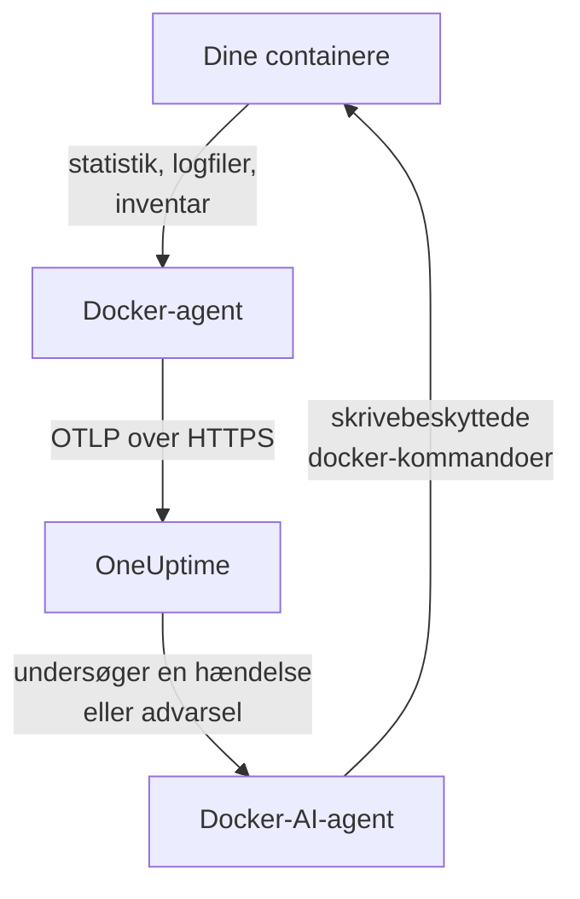

# Docker-agent

OneUptime Docker-agenten er én container, du kører på en Docker-vært. Den læser statistik og logfiler for hver container på værten og sender dem til OneUptime, hvor værten vises med sine containere, metrikker og logs. En anden container, Docker-AI-agenten, lader OneUptime AI undersøge værten. [Docker-monitorer](/docs/monitor/docker-monitor) advarer ud fra det, agenten sender.

:::cards
- [Installer agenten](#installer-agenten): To containere, med `docker run` eller Docker Compose.
- [Hvad agenten indsamler](#hvad-agenten-indsamler): Metrikker, logs og et inventar over hver container.
- [Containerlogs kræver json-file](#containerlogs-kræver-logdriveren-json-file): Kontrollér og skift en containers logdriver.
- [Fejlfinding](#fejlfinding): Genstartsløkker, manglende metrikker, manglende logs.
:::

## Sådan virker det

Agenten er en OpenTelemetry Collector med OneUptimes konfiguration indbygget. Gennem Docker-socketen læser den hver containers statistik hvert 30. sekund og lister hver container, hvert image, hvert netværk og hver volumen hvert 5. minut. Den følger containernes logfiler og sender alt til din OneUptime-URL over OTLP med den indtagelsesnøgle, du giver den.



Værten registrerer sig med sine første data under det navn, du giver den i `DOCKER_HOST_NAME`. AI-agenten er valgfri: udelad den, og collectoren virker på samme måde.

## Før du begynder

- Docker Engine 20.10 eller nyere og root-adgang på værten: agenten læser `/var/run/docker.sock`.
- Docker Compose v2 (kommandoen `docker compose`), hvis du installerer med Docker Compose.
- En indtagelsesnøgle. Opret en under **Projektindstillinger → Telemetri og APM → Indtagelsesnøgler**, og kopiér dens værdi.
- Udgående HTTPS fra værten til din OneUptime-URL.
- Til containerlogs: containere, der bruger Dockers logdriver `json-file`, som er Dockers standard. Se [Containerlogs kræver logdriveren json-file](#containerlogs-kræver-logdriveren-json-file).

## Installer agenten

:::steps
### Start agenten

Erstat `YOUR_ONEUPTIME_URL` med din OneUptime-URL, `YOUR_TELEMETRY_INGESTION_TOKEN` med indtagelsesnøglen og `my-docker-host` med et navn til denne vært, såsom `prod-docker-01`. Navnet er det, værten vises som i OneUptime, så hold det stabilt: et nyt navn registrerer en ny vært.

:::tabs
@tab Docker CLI
```bash
docker run -d \
  --name oneuptime-docker-agent \
  --user 0:0 \
  --restart unless-stopped \
  -v /var/run/docker.sock:/var/run/docker.sock:ro \
  -v /var/lib/docker/containers:/var/lib/docker/containers:ro \
  -e ONEUPTIME_URL="YOUR_ONEUPTIME_URL" \
  -e ONEUPTIME_SERVICE_TOKEN="YOUR_TELEMETRY_INGESTION_TOKEN" \
  -e DOCKER_HOST_NAME="my-docker-host" \
  oneuptime/docker-agent:release
```

Start derefter [AI-agenten](#ai-agent) ved siden af den, med de samme værdier. **AI-undersøgelser er slået til som standard**: mens OneUptime AI undersøger en hændelse eller advarsel på denne vært, kører den skrivebeskyttede `docker`-kommandoer gennem AI-agenten, og den ændrer intet, medmindre du tillader rettelser. For at installere uden AI-undersøgelser skal du springe denne kommando over.

```bash
docker run -d \
  --name oneuptime-docker-ai-agent \
  --user 0:0 \
  --restart unless-stopped \
  --read-only --tmpfs /tmp \
  -v /var/run/docker.sock:/var/run/docker.sock:ro \
  -e ONEUPTIME_URL="YOUR_ONEUPTIME_URL" \
  -e ONEUPTIME_SERVICE_TOKEN="YOUR_TELEMETRY_INGESTION_TOKEN" \
  -e ONEUPTIME_AI_AGENT_RESOURCE_TYPE=docker \
  -e DOCKER_HOST_NAME="my-docker-host" \
  oneuptime/resource-ai-agent:release
```
@tab Docker Compose
Gem dette som `docker-compose.yml` i en mappe på værten. Den anden tjeneste er [AI-agenten](#ai-agent): udelad den for at køre collectoren uden AI-undersøgelser.

```yaml title="docker-compose.yml"
services:
  oneuptime-docker-agent:
    image: oneuptime/docker-agent:release
    container_name: oneuptime-docker-agent
    user: "0:0"
    restart: unless-stopped
    volumes:
      - /var/run/docker.sock:/var/run/docker.sock:ro
      - /var/lib/docker/containers:/var/lib/docker/containers:ro
    environment:
      - ONEUPTIME_URL=YOUR_ONEUPTIME_URL
      - ONEUPTIME_SERVICE_TOKEN=YOUR_TELEMETRY_INGESTION_TOKEN
      - DOCKER_HOST_NAME=my-docker-host
    logging:
      driver: json-file
      options:
        max-size: "10m"
        max-file: "3"
  oneuptime-docker-ai-agent:
    image: oneuptime/resource-ai-agent:release
    container_name: oneuptime-docker-ai-agent
    user: "0:0"
    restart: unless-stopped
    read_only: true
    tmpfs:
      - /tmp
    volumes:
      - /var/run/docker.sock:/var/run/docker.sock:ro
    environment:
      - ONEUPTIME_URL=YOUR_ONEUPTIME_URL
      - ONEUPTIME_SERVICE_TOKEN=YOUR_TELEMETRY_INGESTION_TOKEN
      - ONEUPTIME_AI_AGENT_RESOURCE_TYPE=docker
      - DOCKER_HOST_NAME=my-docker-host
```

Start den i den mappe:

```bash
docker compose up -d
```
:::

### Kontrollér, at agenten kører

```bash
docker ps --filter name=oneuptime-docker-agent
docker logs -f oneuptime-docker-agent
```

Logs bør vise denne linje, når collectoren er startet:

```text
Everything is ready. Begin running and processing data.
```

### Find værten i OneUptime

Åbn **Produkter → Infrastruktur → Docker → Alle værter**. Værten vises under sit `DOCKER_HOST_NAME` inden for et minuts tid, med sine containere, metrikker og logs. AI-agenten vises som forbundet på værtens side **AI-agent** og nederst på dens **Oversigt**.
:::

## Miljøvariabler

| Variabel | Påkrævet | Beskrivelse |
| --- | --- | --- |
| `ONEUPTIME_URL` | Ja | Din OneUptime-URL, såsom `https://oneuptime.com` eller din selvhostede instans. Brug `http://` og dens port, hvis instansen kun bruger HTTP. |
| `ONEUPTIME_SERVICE_TOKEN` | Ja | Indtagelsesnøglen fra **Projektindstillinger → Telemetri og APM → Indtagelsesnøgler**. |
| `DOCKER_HOST_NAME` | Nej | Værtens navn i OneUptime. Standard er `docker-host`, så giv hver vært sit eget. |
| `DOCKER_API_VERSION` | Nej | Den Docker Engine API-version, agenten taler. Standard er `1.44`. Sænk den på en ældre daemon, eller sæt den til en tom værdi for at forhandle den med daemonen (se [Fejlfinding](#fejlfinding)). |

For at ændre en værdi skal du fjerne agenten og køre dens kommando igen (Docker CLI) eller redigere `docker-compose.yml` og køre `docker compose up -d` (Docker Compose).

## Hvad agenten indsamler

| Data | Hvad det er |
| --- | --- |
| Containermetrikker | CPU (forbrug, procent, throttling), hukommelse (forbrug, limit, procent), netværks- og blok-I/O, oppetid, genstarter og antal processer, pr. container, hvert 30. sekund. |
| Containerlogs | stdout og stderr fra hver container, fra dens `json-file`-logfil. |
| Inventar | Hver container i enhver tilstand samt hvert image, netværk og volumen, hvert 5. minut. |

Hver containers metrikker og logs arkiveres under en tjeneste opkaldt efter containeren. Hver loglinje får en alvorlighed ud fra det niveau, den nævner, såsom `[ERROR]`, `level=warn` eller `{"level":"info"}`; en linje, der ikke nævner noget, får sin strøms: stderr er `ERROR`, stdout er `INFO`. Linjer, der starter med mellemrum eller en lukkende parentes, sættes sammen med linjen før, så en stack trace ankommer som én post. Agentens egne logs udelades.

[Docker-monitor](/docs/monitor/docker-monitor#indsamlede-metrikker) viser hver metrik, og hvad den betyder.

## Containerlogs kræver logdriveren json-file

Agenten følger `/var/lib/docker/containers/*/*-json.log`, de filer, Dockers logdriver `json-file` skriver. En container, der bruger en anden driver, efterlader ingen fil at læse: `local` skriver binære filer, og `journald`, `syslog`, `fluentd` og `gelf` sender logs andre steder hen. Dens metrikker ankommer stadig; dens logs gør ikke.

Kontrollér en containers logdriver og daemonens standard:

```bash
docker inspect <container> --format '{{.HostConfig.LogConfig.Type}}'
docker info --format '{{.LoggingDriver}}'
```

Skift en Compose-tjeneste til `json-file` med rotation:

```yaml
services:
  my-app:
    image: my-app:latest
    logging:
      driver: "json-file"
      options:
        max-size: "100m"
        max-file: "5"
```

Eller gør den til standard for hver container, der oprettes bagefter, i `/etc/docker/daemon.json`:

```json title="/etc/docker/daemon.json"
{
  "log-driver": "json-file",
  "log-opts": {
    "max-size": "100m",
    "max-file": "5"
  }
}
```

Genstart derefter Docker, og genopret containerne. En container beholder den logdriver, den blev oprettet med, så det er ikke nok at genstarte den.

## Opgradering af agenten

Når agenten er ældre end din OneUptime, vises et advarselstegn ved siden af **Agentversion** på værtens **Oversigt**. Vælg det for at se disse kommandoer.

:::tabs
@tab Docker CLI
```bash
docker pull oneuptime/docker-agent:release
docker pull oneuptime/resource-ai-agent:release
docker rm -f oneuptime-docker-agent oneuptime-docker-ai-agent
```

Kør derefter begge `docker run`-kommandoer fra [Start agenten](#start-agenten) igen.
@tab Docker Compose
```bash
docker compose pull
docker compose up -d
```
:::

Tagget `release` peger altid på den nyeste udgivelse. For at fastlåse en version skal du bruge `oneuptime/docker-agent:<version>`, såsom `oneuptime/docker-agent:10.0.31`. Det samme image findes på GitHub Container Registry som `ghcr.io/oneuptime/docker-agent:release`.

## Afinstallation af agenten

:::tabs
@tab Docker CLI
```bash
docker rm -f oneuptime-docker-agent
docker rm -f oneuptime-docker-ai-agent
```
@tab Docker Compose
```bash
docker compose down
```
:::

Værten bliver i OneUptime med de data, den har sendt. Hvis du ikke længere har brug for den, så slet den med **Slet vært** i dens menu.

## AI-agent

Kommandoerne og Compose-filen ovenfor, Docker-agentens `install.sh` og `docker-compose.yml` i dens [DockerAgent-mappe](https://github.com/OneUptime/oneuptime/tree/master/agents/DockerAgent) kører alle **Docker-AI-agenten**: en anden container, `oneuptime-docker-ai-agent` (image `oneuptime/resource-ai-agent:release`), der kører de skrivebeskyttede `docker`-kommandoer, som OneUptime AI beder om, mens den undersøger en hændelse eller advarsel på denne vært — `docker ps -a`, `docker logs --tail 200 web`, `docker container inspect web`, `docker stats --no-stream` — og, kun hvis du tillader det, anvender rettelser såsom at genstarte en navngiven container. Den læser de samme `ONEUPTIME_URL`, `ONEUPTIME_SERVICE_TOKEN` og `DOCKER_HOST_NAME` som collectoren, så den betjener netop denne vært, og den vises på værtens side **AI-agent** i OneUptime.

- **AI-undersøgelser er slået til som standard.** Så snart agenten forbinder, undersøger OneUptime AI hændelser og advarsler på denne vært med den, og værtens **Oversigt** viser agentens status. For at stoppe skal du sætte `ONEUPTIME_AI_INVESTIGATION=false`, hvor agenten kører (**Skift** under **Hvad AI må gøre** på AI-agentens side viser hvordan), eller udelade agenten.
- Den er skrivebeskyttet, medmindre du starter den med `ONEUPTIME_AI_ALLOW_WRITES=true`; `ONEUPTIME_AI_WRITE_TARGETS` (for eksempel `web-*,api-*`) begrænser, hvilke containere en rettelse må røre. Start den også med `ONEUPTIME_AI_FIXES` for at angive, hvordan rettelser kører — `ask-for-approval` (en person godkender hver enkelt), `automatic` eller `bypass-approval` — og AI-agentens side viser det skrivebeskyttet ([Hvad AI må gøre, sat af agenten](/docs/ai/infrastructure-ai-agents#what-ai-may-do-set-by-the-agent)).
- Den kører som root med Docker-socketen monteret, fordi socketen ejes af root — og den, der kan bruge socketen, er root på denne vært, `:ro` eller ej. Agentens kommandopolitik er grænsen: den kører aldrig `exec`, `run`, `rm` eller `prune`, og den ændrer aldrig sig selv, collectoren eller noget i `ONEUPTIME_AI_PROTECTED_TARGETS` (globs for containernavne). Miljøværdier i output fra `docker inspect` maskeres, før noget forlader værten.
- `install.sh --no-ai-agent` udelader den; `docker rm -f oneuptime-docker-ai-agent` fjerner den. Opgrader den som collectoren: `docker pull oneuptime/resource-ai-agent:release`, fjern den, og start den igen.

Hvad den må køre, hvordan rettelser virker, og hvordan du fejlsøger den: [Infrastructure AI Agents](/docs/ai/infrastructure-ai-agents#docker-and-podman-hosts).

## Fejlfinding

:::details Agenten genstarter med "client version is too new"
Agentens logs viser:

```text
Error: cannot start pipelines: failed to start "docker_stats" receiver:
Error response from daemon: client version 1.44 is too new.
Maximum supported API version is 1.41
```

En daemon afviser en klient, der er nyere end dens eget maksimum, så receiveren starter aldrig, og collectoren afslutter med den. Find daemonens maksimum:

```bash
docker version --format '{{ .Server.APIVersion }}'
```

Tilføj derefter `-e DOCKER_API_VERSION=1.41` (eller den værdi, du fik) til `docker run`, eller sæt `DOCKER_API_VERSION` i Compose. Nyere daemoner betjener stadig ældre API-versioner, så indstillingen forbliver gyldig efter en opgradering.

Vil du hellere ikke slå tallet op? Sæt `DOCKER_API_VERSION` til den tomme streng. Agenten forhandler så versionen med daemonen (ét `HEAD /_ping`, derefter daemonens eget maksimum), hvilket virker mod både gamle og nye daemoner:

```bash
docker run -d ... -e DOCKER_API_VERSION= ...
```
:::

:::details Adgang nægtet til Docker-socket
Agenten skal køre som root for at læse `/var/run/docker.sock`. Kontrollér, at `--user 0:0` er i din `docker run`-kommando, eller `user: "0:0"` i Compose.
:::

:::details Værten vises som afbrudt
1. Kontrollér, at agenten kører: `docker ps --filter name=oneuptime-docker-agent`
2. Kig efter fejl i dens logs: `docker logs oneuptime-docker-agent 2>&1 | grep -i error`
3. Kontrollér `ONEUPTIME_URL` og `ONEUPTIME_SERVICE_TOKEN`: nøglen skal være en gyldig indtagelsesnøgle, som ikke er deaktiveret.
4. Kontrollér, at værten kan nå din OneUptime-URL over netværket.
:::

:::details Der vises ingen metrikker
1. Kontrollér, at Docker-socketen er monteret i agenten. Dens image har ingen shell, så kig fra en midlertidig container, der deler dens monteringer: `docker run --rm --volumes-from oneuptime-docker-agent alpine:3.19 ls -la /var/run/docker.sock`
2. Kig efter eksportfejl i dens logs: `docker logs oneuptime-docker-agent 2>&1 | tail -100`
3. Kontrollér, at indtagelsesnøglen er gyldig og ikke er udløbet.
:::

:::details Metrikker ankommer, men ingen containerlogs
Dine containere bruger højst sandsynligt en anden logdriver end `json-file`. Kontrollér, hvilke filer agenten overvåger, og hvilken driver en container bruger:

```bash
docker logs oneuptime-docker-agent 2>&1 | grep -E "Started watching file|no files match"
docker inspect <container> --format '{{.HostConfig.LogConfig.Type}}'
```

Hvis agenten rapporterer `no files match the configured criteria`, så skift containerne til `json-file`, og genopret dem, som [Containerlogs kræver logdriveren json-file](#containerlogs-kræver-logdriveren-json-file) viser.
:::

:::details Logs ligger på en anden vært, eller værten hedder docker-host
Værtens navn kommer fra `DOCKER_HOST_NAME`. En agent, der startes uden det, rapporterer `docker-host`, så hver vært, der er sat op på den måde, ligner den samme; skifter du navnet senere, registrerer OneUptime en anden vært, som så indeholder de nye data. Sæt `DOCKER_HOST_NAME` til et navn for sig på hver vært, og genopret agenten. For at kontrollere det navn, agenten rapporterer:

```bash
docker inspect oneuptime-docker-agent --format '{{range .Config.Env}}{{println .}}{{end}}' | grep DOCKER_HOST_NAME
```
:::

## Næste trin

:::cards
- [Docker-monitor](/docs/monitor/docker-monitor): Advar ved containeres CPU, hukommelse og genstarter.
- [Databaser](/docs/telemetry/databases): Databasecontainere på værten findes og får deres egne sider.
- [Kubernetes-agent](/docs/telemetry/kubernetes-agent): Overvåg i stedet en Kubernetes-klynge.
- [OpenTelemetry-collector på værten](/docs/telemetry/host-otel-collector): Overvåg selve maskinen: CPU, diske, processer og logs.
:::
