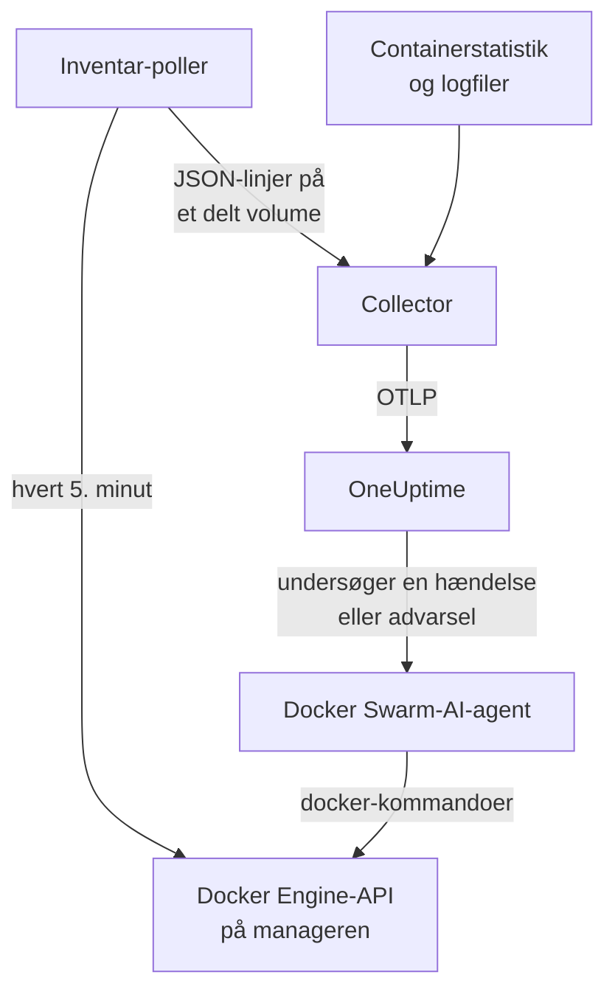

# Docker Swarm-agent

OneUptimes Docker Swarm-agent overvåger en Docker Swarm-klynge: dens noder, services, opgaver, stacks, overlay-netværk, secrets, configs og volumes samt hver containers metrikker og logs. Du kører den med Docker Compose på en manager-node i swarmen, og klyngen vises i OneUptime med det hele. [Docker Swarm-monitorer](/docs/monitor/docker-swarm-monitor) advarer ud fra det, der ankommer.

:::cards
- [Installér agenten](#installer-agenten): Installationsscriptet eller Docker Compose på en manager-node.
- [Hvad agenten indsamler](#hvad-agenten-indsamler): Inventaret, klyngens tællinger samt containermetrikker og -logs.
- [AI-agent](#ai-agent): Lad OneUptime AI læse swarmen, mens den undersøger.
- [Fejlfinding](#fejlfinding): Et diagnosescript og de sædvanlige problemer.
:::

## Sådan virker det

Agenten består af tre containere, alle defineret i én `docker-compose.yml`:

1. **Collector**: en OpenTelemetry Collector, der læser `docker_stats` for hver containers metrikker, følger containernes logfiler og følger filen med inventar-snapshottet. Den stempler alt med din klynges navn (`docker.swarm.cluster.name`) og sender det til OneUptime over OTLP.
2. **Inventar-poller**: en lille sidecar med `curl` og `jq`, der hvert 5. minut gennemgår swarm-managerens API (`/nodes`, `/services`, `/tasks`, `/networks`, `/secrets`, `/configs`, `/volumes`) og udleder stackene fra service-labelet `com.docker.stack.namespace`. Den skriver én JSON-linje pr. objekt, som collectoren videresender.
3. **AI-agent**: `oneuptime-docker-swarm-ai-agent`, der kører de `docker`-kommandoer, som OneUptime AI beder om, mens den undersøger en hændelse eller advarsel på denne klynge. Den er skrivebeskyttet, medmindre du tillader rettelser (se [AI-agent](#ai-agent)).



Klyngen registrerer sig med sine første data under det klyngenavn, du konfigurerer.

## Før du begynder

- En swarm-**manager**-node at køre agenten på: inventar-polleren og AI-agenten kalder API-endpoints, som kun managere svarer på.
- Docker Engine 20.10 eller nyere med Docker Compose v2-pluginet.
- En indtagelsesnøgle. Opret en under **Projektindstillinger → Telemetri og APM → Indtagelsesnøgler**, og kopiér dens værdi.
- Udgående HTTPS fra noden til din OneUptime-URL.

### Hvor agenten skal køre

Kør den på en manager-node. Collectoren rapporterer containerne på den node, den kører på, så for alle noders containermetrikker skal du køre collectoren på hver node, alle med det samme `DOCKER_SWARM_CLUSTER_NAME`; inventar-polleren og AI-agenten behøver kun at køre på én manager. `install.sh` udelader AI-agenten på en node, der ikke er manager (og fjerner en, den tidligere har installeret der). En AI-agent, der alligevel startes på en worker, registrerer sig aldrig for klyngen: den venter, til dens node er manager, så den kan ikke fortrænge managerens AI-agent. Udruller du agenten som en swarm-stack i stedet for med Compose? Hold inventar-polleren og AI-agenten på managere med begrænsningen `node.role == manager`.

## Installer agenten

:::steps
### Installer og start agenten

:::tabs
@tab install.sh
Hent installationsscriptet, og kør det på en manager-node:

```bash
curl -sSL https://raw.githubusercontent.com/OneUptime/oneuptime/master/agents/DockerSwarmAgent/install.sh -o install.sh
sh install.sh
```

Scriptet spørger efter din OneUptime-URL, indtagelsesnøglen og et navn til klyngen. Det installerer i `/opt/oneuptime-docker-swarm-agent`, skriver en `.env`-fil, som kun dens ejer kan læse, og starter alle tre containere. Tilføj `--no-ai-agent` for at udelade AI-agenten.
@tab Docker Compose
Hent `docker-compose.yml`, `otel-collector-config.yaml` og `inventory-snapshot.sh` fra [DockerSwarmAgent-mappen](https://github.com/OneUptime/oneuptime/tree/master/agents/DockerSwarmAgent) ind i en ny mappe på en manager-node:

```bash
curl -fsSL https://raw.githubusercontent.com/OneUptime/oneuptime/master/agents/DockerSwarmAgent/docker-compose.yml -o docker-compose.yml
curl -fsSL https://raw.githubusercontent.com/OneUptime/oneuptime/master/agents/DockerSwarmAgent/otel-collector-config.yaml -o otel-collector-config.yaml
curl -fsSL https://raw.githubusercontent.com/OneUptime/oneuptime/master/agents/DockerSwarmAgent/inventory-snapshot.sh -o inventory-snapshot.sh
chmod +x inventory-snapshot.sh
```

Opret en `.env`-fil ved siden af dem. Den indeholder indtagelsesnøglen, så hold den privat med `chmod 600 .env`:

```bash title=".env"
ONEUPTIME_URL=https://oneuptime.com
ONEUPTIME_SERVICE_TOKEN=your-telemetry-ingestion-key
DOCKER_SWARM_CLUSTER_NAME=my-swarm
```

Start agenten:

```bash
docker compose up -d
```
:::

### Kontrollér, at agenten kører

```bash
docker compose ps
docker compose logs --tail 50 oneuptime-docker-swarm-agent oneuptime-docker-swarm-inventory
```

`docker compose ps` viser tre containere: collectoren (`oneuptime-docker-swarm-agent`), inventar-polleren (`oneuptime-docker-swarm-inventory`) og AI-agenten (`oneuptime-docker-swarm-ai-agent`).

### Find klyngen i OneUptime

Åbn **Produkter → Infrastruktur → Docker Swarm → Alle klynger**. Klyngen vises inden for få minutter, og dens sider **Noder**, **Tjenester**, **Opgaver**, **Stacks**, **Netværk**, **Hemmeligheder**, **Configs** og **Diskenheder** fyldes ud efter det første inventar-snapshot, inden for 5 minutter.
:::

## Miljøvariabler

Installationsscriptet skriver de første tre til `/opt/oneuptime-docker-swarm-agent/.env`; en Docker Compose-installation læser dem fra `.env` ved siden af `docker-compose.yml`. Tilføj eller ændr en hvilken som helst af dem der, og kør derefter `docker compose up -d` i den mappe.

| Variabel | Påkrævet | Beskrivelse |
| --- | --- | --- |
| `ONEUPTIME_URL` | Ja | Din OneUptime-URL, såsom `https://oneuptime.com` eller din selvhostede instans. Brug `http://` og dens port, hvis instansen kun bruger HTTP. |
| `ONEUPTIME_SERVICE_TOKEN` | Ja | Indtagelsesnøglen fra **Projektindstillinger → Telemetri og APM → Indtagelsesnøgler**. |
| `DOCKER_SWARM_CLUSTER_NAME` | Ja | Klyngens navn i OneUptime og den nøgle, som hver nodes data samles under: stemplet på alt som ressourceattributten `docker.swarm.cluster.name`. Hold det stabilt: at ændre det senere registrerer en anden klynge. Standard er `docker-swarm`. |
| `DOCKER_INVENTORY_INTERVAL_SECONDS` | Nej | Hvor ofte inventar-polleren tager et snapshot, i sekunder. Standard er `300`. |
| `DOCKER_API_VERSION` | Nej | Den Docker Engine-API-version, som collectoren og inventar-polleren taler. Standard er `1.44`; tom forhandler den med daemonen (se [Fejlfinding](#fejlfinding)). AI-agenten forhandler den, medmindre du angiver en. |

AI-agentens egne indstillinger findes under [AI-agent](#ai-agent).

## Hvad agenten indsamler

| Signal | Kilde | Hvor det vises |
| --- | --- | --- |
| Noder, services, opgaver, stacks, netværk, secrets, configs og volumes | Inventar-polleren, fra swarm-managerens API | Klyngens lister og detaljesider |
| Klyngetællinger (klare noder, kørende opgaver, services, stacks, …) | Det samme snapshot | Oversigtens kort og sidemenuens badges |
| Containerens CPU, hukommelse, antal processer og oppetid | Receiveren `docker_stats` | Siden **Metrikker** |
| Containerens stdout- og stderr-logs | Receiveren `filelog` | Siden **Protokoller** |

### Sådan adskiller den sig fra Docker-agenten

[Docker-agenten](/docs/telemetry/docker-host) modellerer én vært og stempler `host.name` og `container.runtime=docker`. Docker Swarm-agenten stempler med vilje kun `docker.swarm.cluster.name`: OneUptime arkiverer så dataene under swarm-klyngen i stedet for at registrere hver node som sin egen vært.

## Mærk klyngen med projektetiketter

En ressourceattribut, der starter med `oneuptime.label.`, bliver en projektetiket på klyngen: `oneuptime.label.<dimension>=<value>` er etiketten `<dimension>:<value>`. Tilføj attributterne til processoren `resource` i `otel-collector-config.yaml`, ved siden af `docker.swarm.cluster.name`:

```yaml
processors:
  resource:
    attributes:
      # ...existing attributes...
      - key: oneuptime.label.team
        value: platform
        action: upsert
      - key: oneuptime.label.env
        value: production
        action: upsert
```

Collectoren læser kun sin konfiguration, når den starter: Kør `docker compose restart oneuptime-docker-swarm-agent`. Klyngen viser derefter etiketterne `team:platform` og `env:production`. Etiketter sammenlignes uden hensyn til store og små bogstaver, så en eksisterende etiket `Production` genbruges i stedet for at blive dubleret, og agenten fjerner aldrig en etiket, som nogen har tilføjet i OneUptime.

## Kør som en systemd-tjeneste

For at starte agenten sammen med noden og genstarte den, når den fejler, skal du installere dens systemd-enhed. Den antager, at agenten bor i `/opt/oneuptime-docker-swarm-agent`, hvor installationsscriptet lægger den:

```bash
sudo curl -fsSL https://raw.githubusercontent.com/OneUptime/oneuptime/master/agents/DockerSwarmAgent/systemd/oneuptime-docker-swarm-agent.service -o /etc/systemd/system/oneuptime-docker-swarm-agent.service
sudo systemctl daemon-reload
sudo systemctl enable --now oneuptime-docker-swarm-agent
```

## Opgradering af agenten

Agenten rapporterer den collector-version, den kører. Når den er ældre end den version, denne OneUptime-udgivelse fastlåser, vises et advarselstegn ved siden af agentens version på klyngens side **Oversigt**. Vælg det for at se disse kommandoer.

Kør installationsscriptet igen på manager-noden, og besvar dets spørgsmål med samme URL, nøgle og klyngenavn. Det henter de nyeste filer, henter imagene og genstarter agenten:

```bash
curl -sSL https://raw.githubusercontent.com/OneUptime/oneuptime/master/agents/DockerSwarmAgent/install.sh -o install.sh
sh install.sh
```

Scriptet skriver `.env` igen ud fra dine svar. Det bevarer kun AI-agentens mållister og det, AI må gøre (`ONEUPTIME_AI_INVESTIGATION`, `ONEUPTIME_AI_FIXES`): Tilføj igen enhver variabel, du selv har sat, fx `DOCKER_API_VERSION`. Har du slået AI-rettelser til? Kør det som `ONEUPTIME_AI_ALLOW_WRITES=true sh install.sh` for at beholde dem slået til. Har du udeladt AI-agenten? Angiv `--no-ai-agent` igen.

Med Docker Compose skal du hente de tre filer igen i agentens mappe (og derefter foretage igen eventuelle ændringer, du lavede i `docker-compose.yml`), og så hente og genstarte:

```bash
docker compose pull
docker compose up -d
```

Collector-versionen er fastlåst i filerne, så et pull alene flytter ikke agenten frem.

## Afinstallation af agenten

```bash
cd /opt/oneuptime-docker-swarm-agent
docker compose down
```

## AI-agent

Swarmens `docker-compose.yml` (og `install.sh`) kører også **Docker Swarm-AI-agenten**: en tredje container, `oneuptime-docker-swarm-ai-agent` (image `oneuptime/resource-ai-agent:release`), der kører de skrivebeskyttede `docker`-kommandoer, som OneUptime AI beder om, mens den undersøger en hændelse eller advarsel på denne klynge — `docker node ls`, `docker service ps web --no-trunc`, `docker service logs --tail 200 web` — og, kun hvis du tillader det, anvender rettelser som en rullende genstart af en navngiven service. Den læser de samme `ONEUPTIME_URL`, `ONEUPTIME_SERVICE_TOKEN` og `DOCKER_SWARM_CLUSTER_NAME` som collectoren, så den betjener netop denne klynge, og den vises på klyngens side **AI → AI-agent** i OneUptime.

- **AI-undersøgelser er slået til som standard.** Så snart agenten forbinder, undersøger OneUptime AI hændelser og advarsler på denne klynge med den, og klyngens **Oversigt** viser agentens status. For at stoppe skal du sætte `ONEUPTIME_AI_INVESTIGATION=false`, hvor agenten kører (**Skift** under **Hvad AI må gøre** på AI-agentens side viser hvordan), eller udelade agenten.
- Ligesom inventar-polleren **skal den køre på en manager-node**: Kommandoer for noder, services og opgaver findes kun på managere. På en worker kører den intet og registrerer sig ikke for klyngen, før noden er manager (dens `/status` siger hvorfor). Kør én pr. klynge.
- Den er **skrivebeskyttet**, medmindre du sætter `ONEUPTIME_AI_ALLOW_WRITES=true` i `.env` og kører `docker compose up -d` (eller kører `install.sh` med den; installationsprogrammet skriver `ONEUPTIME_AI_ALLOW_WRITES`, `ONEUPTIME_AI_INVESTIGATION`, `ONEUPTIME_AI_FIXES`, `ONEUPTIME_AI_WRITE_TARGETS` og `ONEUPTIME_AI_PROTECTED_TARGETS` fra sit miljø til `.env`, og en ny kørsel bevarer, hvad `.env` allerede har for de sidste fire, medmindre du angiver den variabel, selv tom); `ONEUPTIME_AI_WRITE_TARGETS` (globs for service- og nodenavne, for eksempel `web_*,api_*`) begrænser, hvad en rettelse må røre. `ONEUPTIME_AI_FIXES` i samme `.env` angiver, hvordan rettelser kører — `ask-for-approval` (en person godkender hver enkelt), `automatic` eller `bypass-approval` — og AI-agentens side viser det skrivebeskyttet ([Hvad AI må gøre, fastsat af agenten](/docs/ai/infrastructure-ai-agents#what-ai-may-do-set-by-the-agent)). At dræne en node kræver altid en persons godkendelse, uanset tilstand.
- Den kører som root med Docker-socketen monteret, fordi socketen ejes af root — og på en manager kontrollerer den, der kan bruge socketen, hele swarmen, `:ro` eller ej. Agentens kommandopolitik er grænsen: Den opretter eller fjerner aldrig services eller stacks, rører aldrig secrets eller configs og ændrer aldrig sig selv, collectoren, inventar-polleren eller noget i `ONEUPTIME_AI_PROTECTED_TARGETS` (globs for service- og nodenavne).
- `install.sh --no-ai-agent` udelader den; du kan også slette tjenesten `oneuptime-docker-swarm-ai-agent` fra `docker-compose.yml`.

Hvad den må køre, hvordan rettelser virker, og hvordan du fejlsøger den: [Infrastructure AI Agents](/docs/ai/infrastructure-ai-agents#docker-swarm-clusters).

## Fejlfinding

:::details Kør diagnosescriptet først
Agenten leveres med et script, [`troubleshoot.sh`](https://github.com/OneUptime/oneuptime/blob/master/agents/DockerSwarmAgent/troubleshoot.sh), der kontrollerer hele kæden: containerne, at inventar-polleren kører på en manager (`docker node ls`), snapshot-filen, klyngenavnet stemplet på alt, tokenets form, collectorens egne metrikker, og om OneUptime accepterer indtagelsesnøglen. Den sidste kontrol betyder mest. OneUptime afviser en forkert nøgle med `401` (`422` for en deaktiveret nøgle eller en browsernøgle), og collectoren logger det som én `Exporting failed`-linje pr. batch, som er let at overse. Scriptet spørger `GET <url>/otlp/v1/validate` efter et direkte `200` (gyldig) eller `401` (ugyldig). Kør det på manager-noden:

```bash
curl -sSL https://raw.githubusercontent.com/OneUptime/oneuptime/master/agents/DockerSwarmAgent/troubleshoot.sh -o troubleshoot.sh
bash troubleshoot.sh    # add -d <dir> if you installed outside /opt/oneuptime-docker-swarm-agent
```
:::

:::details Klyngen vises aldrig
Kør diagnosescriptet først. Ellers skal du læse collectorens logs (`docker compose logs oneuptime-docker-swarm-agent`), kontrollere, at `ONEUPTIME_SERVICE_TOKEN` og `ONEUPTIME_URL` i `.env` er korrekte, og at noden kan nå din OneUptime-URL.
:::

:::details Der vises intet inventar
Kontrollér, at inventar-polleren kører på en manager: `docker node ls` skal lykkes der. Kig derefter efter linjer med `failed to emit ...` i dens logs: `docker compose logs oneuptime-docker-swarm-inventory`.
:::

:::details Klyngen skifter til afbrudt
En klynge bliver afbrudt, når OneUptime ikke har modtaget noget fra den i 15 minutter; OneUptime tjekker hvert 5. minut, og tid, hvor OneUptime selv ikke modtog data, tæller ikke med. Sørg for, at collector-containeren bliver ved med at køre: `docker compose ps` viser den.
:::

:::details Collectoren afslutter med "client version is too new"
Collectorens logs viser:

```text
Error: cannot start pipelines: failed to start "docker_stats" receiver:
Error response from daemon: client version 1.44 is too new.
Maximum supported API version is 1.41
```

Daemonens højeste API-version ligger under standarden `1.44` (Docker Engine 20.10 stopper ved `1.41`), så receiveren `docker_stats` kan ikke starte, og containeren genstarter i en løkke. Find daemonens højeste version:

```bash
docker version --format '{{ .Server.APIVersion }}'
```

Sæt `DOCKER_API_VERSION` til den værdi i `.env`, og kør `docker compose up -d` på hver node, agenten kører på. Nyere daemons understøtter stadig ældre API-versioner, så indstillingen bliver ved med at virke, efter du har opgraderet Docker. Eller sæt `DOCKER_API_VERSION=` (tom), så collectoren forhandler versionen med daemonen i stedet for at fastlåse en.
:::

:::details Klyngen vises under det forkerte navn
Klyngens navn kommer fra `DOCKER_SWARM_CLUSTER_NAME`. Ændr det i `.env`, og kør `docker compose up -d`: Et nyt navn registrerer en ny klynge i stedet for at omdøbe den gamle.
:::

## Næste trin

:::cards
- [Docker Swarm-monitor](/docs/monitor/docker-swarm-monitor): Advar om noder, services, opgaver og containere.
- [Infrastructure AI Agents](/docs/ai/infrastructure-ai-agents): Hvad Docker Swarm-AI-agenten må køre, og hvordan rettelser virker.
- [Docker-agent](/docs/telemetry/docker-host): Overvåg i stedet en enkelt Docker-vært.
:::
