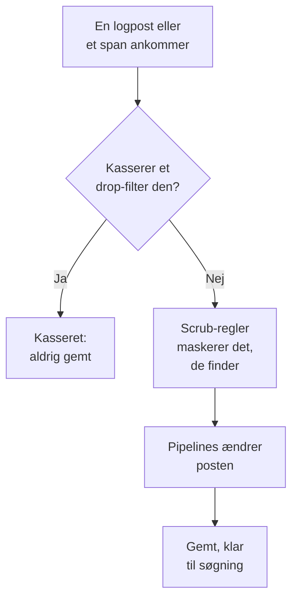

# Drop-filtre og scrub-regler

Drop-filtre og scrub-regler virker på dine protokoller og spans, mens de ankommer, før noget bliver gemt. Et drop-filter smider de poster væk, du aldrig har brug for, eller beholder kun en stikprøve af dem. En scrub-regel maskerer personoplysninger og hemmeligheder, såsom e-mailadresser, kortnumre og adgangskoder, så de aldrig når dit lager.

:::cards
- [Hvor de kører](#hvor-de-kører): Før pipelines, før lagring.
- [Kassér poster, eller tag stikprøver](#kassér-poster-eller-tag-stikprøver): Vælg poster, og kassér dem, eller behold en andel.
- [Rens følsomme data](#rens-følsomme-data): Skjul, maskér eller hash det, et mønster finder.
- [Se, hvad et filter kasserede](#se-hvad-et-filter-kasserede): Tællere på hvert filter.
:::

## Hvor de kører

Protokoller har deres under **Protokoller → Indstillinger**, og spans under **Spor → Indstillinger**. Når en post ankommer, kører OneUptime dem i denne rækkefølge:



- **De virker kun på nye poster.** En regel, du opretter eller ændrer, gælder for poster, der ankommer cirka et minut senere. Poster, der allerede er gemt, ændres ikke.
- **En kasseret post er væk.** Ingen søgning, graf, monitor eller optagelsesregel ser den nogensinde, og der laves ingen undtagelse ud fra den. På OneUptime Cloud bliver den heller ikke faktureret.
- **Hver liste kører i rækkefølge.** Træk rækkerne i en liste for at ændre rækkefølgen. Kun aktiverede filtre og regler kører.

Drop-filtre og scrub-regler for protokoller gælder lige så vel for protokoller fra OpenTelemetry, Syslog, Fluent Bit og Fluentd. [Logpipelines](/docs/telemetry/log-pipelines) forklarer trinnet efter dem.

## Før du begynder

- **Protokoller eller spans, der ankommer.** Se [OpenTelemetry](/docs/telemetry/open-telemetry).
- **En rolle, der ændrer telemetriindstillinger.** Projektejer eller Projektadministrator, eller en brugerdefineret rolle med tilladelsen til det, du ændrer, såsom Create Log Drop Filter eller Create Trace Scrub Rule. Telemetry-rollerne kan se filtre og regler, men ikke ændre dem.

## Kassér poster, eller tag stikprøver

:::steps
### Åbn drop-filtre

Gå til **Protokoller → Indstillinger → Drop-filtre**, eller til **Spor → Indstillinger → Drop-filtre** for spans.

### Vælg posterne

Klik på **Opret Log Drop-filter**, eller på **Opret Spor Drop-filter** for spans. Giv filteret et **Navn** under **Match**, og byg derefter dets **Filterforespørgsel**: et felt, en operator og en værdi for hver betingelse, og om **Alle betingelser** eller **Enhver betingelse** skal matche. Klik på **Næste**.

### Vælg handlingen

Under **Handling** skal du beholde **Kassér** for at smide hver matchende post væk, eller vælge **Stikprøve** og angive den **Stikprøveprocent**, der skal beholdes, fra 1 til 99. Opret derefter filteret.
:::

Filteret begynder at kassere inden for et minut. For at gemme det uden at kassere noget endnu skal du slå **Aktiveret** fra under **Avanceret**, før du opretter det.

> [!WARNING]
> En kasseret post kan ikke hentes tilbage. Hold et filters forespørgsel snæver, og hold øje med dets **Kasseret**-tæller, efter du har oprettet det.

Et filter kan teste disse felter, og enhver attribut med **Custom Attribute...**:

| Poster | Felter |
| --- | --- |
| Protokoller | **Alvorlighed**, **Logindhold**, **Tjeneste-ID** |
| Spans | **Span-navn**, **Span-type**, **Status**, **Statusbesked**, **Tjeneste-ID**, **Har undtagelse**, **Er rod-span** |

| Operator | Matcher |
| --- | --- |
| **er lig med** | Den præcise værdi, med dens store og små bogstaver: `Debug` matcher, `DEBUG` gør ikke. |
| **er ikke lig med** | Alt andet end den præcise værdi. |
| **indeholder** | Værdien hvor som helst i feltet, uanset store og små bogstaver. Et `%` i værdien er et jokertegn. |
| **er en af** | En af en liste af præcise værdier, adskilt af kommaer. |

**Preview query** viser den forespørgsel, betingelserne danner. Denne kasserer et sundhedstjeks debuglinjer:

```text
severityText = 'Debug' AND body LIKE 'healthcheck'
```

Stikprøver afgøres post for post: med en **Stikprøveprocent** på 10 beholdes cirka én ud af ti matchende poster. Filtrene kører i listens rækkefølge, og det første, der kasserer en post, afgør det; en post, som en stikprøve beholder, går videre til det næste filter.

## Rens følsomme data

:::steps
### Åbn scrub-regler

Gå til **Protokoller → Indstillinger → Scrub-regler**, eller til **Spor → Indstillinger → Scrub-regler** for spans.

### Vælg, hvad der skal findes

Klik på **Opret Log Scrub Regel**, eller på **Opret Trace Scrub Regel** for spans, og vælg en **Mønstertype**. Reglen får navn efter den, såsom **Masker e-mailadresser**, indtil du selv skriver et navn. For **Brugerdefineret regex** skal du også angive **Brugerdefineret regex-mønster**.

### Vælg, hvordan der skal renses

Under **Avanceret** skal du vælge **Maskeringshandling** og **Felter, der skal renses**, eller lade dem være, som de er: en ny regel erstatter hvert match med `[REDACTED]`, uanset hvor det står i posten. Opret derefter reglen.
:::

| Mønstertype | Hvad den finder |
| --- | --- |
| **E-mailadresse** | E-mailadresser, såsom `jane@example.com` |
| **Kreditkortnummer** | Seksten cifre i grupper af fire, såsom `4111 1111 1111 1111` |
| **SSN (CPR-nummer)** | Amerikanske personnumre (Social Security), såsom `123-45-6789` |
| **Telefonnummer** | Nordamerikanske telefonnumre, såsom `555-123-4567` |
| **IP-adresse** | Offentlige IPv4- og IPv6-adresser, såsom `203.0.113.7` eller `2001:db8::1`, men ikke private, loopback- eller link-local-adresser |
| **Følsomme attributnøgler** | Hele værdien af enhver attribut, hvis nøgle ser hemmelig ud, såsom `password`, `token`, `api_key`, `authorization` eller `cookie` |
| **Brugerdefineret regex** | Dit eget regulære udtryk, skrevet uden skråstreger eller flag og matchet med forskel på store og små bogstaver |

| Maskeringshandling | Hvad et match bliver til |
| --- | --- |
| **Rediger (skjul)** | `[REDACTED]`, standardvalget |
| **Maske** | For det meste skjult: en e-mailadresse beholder sit første bogstav og slutningen af sit domæne, et kort-, telefon- eller personnummer sine sidste fire cifre, og et brugerdefineret match eller en hemmelig værdi sit første og sidste tegn. En IP-adresse skjules helt. |
| **Hash** | Et token, der er unikt for dit projekt, det samme for den samme værdi hver gang, så gentagelser stadig kan tælles, men ingen kan regne sig tilbage til værdien |

For eksempel gemmer en **E-mailadresse**-regel dette logindhold:

```text
Payment failed for jane@example.com
```

som en af disse, afhængigt af dens **Maskeringshandling**:

```text
Redact: Payment failed for [REDACTED]
Mask:   Payment failed for j***@***.com
Hash:   Payment failed for [HASHED:5e29db14e508e09a]
```

**Felter, der skal renses** er **Begge (brødtekst og attributter)** for en protokolregel, medmindre du vælger **Kun brødtekst** eller **Kun attributter**, og **Alle (navn, attributter og hændelser)** for en span-regel, medmindre du vælger **Kun span-navn**, **Kun attributter** eller **Kun hændelsesattributter**. Attributterne på et spans links renses sammen med spannets egne attributter, og **Alle (navn, attributter og hændelser)** renser også et spans statusbesked og navnene på dets hændelser. En **Følsomme attributnøgler**-regel læser nøgler og renser derfor altid værdierne under dem: i attributter og i en logposts JSON-brødtekst.

- **En regel kan gælde for én tjeneste.** Vælg under **Avanceret** tjenesten i **Kun for én tjeneste**: reglen renser den tjenestes poster, og andre tjenesters forbliver, som de er. Står feltet tomt, renser den alle tjenesters poster. Kolonnen **Omfang** i listen siger hvilken.
- **Formularen siger, hvad en regel ville ændre for andre.** Før du opretter en regel, og når du slår en til, viser OneUptime, hvad der læser de værdier, den ville skjule: monitorer, dashboards, gemte visninger, optagelsesregler og SLO'er, hver som et link, og hvad [Sikkerhedsbegivenheder](/docs/telemetry/security-events) ville miste. En monitor, der filtrerer på en skjult værdi, finder den ikke længere. Reglen gemmes under alle omstændigheder.
- **En IP-adresseregel skjuler de adresser, der er personoplysninger.** Det er offentlige IPv4- og IPv6-adresser, uanset hvordan de er skrevet: forkortet, som `2001:db8::1`, i firkantede parenteser med en port, som `[2001:db8::1]:443`, der beholder sine parenteser og sin port, med en zone, som `2001:db8::2%eth0`, der beholder sin zone, eller en IPv4-adresse skrevet som IPv6, som `::ffff:203.0.113.7`, der skjules helt. Den beholder private, loopback- og link-local-adresser, såsom `10.0.0.12`, `127.0.0.1` og `fe80::1`, og cloudens metadataadresse `169.254.169.254` i en anmodnings URL, hvor [Sikkerhedsbegivenheder](/docs/telemetry/security-events) leder efter forfalskede anmodninger fra serveren. For også at skjule interne adresser skal du tilføje en regel med **Brugerdefineret regex** for dem, såsom `\b(?:\d{1,3}\.){3}\d{1,3}\b` for alle IPv4-adresser.
- **Et hash-token er dit projekts eget.** Det laves med en nøgle, der tilhører dit projekt, afledt af installationens `ENCRYPTION_SECRET`, så den samme værdi har et andet token i et andet projekt, og ingen, der læser et token, kan regne sig tilbage til værdien eller hashe et gæt for at sammenligne. En IP-adresse har ét token, uanset hvordan den er skrevet: `::ffff:203.0.113.7` og `203.0.113.7` deler ét. Poster, der blev gemt, før tokens havde en nøgle, indeholder tokens på 8 tegn, såsom `[HASHED:8c87b489]`, der adskiller sig fra nutidens på 16 tegn: Søg efter begge, indtil de poster når slutningen af deres opbevaring. Hvis du ændrer `ENCRYPTION_SECRET`, ændres alle tokens, og på en selvhostet installation er tokens kun så hemmelige som den.
- **Sikkerhedsbegivenheder kan stadig navngive en hashet IP-adresse.** Når [Sikkerhedsbegivenheder](/docs/telemetry/security-events) læser dine logs eller traces, gemmer en IP-adresseregel, der hasher, også hver adresse, den skjuler, ved siden af dens token, i et lager, som kun Sikkerhedsbegivenheders scanninger læser: Ingen side, søgning, eksport, API eller AI-værktøj kan læse det. Så et angreb fra en adresse, som dine logs kun viser som et token, navngiver stadig adressen, og dens sag siger, hvilken adresse der skal blokeres. Hver adresse gemmes indtil 30 dage efter, at den sidst blev set. En regel, der sletter eller maskerer adressen, gemmer intet, så Sikkerhedsbegivenheder siger da, at en scrub-regel skjulte adressen, som den gør for et token, der er ældre end 30 dage eller lavet, før tokens havde en nøgle.
- **Lister og indlejrede værdier læses også.** En regel læser hver tekst i en liste, en liste af lister eller en nøgle-værdi-liste, såsom værdierne af en HTTP-header, og bevarer værdiens form: tal og sand eller falsk forbliver, som de er. En **Følsomme attributnøgler**-regel læser også nøglerne inde i en værdi, så `password` inde i en nøgle-værdi-liste skjules også. Brødteksten i en logpost, der sendes som et map eller en liste, gemmes som sin JSON-tekst, og en **Følsomme attributnøgler**-regel læser nøglerne i den, som i en brødtekst skrevet som JSON. En mønsterregel bevarer en sådan brødtekst som JSON, og også en attribut skrevet som JSON, såsom et AI-kalds beskeder: Den læser teksten, som dit program skrev den, med en escape-sekvens som `\n` læst som det linjeskift, den står for, og erstatter kun det, den finder, inde i dens tekster og tal.
- **JSON i en streng læses også.** En tekst, der selv er JSON, såsom en attribut `http.request.body`, der indeholder `{"password":"hunter2"}`, eller en Fluentd-posts `log`-linje inde i en logposts brødtekst, læses som JSON, op til 4 niveauer af JSON inden i hinanden, og dybere som tekst. En **Følsomme attributnøgler**-regel skjuler værdierne under de nøgler i den, der ser hemmelige ud, og intet andet: Dens tal, mellemrum og andre tekster forbliver, som dit program skrev dem. En tekst, der kun ligner JSON, såsom `{token}`, efterlades, som den er.
- **En værdi, der er for stor til at blive læst element for element, læses som tekst.** En værdi, der er indlejret mere end 32 niveauer dybt, eller som ville bringe en post over 10.000 værdier inde i dens lister og maps, læses og gemmes som sin JSON-tekst. En mønsterregel renser det, den finder i den tekst, og en **Følsomme attributnøgler**-regel skjuler hele værdien, når et ord som `password` eller `token` optræder i den. I en logposts brødtekst og i JSON i en streng læses kun den del, der ligger ud over disse grænser, som tekst: Resten læses stadig nøgle for nøgle.
- **Undtagelser kommer fra den rensede post.** En undtagelse, der findes i en logpost, laves efter rensningen, og de regler, der renser span-hændelser, renser også de undtagelser, der er registreret på dem.
- **En syslog-linjes rå kopier skjuler det, reglerne skjulte i dens dele.** Syslog gemmer en RFC 5424-linjes strukturerede data, som de ankom, i `syslog.structured.raw`, og syslog sendt over HTTP gemmer hele linjen i `syslog.raw`. Hver kopi sættes sammen igen af det, reglerne efterlod af headerens felter, hver parameter i de strukturerede data og beskeden, og reglerne læser den derefter, som de læser enhver attribut. Så en adgangskode, som en **Følsomme attributnøgler**-regel skjuler i `syslog.structured.auth_1.password`, eller en adresse, som en **Kun brødtekst**-regel skjuler i beskeden, er også skjult i kopierne, skrevet som RFC 5424 skriver en værdi: `password="[REDACTED\]"`. En linje, som reglerne ikke ændrer noget i, beholder sine kopier, som den ankom.
- **En posts sessions-id bevares.** En **Følsomme attributnøgler**-regel skjuler en login-session, såsom en `session_id`, en `sessionid` eller en cookie, men bevarer `session.id`, når den indeholder den session, logposten eller spannet hører til: det tilfældige id, som [Session Replay](/docs/telemetry/session-replay) arkiverer posten under, og som posten under alle omstændigheder beholder som sin session. Et AI-kalds samtale-id bevares på samme måde. Send ikke en login-sessions hemmelighed som `session.id`.
- **Session Replays renses også.** Scrub-regler for protokoller, der gælder for alle tjenester, kører også over Session Replay-optagelser, oven i den maskering, optageren foretager i browseren.
- **Regler kører i listens rækkefølge.** Hver regel ser det, reglerne før den efterlod.
- **Et brugerdefineret mønster tager tid i forhold til posten.** Det beholder JavaScripts syntaks og svar, lookaheads og lookbehinds medregnet, uanset hvordan det er skrevet. En tilbagehenvisning, som `\1`, kan ikke køres på den måde: en regel med en sådan afvises, når du gemmer den, ligesom et mønster, der er for stort til at blive kørt. Hvis det at finde hvert match ville kræve, at en lang værdi blev læst igen og igen, renser reglen hele værdien. Et projekts drop-filtre, scrub-regler og pipelines deler også en arbejdskvote for hver sending, det sender, i forhold til sendingens størrelse og nok til, at snesevis af brugerdefinerede mønstre kan læse hver værdi. Når deres mønstre kræver mere, renser en brugerdefineret scrub-regel hele værdien, og et filter, der ikke kan besvares, gælder ikke for posten.

## Se, hvad et filter kasserede

Listen **Drop-filtre** viser for hvert filter dets **Kasseret**-tæller, og hvornår det sidst kasserede noget, **Last Dropped**. **Nothing dropped yet** betyder, at det aldrig har matchet. Et filters egen side viser det samme under **Aktivitet**, opdateret inden for et minut efter en kassering. Dets kort **Filterbetingelser** viser, hvad det vælger, og du kan ændre betingelserne der.

## Fejlfinding

:::details Et drop-filter kasserer intet
**er lig med**, **er ikke lig med** og **er en af** sammenligner præcis tekst, inklusive store og små bogstaver. Alvorlighedsgrader hedder `Information` og `Warning`, ikke `INFO` eller `WARN`. Kontrollér, at filteret er aktiveret, og giv det et minut efter en ændring.
:::

:::details Protokoller, jeg forventede, mangler
Se på **Kasseret**-tælleren og tidspunktet for **Last Dropped** for hvert drop-filter. Slå **Aktiveret** fra på det, du har mistanke til, og de næste protokoller ankommer igen.
:::

:::details En brugerdefineret scrub-regel siger Maskerer intet
Dens mønster er tomt, ikke et gyldigt regulært udtryk eller kan ikke køres, fordi det for eksempel har en tilbagehenvisning som `\1`, så den renser intet. Redigér reglen, og giv den et mønster, der matcher mindst ét tegn.
:::

:::details Gamle poster viser stadig de data, en ny regel renser
Scrub-regler virker, når poster ankommer. Poster, der blev gemt før reglen, beholder det, de havde, indtil deres opbevaring udløber. Se [Dataopbevaring](/docs/telemetry/data-retention).
:::

## Næste skridt

:::cards
- [Logpipelines](/docs/telemetry/log-pipelines): Fortolk og berig de protokoller, du beholder.
- [Protokoludforsker](/docs/telemetry/logs-explorer): Søg i det, der blev gemt.
- [Sporudforsker](/docs/telemetry/traces-explorer): Følg de spans, du beholder.
- [Dataopbevaring](/docs/telemetry/data-retention): Bestem, hvor længe de opbevares.
:::
