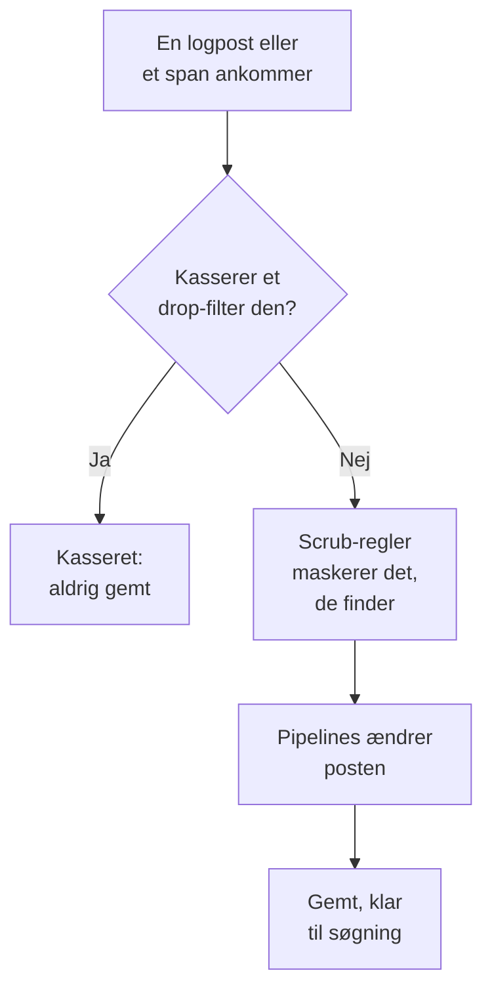

# Drop-filtre og scrub-regler

Drop-filtre og scrub-regler virker på dine protokoller og spans, mens de ankommer, før noget bliver gemt. Et drop-filter smider de poster væk, du aldrig har brug for, eller beholder kun en stikprøve af dem. En scrub-regel maskerer personoplysninger og hemmeligheder, såsom e-mailadresser, kortnumre og adgangskoder, så de aldrig når dit lager.

:::cards
- [Hvor de kører](#hvor-de-kører): Før pipelines, før lagring.
- [Kassér poster, eller tag stikprøver](#kassér-poster-eller-tag-stikprøver): Vælg poster, og kassér dem, eller behold en andel.
- [Hvad et filter ville tage](#hvad-et-filter-ville-tage): Hvad der læser posterne, før du gemmer det.
- [Rens følsomme data](#rens-følsomme-data): Skjul, maskér eller hash det, et mønster finder.
- [Se, hvad et filter kasserede](#se-hvad-et-filter-kasserede): Tællere på hvert filter.
:::

## Hvor de kører

Protokoller har deres under **Protokoller → Indstillinger**, og spans under **Spor → Indstillinger**. Når en post ankommer, kører OneUptime dem i denne rækkefølge:



- **De virker kun på nye poster.** En regel, du opretter eller ændrer, gælder for poster, der ankommer cirka et minut senere. Poster, der allerede er gemt, ændres ikke.
- **En kasseret post er væk.** Ingen søgning, graf, monitor eller optagelsesregel ser den nogensinde, og der laves ingen undtagelse ud fra den. På OneUptime Cloud bliver den heller ikke faktureret.
- **Hver liste kører i rækkefølge.** Træk rækkerne i en liste for at ændre rækkefølgen. Kun aktiverede filtre og regler kører.

Drop-filtre og scrub-regler for protokoller gælder lige så vel for protokoller fra OpenTelemetry, Syslog, Fluent Bit og Fluentd. [Logpipelines](/docs/telemetry/log-pipelines) forklarer trinnet efter dem.

## Før du begynder

- **Protokoller eller spans, der ankommer.** Se [OpenTelemetry](/docs/telemetry/open-telemetry).
- **En rolle, der ændrer telemetriindstillinger.** Projektejer eller Projektadministrator, eller en brugerdefineret rolle med tilladelsen til det, du ændrer, såsom Create Log Drop Filter eller Create Trace Scrub Rule. Telemetry-rollerne kan se filtre og regler, men ikke ændre dem.

## Kassér poster, eller tag stikprøver

:::steps
### Åbn drop-filtre

Gå til **Protokoller → Indstillinger → Drop-filtre**, eller til **Spor → Indstillinger → Drop-filtre** for spans.

### Vælg posterne

Klik på **Opret Log Drop-filter**, eller på **Opret Spor Drop-filter** for spans. Giv filteret et **Navn** under **Match**, og byg derefter dets **Filterforespørgsel**: et felt, en operator og en værdi for hver betingelse, og om **Alle betingelser** eller **Enhver betingelse** skal matche. Klik på **Næste**.

### Vælg handlingen

Under **Handling** skal du beholde **Kassér** for at smide hver matchende post væk, eller vælge **Stikprøve** og angive den **Stikprøveprocent**, der skal beholdes, fra 1 til 99. Opret derefter filteret.
:::

Filteret begynder at kassere inden for et minut. For at gemme det uden at kassere noget endnu skal du slå **Aktiveret** fra under **Avanceret**, før du opretter det.

> [!WARNING]
> En kasseret post kan ikke hentes tilbage. Hold et filters forespørgsel snæver, og hold øje med dets **Kasseret**-tæller, efter du har oprettet det.

Et filter kan teste disse felter, og enhver attribut med **Custom Attribute...**:

| Poster | Felter |
| --- | --- |
| Protokoller | **Alvorlighed**, **Logindhold**, **Tjeneste-ID** |
| Spans | **Span-navn**, **Span-type**, **Status**, **Statusbesked**, **Tjeneste-ID**, **Har undtagelse**, **Er rod-span** |

| Operator | Matcher |
| --- | --- |
| **er lig med** | Den præcise værdi, med dens store og små bogstaver: `Debug` matcher, `DEBUG` gør ikke. |
| **er ikke lig med** | Alt andet end den præcise værdi. |
| **indeholder** | Værdien hvor som helst i feltet, uanset store og små bogstaver. Et `%` i værdien er et jokertegn. |
| **er en af** | En af en liste af præcise værdier, adskilt af kommaer. |

**Preview query** viser den forespørgsel, betingelserne danner. Denne kasserer et sundhedstjeks debuglinjer:

```text
severityText = 'Debug' AND body LIKE 'healthcheck'
```

Stikprøver afgøres post for post: med en **Stikprøveprocent** på 10 beholdes cirka én ud af ti matchende poster. Filtrene kører i listens rækkefølge, og det første, der kasserer en post, afgør det; en post, som en stikprøve beholder, går videre til det næste filter.

## Hvad et filter ville tage

En kasseret post er væk for alt, der læser den, så mens du skriver et drop-filter, siger dets formular, hvad det ville tage, et øjeblik efter at du holder op med at skrive: i trinnet **Match** under **Filterforespørgsel** og i trinnet **Handling** under handlingen. Én linje siger den vigtigste virkning, og **Vis detaljer** siger resten:

- **Hvor meget det matcher.** Hvor mange af de poster, der blev gemt det seneste døgn, der matcher: det, filteret holder ude af dit lager og væk fra din regning. Det tælles ud fra det, der blev gemt, efter at scrub-regler og pipelines ændrede det, og kun over de tjenester, hvis poster du kan læse. En optælling, der tager mere end 10 sekunder, stoppes, og formularen siger det.
- **Hvad Sikkerhedsbegivenheder ville miste.** Hvor [Sikkerhedsbegivenheder](/docs/telemetry/security-events) læser dine logs med **Dine logs**, eller dine spans, siger formularen, hvor mange af de matchede poster den læste: de logins, angreb og firewallposter, den gør til begivenheder. Et filter med **Stikprøve** nævner også de regler, der udløses ved et antal, og hvad det gør ved dem, at filteret kun beholder sin andel: ved 10 % skal en regel, der udløses ved 10 fejlede logins på fem minutter, have omkring 100, så den udløses langt sjældnere eller aldrig.
- **Hvad der ellers læser de samme poster.** De monitorer, SLO'er, dashboards med deres widgets, optagelsesregler og gemte visninger, hvis forespørgsler kan medtage en post, som filteret tager. En forespørgsel læser dem, når den læser samme slags post, fra en tjeneste, som filteret kan tage fra, og intet, den låser til en bestemt værdi, udelukker filteret: et filter for logs på niveauet **Fejlfinding** lader en monitor for fejl være, og et filter for én tjeneste lader en anden tjenestes SLO være. Alt, hvad formularen ikke kan udelukke, såsom en søgning i logpostens brødtekst, tæller som at læse dem. Hver af dem er et link, og dem, du ikke kan åbne, tælles, men nævnes aldrig ved navn.

Når noget læser det, et filter tager, beder formularen dig om at bekræfte, når du opretter filteret, slår det til eller ændrer forespørgslen eller handlingen for et filter, der er slået til. Du kan stadig gemme filteret: spørgsmålet er der, så du beslutter dig med viden om det. Et filter, som intet læser, gemmes uden spørgsmål.

Gennem API'et spørger intet, for et script eller Terraform har ingen til at svare. Et filter, der oprettes eller ændres gennem API'et, gemmes, og når det tager noget, andre læser, bærer svaret headeren `X-OneUptime-Write-Warning`, der siger det med antal, og som Terraform-provideren viser som en advarsel. For at spørge først skal du sende filterets `filterQuery`, `action` og `samplePercentage` til `POST /api/telemetry/logs/drop-filter-impact`, eller til `/api/telemetry/traces/drop-filter-impact` for spans: svaret indeholder alt, hvad formularen viser.

De OpenStack-filtre, OneUptime tilføjer til et projekt, beholder hver linje, Sikkerhedsbegivenheder læser, så længe de er, som OneUptime lavede dem. Ændrer du et af dem, kasserer det alt, hvad det matcher, ligesom dine egne filtre.

## Rens følsomme data

:::steps
### Åbn scrub-regler

Gå til **Protokoller → Indstillinger → Scrub-regler**, eller til **Spor → Indstillinger → Scrub-regler** for spans.

### Vælg, hvad der skal findes

Klik på **Opret Log Scrub Regel**, eller på **Opret Trace Scrub Regel** for spans, og vælg en **Mønstertype**. Reglen får navn efter den, såsom **Masker e-mailadresser**, indtil du selv skriver et navn. For **Brugerdefineret regex** skal du også angive **Brugerdefineret regex-mønster**, og for **Navngivne attributter** **Attributter, der skal skjules**, én pr. linje.

### Vælg, hvordan der skal renses

Under **Flere felter** skal du vælge **Maskeringshandling** og **Felter, der skal renses**, eller lade dem være, som de er: en ny regel erstatter hvert match med `[REDACTED]`, uanset hvor det står i posten. Opret derefter reglen.
:::

| Mønstertype | Hvad den finder |
| --- | --- |
| **E-mailadresse** | E-mailadresser, såsom `jane@example.com`, også i en anden skrift, såsom `张伟@example.com`, og i en procentkodet URL |
| **Kreditkortnummer** | Kortnumre, såsom `4111 1111 1111 1111` eller et American Express-nummer, også i en anden skrifts cifre, såsom `４１１１ １１１１ １１１１ １１１１`, og vilkårlige seksten cifre i grupper af fire |
| **SSN (CPR-nummer)** | Amerikanske personnumre (Social Security), såsom `123-45-6789`, også adskilt af punktummer eller mellemrum og i en anden skrifts cifre, såsom `１２３-４５-６７８９` |
| **Telefonnummer** | Telefonnumre, såsom `555-123-4567` eller `+44 20 7946 0958`, internationale numre i de grupper, folk skriver dem i, også i en procentkodet URL og i en anden skrifts cifre, men ikke et decimaltal, en tidszones forskydning eller en version |
| **IP-adresse** | Offentlige IPv4- og IPv6-adresser, såsom `203.0.113.7`, `2001:db8::1` eller `2001::1`, også lige efter en nøgles kolon og i en procentkodet URL, men ikke private, loopback- eller link-local-adresser |
| **Følsomme attributnøgler** | Hele værdien af enhver attribut, hvis nøgle ser hemmelig ud, såsom `password`, `token`, `api_key`, `authorization` eller `cookie` |
| **Navngivne attributter** | Hele værdien af de attributter, du navngiver, uanset hvad den indeholder, såsom en persons navn under `customer_name`. En nøgle navngiver også de attributter, der ligger under den: `user` skjuler `user.email` |
| **Brugerdefineret regex** | Dit eget regulære udtryk, skrevet uden skråstreger eller flag og matchet med forskel på store og små bogstaver, også i en procentkodet URL og i en anden skrifts cifre |

| Maskeringshandling | Hvad et match bliver til |
| --- | --- |
| **Rediger (skjul)** | `[REDACTED]`, standardvalget |
| **Maske** | For det meste skjult: en e-mailadresse beholder sit første bogstav og slutningen af sit domæne, et kort-, telefon- eller personnummer sine sidste fire cifre, og et brugerdefineret match eller en hemmelig værdi sit første og sidste tegn. En IP-adresse skjules helt. |
| **Hash** | Et token, der er unikt for dit projekt, det samme for den samme værdi hver gang, så gentagelser stadig kan tælles, men ingen kan regne sig tilbage til værdien |

For eksempel gemmer en **E-mailadresse**-regel dette logindhold:

```text
Payment failed for jane@example.com
```

som en af disse, afhængigt af dens **Maskeringshandling**:

```text
Redact: Payment failed for [REDACTED]
Mask:   Payment failed for j***@***.com
Hash:   Payment failed for [HASHED:5e29db14e508e09a]
```

**Felter, der skal renses** er **Begge (brødtekst og attributter)** for en protokolregel, medmindre du vælger **Kun brødtekst** eller **Kun attributter**, og **Alle (navn, attributter og hændelser)** for en span-regel, medmindre du vælger **Kun span-navn**, **Kun attributter** eller **Kun hændelsesattributter**. Attributterne på et spans links renses sammen med spannets egne attributter, og **Alle (navn, attributter og hændelser)** renser også et spans statusbesked og navnene på dets hændelser. En **Følsomme attributnøgler**-regel læser nøgler og renser derfor altid værdierne under dem: i attributter og i en logposts JSON-brødtekst.

- **En regel kan gælde for én tjeneste.** Vælg under **Flere felter** tjenesten i **Kun for én tjeneste**: reglen renser den tjenestes poster, og andre tjenesters forbliver, som de er. Står feltet tomt, renser den alle tjenesters poster. Kolonnen **Omfang** i listen siger hvilken.
- **En regel kan navngive de attributter, den læser.** En regel af typen **Navngivne attributter** skjuler de attributter, den navngiver. Ethvert andet mønster end **Følsomme attributnøgler** læser kun de attributter, der står under **Flere felter** i **Kun i disse attributter**, én pr. linje, eller alle attributter, når feltet er tomt: logbrødteksten, eller et spans navn og statusbesked, læses stadig, som **Felter, der skal renses** siger. En regel, som Datasikkerhed opretter for et fund, læser kun den attribut, dataene blev fundet i, og dens formular viser den dér, så du kan tilføje en anden, såsom `db.password_old`, eller tømme feltet. Listen nævner dem under reglens **Mønstertype**: de attributter, en regel skjuler helt, eller de eneste, dens mønster læser.
- **Listen siger, hvad hver regel ændrede.** **Ændrede værdier** tæller de værdier, hver regel skjulte de seneste 7 dage, og **Efter tjeneste** åbner, hvilke tjenester og versioner de kom fra. En version, der ikke længere sender det, en regel skjuler, ændrer intet mere, og sådan ses en lækage, der er rettet i koden, her.
- **En regel, som Datasikkerhed har bevist, siger det.** En regel, der er oprettet for et fund, blev kørt på de poster, dataene blev set i, før den blev gemt, og viser **Bevist**, så længe den stadig er den regel, der blev bevist (se [Følsomme data i telemetri](/docs/data-security/telemetry#bevist-på-de-poster-det-blev-set-i)). Ændr det, den finder, de attributter, den læser, hvordan den renser, hvad den renser eller dens tjeneste, og **Bevist** forsvinder. De samme attributter i en anden rækkefølge eller med andre store og små bogstaver beholder det.
- **Formularen siger, hvad en regel ville ændre for andre.** Før du opretter en regel, og når du slår en til, viser OneUptime, hvad der læser de værdier, den ville skjule: monitorer, dashboards, gemte visninger, optagelsesregler og SLO'er, hver som et link, og hvad [Sikkerhedsbegivenheder](/docs/telemetry/security-events) ville miste. En monitor, der filtrerer på en skjult værdi, finder den ikke længere. Reglen gemmes under alle omstændigheder.
- **En IP-adresseregel skjuler de adresser, der er personoplysninger.** Det er offentlige IPv4- og IPv6-adresser, uanset hvordan de er skrevet: forkortet, som `2001:db8::1`, eller til én gruppe på hver side af `::`, som `2001::1`, i firkantede parenteser med en port, som `[2001:db8::1]:443`, der beholder sine parenteser og sin port, med en zone, som `2001:db8::2%eth0`, der beholder sin zone, eller en IPv4-adresse skrevet som IPv6, som `::ffff:203.0.113.7`, der skjules helt. En adresse lige efter en nøgles kolon, som loglinjer i logfmt eller syslog skriver den, såsom `peer ip:2001:db8::1` eller `remote:2001:db8::1`, skjules for sig, og nøglen beholder alle sine bogstaver. En adresse med én gruppe på hver side af `::` er en adresse, når dens første gruppe er fire hexadecimale cifre, der begynder med 2 eller 3, som en offentlig adresses er, så tekst som `10::30` eller `ab::cd` beholdes. En adresse, der er procentkodet i en URL, som `2001%3Adb8%3A%3A1` i `/geo?ip=2001%3Adb8%3A%3A1`, læses afkodet og skjules, som den er skrevet, med escapes og det hele, og resten af URL'en beholdes. Den beholder private, loopback- og link-local-adresser, såsom `10.0.0.12`, `127.0.0.1` og `fe80::1`, og cloudens metadataadresse `169.254.169.254` i en anmodnings URL, hvor [Sikkerhedsbegivenheder](/docs/telemetry/security-events) leder efter forfalskede anmodninger fra serveren. For også at skjule interne adresser skal du tilføje en regel med **Brugerdefineret regex** for dem, såsom `\b(?:\d{1,3}\.){3}\d{1,3}\b` for alle IPv4-adresser. Medmindre reglen hasher dem, navngiver Sikkerhedsbegivenheder så ingen adresse for de angreb, den finder i de logs eller traces, reglen renser: se [Skjult af en rensningsregel](/docs/telemetry/security-events#skjult-af-en-rensningsregel).
- **En e-mailadresseregel skjuler det, Datasikkerhed kalder en e-mailadresse.** Ud over det, dens eget mønster finder, skjuler den en adresse i enhver skrift, såsom `张伟@example.com`, `josé@example.com` eller `user@例え.jp`, og en adresse, der er procentkodet i en URL, som `jane%40example.com` i `/signup?email=jane%40example.com`, også med dens bogstavers UTF-8-byte, som `jos%C3%A9%40example.com`, der læses afkodet og skjules, som den er skrevet, mens resten af URL'en beholdes. **Maske** læser sådan en adresse afkodet, så den, som enhver e-mailadresse, beholder sit første bogstav og slutningen af sit domæne.
- **En kreditkortnummerregel skjuler det, Datasikkerhed kalder et kortnummer.** Ud over vilkårlige seksten cifre i grupper af fire skjuler den hvert kort, Datasikkerhed finder, såsom et American Express-nummer i grupper af fire, seks og fem, og et kort i en anden skrifts cifre: cifre i fuld bredde, som japansk tekst skriver et kort, såsom `４１１１ １１１１ １１１１ １１１１`, arabisk-indiske og persiske cifre, de andre skrifters cifre eller et kort, der er skrevet i to skrifter. **Maske** beholder dets sidste fire cifre, skrevet som ASCII-cifre.
- **En regel med brugerdefineret regex læser en værdi, som Datasikkerhed læser den.** Den læser teksten, som den er skrevet, derefter med dens procent-escapes læst, også et tegns UTF-8-byte, derefter med alle skrifters cifre læst som ASCII-cifre, og skjuler det, den finder i en hvilken som helst af dem, som det er skrevet, med escapes og det hele: `\+44 \d{2} \d{4} \d{4}` skjuler `%2B44%2020%207946%200958` i en URL og `+٤٤ ٢٠ ٧٩٤٦ ٠٩٥٨` i arabisk-indiske cifre. De regler med **Brugerdefineret regex**, som **Rens** laver for andre datatyper, såsom et GitHub-token eller en IBAN, læser en værdi på de samme måder. **Maske** beholder det første og sidste tegn i et match, som den læser det.
- **Et hash-token er dit projekts eget.** Det laves med en nøgle, der tilhører dit projekt, afledt af installationens `ENCRYPTION_SECRET`, så den samme værdi har et andet token i et andet projekt, og ingen, der læser et token, kan regne sig tilbage til værdien eller hashe et gæt for at sammenligne. En IP-adresse har ét token, uanset hvordan den er skrevet: `::ffff:203.0.113.7` og `203.0.113.7` deler ét, og det gør `2001%3Adb8%3A%3A1` og `2001:db8::1` også. Det samme gælder en e-mailadresse, procentkodet og som den er skrevet, såsom `jane%40example.com` og `jane@example.com`, eller `jos%C3%A9%40example.com` og `josé@example.com`, et kort i en anden skrifts cifre og i ASCII-cifre, og det, en regel med **Brugerdefineret regex** finder, ud fra det, den læser. Poster, der blev gemt, før tokens havde en nøgle, indeholder tokens på 8 tegn, såsom `[HASHED:8c87b489]`, der adskiller sig fra nutidens på 16 tegn: Søg efter begge, indtil de poster når slutningen af deres opbevaring. Hvis du ændrer `ENCRYPTION_SECRET`, ændres alle tokens, og på en selvhostet installation er tokens kun så hemmelige som den.
- **En IP-adresseregel, der erstatter eller maskerer, siger, hvad det koster Sikkerhedshændelser.** Hvor [Sikkerhedshændelser](/docs/telemetry/security-events) læser dine logs eller traces, siger sådan en regel i sin række, at den også skjuler adresser for Sikkerhedshændelser, så de ikke kan fortælle dig, hvilken adresse du skal blokere, med **Brug hash i stedet**, som skifter reglen til **Hash**: Folk ser et token i stedet for adressen, og Sikkerhedshændelser ser stadig adressen. Reglens formular siger det samme under reglens handlinger, og **Rens** hasher en IP-adresse der fra starten.
- **Sikkerhedsbegivenheder kan stadig navngive en hashet IP-adresse.** Når [Sikkerhedsbegivenheder](/docs/telemetry/security-events) læser dine logs eller traces, gemmer en IP-adresseregel, der hasher, også hver adresse, den skjuler, ved siden af dens token, i et lager, som kun Sikkerhedsbegivenheders scanninger læser: Ingen side, søgning, eksport, API eller AI-værktøj kan læse det. Så et angreb fra en adresse, som dine logs kun viser som et token, navngiver stadig adressen, og dens sag siger, hvilken adresse der skal blokeres. Hver adresse gemmes indtil 30 dage efter, at den sidst blev set. En regel, der sletter eller maskerer adressen, gemmer intet, så Sikkerhedsbegivenheder siger da, at en scrub-regel skjulte adressen, som den gør for et token, der er ældre end 30 dage eller lavet, før tokens havde en nøgle.
- **Sikkerhedsbegivenheder kan stadig navngive en hashet bruger.** Hvor [Sikkerhedsbegivenheder](/docs/telemetry/security-events) læser en bruger i dine logs eller traces, såsom en requests `enduser.id`, et AI-kalds bruger eller en cloud-auditlogs principal, gemmer en regel, der hasher brugeren, også brugeren ved siden af dens token, i et lager, som kun Sikkerhedsbegivenheders scanninger læser: Ingen side, søgning, eksport, API eller AI-værktøj kan læse det. Så en sag om en konto, som dine logs kun viser som et token, navngiver kontoen, og en playbook kan handle på den. Hver bruger gemmes indtil 30 dage efter, at den sidst blev set. En værdi, der hashes, hvor Sikkerhedsbegivenheder ikke læser nogen bruger, såsom en e-mailadresse i en fejlmeddelelse, gemmes aldrig, og en regel, der sletter eller maskerer, gemmer intet. For at fjerne en person derfra for altid skal du indsende en sletteanmodning: se [Slet en person](/docs/telemetry/security-events#slet-en-person).
- **Lister og indlejrede værdier læses også.** En regel læser hver tekst i en liste, en liste af lister eller en nøgle-værdi-liste, såsom værdierne af en HTTP-header, og bevarer værdiens form: tal og sand eller falsk forbliver, som de er. En **Følsomme attributnøgler**-regel læser også nøglerne inde i en værdi, så `password` inde i en nøgle-værdi-liste skjules også. Brødteksten i en logpost, der sendes som et map eller en liste, gemmes som sin JSON-tekst, og en **Følsomme attributnøgler**-regel læser nøglerne i den, som i en brødtekst skrevet som JSON. En mønsterregel bevarer en sådan brødtekst som JSON, og også en attribut skrevet som JSON, såsom et AI-kalds beskeder: Den læser teksten, som dit program skrev den, med en escape-sekvens som `\n` læst som det linjeskift, den står for, og erstatter kun det, den finder, inde i dens tekster og tal.
- **JSON i en streng læses også.** En tekst, der selv er JSON, såsom en attribut `http.request.body`, der indeholder `{"password":"hunter2"}`, eller en Fluentd-posts `log`-linje inde i en logposts brødtekst, læses som JSON, op til 4 niveauer af JSON inden i hinanden, og dybere som tekst. En **Følsomme attributnøgler**-regel skjuler værdierne under de nøgler i den, der ser hemmelige ud, og intet andet: Dens tal, mellemrum og andre tekster forbliver, som dit program skrev dem. En tekst, der kun ligner JSON, såsom `{token}`, efterlades, som den er.
- **En værdi, der er for stor til at blive læst element for element, læses som tekst.** En værdi, der er indlejret mere end 32 niveauer dybt, eller som ville bringe en post over 10.000 værdier inde i dens lister og maps, læses og gemmes som sin JSON-tekst. En mønsterregel renser det, den finder i den tekst, og en **Følsomme attributnøgler**-regel skjuler hele værdien, når et ord som `password` eller `token` optræder i den. I en logposts brødtekst og i JSON i en streng læses kun den del, der ligger ud over disse grænser, som tekst: Resten læses stadig nøgle for nøgle.
- **Undtagelser kommer fra den rensede post.** En undtagelse, der findes i en logpost, laves efter rensningen, og de regler, der renser span-hændelser, renser også de undtagelser, der er registreret på dem. Hver undtagelse grupperes stadig efter det, den sagde før rensningen, så en ny regel gør aldrig en undtagelse, du allerede har, til en ny, og udløser ikke **Ny undtagelse** for den igen. Når en regel skjuler en del af det, en ny undtagelse grupperes efter, laves dens fingeraftryk med en nøgle, der tilhører dit projekt, ligesom et hash-token, så ingen kan regne sig tilbage til det skjulte. En undtagelse, der blev lavet før reglen, flytter til sådan et fingeraftryk ved sin næste forekomst, som reglen ændrer; dens forekomster registreret før beholder det gamle, indtil deres opbevaring udløber.
- **En syslog-linjes rå kopier skjuler det, reglerne skjulte i dens dele.** Syslog gemmer en RFC 5424-linjes strukturerede data, som de ankom, i `syslog.structured.raw`, og syslog sendt over HTTP gemmer hele linjen i `syslog.raw`. Hver kopi sættes sammen igen af det, reglerne efterlod af headerens felter, hver parameter i de strukturerede data og beskeden, og reglerne læser den derefter, som de læser enhver attribut. Så en adgangskode, som en **Følsomme attributnøgler**-regel skjuler i `syslog.structured.auth_1.password`, eller en adresse, som en **Kun brødtekst**-regel skjuler i beskeden, er også skjult i kopierne, skrevet som RFC 5424 skriver en værdi: `password="[REDACTED\]"`. En linje, som reglerne ikke ændrer noget i, beholder sine kopier, som den ankom.
- **En posts sessions-id bevares.** En **Følsomme attributnøgler**-regel skjuler en login-session, såsom en `session_id`, en `sessionid` eller en cookie, men bevarer `session.id`, når den indeholder den session, logposten eller spannet hører til: det tilfældige id, som [Session Replay](/docs/telemetry/session-replay) arkiverer posten under, og som posten under alle omstændigheder beholder som sin session. Et AI-kalds samtale-id bevares på samme måde. Send ikke en login-sessions hemmelighed som `session.id`.
- **Session Replays renses også.** Scrub-regler for protokoller, der gælder for alle tjenester, kører også over Session Replay-optagelser, oven i den maskering, optageren foretager i browseren.
- **Regler kører i listens rækkefølge.** Hver regel ser det, reglerne før den efterlod.
- **Et brugerdefineret mønster tager tid i forhold til posten.** Det beholder JavaScripts syntaks og svar, lookaheads og lookbehinds medregnet, uanset hvordan det er skrevet. En tilbagehenvisning, som `\1`, kan ikke køres på den måde: en regel med en sådan afvises, når du gemmer den, ligesom et mønster, der er for stort til at blive kørt. Hvis det at finde hvert match ville kræve, at en lang værdi blev læst igen og igen, renser reglen hele værdien. Et projekts drop-filtre, scrub-regler og pipelines deler også en arbejdskvote for hver sending, det sender, i forhold til sendingens størrelse og nok til, at snesevis af brugerdefinerede mønstre kan læse hver værdi. Når deres mønstre kræver mere, renser en brugerdefineret scrub-regel hele værdien, og et filter, der ikke kan besvares, gælder ikke for posten.

## Se, hvad et filter kasserede

Listen **Drop-filtre** viser for hvert filter dets **Kasseret**-tæller, og hvornår det sidst kasserede noget, **Last Dropped**. **Nothing dropped yet** betyder, at det aldrig har matchet. Et filters egen side viser det samme under **Aktivitet**, opdateret inden for et minut efter en kassering. Dets kort **Filterbetingelser** viser, hvad det vælger, og du kan ændre betingelserne der.

## Fejlfinding

:::details Et drop-filter kasserer intet
**er lig med**, **er ikke lig med** og **er en af** sammenligner præcis tekst, inklusive store og små bogstaver. Alvorlighedsgrader hedder `Information` og `Warning`, ikke `INFO` eller `WARN`. Kontrollér, at filteret er aktiveret, og giv det et minut efter en ændring.
:::

:::details Protokoller, jeg forventede, mangler
Se på **Kasseret**-tælleren og tidspunktet for **Last Dropped** for hvert drop-filter. Slå **Aktiveret** fra på det, du har mistanke til, og de næste protokoller ankommer igen.
:::

:::details En brugerdefineret scrub-regel siger Maskerer intet
Dens mønster er tomt, ikke et gyldigt regulært udtryk eller kan ikke køres, fordi det for eksempel har en tilbagehenvisning som `\1`, så den renser intet. Redigér reglen, og giv den et mønster, der matcher mindst ét tegn.
:::

:::details Gamle poster viser stadig de data, en ny regel renser
Scrub-regler virker, når poster ankommer. Poster, der blev gemt før reglen, beholder det, de havde, indtil deres opbevaring udløber. Se [Dataopbevaring](/docs/telemetry/data-retention).
:::

## Næste skridt

:::cards
- [Logpipelines](/docs/telemetry/log-pipelines): Fortolk og berig de protokoller, du beholder.
- [Protokoludforsker](/docs/telemetry/logs-explorer): Søg i det, der blev gemt.
- [Sporudforsker](/docs/telemetry/traces-explorer): Følg de spans, du beholder.
- [Dataopbevaring](/docs/telemetry/data-retention): Bestem, hvor længe de opbevares.
:::
