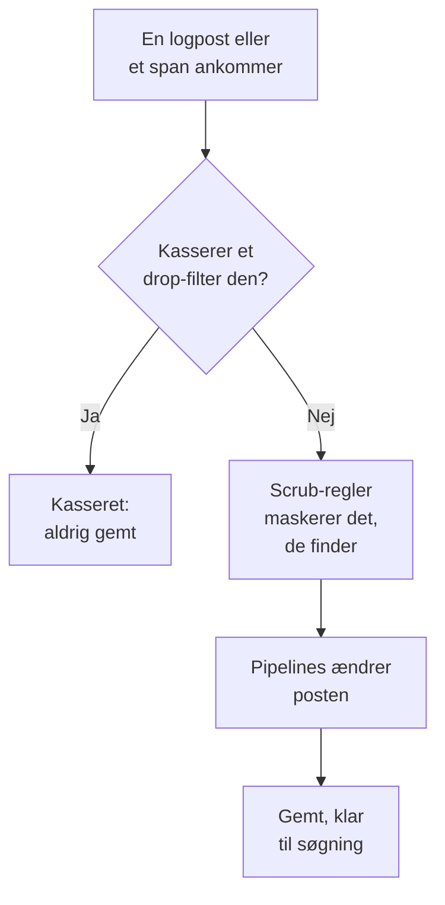

# Drop-filtre og scrub-regler

Drop-filtre og scrub-regler virker på dine protokoller og spans, mens de ankommer, før noget bliver gemt. Et drop-filter smider de poster væk, du aldrig har brug for, eller beholder kun en stikprøve af dem. En scrub-regel maskerer personoplysninger og hemmeligheder, såsom e-mailadresser, kortnumre og adgangskoder, så de aldrig når dit lager.

:::cards
- [Hvor de kører](#hvor-de-kører): Før pipelines, før lagring.
- [Kassér poster, eller tag stikprøver](#kassér-poster-eller-tag-stikprøver): Vælg poster, og kassér dem, eller behold en andel.
- [Rens følsomme data](#rens-følsomme-data): Skjul, maskér eller hash det, et mønster finder.
- [Se, hvad et filter kasserede](#se-hvad-et-filter-kasserede): Tællere på hvert filter.
:::

## Hvor de kører

Protokoller har deres under **Protokoller → Indstillinger**, og spans under **Spor → Indstillinger**. Når en post ankommer, kører OneUptime dem i denne rækkefølge:



- **De virker kun på nye poster.** En regel, du opretter eller ændrer, gælder for poster, der ankommer cirka et minut senere. Poster, der allerede er gemt, ændres ikke.
- **En kasseret post er væk.** Ingen søgning, graf, monitor eller optagelsesregel ser den nogensinde, og der laves ingen undtagelse ud fra den. På OneUptime Cloud bliver den heller ikke faktureret.
- **Hver liste kører i rækkefølge.** Træk rækkerne i en liste for at ændre rækkefølgen. Kun aktiverede filtre og regler kører.

Drop-filtre og scrub-regler for protokoller gælder lige så vel for protokoller fra OpenTelemetry, Syslog, Fluent Bit og Fluentd. [Logpipelines](/docs/telemetry/log-pipelines) forklarer trinnet efter dem.

## Før du begynder

- **Protokoller eller spans, der ankommer.** Se [OpenTelemetry](/docs/telemetry/open-telemetry).
- **En rolle, der ændrer telemetriindstillinger.** Project Owner eller Project Admin, eller en brugerdefineret rolle med tilladelsen til det, du ændrer, såsom Create Log Drop Filter eller Create Trace Scrub Rule. Telemetry-rollerne kan se filtre og regler, men ikke ændre dem.

## Kassér poster, eller tag stikprøver

:::steps
### Åbn drop-filtre

Gå til **Protokoller → Indstillinger → Drop-filtre**, eller til **Spor → Indstillinger → Drop-filtre** for spans.

### Vælg posterne

Klik på **Opret Log Drop-filter**, eller på **Opret Spor Drop-filter** for spans. Giv filteret et **Navn** under **Match**, og byg derefter dets **Filterforespørgsel**: et felt, en operator og en værdi for hver betingelse, og om **Alle betingelser** eller **Enhver betingelse** skal matche. Klik på **Næste**.

### Vælg handlingen

Under **Handling** skal du beholde **Kassér** for at smide hver matchende post væk, eller vælge **Stikprøve** og angive den **Stikprøveprocent**, der skal beholdes, fra 1 til 99. Opret derefter filteret.
:::

Filteret begynder at kassere inden for et minut. For at gemme det uden at kassere noget endnu skal du slå **Aktiveret** fra under **Avanceret**, før du opretter det.

> [!WARNING]
> En kasseret post kan ikke hentes tilbage. Hold et filters forespørgsel snæver, og hold øje med dets **Dropped**-tæller, efter du har oprettet det.

Et filter kan teste disse felter, og enhver attribut med **Custom Attribute...**:

| Poster | Felter |
| --- | --- |
| Protokoller | **Alvorlighed**, **Logindhold**, **Tjeneste-ID** |
| Spans | **Span-navn**, **Span-type**, **Status**, **Statusbesked**, **Tjeneste-ID**, **Har undtagelse**, **Er rod-span** |

| Operator | Matcher |
| --- | --- |
| **er lig med** | Den præcise værdi, med dens store og små bogstaver: `Debug` matcher, `DEBUG` gør ikke. |
| **er ikke lig med** | Alt andet end den præcise værdi. |
| **indeholder** | Værdien hvor som helst i feltet, uanset store og små bogstaver. Et `%` i værdien er et jokertegn. |
| **er en af** | En af en liste af præcise værdier, adskilt af kommaer. |

**Preview query** viser den forespørgsel, betingelserne danner. Denne kasserer et sundhedstjeks debuglinjer:

```text
severityText = 'Debug' AND body LIKE 'healthcheck'
```

Stikprøver afgøres post for post: med en **Stikprøveprocent** på 10 beholdes cirka én ud af ti matchende poster. Filtrene kører i listens rækkefølge, og det første, der kasserer en post, afgør det; en post, som en stikprøve beholder, går videre til det næste filter.

## Rens følsomme data

:::steps
### Åbn scrub-regler

Gå til **Protokoller → Indstillinger → Scrub-regler**, eller til **Spor → Indstillinger → Scrub-regler** for spans.

### Vælg, hvad der skal findes

Klik på **Opret Log Scrub Regel**, eller på **Opret Trace Scrub Regel** for spans, og vælg en **Mønstertype**. Reglen får navn efter den, såsom **Masker e-mailadresser**, indtil du selv skriver et navn. For **Brugerdefineret regex** skal du også angive **Brugerdefineret regex-mønster**.

### Vælg, hvordan der skal renses

Under **Avanceret** skal du vælge **Maskeringshandling** og **Felter, der skal renses**, eller lade dem være, som de er: en ny regel erstatter hvert match med `[REDACTED]`, uanset hvor det står i posten. Opret derefter reglen.
:::

| Mønstertype | Hvad den finder |
| --- | --- |
| **E-mailadresse** | E-mailadresser, såsom `jane@example.com` |
| **Kreditkortnummer** | Seksten cifre i grupper af fire, såsom `4111 1111 1111 1111` |
| **SSN (CPR-nummer)** | Amerikanske personnumre (Social Security), såsom `123-45-6789` |
| **Telefonnummer** | Nordamerikanske telefonnumre, såsom `555-123-4567` |
| **IP-adresse** | IPv4-adresser, såsom `192.168.1.1` |
| **Sensitive Attribute Keys** | Hele værdien af enhver attribut, hvis nøgle ser hemmelig ud, såsom `password`, `token`, `api_key`, `authorization` eller `cookie` |
| **Brugerdefineret regex** | Dit eget regulære udtryk, skrevet uden skråstreger eller flag og matchet med forskel på store og små bogstaver |

| Maskeringshandling | Hvad et match bliver til |
| --- | --- |
| **Rediger (skjul)** | `[REDACTED]`, standardvalget |
| **Maske** | For det meste skjult: en e-mailadresse beholder sit første bogstav og slutningen af sit domæne, et kort-, telefon- eller personnummer sine sidste fire cifre, og et brugerdefineret match eller en hemmelig værdi sit første og sidste tegn. En IP-adresse skjules helt. |
| **Hash** | En kort hash af værdien, den samme for den samme værdi hver gang, så gentagelser stadig kan tælles |

For eksempel gemmer en **E-mailadresse**-regel dette logindhold:

```text
Payment failed for jane@example.com
```

som en af disse, afhængigt af dens **Maskeringshandling**:

```text
Redact: Payment failed for [REDACTED]
Mask:   Payment failed for j***@***.com
Hash:   Payment failed for [HASHED:8c87b489]
```

**Felter, der skal renses** er **Begge (brødtekst og attributter)** for en protokolregel, medmindre du vælger **Kun brødtekst** eller **Kun attributter**, og **Alle (navn, attributter og hændelser)** for en span-regel, medmindre du vælger **Kun span-navn**, **Kun attributter** eller **Kun hændelsesattributter**. En **Sensitive Attribute Keys**-regel renser altid attributværdier, da den læser attributnøgler.

- **Undtagelser kommer fra den rensede post.** En undtagelse, der findes i en logpost, laves efter rensningen, og de regler, der renser span-hændelser, renser også de undtagelser, der er registreret på dem.
- **Session Replays renses også.** Scrub-regler for protokoller kører også over Session Replay-optagelser, oven i den maskering, optageren foretager i browseren.
- **Regler kører i listens rækkefølge.** Hver regel ser det, reglerne før den efterlod.
- **Et brugerdefineret mønster tager tid i forhold til posten.** Det beholder JavaScripts syntaks og svar, lookaheads og lookbehinds medregnet, uanset hvordan det er skrevet. En tilbagehenvisning, som `\1`, kan ikke køres på den måde: en regel med en sådan afvises, når du gemmer den, ligesom et mønster, der er for stort til at blive kørt. Hvis det at finde hvert match ville kræve, at en lang værdi blev læst igen og igen, renser reglen hele værdien.

## Se, hvad et filter kasserede

Listen **Drop-filtre** viser for hvert filter dets **Dropped**-tæller, og hvornår det sidst kasserede noget, **Last Dropped**. **Nothing dropped yet** betyder, at det aldrig har matchet. Et filters egen side viser det samme under **Aktivitet**, opdateret inden for et minut efter en kassering. Dets kort **Filterbetingelser** viser, hvad det vælger, og du kan ændre betingelserne der.

## Fejlfinding

:::details Et drop-filter kasserer intet
**er lig med**, **er ikke lig med** og **er en af** sammenligner præcis tekst, inklusive store og små bogstaver. Alvorlighedsgrader hedder `Information` og `Warning`, ikke `INFO` eller `WARN`. Kontrollér, at filteret er aktiveret, og giv det et minut efter en ændring.
:::

:::details Protokoller, jeg forventede, mangler
Se på **Dropped**-tælleren og tidspunktet for **Last Dropped** for hvert drop-filter. Slå **Aktiveret** fra på det, du har mistanke til, og de næste protokoller ankommer igen.
:::

:::details En brugerdefineret scrub-regel siger Maskerer intet
Dens mønster er tomt, ikke et gyldigt regulært udtryk eller kan ikke køres, fordi det for eksempel har en tilbagehenvisning som `\1`, så den renser intet. Redigér reglen, og giv den et mønster, der matcher mindst ét tegn.
:::

:::details Gamle poster viser stadig de data, en ny regel renser
Scrub-regler virker, når poster ankommer. Poster, der blev gemt før reglen, beholder det, de havde, indtil deres opbevaring udløber. Se [Dataopbevaring](/docs/telemetry/data-retention).
:::

## Næste skridt

:::cards
- [Logpipelines](/docs/telemetry/log-pipelines): Fortolk og berig de protokoller, du beholder.
- [Protokoludforsker](/docs/telemetry/logs-explorer): Søg i det, der blev gemt.
- [Sporudforsker](/docs/telemetry/traces-explorer): Følg de spans, du beholder.
- [Dataopbevaring](/docs/telemetry/data-retention): Bestem, hvor længe de opbevares.
:::
