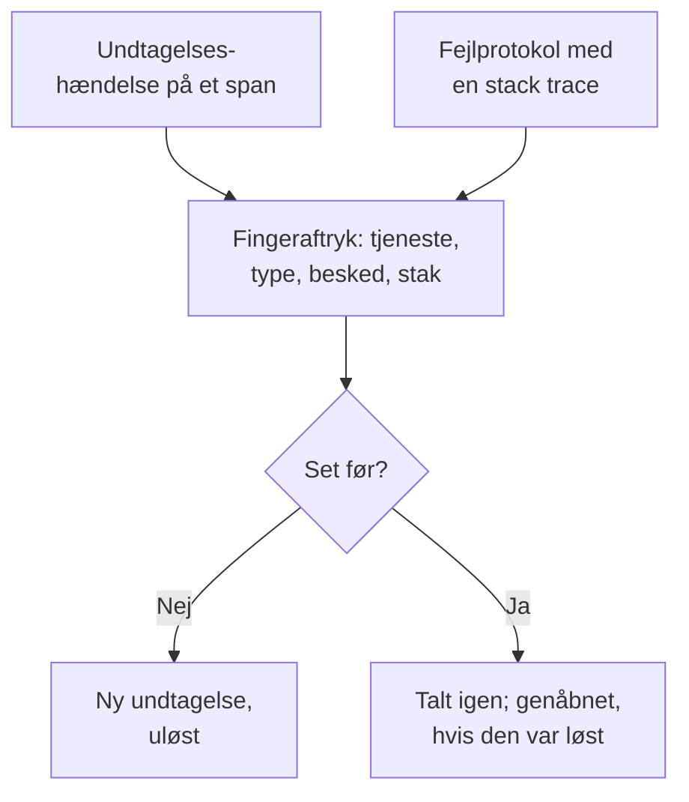

# Undtagelsessporing

Undtagelsessporing samler de fejl, din kode kaster, og grupperer hver forekomst af den samme fejl i én undtagelse med dens stack trace, dens udvikling og de forespørgsler, den opstod i. Gennemgå dem som en opgaveliste: ret, løs eller arkivér støjen, og lad AI åbne en pull request for dem, den kan rette.

:::cards
- [Hvor undtagelser kommer fra](#hvor-undtagelser-kommer-fra): Spans og protokoller, som dine tjenester allerede sender.
- [Gennemgå listen](#gennemgå-listen): Det uløste først, støjen skjult.
- [En undtagelses side](#en-undtagelses-side): Stack trace, forekomster og kontekst.
- [Ret den med AI](#ret-den-med-ai): En pull request med rettelsen eller en regressionstest.
- [Find og ret nye og stigende undtagelser med AI](#find-og-ret-nye-og-stigende-undtagelser-med-ai): Pull requests for de undtagelser, OneUptime finder.
:::

## Hvor undtagelser kommer fra

Du sender ikke undtagelser særskilt. OneUptime finder dem i den telemetri, dine tjenester allerede sender:

- en undtagelseshændelse på et span, som er det, OpenTelemetrys `recordException()` skriver;
- en protokol med attributterne `exception.type`, `exception.message` eller `exception.stacktrace`;
- en protokol med alvorligheden Error eller Fatal, hvis besked indeholder en stack trace, når protokollen ikke er skrevet inde i et span (spannet melder den allerede).

Hver forekomst grupperes med de tidligere forekomster af samme fejl i én undtagelse:

- **Én undtagelse pr. tjeneste og fejl.** Fingeraftrykket laves ud fra tjenesten, undtagelsestypen, beskeden og stack trace. Værdier, der ændrer sig fra kald til kald, tages ud først: UUID'er og andre ID'er, tidsstempler, IP- og e-mailadresser samt tal med syv cifre eller flere. Derfor er `Order id=1042 not found` og `Order id=2077 not found` én undtagelse.
- **En ny forekomst genåbner en løst undtagelse.** Sker den igen, efter at du har løst den, holdt rettelsen ikke, og undtagelsen markeres som **Regression**. En forekomst fra før du løste den, som først når OneUptime senere, genåbner den ikke.
- **En arkiveret undtagelse forbliver arkiveret.** Dens nye forekomster tælles stadig, men de sender ikke længere notifikationer.

> [!TIP]
> For at holde en forventet fejl ude af undtagelsessporingen, såsom ugyldigt input, din tjeneste afviste, skal du sætte attributten `error.class` til `user-error` eller `expected-denial` på spannets undtagelseshændelse. Så registrerer OneUptime ingen undtagelse for den.

## Før du begynder

- **Spans eller protokoller, der ankommer.** Instrumentér dine tjenester med [OpenTelemetry](/docs/telemetry/open-telemetry). Fanen **Opsætningsvejledning** viser koden til dit sprog.
- **En rolle, der må læse telemetri.** Project Owner, Project Admin, Project Member, Viewer, Telemetry Admin, Telemetry Member eller Telemetry Viewer, eller en brugerdefineret rolle med tilladelsen Read Telemetry Service Exception. At løse og arkivere kræver Project Owner eller Project Admin eller tilladelsen Edit Telemetry Service Exception.

## Gennemgå listen

:::steps
### Åbn undtagelser

Gå til **Produkter → Observabilitet → Undtagelser**. Mærket på fanen **Undtagelser** tæller de uløste problemer, og listen åbner på undtagelserne under **Uløst**.

### Vælg en status

Skift mellem **Uløst**, **Løst**, **Arkiveret** og **Alle**. Diagrammet over listen viser, hvor mange forekomster der var **Ikke håndteret**, og hvor mange der var **Håndteret** over tid. En række markeret **Regression** kom igen, efter at den var løst, og en markeret **Ny** blev set første gang inden for de seneste 24 timer.

### Vælg, hvad der tæller som et problem

**Problemer**, som er standard, skjuler brugerfejl og forventede afvisninger, så listen viser det, der kræver en rettelse. **User errors** viser kun dem, og **Alle** viser hver undtagelse.

### Søg og filtrér

Skriv en forespørgsel som `type:TypeError env:production`, se [Søgesyntaks](/docs/telemetry/search-syntax#undtagelser), eller klik på en værdi i sidepanelet **Filtre**: en tjeneste, en vært eller en anden ressource, en **Undtagelsestype**, et **Miljø** eller en **Error Class**. **Tildelt til mig** viser kun de undtagelser, der er tildelt dig, og sorteringsmenuen ordner listen efter **Sidst set**, **Først set** eller **Flest hændelser**.

### Åbn en undtagelse

Klik på en række for at åbne undtagelsens side.
:::

## En undtagelses side

Sidens sidemenu samler det, du gør med en undtagelse:

| Side | Hvad den viser |
| --- | --- |
| **Oversigt** | Beskeden, tjenesten, hvor ofte den skete, og hvornår den først og sidst blev set, dens udvikling over tid og dens seneste forekomst: release, miljø, span, spor og brugersession. Øverst OneUptime AI's forklaring af, hvad der skete, når AI er slået til. |
| **Stack trace** | Stakkens frames. For browserkode de oprindelige filer og linjer, når du har uploadet [Source maps](/docs/telemetry/source-maps) til releasen. |
| **Occurrences** | Hver forekomst med dens tidspunkt, dens besked og det spor, den opstod i. |
| **Context** | Den seneste forekomsts attributter, dens sessionsoptagelse, når der er en, og de trin, der førte til den. |
| **Protokoller** | De protokoller, der blev skrevet omkring den seneste forekomst. |
| **AI Assistance** | AI-opgaver, der retter undtagelsen eller tester den. |
| **Indstillinger** | Løs eller arkivér undtagelsen. Den ligger under **Administrer**, som er foldet sammen fra start. |

## Løs, genåbn og arkivér

Knapperne øverst på undtagelsens side, dens side **Indstillinger** og menuen ⋯ på dens række i listen ændrer dens status:

| Handling | Hvornår du bruger den | Hvad der sker bagefter |
| --- | --- | --- |
| **Løs** | Du har udrullet rettelsen. | Den forlader listen **Uløst**. En ny forekomst genåbner den. |
| **Løs i næste udgivelse** | Rettelsen kommer med din næste udgivelse. | Den forlader listen **Uløst**. Forekomster fra den udgivelse, den sidst blev set i, genåbner den ikke, men en fra enhver anden udgivelse gør. |
| **Genåbn** | Rettelsen virkede ikke. | Den er uløst igen. |
| **Arkiver** | Det er støj, du ikke vil rette. | Den forlader listen. Nye forekomster tælles, men sender ikke længere notifikationer. |
| **Fjern fra arkiv** | Du vil høre om den igen. | Den er tilbage i den liste, den hører til i. |

**Løs i næste udgivelse** findes i menuen ved siden af **Løs**, i rækkens menu ⋯, under **Massehandlinger** og på **Indstillinger**, så længe undtagelsens forekomster angiver deres udgivelse: ressourceattributten `service.version`.

**Indstillinger** viser, hvem der sidst løste eller arkiverede undtagelsen, og hvornår. Dens knapper hedder **Marker som løst** eller **Marker som uafklaret** og **Arkiver** eller **Fjern fra arkiv**.

For at ændre flere på én gang markerer du deres rækker i listen, eller feltet over rækkerne for alle undtagelser på siden, og bruger de samme handlinger under **Massehandlinger**. Resultatet viser, hvilke undtagelser der blev ændret, hvilke der blev ladt være, og hvorfor.

**Tildel** i undtagelsens overskrift giver den til én person eller ét team, og fjerner du valget, ophæves tildelingen. Hver række viser, hvem den tilhører, dens menu ⋯ tilbyder **Tildel til mig**, og **Tildel til…** under **Massehandlinger** tildeler flere på én gang.

## Fejlklasser

Hver undtagelse har en fejlklasse, der siger, hvis problem det er. OneUptime AI sætter den, når den gennemgår en indsigt om undtagelsen, såsom en ny eller hastigt stigende undtagelse: se [AI SRE](/docs/ai/ai-sre#indsigter-proaktiv-detektion). En undtagelse, den ikke har gennemgået, forbliver `unknown`.

| Klasse | Hvad den betyder | I **Problemer** |
| --- | --- | --- |
| `code-fault` | En fejl i koden. Den eneste klasse, AI retter på egen hånd. | Ja |
| `infrastructure` | En timeout, en afbrudt forbindelse eller opbrugte ressourcer. | Ja |
| `unknown` | Endnu ikke klassificeret. | Ja |
| `user-error` | Resultatet af ugyldigt input fra en bruger. | Nej |
| `expected-denial` | En kontrol, der gør sit arbejde, såsom et afvist login. | Nej |

Med **Arkivér forventede undtagelser** slået til i indstillingerne for AI-indsigter arkiveres de undtagelser, som gennemgangen finder at være forventede afvisninger, for dig.

## Forklar den med AI

Øverst på en undtagelses **Oversigt** spørger **Forklar med OneUptime AI** OneUptime AI om, hvad der gik galt. Den læser stack trace, sporet og protokollerne for den seneste forekomst samt tjenestens udrulninger omkring det tidspunkt, hvor undtagelsen begyndte, og svarer på kortet **Hvad der skete**:

| Del | Hvad den siger |
| --- | --- |
| **Hvad der skete** | En sætning eller to, hvor sikker OneUptime AI er, og hvor fejlen ligger: koden, en afhængighed, infrastrukturen, ugyldigt input eller konfigurationen. |
| **Sandsynlig grundårsag** | Årsagen og den frame, det span, den logline eller den udrulning, der viser den. |
| **Foreslået rettelse** | Hvad der skal ændres. |
| **Hvor du skal kigge** | De frames i stack trace, du skal åbne først. |
| **Næste trin** | Højst tre trin til at bekræfte eller rette den. |

Forklaringen gemmes på undtagelsen, så den næste, der åbner den, læser den med det samme, og **Forklar igen** beder om en ny. **Åbn en pull request med rettelsen** åbner undtagelsens side **AI Assistance**, og **Stil et opfølgende spørgsmål** åbner Ask AI om undtagelsen.

ID'er, e-mail- og IP-adresser samt tokens fjernes fra alt, hvad der sendes, og af et spans attributter sendes kun nogle få, såsom dets rute og statuskode. Forklaringen bruger projektets LLM-udbyder og AI-kreditter og tilbydes ikke, mens **Aktivér AI** er slået fra. Alle, der kan læse undtagelsen, kan bede om en.

## Ret den med AI

Siden **AI Assistance** tilbyder tre opgaver. Hver kører som en AI-opgave, der åbner en pull request i dit kodelager:

| Opgave | Hvad pull requesten gør |
| --- | --- |
| **Fix this exception with AI** | Retter grundårsagen. Start den med **Ret med AI**. |
| **Generate Regression Test** | Tilføjer en test, der fejler, indtil fejlen er rettet. |
| **Forbedr fejlhåndtering** | Til forventede fejl: validerer input tidligere, holder brugerdata ude af beskeder og markerer fejlen som håndteret. |

AI har først brug for tre ting: en LLM-udbyder, et forbundet lager (på GitHub, GitLab, Forgejo eller Gitea eller enhver Git-server) og en AI-agent online til at køre opgaven. Siden kontrollerer hver af dem og linker til det, der mangler. Opgaverne holder pause, mens undtagelsen er løst eller arkiveret. Se [Kode](/docs/ai/ai-agent). At starte en opgave kræver tilladelse til at redigere det lager, den arbejder i: Den, der kun må læse undtagelsen, ser dens opgaver, men kan ikke starte nogen.

## Find og ret nye og stigende undtagelser med AI

Hvert 15. minut gennemgår OneUptime dine undtagelser for nye, for dem, der pludselig sker langt oftere, og for tjenester, hvis undtagelser ikke har noget stack trace, og gemmer det, den finder, som AI-indsigter med beviserne. Derefter undersøger OneUptime AI hver enkelt og åbner en pull request for dem, den kan rette. Intet bliver nogensinde flettet: dit team gennemgår hver pull request.

| Fund | Hvornår OneUptime opretter det | Pull requesten |
| --- | --- | --- |
| **Ny undtagelse** | En undtagelse, der første gang blev set inden for de seneste 24 timer, og som allerede er sket 3 eller flere gange. | Retter undtagelsen eller håndterer den bedre. |
| **Stigning i undtagelser** | En undtagelse, der er sket 10 eller flere gange i den seneste time, med 5 eller flere gange sin timerate i de 24 timer før. | Retter undtagelsen eller håndterer den bedre. |
| **Manglende stack trace** | De undtagelser, en tjeneste registrerede det seneste døgn, har intet stack trace og er tilsammen sket 20 eller flere gange. | Får tjenesten til at registrere et stack trace med hver undtagelse. |

En ny eller stigende undtagelses pull request er undtagelsens egen AI-opgave, den som dens side **AI Assistance** starter, og den venter på, at OneUptime AI undersøger fundet. Finder den koden skyldig (`code-fault`), retter pull requesten den, som **Fix this exception with AI** gør. Finder den en forventet fejl (`user-error` eller `expected-denial`), håndterer pull requesten fejlen bedre, som **Forbedr fejlhåndtering** gør. Enhver anden konklusion åbner ingen pull request af sig selv. Med **Arkivér forventede undtagelser** slået til arkiveres en forventet afvisning i stedet og får ingen pull request.

OneUptime AI åbner kun selv en for en undtagelse, der er rejst i din egen kode: en, hvis stack trace har en ramme fra din kode og ikke kun rammer fra biblioteker eller kørselsmiljøet. En pull request, som nogen lukkede uden at flette den, sætter de automatiske på pause for den undtagelse. Alle kan stadig bede om enhver af dem med **Ret med AI** på fundet.

### Slå det til

**Undtagelser → AI → Indstillinger** rummer kontakten **Find og ret nye og stigende undtagelser**, der er slået til for nye projekter. Mens den er slået fra, hører nye og stigende undtagelser som før til AI-indsigter: se [AI SRE](/docs/ai/ai-sre#indsigter-proaktiv-detektion). Er **Aktivér AI** slået fra, findes de stadig, men OneUptime AI gør intet med dem. For at åbne pull requests skal OneUptime AI have et lager forbundet i [Kode](/docs/ai/ai-agent): siden siger først, hvad der mangler. Koden i hvert lager ændres på den Runner, som lageret vælger i Kode.

OneUptime AI åbner selv højst 5 pull requests om dagen (UTC), én for hvert fund, og aldrig flere end et lagers grænse for åbne AI-pull requests.

### AI-regler

Uden regler undersøger OneUptime AI straks hver undtagelse, den finder, og åbner en pull request for hver, den kan rette. **AI-regler** under **Yderligere indstillinger** indsnævrer det, i tre trin:

| Trin | Hvad det afgør |
| --- | --- |
| **Match** | Hvilke tjenester: de valgte, dem med bestemte etiketter eller dem, hvis navn passer til et mønster. |
| **Undersøge** | **Med det samme** eller **Kun hvis stadig fundet efter en ventetid**: en undtagelse, der forsvinder i ventetiden, undersøges ikke. |
| **Rettelse** | **Ret ikke**, **Spørg, før der rettes** eller **Ret uden at spørge**. At spørge først overlader pull requesten til en person: fundet tilbyder **Ret med AI**. |

Under **Flere felter** vælger en regel de kodelagre, MCP-servere og den LLM-udbyder, som OneUptime AI må bruge for den. Er intet valgt, må den bruge dem alle og projektets standard-LLM-udbyder.

### Se, hvad den gjorde

- **Undtagelser → AI → Indsigter** viser, hvad OneUptime fandt, hvert fund med sine beviser, rammerne fra din kode i dets stack trace medregnet. **View Exception Group** åbner undtagelsen, og for en tjenestes manglende stack traces åbner **Åbn i Undtagelser** dens uløste undtagelser fra det seneste døgn.
- **Undtagelser → AI → Protokoller** viser hver undersøgelse og hver pull request, nyeste først, med status for hver og det, hver undersøgelse fandt.
- Pull requesten siger, hvorfor den blev åbnet, med et link til dens fund. En ny eller stigende undtagelses pull request linker også til undtagelsen og vises på undtagelsens side **AI Assistance**. I Kode nævner dens opgave den undtagelse, den retter, eller det fund, den kom fra.

## Indsigter i undtagelser

Fanen **Indsigter** tæller dine undtagelser under **Uløst**, **Løst** og **Arkiveret** og din løsningsrate og viser de hyppigste undtagelser, de tjenester, de rammer, og dem, der senest er set.

## Fejlfinding

:::details En undtagelse, jeg lige har kastet, er ikke i listen
Tjek først visningen: **Problemer** skjuler brugerfejl og forventede afvisninger, så vælg **Alle**. Udvid derefter tidsintervallet, og kontrollér, at undtagelsen blev registreret på et span eller i en protokol med en stack trace.
:::

:::details Én fejl vises som flere undtagelser
Fingeraftrykket omfatter beskeden og stack trace. Når de er forskellige, for eksempel når en besked indeholder et kort tal eller et navn, der ændrer sig ved hvert kald, er hver variant sin egen undtagelse.
:::

:::details En løst undtagelse bliver ved med at komme tilbage
En ny forekomst genåbner med vilje en løst undtagelse: fejlen sker stadig. Kontrollér, at rettelsen nåede den release, der rapporterer den, eller arkivér undtagelsen, hvis du ikke længere vil høre om den. Hvis gamle pods fra udgivelsen bliver ved med at rapportere den under en udrulning, så brug **Løs i næste udgivelse** i stedet.
:::

## Næste skridt

:::cards
- [Undtagelse-monitor](/docs/monitor/exceptions-monitor): Få besked, når undtagelser stiger brat.
- [Source maps](/docs/telemetry/source-maps): Læsbare stack traces til browserkode.
- [Kode](/docs/ai/ai-agent): Sådan retter AI kode og åbner pull requests.
- [Sporudforsker](/docs/telemetry/traces-explorer): Se den forespørgsel, en undtagelse opstod i.
:::
