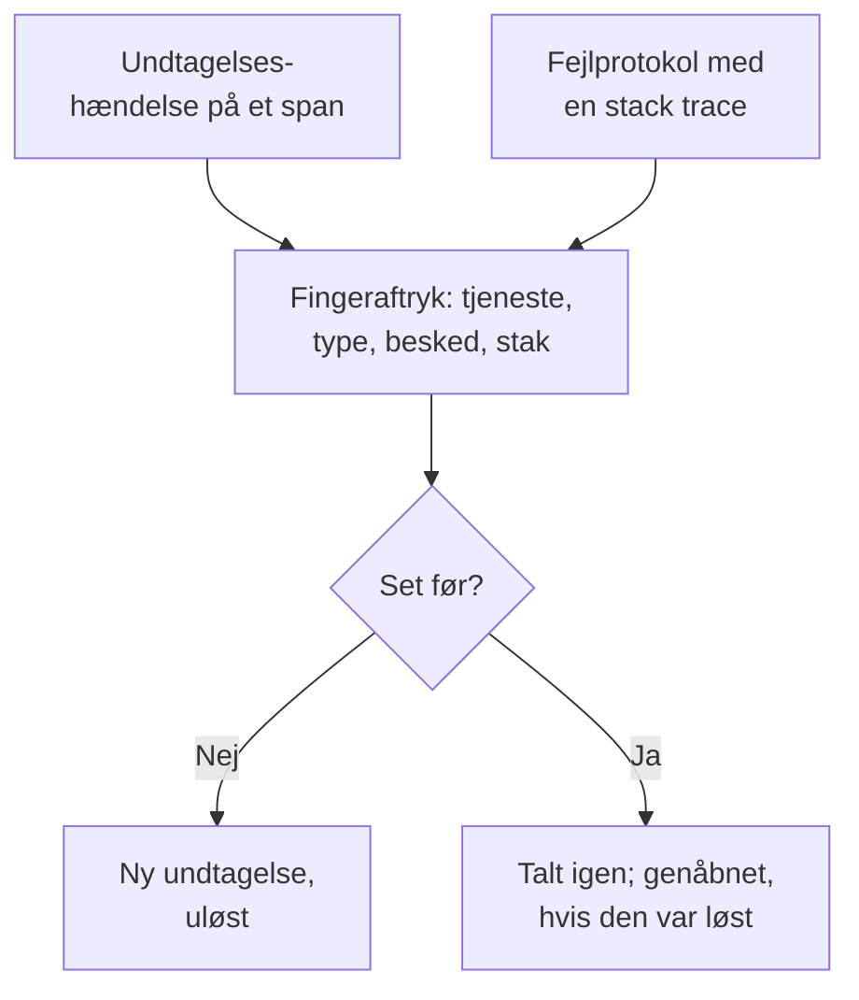

# Undtagelsessporing

Undtagelsessporing samler de fejl, din kode kaster, og grupperer hver forekomst af den samme fejl i én undtagelse med dens stack trace, dens udvikling og de forespørgsler, den opstod i. Gennemgå dem som en opgaveliste: ret, løs eller arkivér støjen, og lad AI åbne en pull request for dem, den kan rette.

:::cards
- [Hvor undtagelser kommer fra](#hvor-undtagelser-kommer-fra): Spans og protokoller, som dine tjenester allerede sender.
- [Gennemgå listen](#gennemgå-listen): Det uløste først, støjen skjult.
- [En undtagelses side](#en-undtagelses-side): Stack trace, forekomster og kontekst.
- [Ret den med AI](#ret-den-med-ai): En pull request med rettelsen eller en regressionstest.
:::

## Hvor undtagelser kommer fra

Du sender ikke undtagelser særskilt. OneUptime finder dem i den telemetri, dine tjenester allerede sender:

- en undtagelseshændelse på et span, som er det, OpenTelemetrys `recordException()` skriver;
- en protokol med attributterne `exception.type`, `exception.message` eller `exception.stacktrace`;
- en protokol med alvorligheden Error eller Fatal, hvis besked indeholder en stack trace, når protokollen ikke er skrevet inde i et span (spannet melder den allerede).

Hver forekomst grupperes med de tidligere forekomster af samme fejl i én undtagelse:

- **Én undtagelse pr. tjeneste og fejl.** Fingeraftrykket laves ud fra tjenesten, undtagelsestypen, beskeden og stack trace. Værdier, der ændrer sig fra kald til kald, tages ud først: UUID'er og andre ID'er, tidsstempler, IP- og e-mailadresser samt tal med syv cifre eller flere. Derfor er `Order id=1042 not found` og `Order id=2077 not found` én undtagelse.
- **En ny forekomst genåbner en løst undtagelse.** Sker den igen, efter at du har løst den, holdt rettelsen ikke.
- **En arkiveret undtagelse forbliver arkiveret.** Dens nye forekomster tælles stadig, men de sender ikke længere notifikationer.

> [!TIP]
> For at holde en forventet fejl ude af undtagelsessporingen, såsom ugyldigt input, din tjeneste afviste, skal du sætte attributten `error.class` til `user-error` eller `expected-denial` på spannets undtagelseshændelse. Så registrerer OneUptime ingen undtagelse for den.

## Før du begynder

- **Spans eller protokoller, der ankommer.** Instrumentér dine tjenester med [OpenTelemetry](/docs/telemetry/open-telemetry). Fanen **Opsætningsvejledning** viser koden til dit sprog.
- **En rolle, der må læse telemetri.** Project Owner, Project Admin, Project Member, Viewer, Telemetry Admin, Telemetry Member eller Telemetry Viewer, eller en brugerdefineret rolle med tilladelsen Read Telemetry Service Exception. At løse og arkivere kræver Project Owner eller Project Admin eller tilladelsen Edit Telemetry Service Exception.

## Gennemgå listen

:::steps
### Åbn undtagelser

Gå til **Produkter → Observabilitet → Undtagelser**. Mærket på fanen **Undtagelser** tæller de uløste problemer, og listen åbner på undtagelserne under **Uløst**.

### Vælg en status

Skift mellem **Uløst**, **Løst**, **Arkiveret** og **Alle**. Diagrammet over listen viser, hvor mange forekomster der var **Ikke håndteret**, og hvor mange der var **Håndteret** over tid.

### Vælg, hvad der tæller som et problem

**Problemer**, som er standard, skjuler brugerfejl og forventede afvisninger, så listen viser det, der kræver en rettelse. **User errors** viser kun dem, og **Alle** viser hver undtagelse.

### Søg og filtrér

Skriv en forespørgsel som `type:TypeError env:production`, se [Søgesyntaks](/docs/telemetry/search-syntax#undtagelser), eller klik på en værdi i sidepanelet **Filtre**: en tjeneste, en vært eller en anden ressource, en **Undtagelsestype**, et **Miljø** eller en **Error Class**.

### Åbn en undtagelse

Klik på en række for at åbne undtagelsens side.
:::

## En undtagelses side

Sidens sidemenu samler det, du gør med en undtagelse:

| Side | Hvad den viser |
| --- | --- |
| **Oversigt** | Beskeden, tjenesten, hvor ofte den skete, og hvornår den først og sidst blev set, dens udvikling over tid og dens seneste forekomst: release, miljø, span, spor og brugersession. |
| **Stack trace** | Stakkens frames. For browserkode de oprindelige filer og linjer, når du har uploadet [Source maps](/docs/telemetry/source-maps) til releasen. |
| **Occurrences** | Hver forekomst med dens tidspunkt, dens besked og det spor, den opstod i. |
| **Context** | Den seneste forekomsts attributter, dens sessionsoptagelse, når der er en, og de trin, der førte til den. |
| **Protokoller** | De protokoller, der blev skrevet omkring den seneste forekomst. |
| **AI Assistance** | AI-opgaver, der retter undtagelsen eller tester den. |
| **Indstillinger** | Løs eller arkivér undtagelsen. Den ligger under **Manage**, som er foldet sammen fra start. |

## Løs, genåbn og arkivér

Knapperne øverst på undtagelsens side og dens side **Indstillinger** ændrer dens status:

| Handling | Hvornår du bruger den | Hvad der sker bagefter |
| --- | --- | --- |
| **Løs** | Du har udrullet rettelsen. | Den forlader listen **Uløst**. En ny forekomst genåbner den. |
| **Reopen** | Rettelsen virkede ikke. | Den er uløst igen. |
| **Arkiver** | Det er støj, du ikke vil rette. | Den forlader listen. Nye forekomster tælles, men sender ikke længere notifikationer. |
| **Fjern fra arkiv** | Du vil høre om den igen. | Den er tilbage i den liste, den hører til i. |

**Indstillinger** viser, hvem der sidst løste eller arkiverede undtagelsen, og hvornår. Dens knapper hedder **Marker som løst** eller **Marker som uafklaret** og **Arkiver** eller **Fjern fra arkiv**.

## Fejlklasser

Hver undtagelse har en fejlklasse, der siger, hvis problem det er. OneUptime AI sætter den, når den gennemgår en indsigt om undtagelsen, såsom en ny eller hastigt stigende undtagelse: se [AI SRE](/docs/ai/ai-sre#indsigter-proaktiv-detektion). En undtagelse, den ikke har gennemgået, forbliver `unknown`.

| Klasse | Hvad den betyder | I **Problemer** |
| --- | --- | --- |
| `code-fault` | En fejl i koden. Den eneste klasse, AI retter på egen hånd. | Ja |
| `infrastructure` | En timeout, en afbrudt forbindelse eller opbrugte ressourcer. | Ja |
| `unknown` | Endnu ikke klassificeret. | Ja |
| `user-error` | Resultatet af ugyldigt input fra en bruger. | Nej |
| `expected-denial` | En kontrol, der gør sit arbejde, såsom et afvist login. | Nej |

Med **Arkivér forventede undtagelser** slået til i indstillingerne for AI-indsigter arkiveres de undtagelser, som gennemgangen finder at være forventede afvisninger, for dig.

## Ret den med AI

Siden **AI Assistance** tilbyder tre opgaver. Hver kører som en AI-opgave, der åbner en pull request i dit kodelager:

| Opgave | Hvad pull requesten gør |
| --- | --- |
| **Fix this exception with AI** | Retter grundårsagen. Start den med **Ret med AI**. |
| **Generate Regression Test** | Tilføjer en test, der fejler, indtil fejlen er rettet. |
| **Forbedr fejlhåndtering** | Til forventede fejl: validerer input tidligere, holder brugerdata ude af beskeder og markerer fejlen som håndteret. |

AI har først brug for tre ting: en LLM-udbyder, et forbundet lager (på GitHub, GitLab, Forgejo eller Gitea eller enhver Git-server) og en AI-agent online til at køre opgaven. Siden kontrollerer hver af dem og linker til det, der mangler. Opgaverne holder pause, mens undtagelsen er løst eller arkiveret. Se [Kode](/docs/ai/ai-agent).

## Indsigter i undtagelser

Fanen **Indsigter** tæller dine undtagelser under **Uløst**, **Løst** og **Arkiveret** og din løsningsrate og viser de hyppigste undtagelser, de tjenester, de rammer, og dem, der senest er set.

## Fejlfinding

:::details En undtagelse, jeg lige har kastet, er ikke i listen
Tjek først visningen: **Problemer** skjuler brugerfejl og forventede afvisninger, så vælg **Alle**. Udvid derefter tidsintervallet, og kontrollér, at undtagelsen blev registreret på et span eller i en protokol med en stack trace.
:::

:::details Én fejl vises som flere undtagelser
Fingeraftrykket omfatter beskeden og stack trace. Når de er forskellige, for eksempel når en besked indeholder et kort tal eller et navn, der ændrer sig ved hvert kald, er hver variant sin egen undtagelse.
:::

:::details En løst undtagelse bliver ved med at komme tilbage
En ny forekomst genåbner med vilje en løst undtagelse: fejlen sker stadig. Kontrollér, at rettelsen nåede den release, der rapporterer den, eller arkivér undtagelsen, hvis du ikke længere vil høre om den.
:::

## Næste skridt

:::cards
- [Undtagelse-monitor](/docs/monitor/exceptions-monitor): Få besked, når undtagelser stiger brat.
- [Source maps](/docs/telemetry/source-maps): Læsbare stack traces til browserkode.
- [Kode](/docs/ai/ai-agent): Sådan retter AI kode og åbner pull requests.
- [Sporudforsker](/docs/telemetry/traces-explorer): Se den forespørgsel, en undtagelse opstod i.
:::
