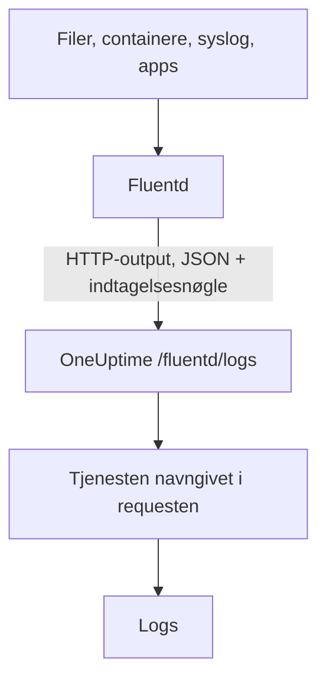

# Fluentd

[Fluentd](https://www.fluentd.org/) indsamler logs fra filer, containere, syslog, applikationer og [mange andre kilder](https://www.fluentd.org/datasources). Dens indbyggede [HTTP-output](https://docs.fluentd.org/output/http) sender dem til OneUptimes Fluentd-endpoint, hvor de bliver søgbare under **Produkter → Protokoller**.

:::cards
- [Konfigurér Fluentd](#konfigurér-fluentd): Tilføj et HTTP-output, der peger på OneUptime.
- [Sådan læses poster](#sådan-læses-poster): Hvilke felter der bliver til beskeden, alvorsgraden og attributter.
- [Selvhostet OneUptime](#selvhostet-oneuptime): Peg Fluentd på din egen instans.
:::

## Sådan virker det



Fluentd sender poster i batches som JSON med din indtagelsesnøgle i headeren `x-oneuptime-token` og tjenestenavnet i `x-oneuptime-service-name`. OneUptime gør hver post til en log for den tjeneste og opretter tjenesten første gang, den sender.

## Før du begynder

- **Installér Fluentd** – se [installationsvejledningen](https://docs.fluentd.org/installation).
- **Et OneUptime-projekt.** I OneUptime Cloud afregnes telemetri pr. indtaget GB – se [priser](https://oneuptime.com/pricing) – og et projekt på Free-planen skal have en betalingsmetode, før det kan sende telemetri.
- **En indtagelsesnøgle til telemetri.** Hvis du ikke har en:

:::steps
### Åbn indtagelsesnøglerne

Gå til **Produkter → Projektindstillinger**, åbn **Telemetri og APM** i sidemenuen, og vælg **Indtagelsesnøgler**.


### Opret en nøgle

Klik på **Opret indtagelsesnøgle**. Dialogen har allerede udfyldt nøglens navn og valgt **Server** – den slags nøgle, en applikation eller en collector sender med – så klik på **Opret indtagelsesnøgle** for at oprette den, eller omdøb den først.

### Kopiér hemmeligheden

Den nye nøgle åbner på sin egen side. Kopiér dens **Hemmelig nøgle**: Det er `YOUR_SERVICE_TOKEN` i konfigurationen nedenfor.


:::

## Konfigurér Fluentd

Fluentds konfigurationsfil er normalt `/etc/fluent/fluentd.conf`, eller `/etc/td-agent/td-agent.conf` for den ældre td-agent-pakke.

:::steps
### Tilføj et HTTP-output

Tilføj en `<match>`-sektion, der sender poster til OneUptime. Erstat `YOUR_SERVICE_TOKEN` med din indtagelsesnøgle og `YOUR_SERVICE_NAME` med det navn, loggene skal vises under – et hvilket som helst navn:

```text title="fluentd.conf"
# Send the time Fluentd gave each event: the HTTP output sends only the record
<filter **>
  @type record_transformer
  enable_ruby true
  <record>
    fluentd_time ${time.utc.strftime("%Y-%m-%dT%H:%M:%S.%NZ")}
  </record>
</filter>

# Match all patterns
<match **>
  @type http

  endpoint https://oneuptime.com/fluentd/logs
  open_timeout 2

  headers {"x-oneuptime-token":"YOUR_SERVICE_TOKEN", "x-oneuptime-service-name":"YOUR_SERVICE_NAME"}

  content_type application/json
  json_array true

  # Send a batch again when OneUptime is busy (429) or restarting (502, 503, 504)
  retryable_response_codes 429,502,503,504

  <format>
    @type json
  </format>
  <buffer>
    # Keep the batches on disk until OneUptime takes them: a restart of Fluentd loses none
    @type file
    path /var/log/fluent/buffer/oneuptime
    total_limit_size 512m
    flush_interval 10s
    chunk_limit_size 900k
    # Try again at least every 30 seconds, for up to 72 hours
    retry_max_interval 30s
    retry_timeout 72h
  </buffer>
</match>

# Keep Fluentd's own logs out of OneUptime
<label @FLUENT_LOG>
  <match **>
    @type null
  </match>
</label>
```

`json_array true` sender hver chunk i bufferen som ét JSON-array, og `flush_interval 10s` sender bufferen hvert 10. sekund. `chunk_limit_size 900k` holder hver request under 1 MB, det højeste OneUptime tager imod på dette endpoint.

Fluentds egen standard virker også: uden `content_type` og `json_array true` sender Fluentd linjeopdelt JSON, én post pr. linje, og OneUptime læser hver linje som den post, den er, med `compress gzip` eller uden.

`@type file` gemmer de batches, der endnu skal sendes, i den mappe, `path` angiver, så en genstart af Fluentd ikke mister nogen af dem; en buffer i hukommelsen, Fluentds standard, mister det, den rummer. Fluentds bruger skal kunne skrive i mappen: `/var/log/fluent` er fluent-packages, `/var/log/td-agent` td-agents, og `/fluentd/log` er den i imaget `fluent/fluentd`. `total_limit_size 512m` gemmer højst 512 MB der; når den er fuld, tager Fluentd ikke imod flere poster, før en batch er sendt.

`retryable_response_codes 429,502,503,504` sender en batch igen, når OneUptime har travlt (`429`) eller genstarter (`502`, `503`, `504`); uden den smider Fluentd en batch væk ved ethvert svar undtagen `503`. `retry_max_interval 30s` venter højst 30 sekunder mellem forsøgene, og `retry_timeout 72h` smider en batch væk, som stadig ikke kan sendes efter 72 timer. Filteret `record_transformer` tilføjer det tidspunkt, Fluentd gav hver post, som `fluentd_time`: HTTP-outputtet sender kun posten, og OneUptime læser en logs tidspunkt fra den.

### Genstart Fluentd

Genstart Fluentd-tjenesten, så den indlæser det nye output.

### Tjek, at logs ankommer

Få sekunder efter næste tømning vises loggene under **Produkter → Protokoller**. Tjenesten står under **Produkter → Tjenester** – fandtes den ikke i forvejen, opretter OneUptime den.
:::

## Komplet eksempel

Denne konfiguration modtager poster over Fluentds forward-protokol på port `24224`, kun fra denne vært, og sender dem alle til OneUptime:

```text title="fluentd.conf"
####
## Source descriptions:
##

## built-in TCP input
## @see https://docs.fluentd.org/input/forward
<source>
  @type forward
  port 24224
  # This host alone: see "Take records from other hosts" to open it
  bind 127.0.0.1
</source>

# Send the time Fluentd gave each event: the HTTP output sends only the record
<filter **>
  @type record_transformer
  enable_ruby true
  <record>
    fluentd_time ${time.utc.strftime("%Y-%m-%dT%H:%M:%S.%NZ")}
  </record>
</filter>

<match **>
  @type http

  endpoint https://oneuptime.com/fluentd/logs
  open_timeout 2

  headers {"x-oneuptime-token":"YOUR_SERVICE_TOKEN", "x-oneuptime-service-name":"YOUR_SERVICE_NAME"}

  content_type application/json
  json_array true

  # Send a batch again when OneUptime is busy (429) or restarting (502, 503, 504)
  retryable_response_codes 429,502,503,504

  <format>
    @type json
  </format>
  <buffer>
    # Keep the batches on disk until OneUptime takes them: a restart of Fluentd loses none
    @type file
    path /var/log/fluent/buffer/oneuptime
    total_limit_size 512m
    flush_interval 10s
    chunk_limit_size 900k
    # Try again at least every 30 seconds, for up to 72 hours
    retry_max_interval 30s
    retry_timeout 72h
  </buffer>
</match>

# Keep Fluentd's own logs out of OneUptime
<label @FLUENT_LOG>
  <match **>
    @type null
  </match>
</label>
```

`bind 127.0.0.1` tager kun imod poster fra denne vært, som dem fra Dockers logdriver `fluentd`, der sender til `localhost:24224`. Vil du sende forskellige kilder som forskellige tjenester, så brug én `<match>`-sektion pr. tag, hver med sit eget `x-oneuptime-service-name` og sin egen buffer-`path`: Fluentd starter ikke med to buffere på samme sti.

## Modtag poster fra andre værter

Med `bind 0.0.0.0` og ingen `<security>`-sektion kan alle, der kan nå port `24224`, sende logs til OneUptime under din indtagelsesnøgle. For at modtage poster fra Fluentd eller Fluent Bit på andre værter skal du lytte på alle adresser, kræve en delt nøgle af hver afsender og bruge TLS. Erstat `<source>`-sektionen i det komplette eksempel med:

```text title="fluentd.conf on this host"
<source>
  @type forward
  port 24224
  bind 0.0.0.0
  <transport tls>
    cert_path /etc/fluent/certs/fluentd.crt
    private_key_path /etc/fluent/certs/fluentd.key
  </transport>
  <security>
    self_hostname fluentd.example.com
    shared_key YOUR_SHARED_KEY
  </security>
</source>
```

`cert_path` og `private_key_path` er et certifikat til denne værts navn, her `fluentd.example.com`, og dets nøgle, som Fluentds bruger skal kunne læse. Fluentd advarer, når nøglen ikke har nogen adgangsfrase; `private_key_passphrase` sætter en. Erstat `YOUR_SHARED_KEY` med en lang tilfældig hemmelighed, for eksempel en fra `openssl rand -base64 32`, og giv hver afsender den samme:

```text title="fluentd.conf on each sender"
<match **>
  @type forward
  transport tls
  # The certificate of the authority that signed this host's; not needed for a public one
  tls_cert_path /etc/fluent/certs/ca.crt
  <security>
    self_hostname app-1.example.com
    shared_key YOUR_SHARED_KEY
  </security>
  <server>
    host fluentd.example.com
    port 24224
  </server>
  <buffer>
    @type file
    path /var/log/fluent/buffer/forward
  </buffer>
</match>

# Keep Fluentd's own logs out of OneUptime
<label @FLUENT_LOG>
  <match **>
    @type null
  </match>
</label>
```

Fluent Bits `forward`-output tager de samme indstillinger: `Shared_Key`, `Self_Hostname`, `tls On` og `tls.ca_file`.

En afsender uden nøglen eller uden TLS bliver afvist. Selve nøglen krydser aldrig netværket: hver side beviser, at den har den. Uden TLS kan alle på netværket mellem værterne læse posterne. Åbn kun port `24224` i værtens firewall for de værter, der sender. Kører Fluentd fra logvejledningens Docker Compose-fil, så udgiv også porten på alle adresser der, `"24224:24224"`, og montér certifikatets mappe i containeren.

## Sådan læses poster

OneUptime læser disse felter fra hver post:

| Logfelt | Læses fra postens første tilstedeværende felt af | Bemærkninger |
| --- | --- | --- |
| Indhold | `message`, `log`, `msg`, `body`, `text` | Loglinjen. En post uden nogen af dem gemmes hel, som JSON. |
| Alvorsgrad | `level`, `severity`, `loglevel`, `log_level`, `priority`, `severityText`, `severity_text` | Navne som `trace`, `debug`, `info`, `notice`, `warn`, `error`, `critical` og `fatal`, med store eller små bogstaver. Enhver anden værdi gemmes som `Unspecified`. |
| Trace-ID | `trace_id`, `traceId`, `traceid` | Kobler loggen til dens trace. |
| Span-ID | `span_id`, `spanId`, `spanid` | Kobler loggen til dens span. |
| Tjeneste | headeren `x-oneuptime-service-name` | `Fluentd`, når headeren ikke er sat. |
| Tid | `time`, `timestamp`, `@timestamp`, `ts`, `fluentd_time` | Et ISO 8601-tidspunkt, for eksempel `2026-11-14T08:00:00.123Z`, eller sekunder, millisekunder, mikrosekunder eller nanosekunder siden epoken; et tidspunkt uden tidszone er UTC. Et tidspunkt før 2000, eller mere end en dag frem, læses ikke. Feltet, tidspunktet læses fra, gemmes ikke som attribut. En post uden tidspunkt gemmes på det tidspunkt, hvor OneUptime modtager den. |

Alle andre felter bliver til en attribut med navnet `fluentd.` efterfulgt af feltets navn, som du kan søge og filtrere på: Et felt `container_name` er `@fluentd.container_name` i log-exploreren. Et indlejret objekt bliver fladet ud med punktummer, f.eks. `fluentd.kubernetes.pod_name`, og en liste gemmes som JSON.

Fluentd-logs går gennem dine [logpipelines](/docs/telemetry/log-pipelines), drop-filtre og maskeringsregler som enhver anden log.

## Selvhostet OneUptime

Erstat `https://oneuptime.com` i `endpoint` med URL'en til din OneUptime-instans: `http(s)://YOUR_ONEUPTIME_HOST/fluentd/logs`.

## Fejlfinding

:::details Fluentd logger `401` fra HTTP-outputtet
Indtagelsesnøglen mangler, er ukendt eller udløbet. Tjek værdien af `x-oneuptime-token` i `headers`.
:::

:::details Fluentd logger `402` eller `422`
`402`: I OneUptime Cloud er projektet på Free-planen og har ingen betalingsmetode. Tilføj en under **Projektindstillinger → Fakturering og fakturaer → Fakturering**. `422`: Nøglen er deaktiveret, eller det er en browsernøgle. Slå **Aktiveret** til igen i nøglens indstillinger, eller opret en **Server**-nøgle.
:::

:::details Fluentd logger `413`
Requesten er over 1 MB, det højeste OneUptime tager imod på dette endpoint. Sæt `chunk_limit_size 900k` i `<buffer>`-sektionen, som i konfigurationen ovenfor.
:::

:::details Fluentd logger `429`, `502`, `503` eller `504`
OneUptime har travlt eller genstarter. Med `retryable_response_codes 429,502,503,504` i `<match>`-sektionen, som i konfigurationen ovenfor, beholder Fluentd batchen og sender den igen; uden den smider Fluentd batchen væk. Med `@type file` i `<buffer>`-sektionen beholder Fluentd også batchen, når den genstarter.
:::

:::details Logs viser det tidspunkt, OneUptime modtog dem, ikke deres eget
OneUptime læser en logs tidspunkt fra dens post, og Fluentds HTTP-output sender kun posten. En `<parse>`-sektion tager feltet `time` ud af posten som hændelsens tidspunkt: tilføj `time_key fluentd_time` til den, så den ikke læser nogen posts tidspunkt og lader `time` være, som det er. Tilføj også filteret `record_transformer` fra konfigurationen ovenfor: det tilføjer det tidspunkt, Fluentd gav hver post, som `fluentd_time`.
:::

:::details En JSON-linje, hvis `time` er `null`, `true`, en liste eller et objekt, kommer aldrig frem
Fluentds `json`-parser læser en linjes felt `time` som hændelsens tidspunkt og smider uden advarsel en linje væk, hvis `time` hverken er tekst eller et tal. Tilføj `time_key fluentd_time` til dens `<parse>`-sektion, som ovenfor: så lader Fluentd `time` stå i posten, som det er. Med filteret `record_transformer` ovenfor gemmer OneUptime loggen på det tidspunkt, Fluentd læste den, `fluentd_time`; uden det på det tidspunkt, OneUptime modtager den.
:::

:::details Logs ankommer under tjenesten `Fluentd`
Headeren `x-oneuptime-service-name` mangler. Tilføj den til `headers` i hver `<match>`-sektion.
:::

:::details Logindholdet viser hele posten som JSON
OneUptime tager indholdet fra det første tilstedeværende felt af `message`, `log`, `msg`, `body` eller `text` og gemmer hele posten, når den ikke har nogen af dem. Omdøb feltet med din loglinje til et af dem, for eksempel med Fluentds filter `record_transformer`.
:::

Har du spørgsmål eller brug for hjælp med konfigurationen, så skriv til os på support@oneuptime.com.

## Næste trin

:::cards
- [Logpipelines](/docs/telemetry/log-pipelines): Fortolk og berig de logs, Fluentd sender.
- [Søgesyntaks](/docs/telemetry/search-syntax): Find loggene i log-exploreren.
- [Fluent Bit](/docs/telemetry/fluentbit): En lettere agent, der sender over OpenTelemetry.
- [Log-monitor](/docs/monitor/logs-monitor): Få besked, når matchende logs dukker op.
:::
