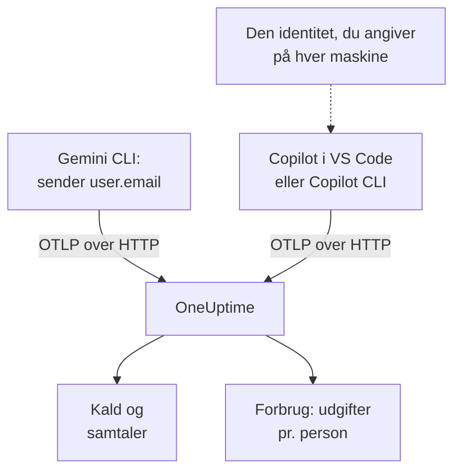

# Gemini CLI og GitHub Copilot

Gemini CLI og GitHub Copilot eksporterer begge selv OpenTelemetry: peg dem mod OneUptime, og deres modelkald, tokens, omkostninger og værktøjskald ankommer i [AI / LLM](/docs/telemetry/ai-llm-observability) ved siden af dine egne apps' AI-kald. De adskiller sig i det, der betyder mest for viderefakturering: Gemini CLI navngiver personen på hver post, og Copilot navngiver ingen, så du navngiver selv hver udvikler.

:::cards
- [Gemini CLI](#opsæt-gemini-cli): Slå telemetri til, med traces, og send den direkte til OneUptime.
- [GitHub Copilot](#opsæt-github-copilot): Eksportér fra VS Code eller Copilot CLI.
- [Navngiv hver udvikler](#navngiv-hver-udvikler): Den identitet, Copilot udelader.
- [Fejlfinding](#fejlfinding): Hvad du tjekker, når intet ankommer.
:::

## Sådan virker det



| | Gemini CLI | GitHub Copilot |
| --- | --- | --- |
| Sender | Traces, metrikker og logs | Traces, metrikker og hændelser, kun fra sine agentflader |
| Navngiver personen | `user.email`, når nogen er logget ind | Ingen: du angiver `enduser.id` og `user.email` |
| Prompttekst | Sendes, medmindre du slår `logPrompts` fra | Sendes ikke, medmindre du slår `captureContent` til |
| Sender som standard til | `http://localhost:4317`, over gRPC | `http://localhost:4318`, over HTTP |

## Før du begynder

- En ingestion-nøgle: åbn **Projektindstillinger → Telemetri og APM → Indtagelsesnøgler**, og klik på **Opret ingestion-nøgle**.
- Din OTLP-basis-URL: `https://oneuptime.com/otlp`, eller `https://YOUR-ONEUPTIME-HOST/otlp`, hvis du selv hoster OneUptime.
- Nøglen følger med i headeren `x-oneuptime-token` på hver eksportanmodning.

## Opsæt Gemini CLI

Gemini CLI sender traces, metrikker og loghændelser og sætter `user.email` på hver post, når nogen er logget ind. OneUptime læser `user.email` som medarbejderen, så hver persons forbrug vises uden tilknytningstabel og uden opsætning pr. maskine.

:::steps
### Slå telemetri til

Tilføj en blok `telemetry` til brugerindstillingsfilen på hver maskine eller til `.gemini/settings.json` i et repository:

```json title="~/.gemini/settings.json"
{
  "telemetry": {
    "enabled": true,
    "target": "local",
    "otlpEndpoint": "https://oneuptime.com/otlp",
    "otlpProtocol": "http",
    "otlpHeaders": {
      "x-oneuptime-token": "YOUR_INGESTION_TOKEN"
    },
    "traces": true,
    "logPrompts": false
  }
}
```

### Start en ny session

Gemini CLI læser sine indstillinger, når den starter, så start den igen, og kør en prompt.

### Tjek, at data ankommer

Åbn **Produkter → AI / LLM → Kald**: kaldene står under tjenesten `gemini-cli` med modellen og tokens.
:::

Tre indstillinger i den blok betyder mere end resten:

- `otlpProtocol: "http"`. Gemini CLI bruger gRPC, medmindre du angiver andet. Over HTTP tilføjer den selv `/v1/traces`, `/v1/metrics` og `/v1/logs` til basis-URL'en. OneUptime accepterer også gRPC på port 443 (se [OTLP over gRPC](/docs/telemetry/open-telemetry#otlp-over-grpc)), men HTTP er enklere.
- `traces: true`. Den er slået fra som standard, og uden den bærer Gemini CLI's spans hverken model eller tokenoptællinger, så intet kan prissættes. Gemini CLI sender heller ingen omkostningsmetrik: slå traces til for at se, hvad dens kald koster.
- `logPrompts: false`. Læs advarslen nedenfor.

> [!WARNING]
> `logPrompts` er `true` som standard, så når du slår telemetri til, sendes den tekst, dine udviklere skriver: ofte kildekode, kundedata og indsatte loginoplysninger. Sæt den til `false` i den samme ændring, der slår telemetri til. Vil du have prompts til fejlsøgning, så beslut det bevidst, og maskér det nødvendige med rensningsregler under **Spor → Indstillinger**.

### Indstillinger for en flåde

Hver indstilling har en miljøvariabel, og variablerne vinder over et repositorys `.gemini/settings.json`, hvilket gør dem til stedet for en flådepolitik, der rulles ud via MDM:

```bash
export GEMINI_TELEMETRY_ENABLED=true
export GEMINI_TELEMETRY_TARGET=local
export GEMINI_TELEMETRY_OTLP_ENDPOINT="https://oneuptime.com/otlp"
export GEMINI_TELEMETRY_OTLP_PROTOCOL=http
export GEMINI_TELEMETRY_OTLP_HEADERS="x-oneuptime-token=YOUR_INGESTION_TOKEN"
export GEMINI_TELEMETRY_TRACES_ENABLED=true
export GEMINI_TELEMETRY_LOG_PROMPTS=false
```

| Indstilling | Variabel | Standard | Hvad den gør |
| --- | --- | --- | --- |
| `enabled` | `GEMINI_TELEMETRY_ENABLED` | `false` | Slår telemetri til |
| `target` | `GEMINI_TELEMETRY_TARGET` | `local` | `local` sender til det endpoint, du angiver; `gcp` sender til Google Cloud |
| `otlpEndpoint` | `GEMINI_TELEMETRY_OTLP_ENDPOINT` | `http://localhost:4317` | Hvor telemetrien sendes hen |
| `otlpProtocol` | `GEMINI_TELEMETRY_OTLP_PROTOCOL` | `grpc` | `grpc` eller `http` |
| `otlpHeaders` | `GEMINI_TELEMETRY_OTLP_HEADERS` | Ingen | Headere på hver eksport: et objekt i filen, `key=value`-par eller JSON i variablen |
| `traces` | `GEMINI_TELEMETRY_TRACES_ENABLED` | `false` | Sætter model, tokens og indhold på spans |
| `logPrompts` | `GEMINI_TELEMETRY_LOG_PROMPTS` | `true` | Sætter prompttekst i loghændelser |
| `outfile` | `GEMINI_TELEMETRY_OUTFILE` | Ingen | Skriver i stedet telemetri til en fil, så du kan se, hvad der ville blive sendt |

Kommandolinjeflag vinder over variablerne `GEMINI_TELEMETRY_*`, som vinder over standardvariablerne `OTEL_EXPORTER_OTLP_*`, som vinder over `settings.json`. Gemini CLI læser også `OTEL_EXPORTER_OTLP_HEADERS`, så en header, du allerede har angivet til andre værktøjer, også når frem til den.

:::details Send i stedet gennem en OpenTelemetry Collector
En collector på hver maskine, eller én pr. team, kan samle, gentage og videresende telemetri, før den når OneUptime. Lad Gemini CLI køre med sine standarder, som sender gRPC til `http://localhost:4317`, og lad collectoren tilføje nøglen:

```yaml title="otel-collector-config.yaml"
receivers:
  otlp:
    protocols:
      grpc:
        endpoint: 0.0.0.0:4317
      http:
        endpoint: 0.0.0.0:4318

exporters:
  otlphttp:
    endpoint: "https://oneuptime.com/otlp"
    headers:
      "x-oneuptime-token": "YOUR_INGESTION_TOKEN"

service:
  pipelines:
    traces:
      receivers: [otlp]
      exporters: [otlphttp]
    metrics:
      receivers: [otlp]
      exporters: [otlphttp]
    logs:
      receivers: [otlp]
      exporters: [otlphttp]
```

Se [OpenTelemetry](/docs/telemetry/open-telemetry) for at køre en collector.
:::

### Hvad Gemini CLI sender

| Metrik | Hvad den bærer |
| --- | --- |
| `gen_ai.client.token.usage` | Input- og outputtokens: den serie, OneUptime tæller |
| `gemini_cli.token.usage` | De samme tokens under Gemini CLI's eget navn plus dens tokens `thought`, `cache` og `tool`; tælles ikke, så tokens aldrig tælles to gange |
| `gen_ai.client.operation.duration` | Hvor lang tid hvert modelkald tog |
| `gemini_cli.api.request.count` | Modelkald |
| `gemini_cli.tool.call.count` | Værktøjskald |
| `gemini_cli.session.count` | Startede sessioner |
| `gemini_cli.lines.changed` | Linjer, agenten ændrede |

Dens loghændelser omfatter `gemini_cli.user_prompt`, `gemini_cli.api_request`, `gemini_cli.api_response`, `gemini_cli.api_error`, `gemini_cli.tool_call` og `gemini_cli.file_operation`. Hver post bærer `session.id`, `installation.id`, `active_approval_mode` og, når nogen er logget ind, `user.email`. OneUptime læser `session.id` som et samtale-ID, så en hel Gemini CLI-session vises som én samtale under **Samtaler**, uanset hvor mange traces den brugte.

Metrikkerne er almindelige OpenTelemetry-metrikker: vis en hvilken som helst af dem i et diagram på et dashboard, eller advar på en med en [Metrik-monitor](/docs/monitor/metrics-monitor).

## Opsæt GitHub Copilot

GitHub dokumenterer kun OpenTelemetry for Copilots agentflader:

| Flade | Sender OpenTelemetry |
| --- | --- |
| Copilot Chat og agenttilstand i VS Code | Ja |
| Copilot CLI | Ja |
| Copilot SDK | Ja |
| Agentworkflows i JetBrains-IDE'er | Ja, angivet i indstillingerne for Copilot-pluginnet |
| Inline-fuldførelser, Copilot på github.com, kodegennemgang med Copilot | Ikke dokumenteret |

Et team, der mest bruger inline-fuldførelser, ser derfor inaktivt ud i OneUptime, uanset hvordan eksporten er sat op.

:::tabs
@tab VS Code
```json title="settings.json"
{
  "github.copilot.chat.otel.enabled": true,
  "github.copilot.chat.otel.exporterType": "otlp-http",
  "github.copilot.chat.otel.otlpEndpoint": "https://oneuptime.com/otlp",
  "github.copilot.chat.otel.captureContent": false
}
```
@tab Copilot CLI
```bash
export COPILOT_OTEL_ENABLED=true
export OTEL_EXPORTER_OTLP_ENDPOINT="https://oneuptime.com/otlp"
export OTEL_EXPORTER_OTLP_HEADERS="x-oneuptime-token=YOUR_INGESTION_TOKEN"
```
@tab Administrerede indstillinger
```json
{
  "telemetry": {
    "enabled": true,
    "endpoint": "https://oneuptime.com/otlp",
    "protocol": "http/protobuf",
    "serviceName": "github-copilot",
    "captureContent": false,
    "lockCaptureContent": true,
    "headers": {
      "x-oneuptime-token": "YOUR_INGESTION_TOKEN"
    }
  }
}
```
:::

- VS Codes indstillinger har ingen nøgle til headere: angiv `OTEL_EXPORTER_OTLP_HEADERS` i det miljø, VS Code starter fra, som for Copilot CLI. Miljøvariabler vinder over VS Codes indstillinger.
- Administrerede indstillinger, som en virksomhed ruller ud til VS Code og Copilot CLI, bærer nøglen i `headers` og vinder over det, hver udvikler angiver. `lockCaptureContent` holder opsamling af prompts slået fra for alle. `protocol` er dér dataformatet, `http/protobuf` eller `http/json`.
- `captureContent` er slået fra som standard, så prompts og svar sendes ikke, medmindre du slår den til.

## Navngiv hver udvikler

Copilot sender ingen identitet, OneUptime kan bruge. Dens indstilling `captureIdentity` tilføjer `user.name`, og Copilot CLI kan tilføje `enduser.pseudo.id`, men OneUptime læser ingen af dem som medarbejderen. Uden en identitet havner hele Copilots forbrug i én række **Ikke tildelt** på fanen **Forbrug**.

Angiv identiteten på hver maskine, i det miljø VS Code og Copilot CLI starter fra: en shellprofil eller et script, som din MDM kører.

```bash
export OTEL_RESOURCE_ATTRIBUTES="enduser.id=alice@example.com,user.email=alice@example.com,team.id=platform,cost_center=eng-tools"
```

| Attribut | OneUptime læser den som |
| --- | --- |
| `enduser.id` | Medarbejderens ID |
| `user.email` | Medarbejderens e-mail: det navn, fanen **Forbrug** viser |
| `team.id`, `team`, `cost_center`, `department` | Teamet eller omkostningsstedet |

Det er ressourceattributter, så de ankommer som `resource.enduser.id`, `resource.user.email` osv.: OneUptime læser hver identitets- og teamnøgle med eller uden præfikset `resource.`. Gemini CLI sender allerede `user.email`; giv den kun `OTEL_RESOURCE_ATTRIBUTES` for teamets skyld.

- Angiv identiteten før det første kald: kald, der ankom uden en, kan ikke tildeles bagefter.
- Udelad `resourceAttributes` fra Copilots administrerede indstillinger: de vinder over `OTEL_RESOURCE_ATTRIBUTES` og ville erstatte den identitet, du har angivet på hver maskine.
- Brug ikke `gen_ai.user` eller `llm.user`. I en app, der betjener kunder, navngiver de kunden, så OneUptime læser dem aldrig som medarbejderen.

## Sådan ser Copilots data ud

Copilot følger OpenTelemetrys GenAI-konventioner, så dens kald vises i **Kald**, **Samtaler** og **Forbrug** som dine egne apps' kald.

| Span | Ét pr. |
| --- | --- |
| `invoke_agent` | Agenttur |
| `chat` | Modelkald |
| `execute_tool` | Værktøjskald |
| `execute_hook` | Hookkørsel |

Dens spans bærer modellen, `gen_ai.usage.input_tokens`, `gen_ai.usage.output_tokens` og `gen_ai.conversation.id`, så en hel agenttur vises som én samtale. Begge flader sender også metrikkerne `gen_ai.client.token.usage` og `gen_ai.client.operation.duration` og hændelser på OTLP-logsignalet: behold en pipeline `logs` i enhver collector, du sætter imellem.

OneUptime prissætter hvert kald ud fra dets model og tokens til taksterne under **Priser**. Det er, hvad tokens ville koste til listepris, ikke hvad GitHub fakturerer dig: Copilot betales pr. licens og pr. premium-anmodning.

Licenser, licensaktivitet og fakturering af premium-anmodninger findes slet ikke i OpenTelemetry: de ligger i GitHubs REST-API, som OneUptime ikke læser. Hent licens- og faktureringstal fra GitHub.

## Fejlfinding

:::details Intet ankommer fra Gemini CLI
Den sædvanlige årsag er, at `otlpProtocol` står på sin standard `grpc`, mens endpointet er HTTP-URL'en. Sæt `otlpProtocol` til `http`, og tjek, at `otlpEndpoint` er basis-URL'en, der slutter på `/otlp`, og at headeren `x-oneuptime-token` er angivet. Angiv `outfile` et øjeblik for at se, hvad Gemini CLI ville sende.
:::

:::details Gemini CLI's kald ankommer uden model, tokens eller omkostning
`traces` er slået fra. Slå den til: uden den bærer Gemini CLI's spans hverken model eller tokenoptællinger, og den sender ingen omkostningsmetrik.
:::

:::details Copilots forbrug vises som Ikke tildelt
Identiteten nåede ikke frem til eksportøren. Tjek, at `OTEL_RESOURCE_ATTRIBUTES` er angivet i det miljø, VS Code eller Copilot CLI startede fra, og at Copilots administrerede indstillinger ikke angiver `resourceAttributes`, som ville erstatte den.
:::

:::details Copilot sender slet ingenting
Tjek, at de personer, du forventer, bruger en agentflade og ikke inline-fuldførelser, og at `OTEL_EXPORTER_OTLP_HEADERS` bærer nøglen: VS Codes egne indstillinger kan ikke.
:::

:::details Nøglen afvises
OneUptime svarer `401` på en manglende, ukendt eller udløbet nøgle og `422` på en deaktiveret nøgle eller en browsernøgle. Brug en servernøgle, sendt i `x-oneuptime-token`.
:::

## Næste trin

:::cards
- [AI-kodeassistenter](/docs/telemetry/ai-coding-assistants): Hvem der bruger hvilket værktøj, og hvad hver person og hvert team bruger.
- [AI- / LLM-observability](/docs/telemetry/ai-llm-observability): De attributter, OneUptime læser, hvordan omkostninger beregnes, og daglige budgetter.
- [AI-gateways](/docs/telemetry/ai-gateways): Værktøjer uden egen eksport, gennem en gateway.
:::
