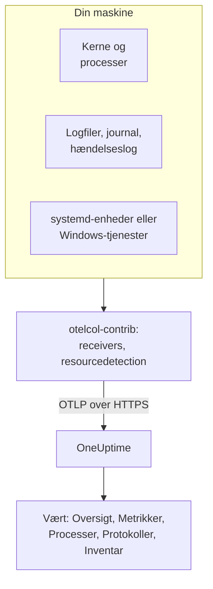

# OpenTelemetry-collector på værten

Kør OpenTelemetry Collector på en Linux-, macOS- eller Windows-maskine for at sende dens metrikker, processer, logs og tjenestetilstande til OneUptime. Maskinen vises under **Produkter → Infrastruktur → Værter** med sine egne sider, uden en OneUptime-agent at installere: collectoren er upstream-udgivelsen `otelcol-contrib`. [Værtsmonitorer](/docs/monitor/host-monitor) advarer ud fra det, den sender.

:::cards
- [Installer collectoren](#installer-collectoren): Tre trin på Linux, macOS eller Windows.
- [Vælg, hvad der skal indsamles](#vælg-hvad-der-skal-indsamles): Metrikker, fillogs, journalen, hændelseslogs og tjenestetilstande.
- [Inventarattributter](#inventarattributter-ip-mac-serienummer-fabrikat-model-firmware): IP, MAC, serienummer, fabrikat, model og firmware til din CMDB.
- [Send mindre](#reducering-af-den-indsamlede-datamængde): Færre loglinjer, grovere intervaller, færre serier.
:::

## Sådan virker det

Collectoren læser maskinen gennem sine receivers, stempler hver post med maskinens identitet og sender den til OneUptime over OTLP med din indtagelsesnøgle. OneUptime registrerer værten ud fra dens første metrikker og udfylder dens sider, efterhånden som dataene ankommer.



| Det, du ser på værten | Hvor det kommer fra |
| --- | --- |
| **Oversigt** og **Metrikker** | Receiveren `hostmetrics`: CPU, hukommelse, diske, filsystemer, netværk, belastning, paging. |
| **Processer** | Scraperen `process` i `hostmetrics`: ét sæt serier pr. proces. |
| **Protokoller** | Receiverne `filelog`, `journald` og `windowseventlog`. |
| **Systemd Units** (Linux) | Receiveren `systemd`. |
| **Tjenester** (Windows) | Receiveren `windows_service`. |
| Inventarelementet | Processoren `resourcedetection` plus de [attributter, du stempler](#inventarattributter-ip-mac-serienummer-fabrikat-model-firmware). |
| **Agentversion** | `oneuptime.agent.version` i processoren `resource`. |

En vært registreres, når en batch, der bærer `host.name`, også bærer `hostmetrics`- eller `process`-metrikker eller en `os.type`-attribut. Processoren `resourcedetection` sætter dem alle, og derfor holder hver konfiguration den først. `host.id` eller `host.arch` alene registrerer ikke en vært, og telemetri, der bærer en Kubernetes-identitet (`k8s.cluster.name`, `k8s.node.name`, `k8s.pod.name`), arkiveres i stedet under sin klynge: overvåg Kubernetes-noder med [Kubernetes-agenten](/docs/telemetry/kubernetes-agent).

## Før du begynder

- En indtagelsesnøgle. Opret en under **Projektindstillinger → Telemetri og APM → Indtagelsesnøgler**, og kopiér dens værdi. Collectoren sender den som headeren `x-oneuptime-token`.
- Administratorrettigheder på maskinen: `sudo` på Linux og macOS, en PowerShell-prompt med forhøjede rettigheder på Windows.
- Udgående HTTPS fra maskinen til din OneUptime-URL.
- Contrib-distributionen af collectoren, `otelcol-contrib`. Core-buildet `otelcol` mangler de receivers og processors, som disse konfigurationer bruger. Receiveren `systemd` (Linux) virker fra v0.143.0 og receiveren `windows_service` (Windows) fra v0.155.0; kommandoerne nedenfor installerer v0.161.0, den udgivelse, OneUptime fastlåser.

## Installer collectoren

:::steps
### Gem konfigurationen

Gem dette som `config.yaml` i den mappe, du vil køre installationskommandoerne fra, og erstat `YOUR_TELEMETRY_INGESTION_TOKEN` med din indtagelsesnøgle (og endpointet med din egen URL, hvis du selv hoster).

:::tabs
@tab Linux
```yaml title="config.yaml"
receivers:
  hostmetrics:
    collection_interval: 30s
    scrapers:
      cpu:
        metrics:
          system.cpu.utilization:
            enabled: true
          system.cpu.logical.count:
            enabled: true
      memory:
        metrics:
          system.memory.utilization:
            enabled: true
      disk:
      filesystem:
        metrics:
          system.filesystem.utilization:
            enabled: true
      load:
      network:
      paging:
      processes:
      process:
        mute_process_name_error: true
        mute_process_exe_error: true
        mute_process_io_error: true
        metrics:
          process.cpu.utilization:
            enabled: true
          process.memory.utilization:
            enabled: true

  # The systemd journal: every unit's logs, info and above.
  journald:
    directory: /var/log/journal
    priority: info

  # Powers the Systemd Units tab (otelcol-contrib v0.143.0+).
  systemd:
    collection_interval: 30s
    units: ["*.service"]
    metrics:
      systemd.service.cpu.time:
        enabled: false

processors:
  # Stamps host.name, host.id and os.type: this is how OneUptime attaches
  # telemetry to the host. Without it the host's pages stay empty.
  resourcedetection:
    detectors: [system, env]
    system:
      hostname_sources: [os]
      resource_attributes:
        host.name:
          enabled: true
        host.id:
          enabled: true
        host.arch:
          enabled: true
        host.ip:
          enabled: true
        host.mac:
          enabled: true
        os.type:
          enabled: true
        os.description:
          enabled: true
        os.version:
          enabled: true
  # The collector release this config is for: the host's Agent Version.
  resource:
    attributes:
      - key: oneuptime.agent.version
        value: "0.161.0"
        action: upsert
  batch:

exporters:
  otlphttp/oneuptime:
    endpoint: https://oneuptime.com/otlp
    headers:
      x-oneuptime-token: YOUR_TELEMETRY_INGESTION_TOKEN

service:
  pipelines:
    metrics:
      receivers: [hostmetrics, systemd]
      processors: [resourcedetection, resource, batch]
      exporters: [otlphttp/oneuptime]
    logs:
      receivers: [journald]
      processors: [resourcedetection, resource, batch]
      exporters: [otlphttp/oneuptime]
```
@tab macOS
```yaml title="config.yaml"
receivers:
  hostmetrics:
    collection_interval: 30s
    scrapers:
      cpu:
        metrics:
          system.cpu.utilization:
            enabled: true
          system.cpu.logical.count:
            enabled: true
      memory:
        metrics:
          system.memory.utilization:
            enabled: true
      disk:
      filesystem:
        metrics:
          system.filesystem.utilization:
            enabled: true
      load:
      network:
      paging:
      processes:
      process:
        mute_process_name_error: true
        mute_process_exe_error: true
        mute_process_io_error: true
        metrics:
          process.cpu.utilization:
            enabled: true
          process.memory.utilization:
            enabled: true

  filelog/system:
    include:
      - /var/log/install.log
      - /var/log/wifi.log
    start_at: end

processors:
  # Stamps host.name, host.id and os.type: this is how OneUptime attaches
  # telemetry to the host. Without it the host's pages stay empty.
  resourcedetection:
    detectors: [system, env]
    system:
      hostname_sources: [os]
      resource_attributes:
        host.name:
          enabled: true
        host.id:
          enabled: true
        host.arch:
          enabled: true
        host.ip:
          enabled: true
        host.mac:
          enabled: true
        os.type:
          enabled: true
        os.description:
          enabled: true
        os.version:
          enabled: true
  # The collector release this config is for: the host's Agent Version.
  resource:
    attributes:
      - key: oneuptime.agent.version
        value: "0.161.0"
        action: upsert
  batch:

exporters:
  otlphttp/oneuptime:
    endpoint: https://oneuptime.com/otlp
    headers:
      x-oneuptime-token: YOUR_TELEMETRY_INGESTION_TOKEN

service:
  pipelines:
    metrics:
      receivers: [hostmetrics]
      processors: [resourcedetection, resource, batch]
      exporters: [otlphttp/oneuptime]
    logs:
      receivers: [filelog/system]
      processors: [resourcedetection, resource, batch]
      exporters: [otlphttp/oneuptime]
```
@tab Windows
```yaml title="config.yaml"
receivers:
  hostmetrics:
    collection_interval: 30s
    scrapers:
      cpu:
        metrics:
          system.cpu.utilization:
            enabled: true
          system.cpu.logical.count:
            enabled: true
      memory:
        metrics:
          system.memory.utilization:
            enabled: true
      disk:
      filesystem:
        metrics:
          system.filesystem.utilization:
            enabled: true
      load:
      network:
      paging:
      processes:
      process:
        mute_process_name_error: true
        mute_process_exe_error: true
        mute_process_io_error: true
        metrics:
          process.cpu.utilization:
            enabled: true
          process.memory.utilization:
            enabled: true

  windowseventlog/system:
    channel: System
    start_at: end

  windowseventlog/application:
    channel: Application
    start_at: end

  windowseventlog/security:
    channel: Security
    start_at: end

  # Powers the Services tab (otelcol-contrib v0.155.0+).
  windows_service:
    collection_interval: 30s

processors:
  # Stamps host.name, host.id and os.type: this is how OneUptime attaches
  # telemetry to the host. Without it the host's pages stay empty.
  resourcedetection:
    detectors: [system, env]
    system:
      hostname_sources: [os]
      resource_attributes:
        host.name:
          enabled: true
        host.id:
          enabled: true
        host.arch:
          enabled: true
        host.ip:
          enabled: true
        host.mac:
          enabled: true
        os.type:
          enabled: true
        os.description:
          enabled: true
        os.version:
          enabled: true
  # The collector release this config is for: the host's Agent Version.
  resource:
    attributes:
      - key: oneuptime.agent.version
        value: "0.161.0"
        action: upsert
  batch:

exporters:
  otlphttp/oneuptime:
    endpoint: https://oneuptime.com/otlp
    headers:
      x-oneuptime-token: YOUR_TELEMETRY_INGESTION_TOKEN

service:
  pipelines:
    metrics:
      receivers: [hostmetrics, windows_service]
      processors: [resourcedetection, resource, batch]
      exporters: [otlphttp/oneuptime]
    logs:
      receivers:
        - windowseventlog/system
        - windowseventlog/application
        - windowseventlog/security
      processors: [resourcedetection, resource, batch]
      exporters: [otlphttp/oneuptime]
```
:::

Hver konfiguration er den, dashboardet skriver under **Produkter → Infrastruktur → Værter → Dokumentation**, med en logs-pipeline tilføjet: dens processors er `resourcedetection`, `resource` og `batch`, og dens exporter er `otlphttp/oneuptime`. Den sætter intet `service.name`, så værtens telemetri hører til værten selv, arkiveret som `host/<hostname>`. Tilføj kun et `service.name` til processoren `resource`, hvis du i stedet vil have den arkiveret under en telemetritjeneste med det navn.

### Installer og start collectoren

:::tabs
@tab Linux
På Debian eller Ubuntu:

```bash
VERSION=0.161.0                      # the release OneUptime pins
ARCH=$(dpkg --print-architecture)   # amd64 or arm64

curl -fL -o /tmp/otelcol-contrib.deb \
  "https://github.com/open-telemetry/opentelemetry-collector-releases/releases/download/v${VERSION}/otelcol-contrib_${VERSION}_linux_${ARCH}.deb"
sudo dpkg -i /tmp/otelcol-contrib.deb
```

På RHEL, CentOS, Fedora eller Amazon Linux:

```bash
VERSION=0.161.0
ARCH=$(uname -m | sed 's/x86_64/amd64/;s/aarch64/arm64/')

curl -fL -o /tmp/otelcol-contrib.rpm \
  "https://github.com/open-telemetry/opentelemetry-collector-releases/releases/download/v${VERSION}/otelcol-contrib_${VERSION}_linux_${ARCH}.rpm"
sudo rpm -Uvh /tmp/otelcol-contrib.rpm
```

Pakken installerer `/usr/bin/otelcol-contrib` og en systemd-enhed og starter den med en standardkonfiguration. Læg din på plads, lad collectorens bruger læse journalen, og genstart den:

```bash
sudo install -m 0644 config.yaml /etc/otelcol-contrib/config.yaml
sudo usermod -aG systemd-journal otelcol-contrib
sudo systemctl enable otelcol-contrib
sudo systemctl restart otelcol-contrib
sudo systemctl status otelcol-contrib
```

Den pakkede enhed kører collectoren som den uprivilegerede bruger `otelcol-contrib`. Gruppen `systemd-journal` lader den læse journalen; for at følge filer i `/var/log` (læsbare for gruppen `adm` på Debian og Ubuntu) skal du også tilføje den gruppe. For at scraperen `process` kan se andre brugeres processer, skal du give den capability'en `CAP_SYS_PTRACE`.
@tab macOS
```bash
VERSION=0.161.0
ARCH=$(uname -m | sed 's/x86_64/amd64/')   # arm64 on Apple silicon, amd64 on Intel

curl -fL -o /tmp/otelcol-contrib.tar.gz \
  "https://github.com/open-telemetry/opentelemetry-collector-releases/releases/download/v${VERSION}/otelcol-contrib_${VERSION}_darwin_${ARCH}.tar.gz"

sudo mkdir -p /usr/local/otelcol-contrib /usr/local/bin /etc/otelcol-contrib
sudo tar -xzf /tmp/otelcol-contrib.tar.gz -C /usr/local/otelcol-contrib
sudo ln -sf /usr/local/otelcol-contrib/otelcol-contrib /usr/local/bin/otelcol-contrib
sudo install -m 0644 config.yaml /etc/otelcol-contrib/config.yaml
```

Opret `/Library/LaunchDaemons/com.oneuptime.otelcol-contrib.plist`, så launchd starter collectoren sammen med Mac'en og genstarter den, hvis den stopper:

```xml title="/Library/LaunchDaemons/com.oneuptime.otelcol-contrib.plist"
<?xml version="1.0" encoding="UTF-8"?>
<!DOCTYPE plist PUBLIC "-//Apple//DTD PLIST 1.0//EN" "http://www.apple.com/DTDs/PropertyList-1.0.dtd">
<plist version="1.0">
<dict>
  <key>Label</key><string>com.oneuptime.otelcol-contrib</string>
  <key>ProgramArguments</key>
  <array>
    <string>/usr/local/bin/otelcol-contrib</string>
    <string>--config=/etc/otelcol-contrib/config.yaml</string>
  </array>
  <key>RunAtLoad</key><true/>
  <key>KeepAlive</key><true/>
  <key>StandardOutPath</key><string>/var/log/otelcol-contrib.out.log</string>
  <key>StandardErrorPath</key><string>/var/log/otelcol-contrib.err.log</string>
</dict>
</plist>
```

Indlæs den:

```bash
sudo launchctl load -w /Library/LaunchDaemons/com.oneuptime.otelcol-contrib.plist
sudo launchctl list | grep otelcol-contrib
```

Brug denne tarball, ikke Homebrew: Homebrew-formlen er core-buildet, som nægter at starte med denne konfiguration.
@tab Windows
Kør denne blok som en helhed fra en PowerShell-prompt med forhøjede rettigheder, i den mappe, der indeholder `config.yaml`: hver linje afhænger af variablerne over den.

```powershell
$VERSION = "0.161.0"                          # the release OneUptime pins; v0.155.0+ has the Services tab
$ARCH    = "amd64"                            # use "arm64" on ARM hosts
$dest    = "C:\Program Files\otelcol-contrib"
$tar     = "$env:TEMP\otelcol-contrib.tar.gz"

# Note the "-contrib" in the asset name; otelcol_... is the wrong archive.
$url = "https://github.com/open-telemetry/opentelemetry-collector-releases/releases/download/v$VERSION/otelcol-contrib_${VERSION}_windows_${ARCH}.tar.gz"

New-Item -ItemType Directory -Force -Path $dest | Out-Null
Invoke-WebRequest -Uri $url -OutFile $tar
tar -xf $tar -C $dest                          # tar.exe ships with Windows 10 1803+ / Server 2019+
Get-ChildItem $dest                            # expect otelcol-contrib.exe, not otelcol.exe
Copy-Item config.yaml "$dest\config.yaml" -Force

# --% hands the rest of the line to sc.exe unchanged, so its quoting
# survives PowerShell — keep the command on one line.
sc.exe --% create "otelcol-contrib" binPath= "\"C:\Program Files\otelcol-contrib\otelcol-contrib.exe\" --config=\"C:\Program Files\otelcol-contrib\config.yaml\"" start= auto DisplayName= "OpenTelemetry Collector (OneUptime)"
sc.exe description "otelcol-contrib" "Collects host telemetry and forwards it to OneUptime over OTLP."
sc.exe start "otelcol-contrib"
sc.exe query "otelcol-contrib"
```

Tjenesten kører som `LocalSystem`, som kan læse hændelsesloggen `Security` og alle Windows-tjenester. På Windows emulerer scraperen `load` kun et belastningsgennemsnit ud fra tælleren *Processor Queue Length*, startende ved 0.

Asset-navnet skal starte med `otelcol-contrib_`. Core-arkivet `otelcol_<version>_windows_amd64.tar.gz` udpakker `otelcol.exe`, som ikke har receiverne `windowseventlog` eller `windows_service`; at omdøbe det til `otelcol-contrib.exe` tilføjer dem ikke. Foretrækker du et installationsprogram? Den samme [udgivelsesside](https://github.com/open-telemetry/opentelemetry-collector-releases/releases) har en signeret `otelcol-contrib_<version>_windows_x64.msi`, som registrerer tjenesten for dig: peg den på denne `config.yaml`, og behold tjenesten på `LocalSystem`.
:::

### Kontrollér, at værten vises

Åbn **Produkter → Infrastruktur → Værter → Alle værter**. Værten vises under sit værtsnavn, når de første metrikker ankommer, normalt inden for 30 sekunder, og dens sider **Oversigt**, **Metrikker**, **Processer** og **Protokoller** udfyldes. Hvis den ikke gør, så læs collectorens egne logs:

:::tabs
@tab Linux
```bash
sudo journalctl -u otelcol-contrib -f
```
@tab macOS
```bash
tail -f /var/log/otelcol-contrib.err.log
```
@tab Windows
```powershell
Get-WinEvent -LogName Application -MaxEvents 20 | Where-Object ProviderName -eq "otelcol-contrib"
```
:::
:::

For at generere en testloglinje skal du køre `logger "hello from oneuptime"` (Linux, macOS) eller `eventcreate /T INFORMATION /ID 999 /L APPLICATION /SO OneUptimeTest /D "hello from oneuptime"` (Windows, med forhøjede rettigheder) og derefter se på værtens side **Protokoller**.

## Vælg, hvad der skal indsamles

Hver konfiguration følger samme form: receivers til det, der skal læses, processorerne `resourcedetection`, `resource` og `batch` og exporteren `otlphttp/oneuptime`. Tilføj receiverne nedenfor til `receivers:` og til deres pipeline, og genstart derefter collectoren (`sudo systemctl restart otelcol-contrib`, `launchctl unload` og `load` på en Mac, `Restart-Service otelcol-contrib` på Windows). Flet hvert uddrag ind i de sektioner, din konfiguration har: en anden `processors:`- eller `service:`-nøgle erstatter den første.

### Værtsmetrikker

`hostmetrics` virker på alle operativsystemer. Den læser CPU, hukommelse, diske, filsystemer, netværk, belastning, paging og processer fra kernen, hvert `collection_interval`. Metrikkerne `*.utilization` og `system.cpu.logical.count` er som standard slået fra i receiveren, og værtens grafer og Host-advarselsskabelonerne læser dem, så hold dem aktiveret, som konfigurationerne ovenfor gør. Scraperen `process` forsyner siden **Processer**; den er også den største kilde til serier (se [Send mindre](#reducering-af-den-indsamlede-datamængde)).

På Linux læser collectoren `/proc` og `/sys`. En collector i en container skal montere værtens og sætte `HOST_PROC` og `HOST_SYS` (se [I en Docker-container](#i-en-docker-container)); en native installation behøver intet.

### Fillogs

Følg en hvilken som helst logfil på disken med en `filelog`-receiver, og tilføj den til `logs`-pipelinen:

```yaml
receivers:
  filelog/app:
    include:
      - /var/log/myapp/*.log
    start_at: end
    multiline:
      # A new entry starts with a timestamp; continuation lines (the
      # "at ...", "File ...", "Caused by: ..." frames) are folded into it.
      line_start_pattern: '^\d{4}-\d{2}-\d{2}[ T]\d{2}:\d{2}:\d{2}'
```

`start_at: end` læser kun nye linjer; brug `beginning` til at læse filerne fra starten ved første kørsel. Collectoren husker sin position i hver fil, så den fortsætter korrekt efter en genstart.

OneUptime scanner fejl- og fatale loglinjer for stack traces og grupperer dem i **Undtagelser** under værten. Til det skal en stack trace over flere linjer (Java, Python, .NET, Ruby) ankomme som én post, hvilket er det, `multiline` gør; uden den er hver frame en log for sig. Hvis dit program selv kan skrive OpenTelemetry-attributterne `exception.type`, `exception.message` og `exception.stacktrace`, er det endnu mere pålideligt.

På en systemd-vært gentager `/var/log/syslog` og `/var/log/messages` det, journalen allerede indeholder, så læs det ene eller det andet.

### systemd-journal

På en systemd-vært læser receiveren `journald` alle enheders logs ét sted, med deres strukturerede felter. Linux-konfigurationen ovenfor læser dem alle fra `info` og op; indsnævr den til nogle enheder:

```yaml
receivers:
  journald:
    directory: /var/log/journal
    units:
      # Drop this list to ingest everything; restrict it to limit volume.
      - ssh.service
      - cron.service
      - nginx.service
    priority: info
```

Receiveren kører `journalctl`, som enhver systemd-vært har, og collectorens bruger skal være i gruppen `systemd-journal`.

### Linux-tjenester (systemd-enheder, metrikker)

Værtens side **Systemd Units** viser hver enhed og dens tilstand, fra [`systemdreceiver`](https://github.com/open-telemetry/opentelemetry-collector-contrib/tree/main/receiver/systemdreceiver) (konfigurationstype `systemd`), Linux-modstykket til siden **Tjenester** på Windows. Linux-konfigurationen ovenfor slår den til:

```yaml
receivers:
  systemd:
    collection_interval: 30s
    # The service manager to read: "system" (default) or "user".
    scope: system
    # Which units to scrape, as systemctl unit patterns. The default is
    # every service; widen it to include timers, sockets or mounts, or
    # narrow it to cut volume on hosts with hundreds of units:
    units: ["*.service"]
    # units: [nginx.service, postgresql.service, "*.timer"]
    metrics:
      # Per-service CPU time is on by default and doubles this receiver's
      # datapoint count. The Systemd Units tab does not use it, so turn it
      # off unless you chart it. On v0.142.0 the key is
      # systemd.unit.cpu.time — naming a metric the running build does not
      # have stops the collector at startup.
      systemd.service.cpu.time:
        enabled: false

service:
  pipelines:
    metrics:
      receivers: [hostmetrics, systemd]
      processors: [resourcedetection, resource, batch]
```

Receiveren blev først leveret i `otelcol-contrib` v0.142.0, og v0.143.0 er den første udgivelse, der er værd at køre. På alt ældre fejler tilføjelsen af `systemd` ved opstart med `'receivers' unknown type: "systemd"`; v0.142.0 alene kalder sin CPU-metrik `systemd.unit.cpu.time` og leder efter cgroup-statistik på hver enhed, hvilket logger en scrape-fejl for hver enhed, der ikke er en `.service`.

Den udsender `systemd.unit.state` som et tilstandssæt: ved hver scrape får hver enhed ét datapunkt pr. mulig tilstand (`active`, `reloading`, `inactive`, `failed`, `activating`, `deactivating`, `maintenance`, `refreshing`), `1` for den tilstand, den er i, og `0` for resten. Enhedens navn er ressourceattributten `systemd.unit.name` og tilstanden datapunktattributten `systemd.unit.active_state`. Fordi enhedsnavnet er en ressourceattribut, skal `resourcedetection` blive i metrics-pipelinen: den stempler `host.name` på hver enheds ressource, og uden den knyttes prøverne aldrig til en vært.

Den læser enhedstilstand over systemets D-Bus med de skrivebeskyttede kald, som `systemctl list-units` foretager, og som systemd tillader uden privilegier. Så den pakkede tjeneste, der kører som brugeren `otelcol-contrib` og ikke som root, behøver ingen ekstra rettigheder. Den behøver dog bussen: en collector i en container har ingen `/run/dbus/system_bus_socket`, medmindre du monterer værtens, så brug en native installation. Receiveren er alpha og kun til Linux.

> [!WARNING]
> Tilstandssættet koster otte datapunkter pr. enhed pr. scrape, og den som standard aktive `systemd.service.cpu.time` tilføjer to mere (`user` og `system`): 10 datapunkter pr. enhed pr. scrape. En vært, der følger 300 enheder hvert 30. sekund, sender omkring 6.000 datapunkter i minuttet fra denne receiver alene, eller omkring 4.800 med CPU-metrikken slået fra. Indsnævr `units:` til de tjenester, du advarer på, eller hæv `collection_interval`, før du slår den til på tværs af en flåde.

### Apple Unified Log

macOS skriver sine systemlogs til Apple Unified Log, som læses med `log show` og `log stream`, i stedet for til `/var/log/system.log`. For at indsamle den skal du streame den til en fil med et lille script, `/usr/local/otelcol-contrib/log-stream.sh`:

```bash title="/usr/local/otelcol-contrib/log-stream.sh"
#!/bin/bash
exec /usr/bin/log stream --style ndjson --level info \
  --predicate 'subsystem != "com.apple.cfnetwork"' \
  >> /var/log/apple-unified.log
```

Gør det eksekverbart, og kør det under launchd (eller `nohup` til en hurtig test), og peg derefter en `filelog`-receiver på filen:

```yaml
receivers:
  filelog/apple-unified:
    include:
      - /var/log/apple-unified.log
    start_at: end
    operators:
      - type: json_parser
        timestamp:
          parse_from: attributes.timestamp
          layout: "%Y-%m-%d %H:%M:%S.%f%j"
```

Mange Mac-flåder klarer sig fint med værtsmetrikker og nogle få fillogs, uden den samlede log.

### Windows-hændelseslogs

Windows-konfigurationen ovenfor abonnerer på kanalerne `System`, `Application` og `Security`. For at indsnævre den meget aktive kanal `Security` til nogle hændelses-id'er:

```yaml
windowseventlog/security:
  channel: Security
  start_at: end
  query: "*[System[(EventID=4625 or EventID=4740)]]"
```

For at læse en anden kanal (alt under *Event Viewer → Applications and Services Logs*) skal du bruge dens nøjagtige navn:

```yaml
windowseventlog/iis:
  channel: Microsoft-IIS-Logging/Logs
  start_at: end
```

### Windows-tjenester (metrikker)

Værtens side **Tjenester** viser hver Windows-tjeneste med dens tilstand og starttype, fra [`windowsservicereceiver`](https://github.com/open-telemetry/opentelemetry-collector-contrib/tree/main/receiver/windowsservicereceiver) (konfigurationstype `windows_service`). Den leveres i `otelcol-contrib` fra v0.155.0: på tidligere udgivelser fejler tilføjelsen af `windows_service` ved opstart med `'receivers' unknown type: "windows_service"`. Windows-konfigurationen ovenfor slår den til:

```yaml
receivers:
  windows_service:
    collection_interval: 30s
    # Collect every service by default. To cut volume — and avoid the
    # "access denied" noise from services the collector can't open —
    # list just the ones you care about:
    # include_services: [Spooler, W3SVC, MSSQLSERVER]
    # Or collect everything except a few:
    # exclude_services: [TrustedInstaller]

service:
  pipelines:
    metrics:
      receivers: [hostmetrics, windows_service]
```

Den udsender én `windows.service.status`-gauge pr. tjeneste, Win32-tjenestetilstanden (`4` er kørende, `1` er stoppet), med attributterne `name` og `startup_mode`. Collectoren læser alle tjenester som `LocalSystem` og springer dem over, den ikke kan åbne. Receiveren er alpha og kun til Windows; hvis en scrape-fejl eller en `access denied` på én tjeneste påvirker de andre, så begræns den med `include_services`.

`include_services` kan kun indsnævre mængden. Hvis du angiver tjenester og stadig ser dem alle, er den redigerede konfiguration ikke nået frem til den kørende collector: genstart tjenesten, kontrollér, at `include_services` er en udfyldt liste med samme indrykning som `collection_interval`, og giv siden **Tjenester** et par minutter, indtil de tjenester, der blev rapporteret før ændringen, forlader dens rullende vindue. Navnene er de nøjagtige tjenestenøglenavne med skelnen mellem store og små bogstaver (`Spooler`, `W3SVC`), som `Get-Service | Select-Object Name` viser.

### Etiketter

Enhver ressourceattribut, der starter med `oneuptime.label.`, bliver en projektetiket på værten: `oneuptime.label.<dimension>=<value>` er etiketten `<dimension>:<value>`. Tilføj en processor til dem, og navngiv den i pipelinerne:

```yaml
processors:
  resource/oneuptime-labels:
    attributes:
      - key: oneuptime.label.team
        value: payments
        action: upsert
      - key: oneuptime.label.env
        value: production
        action: upsert

service:
  pipelines:
    metrics:
      processors: [resourcedetection, resource, resource/oneuptime-labels, batch]
```

Etiketter matches uden skelnen mellem store og små bogstaver, så en eksisterende etiket `Production` genbruges i stedet for at blive duplikeret, og etiketter, der er tilføjet i OneUptime, fjernes aldrig af collectoren.

### Inventarattributter (IP, MAC, serienummer, fabrikat, model, firmware)

Hver vært får også et inventarelement: den post, en CMDB-eksport læser. Dens detaljer udfyldes direkte fra ressourceattributterne på den telemetri, du sender, så det, der ankommer, er det, en CMDB-synkronisering kan hente.

| Det, du vil have | Attribut | Hvor det kommer fra |
| --- | --- | --- |
| IP-adresser | `host.ip` | `resourcedetection`, kommasepareret, når maskinen har flere |
| MAC-adresser | `host.mac` | `resourcedetection`, én pr. aktivt interface, kommasepareret |
| Arkitektur | `host.arch` | `resourcedetection` |
| Maskin-id | `host.id` | `resourcedetection`: maskinens GUID på Windows, `/etc/machine-id` på Linux |
| OS | `os.type`, `os.description`, `os.version` | `resourcedetection` |
| Serienummer | `host.serial_number` | Stemplet af dig, fra WMI eller DMI |
| Fabrikat | `device.manufacturer` | Stemplet af dig, fra WMI eller DMI |
| Model | `device.model.name` | Stemplet af dig, fra WMI eller DMI |
| Firmwareversion (BIOS eller UEFI) | `device.firmware.version` | Stemplet af dig, fra WMI eller DMI |

Konfigurationerne ovenfor aktiverer alle detekterede attributter: i system-detektoren er kun `host.name` og `os.type` slået til som standard, og derfor angiver de de øvrige under `resource_attributes`. Hvis du bygger din egen konfiguration, så behold den `resourcedetection`-blok: uden den er der intet `host.name`, og dermed ingen vært og intet inventarelement overhovedet.

#### Serienummer, fabrikat, model og firmwareversion har ingen detektor

De ligger i maskinens firmware, som collectoren ikke læser. På Linux er det ikke en indstilling, du kan ændre: den pakkede collector kører som den uprivilegerede bruger `otelcol-contrib`, og `/sys/class/dmi/id/product_serial` kan kun læses af root. Så læs dem én gang, når maskinen klargøres, og stempl dem på ressourcen med en processor for sig:

```yaml
processors:
  resource/oneuptime-hardware:
    attributes:
      - key: host.serial_number
        value: "7XYZ123"
        action: upsert
      - key: device.manufacturer
        value: "Dell Inc."
        action: upsert
      - key: device.model.name
        value: "OptiPlex 7090"
        action: upsert
      - key: device.firmware.version
        value: "1.21.0"
        action: upsert

service:
  pipelines:
    metrics:
      processors: [resourcedetection, resource, resource/oneuptime-hardware, batch]
```

Tilføj `resource/oneuptime-hardware` til den processorliste, du allerede har, i stedet for at indsætte denne linje oven i den: fjerner du `resource`, mister værten sin **Agentversion**. Behold under alle omstændigheder `resourcedetection` først: det er den, der knytter batchen til værten.

`host.manufacturer`, `host.model.name`, `host.firmware.version` og `host.bios.version` accepteres som alternative stavemåder og gemmes under nøglerne `device.*` ovenfor, så en konfiguration skrevet på den ene eller anden måde lander ét sted; når begge findes, vinder værdien `device.*`. Serienummeret går den anden vej: `device.serial_number` accepteres og gemmes som `host.serial_number`.

> [!NOTE]
> På en ressource uden værtsidentitet betyder `device.manufacturer` "mobilapp": det er en af de attributter, der markerer en batch som mobil Real User Monitoring. En værts ressource bærer altid `host.name` eller `host.id`, så en collector-konfiguration som den ovenfor forveksles aldrig med en telefon, men genbrug ikke den samme blok i en mobilapps SDK-konfiguration.

#### Aflæsning af værdierne

På Windows, fra en PowerShell-prompt med forhøjede rettigheder. Den udskriver YAML-blokken for den maskine, du kører den på:

```powershell
$bios = Get-CimInstance -ClassName Win32_BIOS
$cs   = Get-CimInstance -ClassName Win32_ComputerSystem

# Quote for YAML: trim, escape any embedded quote, wrap in single quotes.
# The cast to string first is what keeps this working on machines whose
# firmware leaves a field empty — .Trim() on $null throws.
function Format-YamlValue($value) {
  "'" + ("$value".Trim() -replace "'", "''") + "'"
}

@"
  resource/oneuptime-hardware:
    attributes:
      - key: host.serial_number
        value: $(Format-YamlValue $bios.SerialNumber)
        action: upsert
      - key: device.manufacturer
        value: $(Format-YamlValue $cs.Manufacturer)
        action: upsert
      - key: device.model.name
        value: $(Format-YamlValue $cs.Model)
        action: upsert
      - key: device.firmware.version
        value: $(Format-YamlValue $bios.SMBIOSBIOSVersion)
        action: upsert
"@
```

Den udskriver én processorpost, allerede indrykket: tilføj den inde i den `processors:`-blok, du har, ikke som en anden `processors:`-nøgle. Brug `Get-CimInstance`, ikke det forældede `Get-WmiObject`, som PowerShell 7 og nyere ikke længere har. Et felt, som firmwaren efterlader tomt, udskrives som `''`: udelad den attribut i stedet for at sende en tom. Virtuelle maskiner har ofte slet intet serienummer.

På Linux, som root:

```bash
cat /sys/class/dmi/id/product_serial   # host.serial_number
cat /sys/class/dmi/id/sys_vendor       # device.manufacturer
cat /sys/class/dmi/id/product_name     # device.model.name
cat /sys/class/dmi/id/bios_version     # device.firmware.version
```

`bios_version` er den af de fire, som enhver bruger kan læse. På maskiner uden `/sys/class/dmi` returnerer `dmidecode -s system-serial-number`, `-s system-manufacturer`, `-s system-product-name` og `-s bios-version` de samme værdier. Virtuelle maskiner rapporterer deres hypervisor her (`QEMU`, `VMware, Inc.`, `Amazon EC2`), hvilket normalt er det, du vil have i en CMDB.

På en Mac:

```bash
ioreg -l | awk -F'"' '/IOPlatformSerialNumber/{print $4}'   # host.serial_number
sysctl -n hw.model                                          # device.model.name
system_profiler SPHardwareDataType | awk -F': ' '/System Firmware Version/{print $2}'   # device.firmware.version
```

Producenten er `Apple Inc.` `hw.model` returnerer modelidentifikatoren, såsom `Mac14,7` eller `MacBookPro18,3`, ikke markedsføringsnavnet, som Mac'en ikke rapporterer: map identifikatoren i din CMDB, hvis du har brug for et. Læg den alligevel i `device.model.name`: `device.model.identifier` markerer en batch som en mobilapp, uanset hvad den ellers bærer, så en Mac stemplet med den arkiveres som en telefon og løsrives fra sin vært.

#### Brug miljøvariabler i stedet

Detektoren `env` er slået til, så `OTEL_RESOURCE_ATTRIBUTES` virker i stedet for processoren:

```text
OTEL_RESOURCE_ATTRIBUTES=host.serial_number=7XYZ123,device.manufacturer=Dell%20Inc.,device.model.name=OptiPlex%207090
```

Procentkod hver værdi. Variablen læses som en W3C Baggage-liste af `key=value`, hvor `,` og `=` adskiller poster, og mellemrum ikke er portable på tværs af collector-versioner; citationstegn hjælper ikke, og `device.manufacturer="Dell Inc."` kan ankomme med citationstegnene i værdien. På Windows koder `[System.Uri]::EscapeDataString($value)` en værdi.

Sæt den på collectorens egen tjeneste, aldrig for hele maskinen:

- **Linux:** `sudo systemctl edit otelcol-contrib`, derefter en `[Service]`-sektion med `Environment="OTEL_RESOURCE_ATTRIBUTES=…"`.
- **Windows:** værdien `Environment` (typen `REG_MULTI_SZ`) under `HKLM\SYSTEM\CurrentControlSet\Services\otelcol-contrib`. `sc.exe create` kan ikke sætte miljøvariabler for tjenester, og `setx` sætter en variabel, som den kørende tjeneste aldrig læser igen.

> [!WARNING]
> Sæt den ikke for hele maskinen (`setx /M`, `/etc/environment`). Enhver OpenTelemetry SDK-proces på maskinen arver `OTEL_RESOURCE_ATTRIBUTES`, så dine programmer ville rapportere maskinens `device.manufacturer` som deres egen, og en programressource med `device.manufacturer` og uden `host.name` eller `host.id` læses som en mobilapp, hvilket løsriver den fra sin tjeneste.

Processoren er nemmere at få rigtig: den er afgrænset til collectoren af konstruktion, og værdierne ændrer sig aldrig for en maskine. Foretræk den, medmindre du allerede bruger skabeloner til miljøfiler.

#### En MAC-adresse er ikke en stemplet værdi

`host.mac` kommer fra detektoren `system` ligesom `host.ip`: én adresse pr. aktivt netværksinterface, loopback undtaget, i den IEEE-form, OpenTelemetry angiver (`AC-DE-48-23-45-67`). En maskine, der kører Docker eller Hyper-V, rapporterer også sine virtuelle switche, og derfor er værdien en liste. Et interface, der rapporterer pladsholderen med lutter nuller (`00-00-00-00-00-00`), udelades.

Intet på maskinen rapporterer en firmwareversion, der er tilgængelig som opgradering, så OneUptime registrerer den installerede version.

#### Kontrollér, at det virkede

Åbn værtens element under **Produkter → Inventory**, og se på dens kort **Aktivdetaljer**. Værdierne vises inden for få minutter efter den næste batch; en detalje, som collectoren ikke har rapporteret, vises som ukendt med et link tilbage til denne sektion. Fordi de er stemplet og ikke detekteret, opdaterer de ikke sig selv: stempl dem igen efter et bundkortskift, en firmwareopdatering eller en geninstallation.

## Andre måder at køre collectoren på

### I en Docker-container

Kør collectoren i en container, der ser værtens processer og filsystemer, fra den mappe, der indeholder `config.yaml`:

```bash
docker run -d \
  --name otel-collector \
  --restart unless-stopped \
  --network host \
  --pid host \
  -v $(pwd)/config.yaml:/etc/otelcol-contrib/config.yaml:ro \
  --volume /:/hostfs:ro,rslave \
  -e HOST_PROC=/hostfs/proc \
  -e HOST_SYS=/hostfs/sys \
  -e HOST_ETC=/hostfs/etc \
  -e HOST_VAR=/hostfs/var \
  -e HOST_RUN=/hostfs/run \
  -e HOST_DEV=/hostfs/dev \
  otel/opentelemetry-collector-contrib:0.161.0 \
  --config /etc/otelcol-contrib/config.yaml
```

`--network host`, `--pid host`, monteringen `/hostfs` og variablerne `HOST_*` lader `hostmetrics` og `process` læse værtens kerne i stedet for containerens. Brug kun konfigurationens metrics-pipeline: imaget har ingen `journalctl`, og receiveren `systemd` har brug for værtens D-Bus.

### Fra udgivelsens tarball

Hvor pakker ikke er en mulighed, skal du udpakke den statiske binærfil og give den sin egen systemd-enhed:

```bash
VERSION=0.161.0
ARCH=$(uname -m | sed 's/x86_64/amd64/;s/aarch64/arm64/')

curl -fL -o /tmp/otelcol.tar.gz \
  "https://github.com/open-telemetry/opentelemetry-collector-releases/releases/download/v${VERSION}/otelcol-contrib_${VERSION}_linux_${ARCH}.tar.gz"
sudo mkdir -p /opt/otelcol-contrib
sudo tar -xzf /tmp/otelcol.tar.gz -C /opt/otelcol-contrib
sudo install -m 0644 config.yaml /opt/otelcol-contrib/config.yaml
```

```ini title="/etc/systemd/system/otelcol-contrib.service"
[Unit]
Description=OpenTelemetry Collector
After=network.target

[Service]
ExecStart=/opt/otelcol-contrib/otelcol-contrib --config /opt/otelcol-contrib/config.yaml
Restart=on-failure
RestartSec=5s
User=root

[Install]
WantedBy=multi-user.target
```

```bash
sudo systemctl daemon-reload
sudo systemctl enable --now otelcol-contrib
```

`User=root` lader denne enhed læse alle logfiler og alle processer; den pakkede installation ovenfor er det uprivilegerede alternativ.

### På Kubernetes-noder

Kubernetes-noder er ikke værter i OneUptime: deres telemetri bærer en Kubernetes-identitet og arkiveres under klyngen. Installer [Kubernetes-agenten](/docs/telemetry/kubernetes-agent): hver node vises på sin klynges side **Noder**, ved siden af sine pods.

## Opgradering af collectoren

Hver konfiguration på denne side stempler den collector-udgivelse, den er til, som `oneuptime.agent.version` i sin `resource`-processor. OneUptime viser den som **Agentversion** på værtens **Oversigt** med et advarselstegn ved siden af, når OneUptime fastlåser en nyere udgivelse. Vælg tegnet for at se, hvordan du opgraderer på den måde, du installerede.

For at opgradere manuelt skal du installere den nye udgivelse på samme måde, som du installerede denne, med den nye `VERSION` (på Debian og Ubuntu beholder `sudo dpkg -i --force-confold` din konfiguration uden at spørge), sætte `oneuptime.agent.version` i `config.yaml` til samme version og genstarte collectoren. En collector, hvis konfiguration ikke stempler en version, viser ingen og aldrig et tegn.

## Reducering af den indsamlede datamængde

Du ejer konfigurationen, så intet forlader maskinen, medmindre en receiver, du har tilføjet, læser det. Hvis en vært sender mere, end du vil (hvilket viser sig som mere indtagelse og, på OneUptime Cloud, flere omkostninger), så skær ned her. De to største håndtag er, hvilke logs du læser, og hvor ofte du scraper metrikker; en `filter`-processor klarer resten. Skift ét håndtag ad gangen, og genstart collectoren efter hver redigering.

### Hvor mængden kommer fra

| Signal | Største drivkraft | Skru ned med |
| --- | --- | --- |
| Logs | Hver linje fra hver fil, journalenhed eller hændelseskanal | Færre receivers, en smallere `units:` eller `query:`, et `filter` på alvorlighed |
| Værtsmetrikker | Hvor ofte du scraper, gange antallet af serier | Et længere `collection_interval`, færre scrapers |
| Metrik-kardinalitet | Metrikker pr. proces: ét sæt serier pr. proces | At udelade eller indsnævre scraperen `process` |
| systemd-enheder | 10 datapunkter pr. enhed pr. scrape (tilstandssæt og CPU) | En smallere `units:`, CPU-metrikken slået fra, et længere `collection_interval` |

### Læs kun de logs, du har brug for

Logs er næsten altid den største andel, og collectoren læser kun det, du angiver, så angiv mindre:

- Peg `filelog` på bestemte filer, ikke brede globs: `/var/log/myapp/error.log` frem for `/var/log/**`.
- Indsnævr `journald` til de enheder, du interesserer dig for, og hæv `priority` for at droppe `info` og `debug`, før de forlader maskinen:

```yaml
receivers:
  journald:
    directory: /var/log/journal
    units:
      - ssh.service
      - nginx.service
    priority: warning # info and debug are dropped before export
```

- Indsnævr den meget aktive hændelseskanal `Security` til de hændelses-id'er, du reviderer, med en `query:` (som i [Windows-hændelseslogs](#windows-hændelseslogs)), eller drop kanalen.

### Scrape metrikker sjældnere

Mængden fra `hostmetrics` skalerer med `collection_interval`: hvis en opløsning på 30 sekunder er mere, end du har brug for, halverer 60 sekunder datapunkterne.

```yaml
receivers:
  hostmetrics:
    collection_interval: 60s
```

### Indsnævr scraperen pr. proces

Scraperen `process` udsender et sæt serier for hver kørende proces, så på en travl maskine er den den største kilde til serier. Udelad den, hvis du ikke har brug for siden **Processer**, eller begræns den til de processer, der betyder noget (behold under alle omstændigheder `processes`, en håndfuld procesantal):

```yaml
receivers:
  hostmetrics:
    collection_interval: 60s
    scrapers:
      cpu:
      memory:
      disk:
      filesystem:
      network:
      load:
      paging:
      processes: # aggregate counts only — cheap
      process:
        mute_process_name_error: true
        mute_process_exe_error: true
        mute_process_io_error: true
        include:
          names: [nginx, postgres, node]
          match_type: strict
```

Dette skærer receiveren ned til dens standardmetrikker: læg `metrics:`-blokkene fra konfigurationerne ovenfor tilbage under `cpu`, `memory`, `filesystem` og `process`, hvis du bruger værtens grafer og Host-advarselsskabelonerne.

### Indsnævr systemd-enhederne

Receiveren `systemd` sender et datapunkt pr. tilstand pr. enhed ved hver scrape, otte pr. enhed, plus to for den som standard aktive `systemd.service.cpu.time`, så dens mængde bestemmes af, hvor mange enheder `units:` matcher. Standarden `["*.service"]` omfatter de snesevis af engangsenheder, der aldrig skifter tilstand. Angiv de enheder, du advarer på, og slå CPU-metrikken fra, medmindre du viser den i en graf:

```yaml
receivers:
  systemd:
    collection_interval: 60s
    units: [nginx.service, postgresql.service, ssh.service]
    metrics:
      # On otelcol-contrib v0.142.0 this key is systemd.unit.cpu.time.
      systemd.service.cpu.time:
        enabled: false
```

Tilsammen bringer disse en vært med 300 enheder fra omkring 6.000 datapunkter i minuttet til et godt stykke under 100. Enheder, der fjernes fra listen, forsvinder fra siden **Systemd Units** nogle minutter senere, når deres sidste prøver ældes ud af dens rullende vindue.

### Drop poster med en filter-processor

Når du vil have en receiver, men ikke alt dens output, så tilføj en [`filter`](https://github.com/open-telemetry/opentelemetry-collector-contrib/tree/main/processor/filterprocessor)-processor. Den evaluerer en [OTTL](https://github.com/open-telemetry/opentelemetry-collector-contrib/blob/main/pkg/ottl/README.md)-betingelse og dropper hver post, der matcher, før noget sendes.

Drop logs under en alvorlighed:

```yaml
processors:
  filter/drop-low-severity:
    error_mode: ignore
    logs:
      log_record:
        # Drop anything less severe than WARN (info, debug, trace).
        # The UNSPECIFIED guard is required — see the warning below.
        - "severity_number != SEVERITY_NUMBER_UNSPECIFIED and severity_number < SEVERITY_NUMBER_WARN"
```

> [!WARNING]
> Behold `UNSPECIFIED`-vagten. `SEVERITY_NUMBER_UNSPECIFIED` er `0`, og `SEVERITY_NUMBER_WARN` er `13`, så et bart `severity_number < SEVERITY_NUMBER_WARN` er sandt for hver post, hvis alvorlighed aldrig blev parset. En almindelig `filelog`-receiver parser ingen alvorlighed fra linjen, så uden vagten sletter betingelsen stille hver linje, den læser, uden fejl nogen steder. Med vagten beholdes uparsede poster og ankommer med alvorligheden `Unspecified`, hvilket fortæller dig, at det er en alvorlighedsparser, du har brug for.

For at filtrere fillogs korrekt efter alvorlighed skal du først parse en med en [`severity_parser`](https://github.com/open-telemetry/opentelemetry-collector-contrib/blob/main/pkg/stanza/docs/operators/severity_parser.md)-operator på receiveren:

```yaml
receivers:
  filelog/app:
    include:
      - /var/log/myapp/*.log
    start_at: end
    operators:
      # Pull a level out of lines like "2026-01-01 ERROR something broke".
      - type: regex_parser
        regex: '(?i)(?P<level>TRACE|DEBUG|INFO|WARN(?:ING)?|ERROR|FATAL)'
        parse_from: body
        # Lines with no recognisable level fall through unparsed rather
        # than being discarded, and are then kept by the guard above.
        on_error: send
      - type: severity_parser
        parse_from: attributes.level
        preset: default
        mapping:
          warn: warning
          error: err
          fatal: panic
```

På en systemd-vært behøver journalen intet af dette: `priority:` i `journald` filtrerer efter niveau i selve `journalctl`.

Drop metrikker, du ikke viser i grafer, efter nøjagtigt navn eller efter mønster:

```yaml
processors:
  filter/drop-metrics:
    error_mode: ignore
    metrics:
      metric:
        # Exact metric name.
        - 'name == "system.paging.faults"'
        # Or a whole family. IsMatch is RE2 and UNANCHORED, so anchor it
        # yourself with ^ when you mean "starts with".
        - 'IsMatch(name, "^system\\.paging\\.")'
```

For kun at sende et fast sæt metrikker skal du vende betingelsen om: `filter` dropper det, der matcher, så `not (...)` dropper alt, hvad du ikke har navngivet. Hold betingelsen på én linje:

```yaml
processors:
  filter/allowlist:
    error_mode: ignore
    metrics:
      metric:
        - 'not (name == "system.cpu.utilization" or name == "system.memory.utilization" or name == "system.filesystem.utilization")'
```

En tilladelsesliste er en stor hammer: alt, hvad du glemmer at navngive, er væk, sammen med de monitorer, der bygger på det. Foretræk at droppe de få metrikker, du ikke vil have, eller at udelade den scraper, der laver dem: en metrik, der aldrig indsamles, koster intet at filtrere.

Tilføj derefter processoren til dens pipeline, før `batch`:

```yaml
service:
  pipelines:
    metrics:
      receivers: [hostmetrics]
      processors: [filter/drop-metrics, resourcedetection, resource, batch]
      exporters: [otlphttp/oneuptime]
    logs:
      receivers: [journald]
      processors: [filter/drop-low-severity, resourcedetection, resource, batch]
      exporters: [otlphttp/oneuptime]
```

En pipeline, der navngiver en processor eller exporter, som konfigurationen ikke definerer, stopper collectoren ved opstart. Behold `resourcedetection`, der knytter telemetrien til værten, og `resource`, der rapporterer collectorens version. `filter` er en contrib-processor, så core-buildet afviser denne konfiguration.

### Et slankt udgangspunkt

En vært med kun metrikker, et groft interval og ingen serier pr. proces er det mindste nyttige fodaftryk:

```yaml title="config.yaml"
receivers:
  hostmetrics:
    collection_interval: 60s
    scrapers:
      cpu:
        metrics:
          system.cpu.utilization:
            enabled: true
          system.cpu.logical.count:
            enabled: true
      memory:
        metrics:
          system.memory.utilization:
            enabled: true
      disk:
      filesystem:
        metrics:
          system.filesystem.utilization:
            enabled: true
      load:
      network:
      paging:
      processes:

processors:
  # Stamps host.name, host.id and os.type: this is how OneUptime attaches
  # telemetry to the host. Without it the host's pages stay empty.
  resourcedetection:
    detectors: [system, env]
    system:
      hostname_sources: [os]
      resource_attributes:
        host.name:
          enabled: true
        host.id:
          enabled: true
        host.arch:
          enabled: true
        host.ip:
          enabled: true
        host.mac:
          enabled: true
        os.type:
          enabled: true
        os.description:
          enabled: true
        os.version:
          enabled: true
  # The collector release this config is for: the host's Agent Version.
  resource:
    attributes:
      - key: oneuptime.agent.version
        value: "0.161.0"
        action: upsert
  batch:

exporters:
  otlphttp/oneuptime:
    endpoint: https://oneuptime.com/otlp
    headers:
      x-oneuptime-token: YOUR_TELEMETRY_INGESTION_TOKEN

service:
  pipelines:
    metrics:
      receivers: [hostmetrics]
      processors: [resourcedetection, resource, batch]
      exporters: [otlphttp/oneuptime]
```

Tilføj en `logs`-pipeline igen, med en smal `filelog`- eller `journald`-receiver, når du har brug for den.

> [!CAUTION]
> Hold øje med, hvad du skærer væk. En logmonitor har brug for, at dens logs ankommer, så at filtrere en alvorlighed eller en kanal fra gør de monitorer, der overvåger den, tavse, og Host-advarselsskabelonerne har brug for metrikkerne `*.utilization`. Skær de data væk, du ikke handler på, ikke de data, en monitor overvåger, og kontrollér faldet under **Projektindstillinger → Brugshistorik** en dag eller to senere (forbrug tælles pr. dag), før du trækker i det næste håndtag.

## Selvhostet OneUptime og proxyer

På en selvhostet OneUptime skal du pege exporteren på din egen instans; brug `http://` og dens port, hvis den kun bruger HTTP:

```yaml
exporters:
  otlphttp/oneuptime:
    endpoint: https://your-oneuptime-host.example.com/otlp
    headers:
      x-oneuptime-token: YOUR_TELEMETRY_INGESTION_TOKEN
```

Bag en proxy bruger collectoren standardvariablerne `HTTPS_PROXY`, `HTTP_PROXY` og `NO_PROXY`. Sæt dem på dens tjeneste:

- **Linux:** en drop-in, `/etc/systemd/system/otelcol-contrib.service.d/proxy.conf`, med en `[Service]`-sektion og `Environment="HTTPS_PROXY=http://proxy.example.com:3128"`; kør derefter `sudo systemctl daemon-reload`, og genstart collectoren.
- **macOS:** en `EnvironmentVariables`-ordbog i plist-filen.
- **Windows:** værdien `Environment` under `HKLM\SYSTEM\CurrentControlSet\Services\otelcol-contrib`.

## AI-agent

Collectoren sender det, en vært rapporterer; **Værts-AI-agenten** lader OneUptime AI spørge værten selv, mens den undersøger en hændelse eller advarsel der. Den kører skrivebeskyttede kommandoer — `systemctl status nginx --no-pager -n 50`, `journalctl -u nginx -n 200 --no-pager`, `df -h`, `free -m`, `ps aux --sort=-%cpu`, `ss -tulpn` — og anvender, kun hvis du tillader det, rettelser såsom at genstarte en navngiven systemd-enhed. Den er en Linux-container (image `oneuptime/resource-ai-agent:release`) med sit eget installationsprogram, som kræver Docker (systemmotoren, ikke rootless Docker) og Docker Compose-pluginnet:

```bash
curl -fsSL https://raw.githubusercontent.com/OneUptime/oneuptime/master/agents/HostAIAgent/install.sh -o install.sh
sudo bash install.sh
```

- **AI-undersøgelser er slået til som standard.** Så snart agenten forbinder, undersøger OneUptime AI hændelser og advarsler på denne vært med den, og værtens **Oversigt** viser agentens status. For at stoppe skal du sætte `ONEUPTIME_AI_INVESTIGATION=false`, hvor agenten kører (**Skift** under **Hvad AI må gøre** på AI-agentens side viser hvordan), eller fjerne agenten.
- Den registrerer sig under `HOST_NAME`; lad den være tom for at bruge værtens eget værtsnavn, som er det, denne collector rapporterer som `host.name`, medmindre du sætter et andet navn. De to skal matche, så agenten betjener den vært, denne collector oprettede. Den vises på værtens side **AI-agent** i OneUptime.
- Den kører værtens egne programmer ved at gå ind i værtens namespaces med `nsenter`, så den kører privilegeret, som root, med `pid: host`: den er root på værten. Agentens kommandopolitik er grænsen: skrivebeskyttede kommandoer, medmindre du sætter `ONEUPTIME_AI_ALLOW_WRITES=true`, aldrig en shell, `sudo` eller et program uden for dens liste, og aldrig sig selv, denne collectors enhed eller noget i `ONEUPTIME_AI_PROTECTED_TARGETS`.
- Med `ONEUPTIME_AI_ALLOW_WRITES=true` begrænser `ONEUPTIME_AI_WRITE_TARGETS` (fulde enhedsnavne såsom `nginx.service,app-*`), hvilke enheder en rettelse må røre. `ONEUPTIME_AI_FIXES` angiver, hvordan rettelser kører — `ask-for-approval` (en person godkender hver enkelt), `automatic` eller `bypass-approval` — og AI-agentens side viser det skrivebeskyttet; installationsprogrammet skriver begge fra sit miljø ind i agentens `.env` ([Hvad AI må gøre, sat af agenten](/docs/ai/infrastructure-ai-agents#what-ai-may-do-set-by-the-agent)).

Hvad den må køre, hvordan rettelser virker, og hvordan du fejlsøger den: [Infrastructure AI Agents](/docs/ai/infrastructure-ai-agents#hosts).

## Fejlfinding

:::details Der vises ingen vært i OneUptime
1. Læs collectorens logs for eksportfejl (se [Kontrollér, at værten vises](#kontrollér-at-værten-vises)). Tilføj `service.telemetry.logs.level: debug` til konfigurationen for flere detaljer.
2. En HTTP `401` betyder, at indtagelsesnøglen mangler, er forkert eller er udløbet; `422` betyder, at den er deaktiveret eller er en browsernøgle, som ikke kan sende værtstelemetri. Opret en nøgle under **Projektindstillinger → Telemetri og APM → Indtagelsesnøgler**, og opdater `x-oneuptime-token`.
3. Kontrollér, at maskinen kan nå OneUptime: `curl -v https://oneuptime.com/otlp` (eller din selvhostede URL) fra den samme maskine.
4. Behold `resourcedetection` i metrics-pipelinen: den sætter `host.name`, som er sådan, OneUptime genkender værten.
:::

:::details Collectoren kan ikke læse journalen eller en logfil
Den pakkede collector kører som den uprivilegerede bruger `otelcol-contrib`. Tilføj den til den gruppe, der kan læse logs, og genstart den derefter: `sudo usermod -aG systemd-journal otelcol-contrib` for journalen og gruppen `adm` for det meste af `/var/log` på Debian og Ubuntu. For `journald` skal `journalctl` være på collectorens `PATH`, og `/var/log/journal` skal findes (`sudo systemd-tmpfiles --create --prefix /var/log/journal` opretter den).
:::

:::details Windows-tjenesten fejler med Error 2: The system cannot find the file specified
Service Control Manager kan ikke finde det program, tjenesten blev registreret med. Kør `sc.exe qc "otelcol-contrib"`, og sammenlign `BINARY_PATH_NAME` med det, der ligger i `C:\Program Files\otelcol-contrib`. Næsten altid er core-arkivet `otelcol_<version>_windows_amd64.tar.gz` blevet hentet: det udpakker `otelcol.exe`, mens tjenesten navngiver `otelcol-contrib.exe`, som kun arkivet `otelcol-contrib_<version>_...` har. Hent contrib-asset'et igen; omdøb ikke `otelcol.exe`, hvilket i stedet giver `1064` nedenfor. Den anden årsag er en `binPath=` uden citationstegn: en sti gennem `C:\Program Files` deles ved mellemrummet, medmindre den er citeret nøjagtigt, som installationstrinnet viser.
:::

:::details Windows-tjenesten fejler med Error 1064
Tjenestestyringen startede programmet, men collectoren afsluttede under opstarten. En omdøbt `otelcol.exe` gør dette: core-buildet har ingen receiver `windowseventlog` eller `windows_service`, så den afviser konfigurationen. Det samme gør en `--config`-sti uden citationstegn, som deles ved mellemrummet i `Program Files`. Kontrollér, hvad du har:

- `otelcol-contrib.exe --version` bør udskrive `otelcol-contrib version ...`; `otelcol version ...` er core-buildet, omdøbt.
- `otelcol-contrib.exe components` bør vise `windowseventlog` og `windows_service` blandt receiverne (ikke `hostmetrics`, som core-buildet også har).
- Kør den i forgrunden for at se den reelle fejl: `& "C:\Program Files\otelcol-contrib\otelcol-contrib.exe" --config="C:\Program Files\otelcol-contrib\config.yaml"`.
- *Event Viewer → Windows Logs → Application*, kilden `otelcol-contrib`, registrerer den opstartsfejl, som tjenestestyringen slugte.
:::

:::details Hændelsesloggen Security giver adgang nægtet
Tjenesten mangler rettighederne. Kør den som `LocalSystem` (standarden for `sc.exe create`), eller giv dens konto brugerrettigheden *Manage auditing and security log*.
:::

:::details systemd-receiveren rapporterer en D-Bus-fejl, eller siden Systemd Units er tom
- Collectoren kan ikke nå systembussen: kontrollér, at `/run/dbus/system_bus_socket` findes, og at collectorens bruger kan åbne den; `systemctl list-units` kørt som den bruger er den hurtigste kontrol. Root er ikke påkrævet. En collector i en container ser ingen bus, medmindre du monterer værtens socket.
- Siden er tom, mens receiveren kører: behold `resourcedetection` i den samme metrics-pipeline. Receiveren knytter kun `systemd.unit.name` til hver enheds ressource, så uden `resourcedetection` er der intet `host.name`, og prøverne knyttes aldrig til en vært.
- En scrape-fejl pr. enhed, eller en collector, der nægter at starte på grund af en ukendt metrik, skyldes versionsforskel: v0.142.0 læser cgroup-statistik på hver enhed og kalder sin CPU-metrik `systemd.unit.cpu.time`; v0.143.0 og nyere læser kun tjenester og kalder den `systemd.service.cpu.time`. Kør v0.143.0 eller nyere, og navngiv den nøgle, dit build har, i enhver `metrics:`-tilsidesættelse.
:::

:::details CPU- og hukommelsesgraferne eller Host-advarselsskabelonerne viser ingen data
De læser `system.cpu.utilization`, `system.memory.utilization` og `system.filesystem.utilization`, som `hostmetrics` lader være slået fra, medmindre du aktiverer dem. Kopiér `metrics:`-blokkene under `cpu`, `memory` og `filesystem` fra konfigurationerne ovenfor ind i din, og genstart collectoren.
:::

:::details For mange data eller en høj regning
Se [Reducering af den indsamlede datamængde](#reducering-af-den-indsamlede-datamængde): indsnævr receiverne (Windows-kanaler, systemd-enheder, logfiler), scrape sjældnere, indsnævr scraperen pr. proces, eller drop poster med en `filter`-processor, før de sendes.
:::

## Næste trin

:::cards
- [Værts-monitor](/docs/monitor/host-monitor): Advar ved CPU, hukommelse, disk og processer.
- [Log-monitor](/docs/monitor/logs-monitor): Advar ved logmønstre, såsom mislykkede logons i et vindue på 5 minutter.
- [Eksport til en CMDB](/docs/inventory/cmdb-sync): Send inventarattributterne videre til din CMDB.
- [Server- / VM-monitor](/docs/monitor/server-monitor): Overvåg også en servers tilgængelighed udefra.
:::
