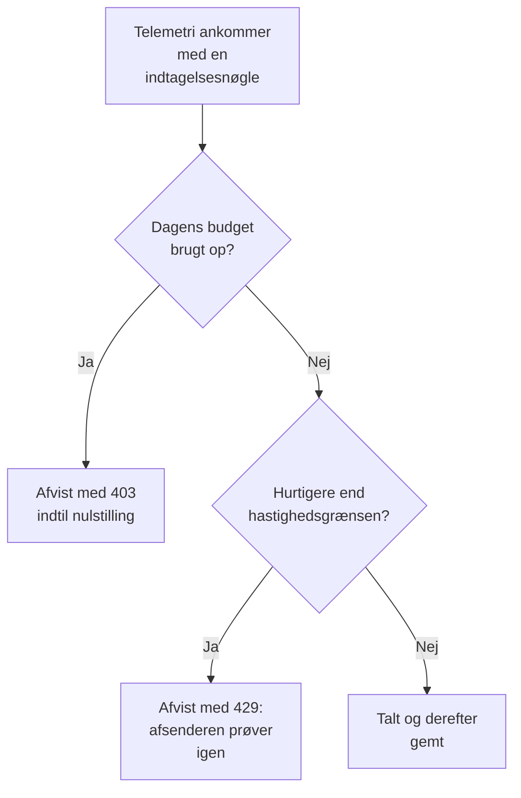

# Indtagelsesbudgetter

Et indtagelsesbudget begrænser, hvor meget telemetri et projekt sender på en dag, så én støjende tjeneste eller en løbsk protokolløkke ikke kan fylde dit lager. Instansadministratoren angiver et dagligt budget for hvert signal, for alle projekter eller for ét projekt, og alle, der redigerer en indtagelsesnøgle, kan give nøglen dens eget, mindre budget. Hvert budget kan også have en hastighedsgrænse pr. sekund.

:::cards
- [Sådan fungerer budgetter](#sådan-fungerer-budgetter): Tre niveauer, talt, efterhånden som telemetrien ankommer.
- [Angiv alle projekters standardbudgetter](#angiv-alle-projekters-standardbudgetter): I Admin Dashboards indstillinger.
- [Giv en indtagelsesnøgle dens eget budget](#giv-en-indtagelsesnøgle-dens-eget-budget): En andel af projektets budget.
- [Få advarsler om et budget](#få-advarsler-om-et-budget): Før det er brugt op, og når det er.
:::

## Sådan fungerer budgetter

Telemetri tælles, efterhånden som den ankommer: mod dens projekts budget for dens signal, og mod dens indtagelsesnøgles, når nøglen har et. Når et dagligt budget er brugt op, afvises det signal, indtil budgettet nulstilles.



- **Tre niveauer.** Instansens standard gælder for alle projekter. Instansadministratoren kan i stedet give ét projekt dets eget budget, eller slet ingen grænse. En nøgles budget er kun en underopdeling af dens projekts: det kan være mindre, aldrig større.
- **Fem signaler.** Protokoller, spor, metrikker, profiler og sikkerhedshændelser har hver deres eget budget. Sessionsafspilninger har deres egne grænser: se [Sessionsafspilning](/docs/telemetry/session-replay).
- **Bytes tælles dekomprimeret.** En anmodning tæller størrelsen af sin body, når den er dekomprimeret, så komprimering ændrer ikke, hvad den tæller. En GB er 1024³ bytes, og en MB 1024² bytes.
- **Det, der ankommer, tælles, ikke det, der gemmes.** Telemetri, som et [drop-filter](/docs/telemetry/drop-filters-and-scrub-rules) fjerner senere, tæller stadig, så et budget kan vise mere end siden [Telemetriforbrug](/docs/telemetry/usage), som tæller det, der blev gemt.
- **Den sidste anmodning gemmes hel.** En anmodning, der ankommer, mens et budget stadig har plads, gemmes fuldt ud, så et opbrugt budget kan vise lidt over 100 %.
- **Intet begrænses, før et budget er angivet.** Alle installationer starter uden budgetter, og et projekt uden et budget tælles slet ikke.
- **Ændringer når ud til alle servere inden for et minut.**
- **Telemetri accepteres, når den ikke kan tælles.** Budgetterne tælles i Valkey. Mens Valkey ikke kan nås, gemmer OneUptime telemetri uden at tælle den i stedet for at afvise den, og budgetsiderne siger det.

## Før du begynder

- **Til instansens og et projekts budgetter: Admin Dashboard.** På en selvhostet installation er det kun instansadministratoren, der angiver dem. Et projekts ejere og administratorer kan se dets budgetter, men ikke ændre dem.
- **Til en nøgles eget budget: en rolle, der redigerer indtagelsesnøgler.** Project Owner eller Project Admin, eller en brugerdefineret rolle med tilladelsen Edit Ingestion Key.
- **For at se budgetterne: en rolle, der ser projektets forbrug.** De roller, der ser siden [Telemetriforbrug](/docs/telemetry/usage), ser projektets budgetter på den.

## Angiv alle projekters standardbudgetter

:::steps
### Åbn Indtagelsesbudgetter

Gå til **Indstillinger → Telemetri → Indtagelsesbudgetter** i Admin Dashboard. **Telemetri** starter sammenklappet i sidemenuen: klik på den for at åbne den.

### Angiv de daglige budgetter

Klik på **Rediger daglige standardbudgetter** på kortet **Daglige standardbudgetter**, indtast et antal GB for hvert signal, der skal begrænses, for eksempel **Protokoller (GB pr. dag)**, og klik på **Gem ændringer**. Lad et signal stå tomt for ingen grænse.

### Angiv hastighedsgrænserne, hvis du har brug for dem

Klik på **Rediger standardhastighedsgrænser** på kortet **Standardhastighedsgrænser**, og indtast et antal MB pr. sekund for et signal, for eksempel **Protokoller (MB pr. sekund)**. En hastighedsgrænse forhindrer, at én spidsbelastning bruger en dags budget op på få minutter.
:::

Kortet **Advarsel og nulstilling** indeholder advarselstærsklen og det tidspunkt, hvor budgetdagen nulstilles: se [Advarslen og nulstillingen](#advarslen-og-nulstillingen).

## Angiv ét projekts budgetter

:::steps
### Åbn projektet

Gå til **Projekter** i Admin Dashboard, klik på projektet, og klik på **Indtagelsesbudgetter** i dets sidemenu. Siden åbner med det, projektet har brugt af sine budgetter i dag.

### Angiv dets daglige budgetter

Klik på **Rediger daglige budgetter** på kortet **Daglige budgetter for dette projekt**. Indtast for et signal et antal GB i stedet for instansstandarden, eller 0 for slet ingen grænse. Lad et signal stå tomt for at beholde instansstandarden.

### Angiv dets hastighedsgrænser

Klik på **Rediger hastighedsgrænser** på kortet **Hastighedsgrænser for dette projekt**, og angiv dem på samme måde: et antal MB pr. sekund, 0 for ingen grænse eller tomt for instansstandarden.
:::

Projektets medlemmer ser disse budgetter på deres side [Telemetriforbrug](/docs/telemetry/usage), skrivebeskyttet.

## Giv en indtagelsesnøgle dens eget budget

En nøgles budget er en andel af dens projekts: en afsender, der oversvømmer sin egen nøgle, stopper ved nøglens budget, mens projektets andre nøgler bliver ved med at sende.

:::steps
### Åbn nøglen

Gå til **Projektindstillinger → Telemetri og APM → Indtagelsesnøgler**, og klik på nøglen. **Telemetri og APM** starter sammenklappet i sidemenuen: klik på den for at åbne den.

### Angiv dens budgetter

Klik på **Rediger indtagelsesbudgetter** på kortet **Indtagelsesbudgetter**. Indtast et antal GB pr. dag for hvert signal, der skal begrænses, i trinnet **Daglige budgetter**, og et antal MB pr. sekund i trinnet **Hastighedsgrænser**. Lad et signal stå tomt, hvis nøglen ikke skal have sit eget budget for det.

### Gem budgetterne

Klik på **Gem ændringer**. En nøgles budget kan ikke være større end dens projekts: OneUptime afviser det og siger, hvor stort det højst kan være.
:::

- **Begge budgetter tæller.** Telemetri, der sendes med nøglen, tæller mod nøglens budget og projektets, og det budget, der først er brugt op, afviser den.
- **Et sænket projektbudget holder også nøglen.** Når projektets budget sænkes under en nøgles, holdes nøglen til projektets.

## Hvad afsendere ser

| Når | Over HTTP | Over OTLP/gRPC | Hvad afsenderen gør |
| --- | --- | --- | --- |
| Et dagligt budget er brugt op | `403` | `RESOURCE_EXHAUSTED` | Kasserer batchen: at prøve igen hjælper ikke før nulstillingen |
| En hastighedsgrænse overskrides | `429` med `Retry-After` | `RESOURCE_EXHAUSTED` med en ventetid før nyt forsøg | Prøver batchen igen efter ventetiden |

Hver afvisning siger hvorfor. Over OTLP/HTTP er dens body en `google.rpc.Status`, i protobuf eller JSON, som anmodningen blev sendt, så afsenderens log viser en årsag som:

```text
This project's daily logs ingestion budget of 10 GB is used up, so OneUptime is not storing logs from this project until the budget resets at 2026-11-10 00:00 UTC.
```

- **Andre HTTP-afsendere får JSON.** Fluent Bit, Fluentd, syslog og de andre HTTP-endpoints får `error`, `message` og `resetsAt`, og fra en hastighedsgrænse også `retryAfterSeconds`.
- **MQTT og cloudstreams kan ikke få besked.** Telemetri, der ankommer over MQTT eller fra en cloududbyders stream, kasseres, når dens budget er brugt op. Ingen hastighedsgrænse gælder for den: den kunne ikke sendes igen.
- **Afvisninger tælles.** Det, et opbrugt budget afviser eller kasserer, tælles som kasseret, og hver anmodning, en hastighedsgrænse afviser, som begrænset: se [Se dagens forbrug og kasserede data](#se-dagens-forbrug-og-kasserede-data).

## Advarslen og nulstillingen

- **Advarslen.** Når et dagligt budget passerer advarselstærsklen, 80 %, medmindre instansadministratoren ændrer den, får projektets ejere en e-mail, og explorerne viser et banner over det signals data. De får endnu en e-mail, når budgettet er brugt op. Hvert budget sender hver e-mail højst én gang om dagen.
- **Nulstillingen.** Hver budgetdag begynder forfra kl. 00:00 UTC, medmindre instansadministratoren ændrer det. Kortet **Advarsel og nulstilling** angiver **Advarselstærskel (%)**, fra 1 til 99, **Nulstillingstidspunkt**, som HH:MM, og **Tidszone for nulstilling**: klik på **Rediger advarsel og nulstilling**.
- **Sommertid.** Nulstillingen følger tidszonens ur, så den budgetdag, hvor urene stilles om, er en time kortere eller længere. Et nulstillingstidspunkt, som urene springer over, indtræffer lige så længe efter springet.
- **En ændret nulstilling starter en ny dag.** Når nulstillingstidspunktet eller tidszonen ændres, starter en ny budgetdag med det samme, hvor intet er talt endnu.

## Se dagens forbrug og kasserede data

Gå til **Projektindstillinger → Telemetri og APM → Forbrug**. Mens et budget eller en hastighedsgrænse er angivet for projektet, åbner siden med kortet **Indtagelsesbudgetter**, og nøglerne med deres egne budgetter står på kortet **Budgetter for indtagelsesnøgler**:

| Kolonne | Hvad den viser |
| --- | --- |
| **Signal** | Det signal, rækken gælder. |
| **Brugt i dag** | Det, der er talt, siden budgetdagen begyndte, og dets andel af budgettet. |
| **Dagligt budget** | Det gældende budget, og hvor det blev angivet: **Instansstandard**, **Angivet for dette projekt** eller **Nøglens eget budget**. |
| **Hastighedsgrænse** | Den gældende hastighedsgrænse. |
| **Kasseret** | Det, der blev afvist eller kasseret, fordi budgettet var brugt op. |
| **Begrænset** | Hvor mange anmodninger hastighedsgrænsen afviste. |
| **Status** | **Inden for budget**, **Advarsel nået** eller **Opbrugt**, **Intet dagligt budget** for et signal med kun en hastighedsgrænse, og **Ukendt**, mens optællingerne ikke kan læses. |

- **På en nøgles side** viser kortet **Dagens budgetforbrug**, hvad nøglen har brugt af sine egne budgetter.
- **I explorerne** siger et banner over dataene for protokoller, spor, metrikker, profiler og sikkerhedshændelser, når det signals budget har passeret sin advarsel eller er brugt op, med **Se budgetter** for at åbne siden Forbrug.
- **I Admin Dashboard** viser et projekts side **Indtagelsesbudgetter** de samme tal.

## Få advarsler om et budget

Hvert 5. minut skriver OneUptime hvert budgets tal for dagen som metrikker for projektet, og en [metrik-monitor](/docs/monitor/metrics-monitor) advarer om dem som om enhver anden metrik:

| Metrik | Enhed | Hvad den indeholder |
| --- | --- | --- |
| `oneuptime.telemetry.budget.used.bytes` | `By` | De bytes, der er talt mod det daglige budget, siden budgetdagen begyndte. |
| `oneuptime.telemetry.budget.used.percent` | `%` | Det samme, som en procentdel af det daglige budget. Ved 100 eller mere afvises signalet indtil nulstillingen. |
| `oneuptime.telemetry.budget.dropped.bytes` | `By` | De bytes, der er afvist eller kasseret, siden budgetdagen begyndte, fordi budgettet var brugt op. |
| `oneuptime.telemetry.budget.throttled.requests` | `{request}` | De anmodninger, hastighedsgrænsen har afvist, siden budgetdagen begyndte. |

Hvert punkt har disse attributter:

| Attribut | Værdi |
| --- | --- |
| `projectId` | Projektets ID. |
| `signal` | `logs`, `traces`, `metrics`, `profiles` eller `security-events`. |
| `scope` | `project`, eller `ingestion-key` for en nøgles eget budget. |
| `ingestionKeyId` | Nøglens ID, for en nøgles eget budget. |
| `ingestionKeyName` | Nøglens navn, da punktet blev skrevet, for en nøgles eget budget. |

For at få besked ved 90 % af projektets protokolbudget skal du oprette en metrik-monitor på `oneuptime.telemetry.budget.used.percent`, filtreret på `signal` `logs` og `scope` `project`, der advarer, når maksimum er over 90:

- **Aggreger med maksimum.** Hvert tal vokser kun i løbet af en budgetdag.
- **Brug et vindue på 15 minutter eller mere.** Et punkt skrives hvert 5. minut, og et vindue uden et punkt løser advarslen.
- **Forvent huller, ikke nuller.** Der skrives intet for et tal, der er 0, eller mens optællingerne ikke kan læses.
- **De koster intet.** Disse metrikker tælles ikke mod noget budget eller som telemetriforbrug, og de opbevares lige så længe som monitormetrikker: 30 dage, medmindre instansadministratoren ændrer det. Metriknavne, der starter med `oneuptime.telemetry.budget.`, er reserveret til dem: metrikker, som dine applikationer sender under sådan et navn, kasseres.

## Fejlfinding

:::details En collector logger 403 for sine eksporter
Projektets eller nøglens daglige budget for det signal er brugt op, og collectoren kasserer det, den ikke kan sende, indtil budgettet nulstilles. Se **Brugt i dag** på siden Forbrug. Bed instansadministratoren om at hæve projektets budget, eller send mindre: et drop-filter hjælper ikke her, da det fjerner telemetri, efter at den er talt.
:::

:::details En collector logger 429 og prøver igen
Den sender hurtigere, end en hastighedsgrænse tillader. Den prøver igen efter `Retry-After`-ventetiden, så intet går tabt, medmindre dens kø løber fuld. Hæv hastighedsgrænsen, eller fordel afsendelsen mere jævnt.
:::

:::details Brugt i dag er mere, end siden Telemetriforbrug viser
Et budget tæller telemetri, efterhånden som den ankommer, dekomprimeret, inklusive det, drop-filtre fjerner senere. Siden Forbrug tæller det, der blev gemt, dagen efter.
:::

:::details Budgetterne siger, at dagens optællinger ikke kunne læses
OneUptime kan ikke nå Valkey, hvor budgetterne tælles. Indtil det kan, gemmes telemetri uden at blive talt, og intet budget håndhæves.
:::

## Næste skridt

:::cards
- [Telemetriforbrug](/docs/telemetry/usage): Se, hvad hvert projekt og hver tjeneste sender.
- [Drop-filtre og scrub-regler](/docs/telemetry/drop-filters-and-scrub-rules): Hold op med at gemme den telemetri, du ikke har brug for.
- [Indtagelsesnøgler](/docs/telemetry/ingestion-keys): En nøgle til hver afsender, så hver kan have et budget.
- [Metrik-monitor](/docs/monitor/metrics-monitor): Få advarsler om budgetmetrikkerne.
:::
