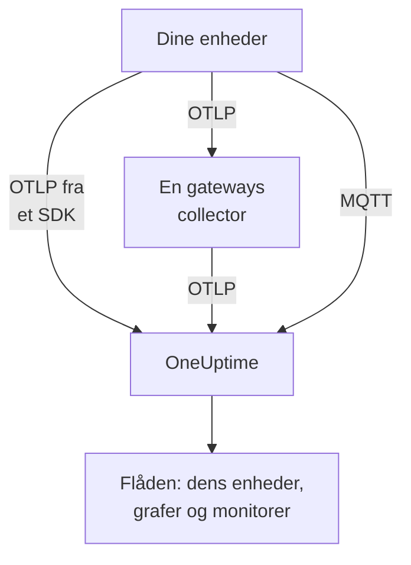

# IoT-enheder

OneUptime overvåger flåder af IoT-enheder — sensorer, gateways, controllere og edge-bokse — ud fra et lille sæt `iot_*`-metrikker, som de sender. Den grupperer enhederne i flåder, fører et inventar over hver flådes enheder og viser grafer for deres batteri, signal, temperatur, CPU, hukommelse og tilgængelighed. Der er ingen OneUptime-agent at installere på en enhed: enheder sender standard-OpenTelemetry eller publicerer til OneUptimes MQTT-endpoint. [IoT-enhedsmonitorer](/docs/monitor/iot-device-monitor) advarer ud fra det, de sender.

:::cards
- [Vælg, hvordan der sendes](#vælg-hvordan-der-sendes): Et OpenTelemetry-SDK, en gateway-collector eller MQTT.
- [Afsendelse af metrikker via MQTT](#afsendelse-af-metrikker-via-mqtt): Topics, legitimationsoplysninger pr. enhed og Last Will.
- [Metrikkonventioner](#metrikkonventioner): De `iot_*`-navne, som OneUptime viser i grafer og advarer på.
- [Fejlfinding](#fejlfinding): Manglende flåder, manglende enheder, skift til offline.
:::

## Sådan virker det

Hver måling hører til en flåde og en enhed. OneUptime opretter flåden ud fra dens første måling, føjer hver ny enhed til flådens inventar og opdaterer enhedens seneste værdier med hver måling derefter. Målinger sendt over OpenTelemetry og over MQTT forsyner de samme flåder, det samme inventar, de samme grafer og monitorer.



## Sådan modellerer OneUptime IoT

- **Flåde**: en gruppe enheder, såsom `building-a-sensors` eller `field-gateways`. Den kommer fra ressourceattributten `iot.fleet.name` og vises i OneUptime som telemetritjenesten `iot/<fleet>`. Sæt også `service.name=iot/<fleet>`, så logs og metrikker samles under den samme tjeneste.
- **Enhed**: én enhed i en flåde, navngivet af attributten `device.id` på hvert datapunkt. Flådens inventar er nøglet på `device.id`.

| Attribut | Sat på | Påkrævet | Beskrivelse |
| --- | --- | --- | --- |
| `iot.fleet.name` | Ressource | Ja | Den flåde, enheden hører til. Den bliver OneUptime-tjenesten `iot/<fleet>`. |
| `device.id` | Hvert datapunkt | Ja | Et stabilt id for enheden, unikt i dens flåde. |
| `iot.device.kind` | Hvert datapunkt | Nej | Enhedsklassen, såsom `Device`, `Sensor` eller `Gateway`. Standard er `Device`. |
| `iot.device.type` | Hvert datapunkt | Nej | En finere type eller model til filtrering af monitorer, såsom `temp-sensor`. |
| `iot.device.firmware` | Hvert datapunkt | Nej | Den firmwareversion, enheden rapporterer. |

Over MQTT sætter topicet flåden og enheden for dig.

## Vælg, hvordan der sendes

| Måde | Brug den, når | Kræver |
| --- | --- | --- |
| [OpenTelemetry-SDK](#afsendelse-af-metrikker-via-opentelemetry-sdket) | Enheden kører et OpenTelemetry-SDK og når selv OneUptime. | En indtagelsesnøgle på enheden. |
| [OpenTelemetry Collector](#afsendelse-af-metrikker-via-en-opentelemetry-collector) | Mange enheder rapporterer gennem en gateway. | En gateway, der kører collectoren. |
| [MQTT](#afsendelse-af-metrikker-via-mqtt) | Enheden taler allerede MQTT eller skal melde sig offline i det øjeblik, den falder ud. | En hvilken som helst MQTT-klient, der forbinder over WebSocket. |

## Før du begynder

- En indtagelsesnøgle. Opret en under **Projektindstillinger → Telemetri og APM → Indtagelsesnøgler**, og kopiér dens værdi. Enheder sender den som headeren `x-oneuptime-token` eller som MQTT-adgangskoden.
- Netværksadgang fra enheden eller gatewayen til din OneUptime-URL.
- Et flådenavn til hver gruppe af enheder og et stabilt id til hver enhed.

## Afsendelse af metrikker via OpenTelemetry-SDK'et

:::steps
### Peg SDK'et på OneUptime

Sæt de standard OpenTelemetry-miljøvariabler på enheden. Erstat nøglen, flådenavnet og enheds-id'et med dine:

```bash
export OTEL_EXPORTER_OTLP_ENDPOINT=https://oneuptime.com/otlp
export OTEL_EXPORTER_OTLP_PROTOCOL=http/protobuf
export OTEL_EXPORTER_OTLP_HEADERS=x-oneuptime-token=YOUR_TELEMETRY_INGESTION_TOKEN
export OTEL_RESOURCE_ATTRIBUTES=iot.fleet.name=building-a-sensors,device.id=sensor-001,service.name=iot/building-a-sensors
```

Hold `iot.fleet.name` stabilt: en ændring registrerer en ny flåde.

### Registrer målinger som IoT-metrikker

Udsend hver måling som en metrik med et af de [konventionelle navne](#metrikkonventioner), og giv hvert datapunkt en `device.id`-attribut:

| Metrik | Værdi | Datapunktattribut |
| --- | --- | --- |
| `iot_device_up` | `1` | `device.id=sensor-001` |
| `iot_battery_percent` | `87` | `device.id=sensor-001` |
| `iot_temperature_celsius` | `21.5` | `device.id=sensor-001` |

Inventaret er nøglet på datapunktets `device.id`, ikke ressourcens, så sæt det på hver måling såvel som i `OTEL_RESOURCE_ATTRIBUTES`.
:::

[Kontrollér derefter, at flåden vises](#kontrollér-at-flåden-vises).

## Afsendelse af metrikker via en OpenTelemetry Collector

Når mange enheder rapporterer gennem en gateway, så kør en OpenTelemetry Collector på gatewayen. Den modtager OTLP fra dine enheder, stempler flåden på hver måling og videresender dem til OneUptime.

:::steps
### Gem gatewayens konfiguration

Gem dette som `config.yaml` på gatewayen:

```yaml title="config.yaml"
receivers:
  otlp:
    protocols:
      grpc:
        endpoint: 0.0.0.0:4317
      http:
        endpoint: 0.0.0.0:4318

processors:
  batch:
    send_batch_size: 512
    timeout: 5s
  resource:
    attributes:
      - key: iot.fleet.name
        value: field-gateways
        action: upsert
      - key: service.name
        value: iot/field-gateways
        action: upsert

exporters:
  otlphttp:
    endpoint: "https://oneuptime.com/otlp"
    headers:
      "x-oneuptime-token": "YOUR_TELEMETRY_INGESTION_TOKEN"

service:
  pipelines:
    metrics:
      receivers: [otlp]
      processors: [resource, batch]
      exporters: [otlphttp]
```

- `otlp` modtager fra dine enheder over gRPC (`4317`) og HTTP (`4318`). Modtag målinger på enhver anden måde, collectoren understøtter (en MQTT-bro, fillogs), og send dem gennem den samme pipeline.
- `resource` stempler hver måling med flåden. Sæt `iot.fleet.name` og det tilsvarende `service.name=iot/<fleet>` pr. gateway, så hver gateways enheder lander i deres flåde.
- Behold `device.id` og eventuelt `iot.device.kind`, `iot.device.type` og `iot.device.firmware` på hvert datapunkt, så OneUptime kan skelne enhederne i flåden fra hinanden.
- `otlphttp` sender til OneUptime over HTTPS med indtagelsesnøglen. Både standardkodningen protobuf og `encoding: json` accepteres.

### Kør collectoren på gatewayen

:::tabs
@tab Docker
Kør den fra den mappe, der indeholder `config.yaml`:

```bash
docker run -d \
  --name otel-collector \
  --restart unless-stopped \
  -p 4317:4317 \
  -p 4318:4318 \
  -v $(pwd)/config.yaml:/etc/otelcol-contrib/config.yaml:ro \
  otel/opentelemetry-collector-contrib:0.161.0 \
  --config /etc/otelcol-contrib/config.yaml
```
@tab otelcol-contrib
Hvis gatewayen allerede har `otelcol-contrib`, så peg den på filen:

```bash
otelcol-contrib --config config.yaml
```
:::

Enheder sender derefter OTLP til gatewayen, for eksempel med `OTEL_EXPORTER_OTLP_ENDPOINT=http://<gateway-host>:4318` i hver enheds SDK.
:::

[Kontrollér derefter, at flåden vises](#kontrollér-at-flåden-vises).

## Afsendelse af metrikker via MQTT

OneUptime har sit eget MQTT-endpoint, så enheder, der taler MQTT, publicerer målinger direkte til det, uden SDK, collector eller bro. Det, der ankommer over MQTT, går gennem den samme pipeline som OTLP: flåder oprettes, inventaret opdateres, og hver IoT-monitor og advarselsskabelon virker på samme måde.

### Endpoints

| Transport | Adresse | Bemærkninger |
| --- | --- | --- |
| MQTT over WebSocket | `wss://<your-host>/mqtt` | Virker på alle installationer, gennem den normale HTTPS-port. |
| MQTT over TCP | `<app-host>:1883` | Kun selvhostet, og internt i klyngen eller Compose-netværket, indtil du eksponerer den. Porten er `MQTT_INGEST_PORT`. |

### Godkendelse

- **Med indtagelsesnøglen**: send den som MQTT-adgangskoden. Brugernavnet ignoreres; har din klient kun et brugernavnsfelt, så sæt nøglen der. Det passer til en gateway, der publicerer for mange enheder.
- **Med legitimationsoplysninger pr. enhed**: anbefales til enheder, der forbinder direkte. Åbn flådens side **Device Registry**, og registrer enheden med det **Device ID**, den bruger som `device.id`. Enhedens **MQTT Username** er dens brugernavn, og dens **MQTT Password (Secret)** dens adgangskode.

En enheds legitimationsoplysninger kan kun publicere under dens egne `oneuptime/<fleet>/<device>/`-topics. Du kan tilbagekalde én enhed uden at røre resten af flåden: slå dens kontakt **Aktiveret** fra, eller slet den, og en forbundet enhed afbrydes inden for omkring et minut. En registreret enhed, der bliver tavs, bliver i inventaret som offline, og advarselsskabelonen Device Offline udløses for den, selv hvis den dør uden en Last Will.

OneUptime afviser forkerte legitimationsoplysninger ved CONNECT med returkode 4 (forkert brugernavn eller adgangskode), så en fejlkonfigureret enhed fejler tydeligt. Browsernøgler afvises over MQTT.

### Topics og payloads

Publicer under det faste præfiks `oneuptime/`. Flåde- og enhedssegmenterne må ikke indeholde `/`, `+` eller `#`, må ikke starte med `$` og er højst 100 tegn lange.

| Topic | Payload |
| --- | --- |
| `oneuptime/<fleet>/<device>/telemetry` | Et JSON-objekt med målinger: `{"metrics":{"iot_temperature_celsius":21.5}}`, eller et fladt objekt, hvis numeriske felter er metrikkerne. |
| `oneuptime/<fleet>/<device>/metrics/<metricName>` | Én værdi: et bart tal (`23.4`) eller `{"value":23.4}`. |
| `oneuptime/<fleet>/<device>/status` | `online` eller `offline` (også `1` eller `0`, `true` eller `false`, `up` eller `down`). Den sætter `iot_device_up`. |

En telemetri-payload kan også bære `"attributes"`, et map af strenge, der stemples på hvert datapunkt (brug det til `iot.device.kind`, `iot.device.type`, `iot.device.firmware` eller dine egne etiketter), og `"timestamp"`, i ISO 8601 eller unix-sekunder eller -millisekunder. Begge er valgfrie: uden et `timestamp` bruges det tidspunkt, hvor OneUptime modtager målingen.

### Offline-registrering med Last Will

Registrer en MQTT Last Will på `oneuptime/<fleet>/<device>/status` med payloaden `offline`. Hvis enheden dør eller falder af netværket, publicerer OneUptime `iot_device_up = 0` for den i det øjeblik, dens session slutter, hvilket udløser den medfølgende advarselsskabelon Device Offline og markerer enheden som nede i inventaret, uden polling. Publicer `online` til det samme topic efter forbindelsen, så enheden vises som oppe igen.

### Eksempler

:::tabs
@tab mosquitto_pub
Over rå TCP, på en selvhostet instans:

```bash
mosquitto_pub -h YOUR-ONEUPTIME-APP-HOST -p 1883 \
  -u oneuptime -P "YOUR_TELEMETRY_INGESTION_TOKEN" \
  -t "oneuptime/building-a-sensors/sensor-001/telemetry" \
  -m '{"metrics":{"iot_device_up":1,"iot_battery_percent":87,"iot_temperature_celsius":21.5},"attributes":{"iot.device.type":"temp-sensor","iot.device.firmware":"1.4.2"}}'
```
@tab Node.js
Med pakken `mqtt`, over WebSocket, mod oneuptime.com eller en hvilken som helst selvhostet instans:

```javascript
const mqtt = require("mqtt");

const client = mqtt.connect("wss://oneuptime.com/mqtt", {
  username: "oneuptime", // ignored — the token below is what authenticates
  password: "YOUR_TELEMETRY_INGESTION_TOKEN",
  will: {
    topic: "oneuptime/building-a-sensors/sensor-001/status",
    payload: "offline",
  },
});

client.on("connect", () => {
  client.publish("oneuptime/building-a-sensors/sensor-001/status", "online");
  setInterval(() => {
    client.publish(
      "oneuptime/building-a-sensors/sensor-001/telemetry",
      JSON.stringify({
        metrics: {
          iot_device_up: 1,
          iot_battery_percent: readBattery(),
          iot_temperature_celsius: readTemperature(),
        },
      }),
    );
  }, 60 * 1000);
});
```
@tab Python
Med `paho-mqtt`, over WebSocket:

```python
import json
import paho.mqtt.client as mqtt

client = mqtt.Client(transport="websockets")
client.username_pw_set("oneuptime", "YOUR_TELEMETRY_INGESTION_TOKEN")
client.tls_set()
client.will_set("oneuptime/building-a-sensors/sensor-001/status", "offline")
client.ws_set_options(path="/mqtt")
client.connect("oneuptime.com", 443)

client.publish("oneuptime/building-a-sensors/sensor-001/status", "online")
client.publish(
    "oneuptime/building-a-sensors/sensor-001/telemetry",
    json.dumps({"metrics": {"iot_device_up": 1, "iot_temperature_celsius": 21.5}}),
)
```
:::

### Grænser og levering

- Endpointet tager kun imod målinger: abonnementer afvises (en SUBACK-fejl), og retained messages gemmes ikke.
- Indtagelsen sker mindst én gang. Brug QoS 1 for at få OneUptime til at bekræfte hver publicering; en gensendelse med QoS 1 eller 2 efter en tabt bekræftelse kan give dublerede datapunkter.
- En publicering over 128 KB eller med mere end 100 metrikker droppes, og en pakke, der angiver mere end det, lukker forbindelsen.
- En publicering uden for disse topics, eller med en fejlformet payload, accepteres og droppes, fordi MQTT 3.1.1 ikke har nogen fejl pr. besked. OneUptime logger en advarsel med årsagen (`MQTT: dropped publish to …`).
- På WebSocket-endpointet skal du holde MQTT-keepalive under 5 minutter. Ingress lukker en WebSocket, der er inaktiv i 300 sekunder, hvilket udløser Last Will og en falsk Device Offline-advarsel. Klientbibliotekernes standarder (60 sekunder for `mqtt` og `paho-mqtt`) er fine, og TCP-endpointet har ingen sådan grænse.

## Metrikkonventioner

OneUptime genkender disse `iot_*`-metriknavne. Send kun dem, der giver mening for din enhed: de manglende vises ikke i grafer. Hvert datapunkt bærer enhedens `device.id` (over MQTT navngiver topicet enheden).

| Metriknavn | Betydning |
| --- | --- |
| `iot_device_up` | Tilgængelighed: `1` er oppe og tilgængelig, `0` er nede. IoT Device-monitoren læser den. |
| `iot_device_info` | Kun identitet. Den bærer `device.id`, klassen, typen og firmwaren, så en enhed vises i inventaret, før den rapporterer målinger. |
| `iot_battery_percent` | Batteriniveau, `0` til `100` (%). |
| `iot_signal_strength_dbm` | Trådløs signalstyrke i dBm, såsom RSSI for Wi-Fi, LoRa eller mobilnet. |
| `iot_temperature_celsius` | Enheds- eller sensortemperatur i °C. |
| `iot_cpu_usage_ratio` | CPU-forbrug som et forhold fra `0` til `1`. OneUptime gemmer og viser det som en procentdel. |
| `iot_memory_usage_bytes` | Hukommelse i brug, i bytes. |
| `iot_memory_size_bytes` | Samlet hukommelse på enheden, i bytes. |
| `iot_uptime_seconds` | Sekunder siden enheden sidst startede. |

## Kontrollér, at flåden vises

1. Kontrollér, at enheden, gatewayens collector eller MQTT-klienten sender uden fejl: kig efter eksportfejl og HTTP-svar `401` eller `422` i dens logs eller en forbindelse, der afvises med returkode 4.
2. Åbn **Produkter → Infrastruktur → IoT → All Fleets**. Flåden vises som `iot/<fleet>` inden for et minuts tid efter dens første målinger.
3. Åbn flådens side **Devices**. Hver enhed, du har sendt, bør være opført med sit seneste batteri, signal, temperatur, CPU, hukommelse og status oppe eller nede.
4. Åbn flådens side **Metrikker** for at vise en hvilken som helst af `iot_*`-serierne i en graf.

## Selvhostet OneUptime

Peg endpointet på din egen instans:

```bash
export OTEL_EXPORTER_OTLP_ENDPOINT=https://your-oneuptime-host.example.com/otlp
```

Eller i en collector:

```yaml
exporters:
  otlphttp:
    endpoint: https://your-oneuptime-host.example.com/otlp
    headers:
      "x-oneuptime-token": "YOUR_TELEMETRY_INGESTION_TOKEN"
```

For MQTT skal du forbinde til `wss://your-oneuptime-host.example.com/mqtt` eller eksponere app-tjenestens rå MQTT TCP-port (`MQTT_INGEST_PORT`, `1883` som standard) for enheder, der ikke kan bruge WebSocket. Sæt `MQTT_INGEST_ENABLED=false` på app-tjenesten for at slå begge MQTT-lyttere fra. Bruger instansen kun HTTP, så brug `http://` (og `ws://` til MQTT) og dens port.

## Fejlfinding

:::details Flåden vises ikke
1. Kontrollér, at `iot.fleet.name` er en ressourceattribut (ikke en datapunktetiket), og at `service.name` er `iot/<fleet>`.
2. Kontrollér, at endpointet er `https://oneuptime.com/otlp` (eller din selvhostede `…/otlp`), og at headeren `x-oneuptime-token` bærer en gyldig indtagelsesnøgle.
3. Over MQTT skal du kontrollere, at topicet følger `oneuptime/<fleet>/<device>/…` nøjagtigt: topicets flådesegment er det, der opretter flåden.
:::

:::details Enheder mangler i inventaret
1. Giv hvert datapunkt en `device.id`-etiket: enheder er nøglet på den. Over MQTT er det topicets enhedssegment.
2. For en enhed, der ikke har rapporteret målinger endnu, skal du sende `iot_device_info` (eller, over MQTT, en `status`-besked), så den vises i inventaret.
3. Hold `device.id`-værdier stabile: et skiftende id skaber dublerede enheder.
:::

:::details HTTP 401 eller 422 fra exporteren
`401` betyder, at indtagelsesnøglen mangler, er forkert eller er udløbet; `422` betyder, at den er deaktiveret eller er en browsernøgle, som ikke kan sende enhedstelemetri. Opret en ny under **Projektindstillinger → Telemetri og APM → Indtagelsesnøgler**, og opdater headeren `x-oneuptime-token`.
:::

:::details MQTT-forbindelsen afvises med "bad username or password"
OneUptime afviser forkerte legitimationsoplysninger ved CONNECT med returkode 4. Kontrollér, at adgangskoden er en gyldig indtagelsesnøgle, der ikke er deaktiveret eller udløbet, eller, for en registreret enhed, legitimationsoplysningernes secret med dens **MQTT Username** som brugernavn. Browsernøgler afvises over MQTT.
:::

:::details Enheder skifter til offline, mens de kører
På WebSocket-endpointet lukker ingress en forbindelse, der er inaktiv i 300 sekunder, hvilket udløser Last Will og en falsk Device Offline-advarsel. Hold MQTT-keepalive under 5 minutter: klientbibliotekernes standarder på 60 sekunder er fine.
:::

:::details Målinger vises ikke i flådens grafer
1. Brug de nøjagtige `iot_*`-navne fra [Metrikkonventioner](#metrikkonventioner): andre navne gemmes som generiske metrikker og udfylder ikke IoT-graferne.
2. Send `iot_cpu_usage_ratio` som et forhold fra `0` til `1`; OneUptime viser det som en procentdel.
3. Giv op til et minut, før de første datapunkter vises, efter at en enhed er begyndt at rapportere.
:::

## Næste trin

:::cards
- [IoT-enheds-monitor](/docs/monitor/iot-device-monitor): Advar, når en enhed går offline, løber tør for batteri eller bliver overophedet.
- [OpenTelemetry](/docs/telemetry/open-telemetry): Hvordan OneUptime tager imod OTLP fra ethvert SDK eller en hvilken som helst collector.
- [OpenTelemetry-collector på værten](/docs/telemetry/host-otel-collector): Overvåg selve en Linux-, macOS- eller Windows-gateway.
:::
