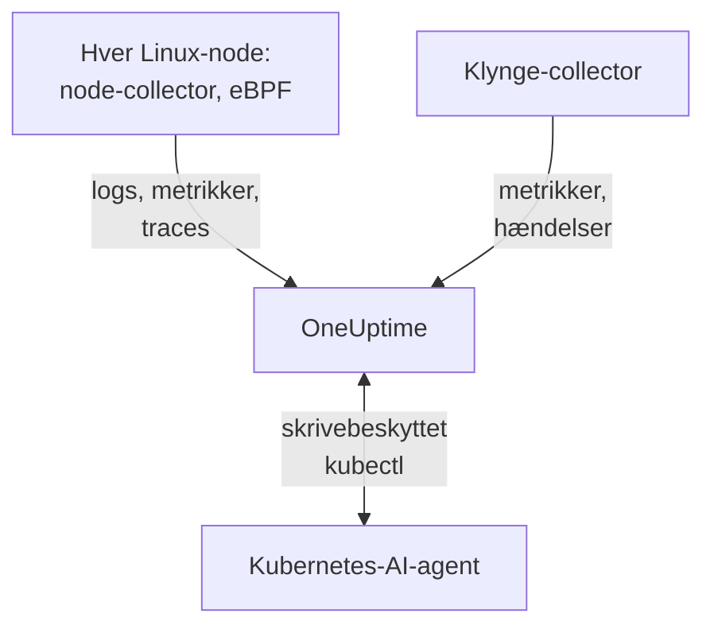

# Kubernetes-agent

OneUptime Kubernetes-agenten er et Helm-chart, der indsamler din klynges metrikker, hændelser og pod-logs og, med eBPF, traces, request-metrikker, servicegraf og netværksflows for hver pod, uden kodeændringer og uden SDK'er. Den kører også [Kubernetes-AI-agenten](#kubernetes-ai-agent), som lader OneUptime AI køre skrivebeskyttet `kubectl`, mens den undersøger en hændelse eller advarsel. Ét `helm install` sætter den på plads; [Kubernetes-monitorer](/docs/monitor/kubernetes-monitor) advarer ud fra det, den sender.

:::cards
- [Installer agenten](#installer-agenten): Fire trin med Helm.
- [Konfigurationsmuligheder](#konfigurationsmuligheder): Filtre, sampling, kontrolplan, service mesh, omkostninger og etiketter.
- [Kubernetes-AI-agent](#kubernetes-ai-agent): Skrivebeskyttet `kubectl` til OneUptime AI og rettelser, når du tillader dem.
- [Send mindre](#reducering-af-den-indsamlede-datamængde): Håndtagene, i rækkefølge efter effekt.
:::

## Sådan virker det

Chartet kører nogle få workloads i sit eget namespace. Hver af dem sender det, den indsamler, til din OneUptime-URL over OTLP med den indtagelsesnøgle, du giver den, og klyngen registrerer sig under det navn, du giver den i `clusterName`.



| Workload | Type | Hvad den gør | Kører |
| --- | --- | --- | --- |
| Klynge-collector | Deployment | Klyngemetrikker, Kubernetes-hændelser og specifikationerne for pods, noder og workloads, fra Kubernetes-API'et. | Altid |
| Node-collector | DaemonSet | Pod-logs fra `/var/log/pods`, kubelet- og cAdvisor-metrikker og nodens OS-metrikker. | Overalt undtagen på EKS Fargate |
| eBPF-instrumentering (OBI) | DaemonSet | HTTP-, gRPC-, SQL- og Redis-traces og request-metrikker fra hver pod samt servicekortet. | Som standard, undtagen på GKE Autopilot og EKS Fargate |
| Kubernetes-AI-agent | Deployment | Skrivebeskyttet `kubectl` til OneUptime AI, mens den undersøger en hændelse eller advarsel. | Som standard |
| Log-tailer | Deployment | Pod-logs gennem Kubernetes-API'et, hvor node-collectoren ikke kan læse dem. | Med presets `gke-autopilot` og `eks-fargate` |
| Omkostningsmotor og poller | Deployments | Forbrug pr. namespace, workload og pod. | Med `cost.enabled=true` |

Alle agentens images er kun til Linux, så alle workloads er fastlåst til Linux-noder.

## Før du begynder

- En Kubernetes-klynge med v1.23 eller nyere og `kubectl` konfigureret til at nå den.
- Helm 3. Opgraderinger bruger `--reset-then-reuse-values`, som kræver Helm 3.14 eller nyere.
- En indtagelsesnøgle. Opret en under **Projektindstillinger → Telemetri og APM → Indtagelsesnøgler**. Agenten sender den som headeren `x-oneuptime-token`, så en projekt-API-nøgle virker ikke her.
- Et navn til klyngen, unikt i dit projekt og stabilt, såsom `prod-us-east-1`: klyngen vises i OneUptime under det.
- Udgående HTTPS fra klyngen til din OneUptime-URL.

## Installer agenten

:::steps
### Tilføj Helm-repositoriet

```bash
helm repo add oneuptime https://helm-chart.oneuptime.com
helm repo update
```

### Installer chartet

Erstat `YOUR_ONEUPTIME_URL`, `YOUR_ONEUPTIME_API_KEY` (indtagelsesnøglen) og klyngenavnet med dine værdier, og vælg fanen for din platform (se [Vælg et preset](#vælg-et-preset)).

:::tabs
@tab Standard
Selvadministrerede klynger, EKS on EC2, GKE Standard, AKS, minikube, kind og k3s:

```bash
helm install kubernetes-agent oneuptime/kubernetes-agent \
  --namespace oneuptime-agent \
  --create-namespace \
  --set oneuptime.url="YOUR_ONEUPTIME_URL" \
  --set oneuptime.apiKey="YOUR_ONEUPTIME_API_KEY" \
  --set clusterName="my-cluster" \
  --set aiAgent.enabled=true
```
@tab GKE Autopilot
```bash
helm install kubernetes-agent oneuptime/kubernetes-agent \
  --namespace oneuptime-agent \
  --create-namespace \
  --set oneuptime.url="YOUR_ONEUPTIME_URL" \
  --set oneuptime.apiKey="YOUR_ONEUPTIME_API_KEY" \
  --set clusterName="my-cluster" \
  --set aiAgent.enabled=true \
  --set preset=gke-autopilot
```
@tab EKS Fargate
```bash
helm install kubernetes-agent oneuptime/kubernetes-agent \
  --namespace oneuptime-agent \
  --create-namespace \
  --set oneuptime.url="YOUR_ONEUPTIME_URL" \
  --set oneuptime.apiKey="YOUR_ONEUPTIME_API_KEY" \
  --set clusterName="my-cluster" \
  --set aiAgent.enabled=true \
  --set preset=eks-fargate
```
:::

**AI-undersøgelser er slået til som standard.** `aiAgent.enabled=true` kører [Kubernetes-AI-agenten](#kubernetes-ai-agent) ved siden af collectoren: når en hændelse eller advarsel rejses på denne klynge, undersøger OneUptime AI den med skrivebeskyttet `kubectl` (`get`, `describe`, `logs`, `events`, `top`) og ændrer intet. Rettelser forbliver slået fra, indtil du tillader dem. For at installere uden den skal du i stedet bruge `--set aiAgent.enabled=false`.

### Kontrollér, at pods kører

```bash
kubectl get pods -n oneuptime-agent
```

Hver pod bør nå `Running` inden for et minut eller to:

:::tabs
@tab Standard
Klynge-collectoren, AI-agenten og på hver node en node-collector og en eBPF-pod:

```text
NAME                                          READY   STATUS    RESTARTS   AGE
kubernetes-agent-xxxxxxxxxx-xxxxx             1/1     Running   0          1m
kubernetes-agent-ai-agent-xxxxxxxxxx-xxxxx    1/1     Running   0          1m
kubernetes-agent-ebpf-xxxxx                   1/1     Running   0          1m
kubernetes-agent-logs-xxxxx                   1/1     Running   0          1m
```
@tab GKE Autopilot
Node-collectoren kører stadig og læser kubelet- og cAdvisor-metrikker uden `hostPath`, og et log-tailer-Deployment læser pod-logs gennem Kubernetes-API'et:

```text
NAME                                          READY   STATUS    RESTARTS   AGE
kubernetes-agent-xxxxxxxxxx-xxxxx             1/1     Running   0          1m
kubernetes-agent-ai-agent-xxxxxxxxxx-xxxxx    1/1     Running   0          1m
kubernetes-agent-logs-yyyyyyyyyy-yyyyy        1/1     Running   0          1m
kubernetes-agent-logs-xxxxx                   1/1     Running   0          1m
```
@tab EKS Fargate
Tre Deployments og intet DaemonSet: Fargate giver hver pod sin egen mikro-VM og planlægger aldrig DaemonSets, så nodemetrikker er ikke tilgængelige der:

```text
NAME                                          READY   STATUS    RESTARTS   AGE
kubernetes-agent-xxxxxxxxxx-xxxxx             1/1     Running   0          1m
kubernetes-agent-ai-agent-xxxxxxxxxx-xxxxx    1/1     Running   0          1m
kubernetes-agent-logs-yyyyyyyyyy-yyyyy        1/1     Running   0          1m
```
:::

### Find klyngen i OneUptime

Åbn **Produkter → Infrastruktur → Kubernetes → Alle klynger**. Klyngen vises under sit `clusterName` inden for nogle få minutter, og dens noder, pods og workloads udfyldes. Kubernetes-AI-agenten vises som forbundet på klyngens side **Agent** under **AI**.
:::

## Vælg et preset

`preset` vælger de standarder, der virker på din platform: om pod-logs læses fra noden gennem `hostPath` eller gennem Kubernetes-API'et, og hvilke workloads der må køre privilegeret.

| `preset` | Bruges til | Pod-logs | Nodemetrikker |
| --- | --- | --- | --- |
| `standard` (standard) | Selvadministrerede klynger, **EKS on EC2**, **GKE Standard**, **AKS**, minikube, kind, k3s | Node-collectoren læser `/var/log/pods` gennem `hostPath` (laveste overhead) | Kubelet, cAdvisor og nodens OS-metrikker |
| `gke-autopilot` | **GKE Autopilot** | Log-taileren læser dem gennem Kubernetes-API'et (ingen `hostPath`, ingen værtsadgang) | Kubelet og cAdvisor, uden `hostPath` |
| `eks-fargate` | **EKS Fargate** | Log-taileren læser dem gennem Kubernetes-API'et (ingen `hostPath`, ingen værtsadgang) | Ingen: Fargate kører ingen DaemonSets |

Er du i tvivl, så start med `standard`. Hvis installationen fejler med en Pod Security-fejl, der nævner `hostPath`, så installer igen med `preset=gke-autopilot` (eller `eks-fargate` på Fargate). GKE Autopilot og EKS Fargate afviser også privilegerede pods, som eBPF og profileren har brug for, så de to presets udelader begge.

## Hvad der indsamles

| Kategori | Data |
| --- | --- |
| Nodemetrikker | CPU-, hukommelses-, filsystem- og netværksforbrug |
| Pod-metrikker | CPU, hukommelse, netværk og genstarter |
| Containermetrikker | CPU og hukommelse pr. container |
| Klyngemetrikker | Nodetilstande, allokerbare ressourcer, antal pods |
| Kubernetes-hændelser | Advarsler, fejl og planlægningshændelser |
| Pod-logs | stdout og stderr fra hver container (gennem `hostPath` på standardklynger, gennem Kubernetes-API'et på Autopilot og Fargate) |
| Applikationstraces (eBPF, slået til som standard) | HTTP-, gRPC-, SQL- og Redis-spans fra hver pod, uden SDK og uden kodeændringer |
| HTTP RED-metrikker (eBPF) | `http.server.request.duration` samt størrelser på request- og response-bodies, pr. tjeneste |
| Servicegraf (eBPF) | Request-rate, latens og fejlkanter fra kalder til kaldt, som tegner servicekortet |
| Netværksflowmetrikker (eBPF) | TCP- og UDP-tællere for bytes og pakker fra pod til pod, med Kubernetes-metadata |
| TCP-statistik (eBPF) | Tællere for round-trip-tid, mislykkede forbindelser og retransmissioner pr. node |
| Workload-omkostninger (frivilligt, `cost.enabled=true`) | Forbrug pr. namespace, workload og pod, med tomgang og effektivitet, samt timeomkostninger for noder og volumener: se [Observability for Kubernetes-omkostninger](/docs/telemetry/kubernetes-cost) |

## Konfigurationsmuligheder

Hver mulighed nedenfor er en Helm-værdi. Sæt den ved installationen, eller på en installeret agent med `helm upgrade ... --reset-then-reuse-values --set <value>`.

### Namespace-filtrering

`namespaceFilters.rules` anvender namespace-mønstre på fire områder, hvert for sig:

| Område | Hvor det filtrerer | Hvad det påvirker |
| --- | --- | --- |
| `podLogs` | Ved hostPath-filelog-receiveren eller API-log-taileren | Kun pods' stdout og stderr; Kubernetes-hændelser og audit-logs påvirkes ikke |
| `ebpfDiscovery` | Ved OBI's procesopdagelse | Både eBPF-traces og eBPF-metrikker fra matchende workloads |
| `metrics` | I collectoren, efter at Kubernetes-metadata er tilføjet | Metrikserier med namespace; node- og klyngeserier uden namespace beholdes |
| `traces` | I collectoren, efter at Kubernetes-metadata er tilføjet | Både eBPF-spans og spans, som applikationer sender over OTLP |

Et mønster matcher hele namespace-navnet og må bruge `*` (`team-*`). Har et område en `include`-regel, beholdes kun matchende namespaces for det område, og `exclude`-regler vinder altid. Standardreglen udelukker kun `kube-system` fra `podLogs` og `ebpfDiscovery`.

For at begrænse pod-logs og eBPF-opdagelse til nogle namespaces:

```bash
helm install kubernetes-agent oneuptime/kubernetes-agent \
  --namespace oneuptime-agent \
  --create-namespace \
  --set oneuptime.url="YOUR_ONEUPTIME_URL" \
  --set oneuptime.apiKey="YOUR_ONEUPTIME_API_KEY" \
  --set clusterName="my-cluster" \
  --set-json 'namespaceFilters.rules=[{"action":"include","namespaces":["default","production","staging"],"scopes":["podLogs","ebpfDiscovery"]}]'
```

For at stoppe logs fra et støjende namespace og samtidig beholde dets eBPF-traces, servicekort og metrikker skal du begrænse udelukkelsen til `podLogs`:

```bash
  --set-json 'namespaceFilters.rules=[{"action":"exclude","namespaces":["kube-system"],"scopes":["podLogs","ebpfDiscovery"]},{"action":"exclude","namespaces":["noisy-*"],"scopes":["podLogs"]}]'
```

Regler for `podLogs` og `ebpfDiscovery` filtrerer ved kilden: udelukkede logfiler åbnes aldrig, og udelukkede workloads instrumenteres aldrig. Regler for `metrics` og `traces` virker senere, i collectoren, efter at namespacet er knyttet til dataene.

#### Filtrering af metrikker og traces efter namespace

Føj disse områder til en regel for også at filtrere metrikker eller spans med namespace:

```bash
  --set-json 'namespaceFilters.rules=[{"action":"exclude","namespaces":["kube-system","noisy-*"],"scopes":["podLogs","ebpfDiscovery","metrics","traces"]}]'
```

> [!NOTE]
> Metrikker på node- og klyngeniveau beholdes altid. Et namespace hører til en pod, ikke til en node, så serier som node-CPU, nodehukommelse og filsystemforbrug har intet at matche og droppes aldrig: en regel afgrænset til `metrics` beskærer serier pr. pod uden at skjule en node, der går i stykker.

Kubernetes-hændelser kan ikke filtreres efter namespace ved agenten: de ankommer fra receiveren `k8sobjects` uden en `k8s.namespace.name`-attribut (namespacet står i hændelsens body), så der er intet for et filter at matche. Drop dem i stedet i OneUptime med **Protokoller → Indstillinger → Drop-filtre**.

### Filtrering efter log-alvorlighed

`filters.logs.minSeverity` dropper pod-logposter under en alvorlighed, ved agenten, før noget sendes:

```bash
  --set filters.logs.minSeverity=WARN
```

Den accepterer `TRACE`, `DEBUG`, `INFO`, `WARN`, `ERROR` og `FATAL`. `WARN` beholder WARN, ERROR og FATAL og dropper INFO, DEBUG og TRACE; standarden (`""`) beholder alt. Den gælder i begge logtilstande (gennem collectoren i tilstanden `daemonset`, inde i log-taileren i tilstanden `api`), så et preset slår den aldrig fra bag din ryg.

Container-runtimes registrerer ingen alvorlighed, så agenten læser en fra selve logteksten (`[ERROR]`, `WARN:`, `"level":"info"`, …). Hvad der sker med en linje uden genkendeligt niveau, afhænger af logtilstanden, fordi de to tilstande ved forskellige ting:

| Tilstand | En linje uden niveau | Hvorfor |
| --- | --- | --- |
| `daemonset` | `stderr` tæller som ERROR (beholdes), `stdout` som INFO (droppes af en WARN-tærskel) | Container-runtimen registrerer, hvilken strøm hver linje kom fra. |
| `api` | Beholdes altid | Kubernetes-API'et `pods/log` fletter stdout og stderr til én strøm uden markør pr. linje, så i stedet for at gætte beholder agenten linjen. |

Så tilstanden `api` dropper med vilje strengt mindre end tilstanden `daemonset`: en Python-traceback eller en `npm ERR!` bærer intet alvorlighedsnøgleord, og at slette den stille er netop den fejl, en tærskel skal beskytte dig mod. I hybridtilstand (`logs.windowsPods.enabled`) gælder begge rækker, efter nodens OS: Linux-pods følger `daemonset`, Windows-pods `api`.

Hændelser over flere linjer samles igen før filtreringen i begge tilstande, så en Java-stack trace bedømmes ud fra sin første linje og beholdes eller droppes som helhed.

> [!IMPORTANT]
> Kubernetes-hændelser og ressourcespecifikationer filtreres aldrig af dette. De ankommer fra Kubernetes-API'et uden egen alvorlighed, så en tærskel ville slette hele feedet, inklusive de advarsler `FailedScheduling`, `BackOff` og `OOMKilling`, du mest vil have. De er få og værdifulde, så agenten sender dem altid; for at tynde dem ud skal du bruge **Protokoller → Indstillinger → Drop-filtre** i OneUptime.

### Inkludering eller udelukkelse af metrikker efter navn

`filters.metrics` bestemmer, hvilke metrikker der forlader klyngen, på tværs af alle receivers.

Drop nogle få støjende metrikker (en denylist, som regel det, du vil have):

```bash
  --set-json 'filters.metrics.exclude=["k8s.volume.available","k8s.volume.capacity"]'
```

Send kun et fast sæt (en tilladelsesliste: alt andet droppes):

```bash
  --set-json 'filters.metrics.include=["k8s.pod.cpu.utilization","k8s.pod.memory.usage"]'
```

Match efter mønster i stedet for efter nøjagtigt navn:

```bash
  --set filters.metrics.matchType=regexp \
  --set-json 'filters.metrics.exclude=["^container_network_"]'
```

| Nøgle | Betydning |
| --- | --- |
| `filters.metrics.exclude` | Metriknavne, der skal droppes. Anvendes efter `include`, så en udelukkelse vinder altid. |
| `filters.metrics.include` | Når den ikke er tom, sendes kun disse metrikker. |
| `filters.metrics.matchType` | `strict` (det nøjagtige navn, standarden) eller `regexp` (RE2, uforankret). |

- `regexp` er uforankret: `system.cpu` matcher også `system.cpu.time`. Forankr det (`^system\.cpu$`), når du mener præcis én metrik.
- RE2 har intet lookahead, så `^(?!container_)` kompilerer ikke. Udtryk "alt undtagen" med `include`, ikke med et negativt mønster.
- `include` gælder for alle receivers på én gang. En tilladelsesliste, der glemmer en metrik, fjerner stille de monitorer, der bygger på den, så foretræk `exclude`, medmindre du vil have et lukket sæt.
- Brug `--set-json` (eller en values-fil) til lister: et almindeligt `--set` erstatter en liste i stedet for at føje til den.

> [!WARNING]
> Test et mønster, før du ruller det ud. Collectoren kompilerer mønstre, når den starter, så et ugyldigt opfører sig ikke stille forkert: collectoren nægter at starte og genstarter i ring, og den collectors logs forsvinder sammen med dens metrikker. Helm kan ikke kompilere RE2, så `helm upgrade` accepterer et dårligt mønster uden at klage.

### Trace-sampling

Filtrene ovenfor fjerner en kategori af telemetri: et namespace, en alvorlighed, et metriknavn. Sampling beholder hver kategori og tynder i stedet bestanden ud. Sæt `sampling.traces.percentage` til den andel af traces, der skal beholdes:

```bash
helm upgrade kubernetes-agent oneuptime/kubernetes-agent \
  --namespace oneuptime-agent --reset-then-reuse-values \
  --set sampling.traces.percentage=10
```

Det beholder ét trace ud af ti og dropper de andre ni ved agenten, før de forlader din klynge.

- **Du får hele traces, ikke brudstykker.** Beslutningen er en hash af trace-id'et, ikke et møntkast pr. span, så alle spans i et trace beholdes eller droppes sammen, og de traces, der overlever, kan læses fra ende til anden.
- **Dine metrikbaserede monitorer rykker sig ikke.** OBI beregner eBPF RED-metrikkerne (request-rate, fejlrate, varighed) ud fra hver request, og de går gennem metrics-pipelinen, som sampleren ikke sidder i. Ved 10% får du en tiendedel af dine traces og nøjagtig rate, fejl og latens.
- **Dine spanbaserede monitorer gør.** Alt, hvad OneUptime tæller ud fra selve spans, falder med raten: se advarslen nedenfor.

| Nøgle | Betydning |
| --- | --- |
| `sampling.traces.percentage` | Procentdelen af traces, der skal beholdes, 0 til 100. Standard `100` (behold alt). |
| `sampling.traces.hashSeed` | Seed for trace-id-hashen. Standard `22`. |

- `0` beholder slet ingen traces. Det er en rate, ikke en afbryder: det sletter hvert trace, mens eBPF-DaemonSettet bliver ved med at køre og koste dig. For ingen traces skal du bruge `ebpf.enabled=false`; for ingen traces, men RED-metrikkerne og servicekortet, skal du lade eBPF være slået til og sætte `0` med vilje.
- Det gælder kun, når `ebpf.enabled` er slået til: ellers er der ingen traces-pipeline, og værdien gør intet.
- Det sampler kun traces. Der er med vilje intet `sampling.logs` eller `sampling.metrics`: se bemærkningen nedenfor.
- Brøker kræver `--set-json`, og de har en bundgrænse. `--set sampling.traces.percentage=0.5` fejler, fordi Helm læser `0.5` som en streng: brug `--set-json 'sampling.traces.percentage=0.5'` eller en values-fil. Under omkring `0.0061` rundes raten ned til nul og opfører sig nøjagtig som `0`, uden fejl; `0.01` (én ud af ti tusind) er den mindste værdi, der gør, hvad den siger.
- Flere klynger virker som standard. To agenter beholder kun det samme trace, hvis de er enige om både `hashSeed` og `percentage`, og begge har som standard de samme værdier overalt, så et trace, der krydser to klynger, overlever helt. Skift kun `hashSeed` for at gøre to samplingniveauer uafhængige: med samme seed beholder en lavere rate en delmængde af den højere rates traces.
- Pod-logs samples aldrig, så med `ebpf.logToTraceCorrelation: true` bærer hver logpost stadig et trace-id, mens kun den beholdte andel af disse traces findes. Omkring (100 − `percentage`)% af logposterne linker så til et trace, der ikke findes; at følge et trace til dets logs påvirkes ikke.

> [!WARNING]
> Juster dine spanbaserede monitorer, når du sætter dette. Sampling reducerer de spans, der når OneUptime, så alt, hvad der tæller dem, tæller mindre: en monitor af typen **Spor** på `Span Count` og en monitor af typen **Undtagelser** på `Exception Count` ser omkring `percentage`% af gårsdagens mængde. En tærskel, der er indstillet på usamplet trafik, bliver stille ikke længere overskredet: monitoren fejler ikke, den bliver bare tavs. Divider disse tærskler med samme faktor; raten gælder for hele klyngen, så ingen tjeneste kan undtages. Fejlgruppering forringes mere end lineært: en almindelig undtagelse vises stadig, men en sjælden enlig undtagelse forsvinder snarere helt, end den vises en tiendedel så ofte.

> [!NOTE]
> Hvorfor der ikke er nogen sampling af logs eller metrikker: collectorens sampler kan slet ikke sample metrikker. Den kan sample logs, men den henter sin tilfældighed fra trace-id'et, som pod-logs ikke har, så hver logpost ville hashe ens, og en lograte ville beholde alt eller slette alt afhængigt af seedet. I stedet for at tilbyde en indstilling, der stille sletter dine logs, tilbyder chartet ingen. Tynd logs ud med [Filtrering efter log-alvorlighed](#filtrering-efter-log-alvorlighed) og [Namespace-filtrering](#namespace-filtrering), som er præcise om, hvad de fjerner.

### Slå logindsamling fra

Hvis du ikke har brug for pod-logs:

```bash
helm install kubernetes-agent oneuptime/kubernetes-agent \
  --namespace oneuptime-agent \
  --create-namespace \
  --set oneuptime.url="YOUR_ONEUPTIME_URL" \
  --set oneuptime.apiKey="YOUR_ONEUPTIME_API_KEY" \
  --set clusterName="my-cluster" \
  --set logs.enabled=false
```

Dine metrikker påvirkes ikke: node-collectoren bliver ved med at køre for kubelet-, cAdvisor- og værtsmetrikker og holder kun op med at læse pod-logs. Logbaserede advarsler stopper, og intet andet gør.

### Gennemtving en bestemt logindsamlingstilstand

`logs.mode` tilsidesætter presettets valg og vinder altid over det:

- `logs.mode=daemonset`: hostPath-DaemonSettet (laveste overhead; kræver `hostPath`).
- `logs.mode=api`: Deployment'et med Kubernetes-API-log-taileren (virker på enhver klynge).
- `logs.mode=disabled`: ingen pod-logs.

Tilstanden bestemmer kun, hvor pod-logs kommer fra: nodemetrikker indsamles under alle omstændigheder, så `api` og `disabled` beholder dine kubelet-, cAdvisor- og værtsmetrikker. Undtagelsen er platformen: EKS Fargate kan slet ikke planlægge DaemonSets, så den har ingen node-collector og ingen node-, pod- eller containermetrikker. GKE Autopilot kører node-collectoren, men blokerer `hostPath`, så den indsamler kubelet- og cAdvisor-metrikker uden dem fra `hostmetrics` (disk-I/O, inodes, NIC-fejl), som læser værtens `/proc` og `/sys`.

På klynger med Windows-nodepuljer dækker tilstanden `daemonset` kun Linux-noderne, fordi alle agentens images kun er til Linux. Tilføj `--set logs.windowsPods.enabled=true` for at køre API-log-taileren ved siden af den, kun for pods på Windows-noder: Linux-pods beholder den lokale filfølgning på noden, og de to sender aldrig den samme linje to gange. Det kræver et `kubernetes-log-tailer`-image, der er mindst lige så nyt som chartet: et ældre image ignorerer begrænsningen og sender Linux-logs to gange.

### Slå overvågning af kontrolplanet til

Klyngens side **Kontrolplan** viser grafer for etcd, API-serveren, scheduleren og controller manageren. Agenten scraper alle fire, når `controlPlane.enabled` er `true`:

```bash
helm upgrade kubernetes-agent oneuptime/kubernetes-agent \
  --namespace oneuptime-agent \
  --reset-then-reuse-values \
  --set controlPlane.enabled=true
```

Hver komponent scrapes på adresserne i sin egen liste: `controlPlane.etcd.endpoints`, `controlPlane.apiServer.endpoints`, `controlPlane.scheduler.endpoints` og `controlPlane.controllerManager.endpoints`. Scrapet kører i agentens pod, som ikke har noget værtsnetværk, så standarderne (`https://localhost:<port>/metrics`) peger på selve den pod: sæt hver liste til en adresse, som poden kan nå. Inde i enhver klynge svarer API-serveren på `https://kubernetes.default.svc:443/metrics`:

```bash
helm upgrade kubernetes-agent oneuptime/kubernetes-agent \
  --namespace oneuptime-agent \
  --reset-then-reuse-values \
  --set controlPlane.enabled=true \
  --set "controlPlane.apiServer.endpoints={https://kubernetes.default.svc:443/metrics}"
```

`controlPlane.enabled` slår alle fire scrapes til på én gang. Hvor en komponent ikke kan nås på sine endpoints (etcd, scheduleren og controller manageren på en administreret klynge, eller på deres `localhost`-standarder), fejler dens scrape ved hvert interval: collectoren logger en scrape-fejl og rapporterer målet som nede, og intet andet ændres.

Agenten scraper kun over HTTPS, med serviceaccountens token og uden klientcertifikat. Derfor:

- **etcd** kræver en HTTPS-metrikadresse, der ikke beder om et klientcertifikat. etcd's sædvanlige metrikporte er uden for rækkevidde: almindelig HTTP på `2381` (kubeadms `--listen-metrics-urls`) scrapes som HTTPS og fejler, og `2379` kræver klientcertifikater.
- **Scheduleren** (`10259`) og **controller manageren** (`10257`) serverer HTTPS og accepterer tokenet, men kubeadm binder dem til `127.0.0.1` på kontrolplanets noder: de kræver en `--bind-address`, som agentens pod kan nå.

Administrerede Kubernetes-tjenester (EKS, GKE, AKS) eksponerer ikke etcd, scheduleren eller controller manageren, så de faner forbliver tomme der. Indtil en fanes metrikker ankommer, viser siden **Kontrolplan** i stedet for dens grafer, hvad der skal sættes, med kommandoen til at kopiere.

### Slå CoreDNS-metrikker til

Fanen **CoreDNS** på siden **Kontrolplan** viser grafer for DNS-forespørgsler, latens, cachen og videresendelse. Indsamlingen af dem er slået fra som standard:

```bash
helm upgrade kubernetes-agent oneuptime/kubernetes-agent \
  --namespace oneuptime-agent \
  --reset-then-reuse-values \
  --set coreDns.enabled=true
```

Agenten scraper port `9153` på de pods, der har etiketten `k8s-app=kube-dns` i `kube-system`, som er sådan CoreDNS kører på kubeadm-klynger, EKS og AKS. Kører din et andet sted, så sæt også `coreDns.namespace`, `coreDns.service` (etiketten `k8s-app`) og `coreDns.port`. GKE kører kube-dns (dnsmasq) eller Cloud DNS i stedet for CoreDNS, så fanen forbliver tom der.

### Slå service mesh-metrikker til

Klyngens side **Service Mesh** viser grafer for Istio og Linkerd. Agenten scraper ét mesh, det, som `serviceMesh.provider` navngiver (`istio` eller `linkerd`):

```bash
helm upgrade kubernetes-agent oneuptime/kubernetes-agent \
  --namespace oneuptime-agent \
  --reset-then-reuse-values \
  --set serviceMesh.enabled=true \
  --set serviceMesh.provider=istio
```

For Istio læser den Envoy-statistikken for hver `istio-proxy`-sidecar (port `15090`); for Linkerd admin-porten på hver `linkerd-proxy`. Intet meshs kontrolplan scrapes: istiod (kortet **Pilot**) og Linkerds komponenter identity, destination og proxy-injector (kortet **Kontrolplan**) serverer deres metrikker på deres egne admin-porte, så de kort siger det i stedet for at vise grafer.

### Metrikker, som agenten ikke indsamler

Nogle grafer viser metrikker, som agenten ikke har et scrape til: **kube-proxy** på siden **Kontrolplan**; **Cilium** (med Hubble) på siden **Service Mesh**; og på fanerne Istio og Linkerd meshenes egne kontrolplaner (**istiod** og Linkerds komponenter identity, destination og proxy-injector). De udfyldes, når disse metrikker når OneUptime på anden vis, for eksempel fra din egen [OpenTelemetry Collector](/docs/telemetry/open-telemetry), der scraper dem, med ressourceattributten `k8s.cluster.name` sat til klyngens navn (agentens `clusterName`). Klynger, der kører uden kube-proxy, har slet ingen kube-proxy-metrikker.

### Slå omkostningsobservability til

Se på klyngens side **Costs**, hvad hvert namespace, hver workload og hver pod koster, med tomgangskapacitet og hvor meget af hver request der bruges:

```bash
helm upgrade kubernetes-agent oneuptime/kubernetes-agent \
  --namespace oneuptime-agent \
  --reset-then-reuse-values \
  --set cost.enabled=true
```

Det alene er en komplet installation: chartet medbringer open source-motoren [OpenCost](https://opencost.io) (med den lille Prometheus, den har brug for) og prissætter dine noder og volumener ud fra din cloududbyders offentlige listepriser uden legitimationsoplysninger. Det tilføjer to små pods, og de første omkostninger vises efter den første afsluttede time. Kører du allerede Kubecost eller OpenCost? Tilføj i stedet `--set cost.engine.url=<its service URL>`, så medbringes intet. On-prem-klynger kan sætte en pristabel med `cost.opencost.customPricing`. Den fulde vejledning, med on-prem-priser og fejlfinding, er [Observability for Kubernetes-omkostninger](/docs/telemetry/kubernetes-cost).

### Automatisk tagging med projektetiketter

Hver ressourceattribut, der starter med `oneuptime.label.`, bliver en projektetiket, knyttet til klyngen og til de tjenester og værter, som denne agent rapporterer: `oneuptime.label.<dimension>=<value>` er etiketten `<dimension>:<value>`. Angiv etiketter ved installationen med `--set oneuptime.labels.<key>=<value>`:

```bash
helm install kubernetes-agent oneuptime/kubernetes-agent \
  --namespace oneuptime-agent \
  --create-namespace \
  --set oneuptime.url="YOUR_ONEUPTIME_URL" \
  --set oneuptime.apiKey="YOUR_ONEUPTIME_API_KEY" \
  --set clusterName="prod" \
  --set oneuptime.labels.team=payments \
  --set oneuptime.labels.env=production \
  --set oneuptime.labels.region=us-east-1
```

Eller hold dem i en values-fil:

```yaml title="values.yaml"
oneuptime:
  url: YOUR_ONEUPTIME_URL
  apiKey: YOUR_ONEUPTIME_API_KEY
  labels:
    team: payments
    env: production
    region: us-east-1
clusterName: prod
```

Etiketter matches uden skelnen mellem store og små bogstaver, så en eksisterende etiket `Production`, som du har oprettet manuelt, genbruges i stedet for at blive duplikeret, og etiketter, der er tilføjet i OneUptime, fjernes aldrig af agenten.

## Applikationstraces og HTTP-metrikker via eBPF (slået til som standard)

Chartet kører et DaemonSet med [OpenTelemetry eBPF Instrumentation (OBI)](https://opentelemetry.io/docs/zero-code/obi/) på hver node. Det indlæser eBPF-programmer i kernen og opfanger HTTP- og HTTPS-, gRPC-, SQL- og Redis-trafikken fra hver understøttet runtime (Go, .NET, Java, Node.js, Python, Ruby, Rust), uden SDK og uden sidecar. Traces og request-metrikker flyder derefter gennem collectoren i klyngen til OneUptime.

Det kræver Linux-kerne 5.8 eller nyere med BTF (standard på Debian 11+, Ubuntu 20.10+, Fedora 34+, RHEL og Stream 9+), og dets DaemonSet kører privilegeret, fordi indlæsning af eBPF-programmer kræver det.

### Sådan ser eBPF-traces ud

eBPF ser netværkskald, ikke din kode, så et trace bygges ud fra de requests, en tjeneste håndterer, og de kald, den foretager, mens den håndterer dem:

- **En request og dens kald udgør ét trace.** Requesten ind i en tjeneste er rod-spannet, navngivet `<METHOD> <route>`, og de HTTP-, gRPC-, SQL- og Redis-kald, tjenesten foretager, mens den håndterer den, er dens børn. (For Node.js afhænger det af OBI's Node.js-agent, som chartet slår til med `ebpf.nodejs.enabled`.) Kald, som samtidige requests sender ned ad én delt forbindelse, typisk for Redis-klienter, kan ikke altid skelnes, så nogle af dem placeres ikke i deres requests trace.
- **Et kald til en tjeneste på en anden node starter et nyt trace**, medmindre noget bærer trace-konteksten over: et OpenTelemetry-SDK eller den frivillige kontekstpropagering, der er beskrevet nedenfor. Når begge ender kører på den samme node, ser OBI begge og forbinder dem selv.
- **Arbejde, som ingen request startede, står alene.** En kø-worker, der poller Redis, eller et cron-job har ingen request, som dets kald kan høre til.
- **Databaseservere står som regel alene.** Databasers wire-protokoller bærer ingen trace-kontekst, så medmindre kalderen kører på samme node, er det span, OBI registrerer inde i en databaseserver for hver kommando, et trace med ét span.

Disse enlige databasekald ankommer som traces med ét span, navngivet efter en bar kommando (`set`, `evalsha`, `SELECT`), og på en travl klynge kan de udgøre det meste af det, OBI opfanger. Som standard dropper agenten dem, før de forlader klyngen: en databaseservers eget span, som altid dublerer kalderens (`ebpf.dropDatabaseServerSpans=true`), og et applikationskald, der ikke hører til noget trace (`ebpf.dropUnlinkedDatabaseCalls=true`). En applikations databasekald inde i en requests trace beholdes, spans, som dine applikationer sender fra deres egne SDK'er, røres aldrig, og databasemetrikkerne tæller stadig hver kommando.

Én afvejning: OneUptime opdager databaser, og tegner dem på servicekortet, ud fra databaseklient-spans. En database, som kun baggrundsarbejde taler med (en workers kø, et cron-jobs warehouse), opdages så ikke længere ud fra traces og vises på servicekortet som et fjernt endpoint. Dens metrikker påvirkes ikke. Sæt `ebpf.dropUnlinkedDatabaseCalls=false` for at beholde de spans.

Baggrundsarbejdes HTTP- og gRPC-kald (en worker, der forespørger ClickHouse over HTTP, en controller, der fornyer sit Kubernetes-lease) ankommer også som traces med ét span (`POST /`, `PUT /apis/*/...`). Sæt `ebpf.dropUnlinkedClientCalls=true` for også at droppe dem, sammen med kald, som OBI ikke kunne placere i deres requests trace, og som ser ens ud; database-, messaging- og GenAI-kald (MCP inklusive) droppes aldrig af den. Den er slået fra som standard, fordi den koster data: når den kaldte tjeneste kører på samme node, knytter OBI den request, den håndterede, under kaldet, så kaldet er roden af det trace, og at droppe det efterlader tracet uden rod. Med `ebpf.contextPropagation` slået til sker det på enhver node og også for en tjeneste med sit eget OpenTelemetry-SDK. Servicekortet læser også disse kald: en afhængighed, som kun baggrundsarbejde kalder, tegnes så alene ud fra OBI's servicegrafmetrikker, og en kant, der også ses inde i requests, tæller kun de kald. En tjenestes oversigt tæller dens spans, så en worker eller probe, hvis spans for det meste er sådanne kald, viser langt færre requests, med en fejlrate og p95-latens over de tilbageværende spans. OBI's klient-request-metrikker tæller stadig hvert kald.

På en selvhostet OneUptime skal du opgradere serveren før agenten: den eBPF-tracer, som dette chart kører (OBI v0.14), navngiver kaldte tjenester og rapporterer message brokeres egne spans på måder, som ældre OneUptime-servere ikke læser.

Navne kommer fra trafikken. HTTP-spans bruger appens route-skabelon, når OBI kan læse den, og ellers et mønster lavet ud fra URL'en med id-lignende segmenter erstattet af `*`; sæt `ebpf.routes.patterns` for selv at navngive dem. OBI læser route-skabelonerne fra apps i Go (net/http, Gorilla mux, Gin), Java (Spring, JAX-RS), Node.js (Express, Fastify, Koa, NestJS, Next.js), Python (Django, FastAPI, Flask), Ruby (Rails), .NET (attribut-routes i ASP.NET Core) og PHP (Symfony, Laravel, Slim). Navne på applikationsniveau såsom `OrderService.charge` findes kun i kode og kræver et OpenTelemetry-SDK.

Hvis en app allerede eksporterer traces med et OpenTelemetry-SDK, bemærker OBI det og holder op med at sende eBPF-traces for den, så den ikke traces to gange (`ebpf.excludeOtelInstrumentedServices=true`, OBI's standard). Sæt den til `false`, hvis det SDK rapporterer til et andet projekt, og du også vil have eBPF-traces for appen i dette.

### Slå eBPF-autoinstrumentering fra

Slå eBPF fra, når:

- Du installerer på **GKE Autopilot** eller **EKS Fargate**: de platforme afviser privilegerede pods, så `preset=gke-autopilot` og `preset=eks-fargate` udelader allerede eBPF for dig, og profileren med det.
- Noderne kører en kerne ældre end 5.8 uden BTF-backports.
- Du allerede sender traces fra OpenTelemetry-SDK'er i hver app og heller ikke vil have eBPF-metrikkerne. (Alene for traces behøver du ikke: OBI holder op med at sende eBPF-traces for en app, som den ser eksportere sine egne, som ovenfor.)

```bash
helm install kubernetes-agent oneuptime/kubernetes-agent \
  --namespace oneuptime-agent \
  --create-namespace \
  --set oneuptime.url="YOUR_ONEUPTIME_URL" \
  --set oneuptime.apiKey="YOUR_ONEUPTIME_API_KEY" \
  --set clusterName="my-cluster" \
  --set ebpf.enabled=false
```

### Slå enkelte signalfamilier til og fra

Alle er slået til som standard undtagen én. Slå enhver fra med `--set ebpf.features.<name>=false`:

| `ebpf.features.*` | Standard | Hvad den tilføjer |
| --- | --- | --- |
| `httpMetrics` | til | HTTP- og gRPC-RED-metrikker (request-rate, latens, fejl) pr. tjeneste |
| `spanMetrics` | til | Antal span-kald og varighed (`traces.span.metrics.*`) |
| `serviceGraph` | til | Kantmetrikker fra kalder til kaldt, som tegner servicekortet |
| `networkMetrics` | til | TCP- og UDP-flowtællere fra pod til pod |
| `networkInterZoneMetrics` | fra | Varianten af netværksmetrikkerne på tværs af zoner (fordobler deres kardinalitet) |
| `tcpStats` | til | Tællere for TCP-round-trip-tid, mislykkede forbindelser og retransmissioner pr. node |

Propagering af trace-kontekst på tværs af tjenester, hvor OBI indsætter en W3C-`traceparent`, så en request fra pod A til pod B vises som ét trace uden SDK nogen steder, er slået fra som standard. Slå den til med `--set ebpf.contextPropagation=true`. Den kræver ingen kerne ud over det, resten af agenten kræver, og ingen kerneversion gør den virkningsløs.

Den er slået fra, fordi indsættelse af headeren betyder omskrivning af trafik, der allerede er undervejs: HTTP-requests i klartekst udvides på stedet i kernen, mens TLS og rå TCP får tilføjet en TCP-option fra en Traffic Control-hook. Hvis forbindelsens byteregnskab ikke korrigeres nøjagtigt, kommer strømmen ud af takt; det rapporterede symptom er overførsler gennem en L7-proxy såsom nginx, der hænger midt i bodyen, når svaret passerer omkring 64KB, mens små requests bliver ved med at virke. Udelukk det ikke ud fra kernens alder: under kerne 5.17 falder OBI tilbage til programmer med begrænset scanning og omskriver trafikken på samme måde. Traces, RED-metrikker og servicekortet afhænger ikke af den; til at forbinde på tværs af tjenester propagerer et OpenTelemetry-SDK `traceparent` i userspace, uden omskrivning i kernen, og er det sikreste valg.

## Kubernetes-AI-agent

Når en hændelse eller advarsel rejses på denne klynge, undersøger OneUptime AI den. **Kubernetes-AI-agenten** i chartet giver den en terminal: den kører skrivebeskyttet `kubectl`, som en vagthavende ingeniør ville (beskriver den fejlende pod, læser dens hændelser, følger den crashende containers logs, kontrollerer nodekapacitet), og angiver hver kommando på hændelsessiden.

Agenten er **slået til som standard** og **skrivebeskyttet**: et lille Deployment (`kubernetes-agent-ai-agent`, pod-etiket `component=ai-agent`, image `oneuptime/kubernetes-ai-agent`), hvis ServiceAccount kun må læse. Den registrerer sig med samme `oneuptime.apiKey` og `clusterName`, som collectoren bruger, så der er intet at sætte op i dashboardet: klyngens side **AI-agent** (Kubernetes → klynge → AI → Agent) viser den som forbundet inden for et minut, og **Test forbindelse**, i menuen **⋯** ved siden af den status, kører `kubectl version` og `kubectl auth can-i --list` gennem den. Alt, hvad AI gjorde med den, står på klyngens side **AI-logs** (AI → Logs), og det, der er værd at vide om klyngen — de problemer, der bliver ved med at vende tilbage, og hvorfor, den node eller workload, der står bag de fleste af dem, hvad AI rettede — på siden **AI Insights** (AI → Insights). Agenten leveres med et fastlåst kubectl (v1.36.4). Den er ikke en Runner og vises aldrig under Runbooks → Runners: OneUptime giver den aldrig legitimationsoplysninger, kører aldrig runbooks på den, og den accepteres aldrig som kommando-Runner for en regel for automatisk afhjælpning.

På en agent, der blev installeret, før AI-agenten fandtes, skal du først opdatere dit chart-indeks og derefter opgradere (på en selvhostet OneUptime skal du opgradere OneUptime først — se [Opgradering af agenten](#opgradering-af-agenten)):

```bash
helm repo update
helm upgrade kubernetes-agent oneuptime/kubernetes-agent \
  --namespace oneuptime-agent --reset-then-reuse-values \
  --set aiAgent.enabled=true
```

Brug det release-navn og namespace, du installerede agenten med, hvis de er anderledes (`helm list -A | grep kubernetes-agent` viser dem). Uden `helm repo update` kan Helm finde det chart, du installerede fra, som ikke kender `aiAgent` og fejler med `Additional property aiAgent is not allowed`. Udgivne chart-versioner følger OneUptime-versionen, så hvis `helm show values oneuptime/kubernetes-agent | grep aiAgent` ikke udskriver noget, er dit indeks stadig gammelt. For at køre chartet uden AI-agenten skal du angive `--set aiAgent.enabled=false`.

### Hvad AI må gøre

Hvad OneUptime AI må gøre på klyngen, sættes i chartet med to værdier, og klyngens AI-agentside viser dem under **Hvad AI må gøre** uden mulighed for at ændre dem der:

- `aiAgent.investigation` — `true`: AI kører skrivebeskyttet `kubectl`, mens den undersøger en hændelse eller advarsel på klyngen. `false`: den undersøger stadig, med de data, OneUptime allerede har.
- `aiAgent.fixes` — `off`, `ask-for-approval`, `automatic` eller `bypass-approval` (nedenfor). Hvert niveau undtagen `off` giver AI-agenten skriveadgang; `off` giver ingen, og agenten afviser så selv enhver skrivning.

AI-agenten rapporterer begge til OneUptime, som anvender dem på klyngen og afviser en ændring foretaget andre steder — på AI-agentsiden, via API'et eller Terraform. **Skift** på den side viser kommandoen for den mulighed, du vælger. Begge er ikke sat i `values.yaml`: en release, der hverken sætter den ene eller den anden, lader agenten bruge sine standarder (undersøgelse til, rettelser fra), og OneUptime anvender dem kun på en klynge, hvis indstillinger ingen har valgt på dens AI-agentside — indstillinger, som nogen har valgt der, bevares, som de er, og siden viser, hvordan du flytter dem til chartet.

### Lad AI rette det, den finder

Rettelser er slået fra, indtil du slår dem til med `aiAgent.fixes` — et separat, valgfrit trin, der også giver AI-agenten skriveadgang. Den anbefalede form giver den kun i de namespaces, hvor AI må rette, med nodeoperationer slået fra:

```bash
helm repo update
helm upgrade kubernetes-agent oneuptime/kubernetes-agent \
  --namespace oneuptime-agent --reset-then-reuse-values \
  --set aiAgent.enabled=true \
  --set aiAgent.investigation=true \
  --set aiAgent.fixes=ask-for-approval \
  --set "aiAgent.remediation.namespaces={web,api}" \
  --set aiAgent.remediation.nodeOperations=false
```

Eller for hele klyngen:

```bash
helm repo update
helm upgrade kubernetes-agent oneuptime/kubernetes-agent \
  --namespace oneuptime-agent --reset-then-reuse-values \
  --set aiAgent.enabled=true \
  --set aiAgent.investigation=true \
  --set aiAgent.fixes=ask-for-approval \
  --set-json 'aiAgent.remediation.namespaces=[]'
```

Hvert namespace, du angiver, skal allerede findes: chartet opretter én RoleBinding i hvert og opretter aldrig et namespace, så et manglende får hele opgraderingen til at fejle — også collectorens — med `namespaces "api" not found`. Opret det først, eller tag det af listen, og tag et namespace af listen, før du sletter det. Udelader du flaget ved en opgradering, beholdes den gemte liste; `--set-json 'aiAgent.remediation.namespaces=[]'` (Helm 3.10+) går tilbage til hele klyngen — ikke `={}`, som Helm læser som ét tomt navn. `--set aiAgent.remediation.namespaces=null` nulstiller ikke en gemt liste under `--reuse-values`: Helm beholder den gemte liste. `aiAgent.remediation.nodeOperations=false` holder rettelser væk fra noder; sæt den til `true` for at lade AI cordon, uncordon, drain og tainte noder.

`aiAgent.fixes` vælger, hvordan rettelser kører; for at slå dem fra igen skal du opgradere med `--set aiAgent.fixes=off`, som også fjerner skriveadgangen:

- **ask-for-approval** — OneUptime AI sammensætter den nøjagtige `kubectl`-plan, og et menneske godkender den med ét klik på hændelsen;
- **automatic** — sikre ændringer kører af sig selv; en mere risikabel ændring gør aldrig. Når runden kun kunne finde mere risikable rettelser, slutter den med at foreslå netop dem til godkendelse med ét klik; når den også kørte en sikker rettelse, foreslås den mere risikable kun, hvis verifikationen viser, at den sikre rettelse ikke genoprettede signalet (opfølgningsrunden, som spørger);
- **bypass-approval** — AI spørger ikke: hver ændring, som politikken tillader, kører af sig selv, opfølgningsrunder inklusive, bortset fra at en runde spørger, når den timevise circuit breaker udløses, når en anden uovervåget OneUptime AI-runde stadig ændrer eller verificerer den samme klynge, eller når den følger efter en rettelse, hvis rollback ikke blev fuldført.

Uanset tilstand kræver en skrivning i kube-system, kube-public eller kube-node-lease altid et menneske, og det samme gør et `drain`, et `taint` og et `patch` af en node (et drain smider pods ud i alle namespaces, agentens eget inklusive, og en `NoExecute`-taint gør det også, uanset om `kubectl taint` eller et node-`patch` sætter den); en brugerdefineret ressource bedømmes efter sit namespace, også en, der hedder som en indbygget type; og AI-agenten ændrer aldrig noget i sit eget namespace, uden for `aiAgent.remediation.namespaces` eller på en node med `aiAgent.remediation.nodeOperations=false`. OneUptime læser det område ud fra det, AI-agenten rapporterer, og afviser en sådan rettelse, når den foreslås eller godkendes, ikke kun i agenten. I begge uovervågede tilstande foreslår en runde sin plan til godkendelse i stedet for at køre den, når den timevise circuit breaker udløses, eller en anden uovervåget runde allerede holder klyngen. Se [AI SRE — Klyngeadgang](/docs/ai/ai-sre) for, hvad hver tilstand må køre, og hvad kommandopolitikken afviser blankt.

**Hvad skriveadgangen svarer til.** Patch/update på workloads, pods og CronJobs og create på Jobs i et namespace svarer til at køre et hvilket som helst image som en hvilken som helst ServiceAccount i det namespace og læse dets Secrets — en pod-skabelon kan navngive ethvert image, enhver ServiceAccount og ethvert Secret-volumen. Så chartets RBAC begrænser, *hvor* AI-agenten må skrive, ikke hvad en skrivning må gøre: kommandopolitikken afviser sikkerhedspatches af pod-skabeloner, patches, der erstatter pod-specifikationen eller en hel `containers`-liste, `set serviceaccount`, `create … --image`, `expose --overrides` (som kan oprette et Job eller enhver anden objekttype i stedet for en Service) og patch-bodies, der ikke er JSON. Den afviser ikke `set image` eller et patch af et image-felt: det er en mere risikabel ændring — det nye image kører som workloadens egen ServiceAccount, med dens Secrets — som et menneske godkender, medmindre klyngen springer godkendelser over, eller dens tilladelsesliste nævner kommandoen. Med tom `aiAgent.remediation.namespaces` bindes skriverollen for hele klyngen, hvilket RBAC ikke kan holde ude af kube-system, kube-public, kube-node-lease eller agentens eget namespace; der holder politikken og AI-agenten linjen. Angiv namespaces, så binder chartet den kun i dem, og en skrivning andre steder afvises, når den foreslås eller godkendes, og igen af AI-agenten.

### Værdier for AI-agenten

`aiAgent.remediation.*` og `aiAgent.extraEnv` er ikke sat i `values.yaml`, så en værdi gemt under den gamle nøgle `aiAccess` bliver ved med at gælde, indtil du sætter dem (se [Opgradering af agenten](#opgradering-af-agenten)). De standarder, tabellen angiver for dem, gælder kun, når hverken nøglen `aiAgent` eller nøglen `aiAccess` er sat. `aiAgent.investigation` og `aiAgent.fixes` er heller ikke sat, så AI-indstillinger, der er valgt på en klynges AI-agentside, bliver ved med at gælde, indtil du sætter en af dem.

| Værdi | Standard | Hvad den gør |
| --- | --- | --- |
| `aiAgent.enabled` | `true` | Kør Kubernetes-AI-agenten med skrivebeskyttet RBAC (for hele klyngen). `false` fjerner den. |
| `aiAgent.investigation` | ikke sat (`true`) | Om OneUptime AI kører skrivebeskyttet `kubectl`, mens den undersøger. Klyngens AI-agentside viser det skrivebeskyttet. |
| `aiAgent.fixes` | ikke sat (`off`) | `off`, `ask-for-approval`, `automatic` eller `bypass-approval`. Hvert niveau undtagen `off` giver skriveverberne nedenfor. Klyngens AI-agentside viser det skrivebeskyttet. |
| `aiAgent.remediation.enabled` | `false` | Udfaset af `aiAgent.fixes` og læses kun, mens den ikke er sat. Giver også de skriveverber, som OneUptime AI's rettelser bruger: patch/update på Deployments, StatefulSets, DaemonSets, ReplicaSets (og deres scale-subresource), Jobs, CronJobs, Pods og HPA'er; create på Jobs og HPA'er; delete kun på Pods og Jobs. Den giver aldrig Secrets, `exec`, `attach`, `port-forward`, CRD'er eller RBAC-skrivninger, så en ændring af enhver anden type — sletning af et Deployment, etikettering af en Service eller ConfigMap — fejler med `Forbidden`, selv når den er godkendt. |
| `aiAgent.remediation.namespaces` | `[]` | Bind kun skriverollen i disse namespaces, med én RoleBinding hver; en skrivning andre steder afvises, når den foreslås eller godkendes, og af AI-agenten. Hvert skal allerede findes, ellers fejler opgraderingen. Tom binder den for hele klyngen; `--set-json 'aiAgent.remediation.namespaces=[]'` nulstiller en gemt liste (`--set aiAgent.remediation.namespaces=null` nulstiller ikke en gemt liste under `--reuse-values`). Agentens eget namespace kan ikke angives. |
| `aiAgent.remediation.nodeOperations` | `true` | Med `remediation.enabled` gives også cordon/uncordon/taint (patch på noder) og drain (pod-evictions), for hele klyngen. Sæt `false` for at holde rettelser væk fra noder: ingen node-RBAC, nodeoperationer afvises, når de foreslås eller godkendes, og AI-agenten afviser dem (`ONEUPTIME_KUBECTL_ALLOW_NODE_OPERATIONS=false`). |
| `aiAgent.image.repository` | `oneuptime/kubernetes-ai-agent` | Agentens image. Peg det på dit spejl, hvis noderne ikke kan hente fra Docker Hub. |
| `aiAgent.image.tag` | `release` | `release` følger hver OneUptime-udgivelse; fastlås en version for at holde den. |
| `aiAgent.image.pullPolicy` | `Always` for `release`, `IfNotPresent` for et fastlåst tag | Lad den være tom for den standard, så en nodes cachede agent aldrig overlever en opgradering. |
| `aiAgent.imagePullSecrets` | `[]` | Pull-secrets til et privat registry eller spejl, som `[{name: <secret>}]`. |
| `aiAgent.resources` | `50m` / `64Mi` requests, `500m` / `256Mi` limits | Agenten er i tomgang mellem kommandoer. |
| `aiAgent.extraEnv` | `[]` | Ekstra `EnvVar`-objekter til agentens container — f.eks. `HTTPS_PROXY` / `NO_PROXY` bag en egress-proxy, som agenten respekterer. Navne, som chartet selv sætter (såsom `ONEUPTIME_KUBECTL_ALLOW_WRITES`, `ONEUPTIME_KUBECTL_WRITE_NAMESPACES`, `ONEUPTIME_KUBECTL_ALLOW_NODE_OPERATIONS` eller `ONEUPTIME_KUBERNETES_CLUSTER_NAME`), får renderingen til at fejle i stedet for stille at erstatte chartets værdi. |

### Hvis AI-agenten ikke forbinder

Hvis AI-agentsiden efter et par minutter stadig siger, at agenten ikke er forbundet, så læs dens log:

```bash
kubectl logs -n oneuptime-agent -l component=ai-agent --tail=100
```

- **"This OneUptime server does not have the Kubernetes AI agent API"** — chartet er nyere end din OneUptime-server. Opgrader OneUptime, eller installer den chart-version, der matcher din server (`--version <your OneUptime version>`). Agenten prøver igen hvert 5. minut.
- **En afvisning, der løser sig selv** — en tidligere agent-pod, der stadig melder sig (en pod, der blev erstattet uden en ren nedlukning), eller den gamle Runner i klyngen, der stadig lukker ned under en opgradering. Agenten prøver igen efter den ventetid, serveren angiver.
- **En afvisning, der kræver dig** — et tomt eller for langt `clusterName` eller et projekt, der har nået sin grænse for AI-agenter; loggen nævner, hvad der skal ændres. Hvis en agent aldrig forbinder, og dens log siger `Another Kubernetes AI agent for cluster "<name>" is online`, deler to installationer ét `clusterName` (AI-agentsiden advarer også om det): den, der allerede er forbundet, beholder det, så længe den kører, så giv hver klynge sit eget `clusterName`, eller fjern den ekstra release. En indtagelsesnøgle med et **Pinned Service Name** kan ikke registrere agenten — giv chartet en nøgle uden.

**Nulstil agent**, i menuen **⋯** ved siden af agentens status på AI-agentsiden, får serveren til at glemme agentens nøgle, når du bekræfter det (en Project Owner, en Project Admin eller **Edit Auto Remediation Rule** må gøre det); poden forbinder igen af sig selv inden for nogle få minutter. Agentens parathed afhænger ikke af OneUptime, så en fejlkonfigureret AI-agent får aldrig `helm upgrade --wait` til at fejle — kun en pod, der ikke kan hente sit image, gør.

## Opgradering af agenten

Når agenten er ældre end din OneUptime, vises et advarselstegn ved siden af **Agentversion** i klyngens **Klyngedetaljer**. Vælg det for at se denne kommando.

```bash
helm repo update
helm upgrade kubernetes-agent oneuptime/kubernetes-agent \
  --namespace oneuptime-agent \
  --reset-then-reuse-values
```

`--reset-then-reuse-values` (Helm 3.14+) beholder de værdier, du har sat (preset, klyngenavn, filtre), og tager alle andre værdier fra det nye chart; angiv eventuelle nye `--set`-tilsidesættelser oven i den. På Helm 3.13 eller ældre skal du i stedet opgradere med de værdier, du har sat:

```bash
helm repo update
helm get values kubernetes-agent --namespace oneuptime-agent -o yaml > values.yaml && \
  helm upgrade kubernetes-agent oneuptime/kubernetes-agent \
  --namespace oneuptime-agent -f values.yaml
```

Brug ikke `--reuse-values`: den beholder også standarderne fra det chart, du opgraderer fra, så et nyere charts standarder (deriblandt dets eBPF-image) aldrig træder i kraft. Når en release kører på et ældre charts standarder, slutter de noter, Helm udskriver efter installationen eller opgraderingen, med en advarsel og den kommando, der retter det.

Hvis opgraderingen fejler med `namespaces "<name>" not found`, angiver `aiAgent.remediation.namespaces` (eller den ældre `aiAccess.remediation.namespaces`) et namespace, der ikke findes (eller ikke længere findes): chartet lægger en RoleBinding i hvert angivet namespace og opretter aldrig et. Opret namespacet, eller opgrader med listen uden det namespace (`--set "aiAgent.remediation.namespaces={web}"`), eller med `--set-json 'aiAgent.remediation.namespaces=[]'` for at gå tilbage til bindingen for hele klyngen. `--set aiAgent.remediation.namespaces=null` nulstiller ikke en gemt liste under `--reuse-values` og fejler derfor med samme fejl.

> **eBPF-spanmetrikker har nye navne.** `ebpf.features.spanMetrics` sender nu `traces.span.metrics.calls` og `traces.span.metrics.duration` (sekunder) i stedet for `traces_spanmetrics_calls_total` og `traces_spanmetrics_latency`: de samme serier under de navne, OBI beholder (de gamle har den udfaset). Et dashboard, en graf eller en metrikmonitor på et gammelt navn modtager ingen nye data efter opgraderingen, uden fejl — flyt det til det nye navn, og opdater enhver `filters.metrics`-post, der nævner et gammelt.

### Opgradering til Kubernetes-AI-agenten

Chartet kører nu [Kubernetes-AI-agenten](#kubernetes-ai-agent) som standard. Den erstatter Runneren i klyngen (`component=ai-runner`), som `aiAccess.enabled=true` installerede i tidligere versioner. Før du opgraderer:

- **Selvhostet OneUptime: opgrader OneUptime-serveren først.** AI-agenten kræver et API, som ældre servere ikke har. Mod en sådan logger den "This OneUptime server does not have the Kubernetes AI agent API" og prøver igen hvert 5. minut — og opgraderingen har allerede fjernet den gamle Runner i klyngen, så OneUptime AI har ingen kubectl-adgang, før serveren er opgraderet. Kan du ikke opgradere serveren endnu, så installer den chart-version, der matcher den (`--version <your OneUptime version>`).
- **Opgraderingen tilføjer en pod, der henter `docker.io/oneuptime/kubernetes-ai-agent`.** Hvis dine noder henter gennem et spejl eller en tilladelsesliste for images, og du opgraderer med `--wait` eller `--atomic`, med Terraform eller med Flux (begge venter som standard), så spejl imaget først, og sæt `aiAgent.image.repository` (og `aiAgent.imagePullSecrets` for et privat registry) — eller angiv `--set aiAgent.enabled=false`. Ellers bliver poden aldrig klar, opgraderingen timer ud, og `--atomic` ruller hele releasen tilbage, collectoren inklusive.

Dine `aiAccess`-indstillinger føres videre:

- Skriveadgang (`aiAccess.enabled` med `aiAccess.remediation.enabled`), `aiAccess.remediation.namespaces`, `aiAccess.remediation.nodeOperations` og `aiAccess.extraEnv` bliver ved med at gælde, indtil du sætter den tilsvarende `aiAgent.*`-værdi, som altid vinder. Fjern skriveadgangen med `--set aiAgent.fixes=off`, gå tilbage til hele klyngen med `--set-json 'aiAgent.remediation.namespaces=[]'`, og ryd en gemt proxyindstilling med `--set-json 'aiAgent.extraEnv=[]'`.
- `aiAccess.enabled=false` slår ikke AI-agenten fra; det gør `--set aiAgent.enabled=false`.
- `aiAccess.image` og `aiAccess.resources` føres ikke videre: AI-agenten er et andet image med sine egne `aiAgent.image` og `aiAgent.resources`.
- I OneUptime beholder hver klynge sine AI-indstillinger, med to ændringer, der foretages, når serveren opgraderes: en klynge, hvis Runner nogen havde frakoblet eller slettet (Runneren i klyngen eller en anden), starter med **Undersøg med kubectl** og rettelser slået fra (slå dem til igen på dens AI-agentside), og **Automatisk** eller **Spring godkendelse over** på en klynge, hvis projekt aldrig slog **Enable AI Command Execution** til, bliver til **Bed om godkendelse** — den kontakt holdt tidligere de rettelser tilbage, og rettelser gennem AI-agenten har ikke længere brug for den.

For at gå tilbage skal du bruge `helm rollback kubernetes-agent <revision> --namespace oneuptime-agent` (`helm history` viser revisionerne), ikke `helm upgrade --version <older version>`: et ældre charts skema afviser de `aiAgent`-værdier, der er gemt på releasen. Inden for en uge efter opgraderingen bringer rollbacken Runneren i klyngen tilbage, og den forbinder igen af sig selv, når AI-agenten er stoppet. Derefter kan OneUptime have fjernet den gamle Runner (klyngens **Feed** siger hvornår). Den tilbagerullede Runner forbinder så, men bruges ikke, før du binder den til klyngen igen med API'et eller Terraform (klyngens **AI Access Runner**; en Project Owner, en Project Admin eller **Edit Auto Remediation Rule** må gøre det), eller du opgraderer chartet igen.

Kubernetes-AI-agenten har intet at gøre med den AI Agent, der blev udfaset i OneUptime 12.

## Afinstallation af agenten

```bash
helm uninstall kubernetes-agent --namespace oneuptime-agent
kubectl delete namespace oneuptime-agent
```

Klyngen bliver i OneUptime med de data, den har sendt, vist som afbrudt. Hvis du ikke længere har brug for den, så slet den med **Slet klynge** i dens menu.

## Reducering af den indsamlede datamængde

Fra starten er agenten indstillet til dækning: den sender metrikker, pod-logs og eBPF-traces fra hele klyngen, så hvert dashboard og hver monitor virker fra første dag. På en stor eller travl klynge kan det være mere, end du har brug for, hvilket viser sig som mere indtagelse (og, på OneUptime Cloud, flere omkostninger). Intet her er påkrævet, men hvis en klynge sender mere, end du vil, er dette de indstillinger, du skal ændre, groft sorteret efter effekt. Hver er en Helm-værdi: anvend den med `--set` på `helm upgrade --reset-then-reuse-values`, og fortryd den på samme måde.

### Hvor mængden kommer fra

| Signal | Største drivkraft | Skru ned med |
| --- | --- | --- |
| Pod-logs | Hver linje fra hver container, i hele klyngen | `namespaceFilters`, `filters.logs.minSeverity`, `logs.enabled`, `logs.mode` |
| eBPF-traces og spanmetrikker | Ét trace pr. request fra hver instrumenteret proces | `sampling.traces.percentage`, `ebpf.enabled`, `ebpf.features.*`, `ebpf.autoTargetExe`, `ebpf.excludeExePaths` |
| Metrikdatapunkter | Hvor ofte agenten scraper, gange pods og containere | `collectionInterval`, `hostMetrics.collectionInterval`, `cadvisor.scrapeInterval` |
| Metrik-kardinalitet | Antallet af forskellige serier (pr. container, pr. PVC, …) | `filters.metrics.exclude`, `namespaceFilters.rules` med området `metrics`, `cadvisor.metricsAllowlist`, `kubeletstats.volumeMetrics` |
| Valgfrie ekstrafunktioner | Profilering, audit-logs, kontrolplanet, metrikker på tværs af zoner | At lade dem være slået fra, som de er som standard |

Der er tre måder at skære mængden ned på, og det er værd at vide, hvilken du bruger:

- **Ved receiveren**: dataene indsamles aldrig. `namespaceFilters` på pod-logs, `cadvisor.metricsAllowlist`, et længere `collectionInterval`. Det koster intet at køre og sparer CPU, egress og indtagelse på én gang, så foretræk det, hvor det dækker dit tilfælde.
- **Ved filter-processoren**: dataene indsamles og droppes derefter, før de sendes. `filters.logs.minSeverity`, `filters.metrics.*` og `namespaceFilters.rules` afgrænset til `metrics` eller `traces`. Lidt mere CPU i collectoren, men det virker på tværs af receivers og kan udtrykke det, en receiver ikke kan.
- **Ved sampleren**: dataene indsamles, og derefter beholdes en repræsentativ andel. `sampling.traces.percentage`. De to andre fjerner en hel kategori af telemetri; sampling beholder hver kategori og tynder den ud, så det, der overlever, stadig er komplet og repræsentativt.

Alle tre er uigenkaldelige: det, du dropper, når aldrig OneUptime, og alle tre kan få en monitor til at blive tavs. De to første gør en monitor tavs ved at fjerne det, den overvåger. Sampling er snævrere: eBPF RED-metrikkerne beregnes før sampleren, så metrikmonitorer forbliver nøjagtige, men monitorer, der tæller spans (**Spor** på `Span Count`, **Undtagelser** på `Exception Count`), ser forholdsmæssigt færre og skal have deres tærskler justeret. For at beslutte senere skal du i stedet droppe data i OneUptime (**Protokoller → Indstillinger → Drop-filtre**, **Metrikker → Indstillinger → Pipelineregler**): det koster stadig egress, men du ændrer det uden en ny udrulning.

### Skær pod-logs ned først

Containerlogs er næsten altid den største andel af indtagelsen: én post pr. linje fra hver container i klyngen.

- Vil du kun have logs fra nogle namespaces? Brug en include-regel for `podLogs`. Matchningen sker ved kilden, så filtrerede namespaces læses aldrig, og eBPF-telemetri påvirkes ikke:

```bash
helm upgrade kubernetes-agent oneuptime/kubernetes-agent \
  --namespace oneuptime-agent --reset-then-reuse-values \
  --set-json 'namespaceFilters.rules=[{"action":"include","namespaces":["default","production"],"scopes":["podLogs"]}]'
```

- For at beholde alle namespaces undtagen en familie af støjende skal du bruge en exclude-regel med `"namespaces":["noisy-*"]` og `"scopes":["podLogs"]`.
- Bekymrer du dig kun om advarsler og fejl? `filters.logs.minSeverity` dropper resten ved agenten. På en snakkesalig klynge er dette ofte den største enkeltstående besparelse, fordi INFO og DEBUG er det meste af det, applikationer skriver (se [Filtrering efter log-alvorlighed](#filtrering-efter-log-alvorlighed) for, hvordan alvorligheden læses):

```bash
helm upgrade kubernetes-agent oneuptime/kubernetes-agent \
  --namespace oneuptime-agent --reset-then-reuse-values \
  --set filters.logs.minSeverity=WARN
```

- Har du slet ikke brug for pod-logs i OneUptime? Slå dem fra:

```bash
helm upgrade kubernetes-agent oneuptime/kubernetes-agent \
  --namespace oneuptime-agent --reset-then-reuse-values \
  --set logs.enabled=false
```

Dette stopper kun pod-logs. Node-, pod- og containermetrikker bliver ved med at flyde, og de monitorer, der bygger på dem (OOM-kills, CPU-throttling, lav PVC-diskplads), bliver ved med at virke: node-collectoren bliver, den holder bare op med at læse `/var/log/pods`. Det samme gælder for `logs.mode: api` og `logs.mode: disabled`.

### Begræns eBPF-autoinstrumentering

eBPF giver dig traces, RED-metrikker, servicekortet og netværksflowmetrikker uden kodeændringer, men det er også den næststørste datakilde: ét span pr. request og flere metrikfamilier pr. tjeneste.

- Sender du allerede traces fra OpenTelemetry-SDK'er, eller vil du ikke have automatiske traces? Slå eBPF fra:

```bash
helm upgrade kubernetes-agent oneuptime/kubernetes-agent \
  --namespace oneuptime-agent --reset-then-reuse-values \
  --set ebpf.enabled=false
```

- Behold dine traces, og drop de tunge metrikfamilier. [Tabellen over signalfamilier](#slå-enkelte-signalfamilier-til-og-fra) viser hvert `ebpf.features.*`-flag; netværks- og spanmetrikkerne er de største, og at slå dem fra beholder traces, HTTP RED-metrikker og servicekortet:

```bash
helm upgrade kubernetes-agent oneuptime/kubernetes-agent \
  --namespace oneuptime-agent --reset-then-reuse-values \
  --set ebpf.features.networkMetrics=false \
  --set ebpf.features.tcpStats=false \
  --set ebpf.features.spanMetrics=false
```

- Lad `ebpf.features.networkInterZoneMetrics` være slået fra, som er dens standard: den fordobler netværksflowserierne.
- Instrumenter kun de runtimes, du interesserer dig for. Som standard knytter OBI sig til hver proces, den genkender (`ebpf.autoTargetExe: "*"`); indsnævr det, eller føj binærfiler til springlisten (`ebpf.excludeExePaths` i chartets værdier), for at skære ned på de tjenester og traces, agenten producerer. `--set` deler ved kommaer, så escape kommaet mellem de to mønstre:

```bash
helm upgrade kubernetes-agent oneuptime/kubernetes-agent \
  --namespace oneuptime-agent --reset-then-reuse-values \
  --set 'ebpf.autoTargetExe=*/python\,*/java'
```

### Scrape sjældnere

Metrikmængden er proportional med, hvor ofte agenten scraper. En fordobling af et interval halverer omtrent datapunkterne for den metrik, med samme dækning og grovere opløsning. Hvis en opløsning på 30 sekunder er mere, end du har brug for, er 60 eller 120 sekunder en stor og sikker besparelse:

```bash
helm upgrade kubernetes-agent oneuptime/kubernetes-agent \
  --namespace oneuptime-agent --reset-then-reuse-values \
  --set collectionInterval=60s \
  --set hostMetrics.collectionInterval=60s \
  --set cadvisor.scrapeInterval=60s
```

- `collectionInterval` (standard `30s`) styrer node-, pod- og containermetrikkerne (`kubeletstats`) og klyngetilstandsmetrikkerne (`k8s_cluster`): det meste af metrikmængden.
- `hostMetrics.collectionInterval` og `cadvisor.scrapeInterval` dækker nodernes OS-metrikker og tællerne for throttling og OOM.
- `resourceSpecs.interval` (standard `300s`) angiver, hvor ofte fulde ressourcespecifikationer (etiketter, annotationer, status) læses: hæv den, hvis ændringer i specifikationer ikke behøver at vises hurtigt.
- De valgfrie scrapers har deres egne: `kubeStateMetrics.scrapeInterval`, `serviceMesh.*.scrapeInterval`, `coreDns.scrapeInterval`, `csi.scrapeInterval`.

### Hold metrik-kardinaliteten begrænset

Kardinalitet, antallet af forskellige serier, betyder lige så meget som hyppighed, fordi hver serie gemmes og faktureres for sig.

- cAdvisor er med vilje begrænset af en tilladelsesliste. Receiveren cAdvisor (slået til som standard) kan udsende hundredvis af metrikker; chartet videresender kun de få, som monitorer bruger (`cadvisor.metricsAllowlist`). Hold listen kort: hver post beholdes pr. container, så én metrik mere ganges med klyngens antal containere. kube-state-metrics er slået fra som standard; slår du den til (`kubeStateMetrics.enabled=true`), virker dens `kubeStateMetrics.metricsAllowlist` på samme måde.
- Volumenmetrikker pr. PVC (`kubeletstats.volumeMetrics.enabled`, slået til som standard) udsender én serie pr. PVC pr. pod: fint for de fleste klynger, meget på tilstandsfulde workloads (Kafka, databaser) med tusindvis af PVC'er. Slå dem fra der, hvis du ikke overvåger PVC-diskplads, med `--set kubeletstats.volumeMetrics.enabled=false`.
- Mætningsmetrikker (`kubeletstats.utilizationMetrics.enabled`, slået til som standard) tilføjer 8 afledte familier for "% af request eller limit". De koster intet ekstra scrape, men bruger du ikke monitorerne for CPU og hukommelse i forhold til limit, så drop dem med `--set kubeletstats.utilizationMetrics.enabled=false`.
- Drop metrikker efter navn med `filters.metrics.exclude`, som gælder for alle receivers, for alt, hvad receivernes tilladelseslister ikke kan udtrykke (se [Inkludering eller udelukkelse af metrikker efter navn](#inkludering-eller-udelukkelse-af-metrikker-efter-navn)):

```bash
helm upgrade kubernetes-agent oneuptime/kubernetes-agent \
  --namespace oneuptime-agent --reset-then-reuse-values \
  --set filters.metrics.matchType=regexp \
  --set-json 'filters.metrics.exclude=["^container_network_"]'
```

- Drop et helt namespaces metrikker med en exclude-regel afgrænset til `metrics`. Serier pr. pod og pr. container filtreres, og node- og klyngeserier uden namespace beholdes altid:

```bash
helm upgrade kubernetes-agent oneuptime/kubernetes-agent \
  --namespace oneuptime-agent --reset-then-reuse-values \
  --set-json 'namespaceFilters.rules=[{"action":"exclude","namespaces":["noisy-*"],"scopes":["metrics"]}]'
```

### Lad de tunge valgfrie funktioner være slået fra

Disse er slået fra som standard, fordi de tilføjer belastning. Slå en til, kun når du bruger det, den giver dig, og fra igen, hvis du kun prøvede den:

| Værdi | Tilføjer |
| --- | --- |
| `profiling.enabled` | Et DaemonSet til kontinuerlig CPU-profilering, tungere end eBPF-traces |
| `auditLogs.enabled` | Hver request til Kubernetes-API'et som en logpost (stor mængde) |
| `controlPlane.enabled` | Metrikker for etcd, API-serveren, scheduleren og controller manageren |
| `kubeStateMetrics.enabled` | Metrikker for CrashLoop, ImagePull og planlægningsårsager (tilføjer et kube-state-metrics-Deployment og et scrape) |
| `ebpf.features.networkInterZoneMetrics` | Fordobler netværksflowserierne |
| `serviceMesh.enabled` / `csi.enabled` / `coreDns.enabled` | Flere Prometheus-scrape-jobs |
| `cost.enabled` | Workload-omkostninger (medbringer OpenCost og en lille Prometheus; timevise omkostningsrækker og et stramt afgrænset metrik-scrape; beskeden indtagelse, to pods mere) |

### Sample traces i stedet for at droppe dem

Hver indstilling ovenfor køber mængde ved at give afkald på noget: et namespace, du holder op med at overvåge, en alvorlighed, du holder op med at beholde, en metrikfamilie, du holder op med at indsamle. Sampling er undtagelsen, og på en travl klynge er det ofte den største besparelse for det mindste tab:

```bash
helm upgrade kubernetes-agent oneuptime/kubernetes-agent \
  --namespace oneuptime-agent --reset-then-reuse-values \
  --set sampling.traces.percentage=10
```

Det er en reduktion på 90% i trace-mængden, og de traces, du beholder, er hele, mens dine RED-metrikker forbliver nøjagtige. Det, du giver afkald på, er mest eksempeltraces: når en monitor udløses, har du en tiendedel så mange at åbne. På en klynge med tusindvis af ens requests i sekundet er det som regel en god handel; på en stille klynge er det ikke, fordi du måske ikke har noget eksempel på den sjældne request, der gik i stykker. Kontrollér først de monitorer, der tæller spans (se [Trace-sampling](#trace-sampling)), og foretræk at slå eBPF-funktioner fra, når du helt vil holde op med at instrumentere noget.

### Et slankt udgangspunkt

For at sende mindre, mens hver monitor stadig virker, beholder denne profil fuld metrikdækning og skærer ned på de to ting, der driver mængden, loglinjer og eBPF-spans:

```yaml title="lean-values.yaml"
# lean-values.yaml
oneuptime:
  url: YOUR_ONEUPTIME_URL
  apiKey: YOUR_ONEUPTIME_API_KEY
clusterName: my-cluster

# Halve the metric data points. Coarser resolution, same coverage.
collectionInterval: 60s
hostMetrics:
  collectionInterval: 60s
cadvisor:
  scrapeInterval: 60s

# Keep pod logs, but only ship the ones worth alerting on. (Metrics do
# not depend on this — the node collector runs either way.)
logs:
  enabled: true
  mode: daemonset

filters:
  logs:
    minSeverity: WARN # drop INFO / DEBUG / TRACE at the agent

namespaceFilters:
  rules:
    - action: exclude
      namespaces: [kube-system]
      scopes: [podLogs, ebpfDiscovery]
    - action: exclude
      namespaces: [noisy-*]
      scopes: [podLogs]

ebpf:
  enabled: true
  features:
    networkMetrics: false # the heaviest eBPF families
    tcpStats: false
    spanMetrics: false
```

```bash
helm upgrade --install kubernetes-agent oneuptime/kubernetes-agent \
  --namespace oneuptime-agent --create-namespace \
  -f lean-values.yaml
```

Stram yderligere op efter behov: hæv `minSeverity` til `ERROR`, føj `metrics` til områderne i en namespace-regel, eller sæt `ebpf.enabled=false`, hvis du allerede sender traces fra OpenTelemetry-SDK'er.

> [!CAUTION]
> Hold øje med, hvad du skærer væk. Nogle monitorer afhænger af bestemte signaler: at slå `cadvisor` fra fjerner monitorerne for OOM-kills og CPU-throttling, at slå `kubeletstats.volumeMetrics` fra fjerner monitoren for lav PVC-diskplads, og at slå logs fra fjerner logbaserede advarsler. `sampling.traces.percentage` fjerner ingen monitor, men skalerer de spanbaserede ned (**Spor** på `Span Count`, **Undtagelser** på `Exception Count`), så juster deres tærskler. Skær de signaler væk, du ikke handler på, ikke dem, en monitor overvåger.

### Mål effekten

Telemetriforbrug tælles pr. dag, så kontrollér udviklingen under **Projektindstillinger → Brugshistorik** over en dag eller to: den rykker sig ikke i det øjeblik, du anvender en ændring. Skift én indstilling ad gangen (logs fra, derefter intervallet op, derefter eBPF begrænset), så du kan se, hvad hver enkelt gjorde, i stedet for at skrue alt ned på én gang og miste en monitor, du var afhængig af.

## Fejlfinding

Start med diagnosescriptet. Det kontrollerer pods' helbred, afkoder og validerer indtagelsesnøglen, kontrollerer, at klyngen kan nå OneUptime, og spørger OneUptime, om den accepterer din nøgle, og udskriver derefter én konklusion, der navngiver den mest sandsynlige årsag:

```bash
curl -fsSL https://raw.githubusercontent.com/OneUptime/oneuptime/master/HelmChart/Public/kubernetes-agent/troubleshoot.sh \
  | bash -s -- -n oneuptime-agent
```

Det læser kun klyngens tilstand og kører et par prober; det ændrer intet. For den mest nøjagtige egress-test skal du først installere med `--set debug.enabled=true`: det tilføjer en lille sidecar med netværksværktøjer til agentens pods, så scriptet tester collectorens egen vej ud.

:::details Installationen fejler med "hostPath volumes are not allowed" eller en Pod Security-fejl
Din klynge afviser `hostPath`, som GKE Autopilot og EKS Fargate gør. Skift til presettet i API-tilstand. Det udelader også eBPF og profileren, som kræver privilegerede pods, som de platforme afviser:

```bash
helm repo update
helm upgrade kubernetes-agent oneuptime/kubernetes-agent \
  --namespace oneuptime-agent \
  --reset-then-reuse-values \
  --set preset=gke-autopilot   # or eks-fargate
```
:::

:::details Klyngen vises som afbrudt
En klynges forbindelsesstatus følger den telemetri, der ankommer: hvis der ikke lander data i omkring 15 minutter, vises klyngen som afbrudt. Så "afbrudt" og "ingen metrikker" har næsten altid samme årsag: OneUptime accepterer ikke agentens telemetri.

Den mest almindelige årsag, især efter en geninstallation, er en forkert eller tilbagekaldt indtagelsesnøgle. OneUptime afviser en sådan nøgle: OTLP-endpoints svarer HTTP `401` for en manglende, ukendt eller udløbet nøgle og `422` for en deaktiveret nøgle eller en browsernøgle. Ingen af dem forsøges igen, så collectoren dropper hver batch og logger én fejl `Exporting failed. Dropping data.` pr. batch, mens pods forbliver Running og Ready, hvilket gør linjen let at overse.

1. Kontrollér, at agentens pods kører: `kubectl get pods -n oneuptime-agent`
2. Kontrollér metrik-collectorens logs: `kubectl logs -n oneuptime-agent -l component=metrics-collector -c otel-collector` (en `Exporting failed`-linje, der rapporterer `HTTP Status Code 401` eller `422`, betyder, at nøglen blev afvist)
3. Spørg OneUptime, om din nøgle accepteres (`200` er gyldig, `401` er ukendt eller tilbagekaldt):

```bash
curl -i -H "x-oneuptime-token: <YOUR_API_KEY>" https://oneuptime.com/otlp/v1/validate
```

4. Svarer den `401`, er nøglen i din release forkert eller tilbagekaldt. Kopiér en aktiv nøgle fra **Projektindstillinger → Telemetri og APM → Indtagelsesnøgler**, og udrul den:

```bash
helm upgrade kubernetes-agent oneuptime/kubernetes-agent \
  --namespace oneuptime-agent --reset-then-reuse-values \
  --set oneuptime.apiKey=<LIVE_KEY>
```

5. Kontrollér, at `oneuptime.url` er korrekt, og at klyngen kan nå den over netværket.
6. Har du ændret `clusterName` ved en geninstallation, vises agenten som en ny klynge, og den gamle forbliver afbrudt: det er forventet, den er forældet.
:::

:::details Der vises ingen metrikker
1. Udeluk først en afvist indtagelsesnøgle: det er den mest almindelige årsag og svær at se fra agentens side. Se *Klyngen vises som afbrudt* ovenfor, eller kør diagnosescriptet.
2. Kontrollér, at klyngens **Klyngenavn (clusterName)** matcher det `clusterName`, du angav. Det står på klyngens side **Indstillinger** under **Klyngedetaljer**; for at rette det skal du vælge **Rediger detaljer** og åbne **Flere felter**.
3. Kontrollér RBAC-tilladelserne: `kubectl get clusterrolebinding | grep kubernetes-agent`
4. Kig efter eksportfejl i collectorens logs.
:::

:::details Der vises ingen pod-logs (API-tilstand)
1. Kontrollér, at log-tailer-poden er Ready: `kubectl get pods -n oneuptime-agent -l component=log-collector`
2. Kontrollér dens `/healthz`: log-taileren svarer på port `13133` med sit antal aktive strømme og sin seneste eksportfejl.
3. Læs dens logs: `kubectl logs -n oneuptime-agent deployment/kubernetes-agent-logs`
4. På en meget stor klynge kan én replika være en flaskehals: fordel namespaces på flere releases med include-regler afgrænset til `podLogs` i `namespaceFilters.rules`.
:::

:::details eBPF-pods genstarter i ring eller starter ikke
Læs deres logs:

```bash
kubectl logs -n oneuptime-agent -l component=ebpf-instrument --tail=200
```

- **Kernen er for gammel eller har ingen BTF.** OBI kræver Linux 5.8 eller nyere med BTF; kør `uname -r` på en node. Kan du ikke opgradere, så slå eBPF fra med `--set ebpf.enabled=false`.
- **Privilegerede pods afvises.** På GKE Autopilot og EKS Fargate udelader deres presets allerede eBPF; på andre låste klynger skal du slå eBPF fra.
- **`debugfs` eller `tracefs` er ikke monteret på værten.** Familien `tcpStats` knytter sig til kernens tracepoints, som kræver dem. Chartet monterer begge gennem `hostPath`; har dine værter dem ikke, så slå kun den familie fra med `--set ebpf.features.tcpStats=false`.
:::

:::details Der vises ingen applikationstraces
1. Kontrollér, at eBPF-DaemonSettet er sundt: `kubectl get pods -n oneuptime-agent -l component=ebpf-instrument`
2. Slå OBI's trace-printer til for at kontrollere, at den opfanger trafik: `--set ebpf.printTraces=true --set ebpf.logLevel=debug`, og læs derefter `kubectl logs -n oneuptime-agent -l component=ebpf-instrument --tail=200`.
3. Hvis OBI udskriver spans, som dashboardet ikke viser, er problemet eksporten fra collectoren til OneUptime: læs metrik-collectorens logs.
:::

## Næste trin

:::cards
- [Kubernetes-monitor](/docs/monitor/kubernetes-monitor): Advar ved crash-loops, OOM-kills, CPU-throttling og fulde diske.
- [Observability for Kubernetes-omkostninger](/docs/telemetry/kubernetes-cost): Se, hvad hver workload koster, og hvilke requests der kan skrumpes.
- [Databaser](/docs/telemetry/databases): Database-workloads i klyngen findes og får deres egne sider.
- [OpenTelemetry-collector på værten](/docs/telemetry/host-otel-collector): Overvåg Linux-, macOS- og Windows-maskiner uden for Kubernetes.
:::
