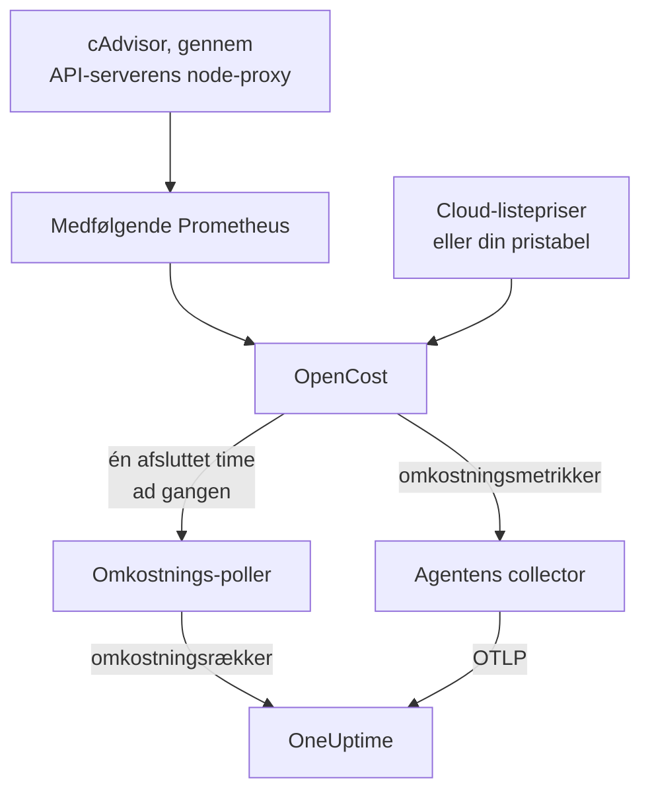

# Observability for Kubernetes-omkostninger

Se, hvad hver Kubernetes-workload koster — forbrug pr. namespace, workload og pod, tomgangskapacitet, og hvor meget af hver request der bruges — ved siden af de metrikker, logs og traces, som [Kubernetes-agenten](/docs/telemetry/kubernetes-agent) allerede indsamler. Det er slået til som standard, uden cloud-legitimationsoplysninger: klyngens oversigt viser, hvad den koster, dens side **Omkostninger** fortæller dig, hvilke requests du kan skrumpe, og omkostningsmetrikkerne kan vises i grafer og bruges til advarsler som alle andre metrikker.

:::cards
- [Slå det til](#slå-omkostningsobservability-til): Slået til som standard; ét `helm upgrade`, hvor det ikke er.
- [Advarsler om omkostninger](#advarsler-om-omkostninger): Omkostning pr. klynge, namespace og workload, som metrikker.
- [Din egen motor](#kører-du-allerede-kubecost-eller-opencost): Kubecost eller OpenCost, som du allerede kører, bliver fundet og læst.
- [Right-sizing](#right-sizing): Anbefalinger til requests, og hvordan de laves.
- [Fejlfinding](#fejlfinding): Tomme sider, manglende anbefalinger.
:::

## Sådan virker det

Med omkostningsovervågning slået til, som den er som standard (`cost.enabled: auto`), kører chartet fire ting ved siden af agenten:



1. **OpenCost**, open source-omkostningsmotoren (Apache-2.0, CNCF; den [cost-model](https://github.com/kubecost/cost-model), som også driver Kubecost). Den overvåger klyngen, prissætter dine noder, volumener og load balancere og beregner, hvad hver workload koster.
2. **En lille Prometheus**, som OpenCost har brug for til forbrugs- og prishistorik. Den kører én replika, beholder 7 dages historik og scraper præcis to mål: cAdvisor gennem API-serverens node-proxy, hvor den kun beholder de serier, OpenCost læser, og OpenCost selv (som udsender sine egne metrikker for ressource-requests, så kube-state-metrics ikke er involveret). Den eksponeres aldrig uden for klyngen, og dens data forlader den aldrig.
3. **Omkostnings-polleren** (`cost.agent`). Én gang pr. afsluttet time læser den OpenCosts Allocation API og sender én omkostningsrække pr. workload til OneUptime: CPU, hukommelse, GPU, volumener, netværk, load balancere og tomgang, med effektivitet. Hver time sendes én gang; serveren springer en time over, som den allerede har, så en genstart kan ikke tælle forbrug to gange. OneUptime skriver også [omkostningsmetrikkerne](#advarsler-om-omkostninger) ud fra disse rækker.
4. **Et scrape af omkostningsmetrikker** (`cost.metrics`). Agentens collector scraper OpenCosts prismetrikker, altså hvad hver node, hvert volumen og hver load balancer koster i timen, og sender dem sammen med resten af klyngens metrikker.

OpenCost prissætter noder ud fra din cloududbyders offentlige listepriser (AWS, Google Cloud, Azure) uden legitimationsoplysninger. Andre steder bruger den sine standardsatser, som du kan erstatte med din egen [pristabel](#priser-for-on-prem-og-bare-metal).

De tre pods har tilsammen requests på cirka 150m CPU og 450Mi hukommelse. Omkostningsovervågning er slået fra som standard med presets `gke-autopilot` og `eks-fargate`: de platforme fakturerer hver pod efter dens requests, så omkostningspodsene ville øge den regning, de måler, og OpenCost prissætter noder, mens ingen af de to platforme fakturerer pr. node.

## Slå omkostningsobservability til

En ny installation kræver ingenting: omkostningsovervågning er slået til som standard. Opgrader en agent, der blev installeret, før det var tilfældet, eller slå det til med presettet `gke-autopilot` eller `eks-fargate`:

:::steps
### Opgrader agenten

```bash
helm upgrade kubernetes-agent oneuptime/kubernetes-agent \
  --namespace oneuptime-agent \
  --reset-then-reuse-values \
  --set cost.enabled=true
```

Det er en komplet installation: tre små ekstra pods, OpenCost, dens Prometheus og omkostningsagenten. Hvis du installerede agenten under et andet release-navn eller namespace, så brug dine (`helm list -A | grep kubernetes-agent` viser dem). For at slå omkostningsovervågning fra skal du sætte `--set cost.enabled=false` på samme måde.

### Vent på den første afsluttede time

De første omkostninger vises, når den første hele time er afsluttet, og OpenCost har brug for nogle minutter efter start til at prissætte sin første time.

### Åbn omkostningssiderne

- **Produkter → Infrastruktur → Kubernetes → Omkostninger** viser forbruget på tværs af alle klynger i projektet.
- På en klynge viser oversigten dens forbrug over de seneste 24 timer, en månedlig prognose, tomgangsforbrug, effektivitet og dens dyreste namespaces og workloads.
- På en klynge viser **Omkostninger** udviklingen i dens forbrug, **Spend by Namespace** med fordelingen på CPU, hukommelse og lager, **Spend by Workload**, tomgangsforbrug, effektivitet og kortet **Right-Sizing**.
:::

Omkostningsmetrikkerne (`node_total_hourly_cost`, `pv_hourly_cost` og resten) er almindelige metrikker: de findes i metrik-explorer, på brugerdefinerede dashboards og i metrikmonitorer. For et færdigt dashboard skal du gå til **Produkter → Dashboards**, vælge **Opret dashboard** og vælge **Kubernetes Cost Dashboard**: udvikling i nodernes timeomkostninger, enhedsomkostninger for CPU og hukommelse samt forbrug på volumener og load balancere.

Under tallene viser oversigten og siden **Omkostninger**, hvor deres priser kommer fra: en cloududbyders listepriser, din pristabel eller OpenCosts standardsatser. Effektivitet er ét og samme tal overalt, også i effektivitetsmetrikken: hvor meget af den anmodede CPU og hukommelse der blev brugt, hvor hver containers time vægtes efter, hvad dens CPU og hukommelse koster, så et billigt job, der intet bruger, ikke kan trække en veludnyttet klynge ned, og tomgangskapacitet tælles ikke med.

## Kører du allerede Kubecost eller OpenCost?

Omkostningsagenten finder din motor og læser den i stedet for den medfølgende OpenCost, så klyngen prissættes, som du har sat den op: med din pristabel eller med din cloudregning, som Kubecost er koblet til. Den leder, når den starter og derefter hver time, gennem Kubernetes-API'et efter de Services, som motorernes egne charts opretter i et vilkårligt namespace (Kubecosts `cost-analyzer` eller `frontend`, OpenCosts chart og den Service `opencost`, som OpenCosts manifest opretter), med Kubecost først. Den springer en motor over, der ikke svarer, kræver login eller svarer for flere klynger, og læser så den medfølgende.

Klyngens oversigt nævner derefter din motor og siger, at den medfølgende OpenCost ikke er nødvendig. Stop med at køre den:

```bash
helm upgrade kubernetes-agent oneuptime/kubernetes-agent \
  --namespace oneuptime-agent \
  --reset-then-reuse-values \
  --set cost.engine.url=auto
```

Med `cost.engine.url=auto` medbringes intet, og agenten læser din motor, uanset hvor den kører; er der ingen motor installeret, prissættes intet. Chartet kan ikke selv lede efter en motor: Helms funktion `lookup` ser intet under `helm template`, Argo CD eller en prøvekørsel. For at beholde den medfølgende OpenCost ved siden af din egen motor skal du sætte `cost.engine.preferExisting=false`; for selv at angive, hvilken motor der skal læses, skal du sætte `cost.engine.url` til dens Service:

| Motor | Sædvanlig service-URL |
| --- | --- |
| OpenCost | `http://opencost.opencost.svc.cluster.local:9003` |
| Kubecost | `http://kubecost-cost-analyzer.kubecost.svc.cluster.local:9090` |

Stien til Allocation API findes af sig selv (`/model/allocation` for Kubecost, `/allocation/compute` eller `/allocation` for OpenCost). Sæt kun `cost.engine.allocationPath` ved en usædvanlig installation. Med `auto` eller en URL medbringes intet, så for hukommelsesanbefalinger skal du også sætte `cost.engine.prometheusUrl` (se [Dataene bag](#dataene-bag)).

## Priser for on-prem og bare metal

Klynger, hvis noder ikke har nogen offentlig cloud-listepris, kan sætte en pristabel. Uden en pristabel prissætter OpenCost dem efter sine standardsatser (on-premises, bare metal, kind, k3s), som kan ligge langt fra, hvad din hardware koster, og det siger klyngens oversigt og side **Omkostninger** også; på en cloud, som den genkender, beholder en node sin listepris, og en pristabel prissætter kun det, listen mangler. Med en pristabel prissætter OpenCost derefter hver ressource ud fra disse tal, alle i USD pr. ressourcetime:

```yaml title="values.yaml"
cost:
  enabled: true
  opencost:
    customPricing:
      enabled: true
      cpuPerCoreHour: "0.031611"       # ~$23 per core-month
      ramPerGiBHour: "0.004237"        # ~$3 per GiB-month
      storagePerGBHour: "0.00005479452" # ~$0.04 per GB-month
      gpuPerHour: "0.95"
```

Det er OpenCosts egne standardsatser: indsæt dine egne tal, ellers siger siden **Omkostninger** stadig, at klyngen er prissat efter OpenCosts standardsatser.

## Indstillinger, der er værd at kende

Alle valgfrie; chartets `values.yaml` har den fulde liste:

```yaml title="values.yaml"
cost:
  enabled: auto           # on, except with the gke-autopilot and eks-fargate presets
  agent:
    windowSeconds: 3600   # allocation window length (hourly = native)
    includeIdle: true     # ship the engine's __idle__ allocation
    currency: USD         # currency code shown in the UI (informational)
  prometheus:
    retention: 7d         # bundled TSDB history; right-sizing reads peaks back over days
    persistence:
      enabled: false      # set true for a small PVC; emptyDir otherwise
  metrics:
    enabled: true         # cost metrics for dashboards / Metric Explorer
    scrapeInterval: 60s
```

## Right-sizing

Kortet **Right-Sizing** på en klynges side **Omkostninger** anbefaler en CPU- og en hukommelses-request for hver container, den har nok historik til, sorteret efter, hvor meget hver ændring sparer pr. måned.

En anbefaling er den observerede efterspørgsel plus 25% margin, afrundet til en værdi, du kan indsætte i et manifest (10m CPU, 16Mi hukommelse):

- CPU dimensioneres ud fra 95. percentil af timegennemsnitligt forbrug: højt nok til at dække reel belastning, lavt nok til, at én spids ikke puster requesten op i en måned.
- Hukommelse dimensioneres ud fra det højeste working set, aldrig et gennemsnit (se [Dataene bag](#dataene-bag)).

Requests anbefales; limits gør ikke. En request er det, scheduleren reserverer, og det, regningen beregnes ud fra, så det er det tal, der flytter omkostningerne. En limit er en beslutning om, hvorvidt en container, der opfører sig forkert, skal throttles eller dræbes, og den beslutning kan forbrugsdata ikke træffe for dig.

Hver container sammenlignes med sin nuværende request:

| Vurdering | Hvad den betyder |
| --- | --- |
| Overprovisioneret | Den reserverer tydeligt mere, end den bruger. Det er herfra, besparelserne kommer. |
| Underprovisioneret | Den reserverer mindre, end den bruger, så den throttles eller risikerer et OOM-kill. At rette det koster penge, og kortet viser det som en stigning. |
| Ingen request sat | Der er intet at skrumpe, men scheduleren kan ikke placere containeren sikkert, og den er den første, der smides ud under pres. |

En container inden for 15% af sin anbefaling regnes for korrekt dimensioneret og udelades: ingen bør redigere et manifest for at skære 3% af en request.

To værn holder rådene ærlige. En workload skal have mindst 24 timers omkostningsvinduer, før den overhovedet dimensioneres, fordi et vindue på fire timer kan fange et natligt batchjob i hvile og råde til at skrumpe det til ingenting. Og besparelser fremskrives ud fra længden af det vindue, du ser på, ikke ud fra antallet af rækker, så et Deployments besparelse ikke ganges med dets antal replikaer. Estimatet antager, at forbruget skalerer med det, motoren allokerede, hvilket er `max(request, usage)`; for en overprovisioneret container er det requesten, så besparelsestallet er nøjagtigt.

### Dataene bag

Ud over forbruget indsamler polleren det, en anbefaling har brug for: hver containers CPU- og hukommelses-requests, limits og forbrug.

Hukommelse kræver én kilde mere. Allocation API rapporterer kun et gennemsnit over hvert vindue, og et timegennemsnit skjuler den spids, der OOM-dræber en container, så det ville være farligt at dimensionere hukommelse ud fra det. Polleren læser i stedet hver containers hukommelsesspids fra Prometheus, sammenkædet på `(namespace, pod, container)`:

- Med den medfølgende motor (standarden) bruger den chartets egen Prometheus. Intet at sætte.
- Når `cost.engine.url` er sat (`auto` eller din motors URL), skal du pege `cost.engine.prometheusUrl` på en Prometheus, der scraper cAdvisor, og sætte `cost.engine.prometheusCadvisorJob`, hvis dens scrape-job ikke hedder `kubernetes-nodes-cadvisor`.
- Uden Prometheus virker CPU-anbefalinger stadig, ud fra de gemte timegennemsnit, og hukommelsesanbefalinger udelades i stedet for at blive gættet.

Et Prometheus-udfald stopper aldrig indsamlingen af forbrug: spidser er en ekstra, og en time sendes uden dem. CPU bruger med vilje ikke Prometheus: en for stor CPU-request throttler kun, hvor en for lille hukommelses-request dræber, så timegennemsnittene er sikre for CPU, og at forespørge hver containers CPU-rate på tværs af en klynge er tungt nok til at vælte en lille Prometheus.

## Advarsler om omkostninger

OneUptime skriver fire metrikker ud fra hver times omkostningsrækker, prissat og navngivet efter, hvad de er, så omkostninger kan vises i grafer, sættes på et dashboard og bruges til advarsler i en [Kubernetes-monitor](/docs/monitor/kubernetes-monitor) eller en [metrikmonitor](/docs/monitor/metrics-monitor):

| Metrik | Hvad den er | Attributter |
| --- | --- | --- |
| `oneuptime.kubernetes.cost.total` | Hvad klyngen kostede i hver time, inklusive tomgangskapacitet | `k8s.cluster.name` |
| `oneuptime.kubernetes.cost.idle` | Den del af det, som ingen workload brugte: tomgangs- og ikke-allokeret kapacitet | `k8s.cluster.name` |
| `oneuptime.kubernetes.cost.workload` | Hvad hver workload kostede i hver time; summeret pr. namespace, hvad namespacet kostede | `k8s.cluster.name`, `k8s.namespace.name` og workloadens navn under dens type, for eksempel `k8s.deployment.name` |
| `oneuptime.kubernetes.cost.efficiency` | Hvor meget af sin anmodede CPU og hukommelse hver workload brugte, i procent, vægtet efter omkostning | Workloadens, som ovenfor |

Hvert punkt er én times omkostning, i agentens valuta (USD som standard), tidsstemplet ved timens start og skrevet cirka en time efter, at den slutter: summér punkterne over et vindue af timer, så giver en dags punkter tilsammen dagens omkostning. De kommer fra det, klyngen allerede har sendt, så de faktureres ikke som indtagne metrikker, og de opbevares lige så længe som klyngens andre metrikker.

Kubernetes-monitoren har tre skabeloner til dem: Cluster Daily Cost Over Budget, Namespace Daily Cost Over Budget og High Idle Spend, hver med et budget, du selv skal sætte. OpenCosts prismetrikker er også almindelige metrikker: en metrikmonitor kan advare, når gennemsnittet af `node_total_hourly_cost` stiger over et budget, eller når `pv_hourly_cost` dukker op for en volumenklasse, der ikke burde findes i en klynge.

## Datamodel og opbevaring

Omkostningsrækker gemmes i ClickHouse, én pr. klynge, vindue, namespace, controller, pod og container. De følger klyngens opbevaring af telemetri: klyngens `retainTelemetryDataForDays` eller projektets dataopbevaring, når den ikke er sat. Tomgangs- og ikke-allokeret kapacitet gemmes som almindelige rækker under namespacene `__idle__` og `__unallocated__`, så de grupperes og filtreres som workload-forbrug.

## Fejlfinding

:::details Omkostningssiderne er tomme
Med presets `gke-autopilot` og `eks-fargate` er omkostningsovervågning slået fra som standard: slå den til med `--set cost.enabled=true`. Ellers skal du læse omkostnings-pollerens logs: `kubectl logs -n oneuptime-agent deploy/kubernetes-agent-cost`. (Deploymentet hedder `<release>-kubernetes-agent-cost`, når release-navnet ikke indeholder `kubernetes-agent`; `kubectl get deploy -n oneuptime-agent` viser dem.) `HTTP 401` betyder, at OneUptime afviste indtagelsesnøglen. `did not answer any known allocation path` betyder, at motoren ikke er oppe endnu (den medfølgende OpenCost har brug for nogle minutter til at prissætte sine første timer), eller at `cost.engine.url` er forkert.
:::

:::details Den medfølgende OpenCost er ikke klar
Læs dens logs: `kubectl logs -n oneuptime-agent deploy/kubernetes-agent-opencost`. De siger, hvilken cloududbyder den registrerede, og om dens prisdata blev indlæst.
:::

:::details Oversigten siger, at den medfølgende OpenCost ikke er nødvendig
Klyngen kører sin egen Kubecost eller OpenCost, og omkostningsagenten læser den, så den OpenCost og Prometheus, som chartet medbragte, prissætter intet. Opgrader med `--set cost.engine.url=auto` for at stoppe dem, eller sæt `cost.engine.preferExisting=false` for i stedet at læse den medfølgende motor.
:::

:::details Omkostningsagenten læser ikke din motor
Omkostningsagentens log siger, hvilken motor den læser, og hvorfor den sprang de andre over: `kubectl logs -n oneuptime-agent deploy/kubernetes-agent-cost`. Den springer en motor over, der ikke svarer (for eksempel på grund af en NetworkPolicy mellem namespacene), kræver login eller svarer for flere klynger, sådan som en Kubecost, der samler flere klynger i en føderation, gør. Angiv med `cost.engine.url`, hvilken motor der skal læses.
:::

:::details OpenCost-loggen siger mkdir /var/configs: permission denied
Et ældre chart kørte OpenCost uden en skrivbar konfigurationsmappe, så `Error downloading default pricing data` efterlod dens Allocation API ude af stand til at svare, og polleren gik i stå, mens poden forblev `Running`, `/healthz` forblev grøn, og nodernes omkostningsmetrikker blev ved med at blive publiceret. Nuværende charts retter det: kør `helm repo update`, og opgrader derefter med `--reset-then-reuse-values`. Omkostningsrækker vises ved næste poll.
:::

:::details Kubernetes Cost Dashboard viser ingen data
Skabelonen læser de scrapede omkostningsmetrikker: kontrollér, at `cost.metrics.enabled` er `true`.
:::

:::details Kortet Right-Sizing er tomt
Enten er tidsintervallet kortere end de 24 timer, en anbefaling kræver (udvid det), eller også er hver container allerede inden for 15% af sin anbefalede request, hvilket kortet siger.
:::

:::details Hukommelsesanbefalinger viser -, men CPU-anbefalinger virker
Ingen hukommelsesspids nåede OneUptime, så hukommelsen blev ikke dimensioneret i stedet for at blive gættet ud fra et gennemsnit. Med din egen motor skal du sætte `cost.engine.prometheusUrl`. Kortet siger, hvor mange containere det berører.
:::

:::details Tallene afviger fra motorens egen brugerflade
OneUptime medregner motorens afstemningsjusteringer i hver omkostningskomponent og sender hele, afsluttede timer: den aktuelle times forbrug vises, når den er afsluttet.
:::

:::details Den medfølgende Prometheus blev genstartet
Med standardlageret `emptyDir` mister en genstart nogle timers forbrugshistorik, så omkostningerne for de timer kan blive mindre. Sæt `cost.prometheus.persistence.enabled=true`, hvis det betyder noget for dig.
:::

## Næste trin

:::cards
- [Kubernetes-agent](/docs/telemetry/kubernetes-agent): Installer agenten, og alt andet den indsamler.
- [Metrik-monitor](/docs/monitor/metrics-monitor): Advar, når forbruget overstiger et budget.
- [Kubernetes-monitor](/docs/monitor/kubernetes-monitor): Advar også om klyngens helbred.
:::
