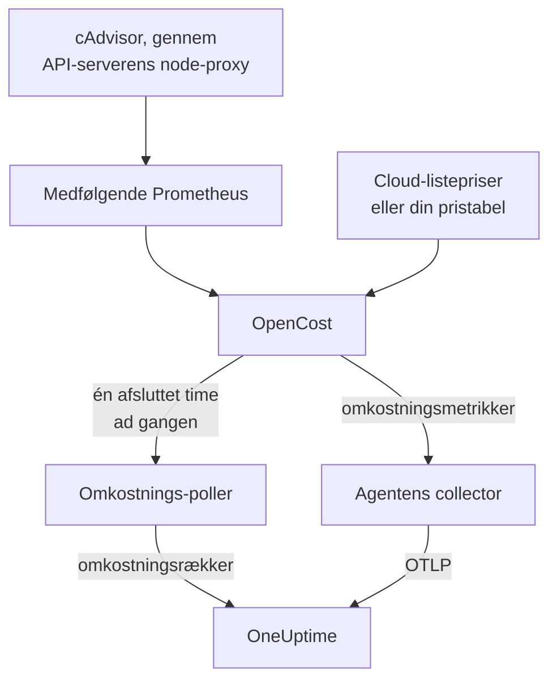

# Observability for Kubernetes-omkostninger

Se, hvad hver Kubernetes-workload koster — forbrug pr. namespace, workload og pod, tomgangskapacitet, og hvor meget af hver request der bruges — ved siden af de metrikker, logs og traces, som [Kubernetes-agenten](/docs/telemetry/kubernetes-agent) allerede indsamler. Én Helm-værdi slår det til, uden cloud-legitimationsoplysninger, og klyngens side **Costs** fortæller dig derefter, hvilke requests du kan skrumpe.

:::cards
- [Slå det til](#slå-omkostningsobservability-til): Ét `helm upgrade`.
- [Brug din egen motor](#kører-du-allerede-kubecost-eller-opencost): Peg agenten på Kubecost eller OpenCost.
- [Right-sizing](#right-sizing): Anbefalinger til requests, og hvordan de laves.
- [Fejlfinding](#fejlfinding): Tomme sider, manglende anbefalinger.
:::

## Sådan virker det

Med `cost.enabled=true` kører chartet fire ting ved siden af agenten:



1. **OpenCost**, open source-omkostningsmotoren (Apache-2.0, CNCF; den [cost-model](https://github.com/kubecost/cost-model), som også driver Kubecost). Den overvåger klyngen, prissætter dine noder, volumener og load balancere og beregner, hvad hver workload koster.
2. **En lille Prometheus**, som OpenCost har brug for til forbrugs- og prishistorik. Den kører én replika, beholder 7 dages historik og scraper præcis to mål: cAdvisor gennem API-serverens node-proxy og OpenCost selv (som udsender sine egne metrikker for ressource-requests, så kube-state-metrics ikke er involveret). Den eksponeres aldrig uden for klyngen, og dens data forlader den aldrig.
3. **Omkostnings-polleren** (`cost.agent`). Én gang pr. afsluttet time læser den OpenCosts Allocation API og sender én omkostningsrække pr. workload til OneUptime: CPU, hukommelse, GPU, volumener, netværk, load balancere og tomgang, med effektivitet. Hver time sendes én gang; serveren springer en time over, som den allerede har, så en genstart kan ikke tælle forbrug to gange.
4. **Et scrape af omkostningsmetrikker** (`cost.metrics`). Agentens collector scraper OpenCosts omkostningsmetrikker og sender dem sammen med resten af klyngens metrikker.

OpenCost prissætter noder ud fra din cloududbyders offentlige listepriser (AWS, Google Cloud, Azure) uden legitimationsoplysninger. Klynger uden cloud-listepris sætter i stedet en [pristabel](#priser-for-on-prem-og-bare-metal).

## Slå omkostningsobservability til

:::steps
### Opgrader agenten med cost.enabled

```bash
helm upgrade kubernetes-agent oneuptime/kubernetes-agent \
  --namespace oneuptime-agent \
  --reset-then-reuse-values \
  --set cost.enabled=true
```

Det er en komplet installation: to små ekstra pods, OpenCost og dens Prometheus. Hvis du installerede agenten under et andet release-navn eller namespace, så brug dine (`helm list -A | grep kubernetes-agent` viser dem).

### Vent på den første afsluttede time

De første omkostninger vises, når den første hele time er afsluttet, og OpenCost har brug for nogle minutter efter start til at prissætte sin første time.

### Åbn omkostningssiderne

- **Produkter → Infrastruktur → Kubernetes → Costs** viser forbruget på tværs af alle klynger i projektet.
- På en klynge viser **Costs** udviklingen i dens forbrug, **Spend by Namespace** med fordelingen på CPU, hukommelse og lager, **Spend by Workload**, tomgangsforbrug, effektivitet og kortet **Right-Sizing**.
:::

Omkostningsmetrikkerne (`node_total_hourly_cost`, `pv_hourly_cost` og resten) er almindelige metrikker: de findes i metrik-explorer, på brugerdefinerede dashboards og i metrikmonitorer. For et færdigt dashboard skal du gå til **Produkter → Dashboards**, vælge **Opret Dashboard** og vælge **Kubernetes Cost Dashboard**: udvikling i nodernes timeomkostninger, enhedsomkostninger for CPU og hukommelse samt forbrug på volumener og load balancere.

## Kører du allerede Kubecost eller OpenCost?

Peg i stedet agenten på din motor, så medbringes intet:

```bash
helm upgrade kubernetes-agent oneuptime/kubernetes-agent \
  --namespace oneuptime-agent \
  --reset-then-reuse-values \
  --set cost.enabled=true \
  --set cost.engine.url=http://kubecost-cost-analyzer.kubecost.svc.cluster.local:9090
```

| Motor | Sædvanlig service-URL |
| --- | --- |
| OpenCost | `http://opencost.opencost.svc.cluster.local:9003` |
| Kubecost | `http://kubecost-cost-analyzer.kubecost.svc.cluster.local:9090` |

Stien til Allocation API findes af sig selv (`/model/allocation` for Kubecost, `/allocation/compute` eller `/allocation` for OpenCost). Sæt kun `cost.engine.allocationPath` ved en usædvanlig installation. For hukommelsesanbefalinger skal du også sætte `cost.engine.prometheusUrl` (se [Dataene bag](#dataene-bag)).

## Priser for on-prem og bare metal

Klynger, hvis noder ikke har nogen offentlig cloud-listepris, kan sætte en pristabel. OpenCost prissætter derefter hver ressource ud fra disse tal, alle i USD pr. ressourcetime:

```yaml title="values.yaml"
cost:
  enabled: true
  opencost:
    customPricing:
      enabled: true
      cpuPerCoreHour: "0.031611"       # ~$23 per core-month
      ramPerGiBHour: "0.004237"        # ~$3 per GiB-month
      storagePerGBHour: "0.00005479452" # ~$0.04 per GB-month
      gpuPerHour: "0.95"
```

## Indstillinger, der er værd at kende

Alle valgfrie; chartets `values.yaml` har den fulde liste:

```yaml title="values.yaml"
cost:
  agent:
    windowSeconds: 3600   # allocation window length (hourly = native)
    includeIdle: true     # ship the engine's __idle__ allocation
    currency: USD         # currency code shown in the UI (informational)
  prometheus:
    retention: 7d         # bundled TSDB history; right-sizing reads peaks back over days
    persistence:
      enabled: false      # set true for a small PVC; emptyDir otherwise
  metrics:
    enabled: true         # cost metrics for dashboards / Metric Explorer
    scrapeInterval: 60s
```

## Right-sizing

Kortet **Right-Sizing** på en klynges side **Costs** anbefaler en CPU- og en hukommelses-request for hver container, den har nok historik til, sorteret efter, hvor meget hver ændring sparer pr. måned.

En anbefaling er den observerede efterspørgsel plus 25% margin, afrundet til en værdi, du kan indsætte i et manifest (10m CPU, 16Mi hukommelse):

- CPU dimensioneres ud fra 95. percentil af timegennemsnitligt forbrug: højt nok til at dække reel belastning, lavt nok til, at én spids ikke puster requesten op i en måned.
- Hukommelse dimensioneres ud fra det højeste working set, aldrig et gennemsnit (se [Dataene bag](#dataene-bag)).

Requests anbefales; limits gør ikke. En request er det, scheduleren reserverer, og det, regningen beregnes ud fra, så det er det tal, der flytter omkostningerne. En limit er en beslutning om, hvorvidt en container, der opfører sig forkert, skal throttles eller dræbes, og den beslutning kan forbrugsdata ikke træffe for dig.

Hver container sammenlignes med sin nuværende request:

| Vurdering | Hvad den betyder |
| --- | --- |
| Overprovisioneret | Den reserverer tydeligt mere, end den bruger. Det er herfra, besparelserne kommer. |
| Underprovisioneret | Den reserverer mindre, end den bruger, så den throttles eller risikerer et OOM-kill. At rette det koster penge, og kortet viser det som en stigning. |
| Ingen request sat | Der er intet at skrumpe, men scheduleren kan ikke placere containeren sikkert, og den er den første, der smides ud under pres. |

En container inden for 15% af sin anbefaling regnes for korrekt dimensioneret og udelades: ingen bør redigere et manifest for at skære 3% af en request.

To værn holder rådene ærlige. En workload skal have mindst 24 timers omkostningsvinduer, før den overhovedet dimensioneres, fordi et vindue på fire timer kan fange et natligt batchjob i hvile og råde til at skrumpe det til ingenting. Og besparelser fremskrives ud fra længden af det vindue, du ser på, ikke ud fra antallet af rækker, så et Deployments besparelse ikke ganges med dets antal replikaer. Estimatet antager, at forbruget skalerer med det, motoren allokerede, hvilket er `max(request, usage)`; for en overprovisioneret container er det requesten, så besparelsestallet er nøjagtigt.

### Dataene bag

Ud over forbruget indsamler polleren det, en anbefaling har brug for: hver containers CPU- og hukommelses-requests, limits og forbrug.

Hukommelse kræver én kilde mere. Allocation API rapporterer kun et gennemsnit over hvert vindue, og et timegennemsnit skjuler den spids, der OOM-dræber en container, så det ville være farligt at dimensionere hukommelse ud fra det. Polleren læser i stedet hver containers hukommelsesspids fra Prometheus, sammenkædet på `(namespace, pod, container)`:

- Med den medfølgende motor (standarden) bruger den chartets egen Prometheus. Intet at sætte.
- Med din egen motor (`cost.engine.url`) skal du pege `cost.engine.prometheusUrl` på en Prometheus, der scraper cAdvisor, og sætte `cost.engine.prometheusCadvisorJob`, hvis dens scrape-job ikke hedder `kubernetes-nodes-cadvisor`.
- Uden Prometheus virker CPU-anbefalinger stadig, ud fra de gemte timegennemsnit, og hukommelsesanbefalinger udelades i stedet for at blive gættet.

Et Prometheus-udfald stopper aldrig indsamlingen af forbrug: spidser er en ekstra, og en time sendes uden dem. CPU bruger med vilje ikke Prometheus: en for stor CPU-request throttler kun, hvor en for lille hukommelses-request dræber, så timegennemsnittene er sikre for CPU, og at forespørge hver containers CPU-rate på tværs af en klynge er tungt nok til at vælte en lille Prometheus.

## Advarsler om omkostninger

Omkostningsmetrikkerne er almindelige metrikker, så en [metrikmonitor](/docs/monitor/metrics-monitor) kan advare på dem som på alt andet: for eksempel når gennemsnittet af `node_total_hourly_cost` stiger over et budget, eller når `pv_hourly_cost` dukker op for en volumenklasse, der ikke burde findes i en klynge.

## Datamodel og opbevaring

Omkostningsrækker gemmes i ClickHouse, én pr. klynge, vindue, namespace, controller, pod og container. De følger klyngens opbevaring af telemetri: klyngens `retainTelemetryDataForDays` eller projektets dataopbevaring, når den ikke er sat. Tomgangs- og ikke-allokeret kapacitet gemmes som almindelige rækker under namespacene `__idle__` og `__unallocated__`, så de grupperes og filtreres som workload-forbrug.

## Fejlfinding

:::details Omkostningssiderne er tomme
Læs omkostnings-pollerens logs: `kubectl logs -n oneuptime-agent deploy/kubernetes-agent-cost`. (Deploymentet hedder `<release>-kubernetes-agent-cost`, når release-navnet ikke indeholder `kubernetes-agent`; `kubectl get deploy -n oneuptime-agent` viser dem.) `HTTP 401` betyder, at OneUptime afviste indtagelsesnøglen. `did not answer any known allocation path` betyder, at motoren ikke er oppe endnu (den medfølgende OpenCost har brug for nogle minutter til at prissætte sine første timer), eller at `cost.engine.url` er forkert.
:::

:::details Den medfølgende OpenCost er ikke klar
Læs dens logs: `kubectl logs -n oneuptime-agent deploy/kubernetes-agent-opencost`. De siger, hvilken cloududbyder den registrerede, og om dens prisdata blev indlæst.
:::

:::details OpenCost-loggen siger mkdir /var/configs: permission denied
Et ældre chart kørte OpenCost uden en skrivbar konfigurationsmappe, så `Error downloading default pricing data` efterlod dens Allocation API ude af stand til at svare, og polleren gik i stå, mens poden forblev `Running`, `/healthz` forblev grøn, og nodernes omkostningsmetrikker blev ved med at blive publiceret. Nuværende charts retter det: kør `helm repo update`, og opgrader derefter med `--reset-then-reuse-values`. Omkostningsrækker vises ved næste poll.
:::

:::details Kubernetes Cost Dashboard viser ingen data
Skabelonen læser de scrapede omkostningsmetrikker: kontrollér, at `cost.metrics.enabled` er `true`.
:::

:::details Kortet Right-Sizing er tomt
Enten er tidsintervallet kortere end de 24 timer, en anbefaling kræver (udvid det), eller også er hver container allerede inden for 15% af sin anbefalede request, hvilket kortet siger.
:::

:::details Hukommelsesanbefalinger viser -, men CPU-anbefalinger virker
Ingen hukommelsesspids nåede OneUptime, så hukommelsen blev ikke dimensioneret i stedet for at blive gættet ud fra et gennemsnit. Med din egen motor skal du sætte `cost.engine.prometheusUrl`. Kortet siger, hvor mange containere det berører.
:::

:::details Tallene afviger fra motorens egen brugerflade
OneUptime medregner motorens afstemningsjusteringer i hver omkostningskomponent og sender hele, afsluttede timer: den aktuelle times forbrug vises, når den er afsluttet.
:::

:::details Den medfølgende Prometheus blev genstartet
Med standardlageret `emptyDir` mister en genstart nogle timers forbrugshistorik, så omkostningerne for de timer kan blive mindre. Sæt `cost.prometheus.persistence.enabled=true`, hvis det betyder noget for dig.
:::

## Næste trin

:::cards
- [Kubernetes-agent](/docs/telemetry/kubernetes-agent): Installer agenten, og alt andet den indsamler.
- [Metrik-monitor](/docs/monitor/metrics-monitor): Advar, når forbruget overstiger et budget.
- [Kubernetes-monitor](/docs/monitor/kubernetes-monitor): Advar også om klyngens helbred.
:::
