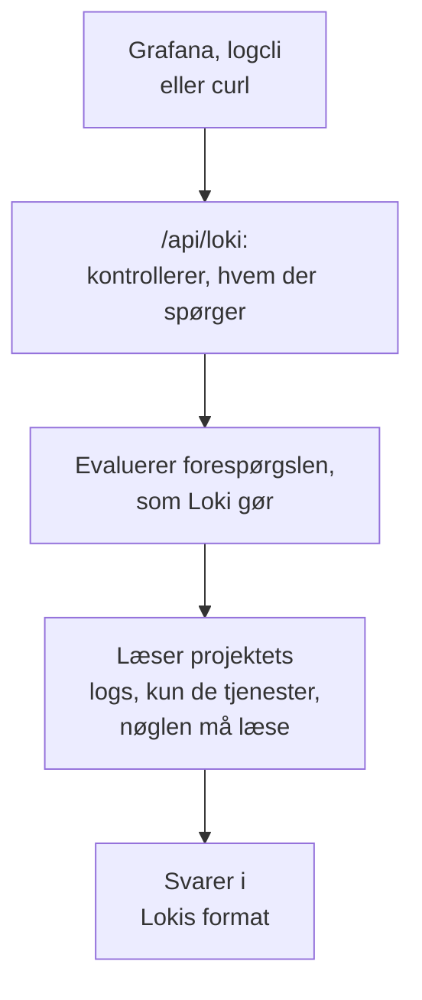

# Forespørg logs med LogQL

LogQL er Grafana Lokis forespørgselssprog. OneUptime besvarer Lokis forespørgsels-API over dit projekts logs, så Grafanas Loki-datakilde, logcli eller enhver Loki-klient læser dem, og de dashboards og gemte forespørgsler, du skrev til Loki, bliver ved med at virke.

:::cards
- [Forbind Grafana](#forbind-grafana): Tilføj OneUptime som Loki-datakilde.
- [Sådan får logs deres labels](#sådan-får-logs-deres-labels): Hvad en stream-selektor finder.
- [Hvad LogQL dækker](#hvad-logql-dækker): Logforespørgsler, parsere og metrikforespørgsler.
- [Grænser](#grænser): Hvad en forespørgsel må læse, og hvor ofte.
:::

## Sådan virker det

Grafana spørger OneUptime, som det spørger Loki. OneUptime kontrollerer, at API-nøglen må læse projektets logs, læser kun de tjenester, den må læse, og evaluerer forespørgslen, som Loki gør.



## Før du begynder

- **Logs, der kommer ind.** Send dem med [OpenTelemetry](/docs/telemetry/open-telemetry), eller fra Promtail, Grafana Alloy, Fluent Bit eller Vector gennem [Lokis push-API](/docs/telemetry/compatible-endpoints).
- **En API-nøgle til projektet, der læser logs**, med rollen Projektejer, Projektadministrator, Projektmedlem, Seer, Telemetriadministrator, Telemetrimedlem eller Telemetriseer, eller tilladelsen Read Logs. En nøgle, der er begrænset til bestemte tjenester, læser kun deres logs. Se [Opret en API-nøgle](/docs/api-reference/api-reference#opret-en-api-nøgle). På OneUptime Cloud kræver API-nøgler abonnementet **Growth**.
- **Ikke en indtagelsesnøgle.** En indtagelsesnøgle sender telemetri og læser ingen, så Grafana kan ikke logge ind med en.

## Forbind Grafana

:::steps
### Opret en API-nøgle

I OneUptime åbner du **Projektindstillinger → Avanceret → API-nøgler** og klikker på **Opret API-nøgle**. Giv nøglen en rolle, der må læse telemetri, eller tilladelsen Read Logs.

### Tilføj en Loki-datakilde

I Grafana åbner du **Connections → Data sources → Add data source** og vælger **Loki**.

### Angiv URL'en

Sæt **URL** til din OneUptime-adresse efterfulgt af `/api/loki`. På OneUptime Cloud er det `https://oneuptime.com/api/loki`.

### Send API-nøglen

Under **HTTP headers** tilføjer du headeren `Authorization` med værdien `Bearer` efterfulgt af et mellemrum og din API-nøgle. Basic-godkendelse virker også: et vilkårligt brugernavn med API-nøglen som adgangskode.

### Gem og test

Klik på **Save & test**. Grafana kører en forespørgsel og siger, at datakilden virker.
:::

Explore, logvolumen over linjerne, label-browserne og dashboards læser derefter OneUptime, som de læser Loki. logcli og enhver anden Loki-klient virker på samme måde. Med curl:

```bash title="Query OneUptime's Loki API"
curl -G -H "Authorization: Bearer $ONEUPTIME_API_KEY" \
  "https://oneuptime.com/api/loki/loki/api/v1/query_range" \
  --data-urlencode 'query={service_name="checkout"} |= "error"'
```

## Sådan får logs deres labels

En stream-selektor finder en logs attributter, navngivet som Loki 3 navngiver OpenTelemetry-logs:

| I OneUptime | I LogQL |
| --- | --- |
| En ressourceattribut `service.name` | Labelet `service_name` |
| En ressourceattribut `k8s.pod.name` | Labelet `k8s_pod_name` |
| En attribut `http.method` | Labelet `http_method` |
| Et label, en Loki-klient sendte, som `job` | Labelet `job` |
| Loggens alvorlighed | Labelet `detected_level`: `trace`, `debug`, `info`, `warn`, `error`, `fatal` eller `unknown` |

- **Hver attribut er et label.** En logforespørgsel svarer med én stream pr. labelsæt, så logs med forskellige attributter er forskellige streams, som Loki 3 svarer for logs med strukturerede metadata.
- **En logs egen attribut kommer først**, når dens ressource har en med samme navn.
- **En selektor nævner en værdi**, som Loki kræver: mindst én matcher, som en log uden labelet ikke opfylder, som `{service_name="checkout"}` eller `{service_name=~"check.+"}`.

Et par forespørgsler at starte med:

```text title="LogQL"
# The checkout service's lines that say error
{service_name="checkout"} |= "error"

# Requests slower than 250ms, read from JSON lines
{service_name="checkout"} | json | duration > 250ms

# Error logs per second, by service
sum by (service_name) (rate({detected_level="error"} [5m]))
```

## Hvad LogQL dækker

- **Logforespørgsler**: stream-selektorer med `=`, `!=`, `=~` og `!~`; linjefiltre `|=`, `!=`, `|~` og `!~`, med `or`; parserne `json` og `logfmt`; labelfiltre på tekst, tal, varigheder og størrelser, med `and`, `or` og `__error__`; `line_format` med `{{.label}}`; `drop`, `keep` og `decolorize`.
- **Metrikforespørgsler**: `count_over_time`, `rate`, `bytes_over_time`, `bytes_rate` og `absent_over_time`; over et label taget med `unwrap` (med `duration()` eller `bytes()`), `rate`, `sum_over_time`, `avg_over_time`, `min_over_time`, `max_over_time`, `first_over_time`, `last_over_time`, `stddev_over_time`, `stdvar_over_time` og `quantile_over_time`; og `offset`.
- **Omkring dem**: `sum`, `avg`, `min`, `max`, `count`, `stddev`, `stdvar`, `topk` og `bottomk`, med `by` eller `without`; aritmetik, sammenligninger (med `bool`), `and`, `or` og `unless`, med `on`, `ignoring`, `group_left` og `group_right`; `sort`, `sort_desc`, `label_replace` og `vector()`.

Parserne `pattern`, `regexp` og `unpack`, `label_format`, `json` med navngivne felter, `ip()`-filtre og `line_format`-skabeloner ud over `{{.label}}` er ikke tilgængelige endnu. En forespørgsel, der bruger en af dem, afvises med en meddelelse, der nævner den.

## API'et

API'et besvarer ruterne i Lokis HTTP-API, med `GET` eller `POST`, under `/api/loki`:

| Rute | Hvad den besvarer |
| --- | --- |
| `/loki/api/v1/query_range` | En logforespørgsels linjer fra `start` til `end`, eller en metrikforespørgsel ved hvert `step`. |
| `/loki/api/v1/query` | En metrikforespørgsel på ét tidspunkt (`time`, som standard nu). |
| `/loki/api/v1/labels` | Labelnavne, for de logs `query` vælger eller for alle logs. |
| `/loki/api/v1/label/<name>/values` | Ét labels værdier. |
| `/loki/api/v1/series` | Labelsættene for de logs, `match[]` vælger. |

Tider er nanosekunder siden 1970, Unix-sekunder eller RFC 3339, og et interval er timen før `end`, medmindre det siger andet. En logforespørgsel svarer med `limit` linjer, 100 som standard, de nyeste først, medmindre `direction=forward`. Svarene er i Lokis format, og fejl er ren tekst, som Loki skriver dem. `/loki/api/v1/status/buildinfo` svarer som en Loki 3-server.

## Grænser

Hver forespørgsel er begrænset, så et dashboard med mange paneler ikke kan overbelaste OneUptime:

| Grænse | Værdi |
| --- | --- |
| Linjer, en logforespørgsel svarer med | 5.000 |
| Logs, en logforespørgsel læser, når filtre efter dens parsere frasorterer nogle | 20.000 |
| Logs, en metrikforespørgsel selv læser, når ClickHouse ikke kan tælle dem | 100.000 |
| Serier, en metrikforespørgsel svarer med | 500 |
| Punkter i én serie i en intervalforespørgsel | 11.000 |
| Logs, én læsning giver tilbage | 64 MB |
| Tid, en læsning må tage | 30 sekunder |
| Forespørgsler, et projekt må sende hvert minut | 1.200 |

En metrikforespørgsel, hvis pipeline kun er linjefiltre, som `sum(count_over_time({service_name="checkout"} |= "error" [5m]))`, tælles der, hvor loggene ligger, så den læser slet ingen linjer.

## Fejlfinding

:::details Grafana siger, at datakilden ikke virker
Kontrollér, at URL'en ender på `/api/loki`, og at headeren `Authorization` indeholder `Bearer`, et mellemrum og API-nøglen. En indtagelsesnøgle, eller en API-nøgle uden en rolle, der læser logs, afvises: giv nøglen sådan en rolle under **Projektindstillinger → Avanceret → API-nøgler**.
:::

:::details "queries require at least one regexp or equality matcher that does not have an empty-compatible value"
Selektoren finder logs uden at nævne en værdi, som `{service_name=~".*"}`. Tilføj en matcher, der nævner en, som `{service_name="checkout"}`.
:::

:::details "This project sent more queries this minute than OneUptime answers."
Projektets dashboards og klienter sendte mere end 1.200 forespørgsler til API'et i dette minut. Panelerne indlæses igen i næste minut; opdater dashboards sjældnere for at holde dig under grænsen.
:::

## Næste trin

:::cards
- [Protokoludforsker](/docs/telemetry/logs-explorer): Søg i og filtrer logs uden at skrive en forespørgsel.
- [PromQL](/docs/telemetry/promql): Forespørg metrikker med PromQL, også fra Grafanas Prometheus-datakilde.
- [Log-monitor](/docs/monitor/logs-monitor): Få en advarsel om logmængde og -indhold.
:::
