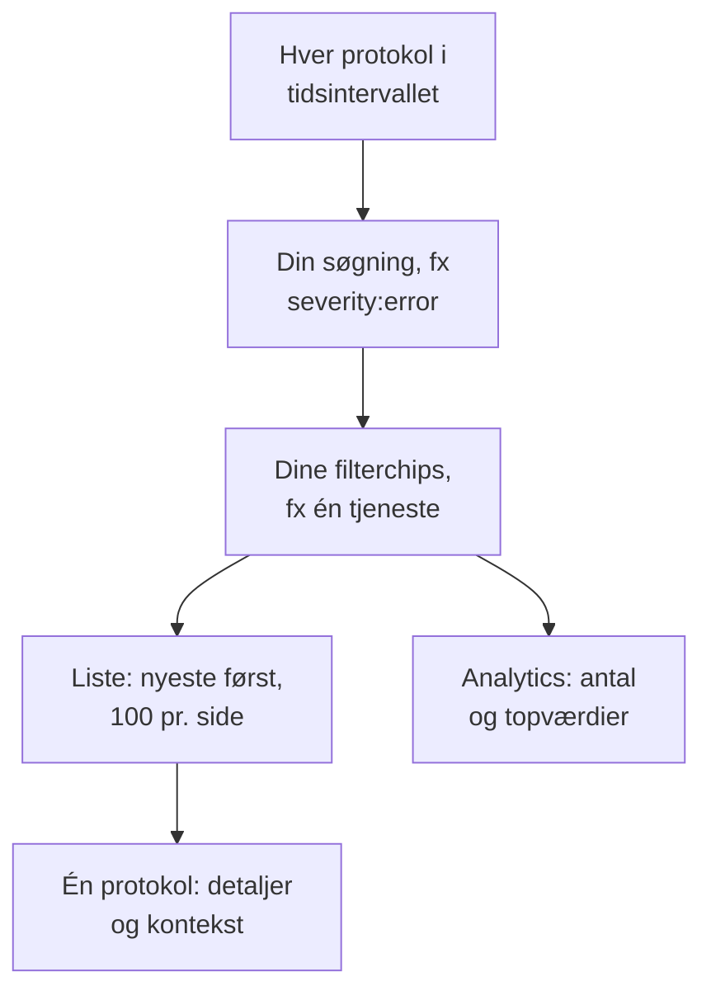

# Protokoludforsker

Protokoludforskeren er stedet, hvor du søger i og læser de protokoller, som dine tjenester, værter og agenter sender til OneUptime. Skær millioner af linjer ned til de få, der betyder noget, følg nye, mens de ankommer, vis dem i diagrammer, og gem de visninger, dit team vender tilbage til.

:::cards
- [Find en protokollinje](#find-en-protokollinje): Et tidsinterval, en søgning og et par filtre.
- [Læs en protokol](#læs-en-protokol): Dens attributter, dens spor og linjerne omkring den.
- [Følg protokoller live](#følg-protokoller-live): Nye linjer hvert 10. sekund.
- [Gem en visning](#gem-en-visning): Gem en søgning, dens filtre og dens kolonner til alle.
- [Indsigter i protokoller](#indsigter-i-protokoller): De største fejl, alvorligheder og hvem der logger hvad.
:::

## Sådan indsnævrer udforskeren dine protokoller

Alt på fanen **Seer** arbejder på ét sæt protokoller: dem i tidsintervallet, der passer til din søgning og til hver filterchip. Ændr en af dem, og listen, volumendiagrammet og tallene i sidepanelet ændrer sig sammen.

Udforskeren har fire faner:

| Fane | Hvad den bruges til |
| --- | --- |
| **Seer** | Søg i, filtrér og læs protokoller. Den åbner på den seneste time, nyeste først, 100 protokoller pr. side. |
| **Indsigter** | Hvad dine tjenester har logget i et tidsinterval, og hvad der gik galt. |
| **Opsætningsvejledning** | Sådan sender du protokoller med OpenTelemetry, Fluent Bit eller Fluentd med en af dine [indtagelsesnøgler](/docs/telemetry/ingestion-keys). |
| **Indstillinger** | Hvad der sker med protokoller, når de ankommer: **Pipelines**, **Drop-filtre**, **Scrub-regler** og **Optagelsesregler**. |

## Før du begynder

- **Protokoller, der ankommer.** Send dem med [OpenTelemetry](/docs/telemetry/open-telemetry), [Fluent Bit](/docs/telemetry/fluentbit), [Fluentd](/docs/telemetry/fluentd) eller [Syslog](/docs/telemetry/syslog). Fanen **Opsætningsvejledning** viser konfigurationen til dit sprog eller din collector.
- **En rolle, der må læse telemetri.** Project Owner, Project Admin, Project Member, Viewer, Telemetry Admin, Telemetry Member eller Telemetry Viewer, eller en brugerdefineret rolle med tilladelsen Read Telemetry Service Log. Dens omfang afgør, hvis protokoller du ser: se [Telemetri](/docs/permissions/index#telemetri).

## Find en protokollinje

:::steps
### Åbn Seer

Gå til **Produkter → Observabilitet → Protokoller**. **Seer** viser protokollerne fra den seneste time, nyeste først, med **Tid**, **Tjeneste**, **Alvorlighed** og **Besked**.

### Vælg tidsintervallet

Vælg et interval i tidsvælgeren, eller træk hen over volumendiagrammet over listen for at zoome ind på en spids. Dobbeltklik på diagrammet for at zoome ud igen. Se [Zoom ind på et tidsinterval](/docs/telemetry/charts-and-time-ranges).

### Søg

Skriv en forespørgsel i søgefeltet, og tryk på Enter, for eksempel `severity:error service:checkout timeout`. Løse ord søger i beskeden, og `@key:value` søger i en attribut. Se [Søgesyntaks](/docs/telemetry/search-syntax#logs).

### Indsnævr med filtre

Klik på en værdi i sidepanelet **Filtre** for at tilføje den som en chip: en alvorlighed, en tjeneste eller en vært, en klynge eller en anden ressource, der har sendt protokoller. Hver værdi viser, hvor mange protokoller der har den. På en telefon trykker du på **Filtre** for at åbne sidepanelet.

### Åbn en protokol

Klik på en række. Dens detaljer åbner ved siden af listen.
:::

Din søgning, dine chips og tidsintervallet gemmes i sidens adresse, så en genindlæsning, et bogmærke eller et delt link åbner de samme protokoller.

## Læs en protokol

Detaljepanelet har to faner:

| Fane | Hvad den viser |
| --- | --- |
| **Detaljer** | **Logindhold**, dens **Spor-ID**, **Span-ID** og **Session**, når den har dem, og dens **Attributter**, som liste eller som JSON. |
| **Context** | Protokollen blandt sine naboer. **Nearby (service + time)** viser de fem linjer før og efter den fra samme tjeneste, og **This trace** viser op til 100 protokoller fra dens spor. |

- Klik på spor-ID'et for at åbne hele forespørgslen i [Sporudforsker](/docs/telemetry/traces-explorer).
- Peg på en attribut, og klik på dens filterikon for at søge efter den værdi, eller kopiér den. Du kan kopiere alle attributter på én gang som JSON.
- **This trace** vises kun for en protokol, der er skrevet inde i et spor.

## Følg protokoller live

Klik på **Live** over listen. Udforskeren hopper til første side, sorteret med de nyeste først, og kigger efter nye protokoller hvert 10. sekund, så linjerne dukker op, mens dine tjenester skriver dem.

Live-tilstanden slår sig selv fra, når du ændrer søgningen, et filter eller tidsintervallet eller går til en anden side med resultater: den viser kun de nyeste protokoller. Klik på **Live** igen for at fortsætte.

## Vælg kolonner og eksportér

- **Kolonner** vælger, hvad listen viser. **Tid**, **Tjeneste**, **Alvorlighed** og **Besked** kommer først; tilføj **Spor-ID**, **Span-ID** eller en vilkårlig attribut, flyt kolonner op og ned, eller gå tilbage til standarden med **Nulstil**.
- **Eksport** henter protokollerne på den side, du kigger på. **Export as CSV** skriver de kolonner, du viser; **Export as JSON** skriver hvert felt i hver protokol med alle dens attributter.

## Gem en visning

En gemt visning gemmer en søgning, dens filterchips, tidsintervallet, kolonnerne, sorteringen og sidestørrelsen under et navn.

:::steps
### Sæt visningen op

Søg, filtrér, og vælg de kolonner, du vil beholde.

### Gem den

Åbn **Saved Views**, og klik på **+ Save Current View**. Angiv et **Navn**, sæt hak i **Indstil som standard**, hvis visningen skal åbne, hver gang nogen åbner protokollerne, og klik på **Gem visning**.

### Brug den

Vælg visningen i **Saved Views** for at anvende den, og **Clear view** for at gå tilbage til den seneste time uden filtre. Peg på en visning i listen for at **Rediger** eller **Slet** den, eller, mens den er anvendt, for at **Opdater** den med dine ændringer.
:::

Gemte visninger hører til projektet, så alle i det ser den samme liste. Et rullende interval som den seneste time bliver ved med at rulle: visningen viser timen, før du åbner den, ikke den time, hvor du gemte den. Så længe projektet ikke har en standardvisning, bliver den næste gemte visning standard, og et projekt har én standard ad gangen.

## Vis dine protokoller i diagrammer

Skift listen til **Analytics** for at tælle protokoller i stedet for at læse dem. Vælg en tidsserie, en topliste eller en tabel; tæl hver protokol eller de unikke værdier i ét felt; og gruppér efter alvorlighed, tjeneste, spor, span eller en vilkårlig attribut og derefter efter et andet felt. En topliste eller en tabel viser de øverste 5, 10, 25 eller 50 grupper.

Klik på **Liste** for at gå tilbage til selve linjerne.

## Åbn tilhørende spor og metrikker

Knapperne **Spor** og **Metrikker** ved siden af **Saved Views** åbner [Sporudforsker](/docs/telemetry/traces-explorer) eller [Måleudforsker](/docs/telemetry/metrics-explorer) for det samme tidsvindue, med så meget af din filtrering, som den udforsker kan bruge. Peg på en knap for at se, hvad den ikke kan tage med.

## Indsigter i protokoller

Fanen **Indsigter** viser, hvad dine tjenester har logget i et tidsinterval, og hvad der gik galt. Begræns den til bestemte tjenester, værter eller klynger med rullelisten ved siden af tidsvælgeren.

| Panel | Hvad det viser |
| --- | --- |
| Oversigtskort | **Logfiler i alt**, **Fejl**, **Distinct errors** og **Reporting sources**. |
| **Severity distribution** | Hvordan protokollerne fordeler sig på alvorlighed. |
| **Top errors** | De forskellige beskeder, der er logget med alvorligheden Error eller Fatal, de hyppigste først. |
| **Sources reporting logs** | Volumen og fejlsignal for hver tjeneste, vært eller anden kilde. |

Vælg en af de største fejl for at se, hvad der skete omkring den: hvornår den opstod, hvad dens forekomster har til fælles, hvor den opstår, de spor, der bærer den, og dens seneste linjer. **Open matching logs** åbner dem i **Seer**, og **Explain with AI** åbner [Spørg AI](/docs/ai/ask-ai) med fejlen og dens beviser som en prompt, du kan redigere.

## Hvad der sker med protokoller, når de ankommer

Fanen **Indstillinger** rummer de regler, OneUptime anvender på hver protokol, før den gemmes. De virker på de protokoller, der ankommer bagefter, ikke på gemte. Hvor længe hver protokol opbevares, afgøres også, når den ankommer: se [Dataopbevaring](/docs/telemetry/data-retention).

| Regel | Hvad den gør |
| --- | --- |
| **Drop-filtre** | Kassér protokoller, du ikke vil beholde, eller behold kun en stikprøve af dem. Se [Kassér poster, eller tag stikprøver](/docs/telemetry/drop-filters-and-scrub-rules#kassér-poster-eller-tag-stikprøver). |
| **Scrub-regler** | Maskér følsomme data, såsom e-mailadresser og kortnumre. Se [Rens følsomme data](/docs/telemetry/drop-filters-and-scrub-rules#rens-følsomme-data). |
| **Pipelines** | Træk felter ud af beskeden, ret alvorligheden, omdøb attributter. Se [Logpipelines](/docs/telemetry/log-pipelines). |
| **Optagelsesregler** | Gør matchende protokoller til metrikker. Se [Optagelsesregler for logs](/docs/telemetry/log-recording-rules). |

## Tastaturgenveje

Tryk på `?` i Seer for at se dem.

| Tast | Hvad den gør |
| --- | --- |
| `j` / `k` | Gå til næste eller forrige protokol. |
| Enter | Åbn eller luk den valgte protokol. |
| Esc | Luk detaljepanelet. |
| `/` | Hop til søgefeltet. |
| ⌘ + Enter eller Ctrl + Enter | Anvend søgningen. |
| `?` | Vis eller skjul genvejene. |

## Fejlfinding

:::details Der vises ingen protokoller
Udvid først tidsintervallet: Seer åbner på den seneste time. Er listen stadig tom, så sammenlign din opsætning med **Opsætningsvejledning**, og kontrollér, at din rolles omfang dækker den tjeneste, der sender protokollerne.
:::

:::details Søgningen siger, at den løb tør for tid
En søgning, der varer mere end 45 sekunder, stoppes. Vælg et kortere tidsinterval, eller tilføj en eksakt værdi som en tjeneste, så OneUptime kan bruge sit indeks. Se [Søgesyntaks](/docs/telemetry/search-syntax#godt-at-vide).
:::

:::details Live slår sig selv fra hele tiden
Live-tilstanden følger kun de nyeste protokoller, så en ændring af søgningen, et filter, tidsintervallet eller siden slår den fra. Klik på **Live** igen, når dine filtre er på plads.
:::

## Næste skridt

:::cards
- [Søgesyntaks](/docs/telemetry/search-syntax): Hvert filter, søgefeltet forstår.
- [Log-monitor](/docs/monitor/logs-monitor): Få besked, når de protokoller, du søger efter, dukker op.
- [Logpipelines](/docs/telemetry/log-pipelines): Gør dele af en protokollinje til attributter, du kan filtrere på.
- [Sporudforsker](/docs/telemetry/traces-explorer): Følg en protokols forespørgsel gennem dine tjenester.
:::
