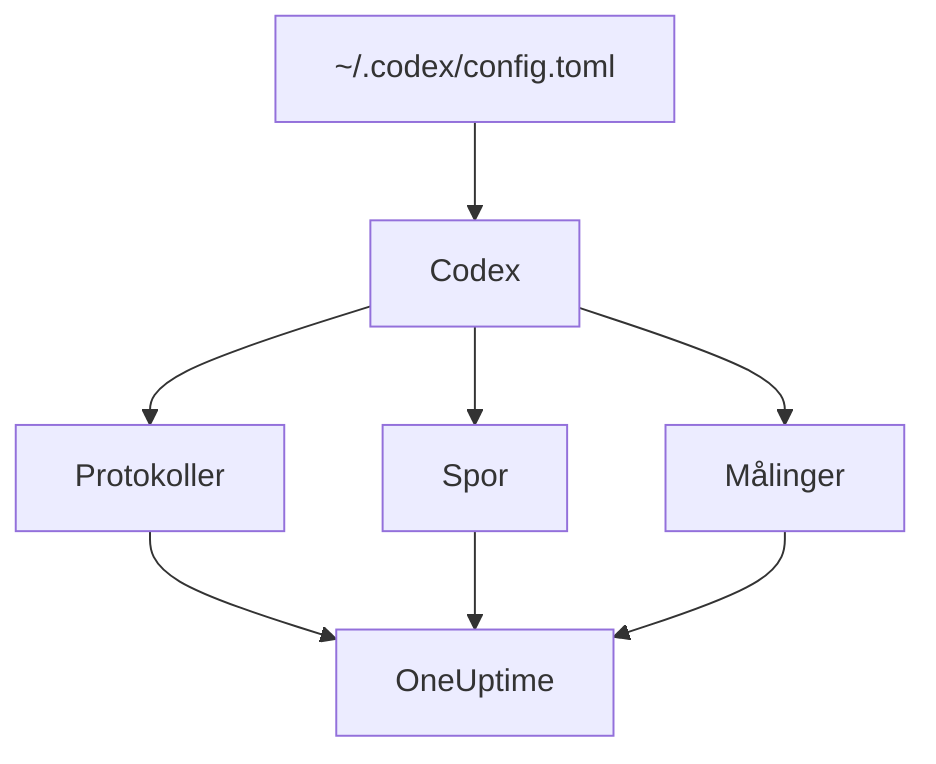

# OpenAI Codex

Codex CLI har tre indbyggede OpenTelemetry-eksportører, én til logs, én til traces og én til metrikker. Peg dem på OneUptime i `~/.codex/config.toml`, så ankommer hver Codex-tur med sine tokens og omkostninger, uden wrapper eller proxy imellem.

:::cards
- [Konfigurér Codex](#konfigurér-codex): Én `[otel]`-blok med en fuld URL pr. signal.
- [Tildel forbruget til en person](#tildel-codex-forbruget-til-en-person): Codex nævner ingen på spans eller metrikker, så det gør du.
- [Tokens og omkostninger](#tokens-og-omkostninger): Hvilket signal OneUptime læser, og hvad det viser.
- [Fejlfinding](#fejlfinding): Hvad du skal tjekke, når intet ankommer.
:::

## Sådan virker det

Hver eksportør sender ét signal til sin egen URL. Traces og logs er slået fra, indtil du konfigurerer dem; metrikker er ikke.



> [!WARNING]
> Codex sender sine metrikker til OpenAI, medmindre du ændrer det. I et release-build er `metrics_exporter` som standard `statsig`, som sender dem til `https://ab.chatgpt.com/otlp/v1/metrics`. At sætte `metrics_exporter` til en OTLP-eksportør, som nedenfor, eller til `none` stopper det. `[analytics]` med `enabled = false` stopper også Statsig-standarden, men lader en OTLP-metrikeksportør, du har sat op, virke.

## Før du begynder

1. Opret en telemetri-indtagelsesnøgle under **Projektindstillinger → Telemetri og APM → Indtagelsesnøgler**.
2. Dit OTLP-endpoint er `https://oneuptime.com/otlp`, eller `https://YOUR-ONEUPTIME-HOST/otlp`, hvis du selv hoster OneUptime.
3. Hver eksport sender nøglen i headeren `x-oneuptime-token`.

## Konfigurér Codex

:::steps
### Tilføj otel-blokken

Læg dette i `~/.codex/config.toml`. Det slår alle tre signaler til og erstatter samtidig Statsig-standarden:

```toml title="~/.codex/config.toml"
[otel]
environment = "prod"
log_user_prompt = false

[otel.exporter.otlp-http]
endpoint = "https://oneuptime.com/otlp/v1/logs"
protocol = "binary"
headers = { "x-oneuptime-token" = "YOUR_INGESTION_TOKEN" }

[otel.trace_exporter.otlp-http]
endpoint = "https://oneuptime.com/otlp/v1/traces"
protocol = "binary"
headers = { "x-oneuptime-token" = "YOUR_INGESTION_TOKEN" }

[otel.metrics_exporter.otlp-http]
endpoint = "https://oneuptime.com/otlp/v1/metrics"
protocol = "binary"
headers = { "x-oneuptime-token" = "YOUR_INGESTION_TOKEN" }

[otel.span_attributes]
"user.id" = "dev@example.com"
"user.email" = "dev@example.com"
"team" = "platform"
```

### Giv hver eksportør dens fulde URL

Codex bruger hvert `endpoint` præcis, som det står: det tilføjer ikke `/v1/logs`, `/v1/traces` eller `/v1/metrics`, som de fleste SDK'er gør. Tre eksportører sat til det bare `https://oneuptime.com/otlp` sender intet nogen steder hen, uden fejl.

### Kør en tur

Start en interaktiv `codex`-session, spørg om noget lille, og lad turen blive færdig. Åbn derefter **Protokoller** i OneUptime: Codex' hændelser, som `codex.conversation_starts`, `codex.api_request` og `codex.turn_cost`, dukker op der.
:::

> [!IMPORTANT]
> Codex ignorerer nøgler, det ikke kender, under `[otel]`, uden advarsel. Dets nøgler er i snake_case (`trace_exporter`, `metrics_exporter`, `span_attributes`), men dets eksportørnavne og TLS-felter er i kebab-case (`otlp-http`, `ca-certificate`). En `trace-exporter` slår traces fra helt uden fejl.

## Konfigurationsnøgler

| Nøgle | Standard | Hvad den gør |
| --- | --- | --- |
| `environment` | `"dev"` | Sætter ressourceattributten `env` |
| `log_user_prompt` | `false` | Sender promptteksten på `codex.user_prompt`; ellers står der `[REDACTED]` |
| `log_agent_responses` | `false` | Sender agentens endelige svar til logeksportøren |
| `exporter` | `none` | Logeksportøren |
| `trace_exporter` | `none` | Trace-eksportøren |
| `metrics_exporter` | `statsig` | Metrikeksportøren: sæt den |
| `span_attributes` | — | Attributter, der tilføjes til hvert eksporteret span |
| `tracestate` | — | W3C-`tracestate`-medlemmer |
| `tool_result` | `{ max_bytes = 2048 }` | Hvor meget af et værktøjs resultat en logpost beholder, i UTF-8-bytes |

En eksportør er `none`, `statsig`, `otlp-http` eller `otlp-grpc`. `otlp-http` tager `endpoint`, `headers`, `protocol` (`"binary"` eller `"json"`, som OneUptime begge accepterer) og `tls` (`ca-certificate`, `client-certificate`, `client-private-key`); `otlp-grpc` tager det samme uden `protocol`.

## Tildel Codex-forbruget til en person

Codex nævner udvikleren ét sted:

- **Logposter** bærer `user.account_id` og `user.email`.
- **Spans** gør ikke: Codex holder med vilje begge ude af sine traces.
- **Metrikker** gør heller ikke: de bærer `auth_mode`, `session_source`, `originator`, `service_name`, `model` og `app.version` og ingen person.

OneUptime læser personer fra spans og fra datapunkter for metrikker, aldrig fra logposter. Så sæt selv identiteten på hvert span i `[otel.span_attributes]`:

```toml title="~/.codex/config.toml"
[otel.span_attributes]
"user.id" = "dev@example.com"
"user.email" = "dev@example.com"
"team" = "platform"
"cost_center" = "eng-123"
```

`user.id` er den nøgle, OneUptime foretrækker, og `user.email` udfylder e-mailkolonnen. Codex har ingen ressourceattributter, så sæt også teamnøglerne (`team.id`, `team`, `cost_center`, `department`) her. Denne blok ligger i hver udviklers egen konfigurationsfil: lever den pr. udvikler, gennem dine dotfiles eller en MDM-profil. Én delt fil med én identitet ville føre alles forbrug over på én person.

## Tokens og omkostninger

| Signal | Hvad Codex sender | Hvad OneUptime gør med det |
| --- | --- | --- |
| Traces | `gen_ai.usage.input_tokens`, `gen_ai.usage.output_tokens` og cachetokens, men ingen model | Tæller tokens pr. person; kan ikke prissætte dem |
| Metrikker | `codex.turn.token_usage` efter `token_type`, og `codex.turn.cost_microusd`, i milliontedele af en USD | Omregner omkostningen til USD; læser kun metrikkerne, hvor spans intet rapporterer |
| Logs | `codex.turn_cost`, med `usage.estimated_usd` og personen | Gemmer den i stifinderen for **Protokoller**; knyttes ikke til forbruget |

Med konfigurationen ovenfor giver det dette på fanen **Forbrug**:

- Tokens kommer fra spans, pr. person, og `codex.turn.token_usage` lægges ikke oveni: de to lægges aldrig sammen ([hvorfor](/docs/telemetry/ai-llm-observability#spans-kommer-først-metrikker-udfylder-hullerne)).
- Codex' spans nævner ingen model, så OneUptime kan ikke prissætte dem, og deres omkostning er 0. Omkostningstotalerne tager så Codex' omkostning fra `codex.turn.cost_microusd`, omregnet til USD for dig.
- Tabellerne **Medarbejder**, **Team** og **Model** viser spans' rækker: tokens pr. person, men ingen omkostninger pr. person.
- Uden traces udfylder metrikkerne de tabeller i stedet, kun med omkostninger, alt under **Ikke tildelt**, da Codex' metrikker ikke nævner nogen.

Den mest præcise omkostning pr. tur, med personen på, er logposten `codex.turn_cost`. OneUptime knytter endnu ikke logposter til forbruget, men lad logeksportøren være slået til: historikken er der, når det sker.

## Codex i CI og som MCP-server

`codex`, `codex exec` og `codex mcp-server` bygger alle deres telemetri ud fra den samme `[otel]`-blok med alle tre eksportører. Kørsler af `codex exec` bærer `originator` `codex_exec`, og `codex mcp-server` eksporterer som `codex_mcp_server`, så du kan skelne kørsler i CI og via MCP fra interaktive sessioner på de værdier.

## Privatliv

`log_user_prompt` og `log_agent_responses` er som standard `false`: lad dem være slået fra. Hændelsen `codex.user_prompt` ankommer stadig, med prompten erstattet af `[REDACTED]`, så du beholder turen, dens tokens og dens omkostning uden promptteksten. Personen (`user.email`, `user.account_id`) står på logposterne, uanset hvad disse kontakter siger.

Hvis du slår indhold til for en undersøgelse, maskerer eller dropper traces' **Scrub-regler** og **Drop-filtre** under **Spor → Indstillinger** det, før det gemmes.

## Brug af OpenAI-API'et i stedet for Codex

OpenAIs platform-API sender ingen OpenTelemetry af sig selv: hvert span kommer fra instrumentering af din egen klient. Tre instrumenteringer virker med OneUptime:

- **OpenTelemetry**: `opentelemetry-instrumentation-genai-openai` til Python, som erstatter `opentelemetry-instrumentation-openai-v2`. `OTEL_INSTRUMENTATION_GENAI_CAPTURE_MESSAGE_CONTENT` afgør, om beskeder registreres.
- **OpenLLMetry** (Traceloop): `opentelemetry-instrumentation-openai`.
- **OpenInference** (Arize): `openinference-instrumentation-openai`.

Peg hvilken som helst af dem på OneUptime, som [AI- / LLM-observability](/docs/telemetry/ai-llm-observability) viser. Ingen af dem ved, hvem din medarbejder er: sæt selv `user.id`.

**OpenAI Agents SDK** sender traces til OpenAIs eget endpoint, ikke via OTLP. Byg bro med `opentelemetry-instrumentation-openai-agents-v2` eller `openinference-instrumentation-openai-agents`, som giver SDK'ets spans videre til en OTLP-eksportør.

## Fejlfinding

:::details Intet ankommer
Tjek først de tre `endpoint`-værdier: hver skal ende på `/v1/logs`, `/v1/traces` eller `/v1/metrics`. Tjek derefter headeren `x-oneuptime-token`: OneUptime afviser en forkert nøgle.
:::

:::details Traces ankommer aldrig, men logs gør
Kig efter en forkert stavet nøgle under `[otel]`: Codex ignorerer den i stilhed. `trace-exporter` i stedet for `trace_exporter` er den sædvanlige.
:::

:::details Codex' omkostninger vises i totalerne, men hver person viser $0
Det er forventet: Codex' spans bærer tokens, men ingen model, så de kan ikke prissættes, og omkostningsmetrikken nævner ingen. Se [Tokens og omkostninger](#tokens-og-omkostninger).
:::

:::details Alles forbrug vises under én person
Den samme identitet i `[otel.span_attributes]` står på hver maskine. Giv hver udvikler sin egen.
:::

## Næste trin

:::cards
- [AI-kodeassistenter](/docs/telemetry/ai-coding-assistants): Sådan tildeles forbruget på tværs af alle kodeassistenter.
- [AI- / LLM-observability](/docs/telemetry/ai-llm-observability): Samtaler, advarsler, omkostninger og budgetter for dine egne AI-kald.
- [AI-gateways](/docs/telemetry/ai-gateways): Én gateway, der tracer og prissætter hvert modelkald.
:::
