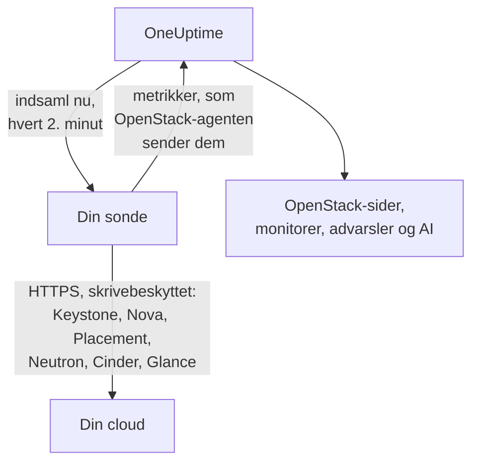

# OpenStack uden agent

Overvåg en OpenStack-cloud uden at installere noget: angiv Keystones adresse og en applikationslegitimation i OneUptime, vælg den sonde, der kan nå clouden, og sonden indsamler de samme data som [OpenStack-agenten](/docs/telemetry/openstack). Der er ingen agent at installere, opgradere eller holde kørende, og ingen egen maskine at klargøre.

> [!IMPORTANT]
> En sonde taler kun HTTPS med en cloud. En legitimation eller dens token sendes aldrig over almindelig HTTP, og DevStack og Kolla-Ansible udstiller som standard deres API'er over almindelig HTTP. For en sådan cloud skal du slå TLS til for dens API'er eller bruge [OpenStack-agenten](/docs/telemetry/openstack), som kører ved siden af den. Forbindelsestesten siger fra, når den finder en adresse med almindelig HTTP.

:::cards
- [Før du begynder](#før-du-begynder): En sonde, der kan nå API'erne, og en legitimation.
- [Tilslut en cloud](#tilslut-en-cloud): Adressen, en legitimation, en test og et navn.
- [Fejlfinding](#fejlfinding): Hvad hver meddelelse betyder, og hvad der løser den.
:::

## Sådan fungerer det



Hvert andet minut læser sonden hver tjeneste i hver region, du har valgt, og sender det, den fandt, til OneUptime. Det ankommer nøjagtigt som agentens data, så hver OpenStack-side, hver [OpenStack-monitor](/docs/monitor/openstack-monitor) og hver advarselsskabelon læser det på samme måde.

Hver tjeneste læses for sig og samtidig med de andre. En Neutron, der fejler eller hænger, koster Neutrons serier, og Novas data ankommer som sædvanligt, med ét forbehold, som Nova selv skaber: den spørger Neutron om hver instans, den viser. Så mens Neutron er nede, beholder en sonde de instanser, den sidst læste, og spørger kun om det, der er ændret. Hvis en instans er ændret, eller sonden lige er startet, kan Nova heller ikke svare på den liste: Nova vises som fejlende, dens øvrige serier ankommer stadig, og hver instans står på sin side, som den sidst var, indtil Neutron er tilbage.

Heat, Magnum, Manila, Trove, Gnocchi, Designate, Swift og Barbican læses, hvor Keystones katalog nævner dem. En cloud, der ikke kører nogen af dem, koster intet for dem, hører intet om dem fra forbindelsestesten og [viser intet spor af dem](/docs/telemetry/openstack#heat-og-magnum).

På en cloud, hvis katalog har Octavia, læser en sonde dens load balancere, puljer, lyttere og amphorae med ét listekald hver, derefter hver puljes medlemmer og trafiktællerne for hver load balancer og lytter, der er `ACTIVE`, én forespørgsel hver. En cloud med 3 load balancere, 1 pulje og 1 lytter koster 9 forespørgsler pr. indsamling; den rigtige DevStack, som testopsætningen optog, kostede præcis det. Der læses højst 25 puljers medlemmer og 50 tællere i én indsamling, de længst ulæste først, og de øvrige siger det, de sagde, da de sidst blev læst. Octavias tællere er kumulative, så en sonde beholder den seneste aflæsning af hver og afbilleder forskellen pr. sekund mellem to af dem: et diagram begynder ved den anden indsamling, og en tæller, der går ned (en genopbygget lytter), tegner intet for det interval. OVN-udbyderen rapporterer 0 for hver tæller, hvilket er en flad linje og ingen fejl.

Amphorae kræver Octavias admin-regel til hver aflæsning. En legitimation under admin ser sit eget projekts load balancere, puljer, lyttere og medlemmer og sine egne tællere, men ingen amphorae: siden Load Balancers siger det, og intet advarer. Monitoreringsrollen på et projekt uden load balancere ser ingen. `load-balancer_global_observer` nægtes alt i denne udgave.

En stoppet Octavia-API er `up 0` for en sonde, hvilket agentens eksportør ikke kan sige.

## Sonde eller agent?

| | En sonde (denne side) | OpenStack-agenten |
|---|---|---|
| Hvad du kører | En sonde, du allerede kører, eller en ny | Agenten, på en maskine for sig selv |
| Hvor legitimationen opbevares | Krypteret i OneUptime, sendes kun til sonden | I agentens `clouds.yaml`-fil |
| Hvad den skal kunne nå | Keystone og hver tjenestes API, over HTTPS | Keystone og hver tjenestes API |
| API'er på almindelig HTTP | Indsamles ikke: en token sendes aldrig ukrypteret | Indsamles |
| Største cloud | Testet ved [200.000 instanser](/docs/telemetry/openstack-very-large-clouds) mod en simuleret cloud, ikke en rigtig, i op til ti uploads på 48 MiB | Endnu ikke testet ved noget: [dens scrape løber tør for tid](/docs/telemetry/openstack-very-large-clouds#gennem-agenten) længe før det |
| Tjenestelogs og AI-agenten | Ikke med | Med |
| Hvad clouden står på: RabbitMQ, MariaDB, Memcached, HAProxy, OVN, libvirt | Ikke med: en sonde læser cloudens API'er | Med, med dens mål navngivet |
| Hver instans' reelle CPU, hukommelse og disk, fra libvirt eller Ceilometer | Ikke med | Med, med deres eksportører navngivet |
| Logins til Keystone | Ét i en tokens levetid, normalt en time | Ét pr. scrape |
| En almindelig `reader` på ét projekt | Det projekts instanser, diskenheder og netværk | Det projekts diskenheder og netværk, og ingen instanser |

Begge sender de samme serier, så siderne og monitorerne virker med begge. En sonde sender også det, som kun en indbygget klient kan læse: en instans' adresser, opgavetilstand og fejlmeddelelse, det image, den startede fra, om en operatør tvang en Nova-tjeneste ned, hvilke netværk en DHCP-agent betjener, hvilken pulje en diskenhed ligger i, hvornår en instans, diskenhed eller et image sidst blev ændret, og status for hvert diskenheds-snapshot og hver backup. Cinder fortæller kun, hvilken pulje en diskenhed ligger i, til en legitimation, den behandler som admin. På en cloud, der kører [Heat eller Magnum](/docs/telemetry/openstack#heat-og-magnum), sender den også, hvorfor en stack eller en klynge fejlede, hvilke instanser og diskenheder en stack ejer, hver klynges projekt, skabelon og Kubernetes-version, og om hver af Heats motorer og Magnums conductors er oppe.

Vælg agenten til tjenestelogs, til AI-agenten, til det, clouden står på, og hver instans' reelle forbrug, til en cloud, hvis API'er kun taler almindelig HTTP, som DevStack og Kolla-Ansible gør som standard, eller til en cloud så stor, at den skal [læses fra sine databaser](/docs/telemetry/openstack-very-large-clouds#databasestien). Vælg en sonde til alt andet: der er intet at installere, og den læser mere af det, Nova og Cinder fortæller. [Meget store OpenStack-clouds](/docs/telemetry/openstack-very-large-clouds) siger, hvad hver af dem koster ved enhver størrelse.

Du kan til enhver tid skifte en cloud fra den ene til den anden på dens side **Indstillinger**.

## Før du begynder

- **En sonde, der kan nå Keystone og hver tjenestes API over HTTPS.** Det er normalt en [brugerdefineret sonde](/docs/probe/custom-probe) i cloudens netværk. Keystones katalog nævner, hvor hver tjeneste svarer, og sonden forbinder til de adresser, så hver skal kunne nås fra sonden, og hver skal være HTTPS. På OneUptime Cloud modtager de delte sonder aldrig en OpenStack-legitimation, så tilføj en sonde af din egen. På en selvhostet instans kan instansens egne sonder også indsamle.
- **En legitimation.** En applikationslegitimation er bedst, fordi den kan begrænses til læsning og kan udløbe. Et brugernavn og en adgangskode virker også og kan gøre alt, hvad deres konto kan.

OpenStack har ingen global skrivebeskyttet rolle, så hvor meget sonden ser, afhænger af legitimationen:

| Niveau | Hvad det kræver | Hvad sonden læser |
|---|---|---|
| Fuld visning | En applikationslegitimation på en konto med `admin` på et projekt for sig selv, begrænset af adgangsregler til læsning | Alt, undtagen Keystones brugere og grupper, som reglerne bevidst udelader |
| Kun infrastruktur | Rollerne `oneuptime_monitoring` og `reader` på et projekt for sig selv, der ikke rummer noget og har nul kvote, og de politikfiler, OpenStack-agenten leverer | Hypervisorer, Novas tjenester, Neutrons agenter, adressepuljer, Placement, projektlisten og hvert projekts instanser. Diskenheder, netværk og routere kun, hvor rollen er tildelt. Ikke `cinder-volume`- og `cinder-scheduler`-tilstand eller lagerpuljer: Cinders egen kode kræver en admin |
| Projektvisning | Almindelig `reader` på ét projekt | Det projekts instanser, diskenheder og netværk, og ingen infrastruktur |

Forbindelsestesten siger, hvilket af disse en legitimation svarer til, og advarer, når dens eget projekt rummer ting: hvor Cinder har `enforce_new_defaults` slået fra, hvilket er dens egen standard, kan enhver rolle på et projekt oprette det projekts diskenheder, `reader` inklusive.

> [!IMPORTANT]
> En applikationslegitimation begrænset af adgangsregler afvises med en `401` af enhver tjeneste, hvis `keystonemiddleware` ikke har `service_type` sat. Forbindelsestesten siger det for hver aflæsning. Sæt den i hver tjenestes konfiguration, og genstart den derefter. [Opret legitimationen](/docs/telemetry/openstack#opret-legitimationen) har reglerne, politikfilerne og indstillingerne for hver tjeneste, og [hvad hvert niveau læser](/docs/telemetry/openstack#hvad-hvert-niveau-læser) er det, rigtige clouds svarede.

## Tilslut en cloud

:::steps
### Åbn dine clouds
Åbn **OpenStack → Alle clouds** i OneUptime, og klik på **Tilslut cloud**.

### Angiv adressen og legitimationen
Angiv `auth_url` fra din `clouds.yaml`- eller `openrc`-fil, f.eks. `https://keystone.example.com:5000/v3`, samt applikationslegitimationens ID og hemmelighed. Vælg den sonde, der kan nå clouden.

### Test forbindelsen
Klik på **Test forbindelse**. Sonden logger ind, prøver hver aflæsning, en indsamling foretager, i hver region, og logger ud. Den siger, hvilke regioner kataloget nævner, hvad legitimationen kan læse, hvad den nægtes, hvilke sider der går uden, og den linje, der åbner for det. En mislykket aflæsning stopper ikke testen.

### Stol på cloudens certifikat
En cloud med sin egen certifikatmyndighed præsenterer et certifikat, som sonden ikke stoler på. Testen viser så certifikatet og den vært, der præsenterede det. Kontrollér dets fingeraftryk mod API'ets eget, og klik derefter på **Stol på dette certifikat**. En cloud med en vært pr. tjeneste kan have et certifikat pr. tjeneste, og du kan stole på op til 32.

### Vælg regionerne, og tilslut
Vælg de regioner, der skal læses, giv clouden et navn, og klik på **Tilslut cloud**. Cloudens side åbnes.
:::

Cloudens **Oversigt** viser et kort **Dataindsamling**. Det viser **Kontrollerer** indtil den første indsamling, som starter inden for et minut, derefter **Indsamler**, og siderne fyldes ud. Når nogle tjenester blev læst, og en anden ikke blev, siger det hvilken. Hvis ingen sonde kommer efter clouden i 15 minutter, fordi den er offline eller for gammel, viser det **Indsamler ikke** og siger det, uanset hvad den sidste indsamling fandt.

Kortet **Dataindsamling** på cloudens side **Indstillinger** rummer det, du tilsluttede den med:


## Tilslut en cloud fra API'et eller Terraform

En clouds forbindelsesindstillinger er almindelige felter i [OpenStack Cloud-ressourcen](/reference/open-stack-cloud) i API'et, på `/api/openstack-cloud`, så en cloud kan tilsluttes helt uden dashboard. Med Terraform er det `oneuptime_openstack_cloud`:

```hcl
resource "oneuptime_openstack_cloud" "prod_eu" {
  name                      = "prod-eu"
  collection_method         = "Probe"
  auth_url                  = "https://keystone.example.com:5000/v3"
  credential_kind           = "applicationCredential"
  application_credential_id = var.openstack_application_credential_id
  credential_secret         = var.openstack_application_credential_secret
  collection_probe_id       = oneuptime_probe.eu_west.id
  collection_regions        = jsonencode(["RegionOne"])

  # A cloud with its own certificate authority: the fingerprints it presents.
  trusted_certificate_fingerprints = jsonencode(["AB:CD:EF:..."])
}
```

For et brugernavn og en adgangskode sættes `credential_kind` til `password`, med `keystone_username`, `project_name` og, når de ikke er `Default`, `user_domain_name` og `project_domain_name`. `endpoint_interface`, `collection_interval_in_minutes` og `collection_options` er det, formularen samler under **Flere felter**. Kun `name` er påkrævet, fordi en cloud, som agenten sender, ikke har nogen af disse.

`credential_secret` er kun til skrivning, så ingen læsning returnerer den, og Terraform holder den ude af planer og output. [Reglerne for en gemt legitimation](#den-gemte-legitimation) gælder også her: at ændre adressen, sonden eller de betroede certifikater kræver hemmeligheden i samme forespørgsel. Det, sonden rapporterer, f.eks. `collection_status`, `collection_error` og `presented_certificate`, kan læses og ikke sættes.

## Hvad det koster din cloud

Monitorering må aldrig være det, der tager en cloud ned, så en indsamling er skånsom pr. konstruktion:

- **Ét login, genbrugt.** Tokenen bruges, indtil fem minutter før den udløber. Et login er det, en Keystone i vanskeligheder har mindst råd til.
- **Lister i sider.** Hver liste læses tusind rækker ad gangen, med `limit` og `marker`.
- **Instanser efter hvad der er ændret.** Mellem fulde aflæsninger, hver halve time, spørger sonden kun Nova om det, der er ændret siden sidste aflæsning, med `changes-since`.
- **En hypervisors inventar én gang.** Placement flytter en udbyders generation, hver gang de ændres, hvilket ét listekald siger om dem alle, så de læses først igen dér.
- **En angivet belastning.** Det, der er ét kald pr. ting, går på skift ud over 2.000 pr. indsamling, og ud over 250 projekter for grænser. Det, der ikke blev læst denne gang, sendes, som det sidst blev læst, så ingen serie har et hul, og belastningen holder op med at vokse med clouden.
- **Kun de felter, den læser.** Neutrons lister navngiver deres felter, og sikkerhedsgrupper forespørges kun om deres ID'er.
- **Aldrig stablet.** En indsamling, der tager længere end sit interval, springes over og køres ikke ved siden af den næste.
- **Et tidsbudget.** En indsamling har ni tiendedele af sit interval og højst ti minutter. Det, der er læst inden da, sendes, og den tjeneste, der løb tør for tid, siger det.
- **Går i bero.** Når den bliver bedt om at vente med en `429` eller `Retry-After`, venter sonden. En tjeneste, der svarer `429`, `503` eller slet ikke, lades i fred i et minut, så to, så fire, op til en halv time, og dens serier bliver ved med at sige, at den er nede, mens den venter.
- **Sætter farten ned.** Et svar, der er tre gange langsommere, end den tjeneste plejer at svare, og mindst et sekund, eller fem sekunder uanset hvad der er normalt, holder den tjenestes næste forespørgsel tilbage lige så længe. Kortet **Dataindsamling** siger, hvornår det skete.
- **En afvist legitimation venter længst.** At gentage en er det, der låser en konto, så den venter fem minutter, så ti, op til en time. En legitimation, du har rettet, prøves med det samme.

- **Mindre af en stor cloud.** Ud over 5.000 instanser beholder en cloud tal og sine dele og ingen serie pr. instans eller pr. diskenhed, medmindre du vælger andet under **Reelt forbrug pr. instans** på dens side **Indstillinger**. Det, der er ændret, det, du valgte at beholde, og det, en advarsel overvåger, sendes stadig ved hver indsamling. Resten går på skift, og kortet **Dataindsamling** siger, hvor lang tid et skift tager.

Ved hver indsamling koster en region med standardindstillingerne 7 kald til Nova, 7 til Neutron og 5 til Cinder, ét kald til Placement og to mere pr. hypervisor, op til 4 mere for at spørge Placement, [hvor mange af hver flavor der kan være plads til](/docs/telemetry/openstack#kapacitet), og cirka hvert femte minut 5 til Keystone og 1 til Glance. En hypervisors inventar læses én gang og igen kun, når Placement siger, at det er ændret. En liste på over tusind rækker tager et kald pr. tusind. Hver instans, der er ændret, tager et kald mere til Nova for at læse, hvad den gennemgik, og højst 25 læses i en indsamling: en rolig cloud foretager ingen. På ML2/OVS tager Neutron et kald mere pr. router for at spørge, hvilke L3-agenter der holder den, og hvert tiende minut et kald pr. DHCP-agent, højst 20, for at spørge, hvilke netværk den betjener. En cloud med flere DHCP-agenter går dem igennem på skift, en cloud ud over oversigtsstørrelsen udelader dette, og en langsom Neutron spørges slet ikke. En cloud på OVN har ingen at spørge om. [Meget store OpenStack-clouds](/docs/telemetry/openstack-very-large-clouds#belastningen-på-dit-kontrolplan) har, hvad det løber op i af forespørgsler i minuttet ved hver størrelse.

En cloud, der kører Manila, betaler cirka hvert femte minut 2 kald til den, en der kører Trove betaler 1, Gnocchi 1 og Barbican 3. Designate tager 2 og ét mere for hver zone, der ikke er `ACTIVE`, højst 50 pr. indsamling. Swift tager 1 for legitimationens eget projekt og med `ResellerAdmin` ét mere for hvert andet projekt, højst 200 pr. indsamling. En cloud, der kører Heat eller Magnum, betaler cirka hvert femte minut 2 kald til Heat og 3 til Magnum. Ingen af listerne siger alt: Magnums siger ikke, hvem en klynge tilhører eller hvorfor den fejlede, og Heats siger ikke, hvad en stack ejer. Så sonden læser også en klynge eller en stack for sig, når dens status har flyttet sig, højst 25 af hver pr. indsamling. En cloud med flere bliver ved med at fylde ud over de næste indsamlinger, og en, der står stille, læses aldrig to gange.

Tre ting er slået fra, medmindre du slår dem til, under **Hvad den læser ud over standarden** på kortet **Dataindsamling** på cloudens side **Indstillinger**, eller under **Flere felter**, når du tilslutter den, fordi hver koster din cloud mere:

| Valgmulighed | Hvad du får | Hvad det koster |
|---|---|---|
| Porte | Én serie pr. port og hvor mange der ikke har nogen adresse, eller en load balancer, der er nede | Én sideopdelt liste pr. netværk eller projekt, du angiver, eller af alle porte, hvis du ikke angiver nogen. En uafgrænset liste over porte kan overbelaste Neutron på en stor cloud |
| Projektgrænser | Kvoter og grænser pr. projekt | Fire kald pr. projekt, højst 250 projekter pr. indsamling |
| Swifts lagerservere | Om hver svarer, dens replikering og om de alle har de samme ringe, hvor du angiver hver servers `/recon`-port som `host:port`. Kun en cloud, der kører Swift, tilbyder dette, på sin side **Indstillinger**, når dens første indsamling har læst Swift | 5 kald pr. server ved hver indsamling. Ingen legitimation sendes til dem |

## Certifikater

Sonden springer aldrig certifikatverifikation over. Hver forbindelse gennemfører et fuldt TLS-handshake, og derefter:

- hvis ingen certifikater er betroet, skal et API's certifikat komme fra en myndighed, som sondens maskine stoler på, for den adresse, det svarer på;
- hvis certifikater er betroet, skal et API præsentere et af netop dem, identificeret ved deres SHA-256-fingeraftryk. Intet andet accepteres, ikke engang et offentligt betroet.

Sådan kontrollerer du et fingeraftryk fra sondens maskine:

```bash
openssl s_client -connect keystone.example.com:5000 </dev/null | openssl x509 -noout -fingerprint -sha256
```

Når et certifikat fornyes, stopper indsamlingen med **API'ets certifikat er ændret**, og det nye certifikat vises. Intet sendes, før du stoler på det, på cloudens side **Oversigt** eller **Indstillinger**.

## Den gemte legitimation

Hemmeligheden er krypteret og kun til skrivning: ingen kan læse den tilbage, og API'et returnerer den aldrig. Den sendes kun til den sonde, der indsamler clouden, og som opbevarer den i hukommelsen.

En gemt legitimation sendes kun til den adresse, gennem den sonde og til de certifikater, den blev indtastet for. Ændring af adressen, sonden eller de betroede certifikater beder om hemmeligheden igen, så ingen, der kan redigere clouden, kan sende den et andet sted hen. Hvis du stoler på det certifikat, sonden fandt på den gemte adresse, beholdes den, og det gør den også, hvis du stoler på færre.

Kataloget er underlagt de samme regler som den adresse, du indtastede, fordi en token går, hvorhen den siger. Sonden forbinder ikke til en loopback-, link-local- eller cloud-metadataadresse, uanset om kataloget nævner den, eller et værtsnavn opløses til den, og den forbinder til de adresser, den kontrollerede, ikke til hvad DNS siger et øjeblik senere. Den følger ikke omdirigeringer.

## Skift mellem agenten og en sonde

Åbn cloudens side **Indstillinger**. Dens kort **Dataindsamling** tilbyder **Indsaml med en sonde** for en cloud, agenten sender, og **Brug OpenStack-agenten** for en, en sonde indsamler. Når du skifter til agenten, glemmes den gemte legitimation.

> [!WARNING]
> Stop OpenStack-agenten, når den første sondeindsamling lykkes. Mens begge kører, ankommer hver metrik to gange.

Ud over [5.000 instanser](/docs/telemetry/openstack-very-large-clouds#oversigtstilstand) kender en sondes første indsamling hele clouden og sender en del af den, så en ny clouds lister fyldes over dens første cyklus, og kortet **Dataindsamling** siger, hvornår de alle vil være der.

## Bare metal

På en cloud, hvis katalog har Ironic, læser en sonde dens noder og beder om hvert felt ved navn, så en nodes `driver_info` aldrig læses i en indsamling. Den tilføjer det, agentens eksportør ikke har: en nodes driver, dens conductor, dens fejl og hvorfor den fejlede. Ironic kan tømme `last_error` inden for cirka et minut, så en side beholder den sidste, en indsamling så, og siger hvornår.

En sonde læser kataloget først, så den kan sige, at Ironics API er nede, hvilket agentens eksportør ikke kan. En cloud uden Ironic spørges ikke om noget om den.

Ironic viser et projekt kun de noder, det ejer, og nægter det listen over conductors. Efter Ironics standardpolitik læser kun en legitimation med systemomfang dem, og en sondes legitimation kan ikke have systemomfang, fordi den læser Novas lister med den samme. Så medmindre cloudens politik giver dens rolle `baremetal:node:list_all` og `baremetal:conductor:get`, ser en sonde de noder, dens projekt ejer, og ingen conductors, og siderne siger det. [Bare metal](/docs/telemetry/openstack#bare-metal) har resten.

## Reference

| Indstilling | Standard | Noter |
|---|---|---|
| Indsaml hvert | 2 minutter | Fra 1 til 60 minutter. Indsaml en stor cloud sjældnere for at skåne den. Keystone og Glance læses cirka hvert femte minut, uanset hvor ofte resten læses. |
| Endpoint-grænseflade | public | Hvilken af katalogets URL'er der bruges: public, internal eller admin. |
| Indsamlinger på én gang | 4 pr. sonde | En indsamling, der er langsommere end sit interval, springes over og stables aldrig. |
| Største upload | 48 MiB | En indsamling sendes i så mange, som der skal til, op til ti. Ud over [5.000 instanser](/docs/telemetry/openstack-very-large-clouds#oversigtstilstand) går det, der ikke er ændret, på skift. |
| Forespørgsler til hver tjeneste | Én ad gangen | Placements kald pr. udbyder går fire ad gangen. |
| Ventetid på ét svar | 60 sekunder | Prøvet tre gange i alt, når det er en `429` eller en serverfejl. |
| Forbindelsestest | 90 sekunder til start | En test, ingen sonde henter i tide, eller som kører længere end 3 minutter, besvares som mislykket. Fem kan vente eller køre på én gang i et projekt. |

## Fejlfinding

:::details API'ets certifikat er ikke betroet
Clouden præsenterer et certifikat fra sin egen myndighed. Kontrollér det viste fingeraftryk mod API'ets certifikat, og klik derefter på **Stol på dette certifikat**.
:::

:::details API'ets certifikat er ændret
Certifikatet er blevet fornyet, eller nogen sidder i midten. Intet sendes, før du stoler på det nye. Kontrollér dets fingeraftryk, og stol derefter på det.
:::

:::details Auth-URL'en er ikke gyldig
Angiv Keystones adresse over HTTPS, f.eks. `https://keystone.example.com:5000/v3`. En adresse på almindelig HTTP afvises, før noget sendes. For en cloud, hvis API'er kun taler almindelig HTTP, skal du slå TLS til eller bruge [OpenStack-agenten](/docs/telemetry/openstack).
:::

:::details Kataloget nævner et endpoint på almindelig HTTP
En legitimations token sendes aldrig ukrypteret. Slå TLS til for det API, vælg en anden endpoint-grænseflade, eller brug [OpenStack-agenten](/docs/telemetry/openstack) til denne cloud. Forbindelsestesten fejler, indtil hvert API, den læser, er på HTTPS. I en indsamling går kun den tjeneste med det endpoint uden: de andre læses som sædvanligt.
:::

:::details Keystone afviste legitimationen
ID'et, hemmeligheden eller adgangskoden er forkert, den er udløbet eller slettet, eller dens konto mistede sin rolle på projektet. Opret en ny, og indtast den med **Rediger forbindelse** på cloudens side **Indstillinger**.
:::

:::details Kontoen har ingen rolle på det projekt
Et brugernavn og en adgangskode loggede ind, men ikke på det projekt. Kontrollér projektnavnet og begge domæner. En applikationslegitimation undgår dette: den får sit omfang, når den oprettes.
:::

:::details Legitimationen kan ikke læse det, monitorering har brug for
Testen viser hver aflæsning, der blev nægtet, hvad der går uden den, og den linje, der åbner for det. En `401` på en legitimation med adgangsregler betyder, at de ikke nævner den sti, eller at den tjenestes `keystonemiddleware` ikke har `service_type` sat og ikke er genstartet.
:::

:::details Sonden får intet svar fra clouden
Sondens netværk kan ikke nå det API. Tillad det gennem firewallen, eller vælg en sonde i cloudens netværk. Hver tjenestes adresse er sin egen: meddelelsen navngiver den, der ikke svarede.
:::

:::details Intet svarer på den port
Kontrollér adressen og porten. Keystone betjener normalt på 5000 eller på 443 bag en sti som `/identity`.
:::

:::details Den sikre forbindelse mislykkedes
Adressen peger sandsynligvis på en port, der ikke taler HTTPS. Kontrollér den. Hvis cloudens API'er kun taler almindelig HTTP, skal du slå TLS til eller bruge OpenStack-agenten.
:::

:::details OneUptime forbinder ikke til denne adresse
Adressen, eller noget kataloget nævner, er eller opløses til en loopback-, link-local- eller cloud-metadataadresse. Brug den adresse, API'et svarer på i dit netværk.
:::

:::details Denne adresse er ikke Keystone
Angiv Identity-endpointet fra din `clouds.yaml`- eller `openrc`-fil: dens `auth_url`.
:::

:::details En region er ikke i kataloget
Vælg blandt de regioner, kataloget nævner. Forbindelsestesten viser dem.
:::

:::details Keystone fejler
Keystone svarede med en serverfejl. Sonden venter længere mellem logins, indtil den kommer sig, og intet andet kan læses uden et login. Kontrollér Keystones tjeneste og databasen bag den.
:::

:::details En tjeneste er stoppet eller for travl til at svare
Den blev ved med at svare `429` eller en serverfejl, så sonden venter længere mellem indsamlinger, indtil den kommer sig. Kontrollér, at den kører, og derefter dens belastning. Det hjælper en travl at indsamle sjældnere.
:::

:::details Indsamlingen tog for lang tid
Clouden svarede for langsomt til dette interval. Indsaml sjældnere, eller kontrollér dens belastning.
:::

:::details Sonden hentede ikke dette
Sonden er offline eller kører en OneUptime-version, der er ældre end OpenStack-indsamling. Kontrollér, at den er tilsluttet, på siden **Sonder**, og opdatér den. En clouds kort siger også dette, når en indsamling er 15 minutter forsinket, uanset hvordan dens sidste indsamling gik, og går tilbage af sig selv, når sonden gør.
:::

:::details Denne cloud er for stor til at indsamle fra en sonde
Dens metrikker er mere, end en indsamling må sende, og denne cloud er sat til at beholde hver instans' serier. Lad den beholde tal i stedet under **Reelt forbrug pr. instans** på dens side **Indstillinger**, eller brug [OpenStack-agenten](/docs/telemetry/openstack). [Oversigtstilstand](/docs/telemetry/openstack-very-large-clouds#oversigtstilstand) siger, hvad det opgiver.
:::

## Næste trin

:::cards
- [OpenStack-monitor](/docs/monitor/openstack-monitor): Advar om tjenester, hypervisorer, instanser, netværk og diskenheder.
- [Brugerdefineret sonde](/docs/probe/custom-probe): Kør en sonde i cloudens netværk.
- [OpenStack-agent](/docs/telemetry/openstack): Indsaml en cloud med agenten i stedet.
:::
