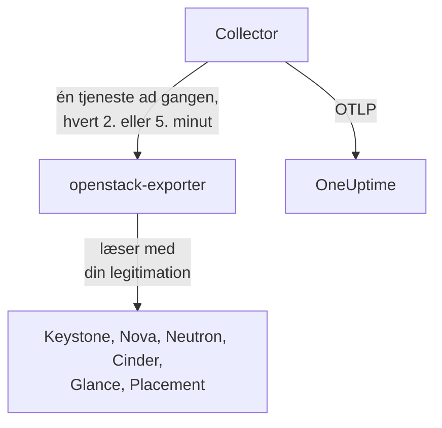

# OpenStack-agent

OneUptimes OpenStack-agent overvåger en OpenStack-cloud: dens tjenester og agenter, hypervisorer, instanser, netværk, routere, volumener, lagerpuljer, images og projekter i alle regioner. Den læser cloudens API'er med en legitimation, du selv vælger, og sender det, den finder, til OneUptime, hvor clouden vises med sine regioner, hypervisorer og projekter. [OpenStack-monitorer](/docs/monitor/openstack-monitor) giver advarsler ud fra det, der kommer ind, og en [probe](/docs/telemetry/openstack-agentless) kan indsamle fra en cloud uden at noget skal installeres.

:::cards
- [Probe eller agent?](/docs/telemetry/openstack-agentless#sonde-eller-agent): Hvilken du skal vælge, hvis en cloud kan bruge begge.
- [Vælg, hvor meget den ser](#vælg-hvor-meget-agenten-ser): OpenStack har ingen global skrivebeskyttet rolle, så der er tre niveauer.
- [Installér agenten](#installér-agenten): En legitimation, derefter installationsscriptet, Docker Compose eller helt uden Docker.
- [Hvad den koster din cloud](#hvad-den-koster-din-cloud): Hvad hver indstilling læser, og hvordan du ændrer den.
- [Kapacitet](#kapacitet): Hvor mange flere af hver flavor der kan være, og hvor mange dage der er, til hver ting er fuld.
- [Forbrug](#forbrug): Hvem der bruger hvad, hvad det løber op i til dine priser eller som CloudKitty har afregnet det, og hvad der kunne frigives.
- [Statussider og besked til projekter](#statussider-og-besked-til-projekter): En side pr. region i ét trin, og besked kun til de projekter, en fejl rammer.
- [Tjenesteprotokoller](#tjenesteprotokoller): Fortolket, med en forespørgsel fulgt på tværs af tjenester.
- [Livscyklushændelser](#livscyklushændelser): Instanshandlinger i feedet og på diagrammer, fra notifikationer eller en probe.
- [Hvem gjorde hvad](#hvem-gjorde-hvad): Revisionsspor ind i sikkerhedshændelser.
- [Spor en forespørgsel](#spor-forespørgsler-gennem-kontrolplanet): Én signeret forespørgsel, fulgt på tværs af kontrolplanet.
- [Tjek udefra](#tjek-clouden-udefra): Om nogen faktisk kan starte en instans, fra en probe uden for clouden.
- [Uden internet](#uden-internet): Agentens fire images, og hvordan du kopierer dem til dit eget register.
- [Efter udrulningsværktøj](/docs/telemetry/openstack-deployment-tools): Kolla-Ansible, OpenStack-Ansible, OpenStack-Helm, Atmosphere, Sunbeam, Red Hat og Mirantis.
- [Fejlfinding](#fejlfinding): Et diagnosescript og de sædvanlige problemer.
:::

## Sådan virker det

Agenten er to fastlåste upstream-programmer og deres konfiguration på én maskine: [openstack-exporter](https://github.com/openstack-exporter/openstack-exporter) læser cloudens API'er og omsætter dem til `openstack_*`-serier, og en OpenTelemetry Collector spørger den om én OpenStack-tjeneste ad gangen, stempler hver serie med den cloud og region, den kom fra, og sender dem til OneUptime. Intet kører på dine controllere eller compute-noder, medmindre du tilføjer den valgfrie [logprofil](#tjenesteprotokoller), som læser deres logfiler.



Clouden registrerer sig selv med sine første data, under det navn, agenten stempler på hver metrik som `openstack.cloud.name`. Én agent overvåger én cloud: én Keystone, med én region eller flere.

## Inden du går i gang

- Docker Engine 20.10 eller nyere med Docker Compose v2-pluginet, eller, hvis du vil køre uden Docker, en Linux-maskine (x86_64 eller arm64) med systemd 235 eller nyere, glibc 2.34 eller nyere (RHEL 9, Ubuntu 22.04, Debian 12) og root.
- En rute fra den maskine til Keystone og til hver tjenestes offentlige endpoint.
- Kommandolinjen `openstack`, som en person der kan oprette legitimationen nedenfor.
- En indlæsningsnøgle. Opret en under **Projektindstillinger → Telemetri og APM → Indtagelsesnøgler** og kopiér dens værdi.
- Udgående HTTPS fra den maskine til din OneUptime-URL.

### Hvor agenten skal køre

Kør agenten uden for den cloud, den overvåger: en lille VM på separat hardware, en administrationsvært, en anden cloud. En agent inde i en cloud, der er gået ned, bliver tavs sammen med den, og tavshed ligner en sund cloud, der er holdt op med at rapportere.

## Vælg, hvor meget agenten ser

OpenStack har ingen global skrivebeskyttet rolle, og det er det sværeste ved at overvåge det:

- `reader` er afgrænset til et projekt overalt undtagen i Keystone og Ironic.
- Hypervisorer, tjenester, agenter, puljer og Placement kræver som standard admin.
- En policy-tilsidesættelse kan ikke åbne lister over alle projekter i Neutron eller Cinder, som afgrænser dem efter admin-kontekst i deres egen kode.
- Cinders tjenester og lagerpuljer svarer alle andre end en admin med `403`, fra Cinders egen kode, efter at policy allerede er bestået. Ingen tilsidesættelse åbner dem heller.
- Neutron og Cinder svarer en almindelig reader med `200` og kun denne readers eget projekt. Det ser ud, som om det virkede, og det gjorde det ikke.
- Hvor Cinder har `enforce_new_defaults` slået fra, hvilket er Cinders egen standard, kan enhver rolle på et projekt oprette projektets volumener, også `reader` og `oneuptime_monitoring`. På Epoxy, Flamingo og Gazpacho oprettede både en almindelig reader og rollen på et rigtigt projekt en volumen (`202`). På Hibiscus blev begge afvist (`403`), fordi DevStack kun slår `enforce_new_defaults` til der. En skrivebeskyttet rolle på et rigtigt projekt er ikke skrivebeskyttet.

Der er altså tre niveauer, og hvert koster noget. Start med det første, hvis du kan.

| Niveau | Hvad det kræver | Hvad det ser | Hvad der mangler |
| --- | --- | --- | --- |
| **1. Fuld visning** | En applikationslegitimation på en konto med `admin` på et eget projekt, begrænset af adgangsregler til læsning, med `service_type` sat på hver tjeneste | Alle læsninger, agenten foretager, samt tilstand for `cinder-volume` og `cinder-scheduler` og lagerpuljer, som kun dette niveau ser | Keystones brugere og grupper, med vilje. Den kan ikke skrive: hver skrivning blev besvaret med `401` |
| **2. Kun infrastruktur** | Rollerne `oneuptime_monitoring` og `reader` på et eget projekt, der ikke rummer noget og har nul kvote, og de policy-tilsidesættelser, agenten leverer | Alle Keystones projekter, domæner, tjenester og endpoints, hele Nova inklusive alle projekters servere, hele Placement samt Neutrons agenter og IP-tilgængeligheder | Neutrons netværk, subnet, routere, flydende IP'er og porte samt Cinders volumener og snapshots er kun projektets egne, så på et tomt projekt kun de delte og eksterne. Ingen tilstand for `cinder-volume` eller `cinder-scheduler` og ingen lagerpuljer. Den kan ikke skrive: hver skrivning blev besvaret med `403`, eller `409` og `413` på grund af kvote |
| **3. Projektvisning** | Almindelig `reader` på et rigtigt projekt, til et team der overvåger sin egen del af en cloud, som en anden driver | Det projekts volumener, netværk og routere, fra Cinder og Neutron | Al infrastruktur: ingen hypervisorer, tjenester, agenter, puljer eller kapacitet. Gennem agenten heller ingen instanser, fordi exporterens læsning af alle projekter afvises. Og på mange clouds kan `reader` skrive der |

Skabelonerne **Block Storage Service Down**, **Storage Pool Warning** og **Storage Pool Critical** kræver niveau 1. **Compute Service Down**, **Network Agent Down** samt Placement- og hypervisorskabelonerne kræver niveau 1 eller 2, og intet på niveau 3 læser en instans.

### Hvad hvert niveau læser

Det er, hvad fem rigtige clouds svarede, på Epoxy, Flamingo, Gazpacho (OVN og OVS) og Hibiscus. Hver celle er skrevet ud fra de optagelser.

| Læsning | Niveau 1: Fuld visning | Niveau 2: Kun infrastruktur | Niveau 3: Projektvisning |
| --- | --- | --- | --- |
| Keystone: projekter | alle | alle | afvist |
| Keystone: domæner | alle | alle | afvist |
| Keystone: regioner | alle | det, enhver ser | det, enhver ser |
| Keystone: tjenester | alle | alle | afvist |
| Keystone: endpoints | alle | alle | afvist |
| Nova: servere, alle projekter | alle | alle | afvist |
| Nova: tjenester | alle | alle | afvist |
| Nova: hypervisorer | alle | alle | afvist |
| Nova: aggregater | alle | alle | afvist |
| Nova: tilgængelighedszoner, detaljer | alle | alle | afvist |
| Nova: flavors | alle | det, enhver ser | det, enhver ser |
| Nova: forbrug pr. projekt | alle | alle | afvist |
| Placement: ressourceudbydere | alle | alle | afvist |
| Neutron: agenter | alle | alle | intet |
| Neutron: netværk | alle | kun eget projekt | kun eget projekt |
| Neutron: subnet | alle | kun eget projekt | kun eget projekt |
| Neutron: routere | alle | kun eget projekt | kun eget projekt |
| Neutron: flydende IP'er | alle | kun eget projekt | kun eget projekt |
| Neutron: IP-tilgængeligheder | alle | alle | intet |
| Neutron: sikkerhedsgrupper | alle | 409, forventet | kun eget projekt |
| Neutron: porte | alle | kun eget projekt | kun eget projekt |
| Neutron: kvoter | alle | afvist | afvist |
| Cinder: volumener, alle projekter | alle | kun eget projekt | kun eget projekt |
| Cinder: tjenester | alle | afvist | afvist |
| Cinder: puljer | alle | afvist | afvist |
| Cinder: snapshots, alle projekter | alle | kun eget projekt | kun eget projekt |
| Cinder: sikkerhedskopier, alle projekter | alle | ingen registreret | ingen registreret |
| Cinder: volumentyper | alle | det, enhver ser | det, enhver ser |
| Glance: images | alle | det, enhver ser | det, enhver ser |

- **alle**: de samme rækker, en admin så.
- **kun eget projekt**: det projekts rækker samt alt delt eller eksternt. På et projekt, der intet rummer, er det kun de delte og eksterne.
- **afvist**: en `401` eller en `403`.
- **det, enhver ser**: hver legitimation så hver række, på clouds der kun har offentlige flavors, volumentyper og images. Et privat i et andet projekt kræver niveau 1.
- **intet**: en `200` uden rækker, på et projekt der også har netværk. Det ser ud, som om det virkede, og det gjorde det ikke.
- **ingen registreret**: en `200` uden rækker, hvor en admin heller ikke så nogen, så der var intet at skelne på.
- **409, forventet**: Neutron forsøger at oprette projektets standardsikkerhedsgruppe, når den listes, og nul kvote tillader det ikke, så den svarer `409 Quota exceeded`. Det er harmløst og kræver ingen rettelse.

Octavia, Ironic, Heat, Magnum, Manila, Designate, Barbican, Swift, Trove og Gnocchi er ikke med her, fordi de clouds ikke kører dem. [Diagnosescriptet](#fejlfinding) spørger også dem, hvor en cloud har dem, og det læser hver sti med din rigtige legitimation og fortæller, hvad den legitimation kan se.

Det, agentens exporter fik med hver, i serier pr. tjeneste. Antallene følger det, en cloud rummer, når den spørges, så sammenlign dem med hinanden og ikke med dine egne:

| Exporter-tjeneste | Admin | Niveau 1: Fuld visning | Niveau 2: Kun infrastruktur | Niveau 3: Projektvisning |
| --- | --- | --- | --- | --- |
| identity | 14 | 13 | 13 | 4 |
| compute | 33 | 33 | 33 | 15 |
| placement | 25 | 25 | 25 | 1 |
| network | 36 til 40 | 36 til 40 | 24 til 26 | 14 |
| volume | 33 | 33 til 41 | 23 | 29 til 37 |
| image | 4 | 4 | 4 | 4 |

## Installér agenten

Hver OneUptime serverer agentens installationsscript og filer til sin egen version: kommandoerne nedenfor henter dem fra `https://oneuptime.com`, så på en selvhostet OneUptime skal du erstatte den med din URL. Installationsscriptet gemmes først som `install.sh`, så du kan læse det, før du kører det.

:::steps
### Opret legitimationen

Vælg det niveau, du valgte. Hvert opretter en applikationslegitimation, som udskriver et `id` og en `secret`: hemmeligheden vises kun én gang. Giv den en udløbsdato og aldrig `--unrestricted`, som ville lade den oprette flere legitimationer.

:::tabs
@tab Level 1: Full view
Opret som admin et projekt og en konto til agenten:

```bash
openstack project create --domain default oneuptime-monitoring
openstack user create --domain default --password-prompt oneuptime-monitoring
openstack role add --project oneuptime-monitoring --user oneuptime-monitoring admin
```

Opret derefter legitimationen, logget ind som den konto på det projekt. Reglerne er de nøjagtige `GET`-stier, agenten bruger, tilpasset din cloud:

```bash
curl -fsSLO https://oneuptime.com/install/openstack-agent/access/application-credential-access-rules.json
curl -fsSLO https://oneuptime.com/install/openstack-agent/access/access-rules-for-cloud.py
openstack catalog list -f json | python3 access-rules-for-cloud.py \
  application-credential-access-rules.json > access-rules-for-this-cloud.json
openstack application credential create oneuptime-agent \
  --role admin \
  --access-rules "$(cat access-rules-for-this-cloud.json)" \
  --expiration 2027-11-01T00:00:00
```

En adgangsregel matches mod den sti, tjenesten ser. En tjeneste bag et stipræfiks, som `https://cloud.example/compute/v2.1`, ser `/compute/v2.1/servers` og afviser den leverede regel for `/v2.1/servers` med en `401`. `access-rules-for-cloud.py` tilføjer hver regel igen under sin tjenestes præfiks, læst fra dit katalog.

To af exporterens læsninger kræver regler, der er lette at overse, når man laver dem i hånden. Den læser Octavias rod før noget andet, og bag Apache ser en tjeneste den som `/load-balancer//`, med to skråstreger. Afvist svarer exporteren en tom `200`, så det ser ud, som om clouden ikke kører Octavia. Og den lister Swifts konto med en afsluttende skråstreg, som `/v1/*` ikke matcher. Afvist viser `openstack_object_store_up` `0`. De tilpassede regler indeholder begge. En legitimations regler kan ikke ændres, så hvis din blev lavet ud fra en ældre kopi af dem, så opret en ny.

Adgangsregler kræver også, at `service_type` er sat for keystonemiddleware på hver tjeneste, og en genstart af den tjeneste. Uden det afviser tjenesten legitimationen med en `401`:

```ini title="nova.conf"
[keystone_authtoken]
service_type = compute
```

| Konfigurationsfil | `service_type` |
| --- | --- |
| `nova.conf` | `compute` |
| `neutron.conf` | `network` |
| `cinder.conf` | `block-storage`. Reglerne indeholder også `volume` og `volumev3`, til en Cinder konfigureret på den måde |
| `glance-api.conf` | `image` |
| `placement.conf` | `placement` |
| `octavia.conf` | `load-balancer` |
| `ironic.conf` | `baremetal` |
| `heat.conf` | `orchestration` |
| `magnum.conf` | `container-infra` |
| `manila.conf` | `sharev2`. Reglerne indeholder også `shared-file-system`, til en Manila konfigureret på den måde |
| `designate.conf` | `dns` |
| `barbican.conf` | `key-manager` |
| `trove.conf` | `database` |
| `gnocchi.conf` | `metric` |
| `cloudkitty.conf` | `rating` |
| `proxy-server.conf`, under `[filter:authtoken]` | `object-store`, og `include_service_catalog = True` ved siden af. keystonemiddleware tjekker reglerne mod tokenets katalog, så med `False`, som DevStack sætter, svarer Swift legitimationen med `500` |

Kun de tjenester, din cloud kører, behøver en linje.

På de tjenester, en cloud måske ikke kører, afviger det, hvert niveau fik på rigtige clouds, fra tabellerne ovenfor på fire måder:

- **Ironic** svarer en projektlegitimation, også en admins, med kun de noder, projektet ejer, og afviser dens conductors. Kun systemscope læser hver node og conductors, og agentens legitimation er på et projekt. For at læse en node med den skal du gøre dens projekt til ejer: `openstack baremetal node set --owner`.
- **Swift** lister legitimationens eget projekts containere og ingen andre. Et andet projekts konto svarer `403`, medmindre legitimationen har `ResellerAdmin`.
- **Barbican** svarer en legitimation kun om dens eget projekt og afviser en almindelig reader. OneUptime læser ingen hemmeligheder.
- **Gnocchi** lader enhver rolle på et projekt oprette en metrik, så på en cloud der kører den, kan niveau 2 og niveau 3 skrive der.

Keystone kræver intet. Med reglerne tilpasset, `service_type` sat og API'erne genstartet blev hver læsning besvaret med `200` og hver skrivning med `401`, på hver version vi har optaget. Exporteren får det, en admin får, bortset fra Keystones brugere og grupper, med vilje. Det gælder også de tjenester, en cloud måske ikke kører: optaget på DevStack fik niveau 1 de samme serier som en admins legitimation fra hver, exporteren læser, og hver skrivning blev besvaret med `401`.

Hvis du ikke vil lave den ændring, så opret den samme legitimation uden `--access-rules`: en almindelig admin-applikationslegitimation. Den virker, og den kan skrive, så diagnosescriptet mærker den som sådan.
@tab Level 2: Infrastructure only
Opret som admin rollen, et projekt der intet rummer og har nul kvote, og en konto:

```bash
openstack role create oneuptime_monitoring
openstack project create --domain default --description "OneUptime monitoring: holds nothing" oneuptime-monitoring
openstack quota set --instances 0 --cores 0 --ram 0 --key-pairs 0 oneuptime-monitoring
openstack quota set --volumes 0 --gigabytes 0 --snapshots 0 --backups 0 --backup-gigabytes 0 oneuptime-monitoring
openstack quota set --networks 0 --subnets 0 --ports 0 --routers 0 --floating-ips 0 --secgroups 0 --secgroup-rules 0 oneuptime-monitoring
openstack user create --domain default --password-prompt oneuptime-monitoring
openstack role add --project oneuptime-monitoring --user oneuptime-monitoring oneuptime_monitoring
openstack role add --project oneuptime-monitoring --user oneuptime-monitoring reader
```

Projektet rummer med vilje intet og har nul kvote. Hvor Cinder har `enforce_new_defaults` slået fra, kan enhver rolle på et projekt oprette projektets volumener. Uden noget at røre ved og uden kvote til at oprette noget med er der intet at skrive: på hver version vi har optaget, blev hver skrivning besvaret med `403`, eller `409` og `413` på grund af kvote.

Download policy-tilsidesættelserne, og flet hver fil, på hver controller, ind i den fil, som `[oslo_policy] policy_file` peger på i den tjenestes konfiguration (`nova.conf`, `neutron.conf` og så videre). Det er `/etc/nova/policy.yaml` og så videre, medmindre din udrulning siger andet: DevStack siger `policy.json`. Hver regel beholder tjenestens standard og tilføjer rollen, og oslo.policy opdager en ændret fil af sig selv, så ingen genstart er nødvendig.

```bash
curl -fsSLO https://oneuptime.com/install/openstack-agent/access/policy/nova.yaml
curl -fsSLO https://oneuptime.com/install/openstack-agent/access/policy/neutron.yaml
curl -fsSLO https://oneuptime.com/install/openstack-agent/access/policy/keystone.yaml
curl -fsSLO https://oneuptime.com/install/openstack-agent/access/policy/placement.yaml
```

Der er ingen fil til Cinder. Dens `os-services` og `scheduler-stats/get_pools` svarer rollen med `403 User does not have admin privileges`, på alle fem clouds vi har optaget. Det kommer fra Cinders egen kode, som kræver en admin-kontekst, efter at policy allerede er bestået, så ingen tilsidesættelse kan åbne dem.

**For at fjerne tilsidesættelserne igen skal du tømme filen (`{}`) og aldrig slette den.** På Flamingo (2025.2) og Epoxy (2025.1) rejser oslo.policy en fejl ved hvert tjek, når en policy-fil, den har læst, er væk, så den tjeneste fejler på hver forespørgsel. Når tjenesten er Keystone, holder den op med at validere tokens, og hele clouden svarer `503`. Hvis det allerede er sket, så genstart tjenesten.

Opret derefter legitimationen, logget ind som den konto på det projekt:

```bash
openstack application credential create oneuptime-agent --expiration 2027-11-01T00:00:00
```

Hvis du lægger rollen på et rigtigt projekt for at se dets volumener og routere, kan kontoen også skrive der, på en cloud hvor Cinder har `enforce_new_defaults` slået fra. Diagnosescriptet advarer, når legitimationens projekt rummer noget.
@tab Level 3: Project view
Giv en konto den almindelige `reader`-rolle på projektet, og opret derefter legitimationen, logget ind som den konto på det projekt:

```bash
openstack role add --project my-team --user my-monitoring-account reader
openstack application credential create oneuptime-agent --expiration 2027-11-01T00:00:00
```

Agenten ser det projekts rækker fra Cinder og Neutron og ingen infrastruktur. Tre ting at vide, før du vælger dette:

- **Gennem agenten viser den slet ingen instanser.** Exporteren beder Nova om alle projekters servere, Nova afviser en almindelig reader, og den læsning fejler helt. Kun en OneUptime-probe, der indsamler uden denne agent, kan liste ét projekts instanser.
- **Den kan måske skrive.** På en cloud hvor Cinder har `enforce_new_defaults` slået fra, kan almindelig `reader` også oprette volumener i sit projekt. På Epoxy, Flamingo og Gazpacho kunne den (`202`), og på Hibiscus blev det afvist (`403`), fordi DevStack kun slår `enforce_new_defaults` til der. Cinders egen standard er slået fra.
- **Placement ser ud, som om den ikke svarer.** Hvert kald, den foretager, afvises, og exporteren rapporterer det på samme måde som en stoppet Placement: `openstack_placement_up 0`, på alle fem clouds vi har optaget. Siderne kan se det ud fra, hvad der ellers er lukket for denne legitimation, og siger det. Skabelonen [Placement API Down](/docs/monitor/openstack-monitor#færdige-advarselsskabeloner) kan ikke, så udelad den på dette niveau.
:::

### Installér og start agenten

:::tabs
@tab install.sh
Download installationsscriptet, og kør det på den maskine, der skal være vært for agenten:

```bash
curl -fsSL https://oneuptime.com/install/openstack-agent -o install.sh
bash install.sh
```

Scriptet spørger efter din OneUptime-URL, indlæsningsnøglen, et stabilt navn til clouden, Keystones auth-URL, regionsnavnene, applikationslegitimationen (et brugernavn og en adgangskode, hvis du svarer nej til den) og en privat CA-fil, hvis clouden har sin egen certifikatudsteder. Intet hemmeligt gentages på skærmen eller havner på en kommandolinje. Det tjekker legitimationen hos Keystone, før det skriver eller starter noget, installerer i `/opt/oneuptime-openstack-agent`, eller i `oneuptime-openstack-agent` i din hjemmemappe, hvis du ikke har rettigheder på `/opt` (det kræver kun gruppen `docker`), skriver `.env` og `clouds.yaml` med tilstand `0600` og starter agenten med Docker Compose. Hvert svar virker også som en miljøvariabel, og når scriptet køres igen, genbruger det dem i stedet for at spørge igen, og sådan [opgraderer du agenten](#opgradering-af-agenten).
@tab Docker Compose
Download `docker-compose.yml` og `otel-collector-config.yaml` fra din OneUptime ned i en ny mappe:

```bash
mkdir oneuptime-openstack-agent && cd oneuptime-openstack-agent
curl -fsSLO https://oneuptime.com/install/openstack-agent/docker-compose.yml
curl -fsSLO https://oneuptime.com/install/openstack-agent/otel-collector-config.yaml
```

Opret en `clouds.yaml` ved siden af dem, med én post pr. region, **opkaldt efter regionen**, fordi exporterens serier ikke siger, hvilken region de kommer fra, og collectoren stempler postens navn på dem som `openstack.region.name`:

```yaml title="clouds.yaml"
clouds:
  RegionOne:
    region_name: RegionOne
    identity_api_version: 3
    auth_type: v3applicationcredential
    auth:
      auth_url: https://keystone.example.com:5000/v3
      application_credential_id: your-credential-id
      application_credential_secret: your-credential-secret
```

Derefter en `.env`-fil:

```bash title=".env"
ONEUPTIME_URL=YOUR_ONEUPTIME_URL
ONEUPTIME_TELEMETRY_INGESTION_KEY=YOUR_TELEMETRY_INGESTION_TOKEN
OPENSTACK_CLOUD_NAME=my-cloud
OPENSTACK_EXPORTER_CLOUDS=[RegionOne,RegionTwo]
COMPOSE_PROFILES=openstack-exporter,openstack-ai-agent
```

`OPENSTACK_EXPORTER_CLOUDS` lister hver region, i firkantede parenteser, og `COMPOSE_PROFILES` starter den medfølgende exporter og [AI-agenten](#ai-agent). Begge filer indeholder hemmeligheder. Exporteren kører som uid 65532 og skal være den ene konto, der kan læse `clouds.yaml`. Start agenten:

```bash
chmod 600 .env
sudo chown 65532:65532 clouds.yaml
sudo chmod 600 clouds.yaml
docker compose up -d
```
@tab Without Docker
På Linux (x86_64 eller arm64) med systemd 235 eller nyere og glibc 2.34 eller nyere kører installationsscriptet de samme to programmers upstream-udgivelser som systemd-tjenester. RHEL 8 og dets slægtninge har en ældre glibc, som exporterens udgivelse ikke kan køre på: scriptet siger det og ændrer intet, så brug Docker der.

```bash
curl -fsSL https://oneuptime.com/install/openstack-agent -o install.sh
sudo bash install.sh --without-docker
```

De samme spørgsmål, det samme tjek hos Keystone og de samme filer. Hvert udgivelsesarkiv holdes op mod en sha256, der er fastlåst i `install.sh`, og en download, der ikke matcher, stopper installationen, før noget ændres. Collectoren kører som en engangsbruger uden rettigheder, som aldrig ser OpenStack-legitimationen, og exporteren som systembrugeren `oneuptime-openstack`, den eneste konto der kan læse `clouds.yaml`, og den lytter kun på `127.0.0.1:9180`.

Kør én agent pr. cloud: hvis du flytter væk fra en Docker-installation, så kør først `docker compose down`, ellers kommer hver metrik to gange.
:::

Kører du allerede openstack-exporter med `--multi-cloud`? Peg agenten på den, så starter den medfølgende aldrig: `OPENSTACK_EXPORTER_ADDRESS=10.0.0.5:9180 bash install.sh`, eller udelad `COMPOSE_PROFILES` fra `.env` og sæt `OPENSTACK_EXPORTER_ADDRESS` der. Dens `clouds.yaml` skal have en post opkaldt efter hver region, og den bør slå fra det, den medfølgende slår fra: se [Hvad den koster din cloud](#hvad-den-koster-din-cloud). Brug en adresse, agentens container kan nå: `localhost` er containeren selv.

Kolla-Ansibles exporter kører uden `--multi-cloud`, så den har ingen `/probe`, og den er fastlåst til en udgivelse, der siger mindre. [Brug den exporter, du allerede kører](/docs/telemetry/openstack-deployment-tools#brug-den-eksportør-du-allerede-kører) fortæller, hvordan du læser den, og præcis hvad siderne går glip af. [OpenStack efter udrulningsværktøj](/docs/telemetry/openstack-deployment-tools) har resten af hvert værktøjs trin.

### Tjek, at agenten kører

```bash
cd /opt/oneuptime-openstack-agent    # or the folder the script said it installed to
docker compose ps
docker logs oneuptime-openstack-agent
```

`docker compose ps` viser collectoren (`oneuptime-openstack-agent`), den medfølgende exporter (`oneuptime-openstack-exporter`) og [AI-agenten](#ai-agent) (`oneuptime-openstack-ai-agent`). Collectorens logs bør vise denne linje, når den er startet:

```text
Everything is ready. Begin running and processing data.
```

Uden Docker kan du spørge med `systemctl status oneuptime-openstack-agent oneuptime-openstack-exporter` og `journalctl -u oneuptime-openstack-agent`.

### Find clouden i OneUptime

Åbn **Produkter → Infrastruktur → OpenStack**. Clouden vises under sit `OPENSTACK_CLOUD_NAME` efter sin første indsamling, inden for få minutter. Compute, netværk, volumen og Placement læses hvert 2. minut, identitet og images hvert 5.
:::

Cloudens **Oversigt** fortæller, om dens data når frem til OneUptime, hvad der kræver opmærksomhed først, og hvordan hver tjeneste klarer sig:


**Hypervisorer** fortæller, hvad Nova og Placement har lovet på hver compute-vært:


**Instanser** lister hver instans med dens status med Novas egne ord, dens projekt, flavor og hypervisor:


## Miljøvariabler

Installationsscriptet skriver dem til `/opt/oneuptime-openstack-agent/.env`; en Docker Compose-installation læser dem fra `.env` ved siden af `docker-compose.yml`. Efter du har ændret en, så kør `docker compose up -d` i den mappe, eller `sudo systemctl restart oneuptime-openstack-agent` uden Docker. Kun `clouds.yaml` rummer legitimationen.

| Variabel | Påkrævet | Beskrivelse |
| --- | --- | --- |
| `ONEUPTIME_URL` | Ja | Din OneUptime-URL, såsom `https://oneuptime.com` eller din selvhostede instans. |
| `ONEUPTIME_TELEMETRY_INGESTION_KEY` | Ja | Indlæsningsnøglen fra **Projektindstillinger → Telemetri og APM → Indtagelsesnøgler**. |
| `OPENSTACK_CLOUD_NAME` | Ja | Cloudens navn i OneUptime, stemplet på hver metrik som ressourceattributten `openstack.cloud.name`. Hold det stabilt: en ændring registrerer en ny cloud. Er som standard `openstack`. |
| `OPENSTACK_AUTH_URL` | Medfølgende exporter | Et svar til installationsscriptet: Keystones auth-URL. `/v3` tilføjes, hvis det mangler. |
| `OPENSTACK_EXPORTER_CLOUDS` | Ja | Regionerne, i firkantede parenteser, såsom `[RegionOne,RegionTwo]`, hver navnet på en post i `clouds.yaml`. Er som standard `[RegionOne]`. |
| `OPENSTACK_EXPORTER_ADDRESS` | Nej | `host:port`, uden skema, til din egen exporter. Udelad den for den medfølgende. |
| `OPENSTACK_CA_FILE` | Nej | En PEM-fil med certifikatudstederen for en cloud, der har sin egen. Installationsscriptet beholder en kopi som `ca.pem` ved siden af `clouds.yaml`. |
| `OPENSTACK_EXPORTER_USER` | Nej | Det `uid:gid`, exporterens container kører som, og som skal eje `clouds.yaml`. Er som standard `65532:65532`. |
| `COMPOSE_PROFILES` | Medfølgende exporter | `openstack-exporter` starter den medfølgende exporter og `openstack-ai-agent` [AI-agenten](#ai-agent). |
| `OPENSTACK_LIBVIRT_EXPORTER_TARGETS` | Nej | De compute-noder, [reelt forbrug](#reelt-forbrug) skal læses fra gennem `prometheus-libvirt-exporter`, i firkantede parenteser, såsom `[compute-01:9177,compute-02:9177]`. Er som standard ingen. |
| `OPENSTACK_CEILOMETER_EXPORTER_TARGETS` | Nej | Det samme gennem Ceilometers egen exporter, såsom `[compute-01:9101]`. Er som standard ingen. |
| `OPENSTACK_SINGLE_CLOUD_EXPORTER_TARGETS` | Nej | En exporter, der allerede kører uden `--multi-cloud`, såsom Kolla-Ansibles: `[10.0.0.254:9198]`. Se [Brug den exporter, du allerede kører](/docs/telemetry/openstack-deployment-tools#brug-den-eksportør-du-allerede-kører). |
| `OPENSTACK_RABBITMQ_TARGETS` | Nej | RabbitMQs Prometheus-plugin på hver node, til [det, clouden står på](#hvad-clouden-står-på): `[10.0.0.11:15692,10.0.0.12:15692]`. Er som standard ingen. |
| `OPENSTACK_MARIADB_TARGETS` | Nej | mysqld_exporter ved siden af hver MariaDB-node, normalt på `9104`. Er som standard ingen. |
| `OPENSTACK_MEMCACHED_TARGETS` | Nej | memcached_exporter ved siden af hver Memcached, normalt på `9150`. Er som standard ingen. |
| `OPENSTACK_HAPROXY_TARGETS` | Nej | HAProxys egen Prometheus-exporter. Er som standard ingen. |
| `OPENSTACK_NETWORK_EXPORTER_TARGETS` | Nej | openstack-network-exporter på hver node, til OVN og Open vSwitch, normalt på `1981`. Er som standard ingen. |
| `OPENSTACK_LIBVIRT_HEALTH_TARGETS` | Nej | prometheus-libvirt-exporter på hver compute-node, normalt på `9177`, for om libvirt svarer og intet pr. instans. Er som standard ingen. |
| `OPENSTACK_CONTROL_PLANE_REGION` | Nej | Regionen for et mål ovenfor, der ikke selv angiver sin. Et mål kan det: `RegionTwo@10.1.0.11:15692`. Er som standard den første region. |
| `OPENSTACK_AGENT_SERVICES` | Nej | Hvilke tjenester denne agent læser, til [deling af en cloud mellem agenter](/docs/telemetry/openstack-very-large-clouds#deling-af-en-cloud-mellem-indsamlere), såsom `compute\|placement`. Er som standard dem alle. |
| `OPENSTACK_AGENT_MEMORY_LIMIT_MIB` | Nej | Hvad collectoren må holde i hukommelsen. Indsamlingen fra en meget stor cloud tager mere end standarden på `512`. |
| `OPENSTACK_DATABASE_EXPORTER_TARGETS` | Nej | `openstack_database_exporter`, til [databasestien](/docs/telemetry/openstack-very-large-clouds#databasestien): `[openstack-database-exporter:9180]`. Er som standard ingen. Den stis øvrige indstillinger står opført der. |

Installationsscriptet læser også legitimationen fra miljøet for at springe sine spørgsmål over: `OPENSTACK_APPLICATION_CREDENTIAL_ID` og `OPENSTACK_APPLICATION_CREDENTIAL_SECRET`, eller `OPENSTACK_USERNAME`, `OPENSTACK_PASSWORD`, `OPENSTACK_PROJECT_NAME`, `OPENSTACK_USER_DOMAIN_NAME` og `OPENSTACK_PROJECT_DOMAIN_NAME`. De har egne navne i stedet for de `OS_*`, en openrc-fil sætter, så en admins indlæste openrc aldrig bliver agentens legitimation uden at nogen bliver spurgt. En applikationslegitimation er bedre end et brugernavn og en adgangskode: den kan begrænses til læsning og kan udløbe.

## Hvad clouden står på

De fleste OpenStack-nedbrud begynder nedenunder: en RabbitMQ der er væk, Galera uden quorum, en OVN-database uden leder. Agenten kan læse de exportere, de allerede har, hvert minut, og den er slået fra, indtil du navngiver dem. Intet her skriver til nogen af dem, og kun nogle få serier af hver gemmes.

Navngiv hver i agentens `.env`, hvert medlem af en klynge, og kør derefter `docker compose up -d`:

```bash
OPENSTACK_RABBITMQ_TARGETS=[10.0.0.11:15692,10.0.0.12:15692,10.0.0.13:15692]
OPENSTACK_MARIADB_TARGETS=[10.0.0.11:9104,10.0.0.12:9104,10.0.0.13:9104]
OPENSTACK_MEMCACHED_TARGETS=[10.0.0.11:9150,10.0.0.12:9150]
OPENSTACK_HAPROXY_TARGETS=[10.0.0.11:9101,10.0.0.12:9101]
OPENSTACK_NETWORK_EXPORTER_TARGETS=[10.0.0.21:1981,10.0.0.22:1981,RegionTwo@10.1.0.21:1981]
OPENSTACK_LIBVIRT_HEALTH_TARGETS=[10.0.0.21:9177,10.0.0.22:9177]
OPENSTACK_CONTROL_PLANE_REGION=RegionOne
```

Et mål kan angive, hvilken region det er i, som det sidste på listen gør. Et, der ikke gør, er i `OPENSTACK_CONTROL_PLANE_REGION`. På Kolla-Ansible, hvis Prometheus allerede kender dem alle, udskriver `control-plane-targets.py` disse linjer for dig, og [OpenStack efter udrulningsværktøj](/docs/telemetry/openstack-deployment-tools) fortæller, hvor hver exporter er på de andre.

Hvad hver læser, og hvad agenten har brug for fra den:

| Indstilling | Læser | Slå til med |
| --- | --- | --- |
| `OPENSTACK_RABBITMQ_TARGETS` | RabbitMQs eget plugin, `/metrics` og hver kø fra `/metrics/detailed` | `rabbitmq-plugins enable rabbitmq_prometheus` på hver node |
| `OPENSTACK_MARIADB_TARGETS` | mysqld_exporter ved siden af hver node. Dens standarder rapporterer allerede Galera | Intet ud over exporteren |
| `OPENSTACK_MEMCACHED_TARGETS` | memcached_exporter ved siden af hver Memcached | Intet ud over exporteren |
| `OPENSTACK_HAPROXY_TARGETS` | HAProxys egen exporter | `http-request use-service prometheus-exporter` på en `frontend` for sig |
| `OPENSTACK_NETWORK_EXPORTER_TARGETS` | openstack-network-exporter på hver maskine med Open vSwitch eller OVN's databaser | Dens standardcollectorer. En maskine rapporterer, hvad den kører |
| `OPENSTACK_LIBVIRT_HEALTH_TARGETS` | prometheus-libvirt-exporter på hver compute-node, og kun om libvirt svarer | Intet ud over exporteren |

Derefter har cloudens kort **Kontrolplan** én linje for hver og en side pr. afhængighed med én linje pr. maskine. **Ikke overvåget** på det kort betyder, at du ikke har navngivet den: den vises aldrig som sund. Problemer der går til cloudens **Kræver opmærksomhed**. Cloudens side **Anbefalinger** tilbyder [advarselsskabelonerne](/docs/monitor/openstack-monitor#hvad-cloudet-hviler-på), og `troubleshoot.sh` tjekker, at hvert mål svarer og er det, du sagde, det er.

Til mere af en RabbitMQ eller en database, end en clouds sundhed har brug for, læser produkterne [Køer](/docs/telemetry/queues) og [Databaser](/docs/telemetry/databases) dem gennem deres egne agenter, hvilket er flere data end dette og på deres egne vilkår. Siderne under Kontrolplan linker til dem. At installere dem er en separat sag, fordi de produkter læser de agenters serier og ikke disse.

To ting at vide om openstack-network-exporter 0.3.0, den version disse blev optaget med:

- **Den forbinder til Open vSwitchs database én gang.** Efter Open vSwitch genstarter, forbliver `ovs_build_info`, dens broer, dens grænseflader og alle ovn-controllers serier væk, til exporteren også genstarter, mens Open vSwitchs egne serier kommer direkte tilbage. **Exporter Lost Open vSwitch's Database** siger til, når det er sket.
- **Den læser én OVN-databases klyngestatus på en maskine.** Det er Southbound, hvor en maskine har begge sockets, som Kolla-Ansibles har. Så Northbounds leder vises kun, hvor en maskine ikke har nogen Southbound at læse.

## Hvad agenten indsamler

Collectoren laver ét scrape-job pr. OpenStack-tjeneste, gennem exporterens `/probe?cloud=<region>&include_services=<service>`, så en Nova der fejler, kun lader Novas serier mangle:

| Scrape-job | Hver | Timeout | Serier |
| --- | --- | --- | --- |
| `oneuptime-openstack-compute` | 2 minutter | 110 s | `openstack_nova_agent_state`, `openstack_nova_running_vms`, `openstack_nova_vcpus_used`, `openstack_nova_memory_used_bytes`, `openstack_nova_local_storage_used_bytes`, `openstack_nova_total_vms`, `openstack_nova_server_status`, `openstack_nova_flavors`, `openstack_nova_availability_zones` |
| `oneuptime-openstack-network` | 2 minutter | 110 s | `openstack_neutron_agent_state`, `openstack_neutron_networks`, `openstack_neutron_subnets`, `openstack_neutron_routers`, `openstack_neutron_router`, `openstack_neutron_l3_agent_of_router`, `openstack_neutron_floating_ips`, `openstack_neutron_security_groups`, `openstack_neutron_network_ip_availabilities_total`, `openstack_neutron_network_ip_availabilities_used` |
| `oneuptime-openstack-volume` | 2 minutter | 110 s | `openstack_cinder_agent_state`, `openstack_cinder_volumes`, `openstack_cinder_volume_gb`, `openstack_cinder_snapshots`, `openstack_cinder_pool_capacity_free_gb`, `openstack_cinder_pool_capacity_total_gb` |
| `oneuptime-openstack-placement` | 2 minutter | 110 s | `openstack_placement_resource_total`, `openstack_placement_resource_usage`, `openstack_placement_resource_allocation_ratio`, `openstack_placement_resource_reserved` |
| `oneuptime-openstack-identity` | 5 minutter | 120 s | `openstack_identity_projects`, `openstack_identity_project_info`, `openstack_identity_domains`, `openstack_identity_regions` |
| `oneuptime-openstack-image` | 5 minutter | 120 s | `openstack_glance_images`, `openstack_glance_image_bytes`, `openstack_glance_image_created_at` |
| `oneuptime-openstack-load-balancer` | 5 minutter | 120 s | `openstack_loadbalancer_total_loadbalancers`, `openstack_loadbalancer_loadbalancer_status`, `openstack_loadbalancer_total_amphorae`, `openstack_loadbalancer_amphora_status`, `openstack_loadbalancer_total_pools`, `openstack_loadbalancer_pool_status` |
| `oneuptime-openstack-baremetal` | 5 minutter | 120 s | `openstack_ironic_node`, `openstack_ironic_node_updated_at`, `openstack_ironic_node_provision_updated_at` |
| `oneuptime-openstack-orchestration` | 5 minutter | 120 s | `openstack_heat_stack_status`, `openstack_heat_stack_status_counter` |
| `oneuptime-openstack-container-infra` | 5 minutter | 120 s | `openstack_container_infra_total_clusters`, `openstack_container_infra_cluster_masters`, `openstack_container_infra_cluster_nodes`, `openstack_container_infra_cluster_status` |
| `oneuptime-openstack-sharev2` | 5 minutter | 120 s | `openstack_sharev2_shares_counter`, `openstack_sharev2_share_gb`, `openstack_sharev2_share_status`, `openstack_sharev2_share_status_counter` |
| `oneuptime-openstack-dns` | 5 minutter | 120 s | `openstack_designate_zones`, `openstack_designate_zone_status`, `openstack_designate_recordsets`, `openstack_designate_recordsets_status` |
| `oneuptime-openstack-object-store` | 5 minutter | 120 s | `openstack_object_store_objects`, `openstack_object_store_bytes` |
| `oneuptime-openstack-database` | 5 minutter | 120 s | `openstack_trove_total_instances`, `openstack_trove_instance_status`, `openstack_trove_instance_volume_size_gb`, `openstack_trove_instance_volume_used_gb` |
| `oneuptime-openstack-gnocchi` | 5 minutter | 120 s | `openstack_gnocchi_status_metricd_processors`, `openstack_gnocchi_status_metric_having_measures_to_process`, `openstack_gnocchi_status_measures_to_process` |

De sidste ni er tjenester, en cloud måske ikke kører. Spurgt om en, der ikke står i dens katalog, logger exporteren ind hos Keystone, logger én linje (`No suitable endpoint could be found in the service catalog`) og svarer med intet, og den cloud viser ikke spor af tjenesten. Det er ét login hvert 5. minut pr. tjeneste og region, og derfor er disse alle 5 minutter. For kun at spørge efter de tjenester, du kører, så sæt `OPENSTACK_AGENT_SERVICES`, såsom `identity|compute|placement|network|volume|image`.

Hver tjeneste rapporterer også `openstack_<service>_up`, såsom `openstack_nova_up`. [OpenStack-monitoren](/docs/monitor/openstack-monitor#indsamlede-metrikker) lister hver serie med, hvad den betyder. Hver serie bærer:

| Attribut | Hvad den siger |
| --- | --- |
| `openstack.cloud.name` | Cloudens navn, en ressourceattribut |
| `oneuptime.agent.version` | Versionen af agentens filer, en ressourceattribut: den collectorversion, de låser fast, hvor det sidste tal hæves, hver gang de ændres på den collector |
| `openstack.region.name` | Regionen, fra navnet på posten i `clouds.yaml`, på hvert datapunkt |
| `openstack_service` | Jobbets OpenStack-tjeneste (`compute`, `network`, ...), på hvert datapunkt |

Monitorfiltre matcher på lighed, så behold processoren `transform/openstack-identity`, hvis du tilpasser konfigurationen, og de to sletninger af `service.name` og `service.instance.id` i processoren `resource`: uden sletningerne registrerer dataene en fantom-Service i stedet for at nå clouden.

## Hvad den koster din cloud

Overvågning må aldrig være det, der tager en cloud ned, så standarderne er skånsomme. Hvert scrape logger ind hos Keystone igen og laver rigtige API-kald. [Meget store OpenStack-clouds](/docs/telemetry/openstack-very-large-clouds) viser, hvad det løber op i, i forespørgsler i minuttet og gigabyte om dagen, ved hver størrelse.

| Indstilling | Standard | At slå den til eller ændre den giver dig | Hvad det koster |
| --- | --- | --- | --- |
| Projektkvoter | Fra | Hvor meget af hver kvote et projekt har brugt, på dets side og under **Kræver opmærksomhed**, samt advarslen Project Quota Nearly Reached | Fire API-kald pr. projekt, pr. region, én gang i timen (Nova ét, Cinder to, Neutron ét), fra en exporter for sig |
| Langsomme metrikker | Fra | Novas egne kvotelister og forbrug pr. server | Ét kald pr. projekt pr. scrape, så det vokser med antallet af projekter |
| Serier pr. port | Fra | `openstack_neutron_port`, `openstack_neutron_ports`, `openstack_neutron_ports_no_ips`, `openstack_neutron_ports_lb_not_active` | En ubegrænset liste over hver port. På en stor cloud kan det [mætte Neutron og give kaskadefejl](https://github.com/openstack-exporter/openstack-exporter/issues/540), så lad den være slået fra, medmindre du ved, at dit portantal er lille |
| Tjenester en cloud måske ikke kører | Til | Load balancere, bare metal, stacks, klynger, shares, DNS, objektlager, databaser og Gnocchi, hvor clouden har dem | En cloud uden en betaler ét login hvert 5. minut. Designate koster ét kald pr. zone pr. scrape, så det vokser med antallet af zoner |
| Scrape-intervaller | 2 og 5 minutter | Friskere data eller mindre belastning | Dobbelt så ofte er dobbelt så mange API-kald. Hold hver `scrape_timeout` under dens `scrape_interval`, så et langsomt scrape aldrig stakker sig oven på det forrige |

**Projektkvoter:** kør `install.sh` igen med `OPENSTACK_COLLECT_QUOTAS=true`. På en Docker Compose-installation skal du tilføje `openstack-quotas` til `COMPOSE_PROFILES` i `.env` og sætte `OPENSTACK_QUOTA_CLOUDS` til det, `OPENSTACK_EXPORTER_CLOUDS` siger. Begge dele starter en anden exporter, `openstack-quota-exporter`, som ikke læser andet, og collectoren spørger den én gang i timen efter `openstack_nova_limits_*`, `openstack_neutron_quota_*`, `openstack_cinder_limits_*` og `openstack_cinder_volume_type_quota_gigabytes`. De ændrer sig langsomt, og en exporter læser de samme ting, uanset hvilket job der spørger, så at læse dem sjældnere kræver en exporter for sig. Din egen exporter har ikke noget sådant: agenten læser, hvad den siger, ved hvert scrape.

**Langsomme metrikker:** slet linjen `--disable-metric` for det, du vil have, fra exporterens `command` i `docker-compose.yml`, eller fra `ExecStart` i `oneuptime-openstack-exporter.service` uden Docker. Prisen er ét kald pr. projekt pr. scrape.

| Slet | For at indsamle |
| --- | --- |
| `--disable-metric=nova-quota_cores` | `openstack_nova_quota_*` |
| `--disable-metric=nova-server_local_gb` | `openstack_nova_server_local_gb`, forbrug pr. server. Denne er en enkelt forbrugsrapport, der gennemgår hver server frem for et kald pr. projekt, og den er alligevel langsom på en stor cloud |

De tre linjer, der holder projektkvoter ude af denne exporter (`--disable-metric=nova-limits_vcpus_max`, `--disable-metric=neutron-quota_network`, `--disable-metric=cinder-limits_volume_max_gb`), bliver stående. Hvis du sletter dem, læses de også hvert andet minut.

Hvert flag navngiver den serie, der læser resten af dens række, og derfor slår én linje dem alle fra. Brug ikke exporterens eget `--disable-slow-metrics` i stedet: det tager også `openstack_glance_image_*`, den imageliste siden Images læser med ét kald. Neutrons liste over kvoter er kun en admins på alle niveauer undtagen niveau 1, så `openstack_neutron_quota_*` kræver det niveau.

**Serier pr. port:** slet de fire `--disable-metric=neutron-port*`-linjer, samme sted.

**Intervaller:** ændr `scrape_interval` og `scrape_timeout` under et job i `otel-collector-config.yaml`.

Kør derefter `docker compose up -d --force-recreate`, eller `sudo systemctl daemon-reload` og genstart begge tjenester uden Docker. En opgradering erstatter disse filer og beholder din kopi som `<file>.bak.<timestamp>`, så lav din ændring igen bagefter.

Tre linjer til bliver stående, fordi du ikke vil savne dem. `--disable-metric=neutron-subnets_total` udelader mange serier, der siger det, adressepuljerne allerede siger (`openstack_neutron_subnets_total`, `openstack_neutron_subnets_used`, `openstack_neutron_subnets_free`). `--disable-metric=nova-security_groups` udelader en læsning af en rute, Nova ikke længere har, som kun ville fylde exporterens log. `--disable-metric=gnocchi-total_metrics` udelader en læsning af hver metrik i Gnocchi, side for side, for ét tal (`openstack_gnocchi_total_metrics`): en Gnocchi kan rumme millioner.

For at læse interne endpoints frem for offentlige, så tilføj `--endpoint-type=internal` samme sted.

Tre åbne upstream-sager former alt dette, og projektet har også [bedt om vedligeholdere](https://github.com/openstack-exporter/openstack-exporter/issues/443):

- [Sag 660](https://github.com/openstack-exporter/openstack-exporter/issues/660): én tjeneste, der fejler, tømmer et helt scrape. Derfor er der ét scrape-job pr. tjeneste. Slå dem ikke sammen.
- [Sag 540](https://github.com/openstack-exporter/openstack-exporter/issues/540): en ubegrænset portliste kan mætte Neutron. Derfor er serierne pr. port slået fra, og diagnosescriptet beder om én lille side porte.
- [Sag 244](https://github.com/openstack-exporter/openstack-exporter/issues/244): scrapes får timeout på større clouds. Derfor er intervaller minutter frem for sekunder, hver med en timeout under sig. Hvis `openstack_*_up` mangler for én tjeneste på en stor cloud, så hæv det jobs interval og timeout, før du gør andet.

## Bare metal

Hvis din cloud kører Ironic, får den en sektion **Bare Metal** med hver node, Ironic viser legitimationen: hvor den er i Ironics tilstandsmaskine, dens strøm, om nogen har sat den i vedligeholdelse og hvorfor, dens ressourceklasse og hvornår Ironic sidst så den bevæge sig. En cloud uden Ironic har ingen sådan sektion, ingen advarsel om det og ingen linje på nogen side.

En node er ikke en hypervisor, selv om Nova og Placement begge lister den som en under dens UUID, så den tælles ikke som et sted at køre en virtuel maskine. Hvor mange noder af hver ressourceklasse der kunne tage en instans, står på siden Bare Metal, for de noder Ironic viser denne legitimation, og på siden [Kapacitet](#kapacitet), for hver node Placement rummer.

Hvad der kræver nogen, på de samme linjer som [advarselsskabelonerne](/docs/monitor/openstack-monitor#færdige-advarselsskabeloner):

| Læser | Betyder |
| --- | --- |
| En fejltilstand, såsom `clean failed` eller `deploy failed`, eller `error` | Den forbliver fejlet, til nogen handler: Ironic prøver ingen af disse igen og sætter ikke altid noden i vedligeholdelse |
| Den samme gennemgående tilstand, såsom `wait call-back`, i 2 timer | Ironic opgiver at vente efter 30 minutter som standard, så noget andet holder den fast. En lang diskudslettelse kan med rette tage så lang tid: siden læser Ironics egen tid, som en udslettelses heartbeats holder i bevægelse, og en advarsel læser kun ordet |
| I vedligeholdelse i 7 dage | Planlagt indtil da, som en tjeneste nogen har deaktiveret, så intet siger, at den kræver opmærksomhed før da |
| `active` med strømmen slukket | Det, der kører på den, er stoppet. Hvis dens ejer har stoppet instansen på den, siger nodens side, at det er planlagt. En advarsel læser én serie og kan ikke se forskel |

### Hvad den ikke kan se

Hver af disse blev optaget på en rigtig DevStack, og hver side siger det, hvor det betyder noget:

- **Ironic viser et projekt kun de noder, det ejer.** Placement svarer alle, så hvor den rummer en node, Ironic ikke listede, siger siden, at listen ikke er hele cloudens. Efter Ironics standardpolicy læser kun en legitimation med systemscope hver node, eller en hvis rolle har `baremetal:node:list_all`.
- **Exporteren medbringer ikke, hvorfor en node fejlede.** Den har en vedligeholdelsesårsag og ingen `last_error`, og Ironic kan alligevel tømme `last_error` inden for omkring et minut, mens noden stadig er fejlet: det gjorde den for en fejlet clean og lod en fejlet deploys stå. Så kig med det samme med `openstack baremetal node show <node> -c last_error`, eller i conductorens log. En [probe](/docs/telemetry/openstack-agentless) læser `last_error` og beholder den sidste, den så.
- **Exporteren har ingen conductors.** Kun en probe læser dem, og Ironic afviser et projekts legitimation listen, medmindre dens policy siger andet (`baremetal:conductor:get`).
- **En stoppet Ironic læses som ingen Ironic.** Spurgt om en, der er stoppet, svarer exporteren en tom 200, som den gør for en cloud, der aldrig har haft den. Så en side siger kun, at den ikke har hørt fra Ironic, og at noderne er, som de sidst blev læst. Den siger aldrig nede. To uger efter at resten af clouden sidst rapporterede uden den, forsvinder de rækker, og de kommer tilbage, hvis den gør.

## Kapacitet

"Kan vi få plads til dette?" er det spørgsmål, en OpenStack-operatør oftest får, og Novas ledige tal besvarer det ikke: allokeringsforhold, reservationer og fragmentering betyder alle noget, så en cloud kan have tusindvis af ledige vCPU'er og ingen plads til én stor instans. En clouds side **Kapacitet** fortæller, hvor mange flere af hver flavor der kan være, og hvad der er knapt, det nærmeste først. Den læser ét resumé, beregnet hvert andet minut, så det, den indlæser, ikke vokser med antallet af værter. **Eksportér CSV** på dens flavor-tabel downloader alt på siden.

Alt på den er allokering: hvad der er lovet, ikke hvad der er travlt. En ledig instans holder alt af det.

**Hvad kapacitet er.** For hver ressourceudbyder og ressourceklasse er kapaciteten `(total - reserved) x allocation_ratio`, og allokeret er det, Placement har lovet. Det lægges sammen efter zone, aggregat, region og cloud. En vært, hvis `nova-compute` er nede, bliver ved med at rapportere sine sidste tal, og en deaktiveret tager intet nyt på, så ingen af dem tæller som plads. Det, de rummer, er der stadig, og en prognose tæller det med.

**Bare metal.** En node tager én instans hel, så en cloud med Ironic får en tabel for sig, efter ressourceklasse: hvor mange noder, hvor mange der kunne tage en instans, hvor mange der er i brug, og hvor mange der er holdt tilbage, fordi Novas Ironic-driver ikke kan bruge dem lige nu. Det er Placements egne tal, så de er hele cloudens, også hvor Ironic kun viser et projekt det, det ejer, og de indgår ikke i vCPU'erne og hukommelsen ovenfor. En probe læser, hvilken klasse en flavor beder om, og tæller den mod disse. Agentens exporter siger det ikke, så på agenten tæller en bare metal-flavor som sine vCPU'er, sin hukommelse og sin disk, på værter.

**Hvor mange flere der kan være.** Hver flavor tælles vært for vært, fordi en instans skal have alt, den beder om, på én vært. Ved siden af tallet står det, det ville være, hvis alt ledigt var på én vært, og sådan skelnes en fuld cloud fra en fragmenteret. En flavor, ingen vært kunne rumme selv tom, siger **For stor til hver vært**, og intet advarer nogensinde om den. Tal gælder en instans startet fra et image: en startet fra en volumen beder ikke om nogen rodisk.

Siden siger, hvor hvert tal kom fra:

| | Gennem en probe | Gennem agenten |
| --- | --- | --- |
| **Talt fra** | `GET /allocation_candidates`, som er det, Novas scheduler spørger om, ligesom [StackHPC's os-capacity](https://github.com/stackhpc/os-capacity) gør. Inventar fyldes ind, til en flavors tur kommer rundt | De Placement-serier, exporteren allerede sender: `openstack_placement_resource_{total,reserved,allocation_ratio,usage}` |
| **Ser traits og indlejrede udbydere** | Ja. En flavors extra specs spørges der også om, så `trait:` og `resources:` tæller | Nej: exporterens flavor-serie har ingen extra specs, så en flavor, der kræver en trait, tæller hver vært, og siden siger det |
| **En værts `max_unit`** | Placements egen | Regnet som værtens total, hvilket er det, Nova sætter |

En probe spørger forsigtigt, fordi dette er den ene læsning, der får Placement til at arbejde. Den spørger om én flavor-form ad gangen, så flavors, der beder om det samme, er ét spørgsmål, og højst 4 pr. indsamling, på skift, uanset hvor mange flavors der er. Så en cloud med 40 flavors indsamlet hvert 2. minut koster 2 kald i minuttet og går rundt på 20 minutter. Hvert svar er begrænset til 1.000 værter, hvilket er Novas eget `max_placement_results`: ét starts arbejde. Et tal fra et så langt svar er et gulv, og siden siger **Mindst**. Den spørger om intet ved sin første indsamling, intet når Placement har været langsom den indsamling, og i en time intet, når en legitimation er blevet afvist, fordi tallet fra inventar er der alligevel. En applikationslegitimation eller rollen `oneuptime_monitoring` kræver, at `/allocation_candidates` er tilladt: den står i `access/application-credential-access-rules.json` og `access/policy/placement.yaml`.

**Ved siden af det, værterne virkelig bruger.** Hvor [reelt forbrug](#reelt-forbrug) når OneUptime, sætter siden det forhold, du har sat, ved siden af det, værterne virkelig bruger på deres højdepunkt over et døgn, og det forhold, hvor de ville nå den 90 %-grænse, som **Hypervisor CPU Saturated** og **Hypervisor Memory Pressure** tegner. Det er en ret linje ud fra ét døgn af én arbejdsbyrde, så det siger, hvor langt et forhold kunne flyttes, ikke at du skal flytte det. Den siger intet, før over halvdelen af en zones værter rapporterer.

**Hvornår tingene fyldes op.** Hver zones ressourceklasser, hvert eksternt netværks IPv4-adresser og hver lagerpulje har en prognose: en ret linje gennem det, der var allokeret den seneste uge, mod det, der er i dag. En ny cloud siger **Ikke nok historik**, til den har et døgn af den.

**Om en zone kan miste en vært.** Det, der er allokeret i zonen, også på en tabt vært, mod det, dens andre værter kunne love, når den største er væk, som VMwares Host failure spørger om for en klynge. Den sammenligner mængder frem for, hvor hver instans ville lande, så en zone, der består, har plads til en evakuering, ikke et løfte om, at hver instans finder en vært: flavor-tabellen viser, hvad der er fragmenteret. En zone med én vært har intet at sige, og det har en med en vært, nogen har deaktiveret, fordi det er planlagt arbejde, heller ikke.

**Allokeringer, ingen instans forklarer.** Når Placement rummer mere på en vært, end dens instansers flavors summer til, i over en halv time, nævner siden værten. Det er som regel en [forladt allokering](https://docs.openstack.org/nova/latest/admin/troubleshooting/orphaned-allocations.html), efterladt af en sletning eller en flytning, der fejlede halvvejs, og den æder i det stille kapacitet. Den sammenligner vCPU'er og hukommelse, fordi en instans startet fra en volumen ikke holder noget af sin flavors disk. Den siger intet om en vært med noget i bevægelse på sig, eller en instans af en flavor, clouden ikke længere lister. For at se, hvad de er, og for at fjerne dem, når du har tjekket, at hver virkelig ikke hører til nogen instans eller migrering:

```bash
nova-manage placement audit --verbose
nova-manage placement audit --verbose --delete
```

**Advarsler.** **Flavor Can No Longer Be Placed**, **Capacity Forecast Under 14 Days** og **Reserved Headroom Gone** læser serier, OneUptime skriver ud fra det samme resumé. De står i [monitorens skabeloner](/docs/monitor/openstack-monitor#færdige-advarselsskabeloner) og på cloudens side **Anbefalinger**.

**Hvad det koster.** Intet på agenten. En probe tilføjer kaldene ovenfor. OneUptime skriver omkring 2 serier for hver zones ressourceklasse, hvert eksternt netværk og hver lagerpulje, og én for hver flavor, folk kan bede om, hvert andet minut, faktureret som enhver anden metrik.

## Forbrug

Private clouds koster stadig penge, og den, der driver en, bliver spurgt, hvem der bruger hvad, og hvad der kunne frigives. En clouds side **Forbrug** besvarer begge dele, og virker helt uden opsætning. Den viser forbrug og estimater at planlægge med. OneUptime fakturerer ingen, og intet her er et beløb, en lejer skylder.

**Denne måned mod sidste** står øverst, derefter hvem der vokser, derefter hvert projekt, størst først, med **Eksportér CSV**. Domænerne og det, der blev brugt på hvilken flavor og volumentype, ligger nedenunder. Et projekts egen side har sin måned linje for linje og månederne før.

### Sådan beregnes forbruget

Hvert 15. minut læser en worker, hvad hvert projekt rummer i cloudens inventar, og lægger det til for tiden siden sidste aflæsning: vCPU-timer og hukommelsestimer efter flavor, volumen-GB-timer efter type, flydende IP-timer samt lagerplads til images og snapshots. Ingen serie pr. instans læses eller skrives, så det koster metriklageret og telemetriregningen intet, og det virker på samme måde på en cloud i [oversigtstilstand](/docs/telemetry/openstack-very-large-clouds#oversigtstilstand).

Hvad det betyder for tallene:

- **En størrelsesændring flytter timer fra den ene flavor til den anden**, og en sletning stopper dem. En ændring tælles fra den første aflæsning, der viser den, så hver kan være forskudt med op til 15 minutter. En instans, der levede kortere end det, bliver måske aldrig set.
- **En del tæller, til inventaret slipper den,** hvilket er op til 15 minutter efter, den forsvandt. På en stor cloud læst på skift tager en ændring så lang tid som sin tur om at nå frem.
- **En instans holder sin flavor fra den placeres, til den slettes.** En slukket tæller stadig, på sin egen linje, fordi Nova holder dens vCPU'er og hukommelse reserveret på dens vært. En, der aldrig nåede en vært, tæller ikke, og det gør en, der er lagt på hylden væk fra sin vært, heller ikke.
- **En volumen eller et snapshot i fejl, eller som stadig oprettes, tæller ikke,** fordi den ikke har plads bag sig i det store hele.
- **Timer, OneUptime ikke læste, gættes der ikke på.** Et hul på mere end en time tæller sin sidste time, og siden siger, hvor mange timer der ikke blev talt.
- **Agentens exporter rapporterer, hvor mange snapshots der er, ikke hvilke,** så snapshot-lager tælles kun på en cloud [forbundet uden en agent](/docs/telemetry/openstack-agentless).

### Priser

Priser er dine og valgfri. Uden dem viser siden forbrug. Under **Priser** angiver du en valuta og en pris pr. time for en vCPU, en GB hukommelse, en GB volumen, en flydende IP, en GB image og en GB snapshot. **Avanceret** har en pris pr. instanstime efter flavor, som så er hele den flavors pris, en pris efter volumentype og en kontakt til at udelade slukkede instanser. En måned er omkring 730 timer.

En pris på nul betyder ingen pris, ikke en gratis cloud. Det, der ikke har nogen pris, siges ikke at have nogen, og et projekt, der brugte noget uden pris, tælles på siden, så en total af det, der har pris, aldrig udgives for at være det hele. Dagens priser gælder hele hver viste periode, også sidste måneds, så en ændret pris ikke ser ud som et projekts forbrug, der flytter sig. En pris ændret nu vises inden for 15 minutter.

### CloudKitty

Hvis clouden kører [CloudKitty](https://github.com/openstack/cloudkitty), erstatter det, den har afregnet, beregningen, projekt for projekt, og siden siger, hvilken den brugte. En probe spørger én gang i timen, for denne måned og sidste, og det spørges af `GET /v2/summary`, eller `GET /v1/report/summary` på en CloudKitty, der er for gammel til den. Det er højst to forespørgsler pr. 1.000 projekter i timen, plus en forespørgsel om dens version hver gang, den læses.

- **Kun en [probe](/docs/telemetry/openstack-agentless) kan læse den.** Agentens exporter har ingen serie for CloudKitty, så en cloud forbundet gennem en agent beregner og siger det.
- **Det, den ser, er det, legitimationen må se.** CloudKittys egen policy viser en admins legitimation hvert projekt, med adgangsregler eller uden, og alt mindre kun dens eget. De projekter, den ikke afregner, bliver ved med at blive beregnet ud fra dine priser.
- **En CloudKitty pr. region lægges sammen.** Hver læses i sin egen tid, og et projekts tal er det, de afregnede imellem sig. En CloudKitty, som kataloget lister for flere regioner, spørges én gang.
- **Dens tal er den eneste del af dette, der er telemetri.** De når OneUptime som `openstack_cloudkitty_rated`, ét datapunkt pr. projekt og måned, én gang i timen: 20.000 i timen ved 10.000 projekter, hvilket er næsten intet ved siden af resten af en cloud af den størrelse.
- **Den angiver ikke en valuta.** En takst vises i din prislistes valuta, hvis du har sat en, og som et tal alene, hvis ikke.
- **Hvis den holder op med at svare,** bliver det, hvert projekt var afregnet, stående, hvor det var, og siden siger, hvornår den sidst blev læst. **Rating API Down** advarer om det.
- **En rigtig CloudKitty har svaret på dette,** på `stable/2026.1`, med InfluxDB bagved, der afregnede det, Ceilometer skrev til Gnocchi. Det er den eneste opsætning, den er blevet læst på. Uden en aktiveret regel afregner den hvert projekt til `0`, og uden noget afregnet endnu svarer den uden rækker. Begge dele betyder, at de projekter bliver ved med at blive beregnet ud fra dine priser.

### Budgetter

Et budget siger, hvad et projekt, eller en hel cloud, må løbe op i på en måned, i valutaen for dine priser. Som med [en forbundet clouds budgetter](/docs/telemetry/cloud-costs) rejser det en advarsel første gang i en måned, estimatet passerer hver andel af det (80 % og 100 %, medmindre du siger andet), og en, når det, der holdes nu, ville passere det, før måneden er omme. En ny måned starter fra ingenting, og sidste måneds advarsler løses. Et budget advarer kun: det stopper intet. Uden priser eller CloudKitty er der intet at sammenligne, så det forholder sig stille, og dets række siger, at det ikke er blevet tjekket.

### Hvad der kunne frigives

Cloudens side **Anbefalinger** lister, hvad der er efterladt ubrugt, hvad hver ville frigive, og kommandoen, der lister det, én gang i timen. OneUptime fjerner aldrig noget, og hver af disse er et spørgsmål til den, der ejer det.

| Hvad | Hvornår det nævnes | Hvad det frigiver | Kommandoen, der lister dem |
|---|---|---|---|
| Hypervisorer, der kunne tømmes | 20 % eller mindre af dens vCPU'er og hukommelse er allokeret, alt på den passer på de andre værter i dens zone og aggregater, og zonen kunne stadig miste en vært bagefter | Hele værten | `openstack hypervisor list --long` |
| Instanser slukket i lang tid | Slukket i 30 dage | Deres vCPU'er, hukommelse og lokale disk | `openstack server list --all-projects --status SHUTOFF --long` |
| Volumener tilsluttet intet | Ledig i 30 dage, tilsluttet intet og ikke en af Cinders egne `image-<id>`-volumener, som kommandoen også lister | Deres lagerplads | `openstack volume list --all-projects --status available --long` |
| Gamle volumen-snapshots | Lavet for 90 dage siden. Kun probe | Deres lagerplads | `openstack volume snapshot list --all-projects --long` |
| Images, intet blev startet fra | Private eller delte, 30 dage gamle, ikke beskyttede, og ingen instans eller volumen kom fra dem. Kun probe | Deres lagerplads | `openstack image list --long` |
| Flydende IP'er, intet bruger | Utilknyttet i 7 dage | En adresse | `openstack floating ip list --status DOWN --long` |

Intet i brug nævnes nogensinde. Hvor længe noget har været sådan, kommer fra cloudens eget ur, hvor en probe rapporterer et. Gennem en agent er det, hvor længe OneUptime har set det sådan, så den dag, du forbinder en cloud, er intet gammelt endnu. En regel, der ikke kan være sikker, siger det i stedet for at gætte: agenten kan ikke sige, hvilket image en instans blev startet fra, så et image i brug ville se ubrugt ud, og den kan ikke liste snapshots, så de to regler venter på en probe. En vært nævnes ud fra det, der er allokeret, frem for hvor travl den er, den nævnes aldrig i en zone med en tabt eller deaktiveret vært, og værter tages tomste først, så alt, der nævnes, kan gøres. Den kan ikke se traits eller andet, en instans kræver af en vært.

### Ved hver størrelse

En aflæsning koster det samme, uanset hvor ofte instanser ændrer sig, og det, den koster, vokser med det, der nævnes her. Disse er testet på Postgres, med sætningerne talt nøjagtigt og den største størrelses tid holdt inden for et budget.

| Hypervisorer | Instanser | Projekter | Sætninger pr. aflæsning | Gemte rækker | Hvad siden læser |
|---|---|---|---|---|---|
| 10 | 100 | 10 | 13 | 750 | Én række for clouden, én side projekter |
| 500 | 20.000 | 1.000 | 14 | 75.000 | Én række for clouden, én side projekter |
| 5.000 | 200.000 | 10.000 | 37 | 750.000 | Én række for clouden, én side projekter |

Når en cloud har en sidste måned, læser en aflæsning også den, én sætning pr. 2.000 projekter. De timevise regler læser fem lister på højst 5.000 rækker og gennemgår hver instans' række én gang for at se, hvad der er i brug.

Ved den største størrelse læses det, hvert projekt rummer, på under 5 sekunder, en hel aflæsning tager under 30, og rækken, siden læser, forbliver under 2 MB. Gemte rækker er én pr. projekt for hver af 13 måneder og én pr. projekt for hver af de sidste 62 dage. De afhænger ikke af, hvor mange instanser der er, og intet af det tæller som telemetri.

## Reelt forbrug

Nova og Placement siger, hvad der er lovet på en hypervisor, ikke hvad der er travlt: en ledig instans holder alle sine vCPU'er. Så intet i OneUptime kalder de tal forbrug. For at se, hvad der virkelig er travlt, så peg agenten på, hvilken af disse din cloud allerede kører. OpenTelemetry Collector har ingen libvirt-receiver af sig selv.

| Kilde | Hvor den kører | Slå den til |
| --- | --- | --- |
| [`prometheus-libvirt-exporter`](https://github.com/inovex/prometheus-libvirt-exporter) | Port 9177 på hver compute-node. Kolla-Ansible kører den, når Prometheus og KVM er slået til. | Sæt `OPENSTACK_LIBVIRT_EXPORTER_TARGETS=[compute-01:9177,compute-02:9177]` |
| Ceilometers egen exporter, fra 2025.1 | Port 9101 på hver compute-node, ved siden af dens polling-agent. | Sæt i `ceilometer.conf`, under `[polling]`, `enable_prometheus_exporter = true`, `prometheus_listen_addresses` til en adresse, agenten kan nå, og `batch_size` højere end det største antal instanser på én node. Sæt derefter `OPENSTACK_CEILOMETER_EXPORTER_TARGETS=[compute-01:9101]` |

Efter du har ændret en af dem, så kør `docker compose up -d`. Hver exporter taler for én compute-node, så navngiv hver node, du vil have læst.

Ceilometer siger kun, hvad dens `polling.yaml` beder om, og den fil, den leveres med, udelader noget af dette. Tilføj disse meters til den for det fulde billede:

| Meter | Uden den |
| --- | --- |
| `vcpus` | En instans' CPU måles i stedet mod det, dens flavor siger. Epoxy har ingen sådan meter. |
| `memory.resident` | Intet siger, hvad instanser holder på deres hypervisor, så ingen **Hypervisor Memory Pressure** |
| `disk.device.read.latency`, `disk.device.write.latency` | Ingen disklatens, så ingen **Instance Disk Latency High** |

OneUptime omsætter begge til ét sæt serier, efterhånden som de kommer ind, ved siden af originalerne: `openstack.instance.*` for hver instans, efter dens UUID, og `openstack.hypervisor.instances.*` for det, en hypervisors instanser summerer til. [OpenStack-monitoren](/docs/monitor/openstack-monitor#indsamlede-metrikker) lister dem. Så sider og advarsler betyder det samme, uanset hvilken kilde en cloud har:

| Hvad den læser | libvirt | Ceilometer |
| --- | --- | --- |
| CPU i brug | Hvor meget CPU-tid der gik, over tiden mellem to aflæsninger | Det samme, fra et kumulativt tal i nanosekunder |
| CPU der venter, hvad gæsten kalder steal | `libvirt_domain_vcpu_delay_seconds_total` | `ceilometer_cpu_delay`, når en udgivelse har den. Ingen udgivet Ceilometer har den endnu, fra Epoxy til Hibiscus, så disse viser ingen aflæsning |
| Hukommelse i brug | Hvad gæstens balloon-driver siger: tilgængelig minus brugbar | `ceilometer_memory_usage`, som er den samme sum. Uden en balloon-driver har ingen af dem dette, og det udelades frem for at blive gættet |
| Hukommelse på hypervisoren | `libvirt_domain_memory_stats_rss_bytes` | `ceilometer_memory_resident`. Den rummer mere end flavorens størrelse, fordi QEMU selv er med |
| Disk og netværk | Rater pr. disk og grænseflade, og latens som den tid, forespørgsler tog, over hvor mange der var | Det samme |

Ceilometers aflæsninger ændrer sig kun én gang pr. polling-cyklus, som standard fem minutter, uanset hvor ofte de læses. En rate beregnes mellem de tidspunkter, en aflæsning ændrede sig, så den ikke viser 0, 0, så fem gange sandheden, og en aflæsning, der ikke ændrede sig, tilføjer ingen data. Den første værdi, der ses, siger intet om, hvornår den blev pollet, så den første rate tager to polls. Når en poll har flyttet noget om en instans, viser det, den lod være, 0, og en aflæsning på en instans, hvor intet bevæger sig, viser 0 efter 11 minutter. En tæller, der går baglæns, er genstartet, efter en instans genstartede eller flyttede, og tæller fra nul. `libvirt_domain_info_memory_usage_bytes` læses ikke som forbrug: det er ballonens størrelse, som på en ledig instans er dens flavors hukommelse.

En slukket instans har ingen aflæsning fra nogen af kilderne: libvirt rapporterer en CPU-tid på 0 og Ceilometer siger intet, og ingen af dem er en instans, der ikke gør noget. Et config drive er en cd-rom, som libvirts exporter udelader og Ceilometer ikke, så med Ceilometer viser en instans, der har et, en disk mere, normalt `hda`, der ikke viser noget.

En instans' side viser CPU, hukommelse, disk og netværk ved siden af sin flavors størrelse, med deres diagrammer under **Forbrug**. En hypervisors side viser, hvad dens instanser bruger, målt mod det, den har før noget allokeringsforhold, og nævner de travleste ved siden af, hvad hver fik, med deres diagrammer under **Metrikker**. Over en grænse siger den, hvilke instanser der er ansvarlige, og hvilke der tvinges til at vente. Uden en kilde siger hver side det og hvad der skal tilføjes. Hvor OneUptimes [værtsagent](/docs/telemetry/hosts) kører på en hypervisor, læser dens side den maskines egen CPU, hukommelse, disk og netværk derfra, hvilket inkluderer værtens egne processer, så den kan være over grænsen, mens dens instanser ikke er.

Agentens fejlfindingsscript læser hver exporter, du navngav, siger hvor mange instanser den kender, og hvilke meters Ceilometer ikke poller, og hvad hver koster dig.

Fire [advarselsskabeloner](/docs/monitor/openstack-monitor#færdige-advarselsskabeloner) læser disse: **Hypervisor CPU Saturated**, **Hypervisor Memory Pressure**, **Instance CPU Saturated** og **Instance Disk Latency High**. Uden en kilde forholder de sig stille.

### Hvad det koster

Serier pr. instans formerer sig hurtigt, så at beholde dem er et valg, under cloudens **Indstillinger**, i **Reelt forbrug pr. instans**:

| Valg | Hvad det beholder |
| --- | --- |
| Automatisk, standarden | Hver instans, så længe clouden har 500 eller færre, og ingen ud over det |
| Hver instans | Hver instans, i enhver størrelse |
| Kun de projekter og aggregater, jeg vælger | Instanserne i de projekter og dem på hypervisorerne i de aggregater |
| Ingen | Ingen instans' serier |

En instans, der ikke beholdes, mister også sine oprindelige serier, så valget stopper hele omkostningen, og den tæller stadig med i sin hypervisors totaler, som er fem serier pr. hypervisor, uanset hvad du vælger. Agentens scrape-jobs beholder kun det, OneUptime læser af hver exporter. Over 5.000 instanser afgør det samme valg også, hvem der beholder en [serie med deres status](/docs/telemetry/openstack-very-large-clouds#oversigtstilstand).

Hvad én instans koster, med to vCPU'er, én disk og én netværksgrænseflade:

| Kilde | Serier pr. instans | Rækker pr. time | Rækker pr. måned, 100 instanser | Rækker pr. måned, 1.000 instanser |
| --- | --- | --- | --- | --- |
| `prometheus-libvirt-exporter`, læst hvert minut | 30 | 1.800 | 131.400.000 | 1.314.000.000 |
| Ceilometers exporter, læst hvert minut og pollet hvert 5. | 24 | 864 | 63.072.000 | 630.720.000 |

Hver yderligere disk tilføjer 12 serier til begge, og hver yderligere grænseflade 4. Hver yderligere vCPU tilføjer 1 fra libvirt. Agentens collector holder disse i hukommelsen på vej ud, så en stor cloud kan ønske mere end sine standard 512 MiB. Vejledningens beregner, under **OpenStack → Dokumentation**, sætter en pris på disse for en cloud af din størrelse.

## Projekter og domæner

En cloud rummer mange lejere, så OneUptime holder styr på, hvem alt tilhører.

- **Projekter** lister hvert projekt med dets domæne, hvad det kører, hvad der kræver opmærksomhed i det, og de hændelser og advarsler, der er åbne på dets dele. Et projekts side siger det samme fuldt ud og nævner enhver vært under det, der er nede.
- **Domæner** siger, hvor mange projekter hvert domæne rummer.
- **Hver liste over det, et projekt ejer,** kan indsnævres til ét projekt, og til ét domæne på en cloud med mere end ét. Begge går efter ID, så en omdøbning af et projekt eller et domæne ødelægger intet.

### Send et projekts advarsler til dets team

Tilføj på et projekts side en regel under **Hvem der får besked om dette** eller **Etiketter på det, der åbnes om dette**. **Domæner** har de samme to for et helt domæne. Fra da af får hver advarsel og hændelse, der når det projekt eller domæne, de ejere eller etiketter.

En regel her er en **Ejerregel for OpenStack-cloud** eller **Etiketregel for OpenStack-cloud** med projektets eller domænets ID på, så den vises også under cloudens indstillinger **Ejerregler** eller **Etiketregler**, hvor du kan skrive en i hånden under **Ét projekt eller domæne**. En regel med begge ID'er tilføjer intet til selve clouden. Betingelser på clouden gælder stadig, og en regel lavet fra **Domæner** nævner sin cloud, fordi hver cloud har et domæne kaldet `default`. Hvis du omdøber den cloud, så opdater reglens navnebetingelse.

En advarsel eller hændelse på en del af clouden når hvert projekt, der har noget på den del, uanset hvor mange der er. Kun en monitor kan sige, hvad den når, så en regel som denne når ikke en hændelse, nogen erklærer i hånden. Etiketter sættes på, når advarslen åbnes, og ejere lige efter.

Regler skrevet tidligere som et par af advarsels- og hændelsesregler, der matcher ``OpenStack project `<id>` `` or ``OpenStack domain `<id>` `` i beskrivelsen, bliver ved med at virke og er også listet her. En beskrivelse nævner højst 50 af de projekter, den når, så et sådant par stopper der. Fjern det, og tilføj reglen igen for at ophæve den grænse.

### Kvoter

Med kvoter slået til viser et projekts side, hvor meget af hver det har brugt: instanser, kerner, RAM, gigabyte volumener, netværk, porte og flydende IP'er. Et projekt på 90 % af en, eller over, vises under **Kræver opmærksomhed**. En grænse på -1 betyder ingen grænse, så den er aldrig ved noget. De læses én gang i timen. En aflæsning mere end tre timer gammel vises, men vurderes ikke længere, fordi kvoter kan være slået fra.

De er slået fra som standard på grund af det, de koster: se [Hvad den koster din cloud](#hvad-den-koster-din-cloud). OpenStacks kvote for, hvor mange volumener et projekt må rumme, vises ikke, fordi exporteren kun læser dens gigabyte.

### Etiketter fra Nova-metadata

For at se en Nova-metadatanøgle som en etiket skal du tilføje `--nova.metadata-extra-labels=team` til exporterens kommando, med flere nøgler efter et komma. Et projekts side viser de værdier, dets instanser bærer.

## Topologi og sprængradius

En clouds side **Topologi** tegner den region for region: tilgængelighedszoner, hypervisorer og instanserne på dem, lagerpuljer og volumener, netværk, routere og flydende IP'er samt API'er og tjenester. Hver del farves efter de samme regler som **Kræver opmærksomhed**, så en hypervisor, hvis `nova-compute` er stoppet, er rød, med sine instanser under sig.

Over 5.000 dele læser kortet det, der er fejlet, og hvad det tager med sig, frem for alt, åbner på de værter, der fejlede, og siger, hvad det udeladte. **Kræver opmærksomhed** indsnævrer det til alt det øvrige. [Infrastruktur](/docs/telemetry/topology) tegner clouden ved siden af dine værter og klynger.

Med `nova-compute` stoppet på en vært bliver værten rød med sine instanser under sig, og siden tæller den åbne hændelse og advarsel:


En dels sprængradius er det, den tager med sig, efter antal og efter projekt:

| Når dette fejler | Rammer det |
| --- | --- |
| En hypervisor, eller dens `nova-compute` | Dens instanser |
| En lagerpulje | Dens volumener og de instanser, de er tilsluttet |
| En L3-agent | De routere, ingen anden agent kan overtage, og deres flydende IP'er |
| En regions API | Alt, det API betjener i regionen, i hvert projekt |

En dels side viser den. En advarsel eller hændelse på delen siger den i sin beskrivelse, såsom "3 instanser i 2 projekter", med deres navne.

Exporteren siger ikke, hvilket netværk en instans er på, eller hvilken pulje en volumen ligger i, så ingen af dem tegnes for en cloud, agenten indsamler. Kortet siger det, og en lagerpuljes sprængradius siger, at den ikke kan se det, frem for at svare ingen. En [probe](/docs/telemetry/openstack-agentless) siger begge dele. Kortet forbinder så en volumen med dens pulje, når Cinder behandler dens legitimation som admin, og en puljes sprængradius tæller dens volumener og de instanser, de er tilsluttet. Det forbinder også en instans med hvert netværk, den har en adresse på. Nova navngiver de netværk kun ved navn, og Neutron tillader to med ét navn, så kortet leder efter et i instansens projekt, derefter et delt med det, derefter ethvert med det navn, og tegner ingen forbindelse, når to er lige sandsynlige. Det, der stadig er ukendt, står i kortets meddelelse.

## Statussider og besked til projekter

Mange clouds drives for andre. Når en vært fejler, vil de give besked til præcis de projekter, den rammer, og offentliggøre, hvordan hver region klarer sig. Alt her er bygget af det, OneUptime allerede har, og alt, det laver, kan stadig redigeres, hvor det altid kan. Åbn en clouds side **Statussider** for at starte.

### En statusside i ét trin

**Opret statusside** viser først, hvad den vil oprette, monitor for monitor, og opretter intet, før du siger til. Hver region er en gruppe, og hver tjeneste, regionen kører, er en række: Compute, Networking, Block Storage, Images, Identity og Load Balancing, hver bakket op af de monitorer, der siger, om den virker. En tjeneste, din cloud ikke kører, har ingen række.

En monitor, der allerede overvåger en række, bruges, som den er, så én fejl stadig åbner én hændelse. På en cloud med flere regioner kan en monitor, du lavede til hele clouden, ikke være én regions række, fordi en fejl andetsteds ville gøre den rød. Den række får en monitor for sig, som kun siger, hvordan rækken læses, og din bliver ved med at åbne hændelsen.

Siden er privat, til du siger andet. Det er en almindelig statusside: dens grupper, rækker og hvem der kan læse den findes alle på dens egne sider.

**Opret mål** laver ét mål pr. række, i [Service Level Objectives](/docs/slo/introduction): 99,9 % af de seneste 30 dage, ud fra oppetiden for dens monitorer og, hvor et [tjek udefra](#tjek-clouden-udefra) er slået til, også det tjeks monitor. Kør det igen, og det lader dem, det allerede har lavet, være.

### Hvem en hændelse nævner

En hændelse på en del af clouden tager sin [sprængradius](#topologi-og-sprængradius) og tilføjer, gennem [ejerregler på et projekt](#send-et-projekts-advarsler-til-dets-team), de teams, der ejer de berørte projekter. En fejlet hypervisor siger "42 instanser i 7 projekter" og nævner dem.

Alt det står under linjen **I denne cloud** i hændelsens beskrivelse, og det er kun nogensinde til dit team. En statusside og dens abonnenter læser beskrivelsen ned til den linje, så én kundes navn aldrig når en andens side.

### Besked til et projekt

En **projektmeddelelse** er én e-mailadresse eller webhook, der hører, når en del, der påvirker det projekt, har en hændelse eller planlagt vedligeholdelse. Tilføj en på cloudens side **Statussider** eller på et projekts egen side.

En meddelelse starter slået fra. At slå den til sker altid fra dens forhåndsvisning, som viser, hvem den giver besked, projektet den handler om, og hvad en fejl ville sige. Ændr adressen, og den er slået fra igen, fordi det ikke længere er den, du så.

Det, der meddeles, handler kun om det projekt: hvad det rummer på delen, med vores ord. En meddelelse nævner aldrig en værts navn, som OpenStack selv holder skjult for et projekt, og siger aldrig noget om et andet projekt. Hvert ord fra din cloud behandles som tekst, så et projekt med et mærkeligt navn gør intet i en mailklient eller ved det, der læser en webhook, og en e-mail indlæser intet udefra.

| Række | Hvem der får besked |
| --- | --- |
| Tre projekter på en vært, ét slået til | Det ene, med det, det rummer der |
| Et projekt med meddelelser slået fra | Ingen, og hændelsens feed siger det |
| En del, der når 500 projekter | Hvert et, der er slået til, ud over de 50, en hændelses beskrivelse nævner |
| En instans uden projekt | Ingen. Den tæller i totalen, og forhåndsvisningen siger det |
| Et projekt, der blev slettet, med en instans efterladt | Ingen, uanset hvordan dets meddelelse er sat |
| En anden hændelse på en del, der allerede er givet besked om | Ingen, før begge er overstået. Så får den besked én gang om, at det er overstået |
| En meddelelse slået fra i minuttet, før den gik ud | Ingen, og **Hvad der blev sendt** siger hvorfor |
| En vært, nogen har deaktiveret, uden vedligeholdelseshændelse | Ingen. Den kalder dit team, og det, et projekt kører der, fortsætter |

Hver meddelelse går højst én gang ud. Hvis en worker stopper halvvejs gennem afsendelsen, sendes den meddelelse ikke igen, og **Hvad der blev sendt** siger, at den måske eller måske ikke gik afsted. En webhook er en POST af JSON med et `id`, der ikke ændrer sig, og kun et svar, der siger, at den ikke blev modtaget (`429` eller en `5xx`), prøves igen.

### Et projekts egen private side

**Opret privat side**, på et projekts side, laver en privat statusside til dem, der bruger det projekt: en række for hver tjeneste, det bruger, i hver region, det er i. En række bliver kun rød, når en fejl rammer det projekt, og en meddelelse siger, hvad der skete, med de samme ord, som en meddelelse bruger.

Ingen kan læse den, før du tilføjer dem under dens **Private brugere**, og en session på ét projekts side læser ingen andens. Siden viser kun monitorer for sig selv, som ingen hændelse nogensinde er på, så intet om et andet projekt kan læses gennem den, hverken på siden eller gennem dens API.

### Planlagt arbejde på en vært eller en zone

**Planlæg vedligeholdelse**, på en hypervisors eller tilgængelighedszones side, laver en vedligeholdelseshændelse på netop det. Den viser først, hvem den ville give besked. Når den er lavet, nævner dens feed de projekter, den når, og den, der bad om at høre om de projekter, får besked. Mens den er slået til, forholder det, den vært eller værterne i den zone siger, sig stille, også på en statussides række, og hver anden del bliver ved med at kalde.

En hændelse knyttet til clouden uden nævnte værter eller zoner handler om hele clouden.

`openstack compute service set --disable` forventes under en hændelse på den vært, og hypervisorens side siger det. Uden for en har ingen sagt hvorfor, så skabelonen **Compute Service Disabled** kalder om det. Tilføj den monitor, hvis en vært deaktiveret i hånden er noget, du vil høre om. Den kalder dig og giver ingen projekter besked, fordi det, et projekt allerede kører der, fortsætter. En `nova-compute`, der deaktiverede sig selv, fordi libvirt gik ned, er én fejl og én hændelse: **libvirt Service Down** siger det, og denne forholder sig stille, mens den er åben.

## Sammenkoblet med resten af OneUptime

En hændelse bliver sjældent i OpenStack. En pod er langsom, fordi dens nodes instans ligger på en fuld hypervisor, hvis volumener ligger på en forringet Ceph-pulje. Hver af dem rapporterer til OneUptime for sig, og dette er forbindelserne.

Der laves intet link på et gæt. Et navn, der matcher to dele, linker til ingen af dem, uanset hvilken ende du læser det fra: en vært kaldet `compute-01` ved siden af to hypervisorer kaldet `compute-01.east.example` og `compute-01.west.example` er på ingen af dem, og en hypervisor, to værter kunne være, har ingen vært. Den samme UUID i to clouds, såsom en gendannet kopi, linker til ingen af dem, medmindre den ene er arkiveret.

| Hvad | Linker til | Hvordan |
| --- | --- | --- |
| En [vært](/docs/telemetry/hosts), der kører OneUptimes agent på en compute-node | Dens hypervisor | Efter navn, hvor præcis én vært og én hypervisor matcher. Et kort navn matcher et fuldt, og to fulde navne i forskellige domæner er to maskiner |
| En vært inde i en gæst | Dens instans | Dens `host.id` er instansens UUID, som collectorens `nova`-ressourcedetektor rapporterer. Sæt den først, så den vinder over `system`: `detectors: [nova, system, env]`. Lad `system` om `host.name` med `nova: { resource_attributes: { host.name: { enabled: false } } }`, ellers ændres værtens navn til instansens |
| En Kubernetes-node | Dens instans | Dens `spec.providerID`, `openstack:///<uuid>` eller `openstack://<region>/<uuid>`, som `openstack-cloud-controller-manager` sætter |
| En tjeneste | Den instans eller hypervisor, den kører på | Den vært, dens telemetri nævner, eller den Kubernetes-node, dens pods er på |
| En Cinder-lagerpulje | Dens Ceph-klynge | Se nedenfor |

Hver side linker til den næste: en vært, en Kubernetes-node og en tjeneste siger, hvor de kører, en instans siger, hvad den også er, og [Infrastruktur](/docs/telemetry/topology) tegner en forbundet værts tjenester under deres instans. En værts link laves én gang og efterlades. Det tjekkes hvert femte minut, til det kan laves, og overskrives aldrig. Når mere end én cloud kunne være den, så vælg én under **OpenStack-cloud** på værtens side Indstillinger.

Siderne for RabbitMQ og MariaDB under **Hvad den står på** fører til [Køer](/docs/telemetry/queues) og [Databaser](/docs/telemetry/databases), som går dybere, når deres egen agent læser dem.

Når en hypervisor fejler, går dens sprængradius videre ud over clouden, og en advarsels beskrivelse og OneUptime AI læser det samme svar: dens instanser, selve maskinen, de værter og Kubernetes-noder, dens instanser er, de klynger, de er i, og tjenesterne på de værter og noder. En undersøgelse, der starter ved en langsom tjeneste, kan gå ned til dens hypervisor.

### En lagerpulje og Ceph

Det, hver kilde siger om en pulje, afgør, hvordan den linker:

| Kilde | Hvad den siger | Hvad der sker |
| --- | --- | --- |
| En [probe](/docs/telemetry/openstack-agentless) på niveauet Fuld visning | Cinders RBD-driver nævner Ceph-klyngens fsid og pulje i `location_info` | Den linker af sig selv, når én [Ceph-klynge](/docs/telemetry/ceph) her rapporterer den fsid. En Ceph-klynge rapporterer den kun med `ceph.cluster.fsid` sat i sin agents konfiguration |
| Agentens exporter | Puljens navn, dens backends navn og dens leverandør, som lyder `Open Source` for både LVM og RBD | Intet siger, at den er på Ceph. En Ceph-pulje med samme navn i præcis én klynge tilbydes, så nogen kan bekræfte det én gang på pulje-siden, medmindre en anden Cinder-pulje også har det navn. Uden et sådant match kan de vælge en klynge eller sige, at den ikke er på Ceph |

Når den er linket, siger pulje-siden, hvordan dens klynge ser ud, og `HEALTH_WARN` eller `HEALTH_ERR` vises i cloudens **Kræver opmærksomhed**. Et forslag, ingen bekræftede, rejser intet. Et svar, nogen gav, kan ændres på pulje-siden. Kun legitimationen med Fuld visning kan overhovedet se puljer: se [Vælg, hvor meget agenten ser](#vælg-hvor-meget-agenten-ser).

## Heat og Magnum

Hvis din cloud kører Heat eller Magnum, vises de af sig selv: der er intet at slå til. En cloud, der kører ingen af dem, viser intet spor af dem, uden menupunkt, uden kort på **Tjenester** og uden advarsel at vælge. Det, der afgør det, er cloudens eget svar, aldrig en indstilling: agenten spørger om hver ved hver indsamling, og en tjeneste, Keystones katalog ikke nævner, svarer med intet.

En cloud med Heat får **Stacks** under **Orkestrering**, og en med Magnum får **Kubernetes-klynger**. Hver lister hver stack eller klynge med dens status i tjenestens eget ord, og hver har en side. En stack eller klynge i en fejltilstand når **Kræver opmærksomhed** ved navn, og det gør også en, der stadig er i gang efter to timer, hvilket er det dobbelte af, hvad hver tjeneste selv giver en. Magnum bygger en klynge med en Heat-stack, så en fejlet klynge og dens fejlede stack læses som én linje, efter klyngens navn, og hver side linker til den anden.

### Hvad hver måde at indsamle på ser

Exporteren siger mindre om disse tjenester, end en læsning af deres API'er gør, og ingen af tjenesterne viser andre end en admin hele clouden. Så hver side siger, hvad din clouds collector ikke kan se.

| Hvad | Agent, Fuld visning | Probe, Fuld visning | Alt mindre |
| --- | --- | --- | --- |
| Hvert projekts stacks og deres status | Ja | Ja | Højst sit eget projekts, uden projekt på dem, og ingen fejl siger det |
| Hvis en stack er | Ja | Ja | Nej |
| Hvorfor en stack fejlede | Nej. Kør `openstack stack failures list` | Ja | Nej |
| Hvert projekts Kubernetes-klynger og deres status | Ja | Ja | Ingen af et andet projekts, og ingen fejl siger det |
| Hvis en klynge er | Fra dens Heat-stack | Fra Magnum | Nej |
| Hvorfor en klynge fejlede, dens skabelon og dens Kubernetes-version | Nej. Kør `openstack coe cluster show` | Ja | Nej |
| Heats engines og Magnums conductors på **Tjenester** | Nej | Ja | Nej |
| Hvilke instanser og volumener en stack ejer | Nej | Ja | Højst sit eget projekts |

To fejl læses forskelligt, og begge er det, en rigtig cloud gør:

- **En stoppet `heat-engine`** læses som **Orchestration API Down**, på begge collectorer. Heats API beder en engine om sine lister, så når ingen er tilbage, kan den ikke besvare dem, efter et minuts ventetid på en RPC-timeout. En stack, en engine efterlod i gang, kan forblive i gang, efter engine'en kommer tilbage, og læses **Stack Stuck In Progress**, når to timer er gået.
- **En stoppet `magnum-conductor`** vises ingen steder på en cloud, agenten indsamler, fordi Magnums API bliver ved med at svare uden en, og exporteren ikke læser conductors. Dens klynger holder simpelthen op med at bevæge sig. En probe med en legitimation med Fuld visning læser dem, hvilket er den eneste måde at se dette på, eller kør `openstack coe service list`.

Hvilke instanser og volumener en stack ejer, ligger i endnu en læsning af den stack, som agentens exporter ikke foretager. På en cloud, en probe indsamler, lister en stacks side dem, og en instans' eller en volumens side og advarsler nævner stacken. En legitimation med Fuld visning får svar om hvert projekts stacks. Alt mindre får et andet projekts afvist, og en stacks side siger, når intet har læst den. På en cloud, agenten indsamler, kør `openstack stack resource list`.

### En klynge med Kubernetes-agenten på

Installér [Kubernetes-agenten](/docs/telemetry/kubernetes-agent) på en klynge, Magnum byggede, og de to linker begge veje, uden noget at sætte: Magnum-klyngens side nævner Kubernetes-klyngen, og Kubernetes-klyngens side nævner Magnum-klyngen og den cloud, den er i. Hver nodes side siger allerede, hvilken instans og hypervisor den er.

Det, der gør det til et link, er, at nodernes `spec.providerID` nævner instanser, og de instansers navne er det, Magnums Heat-driver giver den klynges stacks servere: `<stack>-master-0`, `<stack>-node-0`. Så det kræver tre ting, og uden nogen af dem er der intet link og ingen fejl:

- OpenStack-cloududbyderen på klyngen, som er det, der sætter `spec.providerID`, og som Magnum slår til som standard.
- En legitimation, der kan læse Heat, fordi stackens navn kommer derfra.
- En klynge bygget med Heat-driveren. En driver, der ikke bygger nogen Heat-stack, har intet at forbinde på.

Et link er aldrig et gæt. En agent installeret to gange under to navne, eller én klynge med servere fra to Magnum-klynger, linker til ingen af dem. En maskine, du tilsluttede klyngen i hånden, eller en nodegruppe med en stack for sig, siger heller intet.

En server i en Magnum-klynge nævner sin klynge på sin egen side og i enhver advarsel om den, og en hypervisors **Hvad den tager med sig** nævner hver Magnum-klynge med en server på den.

Hvis en tjeneste forlader Keystones katalog, forsvinder dens rækker omkring 15 minutter efter, exporteren begynder at svare med intet om den, forudsat at resten af clouden stadig svarer. En fejlet indsamling, eller en Keystone ingen kan logge ind på, fjerner intet. En hændelse, en monitor havde åben på den, forbliver åben, til nogen løser den, fordi stilhed aldrig lukker en hændelse.

## Manila

Hvis din cloud kører Manila, får en cloud **Shares** under **Lagerplads** af sig selv, og en, der ikke gør, viser intet spor af det. Hver share har sin status i Manilas eget ord, hvad den har plads til, sin protokol og hvis den er, og en side for sig. En share i en fejltilstand når **Kræver opmærksomhed** ved navn, og det gør også en, der stadig er undervejs efter en time: Manila har ingen egen timeout for en langsom backend, så en, der hang, læses som en, der er langsom, indtil da. En share under migrering eller sikkerhedskopiering lades i fred, fordi de varer, så længe dens data tager at kopiere.

| Hvad | Agent, Fuld visning | Probe, Fuld visning | Alt mindre |
| --- | --- | --- | --- |
| Hvert projekts shares og deres status | Ja | Ja | Højst sit eget projekts, og overvågningsrollen ingen, og ingen fejl siger det |
| Hvilken backend der rummer en share, og om dens adgangsregler er i kraft | Nej. Kør `openstack share show` | Ja | Nej |
| Hvorfor en share fejlede | Nej. Kør `openstack share message list` | Nej. Kør det samme | Nej |
| Hvor meget af en share der er brugt | Nej: kun dens backend ved det | Nej | Nej |
| `manila-share`, `manila-scheduler` og `manila-data` på **Tjenester** | Nej. Kør `openstack share service list` | Ja | Nej |

Manilas API bliver ved med at svare uden sine andre tjenester, så på en cloud, agenten indsamler, vises en stoppet `manila-share` ingen steder: dens shares holder simpelthen op med at ændre sig, og **Share Stuck** er det, der til sidst siger det. En probe med en legitimation med Fuld visning læser dem, og **Manila Service Down** siger det så. Manila siger `stopped` for en tjeneste, der lukkede rent ned, og `down` kun for en, der døde, når dens heartbeat er blevet gammel.

En cloud uden Manila koster intet for den: exporteren svarer med intet, og det giver ingen række. Hvis Manila forlader Keystones katalog, forsvinder dens rækker omkring 15 minutter efter, det begynder, som [Heats og Magnums gør](#heat-og-magnum).

## Octavia

Hvis din cloud kører Octavia, får en cloud **Load balancere** under **Netværk** af sig selv, og en, der ikke gør, viser intet spor af det. Hver load balancer har sin provisioneringsstatus og sin driftsstatus med Octavias egne ord, sin udbyder (`amphora` eller `ovn`), sin virtuelle IP og hvis den er. Puljer og amphorae har sider for sig, og en amphora linker til den instans, den kører i.

En load balancer i `ERROR`, en der sidder fast i `PENDING_UPDATE` eller `PENDING_CREATE` i en time, en pulje hvor hvert medlem fejler sit helbredstjek, en amphora i `ERROR`, et aktiv-standby-par med to masters og en amphora, hvis certifikat har under 14 dage tilbage, når alle **Kræver opmærksomhed** ved navn. En amphoras certifikat varer præcis 30 dage fra den dag, den bygges (optaget), og Octavias housekeeping fornyer et med 14 dage tilbage som standard, så en grænse ved 30 dage ville udløses på hver amphora hele dens levetid.

| Hvad | Agent, Fuld visning | Alt mindre |
| --- | --- | --- |
| Hvert projekts load balancere og puljer, med begge statusser | Ja | Højst sit eget projekts, og overvågningsrollen ingen |
| Amphorae, deres rolle, deres instans og deres certifikat | Ja | Nej: Octavia lader kun en admin liste dem |
| Lyttere og medlemmer | Nej: exporteren har ingen serier for dem. En [probe](/docs/telemetry/openstack-agentless) læser dem | En probe: sit eget projekts |
| Trafik: forbindelser, bytes, forespørgselsfejl | Nej: exporteren har ingen `stats_*`-serier, og Octavias API er det eneste sted, der siger det. En probe læser det og viser raten mellem to aflæsninger i et diagram | En probe: sit eget projekts |
| Octavias egne workers på **Tjenester** | Nej: intet, agenten læser, lister dem | Nej |

En pulje, hvis medlemmer alle fejler deres helbredstjek, er `ERROR` i driftsstatus, mens den og dens load balancer forbliver `ACTIVE` i provisionering, optaget, så en side, der kun læste provisionering, ville ikke vise noget galt. En load balancer i provisionering `ERROR` viser drift `OFFLINE`. OVN-udbyderen rapporterer 0 for hver trafiktæller, hvilket ikke er en fejl.

En stoppet Octavia API giver exporteren et tomt svar frem for `openstack_loadbalancer_up 0`, ligesom en cloud uden Octavia. Så på en cloud, agenten indsamler, forholder skabelonen Load Balancers API Down sig stille, og siderne siger, hvornår Octavia sidst blev hørt fra. Hvis Octavia forlader Keystones katalog, forsvinder dens rækker efter meget længere tid end Heats, fordi et tomt svar ikke kan skelne en tjeneste, der gik, fra en, der stoppede.

## Designate

En cloud, der kører Designate, får **DNS-zoner** under **Netværk** af sig selv, og en, der ikke gør, viser intet spor af det. Hver zone har sin status i Designates eget ord, hvor mange recordsets den rummer og hvis den er, og en side for sig, som lister dem af dens recordsets, der ikke er `ACTIVE`. Kun de har rækker: en zone kan rumme et vilkårligt antal recordsets, og spørgsmålet er, hvilke af dem der gik galt. Et forsvinder fra listen, når det læses `ACTIVE` igen, ved inventarets næste gennemgang.

En zone i `ERROR` når **Kræver opmærksomhed** ved navn, og det gør også en, der er `PENDING` efter en halv time. Designates worker giver op af sig selv længe før det, så det, der forbliver `PENDING`, har intet, der arbejder på det. En zones egne `SOA` og `NS` læses `ERROR` sammen med den, så det siges én gang, af zonen.

| Hvad | Agent, Fuld visning | Probe, Fuld visning | Alt mindre |
| --- | --- | --- | --- |
| Hvert projekts zoner og deres status | Ja | Ja | Intet: se nedenfor |
| Recordsets, der ikke er `ACTIVE` | Ja | Ja, af op til 50 zoner pr. indsamling | Nej |
| Hvor mange recordsets hver zone rummer | Ja | Kun for en zone, der ikke er `ACTIVE` | Nej |
| Hvorfor en zone fejlede | Nej: tjek `designate-worker`s log | Nej | Nej |
| Designates tjenester | Nej. Kør `openstack dns service list` | Ja | Nej |

To ting læses anderledes end hver anden tjeneste her, begge optaget:

- **En stoppet Designate API siger slet intet.** Exporteren læser dens versioner først, får intet svar og svarer en tom `200`, præcis som for en cloud uden Designate. Så intet fra exporteren kan skelne de to, og OneUptime påstår ikke at kunne. En cloud, der havde Designate, læses som gået stille efter 20 minutter, på **Tjenester** og i **Kræver opmærksomhed**. Dens rækker forsvinder efter to uger af det og kommer tilbage, hvis den gør. Ingen advarsel kan sige dette på en cloud, agenten indsamler. En probe læser selv Keystones katalog, så **DNS API Down** kan.
- **`openstack_designate_up` der læses 0 betyder en afvisning.** Exporteren beder om hvert projekts zoner, hvilket kun en admin må. Så en legitimation, der aldrig har læst dem, får det at vide frem for, at Designate er nede, og tilbydes ikke Designates advarsler.

En stoppet `designate-worker` lader Designates API svare og dens egen liste læses `UP` et stykke tid, fordi den går efter en heartbeat. Ændringer accepteres og udføres ikke, og **DNS Zone Stuck Pending** er det, der siger det.

## Trove

En cloud, der kører Trove, får **Databaser** af sig selv, og en, der ikke gør, viser intet spor af det. Hver database har sin status i Troves eget ord, hvad den kører, sin volumen og hvis den er, og en side for sig. En i en fejltilstand når **Kræver opmærksomhed** ved navn, og det gør også en, der stadig er undervejs efter en time, eller en over 85 % af sin volumen.

| Hvad | Agent, Fuld visning | Probe, Fuld visning | Alt mindre |
| --- | --- | --- | --- |
| Hvert projekts databaser og deres status | Ja | Ja | Slet intet: se nedenfor |
| Hvor fuld en kørende databases volumen er | Ja | Ja | Nej |
| Hvorfor en database fejlede, og hvad den lavede | Nej. Kør `openstack database instance show` | Ja | Nej |
| `trove-taskmanager` og `trove-conductor` | Nej: Trove har ingen liste over dem | Nej | Nej |

Exporteren læser Troves mgmt-API, som kun en admin må. Trove afviser alt mindre, og exporteren læser en afvisning på samme måde som en stoppet Trove: `openstack_trove_up` læses 0, og intet andet siges. Så en legitimation, der aldrig én gang har læst Trove, får det at vide frem for, at Trove er nede, og tilbydes ikke Troves advarsler. En probe læser den samme liste og skelner de to: Trove svarede, så dens API læses som oppe, og forbindelsestesten siger, at den blev afvist. Når den først har læst Trove, læses et 0 som nede, hvilket også er, hvad en legitimation, der siden har mistet sin adgang, læses som.

En stoppet `trove-taskmanager` vises ingen steder, fordi Troves lister svarer uden den, og den har ingen liste over workers: det, den arbejdede på, holder simpelthen op med at bevæge sig, og **Database Instance Stuck** er det, der siger det. Trove giver op på en gæst af sig selv længe før den time.

Intet er optaget om en database, der nåede `ACTIVE`, fordi Nova afviste gæsten ved hver testkørsel, så hvordan en volumens fyldning læses er kun tjekket på opdigtede tal. En instans, der ikke kører, læses som 0 brugt, og det læses som ingenting frem for som tom.

## Gnocchi

En cloud, der kører Gnocchi, får dens API på **Tjenester** af sig selv, og en, der ikke gør, viser intet spor af det. Gnocchi har ingen dele, nogen åbner én ad gangen, så det, den siger, står på det API's egen side: hvor mange målinger og metrikker der venter, og hvor mange processorer den har.

Ingen processorer når **Kræver opmærksomhed**, og det gør også en bagstand over 10.000 målinger. Gnocchis API bliver ved med at svare og tage imod målinger med `gnocchi-metricd` stoppet, optaget, så dens processorer er det eneste sted, der viser det. Intet går tabt, så længe det varer, men intet nyere kan læses.

| Hvad | Agent, Fuld visning | Probe, Fuld visning | Alt mindre |
| --- | --- | --- | --- |
| Om dens API svarer | Ja | Ja | Intet: se nedenfor |
| Hvor mange målinger og metrikker der venter, og hvor mange processorer den har | Ja | Ja | Nej |

Exporteren læser Gnocchis status, som kun en admin må. Gnocchi afviser alt mindre, og exporteren læser en afvisning på samme måde som en stoppet Gnocchi: `openstack_gnocchi_up` læses 0. Så en legitimation, der aldrig én gang har læst Gnocchi, får det at vide frem for, at Gnocchi er nede, og tilbydes ikke dens advarsler. En probe skelner de to: Gnocchi svarede, så dens API læses oppe, og forbindelsestesten siger, at den blev afvist.

**Gnocchi Backlog Growing** læser en linje gennem de seneste to timer. En travl clouds bagstand læses aldrig 0, så en stor, der falder, er i orden, og en, der ikke falder, er det, den siger. Vores testclouds nåede kun nogensinde en bagstand på 10 målinger, så dens linje er kun tjekket på opdigtede tal.

## Swift

En cloud, der kører Swift, får **Objektlager** under **Lagerplads** af sig selv, og en, der ikke gør, viser intet spor af det. Den lister legitimationens eget projekts containere, hvor meget hver rummer og hvor mange objekter, og hver har en side for sig.

| Hvad | Agent, Fuld visning | Probe, Fuld visning | Probe, med `ResellerAdmin` | Alt mindre |
| --- | --- | --- | --- | --- |
| Denne legitimations eget projekts containere, og hvor meget hver rummer | Ja, uden projekt | Ja | Ja | Intet: se nedenfor |
| Om dens proxy svarer | Ja | Ja | Ja | Nej |
| Et andet projekts containere | Nej | Nej | Ja, op til 200 projekter pr. indsamling | Nej |
| En stoppet objekt-, container- eller kontoserver | Nej | Nej | Nej | Nej |

Swift holder hvert projekts konto fra alle andre projekters legitimationer, optaget, så uden `ResellerAdmin` er denne liste aldrig hele cloudens. Exporteren beder kun om sin egen konto i begge tilfælde. En probe, hvis legitimation har den rolle, læser hvert projekts på skift, én læsning pr. konto, og siger, hvis hver container er.

En legitimation, Swift afviser, læser `openstack_object_store_up` 0, ligesom en stoppet proxy gør. Så en legitimation, der aldrig én gang har læst Swift, får det at vide frem for, at Swift er nede, og tilbydes ikke dens advarsler. En probe skelner de to: Swift svarede, så dens API læses oppe, og forbindelsestesten siger, at den blev afvist. En applikationslegitimation med adgangsregler kræver også `include_service_catalog = True` i `proxy-server.conf`.

En stoppet objektserver ændrer intet, exporteren siger, optaget: Swifts lister kommer fra dens konto- og containerservere, og dens proxy bliver ved med at svare. Kun det, hver lagerserver siger gennem sin egen `/recon`, siger det, og den står ikke i Keystones katalog.

Så en probe læser den, hvor du navngiver dem: under **Hvad den læser ud over standarden** i kortet **Dataindsamling** lister du hver lagerservers `/recon`-port som `host:port`. Det tager 5 kald pr. server ved hver indsamling, og ingen legitimation går til dem. Du får så **Swift Storage Server Not Answering**, **Swift Rings Differ** og **Swift Replication Stale**, og hvad de summer til, på Swifts egen side. En optagelse havde kun én server at læse, så ringe, der er forskellige, er kun tjekket på opdigtede tal. Det er forældet replikering også, som på en testcloud er færdig hvert par minutter.

**Object Container Growth Forecast** læser en linje gennem den seneste uge for hver container og ser en uge frem. Swift siger intet her om, hvor meget plads en cloud har, så dens grænse på 1 TiB er en at høre om frem for en, noget går i stykker ved. Ændr den, så den passer til din cloud. Ingen testcloud rummer en uges vækst, så den er kun tjekket på opdigtede tal.

## Barbican

Exporteren har ingen læser til Barbican: at bede den om `key-manager` er en `400`, optaget. Så en cloud, agenten indsamler, viser intet spor af den, uanset om den kører den eller ej, og kun en [probe](/docs/telemetry/openstack-agentless) siger noget.

En probe læser Barbican, hvor Keystones katalog nævner den, og sætter den på **Tjenester**: om dens API svarer, og hvor mange hemmeligheder, ordrer og containere denne legitimations eget projekt rummer. Barbican svarer om ét projekt ad gangen, også en admin, så de er aldrig cloudens. OneUptime læser ingen hemmelighed: en liste siger kun, at en findes, og den beder om den ene række, der skal til for at få totalen.

Barbican afviser en almindelig reader, og det læses som det, det er: dens API svarede, så den læses som oppe, og tallene siger intet.

## Tjenesteprotokoller

Agenten ovenfor læser en clouds API'er udefra. Hvorfor en instans ikke kunne bygges, er et andet sted: i `nova-api`, `nova-conductor`, `nova-scheduler`, `nova-compute`, Neutron og Cinder, på flere maskiner. En valgfri logprofil sender de linjer til OneUptime, fortolket, med et stack trace som én post. I modsætning til agenten kører den på cloudens egne controllere og compute-noder, og den læser kun.

:::cards
- [Installér logprofilen](#installér-logprofilen): Én kommando pr. maskine, eller en chart-værdi.
- [Følg en forespørgsel](#følg-en-forespørgsel): Fra en instans' side til dens scheduler-linje i to klik.
- [Logadvarsler](#logadvarsler): De fejl, enhver operatør kender på deres ord.
- [Hvad den beholder og koster](#hvad-den-beholder-og-koster): De filtre, den starter med, og hvad de sparer.
- [Hemmeligheder](#hemmeligheder-i-logs): Hvad der aldrig gemmes, og hvordan det gøres.
:::

### Installér logprofilen

Hvor en clouds tjenester logger, afhænger af, hvad der udrullede den:

| Udrullet med | Hvor dens tjenester logger | Hvad der skal køres |
| --- | --- | --- |
| Kolla-Ansible | Filer i `/var/log/kolla`, i Docker-volumenen `kolla_logs` | `install-logs.sh files` på hver node. En container, der kan læse de filer og intet andet |
| OpenStack-Ansible | Journalen, dens containeres sendt videre til værten | `install-logs.sh journald` på hver vært. En systemd-tjeneste i gruppen `systemd-journal` |
| DevStack | Journalen, under `devstack@*`-units | `install-logs.sh journald` |
| OpenStack-Helm, Atmosphere, Red Hats distribution | Pods | [Kubernetes-agenten](/docs/telemetry/kubernetes-agent), med chart-værdierne nedenfor |

```bash
curl -fsSLO https://oneuptime.com/install/openstack-agent/install-logs.sh
sudo bash install-logs.sh
```

Uden argument kigger scriptet på maskinen og spørger, hvis det ikke kan se det. Det spørger efter din OneUptime-URL, indlæsningsnøglen, cloudens navn, som skal være det navn, clouden har i OneUptime, og den region, denne maskine betjener. Hvert svar virker også som en miljøvariabel, så en kørsel på tværs af en flåde spørger ikke om noget: `ONEUPTIME_URL`, `ONEUPTIME_TELEMETRY_INGESTION_KEY`, `OPENSTACK_CLOUD_NAME`, `OPENSTACK_REGION_NAME`, `OPENSTACK_NODE_NAME` og `OPENSTACK_LOGS_PROFILE`. At køre det igen er opgraderingen og beholder hvert svar.

| Variabel | Hvad den er til |
| --- | --- |
| `OPENSTACK_REGION_NAME` | Den region, denne maskine betjener, som cloudens side Protokoller indsnævrer efter. Er som standard `RegionOne`. En maskine sat op før dette angiver ingen region, så dens logs vises kun under **Alle regioner**, til du kører scriptet igen |
| `OPENSTACK_NODE_NAME` | Denne maskines navn, som en hypervisors og en tjenestes sider læser logs efter. Er som standard maskinens eget |
| `OPENSTACK_LOGS_DIRECTORY` | Hvor Kolla-Ansibles logs er, hvis ikke i dens sædvanlige Docker-volumen |
| `OPENSTACK_LOGS_TIMEZONE` | Den zone, oslo.log skriver sine tider i. Er som standard `UTC` |
| `OPENSTACK_LOGS_UNITS` | Journalens units, der skal læses, i firkantede parenteser. Er som standard hver OpenStack-tjenestes |

Filprofilen læser OpenStacks tjenester ved navn, så RabbitMQ, MariaDB, HAProxy og libvirt i den samme mappe lades i fred. En collector genstartet senere fortsætter fra den linje, den var nået til.

På en klynge skal du navngive clouden i Kubernetes-agentens værdier, med de namespaces, dens tjenester kører i. Pods i de namespaces får så deres stack traces sat sammen, og deres logs går under clouden såvel som klyngen. Det kræver agentens DaemonSet-logtilstand: den logtailer, de begrænsede presets bruger, læser det ikke.

```yaml title="values.yaml"
logs:
  openStack:
    cloudName: my-cloud
    namespaces:
      - openstack
```

### Følg en forespørgsel

Hver linje, OneUptime læser, har sit niveau, sin tjeneste, maskine, forespørgsel, bruger, projekt og instans som attributter, uanset hvordan tjenesten blev konfigureret: oslo.logs standardformat, DevStacks journalformat, `use_json` og `use_journal` læses alle som det samme. Så:

- En instans' fane **Protokoller** viser det, der nævner dens UUID, begyndende med de forespørgsler, de linjer hører til, de fejlede først. En hypervisors viser det, der kom fra den maskine, og en tjenestes sit eget.
- Enhver linje, der har et forespørgsels-ID, siger **Følg forespørgsel**, som åbner den forespørgsel på cloudens side Protokoller: hver linje, der rummer dens ID eller dens globale ID, på tværs af hver tjeneste, i tidsrækkefølge.

Tjenesterne slutter sig til, når den, der kalder dem, sender et globalt forespørgsels-ID. Nova sender et til Neutron, Cinder og Glance, og noget, du har skrevet, gør det måske ikke. Så siden siger, hvilke tjenester der sluttede sig til, og nævner dem, der skrev andre forespørgslers linjer i de samme øjeblikke, som OneUptime ikke kan se, om de deltog eller ej.

### Logadvarsler

Cloudens side **Anbefalinger** tilbyder disse ved siden af de andre [advarselsskabeloner](/docs/monitor/openstack-monitor#hvad-tjenesterne-siger):

| Advarsel | Udløses af |
| --- | --- |
| **No Valid Host** | `No valid host was found` |
| **RabbitMQ Connection Lost** | `AMQP server on <host> is unreachable`, eller `MessagingTimeout` |
| **Database Connection Lost** | `DBConnectionError`, eller MySQLs `Lost connection` og `Can't connect` |
| **Too Many Errors from a Service** | Én tjeneste på én maskine, der skriver mange `ERROR`-linjer |
| **Token Validation Failing** | En tjeneste, der siger `Authorization failed for token`, eller Keystone `not a recognized Fernet token`: sådan ser en controller ud, hvis Fernet-nøgler er forskellige fra de andres |

### Hvad den beholder og koster

En cloud skriver en hel masse, ingen læser. Første gang et projekts OpenStack-logs ankommer, får det disse som [drop-filtre](/docs/telemetry/drop-filters-and-scrub-rules), hvor de kan tælles, ændres eller slås fra. Slået fra forbliver de fra, og det gør også et, du sletter, mens et af de andre er tilbage. Slet alle tre, og de næste logs bringer alle tre tilbage, så slå fra det, du ikke vil have.

| Filter | Hvad det dropper | Hvad det sparer | Hvad det koster dig |
| --- | --- | --- | --- |
| **OpenStack: DEBUG lines** | Hver `DEBUG`-linje. Det er der, en clouds hemmeligheder er lækket | Med `debug = True` det meste af det, en cloud skriver: 85 til 87 % af linjerne og 70 til 76 % af bytes på vores testclouds, over tre udgivelser. Intet med `debug = False` | Den detalje, du slår `debug` til for at læse. Slå dette fra, mens du fejlsøger en tjeneste |
| **OpenStack: health checks** | En load balancer, der spørger hvert API om `/` eller `/healthcheck`: en linje hvert par sekunder, pr. API, pr. controller | Ved ét tjek hvert 2. sekund 43.200 linjer om dagen for hvert API på hver controller. Ved de 220 til 490 bytes, de linjer var på vores testclouds, er det 10 til 21 MB om dagen. Dette er regnestykke ud fra en linjes størrelse: vores testclouds har ingen load balancer | Intet, et menneske læser. Den samme linje fra et menneske ser ens ud |
| **OpenStack: routine notifications** | `metrics.update` og hver `*.exists` og `*.usage`. Se [Livscyklushændelser](#livscyklushændelser) | Ikke målt: vores optagelser er for korte til at rumme mange. Det vokser med antallet af instanser | Intet, der siger, at noget ændrede sig. Slå dette fra for at beholde hver notifikation |

Disse filtre matcher kun det, OneUptime læste fra en clouds logs, så intet andet i et projekt berøres.

### Hemmeligheder i logs

OpenStacks debuglogs har lækket tokens og adgangskoder, og et Fernet-token i en log er et login. Før en clouds linje gemmes, uanset hvilke regler et projekt har sat, fjerner OneUptime Fernet-, JWS- og PKI-tokens efter deres form, værdien af alt, der er navngivet som en hemmelighed (`password`, `token`, `X-Auth-Token`, `adminPass` og lignende), adgangskoden i en URL såsom en `transport_url` og private nøgler. En linje, der er for lang til at blive gemt hel, afkortes først, og en hemmelighed, afkortningen faldt inde i, fjernes også. Intet slår dette fra. Fire [scrub-regler](/docs/telemetry/drop-filters-and-scrub-rules) dækker de samme former på et projekts andre logs, såsom en pods uden en navngivet cloud. De er dine at ændre.

oslo.log maskerer selv en hel del, og ikke alt: vores testclouds' Cinder skrev `connection_info` i klartekst, CHAP-adgangskode inkluderet. OneUptime fjerner også det, selv om enhver, der kan læse tjenestens egen log, stadig kan læse det der.

## Livscyklushændelser

"Hvad ændrede sig lige før dette?" er det første spørgsmål i enhver hændelse, og OpenStack siger det gennem sine notifikationer: instanser migreret, en hypervisor deaktiveret, en volumen frakoblet. De går til en meddelelsesbus, ingen læser, og at koble en consumer på en RabbitMQ i produktion er en risiko, operatører med rette afviser. Så OneUptime beder ikke om nogen consumer. oslo.messagings `log`-driver skriver hver notifikation som JSON, med adgangskoder maskeret, til tjenestens egen log, og [logprofilen](#installér-logprofilen) bærer den.

Hver bliver til:

- En linje i delens **Feed**, og i cloudens.
- En markør på delens diagrammer og en mistænkt, når OneUptime AI undersøger en hændelse på den.
- Det rigtige tidspunkt, en dels tilstand ændrede sig, frem for hvornår den næste indsamling opdagede det.
- For det, der fejlede, advarslerne **Instance Action Failed** og **Scheduling Failed**, hver med den årsag, den angiver.

### Slå notifikationer til

Hver tjeneste tager den samme indstilling, og Nova én mere, fordi den som standard er `unversioned`:

```ini title="nova.conf"
[oslo_messaging_notifications]
driver = log

[notifications]
notification_format = versioned
```

Sæt også `driver = log` i `neutron.conf`, `cinder.conf` og `glance-api.conf`. Hver tjeneste skal genstartes for at læse den, og hvad det kræver, afhænger af, hvad der udrullede den:

| Udrullet med | Hvor det skal hen | Hvad der genstarter den |
| --- | --- | --- |
| Kolla-Ansible | `/etc/kolla/config/global.conf` for hver tjeneste og `/etc/kolla/config/nova.conf` for Novas egen | `kolla-ansible reconfigure -i <inventory> -t nova,neutron,cinder,glance` |
| OpenStack-Ansible | `nova_nova_conf_overrides`, `neutron_neutron_conf_overrides`, `cinder_cinder_conf_overrides` og `glance_glance_api_conf_overrides` i `user_variables.yml` | `openstack-ansible openstack.osa.nova`, og det samme for hver tjeneste. En ældre udgivelse kalder sine playbooks `os-nova-install.yml` |
| OpenStack-Helm | `conf.nova.oslo_messaging_notifications.driver` og `conf.nova.notifications.notification_format` i chartets værdier, og det samme for hver tjenestes chart | `helm upgrade`, som genstarter de pods, hvis konfiguration ændrede sig |
| Red Hats distribution | `customServiceConfig` for hver tjeneste i ressourcen `OpenStackControlPlane`. Dette er fra Red Hats dokumentation: vi har ikke kørt det | Dens operatorer, når ressourcen ændres |
| DevStack | Hver tjenestes fil i `/etc`. `iniset` gør det | `sudo systemctl restart "devstack@n-*" "devstack@q-*" "devstack@c-*" "devstack@g-*"` |

En cloud, der også sender disse til Ceilometer, kan navngive to: `driver` kan sættes mere end én gang. Hvis den Ceilometer læser Novas ældre form, så brug `notification_format = both`. OneUptime læser den versionerede af hvert par, så intet vises to gange.

Lad `notify_on_state_change` være, som den er. Den tilføjer kun `instance.update`-linjer, som er [trin på vejen](#hvad-der-beholdes), og Novas andre hændelser siger allerede, hvornår en dels tilstand ændrede sig.

### Uden notifikationer

En cloud, hvis konfiguration ikke er din at ændre, kan stadig få fejlede handlinger. En [probe](/docs/telemetry/openstack-agentless) læser `os-instance-actions` for de instanser, der ændrede sig siden sidste kig, og siger hver ting som den notifikation, Nova ville have sendt, med den årsag, Nova angiver. Det koster ét kald pr. instans, der ændrede sig, højst nogle få pr. indsamling, og en stille cloud ingen overhovedet. Den forholder sig stille, når en clouds egne notifikationer ankommer, så intet siges to gange.

Nova gemmer disse kun pr. instans, og uden en registrering, der ændrede sig, tager intet dem op. En fejlet volumentilslutning kan lade sin instans være, som den var, så en probe kan ikke se den. Notifikationer kan.

Nova kan også afskrive en build uden noget på dens handling: på vores testclouds lod en build, der fejlede på sin compute-vært, handlingen se fin ud og årsagen stå i instansens fault. Så den nyeste handling for en instans i `ERROR` tæller som fejlet, med den fault som årsag.

### Hvad der beholdes

Tre niveauer af hændelse, som [drop-filteret](#hvad-den-beholder-og-koster) læser dem:

| Niveau | Hvad | Hvor det skal hen |
| --- | --- | --- |
| Rutine | `metrics.update`, `*.exists` og `*.usage`, som siger, at intet skete | Droppet, en indstilling fra at blive beholdt. Beholdt er de logs og går intet andet sted hen |
| Spor | Trin på vejen: `*.start`, en port opdateret mens en instans starter, `instance.update` | Logs, at følge en forespørgsel med |
| Ændring | Noget skete | Logs, feedet, diagrammarkører og OneUptime AI |

## Hvem gjorde hvad

Sikkerhedsteams har brug for at vide, hvem der ændrede hvad i en cloud: rolletildelinger, fejlede logins og admin-handlinger. OpenStack kan skrive alt det, og det går samme vej som alt ovenfor: til logs, uden bus. OneUptime læser det som en kilde til [sikkerhedshændelser](/docs/telemetry/security-events).

Uanset hvilken du slår til, læser OneUptime den, når **Find sikkerhedshændelser i dine logs** er slået til, under **Sikkerhedshændelser → Forbindelser**. [Hvert værktøjs vejledning](/docs/telemetry/openstack-deployment-tools) siger, hvor disse indstillinger hører til på det.

### Slå Keystones revisionsspor til

```ini title="keystone.conf"
[DEFAULT]
notification_format = cadf
notification_opt_out = identity.authenticate.pending

[oslo_messaging_notifications]
driver = log
```

Navngiv selv `notification_opt_out`. Keystones dokumentation siger, at hvert login udelades som standard. På Epoxy, Flamingo og Hibiscus sender dens egen standard fejlede logins og udelader dem, der lykkedes: 24 forkerte logins sendte 24 notifikationer, uanset om brugeren fandtes, og gode logins sendte ingen. At navngive `pending` alene sender en linje for hvert login, fejlet eller ej. **OpenStack admin credential used from a new address** læser dem, der lykkedes. For kun at sende fejlede logins skal du tilføje `identity.authenticate.success`, og den detektion læser så det, revisionsfilteret så.

### Slå revisionsfilteret til

Keystones notifikationer dækker identitet. For hvem der gjorde hvad gennem Nova, Neutron, Cinder og Glance registrerer keystonemiddlewares revisionsfilter hvert kald. Det hører til i tjenestens paste-fil, med en map-fil fra pyCADF, i `etc/pycadf` under det Python-miljø, tjenesten kører i:

```ini title="api-paste.ini"
[filter:audit]
paste.filter_factory = keystonemiddleware.audit:filter_factory
audit_map_file = /path/to/venv/etc/pycadf/nova_api_audit_map.conf
```

```ini title="nova.conf"
[audit_middleware_notifications]
driver = log
```

I hver pipeline kommer `audit` lige efter `authtoken` og det kontekstfilter, der følger efter. Ikke til sidst: Neutrons `extensions`-filter besvarer sine routere og sikkerhedsgrupper, og et filter efter det ser dem aldrig.

Filteret skriver to linjer for hvert kald, og de fleste kald er læsninger. En læsning siger intet, medmindre den blev afvist, så OneUptime beholder det, der ændrede noget, og det, der blev afvist, hvilket er sådan, en der sonderer en cloud, ser ud. `ignore_req_list = GET, HEAD` i filterets sektion udelader også læsninger fra logs, og afviste læsninger med dem.

### Hvad der når sikkerhedshændelser

| Hvad | Hvem, hvad og på hvad |
| --- | --- |
| Et login, fejlet eller ej | Hvem, fra hvilken adresse, mod Keystone |
| En rolle tildelt eller fjernet | Hvem, hvilken rolle, til hvem, på hvilket projekt eller domæne |
| En ændring af Keystones poster | Hvem, hvilken ændring, og hvilket projekt, hvilken bruger eller applikationslegitimation |
| Et kald gennem revisionsfilteret | Hvem, hvilken handling, på hvilken del, og om det blev afvist |
| En sikkerhedsgruppe åbnet for hele verden | Hvem, hvilken gruppe, hvilket projekt og den følsomme port, den åbnede |
| Et image gjort offentligt | Hvem, hvilket image, og hvis det var |

Keystone sender intet for en rolle givet på systemet, så intet her ser en. Når en bruger slutter sig til en gruppe, siger den kun, at gruppen ændrede sig, og ikke hvem der sluttede sig til. Et login for en bruger, der ikke findes, nævner det, der blev skrevet, og nogen kan skrive en adgangskode forkert ind i det. For at holde det ude skal du tilføje en [scrub-regel](/docs/telemetry/drop-filters-and-scrub-rules) for `user_name` i de linjer.

Et projekt og en del navngives ud fra cloudens inventar, hvor OneUptime kender dem, så en sag læser `project payments` og `instance web-1` og ikke deres ID'er. En dels projekt er det, dens række siger, uanset hvilket projekt det token, der rørte den, var til. Keystones brugere er ikke i inventaret, fordi den adgang, agenten beder om, udelader dem med vilje. En bruger navngives, når en af cloudens hændelser har sagt deres navn, og efter ID indtil da. En rolle navngives efter ID, fordi ingen hændelse siger dens navn.

Cloudens side siger, hvad sikkerhedshændelser fandt om den, en sag nævner clouden, og hver dels side har **Hvem ændrede dette**: hvem der gjorde hvad omkring det øjeblik, dens tilstand sidst ændrede sig. Den læser revisionssporet, og en notifikations egen aktør uden et, og den er der ikke, når ingen af dem siger noget.

Disse seks [detektioner](/docs/telemetry/security-events) kommer fra regelbiblioteket:

| Detektion | Hvad den siger |
| --- | --- |
| **OpenStack failed logins burst** | Ti eller flere fejlede logins fra én adresse på fem minutter |
| **OpenStack role granted on a protected project** | En rolle givet på `admin` eller `service`. Tilføj dine egne projekter til reglens liste. Den læser et projekts navn, så den kræver cloudens inventar |
| **OpenStack admin credential used from a new address** | Kontoen `admin` brugt fra en adresse, den ikke har brugt i tredive dage: et login, en ændring eller et kald gennem revisionsfilteret. Bag en load balancer, der ikke videregiver klientens adresse, er hver adresse load balancerens |
| **OpenStack application credential created** | Der blev lavet en. Keystones notifikation læses ens for en, der er ubegrænset, så denne udløses på hver og siger det. `openstack application credential show` siger, hvilken det var |
| **OpenStack security group opened to the world** | `0.0.0.0/0`, `::/0` eller slet ingen adresse, indgående, på en følsom port eller hver port |
| **OpenStack public image published** | Et image set offentligt for første gang i tredive dage. En redigering af et allerede kendt forholder sig stille, fordi Glance siger, hvad et image er, og ikke hvad det var. Så et gjort privat og offentligt igen inden for de tredive dage siges ikke to gange |

### Hvad der aldrig gemmes

En CADF-hændelse kan rumme, hvad der ikke bør gemmes: dens initiators legitimation rummer en del af et token, en ugyldig adgangskodes vedhæftning rummer en del af dens hash, og en API-forespørgsel kan rumme hvad som helst. OneUptime holder en liste over navngivne felter og intet andet af en hændelse, så det, en ny udgivelse tilføjer, holdes ude, til nogen læser det og tilføjer det. En forespørgselssti beholder ingen query string. Forespørgsels- og svarindhold holdes ude: revisionsfilteret skriver dem ikke, og de ville ikke blive gemt, hvis det gjorde. Revisionsposter beholder [sikkerhedshændelsers](/docs/telemetry/security-events) egen opbevaring, og en linje går gennem et projekts scrub-regler for logs, før den læses.

## Spor forespørgsler gennem kontrolplanet

"Hvorfor tager det fire minutter at starte en instans?" krydser Nova, Neutron, Keystone og Glance, og logs viser kun stumperne. Et spor viser, hvor tiden gik. OpenStacks måde at lave et på er [OSProfiler](https://docs.openstack.org/osprofiler/latest/), og OneUptime viser det, den sender, i [Spor](/docs/telemetry/traces-explorer), forbundet med cloudens dele og dens logs.

Vær klar over, hvad du slår til:

- **Det er slået fra, til du beder om det, og det er pr. forespørgsel.** En span findes kun for en forespørgsel [signeret med en HMAC-nøgle](https://docs.openstack.org/osprofiler/latest/user/integration.html), dine tjenester har. Med intet signeret sendes intet, så dette er aldrig et altid slået til feed.
- **Dens [OTLP-driver](https://github.com/openstack/osprofiler/blob/master/osprofiler/drivers/otlp.py) er markeret eksperimentel** af OpenStack, så prøv det først på en cloud, der kan tåle det.
- **Den kan kun sende almindelig HTTP**, og derfor tager en collector på hver maskine dens spans og videresender dem til OneUptime over TLS.
- **Den kræver `opentelemetry-sdk` og `opentelemetry-exporter-otlp` i hver tjeneste**, som intet udrulningsværktøjs images rummer.

> [!WARNING]
> Hold dig under version 1.44 af OpenTelemetrys SDK. Den version hænger en tjeneste, når den starter en underproces ([dens fejl](https://github.com/open-telemetry/opentelemetry-python/issues/5789)). På vores 2026.2-testcloud, hvis pins nævner 1.44.0, lod den Neutrons API aldrig svare, og cinder-volume holdt op med at virke. Kommandoerne her beder om mindre end 1.44, og det holdt på den samme cloud: med 1.43.0 kom hver tjeneste tilbage med driveren slået til, og Neutron er med i sporet. 2026.2's constraints-fil nævner 1.44.0, så den afviser dem: udelad den fra netop denne installation.

:::cards
- [Hvad et spor viser](#hvad-et-spor-viser): Hvad der spores, og hvad der ikke gør, på en standardcloud.
- [Slå spor til](#slå-spor-til): Collectoren, bibliotekerne og konfigurationen.
- [Spor en forespørgsel](#spor-en-forespørgsel): Kommandoen til din cloud, og hvor dens spor er.
- [Hvad sporing koster](#hvad-sporing-koster): Hvad der blev talt, og hvad ingen har målt.
:::

### Hvad et spor viser

Alt her er læst ud fra det, driveren virkelig sendte for en signeret start på DevStack, på OpenStack 2025.2 og 2026.2, ikke fra dens dokumentation. Én forespørgsel er ét spor, uanset hvilke tjenester den krydser, og dens Trace ID er det, klienten udskriver. Hver tjeneste navngives, som du kender den, og forbindes med sin side. Et spor er også knyttet til det, dets forespørgsler nævnte: en start til den instans, den lavede, dens image og dens netværk.

| Tjeneste | På en standardcloud | Hvad du kan gøre |
| --- | --- | --- |
| `nova-api`, `nova-compute`, `neutron-server`, `keystone`, `glance-api`, `cinder-api`, `cinder-scheduler` | I sporet | |
| Placement | Sender intet. Den har en egen konfiguration uden `[profiler_otlp]`, så driveren stopper, når den starter, med `no such option profiler_otlp` i dens log | [Én linje](#placement-én-linje) af dens kode. Med `trace_requests` slået til viser `nova-compute` sine egne kald til Placement uden den |
| `nova-conductor`, `nova-scheduler` | På 2025.2 sender de intet, mens de kører mere end én worker: de laver driveren og forker så på eventlet, og intet, en forket worker lavede, ankom. På 2026.2 kører de på tråde og er med i sporet | På 2025.2, [én worker hver](#novas-conductor-og-scheduler-én-worker-hver) |
| `cinder-volume` | Sender intet: den kører altid hver backend i en forket worker, også på 2026.2 | Intet at sætte |
| Neutrons RPC-server | Sender intet. Den siger aldrig, at den startede OSProfiler, og Neutrons API gør | Intet at sætte |

Så på en standard 2025.2-cloud ankommer en span, en af dem kaldte, med en forælder, der aldrig gør. `nova-compute`s `build_and_run_instance` kaldes af `nova-conductor`, så alt, `nova-compute` gjorde for en start, ligger under en span, hvis forælder mangler. Sporet er ellers helt, det siger **Ikke i dette spor** over vandfaldet, og de tjenesters linjer er stadig i [den forespørgsels logs](#fra-et-spor-til-dets-logs).

På 2026.2 kan et spor også rumme det, der ikke er dets forespørgsels, og mangle det, der er. Novas workers der beholder en signeret forespørgsels kontekst på deres tråde, så `nova-compute`s del af tilslutning af en volumen ankom under starten før den, mere end et minut efter den start, og ikke under tilslutningen. En fejlet starts conductor-spans gjorde det samme. Læs et spors tider såvel som dets tjenester.

### Slå spor til

Åbn din clouds side **Spor**. Den har disse trin for det værktøj, der udrullede din cloud, med dets stier og variabler. Ingen af de værktøjers vejledninger er fulgt på en rigtig udrulning af det værktøj: det, der er kørt, er den samme konfiguration på DevStack, og hver vejledning siger det.

:::steps
#### Kør collectoren på hver maskine

På hver controller og compute-node, hvis tjenester du vil have sporet. Den lytter kun på denne maskine, fjerner det, et kald blev givet, siger hvilken cloud og maskine en span er fra, og videresender resten over TLS.

```bash
curl -fsSLO https://oneuptime.com/install/openstack-agent/install-traces.sh
sudo -E bash install-traces.sh
```

#### Giv hver tjeneste bibliotekerne

I det miljø, hver tjeneste kører fra. Uden dem siger en tjeneste det i sin log og fortsætter, uden spor. På 2026.2 skal du udelade dens constraints-fil fra netop denne installation, fordi den nævner 1.44.0.

```bash
pip install 'opentelemetry-sdk<1.44' 'opentelemetry-exporter-otlp<1.44'
```

#### Slå OSProfiler til

Lav én nøgle med `openssl rand -hex 32`, og giv hver tjeneste den samme nøgle. Enhver, der har den, kan få en hvilken som helst forespørgsel sporet, så behandl den som en adgangskode. Lader du `hmac_keys` stå usat, bruger OSProfiler den bogstavelige værdi `SECRET_KEY`. Tilføj dette til `nova.conf`, `neutron.conf`, `cinder.conf`, `glance-api.conf` og `keystone.conf`, og genstart dem.

```ini
[profiler]
enabled = True
hmac_keys = <your key>
connection_string = otlp://127.0.0.1:4318
trace_sqlalchemy = False
```

#### Tjek, at hver tjeneste startede den

Hver tjenestes egen log bør rumme denne linje, når den starter, og ingen `Could not initialize driver`:

```text
osprofiler is enabled with connection string: otlp://127.0.0.1:4318
```
:::

### Placement, én linje

Uden dette når en signeret forespørgsel stadig Placement og virker, og Placements egen del af den er ikke i sporet. Med den krydser en start Placement, `allocation_candidates` og instansens allokeringer inklusive: dette blev kørt på 2025.2 og på 2026.2. Det er en ændring af OpenStacks kode på dine maskiner, så den er din at holde ved lige gennem opgraderinger. Kør den med den Python, der er i Placements miljø, tilføj den samme `[profiler]`-sektion til `placement.conf`, og genstart den:

```bash
sed -i '/profiler\.set_defaults(config)/a\        config.register_opts(profiler._OTLP_OPTS, group="profiler_otlp")' "$(python3 -c 'import placement.wsgi as module; print(module.__file__)')"
```

### Novas conductor og scheduler, én worker hver

På 2026.2 kører disse på tråde og sender spans, som de er, så dette er til 2025.2. Med én worker hver kører de i den proces, der lavede driveren. Det blev kørt på 2025.2: med Placements linje også havde en starts spor ingen span, der manglede sin forælder, fra `nova-api` gennem begge til `nova-compute`, og en fejlet planlægning viste sig som en fejlet span, `No valid host was found`. Én worker er også al den kapacitet, hver af de processer så har, så dette er til en testcloud, eller en rolig time med at undersøge noget, og ikke til, at en travl cloud kører på.

```ini title="nova.conf"
[conductor]
workers = 1

[scheduler]
workers = 1
```

OpenStack-Helms Nova-chart sætter begge til 1 allerede og skalerer med pods.

### Spor en forespørgsel


**Spor en forespørgsel**, på din clouds side **Spor**, har kommandoerne til denne cloud. De beder om din nøgle uden at gentage den, hvilket holder den ude af din shells historik og maskinens procesliste:

```bash
read -rs OS_PROFILE && export OS_PROFILE
openstack server list
openstack server create --wait --flavor <flavor> --image <image> --network <network> oneuptime-trace-test
openstack server delete --wait oneuptime-trace-test
unset OS_PROFILE
```

`openstack --os-profile <key> server create ...` gør det samme, med nøglen i din historik. Hver kommando udskriver `Trace ID: ...`, uanset om noget blev sporet, så indsæt det på siden for at åbne det spor. Giv det et par sekunder, fordi spans sendes i batches. På 2025.2 kan et API's spans vente på den workers næste forespørgsel: 15 sekunder efter en signeret `server list` var `nova-api`s ikke ankommet på vores testcloud, og de kom med den næste forespørgsel.

En signeret `server list` krydser `nova-api`, `keystone`, `neutron-server` og `glance-api`. En signeret start tilføjer `nova-compute`, knyttet til den instans, den lavede. Hvis de er der, virker det.

| Hvad du ser | Hvad det betyder |
| --- | --- |
| Ingen `Trace ID`-linje | Klienten har ingen OSProfiler og ignorerer din nøgle uden den. `pip install osprofiler` der, hvor du kører `openstack` |
| Et `Trace ID`, og intet spor | En forkert nøgle er ikke en fejl: forespørgslen forbliver bare usporet. Tjek nøglen, at tjenesten blev genstartet, dens log, og at collectoren svarer på `curl -i -X POST http://127.0.0.1:4318/v1/traces` |
| En span, der mangler sin forælder | Den blev kaldt af en tjeneste, der ikke sender noget. Se [Hvad et spor viser](#hvad-et-spor-viser) |
| En tjeneste hænger eller svarer ikke efter en genstart | `pip list \| grep opentelemetry-sdk` der, hvor den kører. Version 1.44 hænger den, så snart den kører en kommando. Installér under den, eller tag `[profiler]` af den tjeneste. `py-spy dump --pid <worker>` viser den fastlåst i `TracerProvider._handle_fork`. Hvis den allerede havde hængt, så genstart igen efter installation under den: på vores testcloud svarede den første genstart stadig ikke, fordi Novas API ventede på Neutrons hængte workers, og den næste gjorde. Det, der hang, kan også blive tilbage efter en genstart, så dræb det, der er tilbage |

Dine spor er på cloudens side **Spor**, en instans', en volumens og et netværks er på dens fane **Spor**, og en tjenestes og et API's på deres. En instans, en forespørgsel lavede, findes ud fra de forespørgsler, der nævnte den: en starts egen `POST` kan ikke nævne den, og det, der følger, kan.

### Kontrolplanet

Cloudens side **Spor** tegner kontrolplanet ud fra dine nyeste spor: hvilken tjeneste der kaldte hvilken, hvor ofte og hvor lang tid det tog. Det er det, de forespørgsler krydsede, og ikke mere, så en tjeneste, ingen sporet forespørgsel nåede, er ikke på den, og et kald fra en tjeneste, der ikke sender noget, tegnes ikke.

### Fra et spor til dets logs

Ingen span rummer et forespørgsels-ID, og ingen loglinje rummer et spors, fordi OSProfiler og oslo.log ikke kender hinanden. Med [logprofilen](#tjenesteprotokoller) slået til finder kortet over et spor dets forespørgsler ud fra det, de to har til fælles, og siger, hvor sikker hver er:

| Den siger | Hvilket betyder |
| --- | --- |
| Dens linjer nævner en instans, dette spor rørte | Lige så godt som et ID: på en rigtig start giver dette det forespørgsels-ID, Novas egne instanshandlinger giver |
| Et API loggede det samme kald i det samme øjeblik | Sikkert, medmindre en anden foretog det samme kald i det øjeblik |
| Kun de samme tjenester i det samme øjeblik | På en stille cloud er det forespørgslen, og på en travl er det måske ikke |

Hver åbner [den forespørgsel](#følg-en-forespørgsel), på tværs af hver tjeneste, hvilket inkluderer dem, der ikke sender nogen spans.

### Hvad sporing koster

Intet, før en forespørgsel signeres. Med OSProfiler slået til og intet signeret koster en forespørgsel ét mislykket tjek af en header. OpenStack [angiver intet tal](https://docs.openstack.org/osprofiler/latest/user/integration.html) for, hvad en signeret koster, og det gør vi heller ikke, fordi ingen har målt det. En signeret forespørgsel gør mere arbejde i hver tjeneste, den krydser, sender hver span over HTTP fra hver af dem og bærer din nøgle på tværs af meddelelsesbussen i sin kontekst. Signér det, du undersøger, ikke trafik.

Det, der er talt, er det, en signeret start sender, på én maskines DevStack:

| Indstillinger | På 2025.2: spans, og hvad collectoren sender videre | På 2026.2: spans, og hvad collectoren sender videre |
| --- | --- | --- |
| Standarderne ovenfor | Omkring 100, 50 KB | Omkring 180, 80 KB |
| `trace_requests = True` | Omkring 150, 90 KB | Omkring 320, 170 KB |
| `trace_sqlalchemy = True` | Omkring 900, 1 MB | Omkring 1.000, 1 MB |

På 2026.2 sender `nova-conductor` også, og senere arbejde lander i sporet, så af de 180 var omkring 130 ankommet 15 sekunder efter starten.

Med collectoren stoppet virkede en signeret start stadig, og dens spans gik tabt, så sporing kom ikke i vejen for forespørgslen.

### Hvad en span rummer

OSProfilers driver kopierer det, et sporet kald blev givet, ind i sin span, skrevet ud, som Python ville udskrive det: en instans' admin-adgangskode og brugerdata og en volumens forbindelsesinfo. Collectoren fjerner `args`, `kwargs`, `result` og `db.params`, før de forlader maskinen, og OneUptime fjerner dem ved ankomsten for en span, der kom en anden vej. Intet slår det fra. En sætning fra `trace_sqlalchemy` beholdes med sine pladsholdere, og dens værdier gør ikke.

Din nøgle er i ingen af dem. Den rejser mellem en tjenestes egne dele, i konteksten for hver meddelelse på din meddelelsesbus, så længe en signeret forespørgsel varer.

### Spor efter en tidsplan

Et spor findes kun, når en forespørgsel er signeret, så intet her sporer en cloud af sig selv. [Livscyklustjekket](#livscyklustjekket) signerer sine egne skrivninger, når det får nøglen, hvert trin i et spor for sig, så en langsom start, det ser, har et spor. Nøglen er det eneste sted, OneUptime holder en: krypteret, kun til skrivning og kun til det tjek.

## Tjek clouden udefra

Hver tjeneste kan rapportere sund, mens ingen kan starte en instans, så den sandeste test er at gøre det, brugerne gør, derfra hvor de er. En probe gør det udefra clouden, fordi et tjek inde i en cloud, der er gået ned, siger intet. Kør disse på [en probe af din egen](/docs/probe/custom-probe), et sted der når cloudens offentlige endpoints, som dine brugere gør. På OneUptime Cloud modtager delte prober aldrig OpenStack-legitimationer.

Begge er på cloudens side **Tjek**. [OpenStack-monitorens skabeloner](/docs/monitor/openstack-monitor#tjek-udefra) omsætter det, de finder, til hændelser.

### API-tjek

Hvert minut som standard og skrivebeskyttet. Keystone udsteder et token, hver tjeneste i kataloget besvarer en autentificeret læsning af én række, og hvert endpoints certifikat læses for, hvornår det udløber. Det, kataloget nævner, er det, der spørges om, så der er ingen liste at vedligeholde.

En cloud, en probe allerede indsamler, kræver ét klik: **Slå API-kontroller til** bruger den samme probe, adresse og legitimation. En cloud, agenten indsamler, har intet af det på en probe, så den spørger efter dem. Enhver legitimation, der kan logge ind, duer, fordi en tjeneste, der afviser den, stadig har svaret.

Det koster ét login og én lille læsning pr. tjeneste pr. region, hvert minut, uden gentagne forsøg. En legitimation, Keystone afviser, spørges igen senere frem for hvert minut, fordi det er gentagelser, der låser en konto.

### Livscyklustjekket

Hvert 30. minut som standard og kun hvis du vælger det til. I et projekt, det har for sig selv, med en legitimation for sig, opretter det en server, venter på `ACTIVE`, tilslutter eventuelt en flydende IP og pinger den, opretter og tilslutter eventuelt en volumen og sletter derefter alt. Hvert trins varighed er en serie, og en fejlet kørsel nævner sit trin og den fault, Nova eller Cinder gav.

:::warning
Dette tjek skriver til din cloud. Alt nedenfor er det, der holder det til ét projekt, og det tjekkes før hver kørsel.
:::

Opret projektet med plads til tre kørsler på én gang, fordi det, en kørsel, der døde, efterlod, tæller med i kvoten, til janitoren fjerner det:

```bash
openstack project create --domain default --description "OneUptime lifecycle check" oneuptime-checks
openstack quota set --instances 3 --cores 3 --ram 2048 --volumes 3 --gigabytes 3 \
  --floating-ips 3 --secgroups 6 --secgroup-rules 20 --ports 8 oneuptime-checks
openstack user create --domain default --password-prompt oneuptime-check
openstack role add --project oneuptime-checks --user oneuptime-check member
```

Giv projektet et netværk at starte på, som den bruger på det projekt. Routeren er kun til delen med den flydende IP:

```bash
openstack network create oneuptime-check-net
openstack subnet create --network oneuptime-check-net --subnet-range 192.168.250.0/24 oneuptime-check-subnet
openstack router create oneuptime-check-router
openstack router set --external-gateway public oneuptime-check-router
openstack router add subnet oneuptime-check-router oneuptime-check-subnet
```

Opret derefter dens legitimation, stadig som den bruger:

```bash
openstack application credential create --role member oneuptime-check
```

Vælg **Slå livscyklustjekket til** på siden **Tjek**, navngiv projektet, og indsæt legitimationens ID og hemmelighed. Lad flavor, image og netværk stå tomme, så vælger hver kørsel dem: det lille testimage, hvis der er et, den mindste flavor, der passer til det, og projektets ene netværk. Hvis det ikke kan se, hvilken du mener, siger det det frem for at gætte.

#### Hvad det opretter

Alt har et navn af præcis denne form, i tjekkets projekt, og intet andet oprettes nogensinde:

```text
oneuptime-check-<key>-<when>-<random>-<part>
```

`<key>` er tolv hex-tegn af en hash af dette tjek, så to tjek, der deler et projekt, aldrig rører hinandens. `<when>` er, hvornår kørslen startede, i UTC. `<part>` siger, hvad det er:

| Del | Hvad det er | Hvornår |
| --- | --- | --- |
| `server` | Én server, af den mindste flavor der passer | Hver kørsel |
| `sg` | Én sikkerhedsgruppe, der lukker ICMP ind fra hvor som helst | Med delen med den flydende IP |
| `fip` | Én flydende IP. En flydende IP har intet navn, så dette er dens beskrivelse | Med delen med den flydende IP |
| `volume` | Én volumen, 1 GiB, medmindre du siger andet | Med delen med volumen |

Nova laver også serverens port og sletter den sammen med serveren.

#### Hvad det må røre

Det sletter, hvad en kørsel lige har lavet, og hvad janitoren finder. Janitoren sletter kun noget, hvis alt dette gælder, og intet, der blot ligner, gør:

- Dets navn er præcis formen ovenfor, for dette tjeks nøgle og for det, det er: `oneuptime-check-web`, en kopi kaldet `...-server-old` eller en volumen med en servers navn lades alle i fred.
- Det nævner intet andet projekt.
- Det er ældre end to intervaller, både efter hvad dets navn siger og hvad tjenesten siger. En kørsel, der stadig kører, er yngre end ét.
- For en volumen er den tilsluttet intet, som dette tjek ikke selv lavede.

Hver kørsel starter med janitoren, så det, et nedbrud efterlod, er væk inden for to intervaller og en kørsel. Indtil da springer en kørsel sig selv over, hvis noget opkaldt efter tjekket er yngre, end en kørsel kan tage, fordi en kørsel måske stadig kører, og en kørsel starter aldrig, mens en anden kører.

#### Hvad det afviser

Før hver kørsel, og igen før hver skrivning, afviser det at fortsætte med en legitimation, der kunne nå længere end det projekt, den blev givet. En afvist kørsel skriver intet, og siden siger hvorfor.

- Dens token er ikke afgrænset til et projekt, eller er afgrænset til et andet. Efter den første kørsel fastlåses projektets ID, så et nyt projekt med samme navn afvises også.
- En af dens roller har `admin` eller `service` i sit navn, eller Keystone kalder dette sit admin-projekt.
- Det er en applikationslegitimation oprettet med `--unrestricted`, som kunne lave flere legitimationer.
- Den kan læse, hvad kun en admin kan: hvert projekt, hver hypervisor eller hver netværksagent. En rolle kan hedde hvad som helst, så dette spørges om såvel som navnene.

En applikationslegitimation er bedre end en adgangskode her, fordi den ikke kan afgrænses til noget andet projekt.

#### Spor en langsom start

Gem din [OSProfiler](#spor-forespørgsler-gennem-kontrolplanet)-nøgle på siden **Tjek**, og hvert trins skrivninger signeres, hvert trin sit eget spor, så en langsom start har et spor med starten og intet andet. Ventetiderne signeres ikke, fordi en signeret forespørgsel gør mere arbejde i hver tjeneste, den krydser. Nøglen er krypteret og kun til skrivning, som legitimationen: den går til denne probe og ind i hver signatur og kommer ikke tilbage fra nogen steder.

#### Slå det fra

Slå tjekket fra, og ingen flere kørsler starter. Indtil intet opkaldt efter det er tilbage, bliver proben ved med at køre janitoren alene, og derfor beholdes legitimationen så længe. Derefter glemmer OneUptime legitimationen og nøglen, og du kan slette projektet. At slette clouden i OneUptime glemmer dem med det samme og rydder intet op, så slå først tjekket fra, og vent, til siden holder op med at sige, at den rydder op. Hvis legitimationen er væk først, så find det, der er tilbage, ved navn:

```bash
openstack server list --name '^oneuptime-check-'
openstack volume list --name 'oneuptime-check-'
```

### OpenStacks egen sporing

oslo.middleware 8.2.0 og oslo.messaging 18.3.1, på 2026.2, kan spore uden noget signeret, så de kunne en dag blive et altid slået til feed. Vi kørte dem, og OneUptime læser dem endnu ikke, fordi de, som de leveres, ikke følger en forespørgsel på tværs af tjenester:

- oslo.messaging alene sender intet og logger `has no attribute 'trace_exporter'` for hvert kald.
- Med oslo.middlewares filter tilføjet til hvert API's pipeline er et API-kald et spor for sig. En start lavede 83 spor, og intet krydsede to tjenester, fordi intet sender sporet videre på et udgående HTTP-kald. Keystone og Placement har ingen pipeline at tilføje det til.
- De spans rummer intet forespørgsels-ID, og RPC-spans gør.

Hvis du slår dem til, når deres spans stadig denne clouds side **Spor** gennem collectoren, under deres egne navne.

## AI-agent

Agentens `docker-compose.yml` kører også **OpenStack AI-agent**, `oneuptime-openstack-ai-agent` (image `oneuptime/resource-ai-agent:release`). Mens OneUptime AI undersøger en hændelse eller advarsel på denne cloud, kører den skrivebeskyttede `openstack`-kommandoer gennem den — `openstack compute service list --host compute-01`, `openstack server list --all-projects --limit 50 --host compute-01`, `openstack server event list ID`, `openstack network agent list`, `openstack volume service list` — og angiver, hvad den kørte. Der er ingen `openstack`-binær i agenten og intet shell: hver kommando bliver til ét `GET` til den tjeneste, der besvarer den, med agentens egen legitimation. Agenten registrerer sig med det samme `OPENSTACK_CLOUD_NAME`, collectoren rapporterer, så den betjener denne cloud.

- **AI-undersøgelser er slået til som standard.** Når agenten forbinder, undersøger OneUptime AI hændelser og advarsler på denne cloud med den, og cloudens **Oversigt** viser agentens status. For at stoppe skal du sætte `ONEUPTIME_AI_INVESTIGATION=false`, hvor agenten kører. **AI → AI-agent** har agentens status, **Test forbindelse**, **Nulstil agent** og installationsvejledningen, **AI → Indsigter** hvad den har gjort og **AI → Protokoller** de kommandoer, den kørte.
- **Den læser, til du siger andet.** Rettelser er slået fra, til du vælger dem til to gange, og bruger en legitimation for sig: se [Rettelser](#rettelser). Keystones brugere, legitimationer og rolletildelinger, konsoller, hvad en gæst udskrev, og Barbicans hemmeligheder er forbudt for den, både at læse og at ændre.
- **Legitimationen er den hårde grænse.** Den bruger den legitimation i `clouds.yaml`, som exporteren læser, så den ser det, det niveau, du valgte i [Vælg, hvor meget agenten ser](#vælg-hvor-meget-agenten-ser), lader den se. Hvis du lavede den legitimation med adgangsregler, så lav en ny ud fra de nuværende [regler](https://oneuptime.com/install/openstack-agent/access/application-credential-access-rules.json): de fik et par `GET`-stier mere til agenten (en instans' handlinger, ét netværk, subnet, router, flydende IP, port eller image), og de gamle virker stadig til alt andet. For at bruge en legitimation for sig skal du sætte `ONEUPTIME_AI_OPENSTACK_APPLICATION_CREDENTIAL_ID`, `ONEUPTIME_AI_OPENSTACK_APPLICATION_CREDENTIAL_SECRET` og `OPENSTACK_AUTH_URL`, og `OPENSTACK_AI_CLOUDS_FILE=/dev/null`, hvis der ikke er nogen `clouds.yaml` ved siden af agenten, som med din egen exporter.
- **Hemmeligheder holdes ude.** En instans' `user_data`, dens admin-adgangskode, et images `direct_url` og en volumens `provider_auth`, samt de generiske hemmeligheder, hver AI-agent maskerer, fjernes fra outputtet, før det når modellen eller en log.
- `install.sh` starter den med den exporter, det medleverer (Compose-profilen `openstack-ai-agent`). Med din egen exporter er der ingen `clouds.yaml` ved siden af den, så den har brug for en legitimation for sig og starter, når du tilføjer den profil til `COMPOSE_PROFILES` i `.env`. `install.sh --without-docker` kører den ikke: brug Docker-installationen, hvis du vil have OneUptime AI til at læse denne cloud.
- Den kører som ejer af `clouds.yaml` uden capabilities og med et skrivebeskyttet rodfilsystem. Slet tjenesten `oneuptime-openstack-ai-agent` fra `docker-compose.yml`, hvis du ikke bruger OneUptime AI. En ny kørsel af `install.sh` sætter den tilbage og beholder din redigerede fil som `docker-compose.yml.bak.<timestamp>`, så slet den igen efter en [opgradering](#opgradering-af-agenten).

Hvad den må køre, og hvordan du fejlfinder den: [AI-agenter til infrastruktur](/docs/ai/infrastructure-ai-agents#openstack-clouds). OneUptime AI's undersøgelser læser også denne clouds Kræver opmærksomhed, sprængradius, tjenesteprotokoller og livscyklushændelser, hvor du har slået dem til.

### Rettelser

OneUptime AI kan foretage ti ændringer på en cloud og kun ti. Den sletter aldrig noget og rører aldrig Keystone, kvoter eller sikkerhedsgrupper.

| Niveau | Ændringen |
| --- | --- |
| Sikker | `openstack server start SERVER-ID`, `openstack server reboot --soft SERVER-ID`, `openstack compute service set --enable HOST nova-compute`, `openstack network agent set --enable AGENT-ID` |
| Mere risikabel | `openstack server reboot --hard SERVER-ID`, `openstack server migrate SERVER-ID [--host HOST]`, `openstack server migrate live SERVER-ID [--host HOST]`, `openstack compute service set --disable --disable-reason "REASON" HOST nova-compute`, `openstack network agent set --disable AGENT-ID` |
| Spørger altid en person | `openstack server evacuate SERVER-ID... [--host HOST]`, i hver tilstand, uanset hvad tilladelseslisten siger. Antallet af instanser, en evakuering må røre uden at spørge, er nul: Nova tager kun en, når værten er nede, så hver evakuering, der kan køre, gælder en død hypervisor |
| Afvist, uanset hvem der godkender det | Alt, der sletter (`server delete`, `volume delete`, `project delete`...), alt i Keystone, kvoter, sikkerhedsgrupper, `--state` og `--down`, og hver kommando, der ikke står i denne tabel |

Hver ændring har én stavemåde, i den rækkefølge: en anden flagrækkefølge, en forkortelse eller et flag, den rigtige klient også tager, afvises. Så det, en person godkender, det, en post på tilladelseslisten nævner, og det, der kører, er de samme ord. En kold `server migrate` efterlader instansen i `VERIFY_RESIZE`, til en person bekræfter, hvilket OneUptime AI aldrig gør.

**Rettelser er slået fra, til du vælger dem til to gange.** På agenten `ONEUPTIME_AI_ALLOW_WRITES=true` og en legitimation til ændringer. På clouden **Hvad AI må gøre** andet end Fra, eller `ONEUPTIME_AI_FIXES` på agenten. En første forbindelse lader dem være slået fra, i modsætning til de andre slags ressourcer.

**Før en person godkender en ændring** læser agenten, hvad den rører, og kortet siger, hvor mange instanser og projekter, og hvilke. En evakueringskort siger også, hvilken tilstand værten er i, og hvad den ellers rummer, som planen ikke nævner. En evakuering, agenten ikke kan læse fuldt ud, foreslås ikke. Hver rettelse er en ændringshændelse på feedet for hver del, den rørte, og på cloudens, med hvem der godkendte den.

**Hvor en ændring må lande.** Begge indstillinger tager `project:ID`, `host:NAME` og `instance:ID`, adskilt af kommaer, hvor hver må rumme en `*`. Et projekt og en instans går efter deres ID'er, fordi et navn kan genbruges: en post, der nævner en på anden måde, holder agenten skrivebeskyttet, til den er rettet.

- `ONEUPTIME_AI_PROTECTED_TARGETS` er det, der aldrig røres. Den vinder over enhver anden indstilling, et skrivemål der nævner det samme og en persons godkendelse inklusive. Sæt den instans, denne agent kører på, her, hvis den kører på denne cloud.
- `ONEUPTIME_AI_WRITE_TARGETS` begrænser, hvor ændringer kan lande. En flytning, der ikke nævner nogen `--host`, afvises, når en vært er listet i en af dem: scheduleren kunne placere den hvor som helst.

Agenten læser, hvilket projekt og hvilken vært en instans er i, lige før den ændrer den, med sin læselegitimation. Det, den ikke kan læse, ændrer den ikke.

#### Legitimationen til ændringer

Ændringer bruger en legitimation for sig og aldrig den, agenten læser med: agenten afviser at køre med den samme begge steder.

Nova overdrager kun et andet projekts instans til en admin-kontekst, i sin egen kode efter policy er bestået, så ingen smallere rolle kan genstarte en instans i en andens projekt. Så denne legitimations rolle er `admin`, og det, der begrænser den, er alt omkring den rolle:

1. **Dens egen konto, på et tomt projekt uden kvote.** Der er intet at røre ved der og ingen kvote til at lave noget med.

   ```bash
   openstack role create oneuptime_remediation
   openstack project create --domain default --description "OneUptime fixes: holds nothing" oneuptime-remediation
   openstack quota set --instances 0 --cores 0 --ram 0 --key-pairs 0 oneuptime-remediation
   openstack quota set --volumes 0 --gigabytes 0 --snapshots 0 --backups 0 --backup-gigabytes 0 oneuptime-remediation
   openstack quota set --networks 0 --subnets 0 --ports 0 --routers 0 --floating-ips 0 --secgroups 0 --secgroup-rules 0 oneuptime-remediation
   openstack user create --domain default --password-prompt oneuptime-remediation
   openstack role add --project oneuptime-remediation --user oneuptime-remediation admin
   openstack role add --project oneuptime-remediation --user oneuptime-remediation oneuptime_remediation
   ```

2. **Adgangsregler: fire stier og intet andet.** Logget ind som den konto på det projekt, tilpasset din cloud:

   ```bash
   curl -fsSLO https://oneuptime.com/install/openstack-agent/access/write-application-credential-access-rules.json
   curl -fsSLO https://oneuptime.com/install/openstack-agent/access/access-rules-for-cloud.py
   openstack catalog list -f json | python3 access-rules-for-cloud.py \
     write-application-credential-access-rules.json > write-access-rules-for-this-cloud.json
   openstack application credential create oneuptime-agent-fixes \
     --role admin --role oneuptime_remediation \
     --access-rules "$(cat write-access-rules-for-this-cloud.json)" \
     --expiration 2027-11-01T00:00:00
   ```

   Adgangsregler kræver, at `service_type` er sat for keystonemiddleware på Nova (`compute`) og Neutron (`network`), og en genstart af hver.

3. **En policy-fil, til det adgangsregler ikke kan se.** `POST /servers/{id}/action` er én sti for en start og en tvungen sletning. `https://oneuptime.com/install/openstack-agent/access/policy/write-nova.yaml` tager fra rollen `oneuptime_remediation` hver handling på den sti, agenten aldrig foretager, og lader alle andres standarder være, som de er. En stjålet legitimation starter, genstarter, flytter og evakuerer så, og intet andet.

Sæt derefter dens ID og hemmelighed i agentens `.env`, og kør `docker compose up -d`:

```bash
ONEUPTIME_AI_ALLOW_WRITES=true
ONEUPTIME_AI_OPENSTACK_WRITE_APPLICATION_CREDENTIAL_ID=...
ONEUPTIME_AI_OPENSTACK_WRITE_APPLICATION_CREDENTIAL_SECRET=...
```

Hvor hver måde at udrulle en cloud på opbevarer de to indstillinger. Kun den første række er kørt, på en rigtig DevStack, hvor denne legitimation genaktiverede en rigtig `nova-compute`, og Nova tog imod evakueringen af en død værts instanser, og alt andet, den prøvede, blev afvist: læsninger og andre tjenester med en 401 og andre handlinger på en server med en 403. Resten siger, hvad hvert værktøjs egen dokumentation siger, og er ikke fulgt på en rigtig udrulning:

| Udrulning | `service_type` | Policy-filen |
| --- | --- | --- |
| I hånden, pakker eller DevStack | `[keystone_authtoken] service_type` i `/etc/nova/nova.conf` og `/etc/neutron/neutron.conf`, og genstart derefter deres API'er | Flet ind i `/etc/nova/policy.yaml` |
| Kolla-Ansible | Samme sektion i `/etc/kolla/config/nova.conf` og `/etc/kolla/config/neutron.conf`, derefter `kolla-ansible reconfigure -t nova,neutron` | `/etc/kolla/config/nova/policy.yaml`, med samme `reconfigure` |
| OpenStack-Ansible | `nova_nova_conf_overrides` og `neutron_neutron_conf_overrides` i `user_variables.yml`, og kør derefter hver tjenestes playbook | `nova_policy_overrides` i `user_variables.yml` |
| OpenStack-Helm | `conf.nova.keystone_authtoken.service_type` og `conf.neutron.keystone_authtoken.service_type` i hvert charts værdier, derefter `helm upgrade` | `conf.policy` i Novas værdier |
| Atmosphere | De samme værdier, gennem `openstack_helm_nova_values` og `openstack_helm_neutron_values` | `conf.policy`, gennem `openstack_helm_nova_values` |
| Canonical Sunbeam | Tilbydes ikke af charms, så adgangsregler gør det heller ikke: dette er den almindelige legitimation nedenfor | Tilbydes ikke af charms |
| Red Hat OpenStack on OpenShift | `customServiceConfig` i Novas og Neutrons API-skabeloner i `OpenStackControlPlane` | `defaultConfigOverwrite` i Novas API-skabelon, som `policy.yaml` |
| Mirantis MOSK | `services`-værdier for Nova og Neutron i `OpenStackDeployment` | `features.policies` i `OpenStackDeployment` |

En cloud, hvor du ikke foretager nogen af disse ændringer, kan stadig bruge en applikationslegitimation på den konto uden `--access-rules`. Den virker, og den kan gøre alt, en admin kan, med intet andet end agentens egen policy imellem sig og det. Husk det, når du beslutter, hvem der må læse agentens `.env`.

### Runbooks til de almindelige fejl

Cloudens side **AI-agent** tilbyder en runbook for hver af disse, som du kan tilføje og gøre til dit teams egen: hvad der skal tjekkes, med den læsning at tjekke det med, og hvilken rettelse den kan ende i, og hvilket niveau den rettelse har. Hver er en række manuelle trin, som en person kan afkrydse. Intet i en kører af sig selv, fordi en ændring af clouden går gennem en rettelse og dens policy.

| Fejl | Den rettelse, den kan ende i |
| --- | --- |
| Compute-tjeneste nede | Sikker: aktivér den. Mere risikabel: deaktivér den. Spørger altid en person: evakuér det, den rummede |
| Instans sidder fast | Sikker: start den, eller genstart den blødt. Mere risikabel: genstart den hårdt, eller flyt den |
| Volumen sidder fast | I hånden: intet her ændrer en volumen, og at nulstille dens tilstand er for en person, der har læst logs |
| Router uden en agent | Sikker: aktivér agenten. Mere risikabel: deaktivér den |
| RabbitMQ-partition | I hånden, på maskinerne: RabbitMQ er under OpenStack, og ingen kommando, OneUptime AI har, når den |
| Galera mistede quorum | I hånden, på maskinerne, fra noden med den højeste `wsrep_last_committed` |

### Rettelser fra en workflow

En workflow kan starte fra en OpenStack-advarsel og foreslå en rettelse: trinnet **Propose an OpenStack fix** tager advarslen eller hændelsen og kommandoen. Det går gennem den samme policy, det samme skriveomfang og den samme læsning af, hvad en ændring rører, som en rettelse OneUptime AI foreslår, det kræver ingen AI-model, og en person godkender det på advarslen. En workflow kan ikke selv foretage ændringen eller godkende det, den foreslår, uanset cloudens rettelsestilstand. Skabelonen **Propose taking a failing OpenStack compute service out of scheduling** er et sted at begynde.

## Kør som en systemd-tjeneste

For at starte agenten sammen med maskinen og genstarte den, når den fejler, skal du installere dens systemd-unit. Den antager, at agenten ligger i `/opt/oneuptime-openstack-agent`, hvor installationsscriptet lægger den. En installation uden Docker er allerede en systemd-tjeneste.

```bash
sudo curl -fsSL https://oneuptime.com/install/openstack-agent/systemd/oneuptime-openstack-agent.service -o /etc/systemd/system/oneuptime-openstack-agent.service
sudo systemctl daemon-reload
sudo systemctl enable --now oneuptime-openstack-agent
```

## Opgradering af agenten

Agenten rapporterer versionen af sine filer som sin **Agentversion**: den collectorversion, de låser fast, hvor det sidste tal hæves, hver gang filerne ændres på den collector. Når den er ældre end den version, denne OneUptime-udgave låser fast, vises et advarselstegn ved siden af den. Vælg det for at se disse kommandoer.

Collector-imaget er låst fast i `docker-compose.yml`, og dens konfiguration er en fil ved siden af, så at hente alene flytter ikke agenten frem. Kør `install.sh` igen, med `sudo` hvis du installerede uden Docker: det genbruger hver værdi i din eksisterende `.env` og legitimationen i `clouds.yaml` (intet spørges om igen), tjekker legitimationen hos Keystone, opdaterer agentens filer (en fil, du har redigeret, beholdes som `<file>.bak.<timestamp>`), henter imagene og genskaber agenten, så collectoren læser sin nye konfiguration.

```bash
curl -fsSL https://oneuptime.com/install/openstack-agent -o install.sh
bash install.sh
```

Installerede du den med Docker Compose i stedet? Download i agentens mappe begge filer igen (og foretag igen enhver ændring, du lavede i dem), hent derefter imagene og genskab agenten:

```bash
curl -fsSLO https://oneuptime.com/install/openstack-agent/docker-compose.yml
curl -fsSLO https://oneuptime.com/install/openstack-agent/otel-collector-config.yaml
docker compose pull
docker compose up -d --force-recreate
```

For at ændre, hvad der står i `clouds.yaml`, så flyt filen til side og kør scriptet igen, som kun spørger efter legitimationen. Eller eksportér det, der ændrer sig, såsom `OPENSTACK_EXPORTER_CLOUDS=RegionOne,RegionTwo` for at tilføje en region. Den gamle fil beholdes som `clouds.yaml.bak.<timestamp>`, lige så privat som den var. Den rummer den gamle legitimation, så slet den, når agenten rapporterer med den nye. For at udskifte en legitimation skal du lave den anden, før du sletter den første, så agenten aldrig står uden en.

## Afinstallation af agenten

```bash
cd /opt/oneuptime-openstack-agent
docker compose down
cd /
sudo rm -r /opt/oneuptime-openstack-agent
```

Hvis den blev installeret i din hjemmemappe, så brug `~/oneuptime-openstack-agent` i de kommandoer, uden `sudo`. Hvis du [kører den som en systemd-tjeneste](#kør-som-en-systemd-tjeneste), så fjern først unitten:

```bash
sudo systemctl disable --now oneuptime-openstack-agent
sudo rm -f /etc/systemd/system/oneuptime-openstack-agent.service
sudo systemctl daemon-reload
```

Uden Docker:

```bash
sudo systemctl disable --now oneuptime-openstack-agent oneuptime-openstack-exporter
sudo rm -f /etc/systemd/system/oneuptime-openstack-agent.service /etc/systemd/system/oneuptime-openstack-exporter.service
sudo systemctl daemon-reload
sudo rm -r /opt/oneuptime-openstack-agent
sudo userdel oneuptime-openstack
```

Slet derefter legitimationen: `openstack application credential delete oneuptime-agent`. Hvis du brugte policy-tilsidesættelserne, så tag dem ud af hver tjenestes fil, eller tøm filen (`{}`). Slet aldrig filen.

## Uden internet

En agent bag et air gap har brug for to ting udefra: installationsscriptet og dets filer, som din egen OneUptime serverer, og de images, dens `docker-compose.yml` kører, som du kopierer til et register på din side. Agenten sender kun til din OneUptime-URL og læser din cloud.

Imagene er låst fast i `docker-compose.yml`, så det, du spejler, er præcis det, agenten kører:

| Image | Hvor det kommer fra | Hvad det er til |
| --- | --- | --- |
| `otel/opentelemetry-collector-contrib:0.161.0` | Docker Hub | Collectoren. Altid, og profilerne for [logs](#tjenesteprotokoller) og [spor](#spor-forespørgsler-gennem-kontrolplanet) kører den samme |
| `ghcr.io/openstack-exporter/openstack-exporter:2.0.0-alpha@sha256:2a864f41db28a1656a5034e8a17831fb37986e8856fd3f5361586a05f928950a` | GitHub Container Registry | Den medfølgende exporter og den, der læser projektkvoter. Ikke nødvendig, hvis du [kører din egen exporter](#installér-og-start-agenten) |
| `oneuptime/resource-ai-agent:release` | Docker Hub | [AI-agenten](#ai-agent). Ikke nødvendig, hvis du tager dens tjeneste ud af `docker-compose.yml`. Tagget `release` flytter sig med hver OneUptime-udgivelse, så kopiér det igen, når du opgraderer |
| `ghcr.io/vexxhost/openstack-database-exporter:v1.2.0@sha256:cae2c794f14f84f697d802a60b866ce69a99ebcffade7dd5e6e0e46f44457508` | GitHub Container Registry | Kun [databasestien](/docs/telemetry/openstack-very-large-clouds#databasestien) |

De to, der nævner en digest, kopieres efter digest, så et spejl, der beholder digesten, rummer de samme bytes. På en maskine, der når internettet og dit register, beholder `crane copy` den (`skopeo copy --all --preserve-digests` gør det også). Eller gem dem i en fil med `docker save`, bær den over, og `docker load` den på agentens maskine.

```bash
crane copy otel/opentelemetry-collector-contrib:0.161.0 registry.example.com/otel/opentelemetry-collector-contrib:0.161.0
crane copy ghcr.io/openstack-exporter/openstack-exporter:2.0.0-alpha@sha256:2a864f41db28a1656a5034e8a17831fb37986e8856fd3f5361586a05f928950a registry.example.com/openstack-exporter/openstack-exporter:2.0.0-alpha
crane copy oneuptime/resource-ai-agent:release registry.example.com/oneuptime/resource-ai-agent:release
```

Kør derefter på agentens maskine [installationsscriptet](#installér-og-start-agenten) som sædvanligt, fra din egen OneUptime. Det forsøger at hente imagene, siger det, når det ikke kan, og starter med dem, maskinen har. Med et register skal du ændre hver `image:` i `docker-compose.yml` til din kopi og køre `docker compose up -d`. `install.sh` erstatter `docker-compose.yml` hver gang, det kører, og beholder din redigerede som `docker-compose.yml.bak.<timestamp>`, så foretag ændringen igen efter en [opgradering](#opgradering-af-agenten).

Brug ikke `--without-docker` bag et air gap. Det downloader collectorens og exporterens udgivelsesarkiver fra GitHub, uden mulighed for at downloade fra et spejl i stedet.

OneUptimes egne images krydser gabet på en anden måde: [Installation i et air-gapped miljø](/docs/installation/air-gapped) dækker platformens, og ikke agentens. Agentens images er ikke i den pakke.

## Fejlfinding

:::details Kør først diagnosescriptet
Agenten leveres med et script, [`troubleshoot.sh`](https://oneuptime.com/install/openstack-agent/troubleshoot.sh), der tjekker hele kæden på den netværkssti, agenten bruger: containerne eller tjenesterne, `clouds.yaml`, exporteren, DNS, TLS, Keystone, hver tjeneste i kataloget, cloudens navn, og om OneUptime accepterer indlæsningsnøglen. OneUptime afviser en dårlig nøgle med `401` (`422` for en deaktiveret nøgle eller en browsernøgle), og collectoren dropper hver afvist batch med en enkelt logglinje, `Exporting failed`, som er let at overse.

```bash
curl -fsSL https://oneuptime.com/install/openstack-agent/troubleshoot.sh -o troubleshoot.sh
sudo bash troubleshoot.sh    # add -d <dir> if you installed outside /opt/oneuptime-openstack-agent
```

Det læser hver sti, agenten har brug for, med den rigtige legitimation, én lille side ad gangen, og rapporterer hver som **læser alt**, **er måske kun eget projekt**, **afvist** eller **ikke udrullet**, med hvilke sider og advarsler der går glip af den, og hvad der skal gøres. Derefter siger det, hvilket niveau svarene summer til, advarer, når legitimationens eget projekt rummer noget, og slutter med en dom, der nævner den mest sandsynlige årsag.
:::

:::details Ingen cloud vises i OneUptime
1. Læs collectorens logs: `docker logs oneuptime-openstack-agent`, eller `journalctl -u oneuptime-openstack-agent` uden Docker. En `401` ved eksport betyder en dårlig indlæsningsnøgle; connection refused betyder en forkert `ONEUPTIME_URL`.
2. Tjek, at exporteren svarer. Den medfølgende exporter udgiver ikke sin port på værten, så spørg inde fra dens netværk: `docker run --rm --network container:oneuptime-openstack-exporter curlimages/curl -s "http://localhost:9180/probe?cloud=RegionOne&include_services=identity" | head` bør udskrive `openstack_identity_*`-linjer.
3. Giv det ét scrape-interval: 2 minutter for compute, 5 for identity.
:::

:::details Exporteren bliver ved med at genstarte, eller siger, at den ikke kan læse sin konfiguration
Exporteren skal være ejer af `clouds.yaml`. Dens image kører som uid 65532. Kørt som root giver `install.sh` filen til den bruger; kørt som en anden kører det i stedet exporteren som den bruger og siger det i `OPENSTACK_EXPORTER_USER`. Kør `install.sh` igen for at rette det, eller `sudo chown 65532:65532 clouds.yaml`, når variablen er usat.
:::

:::details x509- eller TLS-fejl fra Keystone
Exporterens image stoler på offentlige certifikatudstedere, ikke din maskines. Giv den cloudens egen: `OPENSTACK_CA_FILE=/path/to/ca.pem bash install.sh`.
:::

:::details Hver læsning svarer 401 med en legitimation med adgangsregler
En tjeneste bag et stipræfiks afviser de leverede regler: tilpas dem til din cloud med `access-rules-for-cloud.py`. Hver tjeneste skal også have `service_type` sat for keystonemiddleware og en genstart. Begge dele står under [Opret legitimationen](#installér-agenten), på niveau 1.
:::

:::details Hypervisorer eller tjenester er tomme
En legitimation på niveau 3 kan ikke læse dem, og det kan en rolle uden policy-tilsidesættelserne heller ikke. Brug niveau 1, eller niveau 2 med policy-filerne flettet ind i den fil, `[oslo_policy] policy_file` nævner. En fil, tjenesten ikke læser, ændrer intet: diagnosescriptet siger, hvilke læsninger der blev afvist.
:::

:::details Cinders tjenester eller lagerpuljer er tomme
Kun niveau 1 ser tilstand for `cinder-volume` og `cinder-scheduler` og lagerpuljer. Cinders egen kode svarer alt andet med `403 User does not have admin privileges`, efter at policy allerede er bestået, så ingen tilsidesættelse åbner dem.
:::

:::details Sikkerhedsgrupper svarer 409 Quota exceeded
Det er forventet på niveau 2 og harmløst. Neutron forsøger at oprette et projekts standardsikkerhedsgruppe, når den listes, og et projekt med nul kvote kan ikke rumme en. Der er intet at rette.
:::

:::details Volumener og routere viser kun ét projekt
Neutron og Cinder svarer alle andre end en admin med en `200` og kun dens eget projekt, hvilket ser ud, som om det virkede. At se hvert projekt kræver niveau 1. En rolle på et rigtigt projekt viser det projekt, og på mange clouds lader den kontoen skrive der.
:::

:::details Ingen instanser på niveau 3
Exporteren beder Nova om alle projekters servere, Nova afviser en almindelig reader, og den læsning fejler helt. Brug niveau 1 eller 2, eller en [probe](/docs/telemetry/openstack-agentless), som kan liste ét projekts instanser.
:::

:::details Én tjenestes data mangler
Det er designet, der virker: de andre bliver ved med at rapportere. Diagnosescriptet siger, om tjenesten svarer. Læs derefter exporterens log: `docker logs oneuptime-openstack-exporter`, eller `journalctl -u oneuptime-openstack-exporter` uden Docker. En legitimation med adgangsregler lavet ud fra en ældre kopi af reglerne gør dette på Swift og på Octavia bag en sti, selv om scriptets egne læsninger består: lav en ny.
:::

:::details Hver OpenStack-tjeneste fejler, efter at en policy-fil blev fjernet
På Flamingo og Epoxy rejser oslo.policy en fejl ved hvert tjek, når en policy-fil, den har læst, er væk, og når tjenesten er Keystone, svarer hele clouden `503`. Genstart tjenesten. For at fjerne tilsidesættelser skal du tømme filen (`{}`) og aldrig slette den.
:::

:::details En clouds tjenestelogs ankommer ikke
Læs collectorens log: `docker logs oneuptime-openstack-logs` for filprofilen, eller `journalctl -u oneuptime-openstack-logs` for journalens. En `401` betyder en dårlig indlæsningsnøgle. Hvis linjer ankommer under ingen cloud, er `OPENSTACK_CLOUD_NAME` ikke det navn, clouden har i OneUptime: kør `install-logs.sh` igen med det rigtige.
:::

:::details Linjer ankommer uden niveau, forespørgsel eller tjeneste
OneUptime læser oslo.logs egne formater. En cloud, der ændrede `logging_context_format_string` eller `logging_default_format_string`, skriver noget andet, og de linjer beholdes, som de er, uden noget læst fra dem. Sæt formatet tilbage, eller slå `use_json` til, som læses ens, uanset hvad formatet siger.
:::

:::details Feedet forbliver tomt
Hver tjeneste skal have `driver = log` og en genstart, og Nova også `notification_format = versioned`: se [Slå notifikationer til](#slå-notifikationer-til). For at tjekke en tjeneste skal du grep'e dens log efter `oslo.messaging.notification`. Hvis der intet er, så se på `default_log_levels`: et niveau over `INFO` for `oslo.messaging` dæmper de fleste af dem. En cloud, hvis konfiguration ikke er din at ændre, kan bruge en [probe](#uden-notifikationer).
:::

## Næste trin

:::cards
- [OpenStack-monitor](/docs/monitor/openstack-monitor): Advarsler om tjenester, hypervisorer, instanser, netværk og lagerpuljer.
- [OpenStack uden en agent](/docs/telemetry/openstack-agentless): Indsaml fra en cloud med en probe, uden noget at installere.
- [Host OpenTelemetry Collector](/docs/telemetry/host-otel-collector): Visningen på OS-niveau af hver controller og hypervisor.
:::
