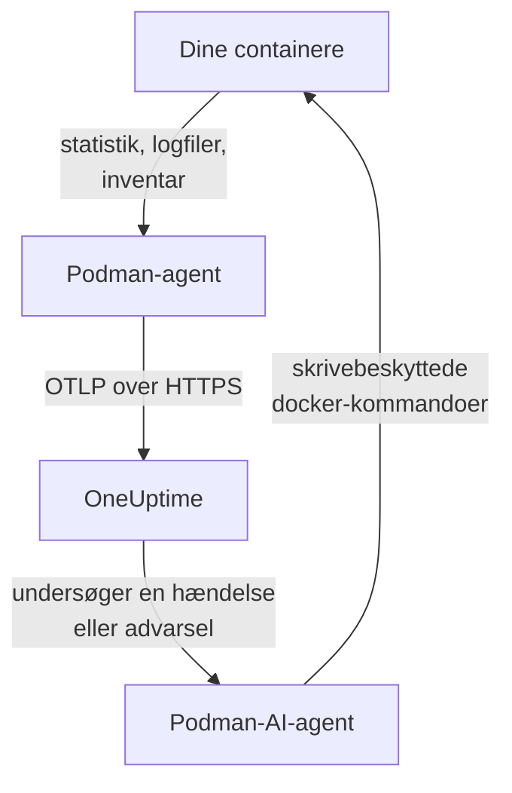

# Podman-agent

OneUptime Podman-agenten er én container, du kører på en Podman-vært. Den læser statistik og logfiler for hver container på værten og sender dem til OneUptime, hvor værten vises med sine containere, metrikker og logs. En anden container, Podman-AI-agenten, lader OneUptime AI undersøge værten. [Podman-monitorer](/docs/monitor/podman-monitor) advarer ud fra det, agenten sender.

:::cards
- [Installer agenten](#installer-agenten): To containere, med `podman run` eller Podman Compose.
- [Hvad agenten indsamler](#hvad-agenten-indsamler): Metrikker, logs og et inventar over hver container.
- [Containerlogs kræver k8s-file](#containerlogs-kræver-logdriveren-k8s-file): Podman logger til journald, medmindre du skifter.
- [Fejlfinding](#fejlfinding): Genstartsløkker, manglende metrikker, manglende logs.
:::

## Sådan virker det

Agenten er en OpenTelemetry Collector med OneUptimes konfiguration indbygget. Gennem Podmans Docker-kompatible API-socket læser den hver containers statistik hvert 30. sekund og lister hver container, hvert image, hvert netværk og hver volumen hvert 5. minut. Den følger containernes logfiler og sender alt til din OneUptime-URL over OTLP med den indtagelsesnøgle, du giver den.



Værten registrerer sig med sine første data under det navn, du giver den i `PODMAN_HOST_NAME`. AI-agenten er valgfri: udelad den, og collectoren virker på samme måde.

## Før du begynder

- Podman 4.0 eller nyere og root-adgang på værten.
- Podmans API-socket på `/run/podman/podman.sock`. Slå den til med `sudo systemctl enable --now podman.socket`.
- En indtagelsesnøgle. Opret en under **Projektindstillinger → Telemetri og APM → Indtagelsesnøgler**, og kopiér dens værdi.
- Udgående HTTPS fra værten til din OneUptime-URL.
- Til containerlogs: containere, der bruger logdriveren `k8s-file`. Rootful Podman logger som standard til `journald`, som agenten ikke kan læse. Se [Containerlogs kræver logdriveren k8s-file](#containerlogs-kræver-logdriveren-k8s-file).

## Installer agenten

:::steps
### Start agenten

Erstat `YOUR_ONEUPTIME_URL` med din OneUptime-URL, `YOUR_TELEMETRY_INGESTION_TOKEN` med indtagelsesnøglen og `my-podman-host` med et navn til denne vært, såsom `prod-podman-01`. Navnet er det, værten vises som i OneUptime, så hold det stabilt: et nyt navn registrerer en ny vært.

:::tabs
@tab Podman CLI
```bash
podman run -d \
  --name oneuptime-podman-agent \
  --user 0:0 \
  --restart unless-stopped \
  -v /run/podman/podman.sock:/run/podman/podman.sock:ro \
  -v /var/lib/containers/storage:/var/lib/containers/storage:ro \
  -e ONEUPTIME_URL="YOUR_ONEUPTIME_URL" \
  -e ONEUPTIME_SERVICE_TOKEN="YOUR_TELEMETRY_INGESTION_TOKEN" \
  -e PODMAN_HOST_NAME="my-podman-host" \
  oneuptime/podman-agent:release
```

Start derefter [AI-agenten](#ai-agent) ved siden af den, med de samme værdier. **AI-undersøgelser er slået til som standard**: mens OneUptime AI undersøger en hændelse eller advarsel på denne vært, kører den skrivebeskyttede `docker`-kommandoer gennem AI-agenten, mod Podmans Docker-kompatible API, og den ændrer intet, medmindre du tillader rettelser. For at installere uden AI-undersøgelser skal du springe denne kommando over.

```bash
podman run -d \
  --name oneuptime-podman-ai-agent \
  --user 0:0 \
  --restart unless-stopped \
  --read-only --tmpfs /tmp \
  -v /run/podman/podman.sock:/run/podman/podman.sock:ro \
  -e ONEUPTIME_URL="YOUR_ONEUPTIME_URL" \
  -e ONEUPTIME_SERVICE_TOKEN="YOUR_TELEMETRY_INGESTION_TOKEN" \
  -e ONEUPTIME_AI_AGENT_RESOURCE_TYPE=podman \
  -e PODMAN_HOST_NAME="my-podman-host" \
  oneuptime/resource-ai-agent:release
```
@tab Podman Compose
Gem dette som `docker-compose.yml` i en mappe på værten. Den anden tjeneste er [AI-agenten](#ai-agent): udelad den for at køre collectoren uden AI-undersøgelser.

```yaml title="docker-compose.yml"
services:
  oneuptime-podman-agent:
    image: oneuptime/podman-agent:release
    container_name: oneuptime-podman-agent
    user: "0:0"
    restart: unless-stopped
    volumes:
      - /run/podman/podman.sock:/run/podman/podman.sock:ro
      - /var/lib/containers/storage:/var/lib/containers/storage:ro
    environment:
      - ONEUPTIME_URL=YOUR_ONEUPTIME_URL
      - ONEUPTIME_SERVICE_TOKEN=YOUR_TELEMETRY_INGESTION_TOKEN
      - PODMAN_HOST_NAME=my-podman-host
    logging:
      driver: json-file
      options:
        max-size: "10m"
        max-file: "3"
  oneuptime-podman-ai-agent:
    image: oneuptime/resource-ai-agent:release
    container_name: oneuptime-podman-ai-agent
    user: "0:0"
    restart: unless-stopped
    read_only: true
    tmpfs:
      - /tmp
    volumes:
      - /run/podman/podman.sock:/run/podman/podman.sock:ro
    environment:
      - ONEUPTIME_URL=YOUR_ONEUPTIME_URL
      - ONEUPTIME_SERVICE_TOKEN=YOUR_TELEMETRY_INGESTION_TOKEN
      - ONEUPTIME_AI_AGENT_RESOURCE_TYPE=podman
      - PODMAN_HOST_NAME=my-podman-host
```

Start den i den mappe:

```bash
podman compose up -d
```
:::

### Kontrollér, at agenten kører

```bash
podman ps --filter name=oneuptime-podman-agent
podman logs -f oneuptime-podman-agent
```

Logs bør vise denne linje, når collectoren er startet:

```text
Everything is ready. Begin running and processing data.
```

### Find værten i OneUptime

Åbn **Produkter → Infrastruktur → Podman → Alle værter**. Værten vises under sit `PODMAN_HOST_NAME` inden for et minuts tid, med sine containere, metrikker og logs. AI-agenten vises som forbundet på værtens side **AI-agent** og nederst på dens **Oversigt**.
:::

## Miljøvariabler

| Variabel | Påkrævet | Beskrivelse |
| --- | --- | --- |
| `ONEUPTIME_URL` | Ja | Din OneUptime-URL, såsom `https://oneuptime.com` eller din selvhostede instans. Brug `http://` og dens port, hvis instansen kun bruger HTTP. |
| `ONEUPTIME_SERVICE_TOKEN` | Ja | Indtagelsesnøglen fra **Projektindstillinger → Telemetri og APM → Indtagelsesnøgler**. |
| `PODMAN_HOST_NAME` | Nej | Værtens navn i OneUptime. Standard er `podman-host`, så giv hver vært sit eget. |
| `DOCKER_API_VERSION` | Nej | Den Docker API-version, agenten taler med Podman-socketen. Standard er `1.44`. Sænk den, hvis socketen rapporterer et ældre maksimum, eller sæt den til en tom værdi for at forhandle den (se [Fejlfinding](#fejlfinding)). |

For at ændre en værdi skal du fjerne agenten og køre dens kommando igen (Podman CLI) eller redigere `docker-compose.yml` og køre `podman compose up -d` (Podman Compose).

## Hvad agenten indsamler

| Data | Hvad det er |
| --- | --- |
| Containermetrikker | CPU (forbrug, procent, throttling), hukommelse (forbrug, limit, procent), netværks- og blok-I/O, oppetid, genstarter og antal processer, pr. container, hvert 30. sekund. |
| Containerlogs | stdout og stderr fra hver container, fra filen `ctr.log`, som logdriveren `k8s-file` skriver. |
| Inventar | Hver container i enhver tilstand samt hvert image, netværk og volumen, hvert 5. minut. |

Hver containers metrikker og logs arkiveres under en tjeneste opkaldt efter containeren. Hver loglinje får en alvorlighed ud fra det niveau, den nævner, såsom `[ERROR]`, `level=warn` eller `{"level":"info"}`; en linje, der ikke nævner noget, får sin strøms: stderr er `ERROR`, stdout er `INFO`. Linjer, der starter med mellemrum eller en lukkende parentes, sættes sammen med linjen før, så en stack trace ankommer som én post. Agentens egne logs udelades.

[Podman-monitor](/docs/monitor/podman-monitor#indsamlede-metrikker) viser hver metrik, og hvad den betyder.

## Containerlogs kræver logdriveren k8s-file

Agenten følger `/var/lib/containers/storage/overlay-containers/*/userdata/ctr.log`, de filer, Podmans logdriver `k8s-file` skriver (`json-file` er den samme driver i Podman). Rootful Podmans standarddriver er `journald`, som ikke efterlader nogen fil at læse, og det samme gør en fjern driver såsom `syslog`. En sådan containers metrikker ankommer stadig; dens logs gør ikke.

Kontrollér en containers logdriver og Podmans standard:

```bash
podman inspect <container> --format '{{.HostConfig.LogConfig.Type}}'
podman info --format '{{.Host.LogDriver}}'
```

Kør en container med `k8s-file`, eller skift en Compose-tjeneste til den:

```bash
podman run --log-driver k8s-file --log-opt max-size=100m ... <image>
```

```yaml
services:
  my-app:
    image: my-app:latest
    logging:
      driver: "k8s-file"
      options:
        max-size: "100m"
```

Eller gør den til standard for hver container, der oprettes bagefter, i `containers.conf` (`/etc/containers/containers.conf` rootful, `~/.config/containers/containers.conf` rootless):

```toml title="containers.conf"
[containers]
log_driver = "k8s-file"
log_size_max = 104857600
```

Genopret derefter containerne. En container beholder den logdriver, den blev oprettet med, så det er ikke nok at genstarte den.

## Opgradering af agenten

Når agenten er ældre end din OneUptime, vises et advarselstegn ved siden af **Agentversion** på værtens **Oversigt**. Vælg det for at se disse kommandoer.

:::tabs
@tab Podman CLI
```bash
podman pull oneuptime/podman-agent:release
podman pull oneuptime/resource-ai-agent:release
podman rm -f oneuptime-podman-agent oneuptime-podman-ai-agent
```

Kør derefter begge `podman run`-kommandoer fra [Start agenten](#start-agenten) igen.
@tab Podman Compose
```bash
podman compose pull
podman compose up -d
```
:::

Tagget `release` peger altid på den nyeste udgivelse. For at fastlåse en version skal du bruge `oneuptime/podman-agent:<version>`, såsom `oneuptime/podman-agent:10.0.31`. Det samme image findes på GitHub Container Registry som `ghcr.io/oneuptime/podman-agent:release`.

## Afinstallation af agenten

:::tabs
@tab Podman CLI
```bash
podman rm -f oneuptime-podman-agent
podman rm -f oneuptime-podman-ai-agent
```
@tab Podman Compose
```bash
podman compose down
```
:::

Værten bliver i OneUptime med de data, den har sendt. Hvis du ikke længere har brug for den, så slet den med **Slet vært** i dens menu.

## AI-agent

Kommandoerne og Compose-filen ovenfor, Podman-agentens `install.sh` og `docker-compose.yml` i dens [PodmanAgent-mappe](https://github.com/OneUptime/oneuptime/tree/master/agents/PodmanAgent) kører alle **Podman-AI-agenten**: en anden container, `oneuptime-podman-ai-agent` (image `oneuptime/resource-ai-agent:release`), der kører de skrivebeskyttede kommandoer, som OneUptime AI beder om, mens den undersøger en hændelse eller advarsel på denne vært — gennem Podmans Docker-kompatible API, med `docker`-CLI'en: `docker ps -a`, `docker logs --tail 200 web`, `docker container inspect web` — og, kun hvis du tillader det, anvender rettelser såsom at genstarte en navngiven container. Den læser de samme `ONEUPTIME_URL`, `ONEUPTIME_SERVICE_TOKEN` og `PODMAN_HOST_NAME` som collectoren, så den betjener netop denne vært, og den vises på værtens side **AI-agent** i OneUptime.

- **AI-undersøgelser er slået til som standard.** Så snart agenten forbinder, undersøger OneUptime AI hændelser og advarsler på denne vært med den, og værtens **Oversigt** viser agentens status. For at stoppe skal du sætte `ONEUPTIME_AI_INVESTIGATION=false`, hvor agenten kører (**Skift** under **Hvad AI må gøre** på AI-agentens side viser hvordan), eller udelade agenten.
- Den er skrivebeskyttet, medmindre du starter den med `ONEUPTIME_AI_ALLOW_WRITES=true`; `ONEUPTIME_AI_WRITE_TARGETS` (for eksempel `web-*,api-*`) begrænser, hvilke containere en rettelse må røre. Start den også med `ONEUPTIME_AI_FIXES` for at angive, hvordan rettelser kører — `ask-for-approval` (en person godkender hver enkelt), `automatic` eller `bypass-approval` — og AI-agentens side viser det skrivebeskyttet ([Hvad AI må gøre, sat af agenten](/docs/ai/infrastructure-ai-agents#what-ai-may-do-set-by-the-agent)).
- Den kræver den samme socket som collectoren og kører som root med den monteret, fordi socketen ejes af root — og for rootful Podman er den, der kan bruge socketen, root på denne vært, `:ro` eller ej. Agentens kommandopolitik er grænsen: den kører aldrig `exec`, `run`, `rm` eller `prune`, og den ændrer aldrig sig selv, collectoren eller noget i `ONEUPTIME_AI_PROTECTED_TARGETS` (globs for containernavne).
- `install.sh --no-ai-agent` udelader den; `podman rm -f oneuptime-podman-ai-agent` fjerner den. Opgrader den som collectoren: `podman pull oneuptime/resource-ai-agent:release`, fjern den, og start den igen.

Hvad den må køre, hvordan rettelser virker, og hvordan du fejlsøger den: [Infrastructure AI Agents](/docs/ai/infrastructure-ai-agents#docker-and-podman-hosts).

## Fejlfinding

:::details Agenten genstarter med "client version is too new"
Agentens logs viser:

```text
Error: cannot start pipelines: failed to start "docker_stats" receiver:
Error response from daemon: client version 1.44 is too new.
Maximum supported API version is 1.41
```

En Docker-API-server, der håndhæver en maksimal klientversion, afviser en nyere, så receiveren starter aldrig, og collectoren afslutter med den. Kontrollér den API-version, Podman-socketen rapporterer:

```bash
curl -s -o /dev/null -D - --unix-socket /run/podman/podman.sock http://localhost/_ping | grep -i '^api-version'
```

Tilføj derefter `-e DOCKER_API_VERSION=1.41` (eller den værdi, du fik) til `podman run`, eller sæt `DOCKER_API_VERSION` i Compose. Nyere servere betjener stadig ældre API-versioner, så indstillingen forbliver gyldig efter en opgradering.

Vil du hellere ikke slå tallet op? Sæt `DOCKER_API_VERSION` til den tomme streng. Agenten forhandler så versionen med socketen (ét `HEAD /_ping`, derefter det maksimum, socketen rapporterer) i stedet for at fastlåse en:

```bash
podman run -d ... -e DOCKER_API_VERSION= ...
```
:::

:::details Adgang nægtet til Podman-socket, eller ingen socket
Agenten skal køre som root for at læse `/run/podman/podman.sock`. Kontrollér, at `--user 0:0` er i din `podman run`-kommando, eller `user: "0:0"` i Compose, og at socketen er slået til: `sudo systemctl enable --now podman.socket`. Rootless Podman har i stedet sin socket på `/run/user/<uid>/podman/podman.sock` (`systemctl --user enable --now podman.socket`): monter den sti i stedet for `/run/podman/podman.sock`.
:::

:::details Værten vises som afbrudt
1. Kontrollér, at agenten kører: `podman ps --filter name=oneuptime-podman-agent`
2. Kig efter fejl i dens logs: `podman logs oneuptime-podman-agent 2>&1 | grep -i error`
3. Kontrollér `ONEUPTIME_URL` og `ONEUPTIME_SERVICE_TOKEN`: nøglen skal være en gyldig indtagelsesnøgle, som ikke er deaktiveret.
4. Kontrollér, at værten kan nå din OneUptime-URL over netværket.
:::

:::details Der vises ingen metrikker
1. Kontrollér, at Podman-socketen er monteret i agenten. Dens image har ingen shell, så kig fra en midlertidig container, der deler dens monteringer: `podman run --rm --volumes-from oneuptime-podman-agent alpine:3.19 ls -la /run/podman/podman.sock`
2. Kig efter eksportfejl i dens logs: `podman logs oneuptime-podman-agent 2>&1 | tail -100`
3. Kontrollér, at indtagelsesnøglen er gyldig og ikke er udløbet.
:::

:::details Metrikker ankommer, men ingen containerlogs
Dine containere bruger højst sandsynligt `journald`, Podmans standardlogdriver. Kontrollér, hvilke filer agenten overvåger, og hvilken driver en container bruger:

```bash
podman logs oneuptime-podman-agent 2>&1 | grep -E "Started watching file|no files match"
podman inspect <container> --format '{{.HostConfig.LogConfig.Type}}'
```

Hvis agenten rapporterer `no files match the configured criteria`, så skift containerne til `k8s-file`, og genopret dem, som [Containerlogs kræver logdriveren k8s-file](#containerlogs-kræver-logdriveren-k8s-file) viser.
:::

:::details Logs ligger på en anden vært, eller værten hedder podman-host
Værtens navn kommer fra `PODMAN_HOST_NAME`. En agent, der startes uden det, rapporterer `podman-host`, så hver vært, der er sat op på den måde, ligner den samme; skifter du navnet senere, registrerer OneUptime en anden vært, som så indeholder de nye data. Sæt `PODMAN_HOST_NAME` til et navn for sig på hver vært, og genopret agenten. For at kontrollere det navn, agenten rapporterer:

```bash
podman inspect oneuptime-podman-agent --format '{{range .Config.Env}}{{println .}}{{end}}' | grep PODMAN_HOST_NAME
```
:::

## Næste trin

:::cards
- [Podman-monitor](/docs/monitor/podman-monitor): Advar ved containeres CPU, hukommelse og genstarter.
- [Databaser](/docs/telemetry/databases): Databasecontainere på værten findes og får deres egne sider.
- [Kubernetes-agent](/docs/telemetry/kubernetes-agent): Overvåg i stedet en Kubernetes-klynge.
- [OpenTelemetry-collector på værten](/docs/telemetry/host-otel-collector): Overvåg selve maskinen: CPU, diske, processer og logs.
:::
