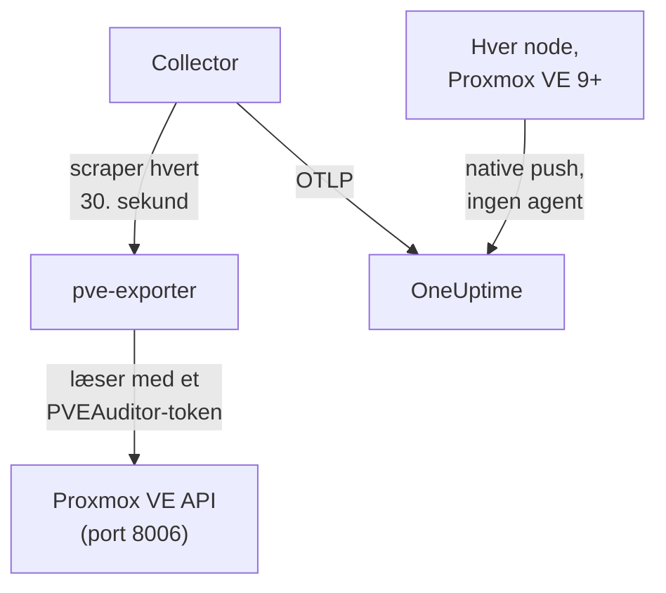

# Proxmox-agent

OneUptime Proxmox-agenten overvåger en Proxmox VE-klynge: dens noder, QEMU-VM'er, LXC-containere, lager, HA-tilstand, backupdækning og replikering. Den læser klyngen gennem Proxmox VE API'et med et skrivebeskyttet token og sender det, den finder, til OneUptime, hvor klyngen vises med sine noder, gæster og lager. På Proxmox VE 9 og nyere kan noderne også selv sende deres egne metrikker, uden noget at installere. [Proxmox-monitorer](/docs/monitor/proxmox-monitor) advarer ud fra det, der ankommer.

:::cards
- [Vælg, hvordan der forbindes](#vælg-hvordan-der-forbindes): Agenten eller Proxmox VE 9's eget push.
- [Installer agenten](#installer-agenten): Et API-token, derefter installationsscriptet eller Docker Compose.
- [Native push](#alternativ-uden-installation-native-opentelemetry-push-i-proxmox-ve-9): Proxmox VE 9 sender selv sine metrikker.
- [Fejlfinding](#fejlfinding): Et diagnosescript og de sædvanlige problemer.
:::

## Sådan virker det

Agenten er et sæt containere, du kører med Docker Compose på én maskine: [prometheus-pve-exporter](https://github.com/prometheus-pve/prometheus-pve-exporter) læser Proxmox VE API'et på port 8006, en OpenTelemetry Collector scraper exporteren hvert 30. sekund og stempler hver metrik med din klynges navn, og Proxmox-AI-agenten lader OneUptime AI læse klyngen, mens den undersøger. Proxmox VE 9's native push sender i stedet hver nodes metrikker direkte til OneUptime.



Klyngen registrerer sig med sine første data under det navn, agenten stempler på hver metrik som `proxmox.cluster.name`.

## Vælg, hvordan der forbindes

| | Agenten | Native push |
| --- | --- | --- |
| Proxmox VE | Enhver understøttet version | 9.0 eller nyere |
| Til installation | Docker Compose på én maskine | Intet: en metrikserver i Proxmox' webbrugerflade |
| Noder, gæster og lager | Ja | Ja |
| HA-tilstand, start ved boot, backupdækning og replikering | Ja | Nej |
| Proxmox-AI-agent | Ja | Nej |

Skabelonerne **HA Resource in Error State**, **Guest Down**, **Guest Not Backed Up** og **Replication Failing** kræver agenten. Brug det ene eller det andet til en klynge: at køre begge rapporterer hver ressource to gange.

## Før du begynder

- Docker Engine 20.10 eller nyere med pluginnet Docker Compose v2, på en maskine, der kan nå Proxmox VE API'et på port 8006.
- En root-shell på en hvilken som helst Proxmox VE-node eller Proxmox' webbrugerflade til at oprette et API-token.
- En indtagelsesnøgle. Opret en under **Projektindstillinger → Telemetri og APM → Indtagelsesnøgler**, og kopiér dens værdi.
- Udgående HTTPS fra den maskine til din OneUptime-URL.

### Hvor agenten skal køre

Agenten forespørger Proxmox VE API'et over netværket, så den behøver ikke at bo på en klyngenode, og det bør den ikke: kør den på en maskine, der overlever et nodenedbrud (en lille overvågnings-VM på separat hardware, en administrationsvært), eller peg `PVE_HOST` på en virtuel IP eller et round-robin-DNS-navn i stedet for én nodes adresse. Hvis agentens API-mål er den node, der lige er gået ned, går din overvågning ned med den. Den ene undtagelse er den valgfrie journald-logpipeline, som skal køre på en Proxmox VE-node (se [Send Proxmox' tjenestelogs](#valgfrit-send-proxmox-tjenestelogs)).

## Installer agenten

:::steps
### Opret et skrivebeskyttet API-token

Agenten læser klyngen med et API-token, der har rollen **PVEAuditor**, som kan læse og intet andet.

:::tabs
@tab Shell
Som root på en hvilken som helst Proxmox VE-node:

```bash
pveum user add monitoring@pam
pveum acl modify / --roles PVEAuditor --users monitoring@pam
pveum user token add monitoring@pam oneuptime --privsep 1
pveum acl modify / --roles PVEAuditor --tokens 'monitoring@pam!oneuptime'
```

Den første kommando fejler kun, og harmløst, hvis `monitoring@pam` allerede findes: API-tokens bærer deres eget secret, så brugeren behøver hverken adgangskode eller systemkonto. `pveum user token add` udskriver token-secretet én gang; token-id'et er `monitoring@pam!oneuptime`.
@tab Proxmox web UI
1. Gå til *Datacenter → Permissions → API Tokens*, og klik på **Add**.
2. Vælg (eller opret) en bruger, giv tokenet et ID som `oneuptime`, og lad **Privilege Separation** være markeret.
3. Kopiér token-id'et (`user@realm!tokenname`) og secretet: secretet vises kun én gang.
4. Under *Datacenter → Permissions* skal du tilføje rollen **PVEAuditor** på stien `/` to gange: én gang som en **API Token Permission** for tokenet og én gang som en **User Permission** for dets bruger.
:::

Rollen sættes på brugeren såvel som på tokenet, fordi et privilegieadskilt token kun får de tilladelser, som dets bruger også har. Den skal sidde på rodstien `/`, fordi exporteren læser hvert node-, gæste- og lagerobjekt: en smallere sti skjuler resten af klyngen og fejler med `401`/`403 Permission check failed (/, Sys.Audit)`.

### Installer og start agenten

:::tabs
@tab install.sh
Hent installationsscriptet, og kør det på den maskine, der skal være vært for agenten:

```bash
curl -sSL https://raw.githubusercontent.com/OneUptime/oneuptime/master/agents/ProxmoxAgent/install.sh -o install.sh
bash install.sh
```

Scriptet spørger efter din OneUptime-URL, indtagelsesnøglen, et navn til klyngen, Proxmox VE API-værten, om den medfølgende exporter skal køre, og token-id'et og secretet — og om [AI-agenten](#ai-agent) må anvende rettelser, og i så fald efter et token for sig og de gæster, den aldrig må ændre. Det installerer til `/opt/oneuptime-proxmox-agent`, skriver en `.env`-fil med `0600` og starter agenten med Docker Compose. Kører du scriptet igen, genbruger det alt i den `.env` i stedet for at spørge igen, og det er sådan, du [opgraderer agenten](#opgradering-af-agenten).
@tab Docker Compose
Hent `docker-compose.yml` og `otel-collector-config.yaml` fra [ProxmoxAgent-mappen](https://github.com/OneUptime/oneuptime/tree/master/agents/ProxmoxAgent) ind i en ny mappe:

```bash
mkdir oneuptime-proxmox-agent && cd oneuptime-proxmox-agent
curl -fsSLO https://raw.githubusercontent.com/OneUptime/oneuptime/master/agents/ProxmoxAgent/docker-compose.yml
curl -fsSLO https://raw.githubusercontent.com/OneUptime/oneuptime/master/agents/ProxmoxAgent/otel-collector-config.yaml
```

Opret en `.env`-fil ved siden af dem. Den indeholder token-secretet, så hold den privat med `chmod 600 .env`:

```bash title=".env"
ONEUPTIME_URL=YOUR_ONEUPTIME_URL
ONEUPTIME_TELEMETRY_INGESTION_KEY=YOUR_TELEMETRY_INGESTION_TOKEN
PROXMOX_CLUSTER_NAME=my-proxmox-cluster
PVE_HOST=192.168.1.10
PVE_API_TOKEN_ID=monitoring@pam!oneuptime
PVE_API_TOKEN_SECRET=your-token-secret
COMPOSE_PROFILES=pve-exporter
```

`COMPOSE_PROFILES=pve-exporter` starter også den medfølgende exporter. Start agenten:

```bash
docker compose up -d
```
:::

Kører du allerede prometheus-pve-exporter? Svar **n**, når scriptet spørger, om den medfølgende skal køre, eller fjern `COMPOSE_PROFILES` fra `.env`, og peg agenten på din (`host:port`, intet skema, en adresse, som agentens container kan nå: `localhost` er selve containeren). Behold `PVE_API_TOKEN_ID` og `PVE_API_TOKEN_SECRET`, hvis du bruger [AI-agenten](#ai-agent), som kalder API'et med det token:

```bash
PVE_EXPORTER_URL=your-exporter-host:9221
```

### Kontrollér, at agenten kører

```bash
docker compose ps
docker logs -f oneuptime-proxmox-agent
```

`docker compose ps` viser collectoren (`oneuptime-proxmox-agent`), den medfølgende exporter (`oneuptime-pve-exporter`, medmindre du bruger din egen) og AI-agenten (`oneuptime-proxmox-ai-agent`). Collectorens logs bør vise denne linje, når den er startet:

```text
Everything is ready. Begin running and processing data.
```

### Find klyngen i OneUptime

Åbn **Produkter → Infrastruktur → Proxmox → Alle klynger**. Klyngen vises under sit `PROXMOX_CLUSTER_NAME` omkring et minut efter det første scrape, med sine noder, gæster og lager.
:::

## Miljøvariabler

Installationsscriptet skriver disse til `/opt/oneuptime-proxmox-agent/.env`; en Docker Compose-installation læser dem fra `.env` ved siden af `docker-compose.yml`. Efter at have ændret en skal du køre `docker compose up -d` i den mappe.

| Variabel | Påkrævet | Beskrivelse |
| --- | --- | --- |
| `ONEUPTIME_URL` | Ja | Din OneUptime-URL, såsom `https://oneuptime.com` eller din selvhostede instans. Brug `http://` og dens port, hvis instansen kun bruger HTTP. |
| `ONEUPTIME_TELEMETRY_INGESTION_KEY` | Ja | Indtagelsesnøglen fra **Projektindstillinger → Telemetri og APM → Indtagelsesnøgler**. |
| `PROXMOX_CLUSTER_NAME` | Ja | Klyngens navn i OneUptime, stemplet på hver metrik som ressourceattributten `proxmox.cluster.name`. Hold det stabilt: at ændre det senere registrerer en anden klynge. Standard er `proxmox-cluster`. |
| `PVE_HOST` | Ja | Proxmox VE API-værten (en hvilken som helst node i klyngen), som exporteren og AI-agenten forespørger, såsom `192.168.1.10`. |
| `PVE_EXPORTER_URL` | Nej | Adressen (`host:port`, intet skema) på prometheus-pve-exporter. Standard er den medfølgende exporter, `pve-exporter:9221`. |
| `PVE_API_TOKEN_ID` | Medfølgende exporter eller AI-agent | Det fulde id for Proxmox-API-tokenet, såsom `monitoring@pam!oneuptime`. AI-agenten læser API'et med det, medmindre den har sit eget token (`ONEUPTIME_AI_PVE_API_TOKEN_ID` / `ONEUPTIME_AI_PVE_API_TOKEN_SECRET`). |
| `PVE_API_TOKEN_SECRET` | Medfølgende exporter eller AI-agent | Proxmox-API-tokenets secret. |
| `PVE_VERIFY_SSL` | Nej | Verificer Proxmox-API'ets TLS-certifikat (exporteren og AI-agenten). Standard er `false`, fordi Proxmox leveres med selvsignerede certifikater. |
| `COMPOSE_PROFILES` | Nej | Sæt til `pve-exporter` for at starte den medfølgende exporter-container. |

## Hvad agenten indsamler

Collectoren scraper exporteren hvert 30. sekund med både dens klynge- og node-collectors slået til, hvilket også dækker exporterens som standard aktive collectors `backup-info` (klyngeniveau) og `replication` (nodeniveau). Hver serie bærer en `id`-etiket, der navngiver ressourcen: `node/<name>`, `qemu/<vmid>`, `lxc/<vmid>` eller `storage/<node>/<storage>`.

| Kategori | Metrikker |
| --- | --- |
| Tilgængelighed | `pve_up`, `pve_uptime_seconds` |
| Node | `pve_node_info`, `pve_cpu_usage_ratio`, `pve_cpu_usage_limit`, `pve_memory_usage_bytes`, `pve_memory_size_bytes` |
| Gæst (VM eller LXC) | `pve_guest_info` og CPU-, hukommelses- og netværksserier på `qemu/*`- og `lxc/*`-id'er (`pve_network_receive_bytes`, `pve_network_transmit_bytes`) |
| Lager | `pve_disk_usage_bytes`, `pve_disk_size_bytes`, `pve_storage_info` |
| HA | `pve_ha_state` |
| Backupdækning | `pve_not_backed_up_total` (de gæster, intet backupjob dækker; én serie på klyngeniveau, ingen `id`-etiket) og `pve_not_backed_up_info` (én serie pr. udækket gæst, med dens `id`). Dækket betyder, at mindst ét job vælger gæsten: om backups kørte for nylig eller lykkedes, eksponeres ikke af exporteren. |
| Replikering | `pve_replication_failed_syncs`, `pve_replication_duration_seconds`, `pve_replication_last_sync_timestamp_seconds`, `pve_replication_last_try_timestamp_seconds`, `pve_replication_next_sync_timestamp_seconds`, `pve_replication_info`, pr. lagerreplikeringsjob. Deres `id`-etiket er jobbets id (såsom `100-0`), ikke en ressource. |

Monitorkriterier og attributfiltre matcher på lighed, ikke på et præfiks, så collectorens processor `transform/pve-identity` deler også `id` op i tre attributter. De indbyggede Proxmox-advarselsskabeloner filtrerer på dem, så behold processoren, hvis du tilpasser konfigurationen:

| Attribut | Værdier | For `qemu/100` |
| --- | --- | --- |
| `pve.scope` | `node`, `guest`, `storage`, `cluster` (`qemu` og `lxc` er begge `guest`) | `guest` |
| `pve.type` | `node`, `qemu`, `lxc`, `storage` | `qemu` |
| `pve.id` | Alt efter den første `/` i `id` (`pve1`, `100`, `pve1/local`) | `100` |

Den oprindelige `id`-etiket bevares, som den er.

## Valgfrit — Send Proxmox' tjenestelogs

Som standard sender agenten kun metrikker, så klyngens side **Protokoller** forbliver tom. Proxmox VE-tjenesterne logger til systemd-journalen under otte enheder: `pveproxy`, `pvedaemon`, `pve-firewall`, `pve-ha-crm`, `pve-ha-lrm`, `pvescheduler`, `pvestatd` og `qmeventd`. Den medfølgende `otel-collector-config.yaml` har en udkommenteret `journald`-receiver for netop de enheder, koblet til en udkommenteret `logs`-pipeline, der stempler `proxmox.cluster.name`, så logs lander på din klynge.

:::steps
### Kør agenten på en node

Journalen er pr. vært, så en fjern agent kan ikke læse den. Det er den ene opsætning, der går imod [Hvor agenten skal køre](#hvor-agenten-skal-køre): for at holde metrikagenten ude af klyngen skal du i stedet køre en anden collector, kun til logs, på noden (kopiér konfigurationen, og slet derefter receiveren `prometheus` og pipelinen `metrics`).

### Slå receiveren til

Fjern kommentarerne fra receiveren `journald` og pipelinen `logs` i `otel-collector-config.yaml` og fra journal-volumenerne i `docker-compose.yml`, så containeren kan læse værtens journal:

```yaml
- /var/log/journal:/var/log/journal:ro
- /etc/machine-id:/etc/machine-id:ro
```

### Skift collector-imaget

Standardimaget `otel/opentelemetry-collector-contrib` er bygget `FROM scratch`: det har ingen `journalctl`, som journald-receiveren kører, og kører som en bruger, der ikke kan læse journalen. Byg denne wrapper, og peg `image:` i `docker-compose.yml` på den:

```dockerfile title="Dockerfile"
FROM otel/opentelemetry-collector-contrib:0.161.0 AS otelcol
FROM debian:stable-slim
RUN apt-get update \
    && apt-get install -y --no-install-recommends systemd \
    && rm -rf /var/lib/apt/lists/*
COPY --from=otelcol /otelcol-contrib /otelcol-contrib
ENTRYPOINT ["/otelcol-contrib"]
CMD ["--config", "/etc/otelcol-contrib/config.yaml"]
```

Pakken `systemd` er der kun for `journalctl`'s skyld, og dette image kører som root, som er det, der kan læse journalen. Eller spring Docker over til logs, og kør `otelcol-contrib`-udgivelsens `.deb` på selve noden, hvor `journalctl` allerede findes.
:::

Hver node sender kun sin egen journal: for tjenestelogs fra alle noder skal du køre collectoren, kun til logs, på hver node.

### Alternativ uden et tilpasset image: filelog på /var/log/syslog

For at beholde standardimaget skal du i stedet følge syslog. Installer rsyslog på noden (`apt install rsyslog`; Debian 12 og Proxmox VE 8 og nyere leverer den ikke længere), monter mappen `/var/log` i containeren (`- /var/log:/var/log:ro`; mappen, ikke filen, så logrotation ikke fastholder en forældet fil), og brug en `filelog`-receiver i stedet for journald-receiveren:

```yaml
receivers:
  filelog:
    include:
      - /var/log/syslog
    start_at: end
```

Du mister filteret pr. enhed (syslog indeholder alt, ikke kun de otte tjenester), og standardimagets bruger skal kunne læse filen. Kobl den til den samme udkommenterede `logs`-pipeline (`receivers: [filelog]`).

## Alternativ uden installation: native OpenTelemetry-push i Proxmox VE 9+

Proxmox VE 9.0 og nyere leveres med en OpenTelemetry-metrikserver, der sender node-, gæste- og lagermetrikker til ethvert OTLP/HTTP-endpoint, uden agent eller exporter at installere. Gå i Proxmox' webbrugerflade til *Datacenter → Metric Server → Add → OpenTelemetry*, og udfyld:

| Felt | Værdi |
| --- | --- |
| Server | Din OneUptime-vært, såsom `oneuptime.com`, eller din selvhostede vært |
| Port | `443` |
| Protocol | `https` |
| Path | `/otlp/v1/metrics` |
| Headers | `{"x-oneuptime-token": "YOUR_TELEMETRY_INGESTION_TOKEN"}` |

Tilføj den én gang: hver node i klyngen sender sine egne metrikker. OneUptime genkender pushet og oversætter det til de samme `pve_*`-serier, som agenten sender, så:

- klyngen registrerer sig under dit Proxmox-klyngenavn (en enkeltstående node under sit nodenavn), og et `proxmox.cluster.name`, du sætter under *Resource Attributes*, bliver ved med at blive brugt i stedet;
- siderne Noder, Gæster og Lager, oversigtsgraferne, metrikkataloget og advarselsskabelonerne for CPU, hukommelse og lager virker, som de gør med agenten;
- de oprindelige serier `proxmox_node_*`, `proxmox_vm_*` og `proxmox_storage_*` bliver i [Metrics Explorer](/docs/monitor/metrics-monitor) for alt andet, Proxmox VE rapporterer (load average, swap, pressure stall, trafik pr. NIC).

### Når en node holder op med at rapportere

Hver node sender kun sin egen status, så en node, der går ned, kan ikke selv sige det. De noder, der stadig er i live, rapporterer det for den:

- Omkring 2 minutter efter sin seneste rapport vises noden som **Offline** på siden Noder. **Sidst set** på nodens egen side beholder tidspunktet for dens egen seneste rapport.
- Efter omkring 5 minutter udløses **Node Offline** for den. **Cluster Quorum at Risk** regner den også som offline; fordi den skabelon kræver et fuldt 5-minutters vindue af rapporter, udløses den omkring 7–9 minutter efter, at noden blev tavs.
- Med sin næste rapport er den **Online** igen, og dens advarsel lukkes.

Offline betyder her, at noden holdt op med at rapportere, ikke nødvendigvis, at den er nede. En node, der er oppe, men hvis `pvestatd` hænger eller er dræbt, hvis klyngefilsystem (`pmxcfs`) er nede, eller hvis netværk til OneUptime er afbrudt, rapporteres på samme måde.

Hvad det ikke kan dække:

- En enkeltstående vært eller en hel klynge, der bliver tavs på én gang: der er ingen tilbage til at rapportere det, så ingen advarsel pr. node udløses. Klyngen bliver i stedet **Afbrudt**, som når agenten stopper.
- En node, der er tavs i mere end 7 dage, rapporteres ikke længere: dens advarsel lukkes, og den forsvinder fra siden Noder. En selvhostet OneUptime ændrer de 7 dage med `PVE_SILENT_NODE_RETENTION_HOURS`.
- En node, du tager ud af klyngen, ser ud som en død. Brug **Remove Node** på dens side: den forsvinder, og dens advarsel lukkes. Ellers forbliver den Offline i op til 7 dage.
- Nodens gæster og lager: kun selve noden beholdes som Offline. Dens VM'er, containere og lager forsvinder fra deres sider omkring 15 minutter efter dens seneste rapport, og gæster, som HA genstarter på en anden node, kommer tilbage under den node.

Efter et udfald i OneUptimes indtagelse rapporteres en node, der nyligt er blevet tavs, først, når en af de andre har sendt igen i 2 minutter, så selve udfaldet aldrig alarmerer for hver node. En node, der allerede var Offline, forbliver Offline gennem et kort udfald og beholder sin advarsel; efter et udfald på mere end 5 minutter rapporteres den igen, når de andre har sendt i 2 minutter.

I [Metrics Explorer](/docs/monitor/metrics-monitor) er disse rapporter punkterne `pve_up` = 0 med etiketten `oneuptime.proxmox.inferred` = `not-reporting`, så du altid kan skelne dem fra det, en node sagde om sig selv.

### Hvad native push ikke kan

Native push sender kun det, hver node ved om sig selv, så en del af det, agenten indsamler, har ingen native modpart:

| Kræver agenten | Hvorfor |
| --- | --- |
| HA-tilstand | Sendes ikke: skabelonen **HA Resource in Error State** kræver agenten. |
| Flag for start ved boot | Sendes ikke: **Guest Down**, som kun alarmerer for gæster, der er sat til at starte ved boot, kræver agenten. |
| Backupdækning og replikering | Sendes ikke: **Guest Not Backed Up** og **Replication Failing** kræver agenten. |

Har du brug for dem, så kør agenten i stedet, og fjern metrikserveren: at køre begge rapporterer hver ressource to gange.

## Kør som en systemd-tjeneste

For at starte agenten sammen med maskinen og genstarte den, når den fejler, skal du installere dens systemd-enhed. Den antager, at agenten bor i `/opt/oneuptime-proxmox-agent`, hvor installationsscriptet lægger den:

```bash
sudo cp systemd/oneuptime-proxmox-agent.service /etc/systemd/system/
sudo systemctl daemon-reload
sudo systemctl enable --now oneuptime-proxmox-agent
```

## Opgradering af agenten

Agenten rapporterer den collector-version, dens filer fastlåser, som sin **Agentversion**. Når den er ældre end den version, denne OneUptime-udgivelse fastlåser, vises et advarselstegn ved siden af den på klyngens **Oversigt**. Vælg det for at se disse kommandoer. En agent, der blev installeret, før dens filer rapporterede en version, viser ingen, indtil den opgraderes på denne måde.

Collector-imaget er fastlåst i `docker-compose.yml`, og dens konfiguration er en fil ved siden af, så et pull alene flytter ikke agenten frem. Kør `install.sh` igen: det genbruger hver værdi i din eksisterende `.env` (der spørges ikke om noget igen), fornyer `docker-compose.yml` og `otel-collector-config.yaml` (en fil, du har redigeret, beholdes som `<file>.bak.<timestamp>`), henter imagene og genopretter agenten, så collectoren læser sin nye konfiguration.

```bash
curl -sSL https://raw.githubusercontent.com/OneUptime/oneuptime/master/agents/ProxmoxAgent/install.sh -o install.sh
bash install.sh
```

Installerede du den i stedet med Docker Compose? Hent begge filer igen i agentens mappe (og foretag igen eventuelle ændringer, du lavede i dem), hent derefter imagene, og genopret agenten:

```bash
curl -fsSLO https://raw.githubusercontent.com/OneUptime/oneuptime/master/agents/ProxmoxAgent/docker-compose.yml
curl -fsSLO https://raw.githubusercontent.com/OneUptime/oneuptime/master/agents/ProxmoxAgent/otel-collector-config.yaml
docker compose pull
docker compose up -d --force-recreate
```

## Afinstallation af agenten

```bash
cd /opt/oneuptime-proxmox-agent
docker compose down
```

Slet derefter API-tokenet under *Datacenter → Permissions → API Tokens*, hvis du ikke længere har brug for det.

## AI-agent

Agentens `docker-compose.yml` kører også **Proxmox-AI-agenten**, `oneuptime-proxmox-ai-agent` (image `oneuptime/resource-ai-agent:release`). Mens OneUptime AI undersøger en hændelse eller advarsel på denne klynge, kører den skrivebeskyttede `pvesh`-kommandoer gennem den — `pvesh get /cluster/status`, `pvesh get /nodes/pve1/qemu/101/status/current`, `pvesh get /nodes/pve1/tasks --errors 1 --limit 20` — og anvender, kun hvis du tillader det, rettelser såsom at starte eller genstarte en gæst. Der er ingen `pvesh`-binær i den: hver kommando bliver til præcis ét kald til Proxmox VE API'et på `PVE_HOST`, med et token fra den samme `.env`. Den registrerer sig som klyngen med navnet `PROXMOX_CLUSTER_NAME`, ligesom collectoren, og vises på klyngens side **AI-agent** i OneUptime.

- **AI-undersøgelser er slået til som standard.** Så snart agenten forbinder, undersøger OneUptime AI hændelser og advarsler på denne klynge med den, og klyngens **Oversigt** viser agentens status. For at stoppe skal du sætte `ONEUPTIME_AI_INVESTIGATION=false`, hvor agenten kører (**Skift** under **Hvad AI må gøre** på AI-agentens side viser hvordan), eller udelade agenten.
- API-tokenet er den hårde grænse. Undersøgelser bruger collectorens PVEAuditor-token (`PVE_API_TOKEN_ID` / `PVE_API_TOKEN_SECRET`), som kan læse og intet andet; kører du din egen exporter og har intet token i `.env`, så tilføj et. Rettelser kræver et token for AI-agenten selv, der må tænde og slukke gæster (`VM.PowerMgmt`, for eksempel rollen `PVEVMUser` på `/vms` eller på én pulje), sat som `ONEUPTIME_AI_PVE_API_TOKEN_ID` / `ONEUPTIME_AI_PVE_API_TOKEN_SECRET`.
- Den er skrivebeskyttet, medmindre du sætter `ONEUPTIME_AI_ALLOW_WRITES=true`; `ONEUPTIME_AI_WRITE_TARGETS` (VMID'er såsom `100,101` og `<node>/<service>` for nodetjenester) begrænser, hvad en rettelse må røre. Hvis agenten kører i en gæst i denne klynge, så sæt den gæsts VMID i `ONEUPTIME_AI_PROTECTED_TARGETS`. `ONEUPTIME_AI_FIXES` i den samme `.env` angiver, hvordan rettelser kører — `ask-for-approval` (en person godkender hver enkelt), `automatic` eller `bypass-approval` — og AI-agentens side viser det skrivebeskyttet ([Hvad AI må gøre, sat af agenten](/docs/ai/infrastructure-ai-agents#what-ai-may-do-set-by-the-agent)).
- Ligesom exporteren verificerer den ikke API'ets selvsignerede certifikat, medmindre du sætter `PVE_VERIFY_SSL=true` eller peger `PVE_CA_FILE` på klyngens CA (`/etc/pve/pve-root-ca.pem`, monteret i containeren).
- Den kører som UID 1000 uden capabilities og med et skrivebeskyttet rodfilsystem og læser aldrig `/access`, åbner aldrig en konsol og ændrer aldrig konfiguration. Slet tjenesten `oneuptime-proxmox-ai-agent` fra `docker-compose.yml`, hvis du ikke bruger OneUptime AI.

Hvad den må køre, hvordan rettelser virker, og hvordan du fejlsøger den: [Infrastructure AI Agents](/docs/ai/infrastructure-ai-agents#proxmox-clusters). Agentens README har de nøjagtige `pveum`-kommandoer til et token til rettelser.

## Fejlfinding

:::details Kør diagnosescriptet først
Agenten leveres med et script, [`troubleshoot.sh`](https://github.com/OneUptime/oneuptime/blob/master/agents/ProxmoxAgent/troubleshoot.sh), der kontrollerer hele kæden: container-runtimen, exporterens scrape, klyngenavnet stemplet på hver metrik, tokenets form, collectorens egne metrikker, og om OneUptime accepterer indtagelsesnøglen. Den sidste kontrol betyder mest. OneUptime afviser en forkert nøgle med `401` (`422` for en deaktiveret nøgle eller en browsernøgle), og collectoren behandler begge som permanente: den dropper batchen og logger én `Exporting failed`-fejl, som er let at overse, mens containeren forbliver sund. Scriptet spørger `GET <url>/otlp/v1/validate` inde fra agentens netværk efter et direkte `200` (gyldig) eller `401` (ugyldig) og falder tilbage til `POST /fluentd/v1/logs` på ældre servere.

```bash
curl -sSL https://raw.githubusercontent.com/OneUptime/oneuptime/master/agents/ProxmoxAgent/troubleshoot.sh -o troubleshoot.sh
bash troubleshoot.sh    # add -d <dir> if you installed outside /opt/oneuptime-proxmox-agent
```

Det slutter med en konklusion, der navngiver den mest sandsynlige årsag.
:::

:::details Der vises ingen klynge i OneUptime
1. Læs collectorens logs: `docker logs oneuptime-proxmox-agent`. En `401` ved eksport betyder en forkert indtagelsesnøgle; afvist forbindelse betyder en forkert `ONEUPTIME_URL`.
2. Kontrollér, at exporteren svarer. Den medfølgende exporter publicerer ikke sin port på værten, så spørg inde fra dens netværk: `docker run --rm --network container:oneuptime-pve-exporter curlimages/curl -s "http://localhost:9221/pve?target=YOUR_PVE_HOST" | head` bør udskrive `pve_*`-linjer. For din egen exporter skal du spørge dens `host:9221` direkte.
3. Kontrollér, at `PROXMOX_CLUSTER_NAME` er sat: klyngen findes ud fra dens ressourceattribut `proxmox.cluster.name`.
:::

:::details Exporteren returnerer 401- eller 595-fejl
API-tokenet er forkert eller mangler tilladelser. Kontrollér token-id'ets format (`user@realm!tokenname`), secretet, og at rollen **PVEAuditor** er på stien `/` for tokenet og for dets bruger. Exporterens egne logs viser API'ets svar: `docker logs oneuptime-pve-exporter`.
:::

:::details Kun nodemetrikker, ingen gæstemetrikker
Gæsteserier (`qemu/*`- og `lxc/*`-id'er) kommer fra exporterens klynge-collector, som den medfølgende konfiguration slår til med scrape-parameteren `cluster=1`. Hvis du har tilpasset `otel-collector-config.yaml`, så sæt parameteren `cluster: ["1"]` tilbage.
:::

:::details Metrikker lander under den forkerte klynge
OneUptime registrerer en Proxmox-klynge ud fra dens `proxmox.cluster.name`, som agenten tager fra `PROXMOX_CLUSTER_NAME`. At ændre det efter de første data opretter en anden klynge i stedet for at omdøbe den første.
:::

:::details Med native push vises en node som Offline
Den holdt op med at rapportere: en node, der er nede, en hængende `pvestatd`, en stoppet `pmxcfs` eller et afbrudt netværk til OneUptime ser ens ud. Dens næste rapport bringer den tilbage. Hvis du tog noden ud af klyngen, så brug **Remove Node** på dens side; ellers forbliver den Offline i op til 7 dage. Se [Når en node holder op med at rapportere](#når-en-node-holder-op-med-at-rapportere).
:::

:::details Med native push udløses Guest Down-, HA- eller backup-advarsler aldrig
Native push sender ikke HA-tilstand, start ved boot, backupdækning eller replikering. [Installer agenten](#installer-agenten) til dem, og fjern metrikserveren: at køre begge rapporterer hver ressource to gange.
:::

## Næste trin

:::cards
- [Proxmox-monitor](/docs/monitor/proxmox-monitor): Advar om noder, gæster, lager, HA, backups og replikering.
- [Ceph-agent](/docs/telemetry/ceph): Overvåg Ceph-lageret under din Proxmox-klynge.
- [Infrastructure AI Agents](/docs/ai/infrastructure-ai-agents): Hvad Proxmox-AI-agenten må køre, og hvordan rettelser virker.
- [OpenTelemetry-collector på værten](/docs/telemetry/host-otel-collector): Hver nodes visning på OS-niveau.
:::
